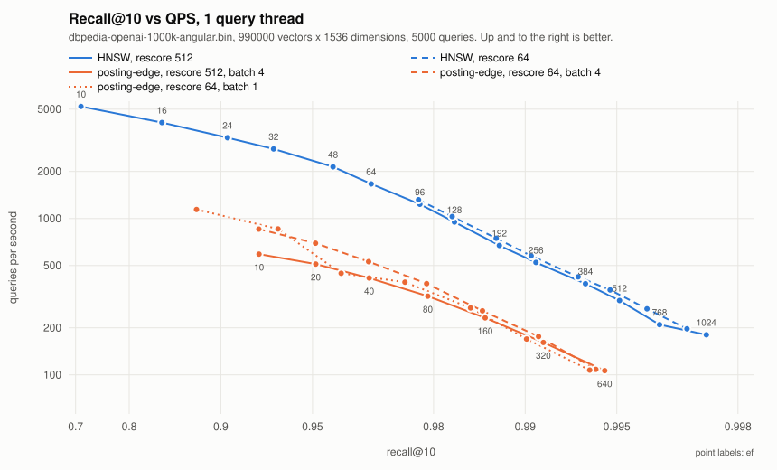
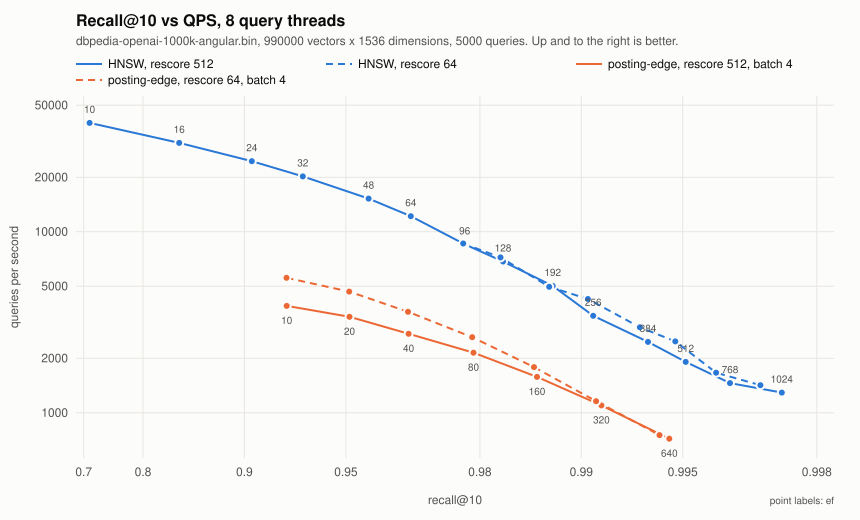

# Índice posting+edges en memoria (v1): benchmark end-to-end contra HNSW

**Fecha:** 2026-11-10 (v1 y v1.1) y 2026-11-11 (v1.2) · **Rama:** `feat/posting-edge-index` · **Paquete:** `adapters/repos/db/vector/postingedge` (nombre provisional)
**Dataset:** dbpedia-openai-1000k-angular (990 000 × 1536d, cosine, GT exacto top-100), el de las sims de `findings.md`
**Máquina:** Apple M1 Max (8P+2E), 64 GB, Go 1.27, GOMAXPROCS=10, escritorio en uso ligero en el v1 y el v1.1, en reposo y de noche en el v1.2

## Resumen de una página, al 2026-11-22

*Cada cifra sale de las secciones de abajo. El detalle está en «Resumen por versión», a continuación.*

**Qué es.** Un índice de postings de unos 236 vectores, con hasta 16 aristas por vector hacia otros postings. La búsqueda sigue esas aristas y ordena los postings con un código de 512 bits por vector, que vive en RAM (celda de ruteo) o en disco junto a las aristas (celda de halo).

**Lo medido.** HFresh va configurado como en un nodo.

| qué | cifra | escala |
|---|---|---|
| desde disco, en frío a 0.95 con 1 thread | 4.02 ms la celda de ruteo y 6.57 la de halo; HFresh 92.62: 23.0 y 14.1 veces | 10M, 768d |
| lo mismo, con HFresh leyendo de 8 en 8 | 35.62 ms: 8.86 y 5.42 veces. El pre-registro pedía 3 | 10M |
| en caliente a 0.95 | 1.17 y 1.82 ms frente a 17.16 | 10M |
| en frío a 0.99 | 16.21 y 31.43 ms; HFresh 595.74, o 176.00 de 8 en 8: llega, y le sale muy caro | 10M |
| RAM y disco | 859 MB y 33 GB la celda de ruteo; 138 MB y 38 GB la de halo; 415 MB y 39 GB HFresh. Con los centroides en RQ8 (26 de noviembre); en `float32` eran 956 y 236 MB | 10M |
| en memoria frente a HNSW | la mitad del heap; HNSW da 2.0 veces el QPS a 0.95 y empata a 0.99 | 10M, 768d |
| frente a HNSW con RQ de 1 bit y los vectores en disco, en frío a 0.95 | por defecto, HNSW tarda 7.71 ms, 1.9 veces la celda de ruteo; centrado, 3.2 a 4.1 ms, un empate, y a 0.99 unos 8 ms frente a 12.22. HNSW usa 4.8 GB de heap: 5.6 veces la celda de ruteo y 35 veces la de halo, con los centroides en RQ8 | 10M |
| inserts en disco | el índice crecido es el gemelo en memoria; reorganizado, 1.10 veces el lote en frío y 1.21 en caliente | 1M |
| velocidad de insert | 184 por segundo con un escritor, 663 con 8 búsquedas a la vez; HFresh, 2 089 | 1M |
| deletes, en memoria | 30 rondas de churn con el 90 % de la base renovado: −0.0011 de recall, +1.6 % de cargas | 1M |

**Lo verificado a escala, a 10M.**

- **El camino de lectura en disco,** frente a HFresh: en frío y en caliente, con 1 y 8 threads, a 0.95 y a 0.99, en dos rondas sin ninguna curva marcada. Y el de memoria, frente a HNSW.
- **Las cargas por query no crecen con el corpus:** 22.56 a 1M y 21.25 a 10M. Las lecturas de HFresh a 0.95 crecen un 65 %.
- **La ventaja aguanta con el rescore de la regla automática:** con 150 en vez de 64, 6.90 y 4.75 veces frente a HFresh de 8 en 8.
- **El build en lote:** 3 h 49 min, 2.9 veces el de HFresh.

**Lo que no.**

- **Nada del camino de escritura a 10M:** inserts, splits, reorganización, deletes y churn están medidos a 1M, y los deletes del prototipo solo en memoria.
- **Linux y x86.** Todo es un M1 Max: valen las comparaciones, no los números absolutos.
- **1536d a 10M en disco, 100M, filtros y HFresh con objetos de verdad.** El build en lote es el riesgo principal para 100M.
- **La regla del rescore por debajo de 768 bits:** falta un barrido con un dataset nativo de 384 o 512 dimensiones antes de publicar.
- **Sin explicar:** a 10M los dos índices llegan a 0.99 con menos rescore que a 1M.

**La integración** va en `feat/posting-edge-integration`. Según su sesión, sin verificar aquí: hito 1 y piezas 1 a 6 del hito 2 cerradas a 1M; la pieza 7, el modo `none`, escrita y sin cerrar.

**Decidido por el usuario el 22.**

- **El refresco de aristas al doblar, apagado por defecto** en el índice integrado: allí cumple su criterio, pero según su sesión no se nota y cuesta un 42 % más de búsqueda al escribir.
- **El rescore a 768 bits queda en 150, sin término de corpus.** A 10M, 64 es un 29 % más rápido en frío a 0.95, y 150 un 25 % más rápido a 0.99.

**Decisión abierta, del usuario.**

- **Formato en disco:** v5.3, o v5.4, que escribe un 31 % menos y empata en frío, pero es más lento en caliente con 8 threads y a 0.99 y no cumple dos de sus cuatro condiciones. *Mi recomendación:* v5.3.
- **Cuatro PR en borrador a main,** con fallos encontrados por el camino: weaviate/weaviate#13944, #13950, #13964 y #13983.

## Resumen por versión, al 2026-11-22

*El detalle del resumen de arriba, versión a versión. Cada cifra sale de las secciones de abajo. Con lo de la noche del 19 al 20 añadido el 20 por la mañana. Incluye la noche del 13 al 14 (v1.6: el kernel de #13880 en los dos brazos, el ef de centroides y una arista por posting de destino), el cambio del ef de centroides a 8 del 16, el streaming en memoria del 16 (v2.0), con el barrido del ef de inserción (v2.1), y el crecimiento desde el 10 % del 17 (v2.2), con su diagnóstico de aristas o partición el refresco de aristas por búsqueda (v2.3) y el refresco al doblar (v2.4), y el punto de operación del halo (v3.0) con su poda (v3.1), y el primer prototipo que lee de disco (v4.0) y los inserts en disco (v5.0), del 18, con su control de reorganización, del 19.*

**Titulares.** wiki-dpr e5, 768d. Ratio = QPS de HNSW (rescoreLimit 512) / QPS de posting-edge (rescoreLimit 200), a igual recall. Sin el kernel de #13880, los rangos de 10M son los dos builds de HNSW de v1.4. Con el kernel, son las dos rondas de un tercer build.

| | 1M | 10M |
|---|---|---|
| heap del índice | 165 MB, 0.49x de HNSW (335 MB) | 1 712 MB, 0.50x de HNSW (3 418 MB) |
| ratio a 0.95, 1 / 8 threads, sin el kernel | 1.53x / 1.26x | 2.10x–2.14x / 2.09x–2.20x |
| ratio a 0.95, 1 / 8 threads, con el kernel (v1.6) | sin medir | 2.01x–2.08x / 2.02x–2.04x |
| ratio a 0.99, 1 / 8 threads, sin el kernel | 0.77x / 0.62x: posting-edge por delante | 1.36x–1.72x / 1.34x–1.82x |
| ratio a 0.99, 1 / 8 threads, con el kernel (v1.6) | sin medir | 1.03x–1.05x / 1.02x–1.04x |
| gate de 0.99, subiendo solo ef | se cumple con rescoreLimit 200: 0.9904 a ef=160 | se cumple con rescoreLimit 200: 0.9909 a ef=160 |
| cobertura | completa: 0 vectores perdidos o repetidos | completa: 0 perdidos o repetidos; 9 999 de 10 000 se encuentran a sí mismos |

- **Los ratios de 10M llevan la variación entre builds de HNSW,** que es del orden de lo que se mide. El tercer build va de un 6 a un 13 % más rápido que los de v1.4 a 0.95, y necesita ef 394 para 0.99 donde uno de ellos necesitaba 256. Por eso, con el kernel, el ratio queda fuera de la banda pre-registrada (1.78x–2.01x), por encima, aunque posting-edge ganó lo estimado.
- **El ratio crece con N; las cargas no.** A 0.95, posting-edge carga 13.4 postings a 1M y 12.6 a 10M. Lo que crece son los endpoints: el grado sube de 9.7 a 11.4 aristas por vector, porque con S fijo caen menos vecinos en el posting propio.
- **dbpedia 1M (1536d):** 263.5 MB de índice frente a 420.1 de HNSW (v1). Ratio de 1.93x a 0.95 y 2.32x a 0.99 con 1 thread (v1.2).

**Defaults cerrados:**

- código completo y S=236 vectores por posting, fijado;
- ef 20, lotes de 4 postings por ronda y una entrada;
- ef de centroides 8 (antes 64): no pierde recall a 1M ni a 10M, y a 10M da de un 15 a un 22 % más de QPS a 0.95 (v1.6, cierre del 16);
- margen de source automático (0.06 en cosine);
- rescoreLimit 64 a 1536d; a 768d va acoplado, 200 (400 para 0.99);
- P=256 y R=64. A 10M hacen falta P=320 y R=256 para un recall de arista de 0.94.

Todo default pasa el gate de 0.99 subiendo solo ef.

**Opt-in.** El modo memoria es `CodeBits` 768, a 1536d: un 34 % menos de índice, a 0.74x del QPS a 0.95 y 0.90x a 0.99. Pide R=512, S=236 fijado y rescoreLimit 200 (400 para 0.99). El de 512 bits es un valor válido sin recomendación. A 768d no hay modo memoria que recomendar: 512 bits ahorra un 18 % a 0.70x–0.77x.

**Lo que murió, y por qué:**

- **Poda triangular por source (v1.1):** poda el 0.1 % de los sources en su mejor caso, frente al 20 % del gate.
- **Códigos capados como default (Fase B):** ninguno iguala el QPS a 0.95; el de 768 bits queda a 0.74x.
- **256 bits en memoria (Fase B):** el routing necesita los bits, y carga 3.0x postings a igual recall.
- **Celda desacoplada en memoria:** scan a 256 bits y routing completo. No llega a 0.99 y queda a 0.37x a 0.95, con más memoria. Pasa a disco como layout (c).
- **S mayor que 236 (Fase C):** el scan crece con S y los endpoints casi no bajan; ningún S domina.
- **FastScan en memoria:** pediría una segunda copia de los códigos, 992 MB a 10M. Pasa a disco, donde no cuesta.
- **Cap de grado (v1.5):** empata a 0.95 y pierde un 28 a 32 % a 0.99, porque las aristas que quita llevan recall.
- **Una arista por posting de destino (v1.6):** gana un 5.4 % a 0.95 con 8 threads, pero pierde un 4.4 % a 0.99, donde el umbral era un 2 %. No pierde destinos, pero los ordena peor: a 0.99 hace falta más ef, con un 28 % más de cargas.
- **El scan con los sketches en RAM (v4.1), y con él el modo `scan` de `rq.cacheMode`:** cambia una lectura de bloque por carga por 136 lecturas de rescore más por query, y en frío a 0.95 queda a 1.49 veces de la celda de ruteo en su mejor curva, con el límite en 1.20. Sin medir: 768 bits con un rescore por debajo de 200, y 768d.

**Palancas, por lo medido:**

1. **El ef de centroides (v1.6), ya default.** Bajarlo de 64 a 8 no pierde recall a 10M, ni a 1M en wiki-dpr y dbpedia (check del 16). Da de un 15 a un 22 % más de QPS a 0.95 y de un 6 a un 8 % a 0.99, porque el tiempo de centroides baja a un tercio. Con el kernel, el ratio queda en 1.67x–1.68x a 0.95 frente al build de HNSW de esa noche (informativo).
2. **El kernel de #13880 (v1.6).** Posting-edge gana lo estimado contra el mismo build: un 16 % a 0.95 y un 26 % a 0.99. El ratio baja menos de lo estimado, de 2.10x–2.14x a 2.01x–2.08x, porque el tercer build de HNSW es más rápido. El gate queda fuera de la banda, por encima.
3. **El número de distancias.** Ni el cap ni una arista por posting de destino lo recortan a igual recall a 0.99: lo que quitan vuelve como cargas. A 0.95, una por posting recorta un 9 % de las distancias y un 3.7 % de la query. A 0.99 las sube un 7 %. El cap las sube en los dos puntos.
4. **Contabilidad por endpoint:** el 15 % del tiempo a 0.95. Es ilustrativo.

**Mantenimiento por inserciones (v2.0, del 16).** dbpedia 1M, con el lote sobre el 50 % y el resto insertado, frente al lote del 100 %. En memoria.

- **Sin aristas inversas no aguanta.** Al doblar el corpus pierde 0.034 de recall a ef 10 y carga un 77 % más a 0.95. Con la misma representación, el QPS queda en 0.54x–0.64x a 0.95.
- **Con aristas inversas queda como el lote:** +0.0007 de recall en el peor ef y un 2.3 % más de cargas a 0.95, con 2 070 splits sin reparar.
  - Cada insert escribe 4.62 aristas inversas de media y 11 en el p95, en 3.28 postings distintos.
- **Reparar el split no las sustituye:** por búsqueda recupera el 60 % de lo perdido, y por hermanos, del 10 al 16 %.
- **Hermanos sobre aristas inversas mejoran al lote:** un 4 % menos de cargas a 0.95 y un 17 % menos a 0.99, con listas un 53 % más largas que las de H1.
- **Un insert cuesta su búsqueda:** unas 57 cargas de posting a ef 320, más que una query a 0.99.
- **El ef de inserción se puede bajar a 80 (v2.1):** un insert carga 21.9 postings en lugar de unos 57, escribe lo mismo, y el índice sigue dentro del criterio.
  - Lo paga la query de recall alto: frente a ef 320, un 4 % más de cargas a 0.95 y de un 16 a un 20 % más a 0.99.
  - La condición de 0.99 la cumple por 0.2 puntos, dentro del ruido. Con ef 160 son 34.6 cargas por insert, y cumple con margen.
  - Por debajo no hay dónde ir: ef 40 carga un 23 % más que el lote a 0.99, y con ef 20 el constructor baja de 0.90 de recall de arista.
  - Queda como parámetro del índice, sin repetir la celda (decisión del usuario del 17): 80 por la regla, y 160 si el objetivo de recall es 0.99.
- **La representación por docID cuesta un 15 % de QPS** con 8 threads, con los docIDs barajados.

**Crecer diez veces por inserciones (v2.2, del 17).** dbpedia 1M, con el lote sobre el 10 % y el 90 % insertado con aristas inversas y sin reparar splits, frente al lote del 100 %. En memoria.

- **A 0.99 no aguanta:** carga un 19.6 % más que el lote con ef de inserción 160 y un 17.9 % más con 80, donde el umbral es un 10 %. La celda de ef 80, repetida, carga un 32.0 % más.
  - El recall a igual ef sí cumple (−0.0027 y −0.0037 en el peor ef), y las cargas a 0.95 también (+6.3 y +9.2 %).
- **La deriva crece con el tramo insertado.** Frente a doblar el corpus con el mismo ef, a 0.99 son un 24 % más de cargas con ef 160 y un 7 % más con ef 80.
- **Subir el ef de inserción no lo arregla:** a 0.99 las dos celdas quedan en 63.1 y 62.2 cargas, dentro del ruido.
- **El grado de un vector queda fijado cuando entra:** 7.63 aristas en los del lote del 10 % y 9.47 en los del último tramo, frente a 8.98 de media en el lote del 100 %.
- **Lo que hace un insert depende del tamaño del corpus, no de la historia:** en el último tramo, 36.8 cargas con ef 160 y 23.1 con ef 80, y 4.8 escrituras inversas.
- **El build incremental hace menos trabajo que el lote:** 0.55 veces sus distancias por código con ef 160 y 0.39 con ef 80, y 0.10 veces las exactas, porque el 94 % de las del lote es la asignación n·k.
  - Un insert buscaba dos veces en el grafo de centroides con la misma query. La segunda, el 28 % de sus distancias exactas, está quitada desde el 17: en v2.3 un insert hace 324.5, donde hacía 438.6 y 448.3.
- **El déficit a 0.99 es de las aristas, no de la partición (diagnóstico del 17).** Con las aristas reconstruidas en lote sobre la partición que dejan los inserts, el índice carga un 0.8 % menos que el lote a 0.99, y su recall a igual ef queda por encima en todos los ef.
  - Lo que queda de la partición: un 3.0 % más de cargas a 0.95 y un 9 % más de aristas. El 17.3 % de los vectores no está en el posting de su centroide más cercano.
  - Las aristas que faltaban son las de los vectores viejos: los del lote del 10 % pasan de 7.63 a 10.26, y los del último tramo, de 9.44 a 9.57.
  - Lo siguiente es un refresco de aristas: el de v2.3, abajo. Reconstruirlas en lote cuesta 1.23 veces las distancias por código del lote entero.
- **Las cargas a 0.99 de un índice crecido no se repiten entre corridas:** las dos de ef 80 se separan un 12.0 %, con el recall a igual ef a 0.0010 como mucho. A 0.99 no separan los dos ef de inserción ni la deriva de ef 80.
  - **Regla de ruido (del usuario, del 17): ninguna comparación a 0.99 entre corridas distintas.** Vale desde v2.3, donde está escrita.

**Refresco de aristas con la búsqueda del insert (v2.3, del 17).** La celda de ef 80 de v2.2 y, al 100 %, cada vector repite el paso de aristas de su insert, en tres etapas por edad. Todo sobre un índice y en una corrida, frente al lote del 100 %. En memoria.

- **Sirve, por el criterio:** con todo refrescado, el índice carga un 6.3 % más que el lote a 0.99 (56.09 postings), donde el umbral es un 10 %. Antes del refresco cargaba un 22.7 % más.
  - El margen son 3.7 puntos, con un suelo de ruido del 3.0 % para esa medida. Sin repetir.
- **La parte de cada etapa en lo que bajan las cargas a 0.99:** el 22 % los del lote inicial, que son el 10 % de los vectores; el 44 % los que entraron del 10 al 40 %; y el 34 % el resto.
  - Por vector refrescado, los más viejos dan 3.8 veces lo que los más nuevos.
  - Con el 40 % más viejo refrescado queda en +11.9 %, a 1.9 puntos del umbral: por las cifras no llega, y no se separa de llegar.
- **El recall a igual ef queda en el del lote** (de +0.0001 a +0.0037), y las cargas a igual ef, donde estaban (de +4.5 a +7.2 %). Lo que queda a 0.99 es de la partición.
- **Un refresco cuesta lo que la búsqueda de un insert, y escribe poco:** 23.2 cargas de posting y 18 503 distancias por código por vector. Cambia el 85 % de las listas propias y escribe 0.21 aristas inversas, donde un insert escribe 4.53.
  - El refresco entero son 1.31 veces las distancias por código de las búsquedas de todos los inserts, y 0.29 veces las de reconstruir en lote.
- **La regla del lote da más, en la misma corrida:** con las aristas reconstruidas en lote después, un 5.9 % menos de cargas que el lote a 0.99. Sus listas tienen menos vecinos exactos que las del refresco (0.970 frente a 0.977) y buscan mejor. Mirado en v2.4, sin explicación todavía.

**Refresco al doblar, mientras el índice crece (v2.4, del 17).** La misma celda de ef 80. Cuando el corpus llega a 200 000, 400 000 y 800 000 vectores se refrescan los que tienen aristas de la mitad del corpus o menos: 700 000 refrescos, y ninguno al final. En memoria.

- **Cumple el criterio:** al 100 % carga un 7.8 % más que el lote a 0.99 (56.88 postings), donde el umbral es un 10 %. El margen son 2.2 puntos, dentro del suelo de ruido del 3.0 %. Sin repetir.
- **Cuesta un tercio menos que refrescar todo al final:** un 34 % menos de cargas de posting y un 38 % menos de distancias por código en los refrescos, y un 18.5 y un 20.9 % menos contando los inserts.
- **Entre tandas el índice se aleja.** Con las aristas reconstruidas en lote sobre la misma partición carga 47.89: el índice del 100 % está un 18.8 % por encima de esa referencia interna.
  - Un vector recién refrescado tiene el 98 % de sus aristas contra el corpus actual, y cuando el corpus dobla, el 68 %.
- **Grado por cohorte al final:** a los refrescados en la última tanda les faltan 0.22 aristas frente a la regla del lote, y a los que entraron entre 400 000 y 800 000, sin refrescar, 0.48.
- **Por qué la regla del lote da más (informativo): ninguna de las tres hipótesis se confirma.**
  - La diferencia se repite: 0.0008 más de recall a ef 160 y a ef 320 que con todo refrescado.
  - No son las escrituras inversas del refresco (refutada).
  - El refresco falla sobre todo donde su búsqueda para, y la regla del lote, fuera de sus 256 postings sondeados y no por el código (a medias).
  - Los fallos del refresco se inclinan hacia los postings con pocas aristas entrantes, el 27.3 % en la quinta parte más baja, sin llegar al umbral del 30 % (a medias).

**El halo: todo en disco, sin sidecar residente (v3.0, del 17).** dbpedia 1M en lote. Cada posting lleva un sketch de cada endpoint distinto de sus aristas, y la búsqueda ordena los postings con esos sketches en lugar de con el código completo del sidecar. Son conteos, sin ningún I/O.

- **Es viable, por el criterio:** las seis celdas (sketch de 256, 384 y 512 bits, con S = 236 y con S = 1024) llegan a 0.99 con rescoreLimit 64 y con 3× o menos las cargas de su referencia: de 1.43 a 2.85 veces.
- **Lo que cuesta está en los bytes.** Con todo en disco, una query de 0.99 lee 14.07 MB en el mejor punto (S = 236, 384 bits), 4.31 veces los 3.26 MB del modo con sidecar residente. A 0.95 son 3.33 MB frente a 0.63.
  - Más de la mitad de lo que lee es halo.
- **El halo pesa como el posting:** 1 318 endpoints distintos por posting de media y 2 557 en el p95. Con 256 bits son 58.0 KB junto a 57.6 KB de miembros y aristas.
- **El sketch de cada vector está escrito 5.58 veces.** A 1M el halo quita 198 MB de RAM y añade de 243 a 420 MB de disco.
- **S = 1024 no lo abarata:** menos cargas y más bytes, de 18.8 a 25.8 MB a 0.99.
- **Sin medir:** la parada con sketch y el mantenimiento del halo. La poda está en v3.1, abajo.

**Podar el halo (v3.1, del 17).** El build de S = 236 de v3.0, con sketches de 384 y de 512 bits: una arista por posting de destino, cap de grado 8, el margen de source en 0.04, 0.06 y 0.08, y todas sus combinaciones. Cada celda, frente a la de v3.0 medida en la misma corrida. Son conteos.

- **No sirve, por el criterio:** ninguna celda lee 2.46 MB o menos a 0.95, la cifra de la partición sin réplicas de HFresh. La mejor lee 2.75 MB (512 bits, las dos podas), un 16.7 % menos que su base y a 0.29 MB del listón. Las 22 celdas podadas llegan a 0.99.
- **A 0.99 baja hasta un 17.3 %,** de 14.02 a 11.60 MB con 512 bits, y hasta un 8.9 % con 384.
- **La poda devuelve parte como cargas.** Con las dos podas, cada carga pesa una cuarta parte menos, y hacen falta de un 4 a un 13 % más a 0.95 y de un 12 a un 22 % más a 0.99, con sus rondas.
- **El margen no mueve los bytes:** a igual recall quedan dentro de un ±3 % a 0.95. Cambia cuánto del halo puntúa la búsqueda, del 10 al 42 % de lo que lee, y no qué postings carga.
- **El disco baja una cuarta parte:** 437 MB con 384 bits y 493 MB con 512, donde eran 573 y 662.
- **Lo que falta:** en la mejor celda, 1.17 MB son miembros y aristas, y el listón deja 1.29 MB para un halo que lee 1.58.
- **Sin medir:** leer del halo solo lo que la búsqueda usa, y la parada con sketch.

**Primer prototipo que lee de disco (v4.0, del 18).** dbpedia 1M, S = 236. El índice se construye en lote, se escribe al store LSM de HFresh y se consulta desde ahí; al lado, el HFresh real de esta rama con su configuración por defecto y con la que menos lee para cada recall. Una sesión de día, de dos rondas, sobre un volumen APFS que se desmonta para el frío.

- **Los criterios 2 y 3 se cumplen, sin empates.** A 0.95, en frío y con 1 thread, la celda de 512 bits en RAM tarda 3.55 ms de p50, el halo 4.90 y HFresh 46.81. En caliente son 0.91, 1.27 y 3.47 ms.
- **A 0.99, HFresh llega y le sale muy caro:** 928 postings por query, 179 ms en frío donde la celda de 512 bits tarda 8.84 y el halo 14.16. En caliente, 16.33 ms frente a 3.22 y 4.87.
- **Parte de la diferencia en frío es cómo lee HFresh:** sus postings, uno detrás de otro. Posting-edge pide a la vez los bloques de una ronda. Lee además tres veces menos: 101 lecturas frente a 310 a 0.95.
  - **Medido el 19, con HFresh leyendo 8 postings a la vez:** baja de 46.80 a 14.28 ms en frío a 0.95. La celda de 512 bits tarda entonces 4.0 veces menos, y el halo 3.0. Con 8 threads HFresh no gana nada.
- **Con HFresh como lo corre un nodo (noche del 19 al 20), que son los números para enseñar:** su grafo de centroides limpio y el presupuesto del limitador de admisión, en una sesión con las dos celdas. En frío a 0.95 con 1 thread, 51.96 ms de HFresh frente a 3.54 de la celda de 512 bits y 4.76 del halo: 14.7 y 10.9 veces. En caliente, 3.40 ms frente a 0.90 y 1.26.
  - **HFresh sale en frío un 11 % más lento que con el arnés de v4.0:** con el grafo limpio pide searchProbe 214 en vez de 185 para 0.95.
  - **Ningún criterio cambia de signo.**
  - **Sus dos curvas marcadas por actividad se repitieron la noche del 20 y confirman la primera ronda,** a un 3.9 % como mucho. Los 14.7 y 10.9 no dependen de ellas.
- **El scan con los sketches en RAM (v4.1, del 20) no es una opción:** la mejor curva, 768 bits con rescore 200, queda en frío a 0.95 a 1.49 veces de la celda de 512 bits, con el límite en 1.20. Cambia una lectura de bloque por carga por 136 lecturas de rescore más. El presupuesto de un nodo no lo arregla: 1.46. Sus tres curvas marcadas se repitieron la noche del 20 y la lectura no cambia.
- **Cada celda devuelve desde disco lo mismo que en memoria,** y el store lee de 1.002 a 1.005 veces los bytes del modelo de v3.0.
- **RAM a 1M, heap tras abrir:** 145.8 MB con los códigos de 512 bits en RAM, 74.8 MB con todo en disco y 163.3 MB en HFresh. *Desglosado el 19: 40 MB de cada cifra son del arnés y del proceso, y el índice son 106.0, 35.0 y 123.0 MB. Los de HFresh llevan unos 50 MB de centroides borrados que el arnés no limpia y un nodo sí.*
- **Cinco de las ocho curvas quedaron marcadas,** cuatro por entrada de teclado o trackpad durante la primera ronda y tres por una mediana en caliente con 8 threads que se movió un 13 a un 15 % entre rondas. Se repitieron la noche del 18, y ningún veredicto cambia: las cifras de arriba son las de la repetición, a menos de un 3 % de las de la primera ronda.
- **Los números absolutos del Mac no valen para producción:** vale la comparación.
- **Sin medir:** inserts, refresco, deletes y splits en disco; Linux. El 10M en disco se midió el 22: es el bloque siguiente.

**10M en disco (del 21 y el 22).** wiki-dpr 10M, 768d, con el camino de lectura de v4.0: las dos celdas frente a HFresh como en un nodo, en su mejor configuración de cada recall, con sus postings uno a uno y de 8 en 8. Dos rondas, ninguna curva marcada.

- **Las dos condiciones pre-registradas se cumplen.** En frío a 0.95 con 1 thread, HFresh de 8 en 8 tarda 35.62 ms, la celda de ruteo 4.02 y la de halo 6.57: 8.86 y 5.42 veces, con el umbral en 3. Las cargas a 0.95 son 21.25 a 10M y 22.56 a 1M, con el umbral en un 15 % más.
- **Frente a HFresh con sus postings uno a uno, que es el producto:** 23.0 y 14.1 veces. En caliente, 17.16 ms frente a 1.17 y 1.82.
- **A 0.99 HFresh llega, y le sale muy caro:** 4 608 lecturas por query, 595.74 ms en frío en serie y 176.00 de 8 en 8, frente a 16.21 y 31.43.
- **Las celdas se cronometraron con rescore 64, no con 150:** a 10M, 64 ya llega a 0.99. Con 150, en una segunda sesión, 6.90 y 4.75 veces. A 10M, 64 es mejor a 0.95 y 150 a 0.99.
- **RAM y disco:** 956 MB y 33.25 GB la celda de ruteo, 236 MB y 38.25 GB la de halo, unos 415 MB y 39.28 GB HFresh.
- **El primer build de HFresh murió en su barrido,** probablemente por memoria, y se repitió con el barrido de searchProbe cortado en 4 096.
- **Sin medir:** el camino de escritura a 10M, 1536d a 10M y HFresh por encima de searchProbe 4 096.

**Inserts en disco (v5.0, del 18).** El camino de escritura de v2.x sobre el store de v4.0, con los códigos de ruteo de 512 bits en RAM: dbpedia 1M, del 10 al 100 % por inserts, T = 360, ef de inserción 160, aristas inversas, sin refresco ni deletes. Las aristas van en una fila Set de su posting, un valor por miembro.

- **El índice crecido en disco es el crecido en memoria,** insert a insert, con cobertura completa en cada checkpoint.
- **Criterio 1, no se cumple por medio punto:** una búsqueda lee 1.105 veces lo que el gemelo en memoria, con el límite en 1.10. El formato solo son 1.089; el resto es lo que la compactación de `lsmkv` deja. El algoritmo no pone nada.
- **Criterio 2, no se cumple:** en frío a 0.95, 5.23 ms frente a 3.67 de la celda en lote, 1.43 veces con el límite en 1.20. El índice crecido carga un 5.6 % más; lo demás es traer las filas de dos segmentos, valor a valor, y un rescore 1.3 veces más lento.
- **Control de reorganización (del 19): reorganizado, el mismo índice queda a 1.07 veces del lote en frío a 0.95,** dentro del 1.20. Es con su bucket de postings en un segmento y sus vectores en orden de posting. Con el segmento solo, 1.19. Falta la reorganización en segundo plano; el formato vale.
  - **En caliente sigue a 1.34 veces:** el store entrega las filas valor a valor, y reorganizar no lo toca.
  - **Con el bucket en un segmento el criterio 1 se cumple:** 1.089.
- **179 inserts por segundo con un escritor,** el 93 % en la búsqueda de aristas. Un insert entrega 1.35 KB al store, además de su vector.
  - **HFresh, con un escritor y sus 9 workers de fondo (del 20):** 2 089 por segundo, de 10.6 a 11.7 veces.
  - **Con las búsquedas de los inserts en paralelo (v5.2, del 20):** 634 por segundo con 8 buscadores, 3.76 veces el insert de siempre, sin perder calidad a igual ef. Su criterio pedía 4 veces: no sirve como se pre-registró. Ocho búsquedas a la vez tardan un 54 % más cada una.
    - **Repetido de noche y sin actividad (del 20 al 21):** 663 por segundo con 8 buscadores y 505 con 4, 3.60 y 2.74 veces los 184 del insert de siempre. El número limpio es 3.6 veces; el 3.76 llevaba un denominador medido con actividad.
- **Aristas consolidadas (v5.1, del 19 y el 20): no sirve, por su criterio.** La fila de aristas de un posting en un solo valor, escrita cada K cambios. En caliente cierra un 55 % de la distancia con el lote, 1.21 veces donde v5.0 queda a 1.45. En frío no mejora a v5.0: 1.41 a 1.47 veces el lote, sin que sepa todavía por qué. El control combinado, del 20, lo explica y lo mide reorganizado: su fila de aristas, sola en su bucket, es una lectura de disco aparte (6.15 page-ins por carga frente a 5.74 de v5.0). Reorganizado cumple en caliente, 1.20 veces el lote, y falla en frío por cuatro milésimas, 1.2045.
- **La fila de aristas en un valor, junto a los miembros (v5.3, del 20): es el formato candidato, reorganizado.** A 0.95 con 1 thread queda a 1.10 veces el lote en frío y a 1.21 en caliente, con los límites en 1.20 y 1.25: el frío de v5.0 reorganizado y el caliente de v5.1. Lo que cuesta es escribirlo: quitar la fila vieja de un Set es una lápida que lleva la fila entera, el store escribe 17.1 GB al crecer (9.4 en v5.0) y, entre compactaciones, una carga lee más del doble de lo que usa. Sin medir: otra forma de reescribir la fila.
- **La misma disposición sobre un bucket Map (v5.4, del 21): no sustituye a v5.3.** Cumple en frío y en caliente, 1.11 y 1.23 veces el lote, en empate con v5.3. No cumple lo escrito, 11.78 GB con el límite en 10, ni lo leído sin compactar, 1.57 veces lo que usa con el límite en 1.5. Frente a v5.3 escribe un 31 % menos. Lo que sobra ya no es la lápida: es que las filas comparten bucket con los miembros y se reescriben con ellos.
- **Deletes (v6.0, v6.1, v6.2 y v6.2b, del 19 y el 20), en memoria y en conteos.** Con la marca sola el índice aguanta el 10 % borrado. La limpieza en dos fases de v6.1 cumple con el 30 % en una pasada y fallaba en un churn. En v6.2, sustituir cada arista muerta por un vecino de la lista del borrado, elegido con una distancia entre dos códigos, cumple en el churn sin ninguna búsqueda: −0.0004 de recall, +2.7 % de cargas a 0.95 y +1.8 % a 0.99. En v6.2b aguanta treinta rondas, con el 90 % de la base renovado (−0.0011, +1.6 % y −1.3 % en la ronda 30), y entra con el 30 % borrado por regiones. Sin medir: todo en disco, donde cada pasada reescribe todos los postings.
- **Antes de compactar, la basura pesa un 34.5 % más de bytes por carga** y 1.75 veces las lecturas, con la política por niveles.
- **El store escribe de 7 a 17 veces lo que guarda,** con cualquiera de sus dos políticas.
- **Un bug de `lsmkv` encontrado por el camino:** su compactador de Set devolvía valores borrados. Arreglado aquí y en un PR a main, weaviate/weaviate#13950.
- **Sin medir:** una reorganización en segundo plano de verdad, el halo en este camino, el refresco, los deletes y Linux.

**Limitaciones:**

- **Build en lote:** `AddBatch` solo admite vectores antes de `Build`, que corre una vez; después devuelve `ErrBuilt`. El camino incremental de v2.0 vive en los tests, no en el índice.
- **Sin deletes ni updates:** `Delete`, y volver a añadir un id, devuelven `ErrNotSupported`.
- **Build de ~4x HNSW a 1M y ~8x a 10M:** unas 3 h 45 min frente a 27 min.
  - La asignación exacta es n·k, cuadrática en N con S fijo.
  - P y R crecen con N. Es el riesgo principal para 100M.
- **Solo medido en arm64,** en un M1 Max. x86 y sus kernels (AVX2, AVX-512) están sin medir.
- **El índice sigue siendo solo en memoria.** El formato en disco y su lector viven en los tests (v4.0): miden el camino de lectura, y nada escribe en disco de forma incremental. El diseño está en `disk-design.md`.

## El heap tras abrir, por componente, a 1M y a 10M (2026-11-26, sin cronometrar)

**Encargo del usuario:** el desglose del heap de los índices que ya existen, `filter1m` a 1M y `tenm` a 10M, en `none` y en `routing`, cuadrado con los 35 y los 236 MB medidos en `none`.

**Cómo:**
- Un perfil de heap con todas las asignaciones (`-test.memprofilerate=1`), tras abrir y recolectar, agrupado por quién asigna.
- Las celdas de v4.0 (`tenm` a 10M y `v40` a 1M, la de los 35 MB) se abren con `TestDiskTimed -bench.diskheap`, como se midieron. El arnés dice además el grafo de centroides por capas.
- `filter1m` se abre con `TestFilteredIndexHeap` (`bench_heap_test.go` de `feat/posting-edge-integration`), sin arnés.
- En MB decimales, como `HeapInuse / 1e6`.

| componente | `tenm` `none` (10M) | `tenm` `routing` | `filter1m` `routing` (1M) | `filter1m` `none` (calculado) | v4.0 `none` 1M (el de los 35) |
|---|---:|---:|---:|---:|---:|
| vectores de los centroides (`float32`, sin comprimir) | 131.2 | 131.2 | 50.0 | 50.0 | 25.9 |
| grafo HNSW de los centroides | 6.5 | 6.5 | 0.9 | 0.9 | 0.7 |
| docID → posting | 80.2 (con el slot) | 80.2 (con el slot) | 5.0 | 5.0 | 7.9 (con el slot) |
| docID → slot | — | — | 5.0 | 5.0 | — |
| docID → cuándo se hicieron sus aristas | — | — | 5.0 | 5.0 | — |
| vivos por docID y tamaño por posting | — | — | 1.3 | 1.3 | — |
| tombstones | 0 | 0 | 1.2 | 1.2 | 0 |
| códigos de ruteo | — | 720.0 | 89.1 | — | — |
| cambios de aristas pendientes de consolidar | — | — | 25.2 | 25.2 | — |
| `lsmkv`: bloom, memtables e índices de segmento | 0.2 | 0.2 | 10.7 | 10.7 | 0.0 |
| resto, cada parte por debajo de 1 MB | 0.2 | 0.1 | 0.5 | 0.5 | 0.2 |
| **el índice** | **218.3** | **938.2** | **193.9** | **≈ 104.8** | **34.7** |
| arnés: queries y manifiesto | 3.3 | 3.3 | 0 | — | 31.7 |
| asignado fuera del perfil | 5.5 | 5.6 | 5.4 | — | 5.6 |
| hueco libre en spans en uso | 9.2 | 9.4 | 16.8 | — | 2.7 |
| **heap en uso medido** | **236.3** | **956.4** | **216.1** | — | **74.7** |

- **Los 236 MB se reproducen (236.3) y cuadran.** Quedan 14.7 MB sin componente: 5.5 asignados fuera del perfil, que son unos 5.5 fijos en cada proceso, y 9.2 de hueco libre en spans.
- **Los 35 MB cuadran.** El mismo índice da hoy 34.7 MB, 0.3 menos. Los 8.3 de entonces sin atribuir son los 5.6 + 2.7 de hoy.
- **Centroides:** en `float32` sin comprimir, no en RQ8, y una sola copia. Son el 60 % del índice en `none` a 10M.
  - La caché del grafo solo reserva los huecos al abrir (1.2 MB a 10M) y no copia vectores. Bajo búsquedas no lo he medido.
- **El grafo de centroides:**
  - **a 10M:** 42 373 nodos (41 073 solo en la capa 0, 1 261 hasta la 1, 38 hasta la 2 y 1 en la 3), sin compresión: 3.1 MB de nodos, 2.1 de conexiones y 1.2 de caché;
  - **en `filter1m`:** 4 239 nodos y 165 tombstones.
- **`filter1m` en `none` no abre, y está bien:** se creció en `routing` y sus postings no llevan halo. Su columna es la de `routing` menos los códigos.
- **`filter1m` en `none` no es comparable con los 35:** es un índice crecido, y aquel se construyó de una vez. Lo que lleva de más:
  - 24.8 MB de centroides retirados: 8 105 posting ids dados, 4 074 vivos;
  - 25.2 de aristas pendientes de consolidar;
  - 10.5 de bloom de sus buckets en el store del shard;
  - 5.0 del mapa de cuándo se hicieron las aristas;
  - 2.5 de vivos y tombstones;
  - unos 2 de que los mapas por docID cubren 1.24 M ids, no los 990 000 vivos.

**Después:** el usuario pidió que los centroides retirados se liberen (`4470f2cd1a` en `feat/posting-edge-integration-m2`) y los centroides en RQ8 (abajo).

### La misma tabla con los centroides retirados liberados y en RQ8 (26 de noviembre, sin cronometrar)

*El mismo método.*
- Las celdas de v4.0 se abren de los clones APFS que convirtió la medida del RQ8, con `TestDiskTimed -bench.diskcentroidcodes`.
- `filter1m` se abre de un clon propio. La primera apertura convierte el clon; la tabla es la segunda.
- Todo con el código de `feat/posting-edge-integration` tras la fusión de `m2` (`93442ad5ac`).

| componente | `tenm` `none` (10M) | `tenm` `routing` | `filter1m` `routing` (1M) | `filter1m` `none` (calculado) | v4.0 `none` 1M |
|---|---:|---:|---:|---:|---:|
| centroides: códigos RQ8 y su caché | 34.7 (era 131.2 en `float32`) | 34.7 | 7.0 (era 50.0) | 7.0 | 6.8 (era 25.9) |
| grafo HNSW de los centroides | 5.3 | 5.3 | 0.7 | 0.7 | 0.6 |
| docID → posting | 80.2 (con el slot) | 80.2 (con el slot) | 5.0 | 5.0 | 7.9 (con el slot) |
| docID → slot, y cuándo se hicieron sus aristas | — | — | 9.9 | 9.9 | — |
| vivos por docID, tamaño por posting y tombstones | — | — | 2.5 | 2.5 | — |
| códigos de ruteo | — | 720.0 | 89.1 | — | — |
| cambios de aristas pendientes de consolidar | — | — | 25.2 | 25.2 | — |
| `lsmkv` | 0.2 | 0.2 | 10.6 | 10.6 | 0.0 |
| resto, cada parte por debajo de 1 MB | 0.2 | 0.1 | 0.7 | 0.7 | 0.5 |
| **el índice** | **120.6** | **840.6** | **150.9** | **≈ 61.8** | **15.8** |
| arnés: queries y manifiesto | 3.3 | 3.3 | 0 | — | 31.7 |
| asignado fuera del perfil, y hueco libre en spans | 14.2 | 15.2 | 22.4 | — | 7.9 |
| **heap en uso medido** | **138.1** (era 236.3) | **859.0** (era 956.4) | **173.3** (era 216.1) | — | **55.4** (era 74.7) |

- **Los centroides pasan a la cuarta parte:** 34.7 MB a 10M en lugar de 131.2; 6.8 a 1M en lugar de 25.9. Los códigos son de unos 784 B a 768 dimensiones y 1 552 a 1 536, y lo demás es su caché.
- **En `filter1m` caen además los retirados:** 7.0 MB para los 4 239 nodos del grafo (4 074 vivos y 165 tombstones), donde antes había 50.0 MB para los 8 105 posting ids dados.
- **Lo que queda en `none` a 10M:** el mapa de docID a posting y slot, 80.2 de 120.6 MB, dos tercios del índice.

### La memoria de un índice crecido por inserts, a 10M (estimada, 2026-11-26)

*Estimado, no medido. Las celdas de 10M se construyeron de una vez. Lo que solo tiene un índice crecido sale del desglose de `filter1m`, crecido a 1M por inserts en un shard (tabla de arriba), y del código de `feat/posting-edge-integration-m2` (`d5d5c99468`).*

**De qué depende cada componente que solo tiene el índice crecido:**

| componente | a 1M (`filter1m`) | de qué depende | tope |
|---|---:|---|---|
| cambios de aristas pendientes de consolidar | 25.2 | postings vivos × lo que espera en cada uno: hasta 64 cambios por posting (`DefaultConsolidate`), unos 6.2 KB de media | por posting sí (64 cambios); en total, **ninguno**: crece con los postings |
| `lsmkv`: bloom e índices de segmento | 10.5 | claves en los segmentos de los buckets por docID, versiones viejas incluidas hasta que se compactan | ninguno propio; lo acota la compactación. Las memtables, mientras se escribe, hasta su límite por bucket |
| docID → slot | 5.0 | 4 B × `keys` | ninguno |
| docID → cuándo se hicieron sus aristas | 5.0 | 4 B × `keys` | ninguno; solo lo lee el refresco, apagado por defecto, y se carga siempre |
| vivos por docID | 1.3, con los tamaños | 1 B × `keys` | ninguno |
| tamaño por posting y retirados | (arriba) | 5 B × posting ids dados, unas dos veces los vivos | ninguno |
| tombstones (marcas por docID) | 1.2 | 1 B × `keys`, haya borrados o no | ninguno |

- **`keys` no es el número de vivos:** es 1.25 veces el mayor doc id que el índice ha visto (`keysFor`). Un shard da un doc id nuevo en cada update, así que con updates crecen los doc ids y no los vivos. Las tablas por docID cuestan 14 B por doc id dado, más la holgura del 25 %, y nunca encogen.
- **Postings vivos a 10M crecido:** unos 42 000, como el lote. A 1M el índice crecido tiene 243 vectores por posting y el lote 236.

**La fila a 10M (MB, heap del índice; el crecido, estimado con 10M doc ids, `keys` = 12.5 M):**

| componente | `none` lote | `none` crecido (estimado) | `routing` lote | `routing` crecido (estimado) |
|---|---:|---:|---:|---:|
| centroides RQ8 y su caché | 34.7 | ≈ 35 | 34.7 | ≈ 35 |
| grafo de los centroides | 5.3 | ≈ 5.3, más sus tombstones hasta la limpieza | 5.3 | ≈ 5.3 |
| docID → posting | 80.2 (con el slot) | 50 | 80.2 (con el slot) | 50 |
| docID → slot | (en la fila de arriba) | 50 | (en la fila de arriba) | 50 |
| docID → cuándo se hicieron sus aristas | — | 50 | — | 50 |
| vivos, tamaños y retirados | — | ≈ 13 | — | ≈ 13 |
| tombstones | 0 | 12.5 | 0 | 12.5 |
| cambios de aristas pendientes | — | ≈ 260 | — | ≈ 260 |
| `lsmkv` | 0.2 | ≈ 105 (10 veces el de 1M) | 0.2 | ≈ 105 |
| códigos de ruteo | — | — | 720.0 | 720 |
| resto | 0.2 | ≈ 2 | 0.1 | ≈ 2 |
| **el índice** | **120.6** | **≈ 580** | **840.6** | **≈ 1 300** |

- **Lo que más pesa en el crecido son los cambios pendientes**, unos 260 MB, y crecen con los postings.
- **El bloom se escala a ojo.** Depende de cuántas versiones de cada clave haya en los segmentos sin compactar, que a 10M no he medido.
- **El lote es más pequeño por construcción:** no tiene pendientes, ni bloom de un store de shard (el arnés abre sus buckets sin bloom), ni las tablas que solo usan los inserts.

**Un tope para los cambios pendientes (propuesta, *mía*).** Un presupuesto global de bytes: al pasarlo, el índice consolida el posting que más tiene esperando (escribe su fila de aristas) antes de llegar a sus 64 cambios.
- **El coste es en escrituras de filas de aristas.** Una fila es de unos 31 KB (243 miembros × 16 aristas × 8 B, estimado). Hoy se escribe cada 64 cambios: unos 485 B por cambio.
- **Con presupuesto B y P postings,** cada posting espera de media B/P bytes, unos 2B/(P × 194 B) cambios. A 10M, con P = 42 000:

| presupuesto | cambios por fila | escritura de filas por cambio | frente a hoy |
|---|---:|---:|---:|
| sin tope (hoy, ≈ 260 MB) | 64 | ≈ 485 B | 1× |
| 128 MB | ≈ 31 | ≈ 1.0 KB | ≈ 2.1× |
| 64 MB | ≈ 16 | ≈ 2.0 KB | ≈ 4.1× |
| 32 MB | ≈ 8 | ≈ 3.9 KB | ≈ 8× |

- Un insert toca su posting y, por las aristas inversas, unos cuantos más. Cada uno es un cambio de la tabla.
- **Propongo 64 MB** (*mío*): a 10M quita unos 200 MB y cuadruplica las escrituras de filas, que son una parte de las de un insert. A 1M, con 4 000 postings, apenas se notaría.
- **Y no cargar la tabla de cuándo se hicieron las aristas mientras el refresco esté apagado:** son 50 MB a 10M.
- **Con las dos cosas,** el crecido quedaría en unos 330 MB en `none` y unos 1 050 en `routing`.
- No está medido. Antes de decidir habría que crecer 10M en un shard y medir, como `filter1m` a 1M.

### Las dos propuestas, aplicadas y medidas (2026-11-26)

**Aplicadas en `feat/posting-edge-integration-m2` (`67fc89114c`), por decisión del usuario:**
- **Tope de 64 MB de heap a lo que espera de las aristas.** Al pasarlo, se escriben las filas de los postings con más esperando, hasta bajar al 90 % del tope.
  - El heap se estima: 112 B por cambio y 150 B por posting, además de las aristas y sus distancias.
  - Medido con 4 000 postings de 8 a 48 cambios de 16 aristas, el error es menor del 11 %.
- **Sin la tabla de cuándo se hicieron las aristas mientras el refresco esté apagado.** El fichero se sigue escribiendo, y un índice abierto con el refresco lo lee entero.
- **Tests:**
  - el tope se cumple insert a insert, el índice sigue siendo su gemelo y responde lo mismo que sin tope;
  - la tabla leída del fichero es la que guarda un gemelo en memoria;
  - un tope que no hace nada, una tabla que se guarda igualmente y un fichero que no se escribe fallan, cada uno, en algún test.

**Las escrituras de más, medidas.**
- **Montaje:** un índice como el de un shard (por defecto, coseno, 768 dimensiones, vectores latentes de 8 dimensiones), crecido por inserts de la base de 10 000 hasta 60 000, sin cronometrar.
- **El tope, escalado a esta escala:** se da por posting vivo. 64 MB entre los ~42 000 postings de 10M son unos 1 600 B por posting.
- **Datos:** `testdata/bench/pending-budget/`.

| tope por posting (su equivalente a 10M) | filas escritas por insert | frente a sin tope | distancias por insert | heap esperando al final | tiempo de crecer |
|---|---:|---:|---:|---:|---:|
| sin tope | 1 507 B | 1× | 301 B | 1.33 MB (5.7 KB por posting) | 106 s |
| 800 B (32 MB) | 6 641 B | 4.41× | 335 B | 178 KB | 239 s |
| 1 600 B (64 MB) | 3 426 B | 2.27× | 324 B | 357 KB | 151 s |
| 3 200 B (128 MB) | 1 907 B | 1.27× | 310 B | 688 KB | 112 s |

- **Con 64 MB las filas de aristas se escriben 2.27 veces,** menos de las 4.1 que estimé. Por insert son 1.9 KB más de filas; las distancias apenas cambian (+7 %), y el log de lo que espera (unos 700 B por insert) no cambia.
- **El tiempo de crecer subió un 42 % con 64 MB.** Es una sola pasada, en una máquina con otras aplicaciones, y la medida no estaba pre-registrada: lo doy como señal, no como dato.
- **Con 128 MB el coste baja a 1.27× en filas y a +6 % en tiempo,** a cambio de 64 MB más de heap. Si el tiempo de insert se confirma, es la alternativa (*mía*).

**La fila de 10M crecido, estimada de nuevo:**

| componente | `none` antes | `none` ahora | `routing` antes | `routing` ahora | fiable |
|---|---:|---:|---:|---:|---|
| centroides RQ8 y su caché | ≈ 35 | ≈ 35 | ≈ 35 | ≈ 35 | sí: medido en el lote de 10M, con los mismos postings por vector |
| grafo de los centroides | ≈ 5.3 | ≈ 5.3 | ≈ 5.3 | ≈ 5.3 | sí |
| docID → posting | 50 | 50 | 50 | 50 | sí, con 10M doc ids dados |
| docID → slot | 50 | 50 | 50 | 50 | sí, igual |
| docID → cuándo se hicieron sus aristas | 50 | 0 | 50 | 0 | sí |
| vivos, tamaños y retirados | ≈ 13 | ≈ 13 | ≈ 13 | ≈ 13 | sí |
| tombstones | 12.5 | 12.5 | 12.5 | 12.5 | sí |
| cambios de aristas pendientes | ≈ 260 | ≤ 64 | ≈ 260 | ≤ 64 | sí: el tope, y la estimación del heap a menos del 11 % |
| `lsmkv` | ≈ 105 | ≈ 105 | ≈ 105 | ≈ 105 | **no**: 10 veces el de 1M, sin saber cómo quedan los segmentos a 10M |
| códigos de ruteo | — | — | 720 | 720 | sí |
| resto | ≈ 2 | ≈ 2 | ≈ 2 | ≈ 2 | — |
| **el índice** | **≈ 580** | **≈ 337** | **≈ 1 300** | **≈ 1 057** | |

**Lo que no es fiable, y la medida que lo resolvería (propuesta, *mía*):**
- **No fiables:**
  - el bloom y los índices de segmento de `lsmkv` (unos 105 MB, un tercio de `none`);
  - cuántos postings tiene un índice crecido de 10M;
  - las tablas por docID, que suponen 10M doc ids dados. Con updates son más, y no encogen.
- **Una noche:** crecer 10M de wiki-dpr por inserts, de una base de 10 000, en un índice con el store de un shard (bloom incluido) y el tope de 64 MB. Después, abrirlo y medir el heap por componente, como se hizo con `filter1m`. La misma pasada dice cuántas filas se escriben y cuánto tarda insertar.
  - A unos 2 ms por insert, como a 60 000, son unas 6 h con un llamador; con varios, menos.
  - El índice ocupa unos 40 GB. Hoy hay unos 45 GB libres en el disco interno y 20 en `/Volumes/v40bench`.

### El tope de 64 MB frente al de 128 MB, en tiempo de crecer (pre-registro, 2026-11-26 a las 22:10, antes de correr nada)

**El encargo (del usuario):**
- Repetir la medida de crecimiento a 60 000 vectores con 64 MB y con 128 MB, tres pasadas de cada uno, alternadas y pre-registradas.
- Si con 64 MB el tiempo de crecer sale un 15 % o más por encima del de 128 MB, 128 MB queda por defecto en `m2` y para la noche de 10M.

**Cómo lo aplico (*mío*):**
- **El montaje** es el de la medida anterior (`TestMeasurePendingBudget`), sin la pasada sin tope.
  - Un índice como el de un shard, con los valores por defecto y coseno, a 768 dimensiones.
  - Crece por inserts, en lotes de 100, de la base de 10 000 hasta 60 000.
- **Los topes son absolutos:** 372 800 y 745 600 B. Son los 1 600 y 3 200 B por posting multiplicados por los 233 postings vivos de la pasada sin tope de antes, y a 10M equivalen a 64 y 128 MB.
- **Seis procesos, uno por pasada,** en el orden 64, 128, 64, 128, 64, 128, con un binario compilado antes una sola vez.
- **El tiempo de crecer** va desde el primer lote hasta que `Settle` vuelve. No cuenta abrir el índice ni compilar.
- **El estadístico (*mío*):** la mediana de las tres pasadas de cada tope.
  - La regla: si la mediana con 64 MB es al menos 1.15 veces la de 128 MB, queda 128 MB.
  - Doy también cada pasada, la media y las filas escritas por insert.
- **La máquina tiene otras aplicaciones gastando CPU** (las de escritorio de Claude y de ChatGPT). No las cierro; las alternancias reparten lo que varíen.

**Lo que espero (*mío*):** por la pasada única de antes (151 frente a 112 s), que con 64 MB tarde un 20–35 % más y que la regla elija 128 MB.

**Resultado (22:13–22:27, con el binario de `67fc89114c` y `bench_pending_runs_test.go`):**

| pasada | tope | tiempo de crecer | filas de aristas por insert | filas por el tope | distancias por insert | heap esperando al final |
|---:|---|---:|---:|---:|---:|---:|
| 1 | 64 MB | 153.3 s | 3 439 B | 14 478 | 324 B | 350 KB |
| 2 | 128 MB | 116.3 s | 1 914 B | 5 472 | 311 B | 729 KB |
| 3 | 64 MB | 154.2 s | 3 433 B | 14 465 | 324 B | 364 KB |
| 4 | 128 MB | 113.8 s | 1 906 B | 5 413 | 310 B | 714 KB |
| 5 | 64 MB | 150.9 s | 3 432 B | 14 447 | 324 B | 364 KB |
| 6 | 128 MB | 110.9 s | 1 911 B | 5 484 | 310 B | 724 KB |

- **Medianas: 153.3 s con 64 MB y 113.8 s con 128 MB,** 1.347 veces. Pasa del 1.15 de la regla: **queda 128 MB.** Las medias dicen lo mismo (152.8 y 113.7 s).
- La dispersión es pequeña: 3.3 s entre pasadas con 64 MB y 5.4 con 128, frente a 39.5 s entre los dos topes.
- Con 64 MB las filas se escriben 1.80 veces lo que con 128 MB; las distancias, un 4 % más.
- La primera pasada única (151 y 112 s) se confirma.
- **Aplicado:** `DefaultPendingBudget = 128 << 20` en `feat/posting-edge-integration-m2` (`c6c8b2e347`), con los tests del paquete con `-race` y el lint en verde.
- **Datos:** `testdata/bench/pending-budget/runs-60k-768/`. El arnés es `bench_pending_runs_test.go`, archivado al lado.
- Un percance sin efecto en los números: el primer lanzamiento no corrió ningún test. El fichero se llamaba `bench_pending_arm_test.go`, y Go lee `_arm_test.go` como «solo GOARCH=arm». Se renombró y se relanzó entero.

### 10M crecido por inserts, una noche (pre-registro, 2026-11-26 a las 22:25, antes de compilar el arnés)

**El encargo (del usuario):**
- Crecer 10M de wiki-dpr por inserts con el tope que elija la regla de arriba, con el store de un shard, en el disco interno y bajo `caffeinate`. `/Volumes/v40bench`, donde está `tenm`, no se toca.
- Medir:
  - el heap por componente, como con `filter1m`, con `lsmkv` desglosado (bloom e índices de segmento);
  - por tramo, el número de postings, las filas escritas, la amplificación de escritura y los inserts por segundo.
- Revisar el registro de energía al acabar: si el Mac se durmió, la corrida no cuenta.
- Por la mañana: la fila real de 10M crecido en `none` y en `routing`, junto a la estimada, y la comparación de RAM con HFresh.
- El mapa docID → posting y slot no se toca: se decide con esta medida.

**Cómo lo aplico (*mío*, salvo lo que dice el encargo):**
- **El código:** `feat/posting-edge-integration-m2` con el tope por defecto que deja la regla de arriba: 128 MB, en `c6c8b2e347`. El arnés es un fichero aparte, `bench_night_grow_test.go`, con las etiquetas `postingedgebench` y `darwin`. Se compila una vez, antes de lanzar, y después se archiva en esta rama.
- **Los datos:** el train de wiki-dpr-10m-e5b (`wikidpr-10m-e5-inplace.bin`), 10 000 000 vectores de 768 dimensiones, normalizados.
  - Se leen del fichero vector a vector. Son 30.7 GB: no se cargan en memoria.
  - El orden es el barajado de las corridas de escala (`TestIntegrationScale`, PCG(1, 1)); el doc id es la fila.
- **El índice:** el que abre un shard (`Open`), con los valores por defecto de una clase. Eso es coseno, `routing` (el `cacheMode` por defecto), la base por defecto de 10 000 y el refresco apagado.
- **El store, como lo abre un shard con los valores por defecto de un nodo:**
  - las opciones de bucket de `makeDefaultBucketOptions`: sin pread, segmentos de cualquier tamaño, memtables dinámicas de 10 a 200 MB (15 a 45 s), sucias a los 60 s, y todos los segmentos cargados al abrir;
  - los ciclos de flush y de compactación con los tickers de un nodo (con backoff, una clase sin tenants) y 2 × GOMAXPROCS rutinas cada uno;
  - los ciclos de tombstones (300 s) y de commit log del grafo de centroides, con su umbral de 100 MB.
- **Lo que no tiene de un shard:** ni el bucket de objetos ni el índice invertido. El `lsmkv` medido es solo el de los buckets del índice, como en `filter1m`.
- **Los llamadores:** uno hasta la base. Después, 8 a la vez, con un lote de 100 cada uno, y un `Flush` tras cada ronda, como el arnés de escala con 8 escritores (así se creció `filter1m`).
- **El disco:** el índice va en el disco interno, en el directorio temporal de la sesión.
  - Espero unos 40 GB, y hay 66 libres.
  - Si quedan menos de 8 GB libres, el arnés cierra el índice y para. Esa corrida no da la fila.
- **Los tramos, cada 5 minutos y al final:**
  - insertados y los inserts por segundo del tramo;
  - postings vivos y dados, y splits;
  - las filas de aristas escritas (número, bytes, y las que forzó el tope), sus distancias, lo que espera (heap estimado, postings y miembros) y el diario;
  - lo que el sistema cuenta al proceso (`proc_pid_rusage`): bytes leídos y escritos en disco, page-ins y footprint;
  - los bytes del directorio, el espacio libre y el `HeapInuse`.
- **La amplificación de escritura** de un tramo es lo que el sistema contó como escrito a disco por el proceso (`ri_diskio_byteswritten`) entre los bytes de los vectores insertados (3 072 B cada uno).
  - Incluye los WAL, los segmentos, las compactaciones, el fichero de vectores y el diario.
  - No lo he validado contra un contador independiente: lo contrasto con el crecimiento del directorio.
- **El heap:** al acabar, `Settle` y cerrar. Después, otro proceso abre el índice sobre el mismo store, sin ciclos, recolecta dos veces y escribe el perfil con todas las asignaciones (`-test.memprofilerate=1`).
  - Se clasifica como el de `filter1m`, con las líneas de `classify.py` puestas al día para `m2`.
  - `lsmkv` va desglosado en bloom, índices y cabeceras de segmento, memtables y el resto.
- **`none`:** el índice se crece en `routing`, el modo por defecto, porque crecer dos veces 10M no cabe en una noche.
  - La columna de `none` es la de `routing` menos los códigos de ruteo, calculada, como la de `filter1m`.
  - Para la amplificación de escritura y los inserts por segundo de `none` (con halo) esta corrida no sirve: lo diré así.
- **La energía:** la cadena corre bajo `caffeinate -i -s`. Al acabar guardo `pmset -g log`.
  - Si hay un `Sleep` entre el arranque y el final del perfil, la corrida no cuenta.
  - Lo contrasto con los tramos: un hueco de reloj de pared mayor de 10 minutos entre dos tramos también la invalida.
- **Sin corte por hora:** si a las 08:00 no ha acabado, sigue. Por la mañana doy los tramos hasta ese momento y cuándo espero que acabe, y la fila llega cuando acabe.
- **Antes, una prueba pequeña** con el mismo binario: 30 000 vectores en otro directorio, y el perfil de lo que deje. Solo comprueba que el arnés funciona y no se reporta.

**Lo que espero (*mío*):**
- **Velocidad:** entre 300 y 600 inserts por segundo con 8 llamadores (v5.2 dio unos 700 a 1M con 1 536 dimensiones en memoria), es decir 10M en 5 a 9 horas.
- **Postings:** unos 42 000 vivos, como el lote.
- **El heap del índice:** cerca de lo estimado con 128 MB de tope, unos 400 MB en `none` y unos 1 120 en `routing`, si lo que espera llena su tope. `lsmkv` es la parte de la que no sé el orden de magnitud.
- **La amplificación de escritura:** no tengo base; entre 3 y 8 veces.

**Resultado: corrida interrumpida (2026-11-27 a las 07:24, por decisión del usuario).**
- **Motivo, del usuario:** a este ritmo de inserts no es viable; la memoria a 10M crecido se medirá cuando el insert vaya más rápido.
- **Hasta dónde llegó:** 3 301 200 vectores de 10M (33 %) en 8 h 47 min. A ese ritmo quedaban unas 30 h.
- **Sin perfil del heap:** no hay fila de 10M crecido, ni real ni a 3.3M.
- **El proceso se mató,** que para el índice es una caída. Su directorio (12 GB) sigue en el directorio temporal de la sesión, sin abrir. No lo borro sin que el usuario lo diga.
- **La energía, comprobada:** `pmset -g log` no tiene ningún `Sleep` ni `Wake` entre las 22:35 y las 07:25, con el Mac enchufado toda la corrida. Ningún hueco de más de 10 minutos entre tramos. Lo medido cuenta.

| hora | insertados | inserts/s (la hora) | postings vivos | postings dados | amplificación de escritura (la hora) | escrito, acumulado | en disco | heap en uso |
|---|---:|---:|---:|---:|---:|---:|---:|---:|
| 22:40 | 75 600 | | 300 | 557 | | 1.2 GB | 0.4 GB | 2 401 MB |
| 23:41 | 572 400 | 136 | 2 305 | 4 567 | 10.0 | 16.4 GB | 2.4 GB | 2 786 MB |
| 00:41 | 994 800 | 116 | 3 975 | 7 907 | 13.5 | 33.8 GB | 4.0 GB | 1 738 MB |
| 01:42 | 1 388 400 | 108 | 5 587 | 11 131 | 16.8 | 54.2 GB | 5.5 GB | 2 774 MB |
| 02:43 | 1 762 800 | 103 | 7 072 | 14 101 | 14.3 | 70.6 GB | 7.0 GB | 2 808 MB |
| 03:44 | 2 119 600 | 98 | 8 488 | 16 933 | 16.6 | 88.8 GB | 8.1 GB | 1 909 MB |
| 04:45 | 2 462 000 | 94 | 9 942 | 19 841 | 16.2 | 105.9 GB | 9.6 GB | 3 092 MB |
| 05:45 | 2 790 800 | 90 | 11 273 | 22 503 | 24.6 | 130.8 GB | 10.8 GB | 1 961 MB |
| 06:46 | 3 116 400 | 89 | 12 511 | 24 979 | 17.1 | 147.9 GB | 12.2 GB | 3 037 MB |
| 07:22 | 3 301 200 | 87 | 13 264 | 26 485 | 16.3 | 157.2 GB | 13.2 GB | 2 017 MB |

- **Inserts por segundo:** de 217 en el primer tramo a 87 al final, cayendo despacio con el tamaño. 8 llamadores rinden como uno: el análisis de abajo da el porqué.
- **Postings:** 13 264 vivos a 3.3M, unos 249 vectores por posting, como el lote (236).
- **Amplificación de escritura: 15.5 veces en total,** 47.8 KB escritos a disco por insert de 3 072 B. Se reparten así:
  - 7.2 KB son lo que el índice escribe por insert: el vector, el miembro, los mapas, las filas, las distancias y el log de lo que espera;
  - 8.2 KB, el diario (un registro por insert);
  - 5.3 KB, los layouts (8 pasadas, 5.1M vectores reescritos, 15.8 GB);
  - el resto, unos 27 KB, son WAL, flush y compactaciones de `lsmkv`, que no he desglosado.
- **Leído de disco:** 91 GB.
- **CPU media:** 1.27 núcleos.
- **El heap en uso del proceso** oscila entre 1.7 y 3.1 GB. Lleva desde el principio las tablas por docID a 12.5M keys, unos 1 025 MB, porque el doc id es la fila del dataset. Sin perfil no se puede repartir.
- **Datos:** `testdata/bench/night-10m-grown/grow-interrupted.json` y `.log`.

### Por qué 8 llamadores insertan como uno (análisis, 2026-11-27, sin compilar ni ejecutar)

*El encargo (del usuario): con el perfil de CPU que ya había y el código del camino de insert integrado (`feat/posting-edge-integration-m2`, `c6c8b2e347`), explicar qué serializa los inserts, compararlo con v5.2 y proponer el cambio con su ganancia estimada, sin implementarlo. Los datos son de la noche de 10M, a 2.97M insertados, y de las pruebas pequeñas de antes de lanzarla.*

**Lo medido:**
- **Con 30 000 vectores, 1 llamador tarda lo mismo que 8:** 76 frente a 77 s de inserts tras la base.
- **Las búsquedas no se solapan.** Sumado sobre todos los llamadores, el tiempo de búsqueda de los inserts (`searchNs`) es el 94.5 % del reloj con 8 llamadores a 30 000 (72.8 de 77 s) y el 100.7 % en la noche a 2.97M (28 156 de 27 953 s). Si corrieran a la vez, la suma pasaría del reloj.
- **Las escrituras pesan poco.** Lo que corre con el candado exclusivo (escribir el vector, aristas inversas, split, filas) es el 1.2 % del reloj en la noche: 0.12 ms por insert, frente a 9.4 ms de búsqueda.
- **La CPU media de la noche es de 1.27 núcleos.**

**Qué lo serializa: el `RWMutex` de `Persistent` (`p.mu`), tomado en exclusiva una vez por insert.**
- `addWindow` (`persistent.go:718`) busca las 4 inserciones de su ventana con `p.mu.RLock()` tomado durante las 4 búsquedas.
- Después escribe cada una por separado: `write` (`persistent.go:761`) toma `p.mu.Lock()` por insert.
- En Go, un `Lock()` que espera bloquea los `RLock()` nuevos. Espera además a que acaben todos los lectores en curso, cada uno con hasta 4 búsquedas pendientes.
- Con 8 llamadores casi siempre hay alguien esperando para escribir. Las búsquedas se drenan, la escritura corre (0.12 ms), entran las siguientes, y la próxima escritura vuelve a drenarlas. Sale aproximadamente un insert por duración de una búsqueda, que es lo medido.
- **No lo he comprobado con un perfil de bloqueos** (`-test.blockprofile`): habría que ejecutar mientras corre la noche. Las dos medidas de arriba son la evidencia. Se puede comprobar con el binario que ya existe, sin compilar, cuando acabe.

**¿El cálculo de aristas corre de verdad fuera del candado?**
- **En el código, sí.** El plan corre sin el candado exclusivo: el posting en el grafo de centroides, la carga de postings, la puntuación, el rescore y los vecinos. Bajo el exclusivo solo van las escrituras, las aristas inversas (0.07 ms), el split y las filas.
- **En el tiempo, no.** El plan necesita el `RLock`, y la escritura que espera se lo niega.
- `refresh` y `outdated`, que corren dentro del exclusivo fuera de los cronómetros, son baratos esta noche: una consulta al grafo solo si el posting se partió, y ningún borrado.

**¿Por qué las lecturas del rescore van una a una?**
- **Cada insert lee 150 vectores exactos,** uno a uno: un `pread` de 3 072 B por vector (`growIndex.exact` → `readFile` → `ReadAt`).
- El rescore los reparte entre min(2 × GOMAXPROCS = 20, candidatos) gorutinas (`search.go:569`), porque el contexto del insert no lleva presupuesto. Dentro de cada gorutina, uno detrás de otro y bloqueantes. Con las búsquedas en serie, en todo el índice hay como mucho unos 20 en vuelo.
- La carga de postings hace lo mismo: 2 gorutinas por posting y ronda (`grow.go:1762`), unas 160 por insert.
- **El coste es de CPU.** En el perfil a 30 000 (127 s de CPU), crear esas gorutinas y despertar hilos para ellas se lleva 52 s (`newproc` → `wakep` → `startm` → `pthread_cond_signal`), un 41 %. Los `pread` se llevan 24 s, unos 6 µs cada uno desde la caché de páginas.
- A 2.97M no está perfilado: no quise perturbar la noche.

**v5.2 hacía otra cosa: tandas.**
- Los inserts iban en tandas de W = 32. Las 32 búsquedas corrían a la vez sobre el estado del final de la tanda anterior, sin nadie escribiendo. Después un único aplicador escribía los 32 planes en orden, sin nadie buscando.
- Era una sección exclusiva por cada 32 inserts, no una por insert. Con 8 buscadores dio 3.60 veces los inserts de 1 (663 frente a 184 por segundo, dbpedia 1M). Lo limitaban la parte del aplicador y la espera de cada tanda a su búsqueda más lenta.
- La integración cambió las tandas por ventanas de 4 por llamador y un candado por insert. Con eso se perdió la agrupación de las escrituras.

**El cambio que propongo (*mío*, sin implementar):**
1. **Escribir en grupo, con una sola toma del exclusivo por grupo.**
   - Cada llamador deja su plan terminado en una cola, en orden.
   - Quien toma `writeMu` toma `p.mu.Lock()` una vez, aplica todo lo que haya en la cola, suyo y de otros, y lo suelta. Después avisa a cada dueño con su error.
   - Es el «aplicador único» de v5.2, pero sin barrera: la tanda es lo que se haya juntado mientras el anterior escribía.
   - El atraso de una búsqueda sigue acotado por lo que hay en vuelo, como hoy.
2. **El `RLock` por búsqueda, no por ventana,** para que un escritor espere como mucho una búsqueda por lector.
3. **Aparte, y después:** un grupo fijo de lectores para las filas y el rescore, en lugar de crear gorutinas en cada ronda. Recupera el ~40 % de CPU que se va en despertar hilos, que pasa a importar cuando 8 búsquedas corran de verdad a la vez.

**La ganancia estimada:**
- Con la escritura en un 1.2 % del insert, el techo por Amdahl con 8 llamadores sería de unas 7.4 veces.
- La referencia realista es lo que midió v5.2: **unas 3–4 veces.** Es decir, de 88 a unos 260–350 inserts por segundo a 3M, y los 10M en unas 10–13 h en lugar de unas 38.
- El siguiente límite sería la CPU. Hoy un insert gasta unos 12 ms de CPU a 3M, contando el fondo y el GC. Con 8 núcleos de rendimiento y 2 de eficiencia, el techo está en unos 700–800 por segundo, más alto si se quita el coste de despertar hilos.
- Es una estimación. Habría que medirla como v5.2: N = 1, 4 y 8, y recall y cargas a 0.95 y 0.99 frente a N = 1.

### Las tablas por docID se dimensionan por el mayor doc id (análisis, 2026-11-27, sin compilar)

**Qué hay.** Todo lo que `extend` (`grow.go:1940`) y la apertura (`openGrowIndex`) dimensionan por `keys` = 1.25 × (mayor doc id + 1):

| estructura | bytes por doc id | lo lee | a 12.5M keys |
|---|---:|---|---:|
| códigos de ruteo (`side.codes`, 9 palabras a 512 bits) | 72 (solo `routing`) | cada extremo de arista que la búsqueda puntúa | 900 MB |
| docID → posting (`side.postingOf`) | 4 | cada extremo de arista (`collectEndpoints`) y las escrituras | 50 MB |
| docID → slot (`slotOf`, desde el primer layout) | 4 | cada vector exacto (rescore, insert, layout) | 50 MB |
| vivo (`live`) | 1 | `holds`, cada candidato y cada vecino | 12.5 MB |
| borrado (`deleted`) | 1 | `holds` | 12.5 MB |
| cuándo se hicieron sus aristas (`builtAt`) | 4 | solo el refresco; no se carga con el refresco apagado | 0 |
| **en memoria** | **82 en `routing`, 10 en `none`** | | **1 025 / 125 MB** |

- **En disco, por doc id:**
  - el fichero de vectores antes del primer layout, escrito en la posición del doc id (con huecos);
  - `built.u32`, 4 B;
  - `slots`, 4 B.
- **Lo que no va por doc id:** el bitmap `present` (sroar, comprimido), los buckets (con clave por doc id, dispersos sin coste), y lo que va por posting (tamaño, retirados, secuencias de halo).
- **Un coste que no estaba en la tabla de antes:** `extend` reserva las tablas nuevas y copia las viejas. Al crecer de 10M a 12.5M keys en `routing`, durante la copia conviven unos 820 MB viejos y 1 025 nuevos: un pico de aproximadamente 1.8 GB.
- **En el arnés de la noche, el doc id es la fila del dataset, en orden barajado.** Las tablas tienen 12.5M keys desde el primer lote, y el `HeapInuse` de los tramos lo lleva desde el principio. En un shard los doc ids crecen con el contador, y las tablas con ellos. Al final es lo mismo: 10M doc ids dados.

**Las dos opciones:**

**(a) Tablas por páginas.**
- **Cómo:** cada tabla se parte en páginas de 4 096 doc ids, con un directorio de punteros. Una página se reserva con su primer vector y se suelta cuando no le queda ninguno, con un contador de vivos por página.
- **Memoria:** el directorio es de unos 24 KB a 12.5M keys.
  - Sigue a los vivos cuando los doc ids muertos están juntos, que es lo que dejan los updates de un shard: el contador crece y las versiones viejas quedan en las páginas antiguas.
  - Sin updates ahorra la holgura del 25 % (unos 205 MB a 10M en `routing`, unos 25 en `none`) y el pico de `extend`: crecer es añadir páginas, sin copiar.
  - No ahorra nada con doc ids esparcidos al azar, como los del arnés: cada página tiene algún vector.
- **Coste en búsqueda:** una carga dependiente más por acceso (el directorio, que vive en L1/L2), de unos 1–4 ns.
  - Puntuar un extremo cuesta hoy 30–60 ns (`BenchmarkSidecarScore`: 48 ns para un código de 13 palabras con prefetch).
  - El prefetch del código sigue funcionando, con la dirección sacada de la página.
  - Estimo un 3–10 % más en el bucle de extremos en `routing`, y menos en `none` o en frío, donde manda el disco.

**(b) Tablas densas por vector presente, con un rango sobre un bitmap de doc ids.**
- **Cómo:** los datos de cada vector van en arrays densos, en orden de doc id. Un bitmap de doc ids dados (1 bit cada uno), con su directorio de rango, da la posición densa: posición = rank(doc id).
  - Como los doc ids de un shard solo crecen, un insert siempre añade al final.
  - Un borrado deja un hueco hasta que una compactación reconstruye arrays y bitmap. Podría ir con el layout, que ya reescribe el fichero de vectores.
- **Memoria:** exactamente los vivos, más unos 2 MB de bitmap a 12.5M doc ids.
  - A 10M sin updates son 820 MB en `routing` y 100 en `none`.
  - Con dos updates por objeto (30M doc ids dados) se quedan en 820 MB, más unos 5 MB de bitmap, frente a unos 3 075 MB hoy.
- **Coste en búsqueda:** el rank son dos cargas dependientes (directorio y palabra del bitmap) y un popcount antes de la carga del código: unos 5–10 ns por extremo.
  - Estimo un 10–25 % más en el bucle de extremos en `routing`. Es bastante más que (a).
  - Guardar en las aristas la posición densa en lugar del doc id lo quitaría, pero cada compactación tendría que reescribir aristas: no lo propongo.

**Cómo encaja con el mapa** (`postingOf` en 3 B y el slot en disco, que se decide con esta noche): las dos opciones se componen con él. Con (a), cada página llevaría `postingOf` en 3 B y sin `slotOf`.

**Lo que propongo (*mío*):** (a). Quita el pico de `extend` y la holgura, y sigue a los vivos con updates, por una carga más en caché. (b) solo gana con doc ids esparcidos al azar, que un shard no produce. Los costes son estimados: habría que medir el bucle de extremos con `BenchmarkSidecarScore` sobre páginas antes de decidir.

### Regresiones del insert a 100 000 y dónde se va su tiempo (pre-registro, 2026-11-27 a las 07:50, antes de compilar)

**El encargo (del usuario):** todo a 100 000 vectores (los primeros 100k de dbpedia 1M), y a 1M solo lo que haya que confirmar.
1. **Comprobar regresiones:** crecer del 10 % al 100 % con 1 y con 8 llamadores en tres puntos:
   - el integrado al cierre del hito 2 (`b6200010ab`);
   - la cabeza de `m2` (`c6c8b2e347`);
   - el camino de v5.2 en el arnés.

   Además, el heap por componente en `b6200010ab` y en `m2`. Resumen corto: regresión sí o no, con la evidencia.
2. **Dónde se va el tiempo del insert con 8 llamadores:** perfiles de CPU, de bloqueo y de mutex. Separar:
   - (a) el cerrojo entre cálculo y escritura;
   - (b) las lecturas del rescore de una en una;
   - (c) el trabajo propio del integrado: diario, log de objetos y tope de cambios pendientes, diciendo si alguno escribe a disco de forma síncrona en cada insert.
3. **Proponer el cambio:** tandas que calculan en paralelo contra un estado fijo y un aplicador, como v5.2, encajado con la indexación asíncrona de Weaviate. Estimar la ganancia con los perfiles, sin implementar.

**Cómo lo aplico (*mío*):**
- **Datos:** dbpedia-openai-1000k-angular (raw), las primeras 100 000 filas (`-bench.limit 100000`), 1 536 dimensiones. Hay 1 000 queries, con la verdad recalculada por fuerza bruta sobre las 100 000, como hace el arnés con límite.
- **Orden:** barajado con PCG(1, 1) sobre las 100 000. La base son las primeras 10 000 (10 %), y después van 90 000 inserts.
- **Los dos integrados:**
  - El arnés es `TestIntegrationScale`, tal como está en `b6200010ab`.
  - En `m2` se restaura, sin commit, el de `ba2686caf2^` sobre `c6c8b2e347`. Es idéntico al de `b6200010ab`: `git diff` entre los dos no da nada en `bench_integration_test.go` ni en `bench_test.go`.
  - Opciones: `-bench.integrationbase 10000`, `-bench.integrationwriters` 1 u 8, `-bench.integrationcycles` (los ciclos de tombstones y commit log del grafo, como en un shard), `routing` y el refresco apagado (los valores por defecto), sin borrado (`-bench.integrationdelete 0`), sin reabrir (`-bench.integrationreopen=false`), y recall de control a ef 40 y 160.
  - El tiempo es el que el arnés cuenta de los inserts tras la base: las rondas con su `Flush`, en `perSecond`.
- **v5.2:** `TestGrowTimedInserts` de `feat/posting-edge-index` (`dda0eb9f6c`), con las opciones de sus celdas: `-bench.growstart 10`, umbral 360, ef de insert 160, 512 bits, `force` y K = 0.
  - Las celdas son N = 1 con tanda 1 y N = 8 con tanda 32.
  - Su base la construye el arnés en lote, y su tiempo es el de sus inserts.
- **El integrado y v5.2 no son comparables uno a uno.** v5.2 es la referencia de lo que hacía el prototipo, no un gemelo. Difieren en:
  - la base: la construye el índice o el arnés;
  - el rescore del insert: automático en el integrado, 64 en v5.2;
  - las aristas: consolidadas con K = 64 y las filas junto a los miembros en el integrado, las de v5.0 en v5.2;
  - el diario;
  - el store.
- **Las corridas:** dos pasadas de las seis celdas, alternadas: `b62`-1, `m2`-1, v5.2-1, `b62`-8, `m2`-8, v5.2-8, y otra vez. Cada binario se compila una sola vez antes de empezar.
- **La regla de regresión (*mía*):** `m2` frente a `b6200010ab`, con el mismo número de llamadores.
  - Regresión si la media de `m2` queda un 10 % o más por debajo y la diferencia es mayor que la que hay entre las dos pasadas de cada uno.
  - Entre un 5 y un 10 % es «posible», y se confirma a 1M.
  - En recall a ef 40 y 160, regresión si baja más de 0.005.
- **El heap:** tras la primera pasada de 1 llamador de `b6200010ab` y de `m2`, otro proceso abre el índice que dejó, sobre el mismo store y sin ciclos. Escribe el perfil con todas las asignaciones, y se clasifica por componente con las líneas de cada versión.
  - Regresión de memoria: un componente que crece sin un cambio que lo explique.
  - A 100 000 el tope de 128 MB no se alcanza.
- **Los perfiles (punto 2):** una corrida aparte de `m2` con 8 llamadores, que no entra en el punto 1. Lleva `-test.cpuprofile`, `-test.blockprofile` (con `blockprofilerate` de 10 000 ns) y `-test.mutexprofile` (fracción 1). Para separar:
  - (a): la espera en `p.mu` y en `writeMu`, de los perfiles de bloqueo y de mutex;
  - (b): los `pread` y la creación de gorutinas del rescore y de la carga de postings, de la CPU, y su espera en el `Wait` de los grupos, del perfil de bloqueo;
  - (c): el diario y el tope, de la CPU. Las escrituras síncronas por insert (`fsync`, `F_FULLFSYNC`, `Sync()`) salen del perfil y de leer el código.
- **El log de objetos no está en `m2`,** sino en `feat/posting-edge-backup`. Leo su código y digo si escribe de forma síncrona por insert, sin medirlo.

**Lo que espero (*mío*):**
- **Inserts por segundo:** sin regresión de `m2` frente a `b6200010ab`. El camino del insert es el mismo: lo que cambió entre los dos son los centroides en RQ8, los retirados liberados, el tope y la tabla de cuándo se hicieron las aristas, más lo que trajo main con sus fusiones.
- **Llamadores:** en los dos integrados, 8 llamadores aproximadamente como 1. v5.2 con 8 da unas 3–3.5 veces su N = 1.
- **El heap:** el de `m2`, menor que el de `b6200010ab`, por los centroides.

**Enmienda 1 (del usuario, 2026-11-27 a las 08:15, con la primera pasada hecha y antes de compilar nada más): un punto antes de la fusión de main.**
- **El encargo (del usuario):**
  - Cuatro puntos a 100k, con 1 y 8 llamadores: `b6200010ab` (hito 2), `m2` justo antes de la fusión de main, la fusión y la cabeza. En cada uno, inserts por segundo, bytes escritos al disco, amplificación de escritura y heap por componente. Así, una diferencia entre el hito 2 y antes de la fusión es nuestra, y una entre antes y después de la fusión es de main.
  - Listar los cambios de main entre el punto común y `5d678d7acf` en los paquetes de los que dependemos: `lsmkv`, `hnsw`, compresión y RQ, kernels de distancia, y la cola y el scheduler de la indexación asíncrona.
  - Si aparece una diferencia en la fusión, aislarla con bisect sobre los commits de main en esos paquetes.
- **Los puntos, en la historia de `m2`:**
  - `b6200010ab`, el hito 2.
  - `4beecb4f1e`, justo antes de la fusión. Ya tiene los centroides en RQ8 (`7a5d8a8b38`) y los retirados liberados (`4470f2cd1a`). **El tope no:** llegó después de la fusión (`67fc89114c`, y `c6c8b2e347` con 128 MB), igual que soltar la tabla de cuándo se hicieron las aristas.
  - `02a95212cf`, la fusión de `5d678d7acf`. Dentro del índice solo adapta tres APIs (`Drop`, `SnapshotMutableFiles` y el `Drop` del build): `grow.go` es el mismo objeto que antes de la fusión.
  - `c6c8b2e347`, la cabeza.
  - El punto común con main es `0be45f9b64` (del 10 de noviembre).
  - Entre el hito 2 y antes de la fusión cambian los centroides. Entre la fusión y la cabeza, el tope, la tabla y los tests encogidos.
- **Cómo (*mío*):**
  - **Las corridas:** el mismo arnés en los cuatro, idéntico a `b6200010ab` en los cuatro (comprobado con `git diff`). Dos pasadas de las ocho celdas, alternadas: `b62`-1, antes-1, fusión-1, cabeza-1, `b62`-8, antes-8, fusión-8, cabeza-8, y otra vez. Son binarios nuevos de los cuatro puntos, compilados una vez cuando acaben las medidas en curso.
  - **Los bytes escritos:** lo que el sistema contó como escrito a disco por el proceso (`proc_pid_rusage`, `ri_diskio_byteswritten`). Lo lee un test que corre después del arnés en el mismo proceso (`zz_written_test.go`).
    - Incluye la base, los inserts, el cierre y el recall de control, que no escribe.
    - **La amplificación de escritura** es ese total entre los bytes de los 100 000 vectores (6 144 B cada uno, 614.4 MB).
  - **El heap por componente:** tras la primera corrida de 1 llamador de cada punto, en otro proceso, como en el diseño de arriba.
  - **La regla:**
    - Una diferencia en inserts por segundo es la regla de arriba: un 10 % o más, y más que la diferencia entre las dos pasadas.
    - En bytes escritos, un 10 % o más.
    - En heap, un componente que crece un 10 % y al menos 1 MB.
    - Si la diferencia está entre antes y después de la fusión, bisect sobre los commits de main en esos paquetes, con la celda que la muestre.
  - **v5.2 no se repite:** vale el de la primera serie. Las corridas de la primera serie de `b62` y de la cabeza se reportan como lo que eran, la serie del diseño original.

**Resultado de la primera serie (diseño original, 07:30–08:23):**

| celda | pasada 1 | pasada 2 | media | recall a ef 40 / 160 |
|---|---:|---:|---:|---|
| `b6200010ab`, 1 llamador | 325.1 | 326.5 | 325.8 | 0.9881 / 0.9973; 0.9875 / 0.9969 |
| cabeza, 1 llamador | 331.9 | 328.5 | 330.2 | 0.9886 / 0.9972; 0.9888 / 0.9972 |
| v5.2, 1 buscador | 288.0 | 276.8 | 282.4 | |
| `b6200010ab`, 8 llamadores | 335.4 | 333.6 | 334.5 | 0.9883 / 0.9972; 0.9879 / 0.9972 |
| cabeza, 8 llamadores | 331.4 | 334.8 | 333.1 | 0.9883 / 0.9979; 0.9887 / 0.9973 |
| v5.2, 8 buscadores y tanda 32 | 1 007.9 | 1 035.8 | 1 021.9 | |

*Inserts por segundo tras la base; 90 000 inserts.*

- **Sin regresión de la cabeza frente al hito 2:** +1.3 % con 1 llamador y −0.4 % con 8. Ni el recall ni los postings (777 a 797) se mueven más que el ruido.
- **En los dos integrados, 8 llamadores rinden como 1:** +2.7 % y +0.9 %. **v5.2 con 8 da 3.62 veces su N = 1,** como a 1M (3.60).
- **El heap tras abrir:** 28.3 MB en `b6200010ab` y 24.3 en la cabeza. Bajan los centroides (4.90 MB en `float32` pasan a 1.37 en códigos RQ8) y la tabla de cuándo se hicieron las aristas (0.51 MB). Lo demás es igual: 9.0 de códigos de ruteo, 2.45 de cambios pendientes, 0.85 de bloom.

**Resultado de la enmienda 1 (los cuatro puntos, 08:30–09:47): sin regresión, ni nuestra ni de main.**

| punto | llamadores | inserts/s (pasada 1, 2) | media | escrito a disco (MB, pasada 1, 2) | amplificación de escritura | recall ef 40 | recall ef 160 |
|---|---:|---|---:|---|---:|---|---|
| `b6200010ab` (hito 2) | 1 | 335.5, 334.7 | 335.1 | 2 339, 2 343 | 3.81 | 0.9870; 0.9880 | 0.9973; 0.9974 |
| `4beecb4f1e` (antes de la fusión) | 1 | 337.5, 334.6 | 336.0 | 2 386, 2 367 | 3.87 | 0.9878; 0.9877 | 0.9976; 0.9974 |
| `02a95212cf` (la fusión) | 1 | 332.5, 336.2 | 334.4 | 2 329, 2 353 | 3.81 | 0.9886; 0.9882 | 0.9975; 0.9975 |
| `c6c8b2e347` (la cabeza) | 1 | 335.5, 336.1 | 335.8 | 2 347, 2 359 | 3.83 | 0.9884; 0.9882 | 0.9973; 0.9975 |
| `b6200010ab` | 8 | 325.5, 330.0 | 327.7 | 2 327, 2 299 | 3.77 | 0.9880; 0.9882 | 0.9970; 0.9970 |
| `4beecb4f1e` | 8 | 333.2, 330.8 | 332.0 | 2 358, 2 360 | 3.84 | 0.9882; 0.9890 | 0.9974; 0.9978 |
| `02a95212cf` | 8 | 330.6, 318.0 | 324.3 | 2 371, 2 323 | 3.82 | 0.9873; 0.9882 | 0.9974; 0.9977 |
| `c6c8b2e347` | 8 | 331.5, 324.8 | 328.2 | 2 348, 2 370 | 3.84 | 0.9895; 0.9884 | 0.9975; 0.9975 |

- **Inserts por segundo:**
  - Entre el hito 2 y antes de la fusión (lo nuestro): +0.3 % con 1 llamador y +1.3 % con 8.
  - Entre antes y después de la fusión (lo de main): −0.5 % y −2.3 %. La fusión con 8 llamadores varía 12.6 entre sus dos pasadas, más que su diferencia con el punto anterior.
  - Ninguna diferencia llega al 10 % de la regla: **no hay bisect.**
- **Bytes escritos:** de 2 299 a 2 386 MB, 3.77 a 3.87 veces los de los vectores (614.4 MB), sin orden entre puntos.
- **Recall:** igual en los cuatro, dentro de 0.0025.
- **El heap tras abrir**, por componente:

| componente | hito 2 | antes de la fusión | la fusión | la cabeza |
|---|---:|---:|---:|---:|
| códigos de ruteo | 9.00 | 9.00 | 9.00 | 9.00 |
| centroides | 4.97 (`float32`) | 1.35 (RQ8) | 1.34 (RQ8) | 1.32 (RQ8) |
| cambios de aristas pendientes | 2.60 | 2.38 | 2.34 | 2.32 |
| `lsmkv` (bloom casi todo) | 0.89 | 0.86 | 0.88 | 0.86 |
| docID → posting, slot | 1.02 | 1.02 | 1.02 | 1.02 |
| docID → cuándo se hicieron sus aristas | 0.51 | 0.51 | 0.51 | — |
| vivos, tombstones, por posting y el grafo de centroides | 0.49 | 0.48 | 0.47 | 0.48 |
| **en el perfil** | **19.77** | **15.84** | **16.08** | **15.28** |
| **heap en uso** | **28.70** | **24.85** | **24.72** | **24.02** |

- Las dos bajadas son nuestras: los centroides en RQ8 (−3.6 MB, antes de la fusión) y la tabla que ya no se carga (−0.5 MB, después). La fusión no cambia ningún componente.
- Datos: `testdata/bench/insert-regression-100k/`.

### Dónde se va el tiempo del insert con 8 llamadores (2026-11-27, `m2` a 100k, perfilado)

*Una corrida aparte de la cabeza con 8 llamadores (329 inserts por segundo, igual que sin perfiles), con los perfiles de CPU, de bloqueo (eventos de 10 µs o más) y de mutex. Al lado, v5.2 con 8 buscadores y su perfil de CPU (1 037 por segundo). Todo en macOS, en este Mac.*

**El reloj.** 274 s de inserts para 90 000, 3.04 ms por insert. Los 8 llamadores suman 2 192 s:

| en qué está un llamador | segundos | parte |
|---|---:|---:|
| esperando `writeMu` (`sync.Mutex`, `addWindow`) | 1 721 | 79 % |
| con `writeMu`, esperando `p.mu.Lock()` (`write`) a que acaben los planes en vuelo | 250 | 11 % |
| planeando (búsqueda del insert, `searchNs` sumado) | 259 | 12 % |
| escribiendo con el candado exclusivo | 15 | 0.7 % |

- **La suma de los planes, 259 s, es el 94.5 % del reloj: hay un plan en vuelo a la vez.**
- El perfil de mutex lo confirma por el lado de quien suelta: 1 224 s de espera los provoca `writeMu.Unlock` y 250 s `p.mu.RUnlock`.

**(a) El cerrojo entre cálculo y escritura: es lo que convierte 8 llamadores en uno.**
- Cada llamador planea su ventana de 4 con `p.mu.RLock()`. Después espera `writeMu` y escribe sus 4 inserts, cada uno con `p.mu.Lock()`, que espera a los lectores en vuelo y deja fuera a los nuevos.
- Mientras uno escribe, los otros 7 tienen su ventana planeada y esperan `writeMu`. El siguiente plan no empieza hasta que su dueño escribe. Al final, planear y escribir se alternan de uno en uno.
- Es independiente de la plataforma.

**(b) Las lecturas del rescore, una a una y repartidas en gorutinas.** Un plan dura 2.88 ms y casi todo es el reparto, no el trabajo:
- **Crear gorutinas:** unas 106 por insert. Son 2 por posting cargado y ronda (43 cargas en 10.5 rondas) más 20 del rescore. En macOS, cada una despierta un hilo (`newproc` → `wakep` → `pthread_cond_signal`): 153 s de CPU, 1.7 ms por insert, en el hilo que planea.
- **Esperarlas:** 0.77 ms por insert la carga de postings y 0.22 ms el rescore (los `Wait` de sus grupos, del perfil de bloqueo).
- **Las lecturas en sí son baratas a este tamaño:** 64 `pread` de 6 KB por insert desde la caché, unos 5 µs cada uno, 44 s de CPU en total. Dentro de un trabajador del rescore van una detrás de otra. Puntuar, decodificar filas y el grafo de centroides suman unos 4 s.
- **El coste de despertar hilos es de macOS;** en Linux es menor. Allí el reparto pesaría menos, pero no lo he medido.
- A 3M con 768 dimensiones (la noche) el plan era de 9.4 ms y leía de disco (91 GB leídos): allí las lecturas pesan más.

**(c) El trabajo propio del integrado: pequeño, y nada con `fsync` por insert.**
- **La sección exclusiva:** 0.17–0.21 ms por insert. Es el 6 % del insert con un llamador.
- **El diario:** su registro se escribe con un `pwrite` por insert (`endStep`, unos 9.7 KB a 1 536 dimensiones), 0.12 ms de llamada al sistema. Después se reparten las escrituras a buckets y ficheros (0.03 ms), y el vector va con otro `pwrite`.
  - Es síncrono hacia el sistema, sin `fsync`. Los WAL de los buckets se vuelcan en el `Flush` de cada ronda, también sin `fsync`.
  - Los únicos `Sync()` del paquete están en el layout.
  - El `json.Marshal` de la meta en cada paso no llega a medirse (0.01 s).
- **El tope de cambios pendientes no actúa a 100k:** 0 s.
- **El log de objetos no está en `m2`.** En `feat/posting-edge-backup` se escribe al empezar cada vaciado del diario (en el `Flush`, o al pasar de 64 MB), no por insert.

**v5.2, al lado.**
- Las 32 búsquedas de una tanda corren a la vez sin candados que se crucen. El aplicador se lleva el 15.8 % del tiempo y los buscadores están ocupados el 88 %.
- Dentro de una búsqueda lee en serie: despertar hilos suma 23 s, frente a 191 s en el integrado.
- Ocupa 6.8 núcleos; el integrado, 1.7.

### El cambio para que el integrado llegue a lo del prototipo (propuesta, 2026-11-27, sin implementar)

**La indexación asíncrona ya hace tandas.**
- Cada cola de un shard tiene un trozo en vuelo, de hasta 10 MB de registros: unos 1 700 vectores a 1 536 dimensiones y unos 3 300 a 768. El scheduler no saca otro de esa cola hasta que acaba (`scheduler.go:471`).
- Lo parte por `docID % workers` entre los GOMAXPROCS − 1 workers compartidos del nodo, y cada parte es un `AddBatch` sobre el mismo índice, a la vez.
- El trozo acaba cuando acaban todas las partes.

**Lo que propongo (*mío*):**
1. **Tandas con estado fijo y un aplicador** (el diseño de v5.2, con los workers del nodo como buscadores):
   - Los `AddBatch` en vuelo planean sus vectores contra el estado del final de la tanda anterior. Mientras tanto no escribe nadie.
   - Cada plan deja su resultado en la tanda. Cuando la tanda tiene W planes, o cuando ya no queda nadie planeando, el último en terminar se hace aplicador: toma el exclusivo una vez y aplica los planes en orden. Los demás esperan a que su parte esté aplicada para volver, porque la cola da el trozo por hecho cuando vuelve `AddBatch`.
   - **W = 32,** como v5.2, para que el atraso de una búsqueda sea el que ya se midió. Un trozo entero (1 700 a 3 300 vectores sin verse entre sí) es mucho más atraso, y no está medido.
   - Funciona igual con los llamadores de una importación síncrona.
2. **Planes sin reparto interno.** Los planes de una tanda se lanzan con un presupuesto de concurrencia de 1 en el contexto (`concurrency.CtxWithBudget(ctx, 1)`).
   - El rescore y la carga de postings ya lo respetan: `rescore` lee `BudgetFromCtx`, y `fetch` limita a `round.inFlight`. Así van en serie, sin crear gorutinas.
   - El paralelismo viene de la tanda, como en v5.2. Las consultas y un insert solo siguen repartiendo.
3. **Un registro del diario por tanda, no por insert:** un `pwrite` y una meta por tanda. La tanda es atómica ante una caída, y la cola vuelve a entregar el trozo si no se marcó hecho.

**La ganancia estimada, en este Mac:**
- **Con 8 workers, 3–3.6 veces lo de un llamador,** como v5.2: a 100k, de unos 330 a unos 1 000–1 200 inserts por segundo.
- **La parte en serie:** el aplicador, a 0.17–0.21 ms por insert y menos con un registro por tanda. Con W = 32 y 8 buscadores no es el límite: la tanda espera a su búsqueda más lenta, como en v5.2.
- **El paso 2 no es opcional.** Con 8 planes a la vez y su reparto actual, despertar hilos se multiplicaría por 8 y llenaría los núcleos: hoy ya son 1.7 ms de CPU por insert.
- **A 3M con 768 dimensiones** (la noche, 88 por segundo), las mismas 3–4 veces darían unos 260–350 por segundo. 10M crecido serían unas 10–13 h.
- **Es una estimación.** Habría que medirla como v5.2: N = 1, 4 y 8, con cargas y recall a 0.95 y 0.99 frente a N = 1, también a 1M.

### La propuesta, por pasos, y lo pendiente de la noche (pre-registro, 2026-11-27 a las 08:55, antes de compilar)

**El encargo (del usuario):**
- **La propuesta, por pasos.** Cada paso se mide a 100k con 1 y 8 llamadores (inserts por segundo, recall y bytes escritos) antes de pasar al siguiente:
  1. Planes sin reparto en gorutinas, con concurrencia 1 dentro del plan. Medir cuánto gana un solo llamador solo con esto.
  2. Tandas con un único aplicador, sobre los trozos de la indexación asíncrona, con los workers del nodo como buscadores.
  3. Un registro del diario por tanda.

  Con los tres, confirmar a 1M frente a v5.2.
- **En paralelo, sin esperar a los pasos** (salvo a lo que esté cronometrando):
  - perfilar unos 20 000 inserts sobre el índice a medias de 3.3M, con 1 llamador, y comparar el reparto del tiempo con el de 100k (búsqueda de aristas, aplicador, diario, compactación), explicando por qué el ritmo bajó de 217 a 87 por segundo;
  - separar los 157 GB escritos entre diario, filas de postings y aristas, vectores exactos y compactación.
- Sin eso, la propuesta acelera los inserts a 100k pero no sabemos si los hace viables a 10M.

**Los pasos: cómo los hago y los mido (*mío*).**
- **El código,** en `feat/posting-edge-integration-m2`, un commit por paso con sus tests, el lint y el paquete con `-race`. Se sube cuando el paso está medido.
- **Paso 1:** el plan de un insert lleva en su contexto un presupuesto de concurrencia de 1 (`concurrency.CtxWithBudget`).
  - El rescore ya lee en línea con un presupuesto de 1.
  - La carga de las filas de una ronda (`growIndex.fetch`) gana un camino en línea con un presupuesto de 1. Hoy, con `SetLimit(1)`, seguiría creando una gorutina por fila.
  - Las consultas no cambian.
  - Un test cuenta las rondas y los rescores repartidos: ninguno en los inserts, y alguno en una consulta.
- **Paso 2:** los `AddBatch` en vuelo son los buscadores. Cada uno planea su ventana contra el estado que dejó la última tanda aplicada; mientras alguien planea, no se aplica nada.
  - Los planes terminados se juntan. Con W = 32 planes, o cuando no queda nadie planeando, quien deja el último se hace aplicador: toma `writeMu` y el exclusivo una sola vez, y aplica todos en orden con lo que ya hace `insertBatch` (`refresh` y `apply` por plan).
  - Un llamador no vuelve hasta que sus vectores están aplicados, porque la cola da el trozo por hecho cuando vuelve `AddBatch`.
  - El error de un plan vuelve a su dueño y no detiene a los demás, salvo un fallo del índice, que lo para como hoy.
  - En la indexación asíncrona son los workers del nodo los que llaman: no hace falta tocar la cola ni el scheduler.
- **Paso 3:** la tanda entera es un solo paso del diario: un registro, un `pwrite` y una meta. Ante una caída, la tanda es atómica.
- **La medida de cada paso:**
  - El arnés de escala, como en la enmienda 1: 100 000 de dbpedia, 1 y 8 llamadores, el recall a ef 40 y 160, y los bytes que el sistema contó como escritos por el proceso.
  - El binario del paso se alterna con el de la cabeza (`c6c8b2e347`): cabeza-1, paso-1, cabeza-8, paso-8, dos pasadas.
  - Doy la razón de las medias frente a la cabeza, en la misma tanda de corridas.
  - **Sin umbral de paso:** el encargo es medir antes de seguir. Si un paso pierde recall más de 0.005 a ef 40 o 160, o escribe un 10 % más, lo digo antes de seguir.
- **A 1M, con los tres:** dbpedia 1M, 1 y 8 llamadores, frente a v5.2 con 1 y 8 buscadores (tanda de 32), una pasada de cada uno. Más recall y cargas a 0.95 y 0.99 con el arnés de escala.

**La noche: cómo (*mío*).**
- **El índice:** un clon APFS (`cp -c`) del índice a medias de 3.3M. El original queda como está.
- **El arnés:** `TestNightContinue`, en el arnés de la noche, compilado sobre la cabeza (el código de la noche, `c6c8b2e347`).
  - Abre el clon como la noche: el store de un shard, con sus ciclos.
  - Sigue el orden barajado de la noche, saltando los doc ids que el índice ya tiene (la caída dejó en él algunos inserts posteriores al último tramo). Inserta 20 000 con 1 llamador.
  - Mide, de los inserts, las diferencias de lo que el índice cuenta (`searchNs`, `writeNs`, `inverseNs`, `splitNs`, `rowNs`, `cycleNs`, el diario, las filas), lo que el sistema cuenta al proceso (bytes leídos y escritos, page-ins) y el reloj.
- **Los perfiles:** de CPU, y una traza (`-test.trace`) para el tiempo bloqueado en llamadas al sistema (`go tool trace -pprof=syscall`), que el perfil de CPU no ve.
- **Los bytes escritos, por clase:** un observador del directorio, cada 500 ms, anota el tamaño máximo de cada fichero nuevo:
  - los WAL (`.wal`);
  - los segmentos de nivel 0 (`flush`);
  - los de nivel 1 o más (compactación);
  - el fichero de vectores, los del índice y el diario (`journal.log`, que crece y se vacía: cuenta lo que creció).

  Junto a lo que el sistema contó al proceso. Lo que no cuadre lo doy como no atribuido.
- **Los 157 GB de la noche:** reparto los totales medidos con las proporciones por insert de estos 20 000 y con los contadores de la noche (diario, filas y vectores, que la noche sí contó), y digo qué parte es medida y qué parte proporción.
- **El ritmo de 217 a 87:** comparo el reparto de los 20 000 inserts a 3.3M con el de 100k, por insert. No es la misma dimensión (768 frente a 1 536), y lo digo.

### El diario y las reorganizaciones de la noche (análisis, 2026-11-27, sin compilar)

*Encargo del usuario, añadido al análisis de la noche:*
1. *Qué guarda el registro del diario. Si lleva el vector completo, decir si se puede reconstruir desde el fichero de vectores o desde el WAL de objetos al recuperar, y cuántos bytes se ahorrarían.*
2. *Cuántas reorganizaciones hubo durante el crecimiento, cuándo se dispararon y cuánto escribió cada una. Proponer una regla para que no reorganice durante una ingesta masiva, o lo haga con menos frecuencia.*

**1. El registro del diario lleva el paso entero, vector incluido.**
- Un registro (`growRecord.encode`) lleva la meta en JSON y todas las escrituras del paso, cada una con su clave, su desplazamiento y sus valores completos.
- La noche escribió 8 211 B de diario por insert a 768 dimensiones. Según los contadores del índice se reparten así:

| parte | B por insert | parte del registro |
|---|---:|---:|
| el vector exacto (3 072 B a 768 dimensiones, 6 144 a 1 536) | 3 072 | 37 % |
| las filas de aristas reescritas al consolidar, y la tombstone de la fila vieja (un Set borra por valor) | ≈ 2 790 | 34 % |
| los cambios de aristas que esperan (lista propia e inversas) | 661 | 8 % |
| las distancias | 284 | 3 % |
| splits, miembro, mapa, código de ruteo, slot, tabla de cuándo | ≈ 410 | 5 % |
| la meta en JSON y el formato de las entradas | ≈ 1 000 | 12 % |

- **¿Se puede reconstruir el vector al recuperar?**
  - **Desde el fichero de vectores, no tal como está hoy.** `endStep` escribe el registro y después reparte sus escrituras, así que tras una caída entre las dos el vector no está en el fichero.
  - Bastaría invertir el orden para el vector: escribirlo primero en su slot, y que el registro lleve solo el slot.
    - Si el registro está, el vector está en el fichero: ante la muerte del proceso, el sistema conserva el orden de lo que se le entregó.
    - El slot de un registro que no llegó lo reutiliza el siguiente insert, porque `nextSlot` sale de la meta.
    - Ante la muerte de la máquina no da menos que hoy: el diario ya dice que en ese caso da lo que dan los logs del store, que tampoco se sincronizan.
  - **Desde el WAL de objetos, posible pero no lo propongo.** El shard escribe el objeto antes que el índice, pero su WAL llega al sistema con `WriteWALs`, después del índice en `putOne` (#14054). Un vector cuyo objeto no llegó no se podría reconstruir. Además ataría la recuperación del índice al shard.
- **Cuánto se ahorraría:**
  - **Sin el vector:** 3 072 B por insert a 768 dimensiones. En la noche son 10.1 de los 27.0 GB de diario (−37 %), un 6.4 % de los 157 GB escritos.
  - **Con el paso 3,** un registro por tanda: la meta y el formato pasan de unos 1 000 B por insert a unas decenas. Son unos 3 GB más en la noche.
  - **Las filas reescritas y sus tombstones** (34 %) se podrían recalcular al recuperar desde lo que espera y la fila anterior. Es rediseñar el diario de la consolidación: no lo propongo ahora (*mío*).

**2. Las reorganizaciones (layouts) de la noche.**
- **La regla** (`layoutDue`): toca un layout cuando los vectores escritos desde el último son tantos como los que dejó ordenados, es decir, al doblar.
- **Cada layout** reescribe todos los vectores en el orden de sus postings, más la tabla de slots de su generación (4 B por doc id: 50 MB a 12.5M keys). Cierra con un `fsync` y lee los vectores de la generación anterior.

| generación | vectores ordenados | se disparó (tramo) | escribió | amplificación de escritura del tramo (y vecinos) |
|---:|---:|---|---:|---|
| 2 | 20 000 | antes de las 22:40 | 0.06 GB + 50 MB | 5.7 |
| 3 | 40 000 | antes de las 22:40 | 0.12 GB + 50 MB | 5.7 |
| 4 | 80 000 | 22:40–22:45 | 0.25 GB + 50 MB | 6.7 |
| 5 | 160 000 | 22:45–22:50 | 0.49 GB + 50 MB | 9.1 |
| 6 | 320 000 | 23:05–23:10 | 0.98 GB + 50 MB | 18.6 (7.6, 8.7) |
| 7 | 640 000 | 23:46–23:51 | 1.97 GB + 50 MB | 30.4 (18.5, 9.4) |
| 8 | 1 280 000 | 01:22–01:27 | 3.93 GB + 50 MB | 52.2 (18.0, 11.8) |
| 9 | 2 560 000 | 05:00–05:05 | 7.86 GB + 50 MB | 69.5 (16.7, 58.5) |

- **Ocho layouts, 15.7 GB de vectores y 0.4 GB de slots.** Es el 10 % de lo escrito en la noche.
- Al doblar, lo que se reescribe suma unas 2 veces los vectores que acaban en el índice. Por la regla, el siguiente sería a 5.12M (15.7 GB), y llegar a 10M habría escrito 31.5 GB en layouts.
- **Para qué sirven:** con los vectores en el orden de sus postings, el rescore de una consulta en frío lee contiguo. Durante una ingesta masiva casi nadie consulta en frío, y el layout compite por el disco con los inserts: un tramo de 5 minutos con layout escribió hasta 70 veces los bytes de sus vectores.

**La regla que propongo (*mía*):**
- **Mientras hay ingesta** (algún insert en los últimos 60 s): un layout solo cuando los vectores sin ordenar sean 3 veces los ordenados, es decir, al cuadruplicar.
- **Cuando el índice está quieto** (60 s sin inserts, la cola vacía): la regla de hoy, al doblar.
- **Con una ingesta seguida de 10 000 a 10M:**
  - los layouts caen a 40k, 160k, 640k y 2.56M: 3.4M vectores, 10.4 GB, frente a 10.2M vectores y 31.4 GB al doblar;
  - al quedarse quieto, uno más con todo (30.7 GB a 10M), fuera de la ingesta.
- **El coste:** mientras crece, hasta 3 de cada 4 vectores pueden estar sin ordenar, y una consulta en frío lee más disperso. No está medido. Habría que medir la latencia en frío a 0.95 con el índice a medio ordenar, como en v4.0.
- **A más largo plazo:** un layout incremental, que reescriba solo los postings que cambiaron, quitaría la reescritura entera. No lo propongo ahora.

**Un fallo probable que sale de mirar la recuperación (en curso).**
- La cola de un shard solo borra un trozo cuando el índice ha volcado (`queue.go:376`). Una caída antes, o un `Flush` que falla, hace que entregue otra vez el trozo con los mismos doc ids.
- El índice rechaza el lote entero porque ya tiene esos ids («already added, updating a vector»). La cola lo cancela y lo reintenta, sin fin. Nada de esa cola se indexaría después.
- Ni la cola ni el shard filtran los ids ya indexados (`vector_index_queue.go:469`).
- Hay un test en rojo escrito (`persistent_replay_test.go`), sin ejecutar todavía, con estos casos:
  - el lote reentregado antes de la base;
  - después de la base, entero;
  - mitad indexado y mitad nuevo;
  - con borrados en medio;
  - otro vector bajo un doc id indexado, que debe seguir rechazándose.
- **El arreglo que propongo (*mío*):** un doc id ya indexado con el mismo vector, tal como el índice lo guarda, es una reentrega y se salta. Con otro vector sigue siendo un update, y se rechaza.

### La reentrega de la cola: confirmada, arreglada, y lo que hacen HNSW, HFresh y la propia cola (2026-11-27)

**Confirmado, y peor de lo que escribí arriba.** La cola no reintenta sin fin: el worker toma el rechazo por un error permanente y descarta el grupo entero (`queue/worker.go`). En el test de punta a punta, por un shard con indexación asíncrona, los 400 objetos importados después de la reentrega no se indexaron nunca, sin más aviso que una línea de log.

**El arreglo (decisión del usuario), en `feat/posting-edge-integration-m2`** (`39d8448300` los tests en rojo, `d0fbd05006` el arreglo):
- Un doc id que el índice ya tiene y llega con el mismo vector se salta en silencio: apartado antes de la base, en un posting, o borrado.
- Con otro vector, el índice conserva el suyo, indexa el resto del lote y deja un aviso (`postingedge_vector_conflict`). Ni HNSW ni HFresh registran nada en ese caso, así que el aviso es *mío*.
- Un id repetido dentro de un lote entra una vez.
- Nada de eso hace fallar ya el lote.
- **Propagado:** `feat/posting-edge-integration` (`8c7dc9f99f`, los dos commits con cherry-pick, sin arrastrar lo demás de `m2`) y `feat/posting-edge-backup` (`eb47743b11`), cada una con sus tests. `feat/posting-edge-none-direct` está fusionada en local (`fd5081de4a`) y se sube cuando acaben los suyos.

**Tests en rojo desde main (`5d678d7acf`), sin arreglo, en una rama local (`local/queue-replay-red`), para una PR en borrador como #14003:**

| test | qué muestra | alcance |
|---|---|---|
| la cola (`TestVectorIndexQueue_PermanentErrorOfOneVectorLosesTheRestOfItsGroup`) | un error no transitorio de un vector hace que el worker descarte la tarea, que es un `AddBatch` con todos los inserts de su parte del trozo: con 4 workers y 200 inserts, rechazar el vector 50 pierde otros 37 | cualquier índice; pérdida silenciosa de indexación (los objetos están, la búsqueda vectorial no los encuentra) |
| HFresh (`TestAddBatchOfVectorsItHoldsIsAReplay`) | una reentrega añade otra vez cada vector a sus postings: 500 entradas pasan a 1 000 en el posting único, y 4 483 a 8 610 con postings | espacio y tiempo, no resultados: la búsqueda devuelve cada id una vez y los mismos k, y un borrado sigue borrado (esas aserciones pasan) |
| HNSW (`TestAddBatchOfVectorsItHoldsIsAReplay`, *mío*: no estaba en el encargo) | una reentrega inserta cada id como un nodo nuevo en el lugar del que había: la capa 0 pasa de unos 98 700 enlaces a unos 68 300, quedan 130–230 enlaces de capas altas hacia nodos que ya no están en su capa, y el recall@10 al mismo ef baja de 0.98 a 0.955 | calidad: unos 2 puntos de recall por reentrega de un lote entero; sin duplicados en los resultados |

- **Cuándo hay reentrega en main:** cualquier error transitorio de una tarea (memoria, solo lectura, disco lleno) cancela el lote y el trozo entero se lee otra vez, con las partes que ya habían entrado; también un `Flush` que falla o una caída antes de borrar el trozo.
- La descripción de la PR está redactada; se abre cuando el usuario lo diga.

### Los pasos 2 a 4 y la regla de reorganización: implementados; enmienda al pre-registro de sus medidas (2026-11-27 a las 12:05, antes de medir ninguno)

**Implementados en local sobre `m2`, cada uno con sus tests, el paquete con `-race`, los tests por un shard y el lint. No se sube ninguno hasta tener su medida.**
- **Paso 1** (`1a27c5a8e7`): planes con concurrencia 1.
- **Paso 2** (`0b6700476f`): tandas de 32 con un aplicador, sobre los llamadores de `AddBatch`.
  - Si un insert tiene que pagar su parte de una pasada (refresco, limpieza, vectores apartados), la paga tras su escritura, como antes, soltando el índice.
  - El test de los llamadores falla solo al minuto, con lo que queda en la tanda, si sus planes no se aplican nunca.
- **Paso 3** (`0918406a29`): una tanda es un registro del diario. Si una escritura falla a medias, falla la tanda entera para todos sus llamadores y el índice se para.
- **Paso 4** (`f41aa7676c`, encargo del usuario): el vector va primero a su sitio en el fichero, y el registro lleva su posición, su longitud y su suma de control.
  - Una copia tomada entre el vector y el registro abre como el índice de antes del insert: es un punto más del barrido de caídas.
  - Al abrir se comprueba cada vector contra su suma. Si el fichero no lo tiene (solo tras la muerte de la máquina), se registra un error y el índice abre igual. **Que abra o no es una decisión que dejo al usuario (*mío*: abre).**
  - Un binario anterior no lee un diario con el tipo nuevo. Solo importa tras una caída seguida de una vuelta atrás de versión.
- **La regla de reorganización** (`4f1cb6b4a2`, encargo del usuario): con un insert en el último minuto, un layout solo cuando el índice tiene cuatro veces los vectores del último; un minuto después del último insert, o para quien llama a `Settle`, al doblar.
  - **Pendiente (del usuario):** medir el coste en frío de una consulta mientras el índice crece con hasta 3 de cada 4 vectores sin ordenar.

**Enmienda al pre-registro de las medidas (*mío*):**
- **Los pasos 2 y 3** se miden como estaba escrito, cada uno contra la cabeza (`c6c8b2e347`), en la misma cadena que el paso 1 y la continuación del índice de 3.3M.
- **El paso 4** se mide igual. Además del total escrito, doy los bytes del diario por insert, que el arnés ya cuenta.
- **Un quinto punto, el paso 4 con la regla de reorganización:** a 100k los layouts de una ingesta pasan de tres (20k, 40k y 80k) a uno (40k). Doy inserts por segundo y bytes escritos, sin umbral.
- **La línea de base cambia de significado desde el paso 2:** la cabeza no tiene el arreglo de la reentrega ni los pasos anteriores, así que cada razón es acumulada frente a la cabeza, no el efecto aislado del paso. El efecto de un paso sale de comparar su fila con la del paso anterior, entre cadenas distintas, y lo digo así.

### El paso 1, medido solo, y dos variantes para decidirlo (2026-11-27 a las 13:10; las variantes, antes de compilarlas)

**El paso 1 solo no gana: con un llamador inserta un 4.4 % menos que la cabeza.** A 100k, de 12:27 a 13:07, dos pasadas alternadas con la cabeza (`c6c8b2e347`).

| binario | llamadores | inserts/s (p1, p2) | media | escrito, MB (p1, p2) | amplificación | recall ef 40 | recall ef 160 |
|---|---:|---|---:|---|---:|---|---|
| cabeza | 1 | 315.3, 319.4 | 317.3 | 2 360, 2 344 | 3.83 | 0.9889; 0.9882 | 0.9974; 0.9978 |
| paso 1 | 1 | 302.6, 303.9 | 303.3 | 2 344, 2 318 | 3.79 | 0.9881; 0.9874 | 0.9975; 0.9977 |
| cabeza | 8 | 312.9, 327.7 | 320.3 | 2 338, 2 377 | 3.84 | 0.9878; 0.9895 | 0.9971; 0.9973 |
| paso 1 | 8 | 306.5, 321.1 | 313.8 | 2 345, 2 349 | 3.82 | 0.9887; 0.9881 | 0.9979; 0.9970 |

- **Con 1 llamador: 0.956 veces la cabeza.** Las dos pasadas coinciden (302.6 y 303.9 frente a 315.3 y 319.4), así que no es ruido.
- **Con 8 llamadores: 0.980,** dentro de lo que se separan las dos pasadas de la propia cabeza (un 4.7 %). Sin tandas, los 8 siguen entrando de uno en uno.
- **Ni la escritura ni el recall cambian:** 0.99 veces los bytes, y el recall a 0.0008 o menos.
- **Por qué pierde.** Esperaba que ganara: el reparto en gorutinas costaba 1.7 ms de CPU de los 2.88 ms de un plan. Pero ese reparto también solapaba las lecturas de una ronda, y leídas una detrás de otra tardan más de lo que se ahorra: el insert entero pasa de 3.15 a 3.30 ms. **Mi estimación de la ganancia para un llamador solo estaba equivocada.**
- **Lo que el paso 1 vale se decide dentro de las tandas,** donde 8 llamadores planean a la vez y el reparto de cada uno compite por los mismos núcleos. Eso lo miden los pasos 2 y 3, que lo llevan dentro, y las dos variantes de abajo.

**Dos variantes sobre el paso 3, para decidir el paso 1 (*mío*, antes de compilarlas):**
- **`s3n`, sin el paso 1:** el paso 3 con los planes como antes, con el presupuesto de quien llama (dos líneas de `persistent_batches.go`).
- **`s3a`, el reparto solo para quien inserta solo:** el plan de un `AddBatch` que es el único en vuelo conserva el presupuesto de quien llama; con otros `AddBatch` en vuelo, lee de una en una. Un contador de llamadas en vuelo, bajo el cerrojo de las tandas.
- **La medida:** `s3`, `s3n` y `s3a` alternados, a 100k, con 1 y con 8 llamadores, dos pasadas. Sin corridas de la cabeza: la comparación es entre los tres, en la misma tanda.
- **La regla:**
  - si `s3a` iguala a `s3` con 8 llamadores (a un 2 % o menos) y con 1 llamador supera a `s3` en un 2 % o más, la regla de `s3a` sustituye al presupuesto fijo del paso 1, en un commit propio;
  - si `s3n` iguala o supera a `s3` con 8 llamadores (a un 2 % o menos), el paso 1 no aporta nada y sale;
  - en otro caso el paso 1 se queda como está, y la pérdida con un llamador queda dicha.

### Los pasos 2 y 3 a 100k, medidos (2026-11-27, de 13:13 a 14:16)

**Con las tandas, 8 llamadores insertan 3.6 veces lo que la cabeza: de unos 330 a unos 1 180 por segundo. Con un llamador quedan un 4 o un 5 % por debajo, que es lo que ya perdía el paso 1 solo. El paso 3 no cambia el ritmo: deja el diario en un registro por tanda.**

Cada paso lleva dentro los anteriores y se alterna con la cabeza (`c6c8b2e347`), dos pasadas, como estaba escrito. La cabeza de estas dos tandas va un 6 % más deprisa que en la del paso 1 (338 frente a 317 con un llamador), con la máquina ya libre: las razones se leen dentro de cada tanda.

| binario | llamadores | inserts/s (p1, p2) | media | frente a la cabeza | escrito, MB (media) | diario, B por insert | registros del diario | recall ef 40 | recall ef 160 |
|---|---:|---|---:|---:|---:|---:|---:|---|---|
| cabeza | 1 | 338.1, 339.7 | 338.9 | | 2 366 | 9 720 | 90 000 | 0.9885; 0.9890 | 0.9977; 0.9975 |
| pasos 1 y 2 | 1 | 324.5, 318.5 | 321.5 | 0.949 | 2 358 | 9 725 | 90 000 | 0.9886; 0.9887 | 0.9975; 0.9974 |
| cabeza | 8 | 331.6, 316.0 | 323.8 | | 2 325 | 9 730 | 90 000 | 0.9887; 0.9892 | 0.9976; 0.9978 |
| pasos 1 y 2 | 8 | 1 188.2, 1 163.0 | 1 175.6 | **3.63** | 2 403 | 9 727 | 90 000 | 0.9875; 0.9885 | 0.9976; 0.9980 |
| cabeza | 1 | 336.9, 338.2 | 337.5 | | 2 364 | 9 727 | 90 000 | 0.9882; 0.9893 | 0.9977; 0.9974 |
| pasos 1 a 3 | 1 | 324.9, 321.5 | 323.2 | 0.957 | 2 336 | 9 473 | 22 500 | 0.9891; 0.9891 | 0.9974; 0.9974 |
| cabeza | 8 | 329.9, 333.5 | 331.7 | | 2 360 | 9 737 | 90 000 | 0.9883; 0.9881 | 0.9976; 0.9976 |
| pasos 1 a 3 | 8 | 1 192.4, 1 174.0 | 1 183.2 | **3.57** | 2 412 | 9 417 | 1 642 | 0.9876; 0.9889 | 0.9976; 0.9974 |

- **El paso 2 es el que gana:** 3.63 veces con 8 llamadores, en las dos pasadas. El prototipo de v5.2 daba 3.62 veces (de 282 a 1 022), y el integrado queda por encima en cifra absoluta: 1 176 por segundo.
- **Con un llamador no gana:** 0.949 y 0.957, lo mismo que el paso 1 solo (0.956). Un llamador solo planea sus vectores uno detrás de otro, leyendo en línea. Lo deciden las variantes del paso 1.
- **El paso 3 no mueve el ritmo** (3.57 frente a 3.63 con 8, 0.957 frente a 0.949 con 1: dentro de la diferencia entre pasadas). Lo que cambia es el diario: de un registro por insert a uno por tanda, 22 500 con un llamador (tandas de 4) y unos 1 640 con 8 (55 inserts por tanda), y un 3 % menos de bytes de diario.
- **Lo escrito:** con 8 llamadores, un 3 % y un 2 % más que la cabeza; con uno, igual. No pasa del 10 % que obligaba a parar.
- **El recall no cambia:** las diferencias son de 0.001 o menos, del orden de lo que se separan las dos pasadas de un mismo binario.
- **Los pasos 2 y 3 son favorables y se suben.** El paso 1, que va antes en la serie, espera a su medida a 3.3M.

### Lo pendiente de la noche: 20 000 inserts sobre el índice de 3.3M, perfilados (2026-11-27, de 13:07 a 13:13)

**El ritmo cayó de 217 a 87 inserts por segundo porque la búsqueda de cada insert lee más cuanto mayor es el índice, y cada lectura es una gorutina que hay que despertar. A 3.3M, despertar hilos es el 63 % de la CPU: unos 10 ms de los 14.5 de un insert. No es la compactación (2.6 % de la CPU), ni el diario, ni el aplicador.**

La corrida: el clon APFS del índice a medias (3 311 508 vectores), el código de la noche (`c6c8b2e347`), 1 llamador, 20 000 inserts en 290.8 s: **68.8 por segundo**. Los datos, en `night10m/continue/` del scratch (resultado, perfil de CPU y traza), que archivo con el resto.

**El tiempo de un insert, a 100k y a 3.3M.** No es el mismo dataset ni la misma dimensión (dbpedia de 1 536 frente a wiki-dpr de 768), y el clon arranca con la caché de disco fría: la comparación es de reparto, no de cifras.

| por insert | 100k, dbpedia (cabeza, 1 llamador) | la noche entera, de 10k a 3.3M | 20 000 inserts a 3.3M |
|---|---:|---:|---:|
| reloj | 3.17 ms | 9.60 ms (4.63 al empezar, 11.44 al acabar) | 14.54 ms |
| la búsqueda del plan | 2.94 ms | 9.67 ms | 13.80 ms |
| aristas inversas | 0.035 ms | 0.071 ms | 0.368 ms |
| elegir posting, escribir, splits, filas | 0.10 ms | 0.11 ms | 0.15 ms |
| postings cargados | 43.2 | 81.1 | 93.9 |
| rondas | 10.6 | 20.0 | 23.2 |
| vectores exactos leídos (rescore) | 64 | 150 | 150 |
| gorutinas (una por posting y una por vector) | 107 | 231 | 244 |

- **La búsqueda es el 95 % del insert a 3.3M,** como a 100k (93 %). Lo demás no ha crecido: el aplicador entero son 0.5 ms.
- **La noche corrió con 8 llamadores,** que con ese código entran de uno en uno. Sus búsquedas se solapan algo, y por eso suman un poco más que el reloj.
- **El perfil de CPU a 3.3M** (317 s de muestras en 298 s):
  - despertar hilos (`pthread_cond_signal`, desde `newproc` y `wakep`): 200.8 s, el 63 %. Son 10.0 ms por insert y 41 µs por gorutina; a 100k eran 1.7 ms por insert y 16 µs por gorutina;
  - esperar a que los despierten (`pthread_cond_wait`): 30.4 s, el 10 %;
  - leer los vectores exactos (`pread`): 42.9 s de CPU, el 13.5 %;
  - el scan y el ruteo de la búsqueda: 12.9 s, el 4 %;
  - la compactación de lsmkv: 8.1 s, el 2.6 %.
- **De los 182 s que quien inserta pasa creando gorutinas salen 9.1 ms por insert de su propio reloj.** El llamador no espera al disco: espera a su propio `go`.
- **Las lecturas de vectores exactos fueron a disco,** por el clon: 408 s bloqueados en `pread` sumando las gorutinas, 136 µs por vector, y 43.6 GB leídos físicamente. En la noche la caché estaba caliente (el proceso había escrito esos ficheros) y leyó 27.6 KB por insert. **Por eso estos 20 000 van a 68.8 por segundo y no a los 87 del final de la noche.**
- **La magnitud es de esta máquina.** Despertar un hilo cuesta en macOS entre 16 y 41 µs; en Linux es varias veces menos. El sentido no cambia, el tamaño sí, y no lo he medido allí.

**Lo que esto dice del paso 1.** A 100k, leer en línea pierde un 4.4 % con un llamador: las lecturas son rápidas y el reparto las solapa. A 3.3M el reparto cuesta 10 ms por insert. Si las lecturas están en caché, leer en línea debería dejar el insert en unos 4 o 5 ms; con el fichero frío, 150 lecturas de 136 µs una detrás de otra son 20 ms. **No sé de qué lado cae, y lo mido** (abajo).

**La noche, tramo a tramo** (marginal, de `grow.json`):

| hasta | inserts/s | reloj, ms por insert | CPU de usuario, ms por insert | escrito, KB por insert | leído, KB por insert |
|---:|---:|---:|---:|---:|---:|
| 75 600 | 216.2 | 4.63 | 5.96 | 17.6 | 12.5 |
| 385 200 | 134.9 | 7.42 | 8.75 | 31.8 | 15.9 |
| 1 095 600 | 112.3 | 8.90 | 10.40 | 41.0 | 16.6 |
| 2 119 600 | 97.9 | 10.22 | 11.91 | 49.6 | 20.8 |
| 3 301 200 | 87.4 | 11.44 | 13.29 | 49.4 | 37.7 |

- **La CPU por insert sube con el reloj,** y es mayor que el reloj: quien inserta despierta hilos mientras los despertados leen.
- **El diario y las filas no crecen:** 8.4 y 2.5 KB por insert al final, frente a 7.4 y 1.9 al principio. Lo que crece de lo escrito es lsmkv.

**Los 157.2 GB escritos, por clase.** Medido es lo que la noche contó; el reparto del resto sale de las proporciones por insert de estos 20 000, y lo marco.

| clase | GB | parte | cómo se sabe |
|---|---:|---:|---|
| compactación de lsmkv (nivel 1 y más) | ≈ 78.0 | 50 % | por diferencia |
| diario | 27.0 | 17 % | medido en la noche |
| reorganizaciones (8 layouts de los vectores) | 15.8 | 10 % | medido en la noche |
| segmentos de nivel 0 de lsmkv (flush) | ≈ 14.7 | 9 % | proporción: 4 481 B por insert |
| WAL de lsmkv | ≈ 11.6 | 7 % | proporción: 3 527 B por insert |
| vectores exactos de los inserts | 10.1 | 6 % | medido en la noche |

- **El diario va por lo que el índice le escribió.** Se reescribe encima de sí mismo, y si el sistema no llegó a pasar a disco todo, la compactación, que va por diferencia, sería mayor de lo que pone la tabla.
- **Por contenido, como lo pediste:** diario 27.0 GB; filas de postings y aristas, su primera escritura (WAL y flush), unos 26.3; vectores exactos 10.1, más 15.8 de reescribirlos en las reorganizaciones; compactación, unos 78.0.
- **La compactación de estos 20 000 no vale para el reparto.** Escribieron 224 KB por insert, de ellos 320 KB de ficheros de compactación (más que lo escrito, porque parte no llegó a disco antes de borrarse). La noche escribía 49 KB por insert al final. Es el store poniéndose al día tras abrir un índice que murió a medias, y por eso la compactación de la tabla va por diferencia y no por proporción.
- **Lo que los pasos tocan de esto:** el paso 4 quita el vector del diario (3 072 de los 8 420 B de un registro: unos 9.8 GB de los 27.0), y la regla de reorganización deja los layouts en 4 de 8 (unos 10.4 GB de los 15.8). **La mitad de lo escrito, la compactación, no la toca ningún paso.**

**Si los pasos hacen viable el insert a 10M: la medida (*mío*, pre-registro de las 13:20, antes de compilar su binario).**
- Los mismos 20 000 inserts, sobre clones nuevos del índice de 3.3M, con el código de `m2` en local (`78c3a9f051`: los pasos 1 a 4, la regla y los vectores perdidos), con 1 llamador y con 8. El clon del índice se abre con el código nuevo; el original no se toca.
- Se comparan con los 68.8 por segundo de arriba, en las mismas condiciones: clon nuevo, caché fría.
- **Lo que espero:** con 8 llamadores, entre 300 y 1 000 por segundo, según cuánto pese el disco frío. Con 1 llamador, entre 50 y 230: no sé si gana.
- **Cuánto tardaría 10M** lo digo con ese ritmo y con el de 1M de las medidas definitivas, sin extrapolar más allá de lo que se haya medido.

#### Enmienda 1 (13:45 del 27, antes de compilar su binario): va antes que el resto, decide el paso 1, y se mide también en caliente

**El encargo (del usuario, a las 13:40).** El Mac está libre y todo va seguido, manteniendo el orden entre medidas cronometradas y compilaciones:
1. terminar los pasos 2 y 3 a 100k;
2. los 20 000 inserts sobre el índice de 3.3M con el código de los pasos, con 1 y 8 llamadores, antes que el resto: **es la medida que decide si el paso 1 se queda, porque su valor está a escala y no a 100k;**
3. el paso 4, la regla de reorganización y las dos variantes del paso 1;
4. las tablas por docID: compilar, todos los tests y su medida a 1M con los umbrales acordados;
5. subir a `m2` cada paso que gane, y después las medidas definitivas a 1M;
6. si el ritmo a 3.3M lo permite, el crecimiento de 10M esta noche, bajo `caffeinate`.

**Pendiente para Linux (del usuario).** El coste de despertar hilos es de macOS, entre 16 y 41 µs. Hay que repetir la medida de inserts a escala en Linux antes de dar por buena la cifra para producción.

**Lo que añado para que decida el paso 1 (*mío*).**
- **Las dos variantes del paso 1, también a 3.3M.** Los pasos frente a la cabeza mezclan el paso 1 con las tandas. Para aislarlo, sobre el mismo código (`78c3a9f051`): `s` (los pasos), `sn` (los pasos sin el paso 1: los planes con el presupuesto de quien llama) y `sa` (el reparto solo para un `AddBatch` que está solo).
- **En caliente además de en frío.** La corrida de la cabeza fue sobre un clon recién hecho: cada lectura de un vector exacto fue a disco. Un índice que crece no está así: sus ficheros los ha escrito el propio proceso. Y con el disco frío, leer en línea paga cada lectura entera. Así que:
  - **en frío,** como estaba escrito: `s` con 1 y con 8 llamadores, contra los 68.8 por segundo de la cabeza;
  - **en caliente,** con todos los ficheros del clon leídos una vez antes de abrir: la cabeza con 1 llamador, y `s`, `sn` y `sa` con 1 y con 8.
- Cada corrida, sobre un clon propio del índice de la noche, que se borra al acabar; el original no se abre.

**La regla del paso 1 (*mío*), a 3.3M y en caliente, que es como está un índice que crece:**
- **el paso 1 se queda** si `s` supera a `sn` en un 5 % o más con 1 o con 8 llamadores y no pierde un 5 % o más con el otro;
- **`sa` sustituye al presupuesto fijo** si iguala a `s` con 8 llamadores (a un 2 % o menos) y lo supera en un 2 % o más con 1, a 3.3M o a 100k, sin perder un 2 % o más en la otra escala;
- **el paso 1 sale** si `sn` iguala o supera a `s` con 1 y con 8 llamadores;
- en cualquier otro caso doy la tabla y decide el usuario.

**Lo que espero en caliente (*mío*, antes de ningún dato):** la cabeza con 1 llamador, cerca de los 87 por segundo del final de la noche; `s` con 1 llamador, entre 150 y 250; `sn` con 8 llamadores, peor que `s`, porque ocho repartos compiten por los mismos núcleos.

#### Resultados (27 de noviembre, de 14:18 a 14:48), y lo que corrigen

**Con 8 llamadores y el código de los pasos, el índice de 3.3M toma 381 inserts por segundo en caliente: 4.4 veces los 85.7 de la cabeza. Con un llamador, 89.0. Y lo que escribí arriba sobre despertar hilos era falso: quitar el reparto en gorutinas cambia el ritmo un 4 % con un llamador y un 2 % con 8, no lo triplica.**

| corrida | código | llamadores | inserts/s | reloj, ms por insert | búsqueda, ms por insert | CPU de usuario, ms por insert | CPU de sistema, ms por insert | leído de disco, GB | diario, B por insert |
|---|---|---:|---:|---:|---:|---:|---:|---:|---:|
| en frío | cabeza | 1 | 68.8 | 14.54 | 13.80 | 13.84 | 2.51 | 43.6 | 7 001 |
| en frío | pasos (`s`) | 1 | 38.1 | 26.23 | 25.55 | 12.37 | 1.47 | 45.1 | 3 694 |
| en frío | pasos (`s`) | 8 | 215.1 | 4.65 | 26.13 | 13.49 | 1.64 | 36.8 | 3 607 |
| en caliente | cabeza | 1 | 85.7 | 11.67 | 11.28 | 13.41 | 1.23 | 0.4 | 7 009 |
| en caliente | pasos (`s`) | 1 | 89.0 | 11.24 | 10.95 | 11.68 | 0.42 | 0.3 | 3 679 |
| en caliente | sin el paso 1 (`sn`) | 1 | 85.6 | 11.69 | 11.31 | 13.26 | 1.22 | 0.5 | 3 690 |
| en caliente | reparto para quien va solo (`sa`) | 1 | 83.2 | 12.03 | 11.65 | 13.60 | 1.24 | 0.3 | 3 676 |
| en caliente | pasos (`s`) | 8 | 381.4 | 2.62 | 13.82 | 13.82 | 0.51 | 0.4 | 3 599 |
| en caliente | sin el paso 1 (`sn`) | 8 | 372.6 | 2.68 | 14.25 | 15.33 | 1.27 | 0.3 | 3 612 |
| en caliente | reparto para quien va solo (`sa`) | 8 | 387.4 | 2.58 | 13.61 | 13.72 | 0.46 | 0.1 | 3 606 |

Una corrida de cada una. Todas hacen el mismo trabajo por insert: 93.9 postings cargados, 23.2 rondas y 150 vectores exactos. La búsqueda, con 8 llamadores, es la suma de las de todos entre los inserts.

**Corrección: despertar hilos no es el 63 % de la CPU ni 10 ms por insert.**
- **Lo que lo desmiente es la CPU que el sistema le cuenta al proceso,** que no depende del perfil. Con un llamador en caliente: 13.41 ms de usuario y 1.23 de sistema por insert con el reparto (la cabeza), y 11.68 y 0.42 sin él (`s`). El reparto cuesta 1.7 ms de usuario y 0.8 de sistema por insert, casi todo en otros núcleos, y 0.4 ms de reloj.
- **El perfil de CPU de la cabeza atribuía mal.** En macOS la señal de muestreo de Go no llega al hilo que está trabajando en proporción a su trabajo cuando muchos hilos se despiertan y se duermen: carga las muestras en `pthread_cond_signal`. Con un solo hilo ocupado, que es `s` con un llamador, el perfil sí cuadra con la CPU del sistema (220 s de muestras en 230 s de reloj).
- **También estaba mal el análisis de esta mañana a 100k** en lo que salía del mismo perfil: los 1.7 ms de CPU por insert «creando gorutinas». Lo que salía de los perfiles de bloqueo y de mutex (el 79 % esperando el cerrojo de escritura) no depende de esa señal, y las tandas lo han confirmado con 3.6 veces.
- **El pendiente para Linux cambia de motivo.** No hay un coste de despertar hilos de 16 a 41 µs que sea de macOS: esa cifra salía del perfil. Sigue pendiente repetir allí los inserts a escala, porque el ritmo depende de la memoria y del disco de la máquina, pero no por eso.

**Dónde está de verdad el tiempo de un insert a 3.3M** (perfil de `s` con un llamador, en caliente: 11.2 ms por insert):
- visitar los postings cargados: 5.6 ms, la mitad. De ellos, seguir las aristas (el posting de cada extremo y el conjunto de visitados) 2.4 ms, y escanear y puntuar miembros y extremos unos 3.2;
- leer los vectores exactos (`pread`): 1.6 ms;
- copiar y decodificar filas: en torno a 1.2 ms;
- el aplicador, todo junto: 0.1 ms.
- **El ritmo cae al crecer porque la búsqueda del insert trabaja más y sobre tablas que ya no caben en las cachés:** 93.9 postings por insert a 3.3M, y cada arista seguida es una lectura a una tabla de 16 MB. No he separado cuánto es por más postings y cuánto por fallos de caché.

**Lo que dicen del paso 1, con mi regla (a 3.3M y en caliente):**
- `s` frente a `sn`: +4.0 % con un llamador (89.0 frente a 85.6) y +2.4 % con 8 (381.4 frente a 372.6). No llega al 5 % de la regla para quedarse, ni `sn` iguala a `s` para que salga.
- `sa` frente a `s`: +1.6 % con 8 llamadores y −6.5 % con uno, donde debería ganar. No sustituye.
- **Por la regla, no decide: doy la tabla y decide el usuario.** Son diferencias del tamaño de lo que puede separar a dos corridas iguales, que no he medido.
- **En frío el paso 1 sí pesa, y en contra, con un llamador:** 38.1 frente a 68.8 de la cabeza. Leídas una detrás de otra, 150 lecturas a disco por insert son 26 ms. Un índice que no cabe en la caché de disco lee así. Con 8 llamadores en frío, 215.1; falta saber cuánto daría el reparto ahí.

#### Enmienda 2 (14:55 del 27, antes de correrlas): las celdas que faltan para decidir el paso 1

- **En frío, sin el paso 1:** `sn` con 1 y con 8 llamadores. Es la celda que falta: tandas con el reparto de las lecturas, con el disco frío.
- **Una segunda corrida** de `s` en frío con 8 llamadores, y de `s` y `sn` en caliente con 1 y con 8, para saber cuánto se separan dos corridas iguales.
- **No cambio la regla.** Con lo que salga doy las dos tablas, en frío y en caliente, y mi recomendación, y decide el usuario.
- **Para esto paro la cadena,** que iba por la primera corrida del paso 4, y la relanzo detrás: estas corridas son de la medida que el usuario puso primero.

#### Resultados de la enmienda 2 (de 14:57 a 15:14): el paso 1, con todo

**En caliente el paso 1 vale un 3 o un 4 %, medido dos veces. En frío hace daño: a un llamador solo lo deja en la mitad. Por mi regla no se queda ni sale, y decide el usuario. Mi recomendación es quitarlo.**

**En caliente, con las segundas corridas** (inserts por segundo):

| código | 1 llamador | 8 llamadores | CPU por insert con 8, usuario + sistema |
|---|---|---|---:|
| cabeza | 85.7 | | |
| pasos, con el paso 1 (`s`) | 89.0, 89.3 | 381.4, 387.1 | 13.8 + 0.5 ms |
| pasos, sin el paso 1 (`sn`) | 85.6, 86.4 | 372.6, 374.5 | 15.3 + 1.3 ms |
| reparto para quien va solo (`sa`) | 83.2 | 387.4 | 13.7 + 0.5 ms |

- **Dos corridas iguales se separan un 1.5 % o menos,** así que la diferencia es real y pequeña: `s` sobre `sn`, +3.7 % con un llamador y +2.9 % con 8.
- **El reparto gasta más CPU:** 16.6 ms por insert frente a 14.3 con 8 llamadores, un 16 % más, en núcleos que aquí estaban libres.
- **`sa` no hace lo que debía:** con un llamador es `sn` (reparte), y sale igual o algo por debajo.

**En frío** (inserts por segundo, y lo que cada corrida leyó de disco):

| código | 1 llamador | 8 llamadores |
|---|---|---|
| cabeza, que reparte y no tiene tandas | 68.8 (43.6 GB) | |
| pasos, con el paso 1 (`s`) | 38.1 (45.1 GB) | 215.1 (36.8 GB); 278.7 (16.5 GB) |
| pasos, sin el paso 1 (`sn`) | 80.3 (12.0 GB) | 322.8 (12.8 GB) |

- **«En frío» no fue igual de frío en todas.** Las dos primeras corridas leyeron 44 o 45 GB de disco. Las de después, sobre clones nuevos, leyeron entre 12 y 17: los clones comparten bloques con el original y, tras las corridas en caliente, parte de esos bloques seguía en memoria. **Solo son comparables entre sí las que leyeron parecido.**
- **La pareja limpia, con todo en disco:** un llamador, 68.8 con reparto (la cabeza) y 38.1 leyendo en línea. El paso 1 le quita el 45 %.
- **Con 8 llamadores, a medio enfriar:** 322.8 sin el paso 1 frente a 278.7 con él, un 16 % más, leyendo algo menos de disco. Apunta en el mismo sentido, pero no es una pareja limpia.
- **Falta la celda limpia con 8 llamadores.** La mido al acabar la cadena en curso, vaciando antes la caché de disco con la lectura de otros ficheros hasta que la corrida lea lo que leyeron las dos primeras: `s` y `sn` con 8, y `sn` con 1. Hasta entonces conservo el índice de la noche, que es el origen de los clones.

**Mi recomendación (*mío*): quitar el paso 1, es decir, que los planes de los inserts conserven el presupuesto de quien llama.**
- No llega al 5 % en ninguna celda en caliente, pierde un 4.4 % con un llamador a 100k y deja a un llamador en la mitad con el disco frío, que es como lee un índice que no cabe en la caché.
- Lo que se pierde al quitarlo: un 3 o 4 % de inserts por segundo en caliente y un 16 % más de CPU por insert.
- La alternativa es `sa` hecha bien (reparto solo para quien va solo): gana ese 3 % con varios llamadores en caliente y evita la caída del llamador solo en frío, a cambio de una regla más y de no repartir con varios llamadores en frío. La celda limpia que falta dice cuánto cuesta eso.
- El camino de lectura en línea para un presupuesto de 1 se queda en cualquier caso: lo usa quien llama con ese presupuesto.

**Cuánto tardaría 10M con 8 llamadores (lo que pidió el usuario).**
- **Unas 8 horas, entre 7 y 9.** La noche, con el código de la cabeza, tardó 8.8 h en llegar a 3.3M, y su coste por insert crecía unos 2.3 ms cada vez que el índice se multiplicaba por e: 11.4 ms a 3.3M, unos 14 a 10M, y 12.8 de media en el tramo. Los 6.7M que faltan serían 23.8 h más: 32.6 h en total con ese código.
- El código de los pasos con 8 llamadores va 3.6 veces más deprisa a 100k y 4.4 veces a 3.3M. Con 4 veces de media, 8.1 h; con 4.4, 7.4.
- **Es una extrapolación de 3.3M a 10M** con la forma de la curva de la noche, y supone que los ficheros siguen en la caché de disco: el índice de 10M son unos 40 GB en una máquina de 64.
- **Pasa por debajo de las 10 horas, así que va el de 10M.**

#### La decisión del paso 1 (del usuario, 27 de noviembre a las 16:45): fuera

- **Los planes de los inserts conservan el presupuesto de quien llama.** El camino de lectura en línea queda para quien llame con presupuesto 1. La celda en frío limpia con 8 llamadores no se mide.
- **En `m2`, en local:** `c04d1c0b8a`, encima de los pasos, con su test (`TestPersistentSearchesReadAsTheirCallerAllows`). Falla si los planes vuelven a llevar presupuesto 1 y si se quita la lectura en línea.
- **Los commits medidos (`1a27c5a8e7` a `cd67cc6466`) se suben tal cual, y este va detrás (*mío*).** Así cada cifra de arriba apunta a un commit que existe en `m2`.
- **El mensaje de `1a27c5a8e7` lleva la cifra falsa de los 1.7 ms creando gorutinas.** No lo reescribo, por lo mismo; `c04d1c0b8a` la corrige en el suyo.

#### Las variantes del paso 1 a 100k (de 16:17 a 16:55): por mi regla también sale

| binario | llamadores | inserts/s (p1, p2) | media | frente a `s3` |
|---|---:|---|---:|---:|
| `s3`, los pasos 1 a 3 | 1 | 326.3, 325.3 | 325.8 | |
| `s3n`, sin el paso 1 | 1 | 333.5, 328.2 | 330.9 | 1.016 |
| `s3a`, reparto para quien va solo | 1 | 335.7, 330.9 | 333.3 | 1.023 |
| `s3` | 8 | 1 198.7, 1 177.1 | 1 187.9 | |
| `s3n` | 8 | 1 183.9, 1 177.6 | 1 180.7 | 0.994 |
| `s3a` | 8 | 1 190.9, 1 181.4 | 1 186.2 | 0.999 |

- **`s3n` iguala a `s3` con 8 llamadores** (0.994, dentro del 2 %). Por la regla pre-registrada, el paso 1 no aporta nada a 100k y sale. Coincide con la decisión del usuario.
- **Con un llamador, quitarlo gana un 1.6 %.** Lo escrito y el recall no cambian.
- **`s3a` cumple su regla a 100k** (+2.3 % con un llamador, empate con 8) **y no la cumplía a 3.3M** (−6.5 % con un llamador). No entra.

#### El paso 4 y la regla de reorganización a 100k (de 15:14 a 16:17): no pierden ritmo, y el diario baja dos tercios

Cada uno lleva dentro los pasos anteriores, también el paso 1, que entonces seguía dentro, y se alterna con la cabeza (`c6c8b2e347`), dos pasadas.

| binario | llamadores | inserts/s (p1, p2) | media | frente a la cabeza | escrito, MB (media) | diario, B por insert | layouts (vectores reescritos) |
|---|---:|---|---:|---:|---:|---:|---|
| cabeza | 1 | 339.3, 339.5 | 339.4 | | 2 357 | 9 722 | 3 (140 262) |
| pasos 1 a 4 | 1 | 326.4, 323.5 | 325.0 | 0.957 | 2 349 | 3 344 | 3 (140 374) |
| cabeza | 8 | 332.6, 334.3 | 333.5 | | 2 368 | 9 737 | 3 (140 998) |
| pasos 1 a 4 | 8 | 1 198.4, 1 197.5 | 1 198.0 | **3.59** | 2 413 | 3 271 | 3 (142 310) |
| cabeza | 1 | 339.4, 340.6 | 340.0 | | 2 376 | 9 722 | 3 (140 250) |
| pasos 1 a 4 y la regla | 1 | 326.5, 322.0 | 324.3 | 0.954 | 2 343 | 3 338 | 2 (140 100) |
| cabeza | 8 | 331.2, 332.8 | 332.0 | | 2 357 | 9 741 | 3 (140 972) |
| pasos 1 a 4 y la regla | 8 | 1 198.3, 1 197.8 | 1 198.0 | **3.61** | 2 416 | 3 286 | 2 (140 580) |

- **El paso 4 no mueve el ritmo y deja el diario en un tercio:** de 9 722 a 3 344 B por insert a 1 536 dimensiones, donde el vector son 6 144 B. Los pasos 1 a 3 daban 0.957 y 3.57 veces la cabeza; con el paso 4, 0.957 y 3.59.
- **Lo que llega a disco no baja:** 0.997 y 1.019 veces la cabeza. El diario se reescribe sobre sí mismo, y el sistema no llega a pasar a disco todo lo que el índice le entrega.
  - **Corrige una cifra mía de arriba:** los «9.8 GB menos de los 27.0» de la noche son bytes entregados al fichero del diario, no bytes en disco. En disco el paso 4 ahorra poco.
- **La regla de reorganización deja los layouts en dos, no en uno como escribí.** Uno a 40 000 mientras ingiere, y otro al acabar: lo hace el `Settle` del arnés, con la regla del índice en reposo. Reescribe los mismos 140 000 vectores, y el total escrito no cambia (0.986 y 1.025).
  - **A 100k ni gana ni pierde.** Lo que quita son reescrituras durante una ingesta larga: de 10 000 a 10M, 3.4M vectores por el camino donde eran 10.2M. Eso lo mide el crecimiento de 10M.
- **El recall no cambia** (0.001 o menos).
- **Veredicto (*mío*):**
  - el paso 4 no pierde y deja el diario en un tercio: entra;
  - la regla no pierde, y su ganancia está a una escala que 100k no ve. Entra con la serie porque el 10M va con ella, y lo que valga lo dice esa corrida, con sus layouts y sus bytes por tramo. Si allí no gana, sale.

#### Un fallo encontrado al dimensionar el disco del 10M: una reorganización no miraba si cabía (arreglado, `44c35ee9b9`)

- **Qué pasaba:** un layout escribe todos los vectores otra vez en ficheros nuevos, y los viejos siguen hasta que acaba. Los vectores están dos veces en disco. Nada miraba el espacio antes ni durante.
  - Uno que no cabía escribía hasta llenar el disco, solo entonces fallaba y borraba lo suyo.
  - Mientras tanto, los inserts, el store y todo lo demás que escribe en ese disco se quedaban sin sitio. Un nodo pone sus shards en solo lectura mucho antes.
- **Dónde lo vi:** el último layout de 10M escribe 30.7 GB, y al acabar la ingesta quedarán unos 5 libres.
- **El arreglo:** antes de empezar, el layout pide los bytes libres del disco y exige lo que escribe más un cuarto (*mío*). Sin eso no arranca.
  - El índice sigue como está, queda un aviso en el log y `Settle` no devuelve error.
  - Se reintenta como uno que falló: cuando el índice ha crecido un 10 %.
  - Si el disco no contesta, el layout arranca, como antes.
- **Test:** `TestPersistentLaysOutOnlyWithRoomOnTheDisk`, cinco casos con el espacio dado por el test. Sin la comprobación fallan los tres casos sin sitio.
- **No lo he reproducido llenando un disco de verdad.** Que un layout sin sitio lo llena sale de leer el código; el test fija la decisión nueva.
- **Un límite del diseño que esto deja a la vista:** un layout necesita libre el tamaño de los vectores más un cuarto. Un índice que ocupe la mitad de su disco o más no se reorganiza, y sus vectores nuevos se quedan en orden de llegada. Va a la nota para Rodrigo.

#### 10M crecido por inserts, con la serie (pre-registro, 27 de noviembre a las 17:10, antes de ejecutarlo)

**El encargo (del usuario, 16:45):** lanzarlo en cuanto la máquina quede libre, con 8 llamadores, con la serie y sin las tablas por docID.

**Cómo lo aplico (*mío*):** como el de la noche del 26 («10M crecido por inserts, una noche», arriba), con estos cambios.
- **El código:** `m2` con la serie, `44c35ee9b9` en local. Lleva los pasos 2 a 4, la regla de reorganización, los vectores perdidos, los planes con el presupuesto de quien llama y la comprobación de espacio del layout.
  - El binario se compiló a las 17:03, antes de escribir esto. No se ha ejecutado.
- **El arnés:** el mismo `TestNightGrow`, sin cambios. Wiki-dpr 10M, base de 10 000, 8 llamadores con lotes de 100 y `Flush` tras cada ronda, el store y los ciclos de un shard, tramos de 5 minutos.
- **El disco:** 42 GB libres tras borrar el índice de la noche. El índice ocupará unos 37. El arnés para si quedan menos de 4 GB libres, donde antes eran 8.
  - **El layout final no cabe** (30.7 GB) **y no se hará:** el `Settle` del final lo saltará con un aviso. El índice de 10M queda con su último layout a 2.56M, con 3 de cada 4 vectores en orden de llegada.
  - El heap no depende de eso. La búsqueda en frío sí, y no la mido sobre este índice.
  - El layout de 2.56M sí cabe: 7.9 GB más un cuarto, con unos 32 libres entonces.
- **Marcador y espera:** el marcador de sesión cronometrada, 15 minutos de teclado y ratón quietos, y `caffeinate -i -s`.
- **Lo que se reporta:** como entonces. Por tramo, inserts por segundo, postings, filas, amplificación de escritura y bytes en disco; al acabar, el heap por componente y el registro de energía. Además, los layouts hechos y sus bytes, que es la medida de la regla de reorganización.
- **El índice se conserva al acabar.** Sobre clones suyos van los 20 000 inserts de antes y después de las tablas por docID (encargo del usuario, con el mismo umbral del 3 %).

**Lo que espero (*mío*):**
- **Unas 8 horas, entre 7 y 9,** por la cuenta de arriba: cerca de 900 inserts por segundo al empezar y unos 300 al acabar.
- **Si la caché de disco no alcanza, el final irá más lento.** El índice son 37 GB y la máquina tiene 64 de RAM, con el heap dentro. A 3.3M, con las lecturas repartidas, en frío salían 323 por segundo donde en caliente 373.
- **Layouts:** cuatro, a 40 000, 160 000, 640 000 y 2.56M. Unos 10.4 GB reescritos, donde la noche reescribió 15.8 solo hasta 3.3M.
- **Lo escrito:** la noche acabó en 49 KB por insert, 16 veces el vector. Espero algo menos, y no mucho menos: la mitad era compactación, que ningún paso toca.
- **Si para por disco,** doy los tramos hasta ahí y lo digo.

#### Estado a las 17:15 del 27

- **La serie está en `m2`:** `d0fbd05006..44c35ee9b9`, con el paquete con `-race`, los tests por un shard, el lint con sus tres etiquetas y el de gorutinas en verde.
- **El 10M corre desde las 17:12:00.** La prueba pequeña de antes, 40 000 vectores con el mismo binario, dio 817 y 635 inserts por segundo en sus dos tramos.
- **El disco va justo:** 40 GiB libres al lanzar, para un índice de 36 o 37. Con el margen de 4 puede parar poco antes del final. La caché de compilación de Go ocupa 22 GB, y no la toco sin que el usuario lo diga.
- **La propagación a integración no está hecha.**
  - `m2` va 12 commits por delante de lo que integración tiene de ella: los tests encogidos, el arnés fuera del núcleo y el tope de 128 MB. La serie no se puede llevar commit a commit, porque choca en los tests.
  - Por fusión son 9 conflictos: 5 ficheros del arnés que `m2` quitó e integración cambió, los dos de la reentrega y dos de tests.
  - Va por fusión, con sus tests enteros, en la primera ventana de compilación tras el 10M. Después, integración a backup y a `none-direct`.

#### Enmienda de las 21:00 del 27 al 10M crecido: la caché de Go borrada en marcha, el recall y las cargas al acabar, y el orden que sigue

**El encargo (del usuario, hacia las 20:55):**
- Borrar ya la caché de compilación de Go.
- Al acabar el 10M, todos sus números: inserts por segundo por tramo, amplificación de escritura, heap por componente en `routing`, número de postings, y recall y cargas a 0.95 y 0.99. Anotar que queda sin reorganización final, y no usarlo para medir búsqueda en frío hasta reorganizarlo.
- Después, por este orden:
  - propagar la serie a integración, backup y `none-direct`, con los tests enteros, y avisar cuando la rama de Rodrigo (`feat/posting-edge-integration`) la tenga;
  - las tablas por docID: compilar, tests, la medida a 1M y los 20 000 inserts sobre un clon del 10M, con el 3 %;
  - borrar `tenm`, medir HFresh a 10M en el mismo arnés con 8 escritores hasta que su cola de fondo quede vacía, y con el espacio que sobre reorganizar nuestro índice de 10M.
- Con todo eso, las medidas definitivas a 1M, con la de punta a punta por un shard, y la congelación. `filter1m` no se toca.

**Lo que cambia en la corrida en marcha.**
- **La caché de Go se borró con la corrida en marcha, de 20:55:59 a 20:56:13:** 22 GB en 14 segundos, de 27 a 49 GiB libres. Es E/S ajena dentro del tramo que cierra a las 20:57:49, y lo marco al dar los tramos.
  - Los dos tramos de alrededor dan 282 y 284 inserts por segundo: no se ve en el ritmo.
- **Estado a las 20:57:** 5 164 400 vectores dentro (51.6 %), 19.8 GB en disco. El primer tramo dio 619 inserts por segundo y el último 284.
  - A este ritmo acaba hacia las 2:00, unas 9 horas, donde esperaba 8.
  - Lo escrito por tramo va de 5 a 20 veces los vectores del tramo.
- **El layout final sigue sin caber, por poco.** Pide libres 38.4 GB, los 30.7 que escribe más un cuarto. Si el índice acaba en los 38 GB que extrapolo, quedarán unos 35.
  - Si el índice acaba más pequeño y cabe, el `Settle` del final lo hará: la regla es del código y no la toco. Lo que haga queda en el log, y lo diré.
  - No libero más sitio para inclinarlo (*mío*): cambiaría una condición pre-registrada a mitad de la corrida.

**El recall y las cargas a 0.95 y 0.99 (pre-registro, antes de compilar).** La cadena en marcha no los mide: da los tramos y el heap. Van en una pasada aparte, `TestNightPoints`, sin cronómetro.
- **El código:** el mismo que hizo crecer el índice, `44c35ee9b9` con el arnés de la noche, más este test. Se compila al acabar la cadena.
- **Cómo abre el índice:** como `TestNightHeap`, sobre el store de un shard sin ciclos, en `routing`, y sin mantenimiento: nada reorganiza ni limpia mientras busca.
- **Las queries y la verdad:** las 1 000 queries del dataset, con k = 10, contra los vecinos exactos que trae el dataset, que son sobre las 10M filas.
  - Exige que el índice tenga las 10M filas y ningún borrado. Si la corrida para antes, esta verdad no vale: habría que calcularla por fuerza bruta sobre lo que haya dentro, y lo diré.
- **Los puntos:** para cada objetivo, el menor ef que lo alcanza, doblando desde 10 y después por bisección, como `TestTablesPoints`. Con 8 hilos y el presupuesto por defecto, que no cambian lo que se cuenta.
- **Lo que reporta por punto:** ef, recall, cargas por query (postings cargados, sin los de entrada, como en las demás medidas), rondas, miembros recorridos, vectores exactos leídos y bytes de bloques leídos.
- **Con qué lo pongo (*mío*):** con las celdas de 10M en lote de v4.0 y con su HFresh, diciendo en cada una qué índice es. El índice crecido no está reorganizado, lo que no cambia el recall ni las cargas, y sí lo que cuesta cada carga en frío.
- **No doy cifra esperada:** no hay medida del índice integrado crecido en wiki-dpr.
- **Nada de búsqueda en frío sobre este índice** hasta reorganizarlo (del usuario).

**Lo preparado mientras corre, sin compilar nada (20:50 a 21:00).**
- **La fusión de `m2` (`44c35ee9b9`) en integración, en un árbol local y sin commit.** Los 9 conflictos están resueltos por texto. No se ha compilado ni probado.
  - **El arnés de integración se queda.** `m2` lo sacó del núcleo; en integración sigue, como quedó anotado entonces. Vuelven los 17 ficheros que la fusión borraba, y los 4 que chocaban conservan la versión de integración.
  - **Entran en él 15 ficheros desde el archivo de esta rama:** los 14 de tests a escala que `m2` sacó al encoger sus tests, y el arnés del tope de lo pendiente. Compilaban contra `m2` antes de la serie; qué les falta ahora lo dirá el compilador.
  - **El informe sale también de integración** (*mío*): era una copia vieja, y los documentos enlazan al de esta rama. La nota para quien prueba se queda.
  - **Reentrega y test de la base:** la versión de `m2`, que trae el caso del vector perdido.
  - **El fixture de los tests:** el `add` de `m2` sobre el `addBatches` de integración, que usa el test de filtros.
  - El diff de #14023 contra `m2` pasa de 143 553 a 162 548 líneas añadidas. De ellas 22 616 son arnés; casi todo lo demás son datos de las medidas de filtros.
- **Las tablas por docID, sobre la serie:** el trabajo sin compilar está ahora encima de `44c35ee9b9`, como commits locales. La cuenta de lo que escribe un layout, que es nueva, ya lee la tabla. Sigue sin compilar.

#### Vigilancia de la corrida del 10M desde fuera (pre-registro, 27 de noviembre a las 21:21, antes de lanzarla)

**El encargo (del usuario, 21:15).** Objetivo: saber por qué el insert se encarece con el tamaño y por qué 8 llamadores no rinden 8 veces. Solo medir, sin optimizar nada. Ahora, sobre la corrida, sin compilar y sin nada que pueda matarla:
- por tramo, junto al ritmo: CPU del proceso (usuario y sistema), actividad de disco (operaciones y MB por segundo, lectura y escritura separadas si se puede) y estado de la caché de ficheros y la paginación;
- cada 30 minutos, una muestra de pilas de 10 s: cuántos hilos calculan, leen, esperan un cerrojo o están aparcados;
- sin perfiles de bloqueo ni de mutex en este binario (#13944) y sin señales; marcar los tramos muestreados.

**Lo que ya había.** Cada tramo del arnés guarda desde el principio lo que el sistema cuenta al proceso (`proc_pid_rusage`): CPU de usuario y de sistema, bytes leídos de disco y escritos, page-ins y huella. Eso cubre también los tramos anteriores a esta vigilancia.

**Lo que añado, desde fuera y solo leyendo** (`monitor.py`, cada 10 s):
- **Del proceso** (`proc_pid_rusage` v4 y `proc_pidinfo`): CPU de usuario y de sistema, tiempo de sus hilos listos sin core, bytes leídos y escritos, page-ins, fallos de página, cambios de contexto, llamadas al sistema, hilos, instrucciones y ciclos.
- **Sus hilos por estado** (`ps -M`): corriendo o listos, dormidos, en espera no interrumpible.
- **Del disco interno** (los contadores de su driver, por `ioreg`): operaciones y bytes de lectura y de escritura, y el tiempo total de cada una. De ahí salen las operaciones y los MB por segundo de cada sentido y el tiempo medio por operación.
  - Es del disco entero, no del proceso. La máquina no hace otra cosa; mis commits del informe escriben poco y los marco.
- **De la memoria del sistema** (`vm_stat` y el swap): páginas de fichero, que son la caché de ficheros, páginas anónimas, lo que guarda y ocupa el compresor, page-ins, page-outs, swap y nivel de presión.
- **Se agrega por tramo del arnés, por la hora.** El borde de un tramo cae a 10 s o menos de una muestra.

**Las muestras de pilas:** `/usr/bin/sample <pid> 10 10`, cada 30 minutos, la primera al lanzar.
- **10 ms entre muestras y no 1 ms** (*mío*): `sample` suspende el proceso un instante en cada muestra. El proceso tiene 164 hilos, y mil muestras bastan para contar estados.
- **Probado antes sobre un proceso Go de prueba** (`gofmt`), no sobre la corrida: funciona sin pedir autorización y el proceso sigue.
- **Lo que puede decir y lo que no,** visto en esa prueba:
  - De un hilo que calcula se ve la pila Go.
  - De un hilo dentro de una llamada de libc (leer, escribir, sincronizar, la espera de una variable de condición) solo se ve la llamada. La pila Go de encima no, porque Go hace esas llamadas en la pila del sistema.
  - **No separa «espera un cerrojo» de «aparcado».** En Go quien espera un `sync.Mutex` es la gorutina; su hilo se aparca o corre otra cosa. La espera en cerrojos sale de la pasada de diagnóstico, con `runtime/metrics` y la traza.
  - Cuento, entonces: hilos que calculan y dónde, que leen, que escriben o sincronizan, y aparcados.
- **Sin perfiles de bloqueo ni de mutex y sin señales al proceso.** Nada de esto abre ficheros del índice.
- **Cada muestra queda con su hora de inicio y de fin,** y el tramo donde cae va marcado en la tabla.

**Lo que perturba.** El monitor son cuatro comandos cada 10 s. La muestra para el proceso una parte de sus 10 s; lo estimo en pocos segundos cada media hora, y lo mido con el tramo marcado.

**Lo que entrego con esto:** la tabla por tramo y el recuento de hilos por muestra. Sin interpretar más allá de lo medido hasta tener la pasada de diagnóstico.

**Primera lectura, al probar el monitor** (6 s hacia las 21:20, no es un tramo):
- 5.0 cores de usuario y 0.4 de sistema.
- El proceso lee de disco 80 MB por segundo, en 4 800 operaciones por segundo.
- La caché de ficheros son 22.5 GB, para un índice de 21 GB y un dataset de 31 GB que el arnés lee al azar.
- El compresor de memoria guarda 42 GB en 13, y hay 3.5 GB de swap usados de 5.1.

#### La corrida del 10M hasta las 21:22: lo que ya dice el arnés por tramo, y la primera muestra de pilas

*Medido, sin interpretar más allá de las cifras. La tabla entera, tramo a tramo, está en `testdata/bench/night-10m-grown/monitor/stretches-until-2122.tsv`. Las columnas del monitor de fuera empiezan en el tramo de las 21:27; estas salen de lo que el arnés lee del proceso al cerrar cada tramo.*

| hora | millones dentro | inserts/s | cores usuario | cores sistema | ms de CPU por insert | leído MB/s | leído KB por insert | escrito MB/s | escrito KB por insert | heap en uso GB |  |
|---|---:|---:|---:|---:|---:|---:|---:|---:|---:|---:|---|
| 17:22:03 | 0.36 | 550 | 5.63 | 0.49 | 11.1 | 13.1 | 24 | 8.9 | 16 | 4.8 |  |
| 17:42:07 | 0.95 | 462 | 5.75 | 0.45 | 13.4 | 8.0 | 17 | 12.7 | 28 | 5.6 |  |
| 18:12:13 | 1.71 | 394 | 5.59 | 0.43 | 15.3 | 12.4 | 31 | 12.7 | 32 | 5.1 |  |
| 18:42:16 | 2.41 | 376 | 5.65 | 0.43 | 16.2 | 11.4 | 30 | 13.6 | 36 | 7.0 |  |
| 18:52:18 | 2.63 | 369 | 5.59 | 0.49 | 16.5 | 31.4 | 85 | 41.4 | 112 | 9.6 |  |
| 19:12:22 | 3.07 | 356 | 5.57 | 0.46 | 16.9 | 12.0 | 34 | 12.5 | 35 | 4.7 |  |
| 19:42:32 | 3.70 | 350 | 5.61 | 0.47 | 17.4 | 11.5 | 33 | 14.0 | 40 | 7.7 |  |
| 20:12:40 | 4.31 | 328 | 5.50 | 0.43 | 18.1 | 15.4 | 47 | 11.0 | 33 | 6.4 |  |
| 20:27:42 | 4.61 | 329 | 5.57 | 0.44 | 18.3 | 19.9 | 61 | 14.5 | 44 | 7.1 |  |
| 20:37:43 | 4.81 | 325 | 5.42 | 0.42 | 18.0 | 30.6 | 94 | 14.0 | 43 | 13.4 |  |
| 20:42:45 | 4.90 | 316 | 5.27 | 0.41 | 18.0 | 53.4 | 169 | 14.9 | 47 | 9.5 |  |
| 20:47:47 | 4.99 | 307 | 5.08 | 0.39 | 17.8 | 88.9 | 289 | 16.5 | 54 | 9.6 |  |
| 20:52:47 | 5.08 | 282 | 4.77 | 0.40 | 18.3 | 155.2 | 550 | 9.7 | 34 | 6.7 |  |
| 20:57:49 | 5.16 | 284 | 4.92 | 0.41 | 18.8 | 123.4 | 435 | 14.6 | 51 | 8.6 | caché de Go borrada |
| 21:02:50 | 5.26 | 305 | 5.17 | 0.41 | 18.3 | 83.8 | 275 | 10.9 | 36 | 7.7 |  |
| 21:12:54 | 5.44 | 302 | 5.17 | 0.41 | 18.5 | 75.2 | 249 | 10.9 | 36 | 7.5 |  |
| 21:22:56 | 5.62 | 303 | 5.07 | 0.40 | 18.1 | 97.8 | 323 | 13.7 | 45 | 10.4 | muestra de pilas |

*La CPU y los bytes son del proceso entero: los inserts, y también la compactación, los volcados, el GC y el arnés.*

**Lo que se lee en la tabla.**
- **Con 8 llamadores el proceso ocupa unos 6 cores desde el primer tramo, no 8:** 5.6 de usuario y 0.5 de sistema a 0.36M, y 5.1 y 0.4 a 5.6M.
- **La CPU por insert crece de 11.1 ms a 18.1,** 1.63 veces, y casi todo antes de 3M: 13.4 a 0.95M, 15.3 a 1.7M, 16.9 a 3.1M, 18.1 a 4.3M, y ahí se queda.
- **El ritmo cae de 550 a 303 inserts por segundo, 0.55 veces.** Sale de esas dos cifras: 1.63 veces más CPU por insert, y 0.90 veces los cores ocupados.
- **Las lecturas de disco eran planas hasta 4.2M,** entre 17 y 38 KB por insert salvo cuatro tramos de 48 a 85, **y desde ahí se disparan:** 61 KB a 4.6M, 169 a 4.9M, 550 a 5.08M, que son 155 MB por segundo.
  - En esos tramos el ritmo baja de 329 a 282 y los cores de usuario de 5.6 a 4.8, con la CPU por insert igual.
  - **Tras borrar la caché de Go bajan a entre 240 y 320 KB por insert** y el ritmo vuelve a 300. Lo que creo que lo explica, sin haberlo medido: borrar 22 GB de ficheros soltó también las páginas suyas que hubiera en la caché de ficheros.
- **Las escrituras no crecen con el tamaño:** entre 16 y 62 KB por insert, con un tramo de 112 a las 18:52.
- **El tramo muestreado no se distingue de los anteriores:** 303 inserts por segundo, donde los tres de antes dieron 300, 302 y 309.

**La memoria del sistema hacia las 21:20** (una lectura, no un tramo): 22.5 GB de caché de ficheros, 27.6 de páginas anónimas, 13 GB ocupados por el compresor para guardar 42, y 3.5 GB de swap. El proceso tiene 18 GB residentes; su heap en uso va de 4 a 13 GB según el tramo.

**La primera muestra de pilas** (21:22:05 a 21:22:16, 5.6M dentro, 849 muestras por hilo, 164 hilos):

| qué hacen | hilos |
|---|---:|
| aparcados en una variable de condición | 155.48 |
| corriendo código Go | 5.01 |
| leyendo (`pread`) | 1.29 |
| durmiendo (`usleep`) | 1.10 |
| en `kevent` | 1.00 |
| escribiendo (`pwrite`) | 0.06 |
| despertando a otro hilo | 0.04 |
| en un cerrojo del núcleo | 0.02 |
| sincronizando (`fsync`) | 0.00 |

- **De 8 llamadores, 5.0 hilos calculan y 1.3 leen.** Faltan 1.7 para 8, que están entre los aparcados: lo que esperan no se ve desde fuera.
- **Los que calculan, por la función en que estaban:** 1.43 siguiendo aristas y el conjunto de visitados, 1.39 puntuando códigos, 0.51 decodificando y juntando filas, 0.36 en búsquedas en mapas, 0.24 reservando memoria, 0.24 copiando bytes, 0.17 en lecturas del store, 0.16 en el GC.
  - Es por la hoja de la pila: de casi ninguna muestra se ve quién llamó. El perfil por líneas va en la pasada de diagnóstico.

**Lo que el índice ya cuenta, y que no estaba mirando.** `growStats` lleva acumulados los contadores y los relojes de cada insert, y el arnés los escribe en `grow.json` al cerrar cada tramo, pisando los anteriores. Desde las 21:27 guardo una copia por tramo (`snap.py`), así que de aquí al final salen por tamaño. De 0 a 5.6M, la media:

| por insert, media de 0 a 5.6M | |
|---|---:|
| búsqueda del plan, por su reloj | 13.85 ms |
| asignar | 0.09 ms |
| escribir el miembro | 0.03 ms |
| aristas inversas | 0.06 ms |
| split | 0.02 ms |
| filas reescritas | 0.01 ms |
| cargas de posting | 88.2 |
| rondas | 21.8 |
| filas leídas del store | 176.4, 3.73 MB |
| vectores exactos leídos | 150.0 |
| vecinos mirados para aristas inversas | 11.2 |
| aristas inversas entradas | 6.12 |
| splits | 4.02 por mil |

- **El insert es su búsqueda:** 13.85 ms de 14.05 que suman los relojes. Aplicarlo bajo el cerrojo son 0.1 ms: escribir el miembro, las aristas inversas, el split y las filas.
- **Esos relojes no cubren todo.** A 373 inserts por segundo de media, cada llamador tarda 21.5 ms por insert. Los 7.4 que faltan no los cuenta ningún reloj: la espera a que se aplique el lote, el `Flush` que el arnés hace tras cada ronda, y la lectura de los vectores del dataset. Es lo que la pasada de diagnóstico tiene que separar.

#### Pasada de diagnóstico del insert (pre-registro, 27 de noviembre a las 21:30, antes de escribir su código)

**El encargo (del usuario, 21:15).** Saber por qué el insert se encarece con el tamaño y por qué 8 llamadores no rinden 8 veces. Solo medir. Después del 10M, antes de las tablas por docID, sobre el mismo clon del 10M y sobre uno de 100k:
1. contadores por insert: cargas, filas leídas, segmentos consultados por fila, extremos puntuados, vectores exactos, splits;
2. tiempo por fase con 1, 2, 4 y 8 llamadores: plan (centroides, filas, recorrido, vectores exactos), espera al aplicador, aplicar bajo el cerrojo, diario y fsync, split, aristas inversas;
3. la búsqueda del insert (ef 160, rescore 150) como consulta de solo lectura sobre el mismo índice, con 1 y 8 hilos, comparada con la fase de plan;
4. E/S por insert: bytes y operaciones, separando diario, volcados y compactación; fallos de página; segmentos por bucket; una pasada con la compactación parada;
5. contención: traza de ejecución de Go de 5 a 10 s y, por tramo, `runtime/metrics` (espera en mutex, latencia del planificador, CPU de GC, CPU ociosa);
6. perfil de CPU por líneas con 1 y 8 llamadores, descontando el artefacto de macOS.

Entrega: por tamaño, ms y porcentaje por fase; para cada fase que crece, la causa medida (más trabajo, fallo de caché, E/S o espera) con sus líneas. Sin propuestas hasta tener la tabla.

**El código que se mide.** `m2` con la serie (`44c35ee9b9`), el que hizo crecer el índice, más tres cosas que no cambian lo que hace un insert:
- **Relojes y contadores nuevos,** apagados salvo que el arnés los pida.
- **El arreglo de #13944** (`c0e54c57c3`), que `m2` no lleva. Sin él la traza de ejecución puede matar el proceso en arm64. Solo toca los núcleos en ensamblador, que guardan y restauran el puntero de marco.
- **Contadores en el store,** solo en esta rama: segmentos consultados por lectura, y bytes de volcados y de compactación.
- Va en una rama local de diagnóstico. No entra en `m2`.

**Control de que medir no cambia lo medido.** Los mismos inserts con el binario de `m2` sin tocar y con el de diagnóstico con los relojes puestos, 8 llamadores, a 100k y a 10M. Si el ritmo difiere más de un 3 %, lo digo y la tabla lleva la advertencia.

**Los índices.**
- **10M:** clones APFS del índice crecido, uno nuevo por pasada, para que todas salgan del mismo estado. El índice está sin su reorganización final, y lo digo en cada cifra a la que afecte.
- **100k:** crecido de nuevo con el mismo arnés y el mismo dataset (las primeras filas del mismo orden), y clonado igual.
- **Tamaños intermedios:** no hago más índices. La curva entre 5.6M y 10M sale de la corrida en marcha, por tramo: los relojes y contadores de `growStats` y el monitor de fuera.

**Los vectores de los inserts. Un problema que no había visto:** al acabar el 10M el dataset no tiene filas sin insertar. El conjunto de 1M es sus primeras filas, comprobado.
- **Los 20 000 inserts son filas ya insertadas, elegidas al azar con semilla fija, con ids nuevos** (de 10 000 000 en adelante). Cada una encuentra a su gemela a distancia 0.
  - El trabajo de su búsqueda es el de un vector nuevo de la misma distribución: mismas cargas, mismas filas, mismo recorrido. El recall y la calidad de las aristas no se miden con ellos.
  - **Control:** las 1 000 queries del dataset, que sí son vectores nuevos, insertadas en una pasada aparte con 8 llamadores. Si su coste por insert difiere más de un 5 % del de las filas repetidas, lo digo y las fases se dan con las queries donde alcancen.
- Vale igual para los 20 000 inserts de las tablas por docID.
- Los vectores se cargan en memoria antes del reloj: el arnés no lee el dataset mientras mide.

**Las pasadas, cada una de 20 000 inserts sobre un clon nuevo.**

| pasada | llamadores | qué lleva puesto | a 100k | a 10M |
|---|---|---|---|---|
| control | 8 | nada; binario de `m2` y binario de diagnóstico | sí | sí |
| fases | 1, 2, 4 y 8 | relojes por fase y `runtime/metrics` por tramo | sí, dos veces en orden alterno | sí, dos veces en orden alterno |
| contadores | 8 | contadores de trabajo de la búsqueda, que cuestan una segunda pasada por posting; sin cronómetro | sí | sí |
| vectores nuevos | 8 | relojes; las 1 000 queries | sí | sí |
| sin compactación | 8 | relojes; el ciclo de compactación sin arrancar | sí | sí |
| búsqueda sola | 1 y 8 hilos | la búsqueda del insert como consulta, sin aplicar nada | sí | sí |
| perfil | 1 y 8 | perfil de CPU; y `sample` desde fuera con 8 | sí | sí |
| traza | 8 | traza de ejecución de 8 s a mitad de la pasada | sí | sí |

- **Tramos de 2 000 inserts** dentro de cada pasada, para ver si la pasada deriva.
- **El arnés hace `Flush` tras cada ronda,** como en el crecimiento, y lo cronometra aparte.
- **Caché de ficheros:** las pasadas a 10M van seguidas, sin vaciarla. El índice son 39 GB y la máquina no lo tiene entero en caché; cada pasada da lo que leyó de disco, y no se llama «en caliente».
- **Marcador, 15 minutos de inactividad y `caffeinate`,** como siempre. Nada compila mientras corre.

**Qué mide cada punto del encargo.**
1. **Contadores por insert:** de `growStats` las cargas, las rondas, las filas y sus bytes, los vectores exactos, los splits y las aristas inversas. De la pasada de contadores, los miembros recorridos, las aristas seguidas y los extremos puntuados. Del store, los segmentos y memtables consultados por fila leída, y cuántos de ellos pasaron el filtro de Bloom.
2. **Fases, por el reloj de cada llamador,** que suman su tiempo entero por insert:
   - plan: centroides, filas (pedir al store y decodificar), recorrido y vectores exactos, con los relojes que la búsqueda ya tiene para las queries;
   - espera a entrar a buscar mientras se aplica un lote;
   - espera a que su lote se aplique;
   - aplicar bajo el cerrojo, partido en escribir el miembro, aristas inversas, split y filas reescritas, más el registro del diario;
   - `Flush` de la ronda, con su fsync;
   - lo que quede sin nombre, que se da como tal.
3. **La búsqueda sola:** las mismas 20 000 búsquedas con ef 160, k = 16 y 150 vectores exactos, sin aplicar nada, con 1 y 8 hilos. Se compara con la fase de plan de las pasadas con 1 y 8 llamadores: ms por búsqueda, y CPU, instrucciones y ciclos por búsqueda.
4. **E/S por insert:**
   - del proceso, bytes leídos y escritos, page-ins y fallos de página (`proc_pid_rusage`), y del disco las operaciones de lectura y escritura con su tiempo (el monitor de fuera, que corre también aquí);
   - bytes del diario, de los vectores, de los volcados de memtable y de la compactación, cada uno con su contador;
   - segmentos por bucket al empezar y al acabar la pasada;
   - la pasada sin compactación da lo mismo con los segmentos acumulándose.
5. **Contención:** por tramo, de `runtime/metrics`, la espera acumulada en mutex, la latencia del planificador, la CPU del GC, la CPU ociosa y la de usuario. Y una traza de ejecución de 8 s con 8 llamadores, de la que saco el tiempo de las gorutinas de los llamadores por estado: corriendo, listas sin core, bloqueadas en sincronización, en llamada al sistema.
   - Sin perfiles de bloqueo ni de mutex.
6. **Perfil por líneas:** `pprof -lines` con 1 y con 8 llamadores.
   - **El artefacto de macOS:** con muchos hilos que duermen y despiertan, el perfil de Go pone muestras de más en despertar hilos. Lo descuento así: el total del perfil se compara con la CPU que el sistema cuenta al proceso; con 8 llamadores doy además las líneas que saca `sample` desde fuera, que no depende de la señal del perfil; y donde los dos no coincidan en una función, lo digo y no la uso.

**La tabla que entrego.** Por tamaño (100k y 10M) y por número de llamadores, cada fase en ms por insert y en porcentaje del tiempo del llamador. Para cada fase que crece de 100k a 10M, o de 1 a 8 llamadores, cuál de estas cuatro cosas lo explica, con la cifra que lo dice:
- **más trabajo:** suben sus contadores o sus instrucciones;
- **fallo de caché de memoria:** mismas instrucciones y más ciclos;
- **E/S:** bytes leídos de disco, fallos de página, tiempo en lecturas;
- **espera:** espera en mutex, latencia del planificador, espera al aplicador.

Y las líneas del perfil donde está. Lo que no quede explicado se da como no explicado.

**Lo que no hago.** Ninguna optimización ni propuesta hasta tener la tabla. Nada de búsqueda en frío sobre el índice sin reorganizar.

**Dónde va en el orden** (*mío*, si el usuario no dice otra cosa): números del 10M, borrar `tenm` y `codes/`, propagación, esta pasada, tablas por docID.

**Enmienda 1 (27 de noviembre a las 21:41, con el código escrito y antes de compilarlo).** Cuatro cosas del pre-registro eran inexactas, y una se añade.
- **`m2` ya lleva el arreglo de #13944** (`c0e54c57c3` está en su historia). Lo di por ausente sin mirar. El código que se mide es `m2` con la serie más los relojes y contadores, nada más. El binario que hace crecer el 10M también lo lleva; la orden de no activarle perfiles de bloqueo ni de mutex se cumple igual.
- **Qué va apagado y qué no.** Los relojes de los llamadores, las cuentas de trabajo de cada plan y los contadores del store no existen salvo que el arnés los pida. Lo que añado a `growStats` va siempre, como los relojes que ya tenía: unas sumas por insert, y dos lecturas de reloj por registro del diario y por sync.
- **El control con `m2` sin tocar** usa el mismo arnés: lo que solo tiene la rama de diagnóstico está tras un fichero que en `m2` no hace nada. Además se corre el binario de diagnóstico con los relojes apagados.
- **Los bytes de volcados y de compactación no salen de contadores del store** sino de vigilar los ficheros por clase, como en las corridas a 3.3M: diario, vectores, WAL, segmentos de nivel 0 y segmentos de nivel 1 en adelante. En el store solo cuento los segmentos que consulta cada lectura.
- **Se añade a 100k una pasada con 20 000 filas nuevas,** que a ese tamaño sí hay, junto a la de filas repetidas. Es la comparación directa de lo que cuesta insertar una fila repetida frente a una nueva, con el mismo umbral del 5 %.
- **Del monitor de fuera:** el tiempo «ejecutable» que el sistema cuenta al proceso incluye el tiempo corriendo (comprobado con un hilo ocupado: 2.49 s de usuario y 2.50 ejecutables). Los hilos listos sin core son esa cifra menos la CPU de usuario y de sistema: 0.29 hilos en el tramo de las 21:27.

**Enmienda 2 (28 de noviembre a las 02:21, con los dos binarios compilados y antes de ejecutar nada).**
- **El índice de 100k se crece de las primeras 100 000 filas del dataset,** con doc ids de 0 a 99 999, y no de las primeras 100 000 del orden del 10M.
  - Con las del orden del 10M sus doc ids caerían por todo el rango de 10M, y sus tablas por docID tendrían el tamaño de las de 10M: 900 MB de códigos de ruteo para 100 000 vectores. Un índice de 100k de un shard no es así, y la comparación entre tamaños mediría otra cosa.
  - El arnés lleva para eso un parámetro nuevo, `PE_ROWS`. Sin él hace lo de antes.
  - Los ids nuevos de las filas repetidas y de las queries van de 100 000 en adelante a 100k, y de 10 000 000 en adelante a 10M. Las filas nuevas de la pasada de 100k son las filas 100 000 a 119 999 del dataset.
- **La caché de ficheros al empezar cada pasada.** Un clon es otro fichero para la caché: recién hecho, nada suyo está en memoria. Esto sustituye a «las pasadas a 10M van seguidas, sin vaciarla», que no contaba con eso.
  - **A 100k** (medio GB), todos los ficheros del clon se leen una vez antes de abrir, como en las pasadas «en caliente» del 27.
  - **A 10M se lee una vez el store** (7 GB). Las filas quedan en caché, como estaban durante el crecimiento, donde los fallos de página eran de 2 a 14 por insert.
  - **Los vectores de 10M** (30.72 GB) **no caben al lado y se quedan como en un clon nuevo:** casi cada vector exacto se leerá de disco. En el crecimiento a 10M iban a disco 94 lecturas por insert. Doy las lecturas de disco por insert de cada pasada junto a esa cifra, y la fase de vectores exactos se lee con esa advertencia.
- **El índice de 100k acaba reorganizado y el de 10M no:** el `Settle` final de 100k cabe. A 100k todo está en memoria; lo anoto por si alguna cifra depende de ello.
- **`sample` desde fuera va en una pasada propia** con 8 llamadores, 10 s a 1 ms entre muestras, y no en la del perfil de Go: suspende el proceso en cada muestra, y no quiero las dos cosas en el mismo perfil.
- **El monitor de fuera corre en cada pasada,** cada 2 s.
- **El control son tres pasadas seguidas con 8 llamadores:** `m2` sin tocar, el binario de diagnóstico con los relojes apagados y con ellos puestos. La variación entre pasadas iguales sale de las dos de fases con 8 llamadores y de la de control con relojes. Si el control difiere menos que ellas entre sí, digo que no se distingue, además de aplicar el 3 %.
- **Los vectores de los inserts son filas repetidas con ids nuevos,** como en el pre-registro. Pregunté al usuario si prefería añadirles ruido; sin respuesta, corre lo pre-registrado, con sus controles.
- **Duración estimada:** unas dos horas y media. Crecer el índice de 100k, 20 pasadas a 100k y 19 a 10M.
- **Dónde va en el orden:** detrás de la propagación, que compila y corre tests. Nada compila mientras corre.

**Enmienda 3 (28 de noviembre a las 03:57, con las 39 pasadas hechas y leídas, antes de ejecutar esta comprobación).**
- **El control de las filas nuevas a 100k no pasa el 5 %:** las filas nuevas dan 969 inserts por segundo y las repetidas 1 327 y 1 335, con un 22 % más de cargas por insert (43.7 frente a 35.9).
- **Hay dos explicaciones y las pasadas no las separan.** O una fila repetida es más barata porque encuentra a su gemela, o las filas 100 000 a 119 999 del dataset no son una muestra de lo que el índice tiene: el dataset va en el orden de Wikipedia, y son los artículos siguientes.
- **La comprobación:** crecer otra vez el índice de 100k, con el mismo binario y el mismo arnés, guardando sus contadores en cada tramo de 10 s. Las cargas por insert de sus últimos tramos son las de filas nuevas de las mismas 100 000, que entran en orden aleatorio.
  - Si quedan cerca de 35.9, las repetidas cuestan lo que una fila nueva de la misma distribución, y las 43.7 son de las filas de después.
  - Si quedan cerca de 43.7, las repetidas son más baratas, y las fases a 100k se leen con esa advertencia.
- **Solo cuenta, sin cronómetro:** cargas, filas y vectores por insert. No da ritmos.
- **A 10M no hace falta:** las filas repetidas dan 108.6 cargas por insert, y las filas nuevas de la corrida de crecimiento daban 108.7 en su último tramo entero.

#### El 10M crecido con la serie: resultado (28 de noviembre, cerrado a las 02:10)

**Los 10 000 000 de vectores entraron en 8 h 49 min 45 s, a 314 inserts por segundo de media: 619 en el primer tramo y 233 en el último entero. El índice queda sin reorganización final, por falta de sitio, y no se usa para búsqueda en frío hasta reorganizarlo. A 0.95 carga 19.53 postings por query y a 0.99 carga 62.90. Abierto en `routing`, su heap son 1 308 MB.**

**Qué pasó.**
- **De las 17:12:00 del 27 a las 02:01:46 del 28,** 31 785 s de inserts tras la base de 10 000, con 8 llamadores. No paró por disco.
- **La máquina no se durmió:** `caffeinate` sostuvo sus dos aserciones las 8 h 50 min, y el registro de energía no tiene ninguna entrada de sueño ni de despertar desde las 17:12.
- **La reorganización final se saltó, como estaba previsto.** El `Settle` del final pedía libres 38.5 GB, los 30.77 que escribe más un cuarto, y había 36.5. Lo dice el log.
  - El índice queda con su último layout a 2 561 320 vectores: 3 de cada 4 vectores están en orden de llegada.
  - **No se mide búsqueda en frío sobre él hasta reorganizarlo** (del usuario). El heap, el recall y las cargas no dependen de eso.
- **En disco: 38.2 GB.** El directorio del índice son 31.1 (los vectores, 30.72) y el store 7.0: 2.2 de filas de postings, 1.6 de distancias de aristas, 1.3 de códigos de ruteo, 1.0 de cambios pendientes y 0.9 del mapa.
  - Segmentos por bucket al acabar: 3 en filas, distancias, mapa y ruteo; 7 en pendientes; 9 en los códigos de los centroides.
- **CPU del proceso entero:** 44.3 h de usuario y 3.8 de sistema, 17.3 ms por insert.

**Frente a lo que esperaba** (pre-registro de las 17:10):

| | esperaba | salió |
|---|---|---|
| duración | unas 8 h, entre 7 y 9 | 8 h 50 min |
| ritmo al empezar | cerca de 900 por segundo | 619 en el primer tramo |
| ritmo al acabar | unos 300 | 233 en el último tramo entero |
| layouts | cuatro, unos 10.4 GB reescritos | cuatro, 3 411 220 vectores, 10.48 GB |
| lo escrito | algo menos que los 49 KB por insert de la noche del 26, que eran hasta 3.3M | 34.8 KB por insert hasta 3.28M, un 29 % menos; 53.0 hasta 10M |
| si la caché de disco no alcanza, el final va más lento | — | pasó: desde 4.5M las lecturas de disco por insert crecen sin parar |

- **El ritmo quedó por debajo en los dos extremos.** A 3.3M, donde había medida sobre el índice de la noche del 26 (323 por segundo en frío y 373 en caliente), salieron 351 y 344. Lo que falló es la extrapolación desde ahí hacia los dos lados.

**Por cuartos de la corrida** (los cortes caen en bordes de tramo):

| millones dentro | horas | inserts/s | cores ocupados | ms de CPU por insert | leído de disco, KB por insert | escrito, KB por insert | veces el vector |
|---|---:|---:|---:|---:|---:|---:|---:|
| 0.01 a 2.52 | 1.59 | 439 | 6.17 | 14.0 | 24 | 30.2 | 9.8 |
| 2.52 a 4.99 | 2.01 | 342 | 5.97 | 17.5 | 61 | 47.6 | 15.5 |
| 4.99 a 7.50 | 2.43 | 287 | 5.31 | 18.5 | 508 | 56.9 | 18.5 |
| 7.50 a 10.00 | 2.80 | 247 | 4.76 | 19.2 | 1 243 | 77.4 | 25.2 |
| **todo** | **8.83** | **314** | **5.44** | **17.3** | **459** | **53.0** | **17.3** |

**Por tramo, cada medio millón** (los 106 tramos, con todas las columnas, en `testdata/bench/night-10m-grown/monitor/stretches-all.tsv`). La CPU y los bytes son del proceso entero: los inserts, y también la compactación, los volcados, el GC y el arnés.

| hora | millones dentro | inserts/s | cores usuario | cores sistema | ms de CPU por insert | leído KB por insert | escrito KB por insert | veces el vector | postings vivos | GB en disco | heap en uso GB |
|---|---:|---:|---:|---:|---:|---:|---:|---:|---:|---:|---:|
| 17:17:02 | 0.20 | 619 | — | — | — | 15 | 16 | 5.3 | 788 | 0.9 | 4.6 |
| 17:27:04 | 0.51 | 505 | 5.61 | 0.47 | 12.0 | 27 | 18 | 5.8 | 2 059 | 2.1 | 4.5 |
| 17:42:07 | 0.95 | 462 | 5.75 | 0.45 | 13.4 | 17 | 28 | 9.0 | 3 795 | 3.8 | 5.6 |
| 18:02:11 | 1.47 | 419 | 5.80 | 0.46 | 15.0 | 19 | 34 | 11.0 | 5 893 | 5.7 | 4.3 |
| 18:22:13 | 1.95 | 394 | 5.67 | 0.43 | 15.5 | 29 | 46 | 15.0 | 7 833 | 7.4 | 8.4 |
| 18:47:17 | 2.52 | 373 | 5.64 | 0.47 | 16.4 | 32 | 40 | 13.0 | 10 080 | 9.7 | 5.9 |
| 19:07:21 | 2.96 | 356 | 5.54 | 0.45 | 16.8 | 36 | 42 | 13.6 | 11 917 | 11.6 | 6.2 |
| 19:32:29 | 3.49 | 349 | 5.53 | 0.47 | 17.2 | 35 | 44 | 14.2 | 14 069 | 13.3 | 7.8 |
| 19:57:35 | 4.01 | 343 | 5.61 | 0.47 | 17.7 | 35 | 54 | 17.7 | 16 138 | 15.6 | 10.8 |
| 20:22:40 | 4.51 | 330 | 5.48 | 0.43 | 17.9 | 63 | 47 | 15.2 | 18 121 | 17.4 | 10.0 |
| 20:47:47 | 4.99 | 307 | 5.08 | 0.39 | 17.8 | 289 | 54 | 17.5 | 20 035 | 19.4 | 9.6 |
| 21:17:55 | 5.53 | 309 | 5.16 | 0.41 | 18.0 | 241 | 62 | 20.2 | 22 216 | 21.5 | 10.6 |
| 21:43:02 | 5.98 | 295 | 4.91 | 0.39 | 18.0 | 482 | 55 | 18.0 | 24 057 | 22.3 | 10.7 |
| 22:13:11 | 6.50 | 282 | 4.87 | 0.40 | 18.7 | 558 | 62 | 20.2 | 26 225 | 24.7 | 14.0 |
| 22:43:22 | 7.01 | 276 | 4.84 | 0.40 | 19.0 | 626 | 55 | 18.0 | 28 290 | 27.1 | 5.8 |
| 23:13:30 | 7.50 | 263 | 4.65 | 0.40 | 19.2 | 809 | 67 | 21.8 | 30 263 | 29.0 | 10.9 |
| 23:43:43 | 7.98 | 260 | 4.53 | 0.40 | 19.0 | 995 | 51 | 16.6 | 32 164 | 30.6 | 6.8 |
| 00:18:55 | 8.51 | 247 | 4.35 | 0.42 | 19.3 | 1 273 | 75 | 24.4 | 34 256 | 32.2 | 9.4 |
| 00:54:08 | 9.03 | 251 | 4.31 | 0.41 | 18.9 | 1 245 | 50 | 16.2 | 36 426 | 35.0 | 10.4 |
| 01:24:15 | 9.47 | 241 | 4.23 | 0.43 | 19.3 | 1 372 | 96 | 31.2 | 38 164 | 36.5 | 10.0 |
| 01:59:23 | 9.97 | 233 | 4.05 | 0.44 | 19.3 | 1 637 | 89 | 29.1 | 40 158 | 38.6 | 12.0 |
| 02:01:46 | 10.00 | 222 | 3.95 | 0.42 | 19.7 | 1 739 | 218 | 70.8 | 40 284 | 38.1 | 10.2 |

- **El último tramo es de 143 s y 31 600 inserts,** no de 5 minutos. En él el proceso escribió 6.9 GB mientras el directorio encogía de 38.6 a 38.1 GB. No sé qué lo escribió: no hay contador que lo separe.
- **El primer tramo no tiene CPU:** la suya incluye abrir el índice y la base.

**Postings.** 40 284 vivos, de 80 525 dados; 40 241 splits, ninguno fallido. Son 248 vectores por posting. El lote de v4.0 a 10M tenía 42 373, 236 por posting; lo estimado para el crecido eran unos 42 000.

**Lo escrito.** 529.7 GB en total, 17.3 veces los 30.72 GB de vectores.
- **Crece con el tamaño durante toda la corrida.** De 16 KB por insert en el primer tramo a entre 75 y 102 en la última hora y media, salvo tres tramos de 50 a 55.
  - **Corrijo lo que escribí con la corrida a 5.6M,** que las escrituras no crecían con el tamaño. Entonces iban de 16 a 62 KB por insert y lo leí como ruido. Por cuartos es 30, 48, 57 y 77.
- **Lo que el índice cuenta de sus propias escrituras, por insert:**

| millones dentro | diario, KB | filas de aristas y sus distancias, KB | log de lo pendiente, KB | filas escritas por insert | de ellas, por el presupuesto |
|---|---:|---:|---:|---:|---:|
| 0.01 a 2.52 | 4.77 | 1.72 | 0.65 | 0.113 | 0 |
| 2.52 a 4.99 | 5.05 | 1.84 | 0.70 | 0.116 | 0 |
| 4.99 a 7.50 | 6.02 | 2.32 | 0.72 | 0.145 | 0.097 |
| 7.50 a 10.00 | 8.08 | 3.34 | 0.73 | 0.214 | 0.204 |

  - **El presupuesto de 128 MB de cambios pendientes se llenó a 5.53M** (132 MB en ese tramo). Desde el tramo siguiente se escriben filas porque el presupuesto lo pide: 751 893 de las 1 467 649 filas de toda la corrida, 0.17 por insert desde entonces. Antes eran 0.11 por insert, todas por posting lleno o por split.
  - Cada fila escrita son 13.6 KB, y va también al diario: por eso el diario pasa de 5.1 a 8.1 KB por insert.
- **El resto, hasta los 53 KB por insert del proceso,** son los vectores (3.07 KB), los WAL del store, sus volcados, su compactación y los cuatro layouts (10.48 GB, 1.05 KB por insert). No están separados aquí; la pasada de diagnóstico los separa por clase de fichero.

**Lo leído de disco.** 4 589 GB en total, 459 KB por insert.
- **Plano hasta 4.2M** (17 a 38 KB por insert, salvo cuatro tramos) **y creciendo desde 4.5M sin parar:** 63 a 4.5M, 482 a 6M, 809 a 7.5M, 1 273 a 8.5M y 1 637 a 9.97M.
- **La caché de ficheros estuvo entre 20 y 24 GB toda la segunda mitad,** para un índice que acaba en 38 GB y un dataset de 31 GB que el arnés lee al azar. La memoria anónima fueron de 25 a 29 GB, el compresor ocupó entre 13.7 y 14.9 GB y el swap no se movió de 3.5 GB. El nivel de presión de memoria fue el normal en todas las lecturas.

**El heap, abierto en `routing`** (otro proceso, perfil con todas las reservas; abrir tardó 17.4 s). 1 308.2 MB reservados y en uso; 1 419.3 MB de heap en uso con lo libre dentro de sus páginas.

| componente | estimado el 26, MB | medido, MB | |
|---|---:|---:|---|
| códigos de ruteo | 720 | 899.9 | la tabla tiene una fila por `keys`, 12 499 156, no por vector vivo: 72 B × 1.25 veces los doc ids dados |
| cambios de aristas pendientes | ≤ 64 | 139.1 | el tope es ahora de 128 MB; el índice cuenta 121.7, y el perfil un 14 % más |
| `lsmkv` | ≈ 105, no fiable | 93.6 | casi todo filtros de bloom, 93.5 |
| docID → posting | 50 | 50.0 | |
| docID → slot | 50 | 50.0 | |
| centroides RQ8 y su caché | ≈ 35 | 34.1 | |
| vivos por docID y tamaños por posting | ≈ 13 | 12.8 | |
| tombstones | 12.5 | 12.5 | |
| grafo de los centroides | ≈ 5.3 | 8.6 | conexiones 5.0, nodos 3.2 |
| por posting: retirados, halo y secuencias | (arriba) | 1.7 | |
| docID → cuándo se hicieron sus aristas | 0 | 0 | ya no se carga |
| resto | ≈ 2 | 0.4 | |
| **en el perfil** | **≈ 1 057** | **1 302.8** | |
| reservado y fuera del perfil | | 5.4 | |
| libre dentro de páginas en uso | | 111.1 | |

- **La diferencia con lo estimado son dos filas.** Los códigos de ruteo, 180 MB más: los estimé por vector vivo y la tabla va por `keys`. Y lo pendiente, 75 MB más: el tope pasó de 64 a 128 MB después de la estimación.
- **`lsmkv`, que era la fila no fiable, sale un 11 % por debajo.**
- **No se midió en `none`:** la cadena de esta corrida solo abre en `routing`.

**El recall y las cargas** (`TestNightPoints`, sin cronometrar: 1 000 queries, k = 10, contra los vecinos exactos del dataset sobre las 10M filas; rescore 150, 8 hilos, el índice abierto en `routing` y sin mantenimiento).

| objetivo | ef | recall | cargas por query | rondas | miembros recorridos | vectores exactos | bloques leídos |
|---|---:|---:|---:|---:|---:|---:|---:|
| 0.95 | 24 | 0.9514 | 19.53 | 4.63 | 5 107 | 150 | 0.84 MB |
| 0.99 | 106 | 0.9901 | 62.90 | 15.47 | 16 381 | 150 | 2.71 MB |

- **La curva entera:** ef 10 da 0.8905 con 11.38 cargas; ef 20, 0.9409 con 17.21; ef 40, 0.9717 con 28.48; ef 80, 0.9858 con 49.51; ef 160, 0.9928 con 87.92.
- **Junto a los índices de 10M de v4.0, que no son el mismo índice:**

| índice | 0.95 | 0.99 |
|---|---|---|
| este, el integrado, crecido por inserts con la serie | 19.53 cargas (ef 24) | 62.90 cargas (ef 106) |
| la celda de v4.0, el prototipo construido en lote, con rescore 150 | 20.70 cargas (ef 28) | 88.87 cargas (ef 177) |
| HFresh como en un nodo, en su mejor configuración | 399.9 postings leídos, 749.9 lecturas con el rescore | 3 407.8 postings leídos, 4 607.8 lecturas |

  - **Qué no es comparable:** la celda de v4.0 es otro código y otra construcción, y sus aristas no se hicieron como las de un insert. Lo que la fila dice es que el índice crecido no carga más que el de lote: un 5.7 % menos a 0.95 y un 29 % menos a 0.99.
  - Las cargas de HFresh son postings suyos, de otro tamaño. Van por el orden de magnitud.
- **No hay latencia:** nada de esto se cronometró, y en frío no se mide hasta reorganizar.
- **No doy cifra esperada en el pre-registro, y no la había.**

**La vigilancia de fuera, de 5.7M a 10M.** *Medido, sin interpretar más allá de las cifras; la causa de cada cosa la tiene que dar la pasada de diagnóstico.*

| hora | millones dentro | inserts/s | reloj del plan, ms | llamadores dentro del plan | cargas | filas leídas, MB | lecturas de disco por insert | ms por lectura | hilos corriendo o listos | hilos esperando al disco | listos sin core | M de instrucciones por insert | instrucciones por ciclo | cambios de contexto por insert | caché de ficheros GB |
|---|---:|---:|---:|---:|---:|---:|---:|---:|---:|---:|---:|---:|---:|---:|---:|
| 21:27:58 | 5.71 | 299 | 16.79 | 5.02 | 101.6 | 4.34 | 28.5 | 0.14 | 6.9 | 0.9 | 0.29 | 113 | 2.11 | 134 | 21.0 |
| 21:43:02 | 5.98 | 295 | 16.98 | 5.01 | 101.9 | 4.36 | 29.9 | 0.16 | 6.8 | 1.0 | 0.30 | 114 | 2.11 | 137 | 21.3 |
| 22:13:11 | 6.50 | 282 | 17.81 | 5.02 | 103.3 | 4.42 | 34.2 | 0.16 | 6.2 | 0.7 | 0.30 | 118 | 2.10 | 145 | 22.1 |
| 22:43:22 | 7.01 | 276 | 18.23 | 5.03 | 104.5 | 4.48 | 37.3 | 0.14 | 4.8 | 0.8 | 0.27 | 120 | 2.11 | 152 | 23.0 |
| 23:13:30 | 7.50 | 263 | 19.27 | 5.07 | 105.2 | 4.51 | 49.3 | 0.17 | 6.0 | 1.5 | 0.33 | 122 | 2.11 | 154 | 23.2 |
| 23:43:43 | 7.98 | 260 | 19.66 | 5.11 | 105.3 | 4.52 | 58.4 | 0.16 | 5.5 | 1.9 | 0.26 | 123 | 2.15 | 162 | 22.5 |
| 00:18:55 | 8.51 | 247 | 20.99 | 5.18 | 107.1 | 4.61 | 73.9 | 0.14 | 4.6 | 2.5 | 0.21 | 127 | 2.17 | 177 | 21.4 |
| 00:54:08 | 9.03 | 251 | 20.65 | 5.18 | 107.8 | 4.64 | 72.4 | 0.14 | 4.5 | 2.6 | 0.21 | 126 | 2.21 | 171 | 22.4 |
| 01:24:15 | 9.47 | 241 | 21.42 | 5.16 | 107.8 | 4.65 | 79.1 | 0.14 | 5.7 | 2.0 | 0.20 | 128 | 2.20 | 181 | 22.3 |
| 01:59:23 | 9.97 | 233 | 22.61 | 5.27 | 108.7 | 4.69 | 93.6 | 0.15 | 5.0 | 2.8 | 0.18 | 130 | 2.23 | 192 | 20.3 |

*El reloj del plan, las cargas y las filas son del índice (`growStats`, la diferencia entre las copias de dos tramos). Las lecturas de disco son las del disco entero entre los inserts del tramo. Los hilos son la media de las lecturas de `ps -M` cada 10 s: `R` es corriendo o listo, `U` es en espera no interrumpible. «Llamadores dentro del plan» es el ritmo por el reloj del plan.*

- **De 5.7M a 10M el ritmo baja un 22 %,** de 299 a 233. La CPU por insert sube un 8 %, de 17.8 a 19.3 ms, y los cores ocupados bajan un 16 %, de 5.33 a 4.49.
- **El reloj del plan sube un 35 %,** de 16.79 a 22.61 ms, **con un 7 % más de cargas y un 8 % más de bytes de filas.** Los vectores exactos son 150 en todos los tramos.
- **Las lecturas de disco por insert se triplican,** de 28.5 a 93.6, a 0.14 ms cada una, y de unos 17 KB.
  - **Los fallos de página del proceso son de 2 a 14 por insert:** la mayor parte de las lecturas de disco no entra por ahí. Las filas del store se leen de segmentos mapeados; los vectores exactos, con una llamada de lectura cada uno.
- **Los hilos en espera no interrumpible pasan de 0.9 a 2.8** y los que corren o están listos de 6.9 a 5.0. Los listos sin core son de 0.18 a 0.33 hilos: no falta CPU.
- **Dentro del reloj del plan hay siempre unos 5 llamadores de los 8:** de 4.97 a 5.27 en los 56 tramos, 5.11 de media. Los otros 3 están fuera de ese reloj en todos los tamaños medidos.
- **Aplicar bajo el cerrojo** pasa de 0.15 a 0.22 ms por insert, y asignar de 0.11 a 0.13.
- **Las instrucciones por insert suben un 15 %,** de 113 a 130 millones, a entre 2.09 y 2.24 por ciclo.
- **Las llamadas al sistema fueron de 262 a 293 por insert** hasta las 23:22. Ahí el contador del sistema, de 32 bits con signo, llegó a su tope y dejó de contar.
- **Media de toda la corrida, por insert** (`growStats`): 16.33 ms de plan de los 16.58 que suman los relojes; 95.8 cargas en 23.7 rondas; 191.6 filas, 4.08 MB; 150.0 vectores exactos; 11.4 vecinos mirados y 6.23 aristas inversas entradas; 4.03 splits por mil.

**Las diez muestras de pilas** (10 s cada una, 838 a 854 muestras por hilo, 164 hilos).

| hora | millones dentro | aparcados | corriendo | leyendo (`pread`) | escribiendo | durmiendo (`usleep`) | en `kevent` |
|---|---:|---:|---:|---:|---:|---:|---:|
| 21:22 | 5.6 | 155.48 | 5.01 | 1.29 | 0.06 | 1.10 | 1.00 |
| 21:52 | 6.1 | 155.59 | 4.79 | 1.40 | 0.07 | 1.05 | 0.99 |
| 22:21 | 6.7 | 154.84 | 5.01 | 1.81 | 0.14 | 1.08 | 0.97 |
| 22:51 | 7.2 | 155.67 | 4.72 | 1.40 | 0.06 | 1.08 | 0.99 |
| 23:21 | 7.6 | 155.47 | 4.58 | 1.76 | 0.05 | 1.09 | 0.99 |
| 23:51 | 8.1 | 155.25 | 4.67 | 1.93 | 0.04 | 1.05 | 0.99 |
| 00:21 | 8.5 | 154.96 | 4.44 | 2.47 | 0.06 | 1.05 | 0.97 |
| 00:51 | 9.0 | 154.93 | 4.51 | 2.39 | 0.06 | 1.08 | 0.98 |
| 01:21 | 9.4 | 154.91 | 4.23 | 2.72 | 0.06 | 1.04 | 0.98 |
| 01:51 | 9.9 | 152.29 | 4.37 | 5.05 | 0.23 | 1.07 | 0.88 |

- **Los hilos que corren bajan de 5.0 a 4.2–4.4 y los que leen suben de 1.3 a 2.7.** La suma va de 6.3 a 7.0.
- **La última muestra tiene 5.05 hilos leyendo y 2.6 aparcados menos.** No sé qué leían esos hilos de más: de un hilo dentro de una lectura no se ve la pila Go.
- **Los que corren, por la función en que estaban, de la primera muestra a la penúltima:** siguiendo aristas y el conjunto de visitados, de 1.43 a 1.33; puntuando códigos, de 1.39 a 1.28; decodificando y juntando filas, de 0.51 a 0.39; búsquedas en mapas, de 0.36 a 0.20; reservando memoria, de 0.24 a 0.18; copiando bytes, de 0.24 a 0.19; lecturas del store, de 0.17 a 0.14; el GC, de 0.16 a 0.14.
- **Los tramos muestreados no se distinguen de sus vecinos.** El ritmo del tramo anterior, el del muestreado y el del siguiente: 309, 303, 299; 293, 292, 291; 286, 283, 284; 275, 277, 272; 267, 265, 262; 258, 253, 248; 247, 249, 251; 248, 251, 245; 242, 241, 238; 236, 235, 233.

**Lo que esto no dice,** y queda para la pasada de diagnóstico: dónde están los 3 llamadores que no están en el plan; qué parte del reloj del plan es espera de disco y cuál cálculo; y qué escribe el store por cada insert.

**El índice se conserva** en el directorio de trabajo de la sesión, que el sistema puede limpiar. Lo paso a `/Volumes/v40bench` en cuanto `tenm` deje sitio (*mío*).

**Datos.** En `testdata/bench/night-10m-grown/series/`: `grow.json` y `grow.log`; `heap-routing.*` con su perfil, `classify10m.py` y lo que da; `points-routing.*` y `points.sh.txt`. En `testdata/bench/night-10m-grown/monitor/`: `stretches-all.tsv` con `full.py`, que lo genera; las lecturas del monitor (`monitor.jsonl.gz`); las copias de `grow.json` por tramo (`grow-snap.tar.gz`); las diez muestras (`samples.tar.gz`) y sus recuentos (`census-*.txt`). El registro de energía no se archiva: nombra otras aplicaciones de la máquina.

#### La propagación de la serie (28 de noviembre, a las 02:49)

**La serie está en integración,** la rama de Rodrigo (`feat/posting-edge-integration`, #14023): `6126bb00a2` a las 02:29, y `20e89f0873` a las 02:37 con el arreglo de abajo.
- **Por fusión de `m2`,** como estaba preparada: el arnés de benchmarks se queda en integración, y la reentrega y el test de la base son los de `m2`.
- **Tests antes de subir:** el paquete entero con `-race`, los tests por un shard, configuración y esquema, el linter con sus tres juegos de etiquetas y el de gorutinas.
- **Lo que la fusión necesitó para compilar y pasar,** además de los 9 conflictos:
  - `bench_disk_test.go` llama a `diskDifference` como lo dejó `m2`;
  - el arnés de HFresh lee el grafo de centroides por el estado que `main` dio al índice de centroides, donde antes era un campo;
  - `persistent_base_test.go` usa el contexto del fixture;
  - `persistent_meta_test.go`, que solo tiene integración, llevaba escrito «600 vectores», la base del fixture de antes. Ahora la toma del fixture, que son 200.

**Un fallo mío en `m2` que encontró el CI de #14023.** Los dos ficheros nuevos que leen el espacio libre del disco (`disk_free_unix.go` y `disk_free_windows.go`, de `44c35ee9b9`) llevaban la restricción de compilación pegada a la cabecera de licencia.
- La herramienta que escribe las cabeceras la toma por parte de la cabecera y la borra. La comprobación del código generado fallaba en los dos ficheros.
- **Arreglado en `m2`** (`8ed921ed59`) **y fusionado en integración** (`20e89f0873`): con una línea en blanco delante, la herramienta no los toca. El paquete pasa `vet` para Windows y para Linux.
- Mis comprobaciones locales no pasaban esa herramienta. Desde ahora la paso.
- **Las otras dos comprobaciones en rojo de #14023 son las de antes:** `hidden unicode characters` y `protolint`, por el límite de 20 000 líneas de diff.

**backup** (`feat/posting-edge-backup`, #14013): `ed1600de96`, a las 02:41. Fusión de integración, con los mismos tests en verde antes de subir.
- **4 conflictos, de lo que cambiaron las dos ramas:**
  - lo que un índice dice haber encontrado al abrir lleva los vectores que faltaban, de la serie, y los doc ids que colocó el diario, de backup;
  - la configuración con la que abre lleva la comprobación de los objetos y su log, de backup, y el presupuesto de lo pendiente y la tabla de cuándo se hicieron las aristas, de la serie;
  - si toca un layout va por la regla de la serie, en reposo o ingiriendo, y nunca mientras un backup sostiene el índice, que es lo de backup.
- **Dos tests de backup no compilaban:** uno llamaba a `maintain` sin la regla, y otro usaba una ayuda que la serie quitó.

**`none-direct`** (`feat/posting-edge-none-direct`, sin PR): `35b9292c3f`, a las 02:48. Fusionó sola, y pasó los mismos tests antes de subir.

**El CI de las tres ramas corre con estos commits.** A las 02:42, lo único en rojo eran las dos comprobaciones por tamaño de diff. No lo he vuelto a mirar.

**El borrado de `tenm` y de `codes/` me lo denegaron** a las 02:12, como la otra vez: es una comprobación de seguridad sobre carpetas de primer nivel de un disco montado. El comando exacto lo tiene el usuario. Hasta entonces hay 32 GiB libres: no caben HFresh a 10M, la reorganización de nuestro índice ni moverlo a ese volumen.

**Las tablas por docID compilan y pasan,** en local: el paquete con `-race`, los tests por un shard, configuración y los linters. Están sobre el `m2` de ahora (`0e69426e81` sobre `8ed921ed59`).
- Lo que hubo que corregir fue un test nuevo, no el código: esperaba que un tercio de los vectores borrados siguiera marcado tras el `Delete`, y un `Delete` paga su parte de la limpieza en cuanto esta toca.
- Falta la serie en limpio y sus dos medidas, que van detrás de la pasada de diagnóstico.

**La pasada de diagnóstico corre desde las 02:49.** Sus dos binarios se compilaron antes, la rama de diagnóstico pasa el paquete y `lsmkv` con `-race`, y el arnés pasó una prueba de punta a punta sobre un índice de 20 000 vectores.
- **Una guarda que añadí a su cadena antes de lanzarla:** ninguna pasada empieza con menos de 10 GiB libres. Hay 19: la caché de compilación de Go ha vuelto a 14 GB con los tests de esta noche, y no la borro sin que el usuario lo diga.
- Nada compila hasta que acabe.

#### Pasada de diagnóstico del insert: resultado (28 de noviembre, cerrado a las 04:03)

*Solo medidas. Ninguna propuesta: el encargo las deja para después de esta tabla.*

**El insert se encarece con el tamaño sobre todo por el recorrido de su búsqueda:** con 1 llamador pasa de 2.66 ms a 100k a 15.42 ms a 10M, y de los 12.76 ms de más, 8.43 son recorrido. Hace 4.8 veces más aristas y puntúa 6.9 veces más extremos, y en tres sitios cada unidad cuesta más. El resto son filas (1.60 ms, el triple de filas) y vectores exactos (1.91 ms, lecturas de disco).

**Ocho llamadores no rinden ocho veces por tres cosas medidas:** rinden 3.5 veces a 100k y 3.4 a 10M.
- **Un llamador solo ya ocupa 1.86 cores a 100k.** La CPU por insert es la misma con 1 que con 8, y en esta máquina de 10 cores el techo son, como mucho, 5.4 veces.
- **La búsqueda sola, sin aplicar nada, da 4.1 veces con 8 hilos a 100k,** con la máquina llena, y 5.1 a 10M.
- **El 31 % del tiempo de los llamadores a 100k, y el 30 % a 10M, es espera alrededor de aplicar el lote.** Lo más grande, un 22 % y un 21 %: nadie empieza a buscar mientras un lote espera a que acaben las búsquedas en curso y se aplica.
- **A 10M, además, los vectores exactos** pasan de 2.21 ms con 1 llamador a 9.33 con 8: 122 lecturas de disco por insert.

**Qué se hizo.** La cadena corrió de 02:49 a 03:50 del 28: creció el índice de 100k y dio las 39 pasadas, todas con salida 0, sin que la máquina se durmiera. Tardó una hora y no las dos y media que estimé. Cada pasada, 20 000 inserts sobre un clon nuevo, con el protocolo de la enmienda 2.
- **Dentro de una pasada el ritmo deriva al principio:** el clon de 100k empieza con 2 segmentos por bucket, y la compactación los junta en los primeros 4 000 inserts. Con 8 llamadores, el primer tramo da 1 124 inserts por segundo y los siguientes entre 1 181 y 1 471. Todas las pasadas lo llevan igual.

**El control: medir no cambia lo medido.**

| pasada con 8 llamadores | 100k: inserts/s | cargas | 10M: inserts/s | cargas | lecturas de disco por insert |
|---|---:|---:|---:|---:|---:|
| `m2` sin tocar | 1 336 | 35.9 | 234 | 108.6 | 113 |
| diagnóstico, relojes apagados | 1 338 | 35.9 | 240 | 108.6 | 104 |
| diagnóstico, relojes puestos | 1 332 | 35.9 | 233 | 108.6 | 114 |
| fases, primera | 1 327 | 35.9 | 226 | 108.6 | 121 |
| fases, segunda | 1 335 | 35.9 | 220 | 108.6 | 124 |
| con los contadores de trabajo | 1 280 | 35.9 | 214 | 108.6 | 127 |
| sin compactación | 1 013 | 35.9 | 228 | 108.6 | 118 |
| las 1 000 queries | 780 | 46.5 | 182 | 87.8 | 145 |
| filas 100 000 a 119 999 | 969 | 43.7 | — | — | — |

- **A 100k,** `m2` sin tocar y el binario de diagnóstico con relojes difieren un 0.3 %, menos que las dos pasadas de fases entre sí (0.7 %).
- **A 10M difieren un 0.6 %,** bajo el 3 %, y las pasadas iguales entre sí hasta un 5.5 % (233, 226 y 220). Las de después leen más de disco por insert: la caché de ficheros no está igual de una pasada a otra. Las cifras de 10M llevan ese margen.
- **Contar el trabajo de cada plan** cuesta un 4 % a 100k y entre un 3 y un 8 % a 10M. Sus cifras son conteos, no tiempos.

**Los vectores: una fila repetida cuesta lo que una fila nueva de la misma distribución.**
- **A 10M:** las repetidas dan 108.6 cargas, 217.2 filas y 4.68 MB por insert. Las filas nuevas de la corrida de crecimiento, en su último tramo entero, 108.7, 217.4 y 4.69.
- **A 100k el control pre-registrado no pasa el 5 %,** y la comprobación de la enmienda 3 dice por qué. Las filas nuevas de las mismas 100 000, en el último tramo de crecer el índice otra vez (de 81 200 a 100 000), dan 36.4 cargas por insert. Las repetidas, 35.9. Las filas 100 000 a 119 999 dan 43.7: son otra parte del dataset, que va en el orden de Wikipedia.
  - Las aristas inversas sí cambian algo: 7.77 vecinos mirados y 4.76 aristas entradas con filas nuevas, 7.29 y 4.43 con repetidas, un 6 y un 7 % menos.
- **Las 1 000 queries no sirven de control:** son otra distribución, con un 30 % más de cargas que las filas a 100k y un 19 % menos a 10M.

**La tabla: dónde va el tiempo de un llamador,** por tamaño y por número de llamadores. Media de las dos pasadas de cada celda. El tiempo del llamador por insert es llamadores × reloj ÷ inserts.

| ms por insert, y parte del tiempo del llamador | 100k, 1 | 100k, 2 | 100k, 4 | 100k, 8 | 10M, 1 | 10M, 2 | 10M, 4 | 10M, 8 |
|---|---:|---:|---:|---:|---:|---:|---:|---:|
| plan: centroides | 0.04 (1 %) | 0.04 (1 %) | 0.04 (1 %) | 0.05 (1 %) | 0.09 (1 %) | 0.09 (0 %) | 0.09 (0 %) | 0.10 (0 %) |
| plan: filas, pedirlas al store y decodificarlas | 1.00 (38 %) | 1.11 (34 %) | 1.24 (30 %) | 1.87 (31 %) | 2.60 (17 %) | 2.59 (14 %) | 2.88 (12 %) | 3.74 (10 %) |
| plan: recorrido | 1.15 (43 %) | 1.22 (38 %) | 1.27 (31 %) | 1.38 (23 %) | 9.58 (62 %) | 9.84 (54 %) | 10.36 (44 %) | 10.94 (31 %) |
| plan: vectores exactos | 0.30 (11 %) | 0.35 (11 %) | 0.45 (11 %) | 0.69 (12 %) | 2.21 (14 %) | 2.63 (14 %) | 3.74 (16 %) | 9.33 (26 %) |
| plan: resto | 0.04 (2 %) | 0.04 (1 %) | 0.04 (1 %) | 0.05 (1 %) | 0.47 (3 %) | 0.54 (3 %) | 0.58 (2 %) | 0.63 (2 %) |
| espera a empezar a buscar mientras un lote se aplica | 0.00 (0 %) | 0.10 (3 %) | 0.49 (12 %) | 1.31 (22 %) | 0.00 (0 %) | 0.52 (3 %) | 2.85 (12 %) | 7.41 (21 %) |
| quien aplica: espera a que acaben las búsquedas en curso | 0.00 (0 %) | 0.15 (5 %) | 0.21 (5 %) | 0.22 (4 %) | 0.00 (0 %) | 0.89 (5 %) | 1.33 (6 %) | 1.36 (4 %) |
| quien aplica: aplicar bajo el cerrojo | 0.12 (4 %) | 0.11 (3 %) | 0.11 (3 %) | 0.12 (2 %) | 0.46 (3 %) | 0.46 (3 %) | 0.45 (2 %) | 0.48 (1 %) |
| espera a que su lote se aplique | 0.00 (0 %) | 0.03 (1 %) | 0.09 (2 %) | 0.12 (2 %) | 0.00 (0 %) | 0.16 (1 %) | 0.46 (2 %) | 0.64 (2 %) |
| admisión del lote y `Flush` de la ronda | 0.01 (0 %) | 0.01 (0 %) | 0.01 (0 %) | 0.01 (0 %) | 0.01 (0 %) | 0.01 (0 %) | 0.01 (0 %) | 0.01 (0 %) |
| fuera de `AddBatch`: la ronda del arnés espera a su llamador más lento | 0.00 (0 %) | 0.07 (2 %) | 0.13 (3 %) | 0.20 (3 %) | 0.00 (0 %) | 0.57 (3 %) | 0.99 (4 %) | 1.19 (3 %) |
| **tiempo del llamador por insert** | **2.66** | **3.23** | **4.07** | **6.01** | **15.42** | **18.30** | **23.74** | **35.84** |
| inserts por segundo, las dos pasadas | 374 y 379 | 617 y 621 | 982 y 981 | 1327 y 1335 | 67 y 63 | 110 y 108 | 170 y 168 | 226 y 220 |

*Las cuatro partes del plan son de los relojes que la búsqueda ya tenía; las esperas y el aplicar, de los relojes nuevos de cada llamador. Lo que no cubre ningún reloj dentro de `AddBatch` es menos de 0.01 ms.*

| por insert | 100k, 1 | 100k, 2 | 100k, 4 | 100k, 8 | 10M, 1 | 10M, 2 | 10M, 4 | 10M, 8 |
|---|---:|---:|---:|---:|---:|---:|---:|---:|
| inserts por segundo | 377 | 619 | 982 | 1 331 | 65 | 109 | 169 | 223 |
| cores ocupados | 1.86 | 3.28 | 5.11 | 6.58 | 1.12 | 1.96 | 3.12 | 4.14 |
| ms de CPU por insert | 4.95 | 5.29 | 5.21 | 4.95 | 17.33 | 17.96 | 18.51 | 18.56 |
| millones de instrucciones por insert | 35.9 | 36.6 | 35.3 | 34.0 | 132.2 | 132.9 | 132.2 | 131.6 |
| instrucciones por ciclo | 2.38 | 2.29 | 2.27 | 2.34 | 2.48 | 2.42 | 2.35 | 2.34 |
| Ps ociosos, según Go | 7.78 | 6.16 | 4.13 | 2.44 | 7.80 | 6.20 | 4.06 | 2.33 |
| hilos listos sin core | 0.35 | 0.52 | 0.64 | 0.63 | 0.12 | 0.14 | 0.16 | 0.21 |
| espera en mutex, ms por insert | 1.17 | 1.66 | 2.37 | 2.43 | 0.84 | 0.62 | 0.82 | 0.81 |
| CPU del GC, ms por insert | 0.71 | 0.71 | 0.49 | 0.32 | 0.38 | 0.35 | 0.31 | 0.29 |
| reservado, MB por insert | 5.15 | 5.70 | 5.62 | 5.85 | 9.41 | 9.64 | 9.97 | 10.43 |
| leído de disco, KB por insert | 0 | 0 | 0 | 0 | 1 683 | 1 826 | 1 976 | 2 186 |
| lecturas de disco por insert | 0.2 | 0.0 | 0.0 | 0.0 | 97.8 | 104.5 | 112.3 | 122.4 |
| ms por lectura de disco | 0.26 | 0.29 | 0.31 | 0.32 | 0.19 | 0.17 | 0.20 | 0.21 |
| hilos esperando al disco | 0.00 | 0.00 | 0.00 | 0.00 | 1.42 | 1.80 | 2.37 | 3.01 |
| escrito a disco, KB por insert | 8.7 | 8.6 | 8.9 | 8.8 | 183.7 | 163.9 | 167.0 | 149.2 |
| fallos de página por insert | 2.1 | 2.5 | 3.8 | 6.8 | 23.9 | 27.5 | 37.3 | 51.0 |
| planes por lote aplicado | 4.0 | 27.3 | 37.8 | 54.8 | 4.0 | 26.1 | 36.8 | 55.7 |

**Contadores por insert** (la pasada que cuenta el trabajo de cada plan; no dependen de cuántos llamadores haya).

| por insert, 8 llamadores | 100k | 10M | veces |
|---|---:|---:|---:|
| cargas de posting | 35.9 | 108.6 | 3.03 |
| rondas | 8.7 | 26.9 | 3.08 |
| filas leídas del store | 71.8 | 217.2 | 3.03 |
| MB de filas | 1.36 | 4.68 | 3.45 |
| segmentos consultados por fila | 1.24 | 1.73 | 1.39 |
| segmentos donde estaba la fila | 1.10 | 1.15 | 1.05 |
| miembros recorridos | 9 033 | 28 235 | 3.13 |
| aristas seguidas | 35 762 | 170 518 | 4.77 |
| extremos dentro de un posting ya cargado | 8 949 | 25 720 | 2.87 |
| extremos puntuados | 10 843 | 75 148 | 6.93 |
| vectores exactos | 150.0 | 150.0 | 1.00 |
| vecinos mirados para aristas inversas | 7.28 | 11.16 | 1.53 |
| aristas inversas entradas | 4.43 | 6.17 | 1.40 |
| splits por mil inserts | 4.45 | 4.25 | 0.96 |
| filas escritas | 0.088 | 0.223 | 2.53 |
| de ellas, por el presupuesto | 0.000 | 0.215 | — |
| KB de diario | 3.27 | 8.39 | 2.57 |

**Por qué se encarece con el tamaño: cada fase que crece, con su causa.** Con 1 llamador, de 100k a 10M.

| fase | 100k, ms | 10M, ms | de los 12.76 ms de más | causa medida |
|---|---:|---:|---:|---|
| recorrido | 1.15 | 9.58 | 8.43, el 66 % | más trabajo, y más caro por unidad en tres sitios (abajo) |
| vectores exactos | 0.30 | 2.21 | 1.91, el 15 % | E/S: de 0 a 98 lecturas de disco por insert, a 0.19 ms cada una. Son los mismos 150 vectores |
| filas | 1.00 | 2.60 | 1.60, el 13 % | más trabajo: 3.0 veces las filas y 3.4 veces sus bytes. Por fila, de 13.9 a 12.0 µs |
| resto del plan | 0.04 | 0.47 | 0.43 | sin separar |
| aplicar bajo el cerrojo | 0.12 | 0.46 | 0.34 | más trabajo: aristas inversas (0.025 a 0.134 ms), split (0.015 a 0.108), escribir el miembro (0.030 a 0.114), el diario y sus escrituras (0.037 a 0.086) |
| centroides | 0.04 | 0.09 | 0.05 | más centroides: 957 postings dados a 100k y 80 695 a 10M |

- **En el conjunto del proceso es más trabajo, no caché:** 3.7 veces las instrucciones por insert (35.9 a 132.2 millones) para 3.5 veces la CPU (4.95 a 17.33 ms), con 2.38 y 2.48 instrucciones por ciclo.
- **Los vectores exactos a 10M llevan la advertencia de la enmienda 2:** cada pasada empieza con los vectores en frío. En el crecimiento iban a disco 94 lecturas por insert; aquí, de 98 a 122.

**El recorrido, por líneas.** De la muestra de fuera con 8 llamadores (`sample`, 10 s a 1 ms): CPU por insert de los hilos que estaban en cada función, y el trabajo que hace cada una según los contadores.

| qué | funciones, y líneas donde se concentra | 100k, ms | 10M, ms | veces | unidades, de 100k a 10M | ns por unidad |
|---|---|---:|---:|---:|---|---|
| marcar el extremo como visto | `visited.(*SparseSet).CheckAndVisit`, `sparse_set.go:210` y `212` | 0.21 | 2.44 | 11.5 | aristas a extremos fuera de lo cargado: 26 813 a 144 798 | 7.9 a 16.8 |
| seguir las aristas y mirar el posting de su extremo | `(*searchScratch).collectEndpoints`, `search.go:504` y `494` | 0.29 | 1.77 | 6.0 | aristas: 35 762 a 170 518 | 8.2 a 10.4 |
| puntuar los miembros, con el código entero | `(*CenteredBinaryRQDistancer).Distance`, `rq1_weighted_hamming.go:28`, y `weightedHamming*` | 0.23 | 2.07 | 8.9 | miembros: 9 033 a 28 235 | 25.8 a 73.3 |
| puntuar los extremos, con el código de ruteo y lectura adelantada | `(*CappedCenteredBinaryRQDistancer).Distance`, `hamming_bitwise`, `(*sidecar).score` | 0.47 | 2.89 | 6.2 | extremos: 10 843 a 75 148 | 43.2 a 38.5 |
| elegir la tanda, el montículo y el bucle de `visit` | `selectBatch`, `visit`, `topK` | 0.19 | 1.19 | 6.3 | | |
| **recorrido, por la muestra** | | **1.40** | **10.37** | 7.4 | | |
| recorrido, por su reloj | | 1.38 | 10.94 | 7.9 | | |

- **La muestra y el reloj coinciden,** a 100k y a 10M. Y la CPU que la muestra ve en código del binario, 4.61 y 17.04 ms por insert, queda a un 9 y un 4 % de la CPU de usuario que el sistema cuenta al proceso en esas pasadas, 4.22 y 16.42.
- **Más trabajo:** con 3.1 veces los miembros, las aristas seguidas son 4.8 veces y los extremos puntuados 6.9 veces. A 100k, de cada 100 aristas, 25 llevan a un posting ya cargado y 30 a un extremo que hay que puntuar. A 10M, 15 y 44.
- **Más caro por unidad en tres sitios:** marcar el extremo como visto (2.1 veces por arista), puntuar un miembro (2.8 veces) y, dentro de seguir aristas, la línea que lee el posting del extremo (`search.go:504`, de 4.4 a 7.6 ns por arista).
  - Las dos primeras leen por doc id tablas que a 10M cubren diez millones de ids. **No tengo instrucciones por línea,** así que no puedo decir si ahí es fallo de caché o más instrucciones por unidad. El conjunto del proceso no lo señala.
  - **Por qué un miembro cuesta 2.8 veces más no lo sé:** sus códigos vienen en la fila del posting, igual a los dos tamaños.
- **Puntuar un extremo no se encarece por unidad:** 43 y 39 ns.
- **Si cada unidad costara a 10M lo que a 100k,** el recorrido serían unos 7.7 ms de los 10.4: el encarecimiento por unidad son unos 2.7 ms, y el resto es más trabajo.
- **El perfil de CPU de Go no sirve aquí, tampoco con 1 llamador,** y no lo uso, como decía el pre-registro. Su total cuadra con la CPU del sistema (91.7 s frente a 100.8 a 100k, 328 frente a 343 a 10M), pero pone el 42 % y el 67 % de las muestras en despertar hilos, y 0.9 s en el recorrido, donde su reloj da 23 s.

**Por qué 8 llamadores no rinden 8 veces.**

| la búsqueda del insert, ms | 100k: sola, 1 hilo | insert, 1 llamador | sola, 8 hilos | insert, 8 llamadores | 10M: sola, 1 hilo | insert, 1 llamador | sola, 8 hilos | insert, 8 llamadores |
|---|---:|---:|---:|---:|---:|---:|---:|---:|
| por segundo | 372 | 377 | 1 534 | 1 331 | 67 | 65 | 343 | 223 |
| plan, ms | 2.68 | 2.53 | 5.21 | 4.03 | 15.02 | 14.95 | 23.34 | 24.75 |
| filas | 1.13 | 1.00 | 2.86 | 1.87 | 2.74 | 2.60 | 4.42 | 3.74 |
| recorrido | 1.19 | 1.15 | 1.48 | 1.38 | 9.70 | 9.58 | 11.38 | 10.94 |
| vectores exactos | 0.29 | 0.30 | 0.76 | 0.69 | 2.02 | 2.21 | 6.75 | 9.33 |
| cores ocupados | 1.92 | 1.86 | 8.24 | 6.58 | 1.17 | 1.12 | 6.34 | 4.14 |
| ms de CPU | 5.16 | 4.95 | 5.37 | 4.95 | 17.64 | 17.33 | 18.51 | 18.56 |
| millones de instrucciones | 39.5 | 35.9 | 37.2 | 34.0 | 132.6 | 132.2 | 129.8 | 131.6 |
| leído de disco, KB | 0 | 0 | 0 | 0 | 1 576 | 1 683 | 1 453 | 2 186 |

- **Un llamador no es un core.** Cada plan reparte sus lecturas de filas y sus 150 vectores exactos entre gorutinas, hasta 20 a la vez para los vectores. Con 1 llamador el proceso ya ocupa 1.86 cores a 100k y 1.12 a 10M.
- **La CPU por insert no cambia con los llamadores:** 4.95 ms con 1 y con 8 a 100k, y 17.3 y 18.6 a 10M. Nadie gira en vacío. Lo que se pierde son cores sin usar.
- **A 100k la búsqueda sola con 8 hilos llena la máquina:** 8.24 cores y 0.03 Ps ociosos según Go, para 1 534 búsquedas por segundo, 4.1 veces las de 1 hilo. La máquina tiene 8 cores de rendimiento y 2 de eficiencia.
- **El insert con 8 llamadores ocupa 6.58 cores y deja 2.4 Ps ociosos.** Lo que le falta frente a la búsqueda sola es la alternancia entre buscar y aplicar:

| con 8 llamadores | 100k | 10M |
|---|---:|---:|
| planes por lote aplicado | 54.8 | 55.7 |
| lotes por segundo | 24.3 | 4.0 |
| una ventana de 4 planes, ms | 16 | 99 |
| quien aplica espera a que acaben las búsquedas en curso, ms por lote | 12 | 76 |
| aplicar el lote, ms | 7 | 27 |
| tiempo en que nadie puede empezar una ventana | 45 % | 41 % |
| llamadores esperando a empezar, de media | 1.74 | 1.65 |
| llamadores dentro del plan, de media | 5.36 | 5.52 |

  - **Las líneas:** un llamador espera en `persistent_batches.go:128` mientras hay un lote aplicándose, y quien aplica espera en la `198` a que acaben las búsquedas en curso. En la traza de 8 s son 16.6 s de `sync.(*Cond).Wait` a 100k y 15.9 s a 10M: 1.59 y 8.30 ms por insert.
  - **Esto es lo que no veía en la corrida de crecimiento:** allí había siempre unos 5 llamadores de 8 dentro del plan. Aquí, 5.4 y 5.5, con 1.7 esperando a empezar, 0.3 esperando para aplicar y 0.3 fuera, en la ronda del arnés.
- **Dentro del plan, a 100k,** las gorutinas de los vectores exactos se bloquean en un cerrojo del plan: 17.4 s de `sync.(*Mutex).Lock` en 8 s de traza, todos en `(*growIndex).readVector` (`grow.go:1694` en la rama de diagnóstico), 1.67 ms por insert. Otros 10.2 s son gorutinas despertadas por ese cerrojo que esperan un P. La fase de vectores exactos pasa de 0.30 ms con 1 llamador a 0.69 con 8.
  - A 10M ese cerrojo no aparece: las gorutinas están en sus lecturas.
- **A 10M, los vectores exactos con 8 llamadores:** 9.33 ms por insert, el 26 % del tiempo del llamador.
  - **Es E/S:** 122 lecturas de disco por insert a 0.21 ms, 27 300 por segundo, 2.2 MB leídos por insert. En la muestra hay 6.9 hilos dentro de una lectura, y 3.0 en espera no interrumpible.
  - **Las lecturas de un plan van de unas 3 en 3, no de 20 en 20:** 122 lecturas de 0.21 ms en 9.33 ms. Con 1 llamador van de unas 8 en 8.
  - **La latencia del planificador que da el runtime son 22.4 ms por insert,** con 3.7 esperas de más de 1 ms y 0.33 de más de 10 ms por insert, y 3.2 ms con 1 llamador. **La traza da 1.2 ms por insert para lo mismo.** No coinciden y no sé cuál cuenta lo que quiero: no la uso como causa.
  - Go cuenta 7.8 Ps ocupados donde el sistema cuenta 4.1 cores. Lo leo como Ps retenidos por hilos que están dentro de una lectura; no lo he medido aparte.
- **El recorrido y las filas se alargan con los llamadores sin más CPU:** el recorrido, de 1.15 a 1.38 ms a 100k y de 9.58 a 10.94 a 10M; las filas, de 1.00 a 1.87 y de 2.60 a 3.74. **Sin explicar.** Con 8 llamadores parte del trabajo cae en los dos cores de eficiencia; no lo he medido.
- **El 3 % «fuera de `AddBatch`» es del arnés:** una ronda acaba cuando acaba su llamador más lento, y los demás esperan.

**E/S por insert, y la pasada sin compactación.**

| por insert, 8 llamadores | 100k | 100k sin compactación | 10M | 10M sin compactación |
|---|---:|---:|---:|---:|
| inserts por segundo | 1 331 | 1 013 | 223 | 228 |
| escrito a disco por el proceso, KB | 8.8 | 5.8 | 149.2 | 23.1 |
| vectores, KB | 3.02 | 3.03 | 3.06 | 3.07 |
| WAL del store, KB | 3.12 | 3.16 | 8.34 | 8.34 |
| volcados de memtable, KB | 2.59 | 0.54 | 11.34 | 8.05 |
| compactación, KB | 2.5 | 0.0 | 267.3 | 0.0 |
| diario, KB, por su contador | 3.28 | 3.28 | 8.39 | 8.39 |
| escrituras de disco | 0.13 | 0.06 | 5.70 | 0.86 |
| leído de disco, KB | 0 | 0 | 2 186 | 2 109 |
| lecturas de disco | 0.0 | 0.0 | 122.4 | 117.5 |
| fallos de página | 6.8 | 6.1 | 51.0 | 34.0 |
| segmentos consultados por fila | 1.22 | 2.71 | 1.79 | 3.59 |
| segmentos donde estaba la fila | 1.07 | 2.03 | 1.16 | 1.76 |
| plan: filas, ms | 1.87 | 3.17 | 3.74 | 4.57 |
| reservado, MB | 5.85 | 10.18 | 10.43 | 15.15 |

*Los bytes por clase salen de vigilar los ficheros. El diario se vacía en cada sync y esa vigilancia lo cuenta de menos: doy su contador.*

- **La compactación es casi todo lo escrito a 10M:** escribe 267 KB por insert en segmentos nuevos. A disco, de todo lo que el proceso escribió durante la pasada, llegaron 149 KB por insert; sin compactación, 23. En el crecimiento entero fueron 53 KB por insert: aquí cada pasada compacta los segmentos grandes de un clon recién hecho.
- **Sin compactación el ritmo a 10M no cambia** (228 frente a 226 y 220) y las filas se leen de 3.6 segmentos y no de 1.8: 0.83 ms más por insert.
- **A 100k sí cambia, un 24 % menos:** cada fila se consulta en 2.7 segmentos y está en 2.0 de ellos, y la fase de filas pasa de 1.87 a 3.17 ms. Se reserva 1.7 veces más memoria por insert.
- **Segmentos por bucket, al empezar y al acabar la pasada,** con compactación: a 100k, 2 en cada uno y 3 en pendientes; pendientes y los códigos de centroides acaban en 1. A 10M, 3 en filas, 3 en distancias (acaba en 2), 2 en mapa y ruteo, 7 en pendientes (acaba en 5) y 8 en los códigos de centroides. Sin compactación a 10M acaban en 5, 4, 4, 4, 8 y 10.
- **Los fallos de página son de 2 a 7 por insert a 100k y de 24 a 51 a 10M,** menores casi todos: 0.6 a 1.0 por insert llegan a disco a 10M.
- **El `Flush` de cada ronda son 0.01 ms por insert** a los dos tamaños.

**Contención, por `runtime/metrics`.** Está en la segunda tabla: la espera en mutex sube con los llamadores a 100k (1.17 a 2.43 ms por insert) y no a 10M (0.84 a 0.81); la CPU del GC baja con ellos (0.71 a 0.32 ms a 100k); los Ps ociosos van de 7.8 con 1 llamador a 2.4 con 8, a los dos tamaños.

**Lo que no queda explicado.**
- Por qué puntuar un miembro cuesta 2.8 veces más a 10M.
- Si el encarecimiento por unidad del conjunto de visitados y de la línea que lee el posting del extremo es caché: faltan instrucciones por línea.
- Por qué el recorrido y las filas tardan más con 8 llamadores con la misma CPU.
- Cuál de las dos latencias del planificador es la buena a 10M.
- El «resto del plan», 0.47 ms a 10M.

**Lo que aclara de la corrida de crecimiento.** Los 7.4 ms por insert que no cubría ningún reloj eran estas esperas alrededor de aplicar, más la ronda del arnés y su lectura del dataset.

**Datos.** `testdata/bench/diag-insert/`: la cadena y su salida; `summary-100k.tsv` y `summary-10m.tsv`, una línea por pasada, con `summary.py`, `table.py` y `report_tables.py`; `results.tar.gz` con el `result.json`, el log y el monitor de cada pasada; de la traza, los perfiles de bloqueo, de planificador y de llamadas al sistema; de la muestra de fuera, su recuento y `lines.txt`, con `lines.py`; el principio de los perfiles de CPU de Go, para que se vea el artefacto; y el crecimiento de 100k de la enmienda 3. Las trazas enteras (75 MB) no se archivan.

#### El CI de la propagación, y un test de backup que dependía del reloj (28 de noviembre, a las 04:18)

**Integración (#14023, `20e89f0873`): en verde,** 84 comprobaciones. Las dos en rojo son las de siempre, por el límite de 20 000 líneas de diff. La del código generado, que falló con `6126bb00a2`, pasa con el arreglo de las cabeceras.

**`m2` (#14041, `8ed921ed59`):** sus cinco comprobaciones han acabado, con la misma de tamaño de diff en rojo.

**backup (#14013, `ed1600de96`): dos en rojo.**
- **Los tests unitarios de `adapters` se pasan de los 10 minutos del CI** en el paquete del índice. Ya fallaba así antes de la fusión (`eb47743b11`): backup tiene más tests que integración, que sí cabe. No lo he tocado.
- **Uno de los tests de integración falló, y este es nuevo:** `TestPostingEdge_CrashBetweenTheIndexAndTheLogOfTheObject`, en el caso del vector que solo está en el diario. Esperaba que tras la caída no volvieran ni el objeto ni su vector, y volvieron los dos.
  - **No es la serie, y la propiedad se cumple:** los dos o ninguno. Es el test. El store escribe los logs que tiene en memoria en un ciclo propio, cada 100 ms a 5 s. Si uno cae entre el put del objeto y la copia de los ficheros, la copia lleva el log del objeto, y esa es la caída del otro caso.
  - **Reproducido aquí:** con una espera de 7 s en esa ventana falla igual que en el CI. Con 3 s no, que es menos que el intervalo más largo del ciclo. Sin espera pasó 15 de 15.
  - **Arreglado en backup** (`628cdd9733`): el test distingue esa copia de la que quiere, por los ficheros del bucket de objetos antes del put y en la copia, y pone otro objeto hasta que la copia es de antes de cualquier escritura del store. Forzando la espera en el primer intento, lo detecta y pasa con el segundo; sin forzar, 20 de 20. Los tests por un shard y el linter, en verde antes de subir.
  - Los otros tests que copian ficheros de un shard lo hacen por el camino del backup, que no depende de ese ciclo.

#### Las tablas por docID sobre el 10M, antes y después (pre-registro, 28 de noviembre a las 04:22, antes de ejecutarlo)

**El encargo (del usuario, 16:45 y 20:55 del 27):** además de la medida de 1M, 20 000 inserts sobre un clon del 10M crecido, antes y después, con el mismo umbral del 3 %. A escala el insert depende de la memoria, y una indirección puede costar más ahí.

**Va antes que la medida de 1M** (*mío*): la de 1M necesita unos 23 GB de pico en disco y hay 19 GiB libres. Esta trabaja sobre clones. La de 1M queda para cuando haya sitio.

**Los binarios.** «Antes» es `m2` (`8ed921ed59`). «Después» es lo mismo más las tablas (`0e69426e81`, en commits de trabajo: la serie en limpio se hace si cumple). El arnés es el de la pasada de diagnóstico, sin los relojes nuevos, que `m2` no tiene. Compilados a las 04:20 y probados los dos sobre el índice de 20 000.
- Sobre ese índice pequeño, las cuentas de la búsqueda sola salen idénticas con los dos: 22.096 cargas y 5 530.6 miembros por plan.

**Lo que la pasada de diagnóstico enseña para leer esto.**
- A 10M, las pasadas iguales de inserts se separan hasta un 5.5 % en ritmo, por la caché de ficheros. La CPU por insert, entre un 1 y un 2 %.
- La indirección está en el recorrido, que es CPU: 9.6 a 9.7 ms por plan con 1 hilo. El reloj del recorrido existe ya en `m2`.

**Las medidas,** cada pasada sobre un clon nuevo del índice, con el store leído antes y los vectores en frío (enmienda 2 de la pasada de diagnóstico):
1. **La búsqueda del insert sola, con 1 hilo, 5 000 planes,** tres rondas alternadas. De cada una, los ms de recorrido por plan, los ms del plan, y la CPU y las instrucciones por plan. Las cargas, las filas y los miembros deben salir idénticos entre binarios: si no, paro.
2. **20 000 inserts con 8 llamadores,** tres rondas alternadas: inserts por segundo, CPU por insert y reloj del plan.
3. **20 000 inserts con 1 llamador,** dos rondas alternadas.
4. **El heap al abrir en `routing`,** de cada binario.

**La regla, con el 3 % del usuario.**
- **No cumple a 10M** si la mediana del de después supera a la del de antes en un 3 % o más en los ms de recorrido por plan, o queda un 3 % o más por debajo en inserts por segundo, con 8 llamadores o con 1.
- **Una celda queda marcada** si las rondas de un mismo binario se separan un 3 % o más. Si el veredicto depende de una celda marcada, repito esa medida con cinco rondas antes de darlo.
- La CPU y las instrucciones por insert se dan como apoyo, sin umbral.
- **Si no cumple:** como en la enmienda 1 de las tablas. No entra en la base, y propongo el camino directo para el caso denso sin implementarlo.

**Lo que espero** (*mío*, antes de ningún dato). Por plan a 10M la búsqueda sigue 170 000 aristas y puntúa 75 000 extremos. La entrada de 8 B por doc id sustituye a la lectura del posting, de 4 B, en una tabla del doble de tamaño (100 MB frente a 50), y el código se pide por la posición que da esa entrada.
- **Recorrido:** entre un 2 y un 7 % más. No sé de qué lado del 3 % cae.
- **Inserts por segundo con 8 llamadores:** la diferencia quedará por debajo de lo que se separan las pasadas iguales. Probablemente una celda marcada.
- **Heap:** unos 180 MB menos, los códigos de ruteo de las posiciones que hoy no tienen vector.

**Duración estimada:** unos 50 minutos.

#### Las tablas por docID sobre el 10M: no cumplen (28 de noviembre, cerrado a las 05:06)

**Las tablas por docID no cumplen a 10M, y por mucho: el recorrido de la búsqueda de un insert tarda un 19.7 % más, con el umbral en el 3 %, y los inserts van un 10.4 % más lentos con 8 llamadores y un 11.7 % con 1. Por la regla del usuario no entran en la base. El heap baja 181 MB, lo esperado.**

**Qué se hizo.** La cadena corrió de 04:22 a 05:05 del 28, las 18 pasadas con salida 0, cada una sobre un clon nuevo del índice de 10M.

**La búsqueda del insert sola,** 1 hilo, 5 000 planes, tres rondas alternadas. Mediana, y entre paréntesis las tres rondas.

| por plan | antes | después | diferencia |
|---|---:|---:|---:|
| recorrido, ms | 9.668 (9.668, 9.783, 9.611) | 11.575 (11.628, 11.507, 11.575) | **+19.7 %** |
| el plan entero, ms | 15.523 | 17.549 | +13.1 % |
| filas, ms | 2.842 | 2.916 | +2.6 % |
| vectores exactos, ms | 2.456 | 2.495 | +1.6 % |
| CPU, ms | 18.07 | 20.20 | +11.8 % |
| millones de instrucciones | 134.7 | 141.9 | +5.4 % |
| millones de ciclos | 55.9 | 62.8 | +12.3 % |
| planes por segundo | 64.4 | 57.0 | −11.5 % |

- **Las cuentas son idénticas con los dos binarios,** en las seis pasadas: 108.81 cargas, 217.6 filas y 28 281 miembros por plan. Es la misma búsqueda.
- **Ninguna celda marcada:** las rondas de un binario se separan un 1.8 % y un 1.0 %.
- **Suben más los ciclos que las instrucciones:** 6.9 millones de ciclos más por plan con 7.3 millones de instrucciones más. Lo añadido cuesta casi un ciclo por instrucción, donde el resto va a 2.4 instrucciones por ciclo.

**Los inserts,** 20 000 sobre cada clon.

| | antes | después | diferencia |
|---|---:|---:|---:|
| 8 llamadores, inserts/s | 236.7 (229.5, 236.7, 237.5) | 212.0 (212.0, 212.3, 210.4) | **−10.4 %** |
| 8 llamadores, ms de CPU por insert | 18.47 | 21.45 | +16.2 % |
| 8 llamadores, reloj del plan, ms | 23.71 | 26.11 | +10.1 % |
| 1 llamador, inserts/s | 66.1 (66.5, 65.8) | 58.4 (58.3, 58.5) | **−11.7 %** |
| 1 llamador, ms de CPU por insert | 17.25 | 19.21 | +11.4 % |
| 1 llamador, reloj del plan, ms | 14.79 | 16.80 | +13.6 % |

- **Las cargas por insert son las mismas:** 108.60 con 8 llamadores y 108.59 con 1, en los dos binarios.
- **Una celda queda marcada:** el «antes» con 8 llamadores, con un 3.4 % entre rondas. **El veredicto no depende de ella,** así que no la repito con cinco rondas: el recorrido y los inserts con 1 llamador no están marcados, y aun en esa celda la peor ronda de antes queda un 7.5 % por encima de la mejor de después.

**El heap al abrir en `routing`.**

| MB | antes | después |
|---|---:|---:|
| lo que el índice guarda por vector | 1 024.9: códigos de ruteo 899.9, slot 50.0, posting 50.0, vivos 12.5 y borrados 12.5 | 840.3, la tabla nueva |
| por vector | 102.5 B | 84.0 B |
| reservado y en uso | 1 308.2 | 1 126.7 |
| heap en uso | 1 419.2 | 1 240.5 |
| abrir, s | 14.0 | 14.8 |

- **Son 181 MB menos,** y la cuenta de la enmienda 1 daba 84.4 B por vector frente a los 102.5 de hoy con su holgura.

**Frente a lo que esperaba.**

| | esperaba | salió |
|---|---|---|
| recorrido | entre un 2 y un 7 % más | un 19.7 % más |
| inserts por segundo con 8 llamadores | diferencia por debajo de lo que se separan las pasadas iguales | un 10.4 % menos |
| heap | unos 180 MB menos | 181 MB menos |

- **Me quedé muy corto en el coste.** A 10M la búsqueda de un insert sigue 170 000 aristas, y la entrada por doc id que el cambio pone delante del posting y del código pesa mucho más de lo que conté.
- **No sé en qué líneas está:** no muestreé el binario de después. Los ciclos por instrucción de lo añadido apuntan a lecturas que esperan a la memoria; no lo he medido por línea.

**Qué sigue, por la regla de la enmienda 1 de las tablas.**
- **No entra en la base.** La base se congela sin ella. El problema queda anotado como conocido en la nota para Rodrigo: lo que el índice guarda por vector ocupa por el mayor doc id dado, 102.5 B por doc id con la holgura. El cambio pasa a `feat/posting-edge-next`.
- **La propuesta que la regla pide, sin implementarla:** un camino directo para el caso denso, posición igual a doc id cuando los ids van seguidos, y la tabla nueva solo cuando hay huecos.
  - **Lo que esta medida añade a esa propuesta** (*mío*, sin medir): el caso denso tiene que conservar las dos lecturas de hoy por extremo, sin una entrada delante. Los 181 MB de la holgura se podrían recuperar aparte, con las tablas de hoy en trozos por doc id: un puntero de trozo por lectura, que cabe en caché.
- **La serie en limpio no se hace:** las tablas se quedan como commits de trabajo en local (`0e69426e81`), con sus tests en verde.

**La medida de 1M no está hecha.** Necesita unos 23 GB de pico en disco y hay 18 GiB libres. El veredicto ya no depende de ella: la regla dice que no cumple si pasa el 3 % en alguna celda.

**Datos.** `testdata/bench/diag-insert/tables10m/`: la cadena y su salida, `tables10m.py` con lo que da, `results.tar.gz` con el resultado, el log y el monitor de cada pasada, y los dos perfiles del heap.

#### Medidas definitivas a 1M, primera parte: los inserts (pre-registro, 28 de noviembre a las 05:12, antes de ejecutarlas)

**El encargo (del usuario, plan del 27 a las 12:20, punto 2):** 1M de dbpedia crecido por inserts con 1 y 8 llamadores, con inserts por segundo por tramo, amplificación de escritura, heap por componente en `none` y en `routing`, y recall y cargas a 0.95 y 0.99 frente al índice en lote; y HFresh en el mismo arnés a 1M.

**Por qué ahora y en este orden** (*mío*; el usuario puede corregirlo).
- **La base ya es la que se va a congelar:** las tablas por docID quedan fuera por la regla, así que es `m2` en `8ed921ed59`.
- **Lo que iba antes está esperando sitio:** HFresh a 10M y la reorganización de nuestro índice de 10M no caben hasta que se borren `tenm` y `codes/`, que lo ejecuta el usuario. Estas medidas no dependen de ellas.
- **Cabe de uno en uno:** hay 18 GiB libres. Un índice nuestro de 1M son unos 8 GB, y otro tanto mientras hace su último layout; HFresh, unos 11. Cada índice se borra en cuanto se han leído sus números.
- **La segunda parte queda para después:** la búsqueda en frío y en caliente de v4.0 sobre el índice crecido, que necesita conservar el índice y más sitio, y la de punta a punta por un shard, cuyo arnés está por escribir.

**El dataset:** dbpedia con embeddings de OpenAI, 990 000 vectores de 1 536 dimensiones. Las queries son las 1 000 primeras de sus 10 000, como en las demás medidas de dbpedia, contra los vecinos exactos que trae.

**HFresh, con 8 escritores.** Su arnés de inserts de v5.0 (`TestHFreshDiskInserts`), con el HFresh de integración (`20e89f0873`, el de `main` al último merge) y su configuración por defecto, sus 9 workers de fondo y los ciclos del store.
- Da los inserts por segundo hasta el último insert y hasta que sus colas de fondo quedan vacías, lo que deja en disco y su recall con la configuración por defecto.
- **Lo que no es igual que en el nuestro,** como ya anoté al proponerlo: cada escritor llama a `Add` vector a vector, sin lotes ni `Flush`, y los vectores exactos se escriben como objetos antes de arrancar el reloj. El nuestro entrega lotes de 100 con un `Flush` por ronda y escribe su vector exacto dentro del reloj. Doy también lo que tardó en escribir los objetos.
- En v5.0, con 1 escritor, fueron 2 089 inserts por segundo y 10.5 GB en disco.

**El nuestro, tres crecimientos,** con el arnés del 10M (`TestNightGrow`): la base por defecto, de 10 000 vectores; lotes de 100 y `Flush` tras cada ronda; el store y los ciclos de un shard; tramos de 60 s; el monitor de fuera cada 10 s.
1. **`routing`, 8 llamadores.**
2. **`none`, 8 llamadores:** un índice crecido en `routing` no abre en `none`, así que el heap de `none` pide el suyo.
3. **`routing`, 1 llamador.**
- **De cada uno:** inserts por segundo por tramo, lo escrito frente a los vectores, y lo que ocupa. Después, el heap por componente al abrirlo en su modo, y el recall y las cargas a 0.95 y 0.99 con k = 10 y rescore 150, sin cronometrar.
- **Acaban reorganizados:** el `Settle` final cabe a este tamaño.
- **El binario** es `m2` en `8ed921ed59` con el arnés. Al test de los puntos le he añadido un tope de queries, para usar las 1 000 primeras; sin él hace lo de antes.

**El orden de la cadena:** HFresh, `routing` con 8, `none` con 8 y `routing` con 1, que es el largo.

**Frente al índice en lote:** las celdas de dbpedia 1M de v4.0 que haya con el mismo rescore. Digo cuáles al dar el resultado, y si no hay ninguna comparable, lo digo.

**Lo que espero** (*mío*).
- **Con 8 llamadores:** cerca de 1 100 inserts por segundo al empezar y entre 550 y 650 al acabar. A 100k de dbpedia la serie daba 1 190, y en wiki-dpr el ritmo a 1M fue un 25 % menor que a 200 000. Unos 30 minutos.
- **Con 1 llamador:** entre 160 y 250 por segundo al acabar. Hora y media o algo más.
- **`none` frente a `routing`:** un ritmo parecido; no lo he medido a esta escala con la serie.
- **HFresh:** varios miles por segundo hasta el último insert, y un total de 5 a 10 minutos con sus colas.
- **Heap:** en `routing`, unos 250 MB, de ellos 89 de códigos de ruteo y hasta 128 de cambios pendientes. En `none`, sin los códigos.
- **Recall y cargas:** no doy cifra; no hay medida del índice integrado crecido en dbpedia con la serie.

**Duración estimada:** unas tres horas y media.

#### Medidas definitivas a 1M, primera parte: los inserts, resultado (28 de noviembre, cerrado a las 08:36)

**A 1M de dbpedia la base inserta 663 vectores por segundo con 8 llamadores y 185 con 1, 3.59 veces. HFresh, con 8 escritores, hace 7 289 hasta su último insert y 5 002 hasta dejar vacías sus colas: 11.0 y 7.5 veces lo nuestro con 8. En `none` son 428 por segundo, un 36 % menos que en `routing`, con un heap de 60 MB frente a 150. Los tres índices crecidos cargan a 0.95 lo que el lote, de 17.9 a 18.7 postings por query frente a 18.6. A 0.99 quedan entre 63.5 y 78.4 frente a 76.3, y ese punto no los separa.**

**Qué pasó.**
- **De las 05:12:30 a las 07:49:12,** 2 h 37 min; estimé tres horas y media. Las cuatro pasadas acabaron sin error y ninguna paró por disco: el mínimo libre durante los crecimientos fueron 10.9 GiB.
- **La máquina llevaba 29 746 s sin teclado ni trackpad al empezar;** durante la cadena no lo registré. El registro de energía no tiene ninguna entrada de sueño ni de despertar desde el 26 a las 21:53. No compilé ni ejecuté tests mientras corría.
- **Todo se leyó de la caché de ficheros:** de 0.12 a 0.16 GB leídos de disco por crecimiento.
- **Una corrida por celda:** no hay medida del ruido entre corridas.

**Tres cosas del pre-registro que estaban mal** (*mías*; la corrida hizo lo que hace el índice, y lo que cambia es con qué se compara).
1. **El rescore fue 64, no 150.** El test de los puntos no fija rescore: usa el automático del índice, que a 1 536 bits es 64. Los 150 son los de 768 bits, los de wiki-dpr, y los arrastré de la corrida de 10M. Las celdas en lote con las que comparo son, por tanto, las de rescore 64.
2. **Los índices no acaban reorganizados.** Escribí que el `Settle` final cabía a este tamaño. Cabe, pero no toca: en reposo reorganiza cuando el índice dobla lo que tenía en la última pasada, y la última fue a 640 320 vectores. Durante la ingesta hubo tres, a 4 veces cada una: 40 000, 160 000 y 640 000. El 35 % de los vectores queda en orden de llegada.
   - El heap, el recall y las cargas no dependen de eso. La búsqueda en frío sí: es de la segunda parte, y ahí hay que decidir si se mide como queda o reorganizado.
3. **Las medidas anteriores de dbpedia usaron 5 000 queries, no 1 000.** Los puntos del lote de v4.0 y de la malla de parámetros se buscaron sobre 5 000. Estos, sobre las 1 000 primeras. No son las mismas queries.

**Frente a lo que esperaba:**

| | esperaba | salió | |
|---|---|---|---|
| 8 llamadores, al empezar | cerca de 1 100 por segundo | 834 en el primer tramo | fuera, por abajo: ver el control de abajo |
| 8 llamadores, al acabar | entre 550 y 650 | 574 en el último tramo entero | sí |
| 8 llamadores, duración | unos 30 minutos | 24.6 | |
| 1 llamador, al acabar | entre 160 y 250 | 159 en el último tramo entero, 152 en el anterior | fuera, por abajo, por poco |
| 1 llamador, duración | hora y media o algo más | 88 minutos | sí |
| `none` frente a `routing` | un ritmo parecido | 428 frente a 663, un 36 % menos | fuera |
| HFresh | varios miles por segundo, y de 5 a 10 minutos con sus colas | 7 289 por segundo, y 3.3 minutos con sus colas | más rápido |
| heap en `routing` | unos 250 MB: 89 de códigos y hasta 128 de pendientes | 150.0 MB: 89.1 de códigos y 25.0 de pendientes | lo pendiente no se acerca a su tope |
| heap en `none` | sin los códigos | 60.1 MB | sí |

**HFresh, con 8 escritores** (`20e89f0873`, configuración por defecto, 9 workers de fondo).

| | |
|---|---:|
| escribir los objetos, antes del reloj | 23.4 s |
| hasta el último insert | 135.8 s, 7 289 por segundo |
| hasta las colas vacías | 197.9 s, 5 002 por segundo |
| con los objetos dentro del reloj | 6 216 y 4 472 por segundo |
| esperando en el último insert | 631 897 reasignaciones, 906 splits y 51 103 por analizar |
| postings, y entradas por vector | 28 164, y 5.16 |
| recall con su configuración por defecto (`searchProbe` 256, rescore 350) | 0.9697 |
| en disco | 11.1 GB: 6.22 de objetos y 4.67 de postings |
| escrito por el proceso, hasta la última lectura del monitor | 26.3 GB, 4.3 veces los vectores |
| CPU del proceso, hasta la última lectura del monitor | 0.39 h, 1.43 ms por vector |

- **Frente a v5.0, con 1 escritor:** 2 089 por segundo entonces; con 8 escritores, 3.5 veces. En disco, 10.5 GB entonces.
- **Frente al nuestro con 8 llamadores:** 11.0 veces hasta el último insert y 7.5 hasta las colas vacías. Con los objetos dentro del reloj, 9.4 y 6.7.
- **Lo que no es igual,** además de lo que anoté en el pre-registro (vector a vector, sin lotes ni `Flush`, y los objetos antes del reloj):
  - **Su grafo de centroides acaba con 28 163 tombstones para 28 164 postings.** El ciclo que los limpia no corre en este arnés, como en v5.0. En el nodo corre; no lo medí con él.
  - **El recall no es un punto de operación comparable:** es el de su configuración por defecto, sin cargas contadas. El nuestro se da a 0.95 y a 0.99.
  - **El CPU y lo escrito son del proceso entero,** con los objetos, las 1 000 queries y el arnés.

**El nuestro: el ritmo.** `m2` en `8ed921ed59`, base de 10 000, lotes de 100 y un `Flush` por ronda.

| | `routing`, 8 llamadores | `none`, 8 llamadores | `routing`, 1 llamador |
|---|---:|---:|---:|
| segundos de inserts tras la base | 1 478 | 2 292 | 5 306 |
| inserts por segundo, media | 663 | 428 | 185 |
| primer tramo | 834 | 644 | 320 |
| último tramo entero | 574 | 373 | 159 |
| cores ocupados, usuario y sistema | 6.38 | 6.95 | 1.40 |
| ms de CPU por insert | 9.73 | 16.47 | 7.70 |
| millones de instrucciones por insert | 61.9 | 104.4 | 60.3 |
| instrucciones por ciclo | 2.16 | 2.16 | 2.52 |
| búsqueda del plan, ms por insert (reloj del índice) | 7.76 | 13.08 | 5.18 |
| cargas por insert | 62.06 | 62.08 | 62.09 |
| filas leídas por insert, y sus MB | 124.1, 3.94 | 186.2, 12.55 | 124.2, 3.94 |
| postings vivos al acabar | 4 070 | 4 097 | 4 094 |
| escrito por el proceso, GB | 27.0 | 49.3 | 34.3 |
| veces los 6.08 GB de vectores | 4.44 | 8.10 | 5.64 |
| en disco, GB (el store y el directorio del índice) | 6.9 (0.75 y 6.16) | 7.5 (1.32 y 6.16) | 6.9 (0.73 y 6.17) |

Los cores, el CPU y las instrucciones son del proceso entero y sin el primer tramo, que lleva abrir el índice y la base.

- **8 llamadores dan 3.59 veces lo de 1.** El diagnóstico, en wiki-dpr, dio 3.5 a 100k y 3.4 a 10M.
- **Son las cifras del prototipo:** v5.2, de noche, dio 184 con 1 y 663 con 8. No es el mismo código ni la misma sesión; lo anoto como coincidencia.
- **El ritmo baja con el tamaño en los tres:** un 31 % del primer tramo al último entero en `routing` con 8, un 42 % en `none` y un 50 % con 1 llamador. El CPU por insert sube un 28, un 42 y un 26 % entre los 200 000 y el final.
- **`none` es más lento porque su búsqueda hace más:** 13.08 ms frente a 7.76, con las mismas cargas. Por cada carga lee una fila más, la de los códigos de los endpoints, y en total 3.2 veces los bytes: 12.55 MB por insert frente a 3.94. Son un 69 % más de instrucciones, al mismo ritmo por ciclo.
  - Este binario no lleva los relojes por fase del diagnóstico: no sé repartirlo entre pedir las filas, decodificarlas y puntuar.
- **No paga el presupuesto de lo pendiente:** ninguna fila se escribió por él. Lo pendiente acaba en 22 MB, lejos de los 128.

**Por tramos de unos 100 000 vectores** (los cortes caen en bordes de tramo; todos los tramos, con todas las columnas, en `testdata/bench/def-1m/<pasada>/stretches.tsv`). El CPU y los bytes son del proceso entero. El primer tramo no tiene CPU: el suyo lleva abrir el índice y la base.

`routing`, 8 llamadores:

| hora | miles dentro | inserts/s | cores usuario | cores sistema | ms de CPU por insert | escrito, KB por insert | veces el vector | diario, KB | filas de aristas y distancias, KB | postings vivos | GB en disco |
|---|---:|---:|---:|---:|---:|---:|---:|---:|---:|---:|---:|
| 05:18:34 | 107 | 792 | — | — | — | 15.8 | 2.56 | 3.32 | 0.98 | 440 | 0.79 |
| 05:20:36 | 200 | 759 | 6.02 | 0.48 | 8.57 | 25.5 | 4.15 | 3.52 | 1.07 | 822 | 1.43 |
| 05:22:37 | 288 | 726 | 6.00 | 0.46 | 8.89 | 16.7 | 2.72 | 3.64 | 1.12 | 1 193 | 2.04 |
| 05:25:39 | 416 | 703 | 5.97 | 0.45 | 9.13 | 20.4 | 3.31 | 3.72 | 1.15 | 1 730 | 2.92 |
| 05:27:40 | 497 | 673 | 5.94 | 0.44 | 9.47 | 21.3 | 3.47 | 3.78 | 1.18 | 2 066 | 3.49 |
| 05:30:42 | 616 | 656 | 5.90 | 0.43 | 9.66 | 25.6 | 4.16 | 3.83 | 1.21 | 2 524 | 4.32 |
| 05:32:44 | 692 | 626 | 5.82 | 0.47 | 10.04 | 80.6 | 13.12 | 3.95 | 1.24 | 2 868 | 4.84 |
| 05:35:47 | 801 | 595 | 5.92 | 0.43 | 10.68 | 25.4 | 4.13 | 3.94 | 1.25 | 3 318 | 5.54 |
| 05:38:49 | 908 | 588 | 5.92 | 0.42 | 10.78 | 28.4 | 4.62 | 3.98 | 1.27 | 3 748 | 6.31 |
| 05:41:11 | 990 | 575 | 5.92 | 0.41 | 10.99 | 28.5 | 4.63 | 4.03 | 1.29 | 4 070 | 6.89 |
| **todo** | 990 | 663 | — | — | — | 27.6 | 4.49 | 3.77 | 1.18 | 4 070 | 6.89 |

`none`, 8 llamadores:

| hora | miles dentro | inserts/s | cores usuario | cores sistema | ms de CPU por insert | escrito, KB por insert | veces el vector | diario, KB | filas de aristas y distancias, KB | postings vivos | GB en disco |
|---|---:|---:|---:|---:|---:|---:|---:|---:|---:|---:|---:|
| 05:44:35 | 116 | 577 | — | — | — | 23.1 | 3.76 | 6.01 | 0.99 | 470 | 0.91 |
| 05:47:37 | 210 | 519 | 6.57 | 0.40 | 13.43 | 39.5 | 6.43 | 6.45 | 1.08 | 866 | 1.59 |
| 05:50:42 | 300 | 489 | 6.57 | 0.38 | 14.21 | 38.7 | 6.30 | 6.69 | 1.12 | 1 231 | 2.24 |
| 05:54:45 | 408 | 444 | 6.58 | 0.40 | 15.71 | 39.0 | 6.35 | 6.80 | 1.16 | 1 688 | 3.15 |
| 05:58:49 | 510 | 417 | 6.61 | 0.41 | 16.84 | 48.3 | 7.86 | 7.10 | 1.20 | 2 117 | 3.78 |
| 06:02:51 | 608 | 405 | 6.59 | 0.40 | 17.25 | 49.5 | 8.05 | 7.10 | 1.21 | 2 515 | 4.51 |
| 06:06:56 | 703 | 387 | 6.42 | 0.41 | 17.67 | 91.7 | 14.93 | 7.12 | 1.24 | 2 897 | 5.84 |
| 06:11:00 | 796 | 379 | 6.54 | 0.35 | 18.18 | 54.7 | 8.91 | 7.52 | 1.25 | 3 304 | 5.99 |
| 06:16:06 | 910 | 374 | 6.55 | 0.38 | 18.50 | 64.1 | 10.43 | 7.27 | 1.27 | 3 785 | 6.74 |
| 06:19:45 | 990 | 365 | 6.57 | 0.37 | 19.02 | 56.8 | 9.25 | 7.44 | 1.29 | 4 097 | 7.47 |
| **todo** | 990 | 427 | — | — | — | 50.3 | 8.18 | 6.94 | 1.18 | 4 097 | 7.47 |

`routing`, 1 llamador:

| hora | miles dentro | inserts/s | cores usuario | cores sistema | ms de CPU por insert | escrito, KB por insert | veces el vector | diario, KB | filas de aristas y distancias, KB | postings vivos | GB en disco |
|---|---:|---:|---:|---:|---:|---:|---:|---:|---:|---:|---:|
| 06:26:32 | 102 | 254 | — | — | — | 16.8 | 2.74 | 3.41 | 0.99 | 426 | 0.73 |
| 06:33:33 | 196 | 222 | 1.36 | 0.12 | 6.68 | 29.2 | 4.75 | 3.61 | 1.07 | 808 | 1.38 |
| 06:41:35 | 296 | 208 | 1.32 | 0.11 | 6.84 | 26.6 | 4.33 | 3.73 | 1.12 | 1 236 | 2.06 |
| 06:50:38 | 403 | 196 | 1.29 | 0.10 | 7.13 | 31.5 | 5.13 | 3.79 | 1.15 | 1 663 | 2.83 |
| 06:59:39 | 502 | 183 | 1.32 | 0.10 | 7.78 | 33.0 | 5.37 | 3.87 | 1.18 | 2 080 | 3.47 |
| 07:08:41 | 596 | 174 | 1.32 | 0.10 | 8.15 | 28.7 | 4.68 | 3.91 | 1.21 | 2 459 | 4.17 |
| 07:18:44 | 698 | 169 | 1.30 | 0.11 | 8.28 | 71.2 | 11.60 | 4.00 | 1.23 | 2 905 | 4.90 |
| 07:28:47 | 797 | 165 | 1.30 | 0.10 | 8.51 | 38.2 | 6.22 | 3.99 | 1.25 | 3 287 | 5.44 |
| 07:39:51 | 905 | 161 | 1.24 | 0.09 | 8.26 | 33.0 | 5.37 | 4.09 | 1.27 | 3 748 | 6.29 |
| 07:48:56 | 990 | 157 | 1.23 | 0.09 | 8.45 | 40.2 | 6.55 | 4.08 | 1.28 | 4 094 | 6.88 |
| **todo** | 990 | 185 | — | — | — | 35.0 | 5.70 | 3.85 | 1.18 | 4 094 | 6.88 |

**Lo escrito.**
- **Por insert, en `routing` con 8 llamadores, 27.6 KB:** el vector (6.14), los tres layouts (5.32: 848 492 vectores reescritos, 5.2 GB), el diario (3.77), las filas de aristas con sus distancias (1.18) y el log de lo pendiente (0.47). Los 10.7 que faltan son los WAL del store, sus volcados y su compactación; no están separados.
  - **El tramo del layout de 640 000 se ve en las tres tablas:** de 71 a 92 KB por insert, donde los vecinos tienen de 25 a 55.
- **`none` escribe 1.8 veces lo de `routing`,** 50.3 KB por insert. Su diario es de 6.94 KB frente a 3.77, y cuenta además 3.0 KB de sus filas de códigos (añadidos, filas reescritas y recortes). El resto, hasta los 22.7 KB de diferencia, está en el store y no está separado.
- **Con 1 llamador se escribe más que con 8,** 35.0 KB por insert frente a 27.6, con el mismo diario, las mismas filas y el mismo log de lo pendiente. No sé de dónde sale. Lo que cambia es que hay un `Flush` cada 100 inserts y no cada 800 (245 000 registros de diario frente a 17 974), y que la corrida dura 3.6 veces más con los ciclos del store corriendo.
- **Escribir crece con el tamaño también aquí:** sin los tramos de layout, de 16 a 28 KB por insert en `routing` con 8.

**El heap al abrir, por componente** (otro proceso, perfil con todas las reservas; abrir tardó de 2.2 a 2.5 s). En MB:

| componente | `routing`, crecido con 8 | `none`, crecido con 8 | `routing`, crecido con 1 |
|---|---:|---:|---:|
| códigos de ruteo | 89.10 | — | 89.10 |
| cambios de aristas pendientes | 25.02 | 25.38 | 25.32 |
| `lsmkv` (filtros de bloom) | 9.01 | 8.45 | 9.03 |
| centroides RQ8 y su caché | 7.74 | 7.19 | 6.96 |
| docID → posting | 4.96 | 4.96 | 4.96 |
| docID → slot | 4.96 | 4.96 | 4.96 |
| vivos por docID y tamaños por posting | 1.28 | 1.28 | 1.28 |
| tombstones | 1.25 | 1.25 | 1.25 |
| grafo de los centroides | 0.70 | 0.67 | 0.70 |
| por posting: retirados, halo y secuencias | 0.17 | 0.17 | 0.17 |
| resto | 0.54 | 0.26 | 0.27 |
| **en el perfil** | **144.71** | **54.56** | **144.00** |
| reservado y fuera del perfil | 5.25 | 5.53 | 5.52 |
| **reservado y en uso** | **149.96** | **60.08** | **149.51** |
| libre dentro de páginas en uso | 16.93 | 11.74 | 17.10 |
| heap en uso | 166.90 | 71.82 | 166.62 |

- **Por vector, 151 B en `routing` y 61 B en `none`.** A 10M en `routing` eran 131: allí lo pendiente topa en su presupuesto y aquí pesa 25 B por vector.
- **Las tablas van por `keys`, 1 237 381, no por los 990 000 vectores:** es el problema conocido de las tablas por doc id, con su holgura de 1.25 veces. Los códigos de ruteo serían 71.3 MB por vector presente.
- **Lo pendiente es lo que no esperaba bien:** 25 MB, que el índice cuenta como 22.2 y el perfil un 13 % más, como a 10M.

**El recall y las cargas** (`TestNightPoints`, sin cronometrar: las 1 000 primeras queries, k = 10, contra los vecinos exactos del dataset; rescore 64, que es el automático; 8 hilos, cada índice abierto en su modo).

| | 0.95: ef | cargas | 0.99: ef | cargas |
|---|---:|---:|---:|---:|
| crecido en `routing` con 8 llamadores | 21 | 18.74 | 164 | 72.44 |
| crecido en `none` con 8 llamadores | 20 | 18.44 | 183 | 78.36 |
| crecido en `routing` con 1 llamador | 19 | 17.87 | 136 | 63.49 |
| en lote, la celda de disco de v4.0, sobre 5 000 queries | 21 | 18.6 | 187 | 76.3 |
| en lote, en memoria, la malla de parámetros del 21, sobre 5 000 queries | 20 | 18.0 | 188 | 76.9 |

A igual ef, recall y cargas de los tres crecidos:

| ef | `routing`, 8 | `none`, 8 | `routing`, 1 |
|---:|---|---|---|
| 10 | 0.9160, 12.45 | 0.9177, 12.59 | 0.9179, 12.50 |
| 20 | 0.9487, 18.19 | 0.9503, 18.44 | 0.9518, 18.43 |
| 40 | 0.9699, 28.09 | 0.9711, 28.43 | 0.9714, 28.28 |
| 80 | 0.9826, 44.25 | 0.9829, 44.41 | 0.9832, 44.25 |
| 160 | 0.9898, 71.14 | 0.9892, 71.23 | 0.9908, 71.21 |
| 320 | 0.9939, 115.70 | 0.9945, 115.52 | sin medir |

- **A 0.95 el crecido carga lo que el lote:** de 17.87 a 18.74 frente a 18.0 y 18.6.
- **A igual ef los tres crecidos son el mismo índice:** las cargas se separan hasta un 1.4 % y el recall entre 0.0006 y 0.0031.
- **El punto de 0.99 no los separa.** Va de ef 136 a ef 183, y de 63.5 a 78.4 cargas, porque ahí la curva es plana: a ef 160 los tres están entre 0.9892 y 0.9908, a una diezmilésima por acierto. En v5.2 dos corridas iguales ya se separaron un 13.3 % en cargas a 0.99.
- **Frente al lote a igual ef,** hasta donde se puede comparar con otras queries: a ef 20 el crecido carga de 18.2 a 18.4 donde el lote carga 18.0, y a ef 180 a 190 carga de 77.6 a 80.4 donde el lote carga 76.9 a ef 188. Entre un 1 y un 4 % más de cargas, con el recall a 0.002 del lote o menos.
- **Crecer con 8 llamadores no deja peor índice que con 1,** con lo que resuelve una corrida: a igual ef el de 1 llamador tiene de 0.0006 a 0.0031 más de recall que el de 8, y `none` con 8 queda entre los dos salvo a ef 160.
- **Postings:** 4 070, 4 097 y 4 094 vivos, 242 a 243 vectores por posting. El lote tiene 4 195, 236 por posting.

**Lo que no sé.**
- **Por qué el arranque queda un 30 % por debajo de la medida de 100k.** Con 8 llamadores, 792 por segundo hasta los 107 000 vectores, donde la serie dio 1 180 creciendo hasta 100 000. Con 1, 254 frente a 322. No son las mismas condiciones: aquella medida eran las 100 000 primeras filas, con doc ids densos, y este arnés baraja las 990 000 y usa la fila como doc id, así que los doc ids caen por todo el rango desde el primer insert y las tablas por doc id tienen su tamaño final desde el principio. Tampoco es el mismo arnés ni el mismo commit. El control de abajo lo separa.
  - **Si es por los doc ids repartidos, lo que queda tocado es el principio de la curva y la media, no el final:** con los 990 000 dentro las tablas son las mismas. En un shard los doc ids llegan en orden.
- De dónde salen los 7.4 KB más por insert que se escriben con 1 llamador.
- Cómo se reparte dentro de la búsqueda lo que `none` tarda de más.
- El ruido entre corridas de cada cifra: hay una corrida por celda.
- Lo que HFresh daría con el ciclo de limpieza de sus centroides corriendo.

**Lo que queda,** como estaba dicho: la segunda parte (la búsqueda en frío y en caliente sobre el índice crecido, y la de punta a punta por un shard), y, cuando haya sitio, HFresh a 10M y la reorganización de nuestro índice de 10M.

**Datos:** `testdata/bench/def-1m/`: por pasada, `grow.json`, `grow.log`, `stretches.tsv`, `groups.txt`, `heap.json`, `heap.heap`, `heap-classified.txt`, `points.json` y `monitor.jsonl.gz`; de HFresh, `result.json`, `run.log` y `monitor.jsonl.gz`; y `chain.out.txt`, `stretches.py`, `md.py` y `classify10m.py`.

#### Control: el arranque de la curva de 1M frente a la medida de 100k (pre-registro, 28 de noviembre a las 08:36, antes de ejecutarlo)

**La pregunta:** si los 792 inserts por segundo del principio de la curva, frente a los 1 180 de la medida de 100k, son del binario (una regresión entre la serie y `m2` en `8ed921ed59`), del arnés, o de que este arnés reparte los doc ids por todo el rango.

**Cómo** (*mío*). El mismo binario de la cadena (`base.test`), sin compilar nada, con el arnés de la cadena y sus mismos parámetros (`routing`, lotes de 100, un `Flush` por ronda, tramos de 60 s), creciendo de la base de 10 000 hasta 100 000 vectores de dos maneras:
- **A, denso:** las 100 000 primeras filas de dbpedia (`PE_ROWS`), que son las de la medida de 100k. Los doc ids van de 0 a 99 999.
- **B, repartido:** las 100 000 primeras de la baraja de las 990 000 (`PE_N`), que es como empezó la cadena. Los doc ids caen por todo el rango.
- Con 8 llamadores, dos pasadas de cada una, alternadas: A, B, A, B. Con 1 llamador, una de cada una.
- De cada pasada: inserts por segundo, CPU por insert, y lo que el índice cuenta por insert (cargas, filas leídas, tiempo de la búsqueda del plan).
- Cronometrado: marcador, espera de máquina libre y `caffeinate`. Unos 25 minutos. Cada índice se borra al acabar su pasada.

**Lo que espero** (*mío*).
- **A con 8 llamadores: entre 1 100 y 1 200 por segundo,** como la serie. Entre la serie y `m2` no hay cambios en el camino del insert que yo sepa.
- **B con 8: cerca de 800,** como el principio de la cadena.
- **Las cargas por insert, iguales en A y en B** con un 3 % de margen: las filas del fichero no están ordenadas, que yo sepa. Si no lo son, la diferencia es de qué filas y no de dónde caen sus doc ids, y lo digo.
- **Con 1 llamador: A cerca de 320 y B cerca de 255.**

**Cómo lo leo.**
- **A como la serie y B por debajo, con las mismas cargas:** el arranque de la curva está deprimido por los doc ids repartidos. El final y el heap no cambian; la media de la corrida es pesimista para un shard, y digo en cuánto se puede acotar.
- **A por debajo de 1 000:** hay una diferencia de binario o de arnés. Paro y la busco antes de dar las cifras por definitivas.
- **A y B iguales y por debajo:** lo mismo.
- No separa el tamaño de las tablas de qué filas entran si las cargas difieren: haría falta un tercer brazo que el arnés no tiene.

#### Control del arranque: resultado, y enmienda 1 (28 de noviembre a las 09:00, antes de ejecutar la enmienda)

**Repartir los doc ids cuesta de un 7 a un 13 % a 100k, y no es lo que explica la diferencia: con los doc ids densos el mismo binario da 850 inserts por segundo con 8 llamadores, no los 1 180 de la medida de 100k, con las mismas cuentas por insert. Por la regla del pre-registro, paro y busco la diferencia antes de dar las cifras de 1M por definitivas.**

**La corrida,** de 08:36:47 a 08:55:49, seis pasadas sin error.
- **Hubo teclado o trackpad hacia las 08:41:40,** durante la segunda pasada densa. Al empezar la máquina llevaba 39 855 s sin tocar; al empezar la cuarta pasada, 48 s. Solo el primer par (A y B con 8 llamadores) está limpio; lo demás lo doy marcado.
- El registro de energía tiene un despertar de pantalla a las 08:41:05, por teclado o trackpad, y ninguna entrada de sueño durante la corrida.

| pasada | doc ids | llamadores | inserts/s | ms de CPU por insert | búsqueda del plan, ms por insert | cargas por insert | filas leídas, y sus MB | recolecciones del GC por segundo | |
|---|---|---:|---:|---:|---:|---:|---|---:|---|
| A | densos | 8 | 862 | 7.40 | 5.98 | 43.23 | 86.5, 2.65 | 17.6 | limpia |
| B | repartidos | 8 | 805 | 8.02 | 6.41 | 43.06 | 86.1, 2.64 | 13.1 | limpia |
| A | densos | 8 | 839 | 7.30 | 6.17 | 43.35 | 86.7, 2.65 | 16.3 | con un toque de teclado dentro |
| B | repartidos | 8 | 786 | 8.17 | 6.57 | 43.00 | 86.0, 2.64 | 12.9 | tras el toque |
| A | densos | 1 | 289 | 7.26 | 3.24 | 43.32 | 86.6, 2.65 | 22.0 | tras el toque |
| B | repartidos | 1 | 255 | 6.43 | 3.72 | 43.08 | 86.2, 2.65 | 9.0 | tras el toque |
| la serie en la medida de 100k (`s5`, el 27) | densos | 8 | 1 198 | | 3.94 | 43.22 | 86.4, 2.65 | sin contar | otro arnés |
| la serie en la medida de 100k (`s5`, el 27) | densos | 1 | 324 | | 2.89 | 43.14 | 86.3, 2.65 | sin contar | otro arnés |

**Frente a lo que esperaba:**

| | esperaba | salió | |
|---|---|---|---|
| A con 8 | entre 1 100 y 1 200 | 862 y 839 | fuera, por abajo |
| B con 8 | cerca de 800 | 805 y 786 | sí |
| cargas iguales en A y en B | con un 3 % de margen | 43.2 a 43.4 frente a 43.0 a 43.1 | sí |
| con 1 llamador | A cerca de 320 y B cerca de 255 | 289 y 255 | A fuera, por abajo |

- **Los doc ids repartidos cuestan un 7 % con 8 llamadores** (805 frente a 862, y 786 frente a 839) **y un 13 % con 1,** con las mismas cargas. La búsqueda del plan tarda un 7 % más con 8 y un 15 % con 1.
- **Lo que queda por explicar es mayor:** el denso, con este arnés, queda un 29 % por debajo de la medida de 100k con 8 llamadores y un 11 % con 1. El trabajo por insert es el mismo (cargas, filas y bytes), y la búsqueda del plan tarda 5.98 ms donde tardaba 3.94.
- **Las dos medidas difieren en el arnés y en el commit.** La de 100k usó `TestIntegrationScale`, que tiene el dataset cargado en memoria, y los binarios de los pasos de la serie; esta usa el arnés de la noche, que lee las filas del fichero, y `m2` en `8ed921ed59`.

**La hipótesis** (*mía*, sin probar): la frecuencia del recolector de memoria de Go.
- **Cada insert reserva 2.65 MB solo en filas leídas del store,** unos 2.2 GB por segundo con 8 llamadores. El recolector arranca cuando lo reservado iguala a lo vivo, y en este arnés lo vivo es poco: corre 17 veces por segundo a 100k.
- **En el arnés de la medida de 100k lo vivo eran al menos 614 MB más,** las 100 000 filas del dataset: unas 5 veces menos recolecciones. No las contó.
- **Cuadra con que el efecto sea mayor con 8 llamadores que con 1:** con 8 no sobran cores para el trabajo del recolector.
- **En la cadena de 1M el recolector corrió menos según crecía el índice:** 14.4 veces por segundo en el primer tramo de `routing` con 8 y 5.4 en el último; con 1 llamador, de 11.5 a 0.8.

**Enmienda 1: probarla sin compilar** (*mía*).
- **D, denso, con `GOGC=500`:** el mismo binario y el mismo arnés que A, con el recolector arrancando cuando lo reservado es 5 veces lo vivo. Dos pasadas con 8 llamadores, con una A normal en medio, y una con 1 llamador.
- **Espero:** D con 8 entre 1 050 y 1 200 por segundo, con 3 a 4 recolecciones por segundo; con 1 llamador, entre 315 y 330.
- **Cómo lo leo:**
  - **D con 8 por encima de 1 100:** la diferencia con la medida de 100k es cada cuánto corre el recolector, que depende de qué más hay vivo en el heap del proceso. El binario no es más lento. Las cifras de 1M valen para un proceso sin nada más en el heap, y hay que decir cuánto cambian con más.
  - **D con 8 por debajo de 1 000:** no es el recolector. Compilo el binario de integración, que tiene los dos arneses, y mido el arnés de 100k con el código de hoy.
  - **Entre los dos:** lo explica en parte, y hago las dos cosas.
- **Si D con 8 pasa de 1 100, una pasada más a 1M:** `routing` con 8 llamadores y `GOGC=500`, sin heap ni puntos, para acotar cuánto de la curva de 1M es del recolector. Unos 25 minutos. Espero que la diferencia sea grande al principio y pequeña al final, donde el recolector ya corría 5 veces por segundo.
- **Lo que no dice:** qué `GOGC` o qué heap tiene un nodo de verdad. Es una cota, no la cifra de un nodo.

**Datos del control:** `testdata/bench/def-1m/control/` (por pasada, `grow.json`, `grow.log` y `monitor.jsonl.gz`; `chain.out.txt`, `control.sh.txt`, `control.py`) y, de la enmienda, `control2.sh.txt`.

#### Control del arranque, enmienda 1: resultado, y enmienda 2 (28 de noviembre a las 09:11, antes de compilar)

**El recolector explica un tercio de la diferencia. Con `GOGC=500` el denso da 955 inserts por segundo con 8 llamadores, entre los 857 de este arnés y los 1 198 de la medida de 100k. Por la regla, no basta: mido el arnés de aquella medida con el código de hoy.**

**La corrida,** de 08:59:31 a 09:09:42, cuatro pasadas sin error.
- **Hubo teclado o trackpad hacia las 09:04:17,** al final de la segunda pasada con `GOGC=500`. Las dos primeras pasadas están limpias; la tercera lleva el toque dentro y la de 1 llamador va después.

| pasada | `GOGC` | llamadores | inserts/s | ms de CPU por insert | búsqueda del plan, ms por insert | cargas por insert | recolecciones por segundo | heap en uso, máximo | |
|---|---:|---:|---:|---:|---:|---:|---:|---:|---|
| D | 500 | 8 | 971 | 6.16 | 5.12 | 43.17 | 1.2 | 13.5 GB | limpia |
| A | 100 | 8 | 870 | 7.41 | 5.93 | 43.24 | 17.4 | 1.2 GB | limpia |
| D | 500 | 8 | 940 | 6.37 | 5.26 | 43.18 | 1.2 | 11.5 GB | con un toque de teclado dentro |
| D | 500 | 1 | 305 | 5.33 | 3.07 | 43.31 | 1.7 | 1.8 GB | tras el toque |

- **Con 8 llamadores, un 11 % más:** 955 de media frente a 857 de las tres A (862, 839 y 870). La búsqueda del plan baja de 5.9–6.2 ms a 5.1–5.3, y el CPU por insert un 15 %.
- **Con 1 llamador, un 6 % más:** 305 frente a 289.
- **Sigue lejos de la medida de 100k:** 955 frente a 1 198 con 8, y la búsqueda del plan en 5.1–5.3 ms frente a 3.94. Con 1, 305 frente a 324.
- **El recolector corrió menos de lo que esperaba,** 1.2 veces por segundo y no 3 o 4: lo vivo es más de lo que estimé, y el heap llegó a 13 GB.
- **La pasada de 1M no tocaba,** por su regla: D con 8 no pasó de 1 100. No se hizo.

**Lo que difiere entre los dos arneses, leído en el código** (sin medir).
- **Los ciclos del store.** El arnés de la medida de 100k (`TestIntegrationScale`) no los tiene en sus relojes: llama a mano al volcado y a la compactación cada cierto número de inserts, entre rondas, con una gorutina y fuera del reloj de los inserts. El de la noche los tiene en los relojes de un nodo, corriendo a la vez que los inserts.
- **Las opciones de los buckets.** El de 100k abre los buckets con las de por defecto de `lsmkv`. El de la noche, con las de un shard: memtable de tamaño dinámico de 10 a 200 MB, volcado a los 60 s de estar sucio, y lo demás.
- **De dónde salen las filas.** El de 100k tiene el dataset en memoria; el de la noche lo lee del fichero, dentro de cada llamador.

**Enmienda 2** (*mía*): el arnés de la medida de 100k con el código de hoy.
- **C:** `TestIntegrationScale` compilado de integración en `20e89f0873`, que lleva la serie y el merge de `main`, con las mismas opciones que el 27 (`steps.sh`): las 100 000 primeras filas, base de 10 000, ciclos, sin deletes ni reapertura. Dos pasadas con 8 llamadores, una más con `GODEBUG=gctrace=1` para contar las recolecciones, y una con 1 llamador. Unos 12 minutos.
- **Espero:** con 8, entre 1 150 y 1 220 por segundo, y de 3 a 5 recolecciones por segundo; con 1, entre 315 y 330.
- **Cómo lo leo:**
  - **C con 8 por encima de 1 100:** el código de hoy va como el del 27 en aquel arnés, y la diferencia es de arnés: un tercio el recolector, y el resto lo que queda de la lista de arriba. El arnés de la noche es el que hace lo que un shard. Las cifras de 1M valen como están, con la nota de que son las de un proceso sin nada más en el heap, y la de 100k del 27 era optimista para un nodo.
  - **C con 8 por debajo de 1 000:** el código de hoy es más lento en el mismo arnés. Es una regresión entre los pasos de la serie medidos el 27 y la cabeza de integración, y la busco por commits antes de congelar nada.
  - **Entre los dos:** las dos cosas, y lo digo con sus partes.

**Datos:** `testdata/bench/def-1m/control2/`.

#### Control del arranque, enmienda 2: resultado (28 de noviembre, cerrado a las 09:29)

**El código de hoy no es más lento: en el arnés de la medida de 100k da 1 188 inserts por segundo con 8 llamadores y 334 con 1, donde el 27 dio 1 198 y 324. La diferencia con la cadena es del arnés. Las cifras de 1M valen como están, con dos notas: son las de un store con las opciones y los ciclos de un shard, en un proceso sin nada más en el heap; y la de 100k del 27 era optimista para un nodo.**

**La corrida,** de 09:19:19 a 09:28:40, cuatro pasadas sin error y sin teclado ni trackpad: 902 s sin tocar al empezar y 1 463 al acabar. Binario de integración en `20e89f0873`, con las opciones de `steps.sh`.

| pasada | llamadores | inserts/s, reloj de los inserts | inserts/s, tramo entero | búsqueda del plan, ms por insert | cargas por insert | recolecciones por segundo | recall a ef 40 y 160 |
|---|---:|---:|---:|---:|---:|---:|---|
| C | 8 | 1 190 | 1 169 | 4.01 | 43.12 | | 0.9892 y 0.9972 |
| C | 8 | 1 188 | 1 168 | 4.03 | 43.14 | | 0.9886 y 0.9973 |
| C, con `gctrace` | 8 | 1 184 | 1 164 | 4.02 | 43.21 | 5.5 | 0.9886 y 0.9975 |
| C | 1 | 334 | 332 | 2.79 | 43.19 | | 0.9891 y 0.9976 |
| el 27, `s5` | 8 | 1 198 | 1 176 | 3.94 | 43.22 | sin contar | 0.9885 y 0.9880, y 0.9974 y 0.9977 |
| el 27, `s5` | 1 | 324 | 322 | 2.89 | 43.14 | sin contar | 0.9885 y 0.9884, y 0.9975 y 0.9970 |

**Frente a lo que esperaba:** con 8, entre 1 150 y 1 220, y salieron 1 184 a 1 190; con 1, entre 315 y 330, y salieron 334; de 3 a 5 recolecciones por segundo, y fueron 5.5.

**El mismo crecimiento, de 10 000 a 100 000 vectores densos con 8 llamadores, por arnés:**

| | inserts/s | búsqueda del plan, ms | recolecciones por segundo |
|---|---:|---:|---:|
| el arnés de la medida de 100k, código de hoy | 1 188 | 4.02 | 5.5 |
| el arnés de la noche, `GOGC=500` | 955 | 5.19 | 1.2 |
| el arnés de la noche | 857 | 6.03 | 17 |
| el arnés de la noche, doc ids repartidos, como en la cadena | 796 | 6.49 | 13 |

- **De los 331 inserts por segundo que separan los dos arneses, 98 son del recolector** y 233 quedan sin separar, entre lo que queda de la lista: los ciclos del store corriendo a la vez o entre rondas y fuera del reloj, y las opciones de los buckets.
  - **No es el recolector solo:** con `GOGC=500` el arnés de la noche recoge menos veces que el de 100k, 1.2 frente a 5.5 por segundo, y aun así tarda 5.19 ms por búsqueda frente a 4.02.
  - Leer las filas del fichero no puede ser: son 100 lecturas de 6 KB de la caché por cada 100 inserts.
- **Los doc ids repartidos son otros 61,** un 7 %.

**Qué cambia en las cifras de 1M.**
- **Nada en las cifras:** la cadena se hizo con el arnés de la noche, que abre el store con las opciones de un shard y con sus ciclos en los relojes de un nodo. Es el que se parece a un shard.
- **Dos notas que hay que leer con ellas:**
  1. **El recolector.** En la cadena corrió 14 veces por segundo al empezar y 5 al acabar con 8 llamadores, porque el proceso no tiene nada más en el heap. A 100k, 17 veces por segundo cuestan un 11 % con 8 llamadores y un 6 % con 1. A 1M no lo medí: la pasada con `GOGC=500` tenía una condición que no se cumplió. Un nodo con más cosas vivas en el heap recoge menos veces.
  2. **Los doc ids.** El arnés los reparte por todo el rango y un shard los da en orden: a 100k eso cuesta un 7 % con 8 llamadores y un 13 % con 1. Al final de la curva de 1M las tablas son las mismas en los dos casos.
- **La cifra de 100k del 27, 1 180 por segundo, era optimista para un nodo** por su arnés. Los pasos de la serie se compararon entre sí con el mismo arnés: sus razones valen.
- **Lo que lo cierra es la medida de punta a punta por un shard,** de la segunda parte.

**Lo que no sé.** Cómo se reparten los 233 inserts por segundo entre los ciclos y las opciones de los buckets. El diagnóstico midió a 100k de wiki-dpr que una fila se lee de 2.7 segmentos en el arnés de la noche; el arnés de 100k deja el bucket de postings en un segmento. No lo he medido aquí.

**Datos:** `testdata/bench/def-1m/control3/` (por pasada, `result.json`, `run.log` y `monitor.jsonl.gz`; `chain.out.txt`, `control3.sh.txt`, `control3.py`).

#### Medidas definitivas a 1M, segunda parte (a): la búsqueda en frío y en caliente sobre el índice crecido (pre-registro, 28 de noviembre a las 09:35, antes de escribir el arnés)

**El encargo (del usuario, plan del 27, punto 2):** la búsqueda en frío y en caliente de v4.0 sobre el índice crecido.

**Qué índices** (*mío*).
- **La base, `m2` en `8ed921ed59`, crecida a 1M de dbpedia con 8 llamadores** por el arnés de la noche, como en la primera parte: una vez en `routing` y otra en `none`. En `/Volumes/v40bench/def1m/`, que es el volumen que se desmonta para el frío. Su crecimiento no se cronometra aquí: sus cifras son las de la primera parte.
- **Dos estados de cada uno:**
  1. **Como lo deja la ingesta:** el 65 % de los vectores en orden de posting y el store como lo dejaron sus ciclos. Es lo que tiene un nodo al acabar de importar.
  2. **Reorganizado:** tras una pasada de layout forzada (la regla no la da hasta 1.28M) y con los ciclos del store corriendo hasta que el número de segmentos de sus buckets lleve 60 s sin cambiar, con un tope de 15 minutos. Doy los segmentos de cada bucket en los dos estados.

**Cómo se mide: el método de v4.0** (`TestDiskTimed`), sobre el índice integrado.
- **k = 10, el rescore automático (64) y el presupuesto de concurrencia del limitador de un nodo,** que pide 2 × GOMAXPROCS como un shard. El índice se abre sin ciclos ni mantenimiento.
- **Las 5 000 primeras queries,** como v4.0, contra los vecinos exactos del dataset. Los puntos de 0.95 y 0.99 se buscan otra vez sobre esas 5 000, sin cronometrar; los de la primera parte eran sobre 1 000.
- **En caliente:** una pasada sin cronometrar y 3 cronometradas, con 1 thread y con 8. Doy la pasada mediana.
- **En frío:** las 500 primeras queries en lotes de 10, o de 16 con 8 threads. Antes de cada lote se cierra el índice, se desmonta y se monta el volumen, se abre y se leen los índices de los segmentos.
- **El arnés es nuevo:** un test sobre el arnés de la noche que copia el bucle de `TestDiskTimed`. Antes de cronometrar, un ensayo a 100k.

**Con qué se compara.**
- **Las celdas en lote de v4.0, en la misma sesión:** `r512` (códigos de ruteo en memoria) y `halo512` (sin códigos), cronometradas con el `TestDiskTimed` del binario de integración (`20e89f0873`), con el limitador y el mismo frío. Sobre clones APFS de las celdas, en el mismo volumen: las originales no se abren.
  - Si los clones no abren con el código de hoy, lo digo y comparo con las cifras de la sesión de v4.0 con el limitador, que no son de la misma sesión.
- **Los límites de v5.x, como referencia y no como criterio nuevo:** a 0.95 con 1 thread, 1.20 veces el lote en frío y 1.25 en caliente.
- **Lo que no es igual:** el lote es el prototipo de v4.0, con su formato y su camino de lectura; el crecido es el índice integrado. El lote tiene 4 195 postings y el crecido unos 4 080.

**El orden,** una cosa a la vez y borrando cada índice al acabar: crecer `routing`; sus puntos; cronometrarlo como queda; reorganizarlo; sus puntos otra vez, que deben dar lo mismo; cronometrarlo reorganizado; la celda `r512`. Después lo mismo con `none` y `halo512`.

**Lo que espero** (*mío*).
- **Como queda, en frío a 0.95 con 1 thread:** entre 1.2 y 1.6 veces el lote. En v5.0 el crecido sin reorganizar quedaba a 1.43.
- **Reorganizado, en frío:** entre 1.05 y 1.25 veces. En v5.3 quedaba a 1.10.
- **En caliente:** entre 1.15 y 1.4 veces en los dos estados; reorganizar no lo toca.
- **Los puntos sobre 5 000 queries:** ef 20 a 22 a 0.95, y entre 140 y 190 a 0.99.
- **`none` frente a `routing`:** más lento en frío y en caliente, como en v4.0.

**Duración estimada:** unas 3 horas: 65 minutos de crecer y el resto cronometrado.

**Disco:** 17 GiB libres. Un índice son 7 GB y su layout pide 7.6 libres: cabe de uno en uno.

#### Orden del usuario del 28 a las 10:00, y la celda principal con doc ids densos, dos veces (pre-registro, 28 de noviembre a las 10:05, antes de ejecutarla)

**El orden** (del usuario):
1. Tras el borrado de `tenm` y `codes/`, lo primero es mover el índice de 10M fuera del directorio temporal. La caché de Go se borra cuando haga falta sitio, entre corridas cronometradas, sin preguntar.
2. Control del arranque: repetir la celda principal (`routing`, 8 llamadores) con doc ids densos, y una segunda corrida para tener el ruido.
3. Huecos del diagnóstico, sobre los clones y antes de reorganizar el 10M:
   - la puerta del lote: qué cerrojo es, por qué quien aplica espera a las búsquedas en curso, y si una query de solo lectura se queda fuera igual; p50 y p99 de queries a 0.95 con 8 llamadores insertando y sin inserts;
   - los vectores exactos: dónde está el límite que deja las lecturas de 3 en 3;
   - el recorrido: por qué marcar visto y puntuar un miembro cuestan más por unidad a 10M, y el grado medio (aristas por vector) a 100k y a 10M;
   - el resultado de la pasada sin compactación, y el reparto de la CPU del proceso entero entre planes, compactación, GC y runtime.
4. Lista de propuestas para `feat/posting-edge-next`, cada una con su ganancia estimada y cómo se mediría, incluida una sin búsqueda dentro del insert: asignar y escribir como HFresh, y construir las aristas después por lotes agrupados por posting.
5. Después: HFresh a 10M, la reorganización, la segunda parte de las definitivas y la congelación. La medida de punta a punta por un shard es la comparación justa con HFresh, y va la primera de esa parte.

**Lo que cambia en lo que tenía en marcha.**
- **La segunda parte (a), la búsqueda sobre el índice crecido, se aplaza** al punto 5, detrás de la medida por un shard. Su pre-registro vale; no se ha medido nada de ella.
  - **El índice que crecí para ella lo borré a las 10:02,** para dejar sitio: 990 000 vectores en 1 486 s, 659 por segundo, sin cronometrar y con comandos míos al lado. El test cronometrado y los clones de las celdas en lote quedan preparados.
  - **El ensayo que pre-registré a 100k no vale como estaba:** el test de los puntos pide el índice con todas las filas. Se hará sobre el índice de 1M, con 200 queries.
- **El borrado no está hecho** a las 10:02: `tenm` y `codes/` siguen en el volumen. Mover el 10M espera a eso: hay 17 GiB libres y el índice ocupa 35.
- **Empiezo por el punto 2,** que no depende del borrado.

**La celda principal con doc ids densos** (*mío* el cómo).
- **Qué cambia en el arnés:** con `PE_DENSE`, el doc id de un vector es su puesto en el orden de llegada, de 0 en adelante, como los da un shard. Las filas entran en el mismo orden barajado de antes. Para el recall, los vecinos del dataset se traducen de fila a doc id.
  - Ensayado con 30 000 vectores: `keys` queda en 31 499, no en 1.24M.
- **Qué se corre:** `routing`, 8 llamadores, 1M de dbpedia, la base `m2` en `8ed921ed59`, como la celda de la primera parte. Dos corridas seguidas, cada una con su crecimiento por tramos de 60 s y sus puntos de 0.95 y 0.99 sobre las 1 000 primeras queries. Cronometrado: marcador, espera y `caffeinate`. Unos 55 minutos. Cada índice se borra al acabar.
- **Con qué se compara:** la celda de la primera parte, 663 por segundo con los doc ids repartidos. Y el crecimiento de las 09:37, 659, que no fue una corrida limpia.

**Lo que espero** (*mío*).
- **La media, entre 685 y 715 por segundo,** de un 3 a un 8 % más. A 100k lo denso daba un 7 % más; al final de la curva las tablas tienen el mismo tamaño en los dos casos.
- **El primer tramo, entre 880 y 920;** el último entero, entre 570 y 600.
- **Entre las dos corridas, menos de un 2 % en la media.**
- **El recall y las cargas, como en la primera parte:** 0.95 con ef 19 a 21 y de 17.9 a 18.7 cargas.

#### La celda principal con doc ids densos, dos veces: resultado (28 de noviembre, cerrado a las 10:54)

**Con los doc ids en orden de llegada, como en un shard, la celda principal da 690 y 694 inserts por segundo: un 4.3 % más que los 663 de la primera parte, con los doc ids repartidos. Las dos corridas se separan un 0.6 %. La diferencia está al principio de la curva, un 9 % en los primeros 100 000, y desaparece al final.**

**La corrida,** de 10:05:27 a 10:53:36, las dos pasadas sin error y sin teclado ni trackpad: 3 670 s sin tocar al empezar y 6 558 al acabar. Ninguna entrada de sueño en el registro de energía.

| | doc ids repartidos (primera parte) | densos, 1 | densos, 2 |
|---|---:|---:|---:|
| segundos de inserts tras la base | 1 478 | 1 421 | 1 412 |
| inserts por segundo, media | 663 | 690 | 694 |
| primer tramo | 834 | 889 | 895 |
| último tramo entero | 574 | 558 | 576 |
| ms de CPU por insert, sin el primer tramo | 9.73 | 9.45 | 9.40 |
| búsqueda del plan, ms por insert | 7.76 | 7.45 | 7.41 |
| cargas por insert | 62.06 | 62.10 | 61.94 |
| escrito, veces los vectores | 4.44 | 4.42 | 4.33 |
| `keys` al acabar | 1 237 381 | 1 147 499 | 1 109 499 |
| postings vivos | 4 070 | 4 093 | 4 119 |
| 0.95: ef, cargas | 21, 18.74 | 21, 18.95 | 20, 18.49 |
| 0.99: ef, cargas | 164, 72.44 | 173, 75.72 | 176, 76.50 |

Por tramos de unos 100 000 vectores, inserts por segundo (los cortes caen en bordes de tramo, que no son los mismos en cada corrida):

| miles dentro, hacia | repartidos | densos, 1 | densos, 2 |
|---:|---:|---:|---:|
| 110 | 792 | 860 | 868 |
| 210 | 759 | 797 | 812 |
| 300 | 726 | 782 | 797 |
| 400 | 703 | 754 | 763 |
| 490 | 673 | 708 | 720 |
| 610 | 656 | 682 | 686 |
| 690 | 626 | 654 | 630 |
| 800 | 595 | 606 | 615 |
| 905 | 588 | 600 | 580 |
| 990 | 575 | 567 | 578 |

**Frente a lo que esperaba:**

| | esperaba | salió | |
|---|---|---|---|
| la media | entre 685 y 715 | 690 y 694 | sí |
| el primer tramo | entre 880 y 920 | 889 y 895 | sí |
| el último tramo entero | entre 570 y 600 | 558 y 576 | la primera, fuera por abajo |
| entre las dos corridas | menos de un 2 % | 0.6 % en la media | sí |
| 0.95 | ef 19 a 21, de 17.9 a 18.7 cargas | ef 21 y 20, 18.95 y 18.49 | la primera, 0.25 cargas por encima |

- **El ruido entre dos corridas iguales es del 0.6 % en la media,** y de hasta un 4 % en un tramo suelto (654 y 630 hacia los 690 000, donde cae el layout de 640 000).
- **Lo que cuestan los doc ids repartidos, a 1M:** un 4.3 % en la media, 692 frente a 663, siete veces el ruido. Un 9 % al principio y nada al final, como a 100k decía el control (un 7 %).
- **El recall y las cargas no cambian:** a 0.95, de 18.5 a 19.0 cargas. A 0.99 las dos densas dan ef 173 y 176 con 75.7 y 76.5 cargas, junto al lote (ef 187, 76.3); las tres corridas de la primera parte iban de 63.5 a 78.4.
- **La celda principal de las definitivas es esta:** `routing`, 8 llamadores, doc ids densos, 692 inserts por segundo, con la nota del recolector que ya tiene. La de la primera parte queda como el caso de doc ids repartidos.
- **No repetí con doc ids densos las otras dos celdas** (`none` con 8 y `routing` con 1). A 100k lo denso daba un 13 % más con 1 llamador.

**Datos:** `testdata/bench/def-1m/dense/` (por pasada, `grow.json`, `grow.log`, `stretches.tsv`, `groups.txt`, `points.json` y `monitor.jsonl.gz`; `chain.out.txt`, `dense.sh.txt` y los tres ficheros del arnés).

#### Huecos del diagnóstico (pre-registro, 28 de noviembre a las 10:15, antes de compilar)

**El encargo** (del usuario, punto 3 del orden de las 10:00): cuatro huecos, sobre los clones y antes de reorganizar el 10M. Solo medir.

**1. La puerta del lote.**

Leído en el código, sin medir (`persistent_batches.go`, `persistent.go`):
- **Qué cerrojo es:** `insertBatches.mu`, un `sync.Mutex` con su condición, que guarda dos cosas: `planning`, cuántos llamadores están buscando, y `applying`, que hay un lote aplicándose o a punto. No es un cerrojo del índice. El índice tiene los suyos: `writeMu`, un escritor a la vez, y `mu`, de lectores y un escritor, que las búsquedas tienen para leer y lo que cambia lo que leen tiene para escribir.
- **Por qué quien aplica espera a las búsquedas en curso:** por dos cosas.
  - **Por la regla de la puerta:** un lote se aplica solo cuando nadie busca, y nadie empieza a buscar mientras se aplica, para que todos los planes de un lote hayan buscado el índice como lo dejó el lote anterior. Quien aplica pone `applying`, espera a que `planning` llegue a 0 y entonces aplica. Es la regla de v5.2.
  - **Por el cerrojo del índice:** aplicar pide `mu` para escribir, y la búsqueda de un insert lo tiene para leer durante su ventana de 4 planes. Sin la regla esperaría ahí igual.
- **Una query de solo lectura no pasa por la puerta:** `SearchByVector` solo pide `mu` para leer.
  - Mientras quien aplica espera a las búsquedas de los inserts todavía no ha pedido `mu`, y la query entra.
  - **Se queda fuera mientras quien aplica tiene `mu` para escribir,** lo que dura aplicar el lote, y mientras lo espera: en Go, en cuanto un escritor espera, los lectores nuevos esperan detrás de él.
  - Al revés también: las queries en curso retrasan a quien aplica.

La medida (`TestDiagQueries`, nuevo), a 100k y a 10M, cada pasada sobre un clon suyo:
- **Las queries:** las 1 000 del dataset, en bucle, k = 10, con el `ef` de 0.95 de cada índice: 24 a 10M, medido el 28; el de 100k se busca antes, sin cronometrar, contra los vecinos exactos entre sus 100 000 filas (`TestDiagPoint`). Presupuesto del limitador de un nodo. Una pasada de todas antes de cronometrar.
- **Cinco pasadas por tamaño:** queries solas con 1 hilo y con 8; inserts solos con 8 llamadores; y queries con 1 hilo y con 8 junto a los 8 llamadores. De 20 s a 100k y 90 s a 10M.
- **De cada query:** su latencia, cuánto de ella fue esperar el cerrojo del índice y cuánto la búsqueda. Doy p50, p95, p99 y máximo, las queries por segundo y los inserts por segundo con y sin queries.
- **Espero** (*mío*): con inserts, el p50 de la espera del cerrojo en 0 y su p99 del orden de lo que dura aplicar un lote, de 7 a 30 ms. El cerrojo está tomado para escribir entre el 10 y el 20 % del tiempo (24 lotes por segundo de 7 ms a 100k; 4 de 27 ms a 10M). El p50 de la latencia sube además por la CPU: 8 llamadores ocupan 6 cores.

**2. Los vectores exactos: dónde se quedan las lecturas de 3 en 3.**

Leído en el código y en lo ya medido:
- **El rescore pide cada vector con una lectura posicional** (`ReadAt`) sobre el único fichero de vectores, desde hasta 20 gorutinas por rescore, sin ningún cerrojo nuestro alrededor de la lectura.
- **Las lecturas se piden de más de 3 en 3:** en la muestra del diagnóstico a 10M con 8 llamadores había 6.87 hilos dentro de `pread` de media, mientras el disco tenía unas 3 lecturas en vuelo. La cola está entre la llamada y el disco.

La medida (`TestDiagReads`, nuevo): lecturas de 3 072 B en sitios al azar de un clon del fichero de vectores del 10M, con la caché fría y sin que dos lecturas caigan en los mismos 16 KiB; con 1, 2, 4, 8, 16, 32 y 64 a la vez; de tres maneras: como el índice (gorutinas y `ReadAt`), con un hilo propio por gorutina, y sin la caché de ficheros del sistema (`F_NOCACHE`). Lecturas por segundo, latencia y lecturas en vuelo.
- **Cómo lo leo:** si las lecturas por segundo dejan de crecer hacia las 3 en vuelo de las dos primeras maneras y no con `F_NOCACHE`, el límite es el camino de la caché de ficheros del sistema para un mismo fichero. Si se para en las tres, es el disco o el volumen. Si crece mucho más allá de 3 en las tres, no hay tal límite debajo del índice, y el 3 es la media de una demanda a ráfagas: entonces lo saco de las fases.
- **Espero** (*mío*, con poca seguridad): que con caché se sature entre 25 000 y 35 000 lecturas por segundo y sin ella llegue más lejos.

**3. El recorrido.**
- **El grado medio** (`TestDiagDegree`, nuevo): de cada posting vivo, como lo trae una búsqueda, las aristas de cada miembro. Aristas por vector, su reparto, cuántas llevan al mismo posting y a cuántos extremos distintos lleva un posting. A 100k y a 10M.
- **Marcar el extremo como visto** (`TestDiagTables`, nuevo, sin índice): el bucle que sigue las aristas (el posting del extremo, si está cargado, y el conjunto de visitados), con tablas de 125 000 y de 12.5 millones de doc ids y con las aristas de una búsqueda de cada tamaño (26 813 y 144 798), con 1 hilo y con 8. **Espero** que el tamaño solo reproduzca el paso de unos 8 a unos 17 ns por arista, y que con 8 hilos a 12.5 millones suba más.
- **Puntuar un miembro:** el bucle lee por cada miembro la marca de borrado, por doc id, en una tabla de un byte por doc id: 125 KB a 100k y 12.5 MB a 10M. Repito la búsqueda de un insert con 1 hilo (`TestDiagSearch`) sobre un clon, con la tabla y sin ella, dos pasadas de cada una alternadas, a los dos tamaños. Los índices no tienen ningún borrado: los resultados son los mismos. **Espero** que a 10M el recorrido baje entre 1.0 y 1.5 ms por plan, de 35 a 50 ns por miembro, y que a 100k no cambie. Si baja menos, la marca explica solo esa parte.

**4. La pasada sin compactación, y el reparto de la CPU.**
- **La pasada sin compactación** ya está corrida, en el diagnóstico: doy su tabla, que no di entera.
- **El reparto de la CPU del proceso,** sin corrida nueva: de las trazas de ejecución del diagnóstico (8 s con 8 llamadores, a los dos tamaños), el tiempo de ejecución de las gorutinas agrupadas por dónde nacen: los llamadores y sus lecturas (los planes y aplicar), los ciclos del store (compactación y volcado) y el recolector. Junto a las clases de CPU que da el propio runtime y la CPU del proceso según el sistema: lo que quede sin gorutina es runtime y kernel.
  - Si la herramienta de trazas no lo da agrupado, lo digo y doy las cotas de la muestra de pilas.

**Duración estimada:** unos 45 minutos cronometrados, detrás de las dos corridas densas.

#### Huecos del diagnóstico: lo que dio la cadena hasta que la paré, el 10M movido, y enmienda 1 (28 de noviembre a las 11:18, antes de ejecutar la enmienda)

**Órdenes del usuario de las 11:11 y las 11:13** (resumen): el borrado de `tenm` y `codes/` está hecho, mover ya el índice de 10M; adelante con la prueba de `GOMAXPROCS` a 20 y 40, pre-registrada como diagnóstico, y si confirma la causa proponer el arreglo que no dependa de subirlo (menos lecturas, lecturas agrupadas o hilos propios para la E/S); las queries junto a inserts también a 10M, como estaba en la cadena; y dos propuestas más para la lista, cada una con su medida: que la arista guarde el posting de su extremo, repitiendo encima la medida de las tablas compactas por docID, y aplicar el lote soltando el cerrojo del índice entre inserts.

**Qué pasó con la cadena** (`diag/gaps.sh`, desde las 11:02).
- **La paré yo a las 11:14:34,** para mover el índice como pide el usuario: estaba clonándolo para sus pasadas de 10M, y copiar 35 GB a su lado le estropeaba los tiempos.
- **Lo de 100k está entero y limpio:** acabó a las 11:08, con la máquina sin tocar desde hacía más de 7 000 s.
- **De 10M solo vale la primera pasada,** las queries solas con 1 hilo. En la segunda cayó el borrado del usuario (de 11:11:00 a 11:11:02 el sistema hace de 8 000 a 10 000 escrituras por segundo que no son del proceso; su máximo de latencia, 188.6 ms, es de esa pasada). La tercera arrancó con teclado o trackpad recién tocado (0 s sin tocar a las 11:11:33). La cuarta la corté. **Las cinco se repiten.**

**El índice de 10M, movido.** Copiado a `/Volumes/v40bench/grow10m/index` a las 11:14:41, en 20 s; comparado byte a byte con el original, 66 ficheros y ninguno distinto; y el original borrado del directorio temporal a las 11:19. Son 35 GiB, y quedan 94 libres. Sigue sin reorganizar, con su último layout a 2 561 320 vectores. Los clones de las pasadas se hacen ahora en ese volumen.

**Lo que ya dice la cadena** (los datos, en `testdata/bench/diag-gaps/`; los resultados completos van con los de la enmienda).
- **Lecturas, sobre un clon frío del fichero de vectores del 10M:**

| a la vez | lecturas por segundo | p50, ms | p99, ms | en vuelo de media |
|---:|---:|---:|---:|---:|
| 1 | 8 113 | 0.120 | 0.195 | 1.0 |
| 2 | 16 134 | 0.121 | 0.194 | 2.0 |
| 4 | 30 842 | 0.124 | 0.215 | 4.0 |
| 8 | 58 935 | 0.126 | 0.263 | 8.0 |
| 16 | 93 137 | 0.151 | 0.371 | 15.9 |
| 32 | 130 010 | 0.207 | 0.644 | 31.1 |
| 64 | 143 075 | 0.357 | 1.028 | 58.5 |

  - **Sale lo mismo de las tres maneras:** con un hilo propio por gorutina, de 8 241 a 143 798; sin la caché de ficheros, de 8 163 a 143 737. Ninguna lectura encontró su dato en la caché.
  - **Debajo del índice no hay ningún límite de 3:** ni en el disco, ni en la caché de ficheros del sistema para un mismo fichero, ni en el runtime de Go con gorutinas que solo leen.
  - **Corrijo el pre-registro:** escribí que el disco tenía unas 3 lecturas en vuelo. Tenía 5.6 (27 300 lecturas por segundo a 0.205 ms). El 3.0 del diagnóstico son hilos en espera no interrumpible, y los 6.9, hilos dentro de `pread`.
  - **El índice pide 27 300 lecturas por segundo donde el fichero da 143 000.** Con 8 llamadores el rescore de un plan tarda 9.1 ms en sus 121 lecturas frías: van unas 2.7 a la vez, para un reparto de 20 gorutinas. Con 1 llamador tarda 1.95 ms: 8.7 a la vez. El límite está en quien las pide.
- **Seguir aristas, sin índice** (`TestDiagTables`), ns por arista del bucle que lee el posting del extremo, mira si está cargado y marca el extremo:

| doc ids que cubren las tablas | aristas de una búsqueda | 1 hilo | 8 hilos |
|---:|---:|---:|---:|
| 125 000 | 26 813 | 6.78 | 7.21 |
| 125 000 | 144 798 | 8.47 | 8.97 |
| 12 500 000 | 26 813 | 21.79 | 26.77 |
| 12 500 000 | 144 798 | 20.86 | 24.79 |

  - **Es el tamaño de las tablas por doc id, no el número de aristas.** En el índice esas dos líneas sumaban 12.3 ns por arista a 100k y 24.4 a 10M.
  - **Con 8 hilos a la vez sube otro 19 a 23 %** con las tablas grandes, y un 6 % con las pequeñas.
  - La marca de un miembro sola, en un bucle que no hace otra cosa: 0.5 ns con 125 000 doc ids y de 3.4 a 4.2 con 12.5 millones. Es una cota por abajo: ahí los fallos de caché se solapan.

**Enmienda 1** (*mía* el cómo), sobre clones del índice donde está ahora, en el volumen de pruebas.
1. **Las pasadas de 10M de la cadena, otra vez y como estaban:** queries solas con 1 hilo y con 8, inserts solos, y queries con 1 hilo y con 8 junto a 8 llamadores, de 90 s; el grado medio; y la búsqueda de un insert con la tabla de marcas y sin ella, dos veces cada una.
2. **Los inserts según los procesadores de Go** (diagnóstico, por orden del usuario): `TestDiagInserts` con 8 llamadores y 8 000 inserts, con `GOMAXPROCS` en 10, que es lo que hay, en 20 y en 40. Dos pasadas de cada uno, alternadas.
   - **El presupuesto de los llamadores se fija en 20 en las tres,** para que el reparto de un rescore siga en 20 gorutinas: sin eso es 2 × `GOMAXPROCS` y cambiaría con él.
   - **Lo que sí cambia con `GOMAXPROCS` además de los procesadores:** los workers del recolector, que son la cuarta parte, y las rutinas de los ciclos del store en el arnés. Lo digo al leerlo.
   - **De cada pasada:** inserts por segundo, ms del rescore por insert, lecturas por segundo y en vuelo en el disco, cores ocupados, procesadores ocupados según Go y latencia del planificador.
   - **La hipótesis:** una lectura en vuelo retiene un procesador de Go hasta que el runtime se lo quita, y con 8 llamadores no quedan procesadores para que las demás gorutinas del rescore pidan su lectura. En el diagnóstico Go contaba 7.8 procesadores ocupados donde el sistema contaba 4.1 cores.
   - **Espero** (*mío*, sin seguridad): si es eso, el rescore baja de 9.1 a menos de 4 ms por insert con 20, las lecturas en vuelo pasan de 10 y los inserts suben entre un 15 y un 25 %. Si no cambia más de un 5 %, no es eso.
   - **Cómo lo leo:** confirmada si el rescore baja un 40 % o más y las lecturas en vuelo suben. Entonces propongo el arreglo que no dependa de subir `GOMAXPROCS`. Si con 40 empeora por tener más hilos que cores, lo digo: no es una recomendación de configuración.
3. **El reparto de la CPU por gorutina,** con un lector de trazas que escribí (`tools/tracecpu`): suma el tiempo que cada gorutina estuvo corriendo y la clasifica por quién la crea, o por su propia pila.
   - **Las trazas del diagnóstico ya están leídas, y no bastan:** son 8 s de la mitad de una pasada, y en esa ventana no corrió ningún volcado ni ninguna compactación a 10M (a 100k, un volcado de 0.03 s). El reparto que dan es el de los planes y el recolector.
   - **Añado una pasada con la traza de su segunda mitad entera** a cada tamaño (8 000 inserts a 10M, 20 000 a 100k), para que los ciclos del store caigan dentro. La traza frena la pasada: de ella doy el reparto, no el ritmo.

**Duración estimada:** unos 30 minutos.

#### Huecos del diagnóstico: lo que dio la enmienda 1, y enmienda 2 (28 de noviembre a las 11:58, antes de ejecutar la enmienda 2)

**La cadena de la enmienda 1 corrió entera y limpia,** de 11:29:15 a 11:52:51: 916 s sin teclado ni trackpad al empezar y 2 332 al acabar, sin entradas de sueño. **Pero sus pasadas de queries, de inserts y de traza a 10M no miden lo que tenían que medir:** cada una corrió con una reorganización del índice en segundo plano.

**Qué pasó** (*error mío*: no lo previ).
- **Con sitio en el disco, el clon del 10M empieza a reorganizarse solo al abrirse.** El índice quedó con su layout a 2 561 320 vectores; en reposo la regla lo da por debido al doblar, y nada más abrir, antes del primer insert, el índice está en reposo. Anoche no había sitio y la pasada no arrancaba; hoy hay 94 GiB.
  - **Se ve en lo que escribe y lee el proceso:** en la pasada de queries solas con 1 hilo, 43 MB por segundo escritos durante toda la pasada y 26.9 GB leídos en 98 s. En la misma pasada de la primera cadena, sin sitio, 0 MB por segundo tras el arranque y 2.5 GB leídos.
  - En las pasadas de inserts, de 114 a 130 KB por insert son vectores de la generación nueva.
- **Además, el store de cada clon compacta 5.4 a 5.7 GB en sus primeros 30 s,** al arrancar sus ciclos: lo que el crecimiento dejó sin compactar al cerrarse. **Esto también estaba en las pasadas de anoche:** los 264 KB de compactación por insert del diagnóstico a 10M son esa compactación de arranque repartida entre los 20 000 inserts de la pasada, no lo que compacta un índice que lleva tiempo abierto. Corrijo lo que escribí entonces, que la compactación es la mayor parte de lo que se escribe a 10M en una pasada: lo es, y es del arranque.
- **Lo que no toca:** el grado medio y la búsqueda con y sin marcas abren el índice sin ciclos ni mantenimiento. Valen.

**Lo que vale de la enmienda 1.**
- **El grado medio:**

| | 100k | 10M |
|---|---:|---:|
| aristas por vector | 7.93 | 11.48 |
| mediana y percentil 90 | 8 y 14 | 12 y 16 |
| el máximo | 16 | 16 |
| miembros sin ninguna arista | 5.6 % | 1.3 % |
| extremos distintos a los que lleva un posting | 979 | 1 962 |
| miembros por posting | 243 | 248 |

  - Ninguna arista lleva a un miembro del mismo posting, en ninguno de los dos.
- **La marca de borrado explica lo que se encarece puntuar un miembro.** La búsqueda de un insert con 1 hilo, con la tabla de marcas y sin ella, dos pasadas de cada una:

| | 100k, con la tabla | 100k, sin ella | 10M, con la tabla | 10M, sin ella |
|---|---:|---:|---:|---:|
| recorrido, ms por plan | 1.189 y 1.178 | 1.157 y 1.139 | 9.715 y 9.701 | 8.241 y 8.255 |
| el plan entero, ms | 2.685 y 2.708 | 2.666 y 2.691 | 14.958 y 14.951 | 13.387 y 13.413 |
| miembros por plan | 9 269 | 9 269 | 28 409 | 28 409 |

  - **A 10M quitarla ahorra 1.46 ms por plan, 51.5 ns por miembro:** el 15 % del recorrido y el 10 % del plan. Esperaba entre 1.0 y 1.5 ms. El diagnóstico medía que puntuar un miembro pasa de 25.8 a 73.3 ns, 47.5 más: es esa lectura.
  - **A 100k ahorra 0.035 ms,** 3.8 ns por miembro, el 3 % del recorrido.
  - Las cargas y los miembros son idénticos con y sin ella: los índices no tienen ningún borrado.

**Lo que no vale, y doy solo como lo que es:** con una reorganización al lado y la compactación de arranque dentro.

| 10M, a 0.95 | p50, ms | p99, ms | máximo, ms | inserts/s |
|---|---:|---:|---:|---:|
| queries solas, 1 hilo | 1.84 | 8.93 | 38 | |
| queries solas, 8 hilos | 2.60 | 11.79 | 45 | |
| inserts solos | | | | 231 |
| 1 hilo de queries y 8 llamadores | 3.70 | 31.92 | 411 | 232 |
| 8 hilos de queries y 8 llamadores | 3.77 | 29.91 | 372 | 147 |

| `GOMAXPROCS` | inserts/s | rescore, ms por insert | recorrido, ms | búsqueda del plan, ms | cores | latencia del planificador, ms por insert |
|---:|---|---|---|---|---:|---|
| 10 | 237.9 y 237.2 | 4.19 y 4.32 | 12.36 y 12.35 | 21.63 y 21.78 | 5.40 | 9.03 y 8.88 |
| 20 | 239.9 y 238.8 | 3.01 y 3.09 | 13.20 y 13.19 | 21.44 y 21.45 | 5.78 | 4.50 y 4.52 |
| 40 | 236.9 y 235.0 | 2.67 y 2.69 | 13.45 y 13.51 | 21.48 y 21.60 | 5.96 | 3.07 y 3.12 |

- **El rescore de la línea base, 4.2 ms, no es el de anoche, 7.6 a 9.6.** Lo leo como efecto de la reorganización, sin haberlo medido aparte: lee el fichero de vectores entero y lo deja en la caché.
- **Dentro de la cadena la comparación es justa:** las seis pasadas tenían lo mismo al lado. Con 20 procesadores el rescore baja un 28 % y con 40 un 37 %; el recorrido sube un 7 y un 9 %; la búsqueda del plan y los inserts por segundo no cambian. No lo doy por resultado hasta repetirlo sin la reorganización.

**Enmienda 2** (*mía*): las mismas pasadas de 10M, sobre clones, con dos cambios.
- **Sin mantenimiento del índice en segundo plano** (`PE_NOMAINTENANCE`): no hay reorganización al lado. Es el estado en que el usuario pidió medir, antes de reorganizar. Tampoco corre nada más del mantenimiento, que sin borrados no tiene nada debido.
- **El reloj arranca con el store asentado** (`PE_SETTLE`): cuando el número de segmentos de sus buckets lleva 15 s sin cambiar. La compactación de arranque queda fuera.
- **Qué se repite:** las cinco pasadas de queries, las seis de `GOMAXPROCS` y la traza de la segunda mitad. **Y una traza más, desde el primer insert y sin esperar al store,** para tener dentro la compactación de arranque y saber cuánta CPU es compactar esos 5.4 GB.
- **Espero** (*mío*): el rescore de la línea base otra vez entre 7.5 y 9.5 ms; con 20 procesadores, un 25 a 35 % menos; inserts por segundo iguales con 10, 20 y 40. Queries solas, p50 de 1.7 a 1.9 ms y p99 de 8 a 9; junto a inserts, p99 de 20 a 35 ms.
- **La regla de lectura de `GOMAXPROCS` es la de la enmienda 1:** confirmada si el rescore baja un 40 % o más.

**Duración estimada:** unos 40 minutos.

#### Huecos del diagnóstico: resultado (28 de noviembre, cerrado a las 12:22)

**Los cuatro huecos, medidos. Una query de solo lectura no pasa por la puerta del lote, pero espera al cerrojo del índice mientras un lote se aplica: junto a 8 llamadores su p99 pasa de 2.1 a 10.2 ms a 100k y de 8.5 a 25.1 a 10M. Las lecturas de vectores exactos no las limita el disco, que da 143 000 por segundo, sino los procesadores de Go: con 20 en vez de 10 el rescore de un insert baja de 7.6 a 2.8 ms. Puntuar un miembro se encarece a 10M por leer su marca de borrado en una tabla por doc id, 51.5 ns por miembro; marcar un extremo, por el tamaño de las tablas por doc id. Y la CPU son los planes: el 95 % a 10M, con el recolector en el 5 % y el store por debajo del 1 %.**

**Las corridas que valen.** A 100k, la primera cadena (11:02 a 11:08). A 10M, la de la enmienda 2 (11:58:56 a 12:19:30), sin mantenimiento del índice y con el store asentado 26 s antes de cada reloj: 2 696 s sin teclado ni trackpad al empezar y 3 930 al acabar, sin entradas de sueño. El grado y las marcas, de la enmienda 1. Lo de las lecturas y las tablas, de la primera cadena.

**1. La puerta del lote y las queries.** La lectura del código está en el pre-registro. Medido, con queries a 0.95 (`ef` 17 a 100k y 24 a 10M):

| | p50, ms | p95 | p99 | máximo | espera del cerrojo del índice: p99, ms | queries que esperan más de 1 ms | inserts/s |
|---|---:|---:|---:|---:|---:|---:|---:|
| **100k:** queries solas, 1 hilo | 0.80 | 1.63 | 2.13 | 7.5 | 0 | 0 | |
| queries solas, 8 hilos | 1.66 | 3.69 | 4.88 | 17.0 | 0 | 0.04 % | |
| inserts solos, 8 llamadores | | | | | | | 1 377 |
| 1 hilo de queries y 8 llamadores | 1.30 | 3.96 | 10.19 | 27.0 | 7.87 | 3.93 % | 1 267 |
| 8 hilos de queries y 8 llamadores | 2.10 | 8.44 | 14.50 | 33.1 | 8.77 | 3.68 % | 662 |
| **10M:** queries solas, 1 hilo | 1.76 | 5.10 | 8.52 | 26.0 | 0 | 0 | |
| queries solas, 8 hilos | 2.56 | 7.09 | 11.81 | 33.8 | 0 | 0 | |
| inserts solos, 8 llamadores | | | | | | | 238 |
| 1 hilo de queries y 8 llamadores | 3.71 | 13.44 | 25.14 | 355.1 | 15.00 | 2.04 % | 215 |
| 8 hilos de queries y 8 llamadores | 3.63 | 16.08 | 34.86 | 382.2 | 10.01 | 1.20 % | 114 |

Lo que hace el lote mientras tanto, por lote de unos 55 planes:

| | lotes por segundo | espera a las búsquedas en curso, ms | espera el cerrojo del índice, ms | lo tiene para escribir, ms | del tiempo, para escribir |
|---|---:|---:|---:|---:|---:|
| 100k, inserts solos | 25.0 | 11.5 | 0.0 | 6.6 | 16.5 % |
| 100k, con 1 hilo de queries | 23.4 | 12.4 | 0.6 | 6.5 | 15.1 % |
| 100k, con 8 hilos de queries | 12.5 | 23.5 | 1.5 | 6.5 | 8.1 % |
| 10M, inserts solos | 4.2 | 74.3 | 0.0 | 20.8 | 8.8 % |
| 10M, con 1 hilo de queries | 3.9 | 79.6 | 1.8 | 21.9 | 8.4 % |
| 10M, con 8 hilos de queries | 2.1 | 133.3 | 5.0 | 25.3 | 5.4 % |

- **La mediana de la espera es 0 y su p99 es lo que dura aplicar un lote,** como esperaba: 7.9 a 8.8 ms a 100k y 10 a 15 a 10M. Esperan más de 1 ms entre el 1 y el 4 % de las queries.
- **El p99 de la query se multiplica por 3 a 5,** y no todo es el cerrojo: a 10M con 1 hilo, la búsqueda sola tiene p99 16.8 ms junto a los inserts, donde tenía 8.5; su mediana pasa de 1.76 a 3.67 sin esperar nada. Es la CPU y el disco que comparten.
- **El máximo a 10M, 355 y 382 ms, es espera del cerrojo** (351 y 349 ms). No sé qué lo tuvo tanto: no hay reloj del lote más largo. Un lote con un split dentro es lo que primero miraría.
- **Los inserts pagan las queries:** con 1 hilo de queries bajan un 8 y un 10 %; con 8 hilos, a la mitad en los dos tamaños. Las búsquedas de los inserts tardan más, y el lote espera más a que acaben.
- **Frente a lo que esperaba:** el cerrojo tomado para escribir entre el 10 y el 20 % del tiempo, y a 10M es el 8.8 %.

**2. Los vectores exactos.** El sondeo sobre el fichero de vectores del 10M, en frío, está en el apartado de la enmienda 1: 8 113 lecturas por segundo de una en una y 143 075 con 64 a la vez, igual con gorutinas, con un hilo por gorutina y sin la caché de ficheros. **Debajo del índice no hay límite.**

Los inserts a 10M con 8 llamadores, según los procesadores de Go, con el presupuesto de los llamadores fijo en 20 (dos pasadas de cada uno, alternadas):

| `GOMAXPROCS` | inserts/s | rescore, ms por insert | recorrido, ms | filas, ms | búsqueda del plan, ms | cores | CPU de sistema, ms por insert | latencia del planificador, ms por insert |
|---:|---|---|---|---|---|---:|---:|---|
| 10 | 228.6 y 228.3 | 7.67 y 7.56 | 11.41 y 11.55 | 4.53 y 4.55 | 24.27 y 24.33 | 4.50 | 2.0 | 20.2 y 19.9 |
| 20 | 249.1 y 244.8 | 2.70 y 2.86 | 12.53 y 12.59 | 4.89 y 4.88 | 20.88 y 21.10 | 5.56 | 3.4 | 5.4 y 5.7 |
| 40 | 245.0 y 241.4 | 2.21 y 2.26 | 13.15 y 13.39 | 5.17 y 5.28 | 21.34 y 21.74 | 6.04 | 4.6 | 3.2 y 3.3 |

- **Confirmada, por la regla que puse:** con 20 procesadores el rescore baja un 64 %, y con 40 un 71 %. Sus 121 lecturas frías pasan de ir unas 2.4 a la vez a ir 6.5 y 8.2.
- **Las lecturas de un rescore esperan un procesador de Go, no al disco.** Con 10 procesadores y 8 llamadores recorriendo, a las 20 gorutinas de un rescore les quedan dos: cada una necesita uno para pedir su lectura y otro para recoger el resultado. La latencia del planificador baja de 20 a 5.5 y 3.2 ms por insert.
- **El ritmo sube un 8 % con 20 y un 6 % con 40,** no lo que el rescore gana: el recorrido se alarga un 10 y un 16 %, y las filas un 8 y un 15 %, con más hilos que cores. La búsqueda del plan baja un 14 y un 11 %.
- **No es una recomendación de configuración.** El arreglo que no depende de subirlo va en la lista de propuestas.
- **Frente a lo que esperaba:** la línea base, entre 7.5 y 9.5 ms, y salió 7.6; con 20, un 25 a 35 % menos, y fue un 64 %; inserts iguales, y suben un 8 %.
- **Con la reorganización al lado** (enmienda 1) la línea base era 4.2 ms y la bajada, un 28 y un 37 %. No son comparables con estas.

**3. El recorrido.**
- **El grado medio:** 7.93 aristas por vector a 100k y 11.48 a 10M, con máximo 16 (tabla en el apartado de la enmienda 2).
- **Marcar el extremo como visto se encarece por el tamaño de las tablas por doc id:** sin índice, el mismo bucle cuesta 6.8 ns por arista con tablas de 125 000 doc ids y 20.9 con 12.5 millones, con las aristas de una búsqueda de cualquiera de los dos tamaños; con 8 hilos, 7.2 y 24.8. En el índice esas líneas sumaban 12.3 y 24.4.
- **Puntuar un miembro se encarece por la marca de borrado:** sin leerla, 51.5 ns menos por miembro a 10M y 3.8 a 100k; el diagnóstico medía 47.5 ns más por miembro a 10M. El recorrido baja un 15 % y el plan un 10 %. Ninguno de los dos índices tiene un solo borrado.

**4. La pasada sin compactación, y el reparto de la CPU.**

La pasada sin compactación es del diagnóstico (noche del 27 al 28, 8 llamadores, 20 000 inserts), junto a las dos de fases:

| | 100k, con | 100k, sin | 10M, con | 10M, sin |
|---|---|---:|---|---:|
| inserts/s | 1 327 y 1 335 | 1 013 | 226 y 220 | 228 |
| segmentos consultados por fila leída | 1.22 | 2.71 | 1.79 | 3.59 |
| filas, ms por insert | 1.88 y 1.87 | 3.17 | 3.73 y 3.75 | 4.57 |
| MB reservados por insert | 5.85 | 10.18 | 10.42 | 15.15 |
| CPU del recolector, ms por insert | 0.32 y 0.31 | 0.66 | 0.30 y 0.28 | 0.51 |
| escrito, KB por insert | 9.2 y 8.5 | 5.8 | 144 y 155 | 23 |

- **A 100k parar la compactación cuesta un 24 %:** cada fila se lee de 2.7 segmentos en vez de 1.2, y reserva casi el doble.
- **A 10M no cambia el ritmo,** aunque las filas tardan un 22 % más: pesan poco en un insert de 35 ms.
- **Los 121 a 132 KB de diferencia en lo escrito a 10M son la compactación de arranque del clon** (5.3 GB entre 20 000 inserts), no un ritmo.

El reparto de la CPU, del tiempo que cada gorutina estuvo corriendo en la segunda mitad de una pasada con 8 llamadores (`tools/tracecpu`; a 10M, sin mantenimiento y con el store asentado):

| | 100k | 10M |
|---|---:|---:|
| llamadores: los planes en línea, aplicar el lote y el flush de cada ronda | 37.7 % | 72.6 % |
| las gorutinas que leen las filas de una ronda | 36.9 % | 20.3 % |
| las gorutinas del rescore | 11.9 % | 2.3 % |
| **planes y aplicar, en todo** | **86.5 %** | **95.2 %** |
| recolector: sus workers, el barrido y el scavenger | 13.4 % | 4.6 % |
| store: volcado de memtables | 0.1 % | 0.2 % |
| store: compactación | 0.0 % | 0.0 % |
| cores de gorutinas corriendo | 6.86 | 4.29 |

- **La compactación de arranque, medida aparte** (traza desde el primer insert, sin esperar al store): 4.25 s de CPU para 4.66 GB, 0.9 s por GB, el 2.7 % del tiempo de las gorutinas de esa pasada.
- **Fuera de las gorutinas quedan 0.23 cores a 10M,** de los 4.52 que cuenta el sistema: el planificador y el kernel. Las gorutinas del rescore pasan además 127 s de los 35 de la ventana dentro de la llamada de lectura, 3.6 a la vez.
- **Gorutinas creadas:** a 100k, 1.39 millones en 16.4 s para leer filas, 69 por insert, y 400 000 para el rescore, 20 por insert. A 10M, 216 y 20 por insert.
- **Lo que este reparto no separa:** dentro de los llamadores, el recorrido de aplicar; lo dan los relojes de las fases.

**Lo que no sé.**
- Qué retiene el cerrojo 350 ms en el peor caso a 10M.
- Cuánto de lo que tarda de más una búsqueda junto a los inserts es CPU y cuánto disco.
- Si en Linux los procesadores de Go limitan igual las lecturas: el runtime es el mismo, el coste de despertar un hilo no.

**Datos:** `testdata/bench/diag-gaps/`: `chain1` (100k, tablas y lecturas), `chain2` (enmienda 1), `chain3` (enmienda 2), `tracecpu` (el lector y sus salidas), los guiones y los tests.

#### Insert en dos tiempos: simulación (pre-registro, 28 de noviembre a las 12:24, antes de escribir el simulador)

**El encargo** (del usuario, a las 12:15): evaluar una idea, solo con simulación y sin tocar la base, detrás de la cadena de los huecos, y meterla en la lista de propuestas con sus datos.
- **La idea:** el insert en dos tiempos. (1) Asignar al centroide más cercano y escribir en el posting, sin búsqueda. (2) Eventos por posting, que cargan una vez su grupo de postings vecinos y conectan en memoria todos sus vectores pendientes, con las aristas inversas.
- **Qué medir, sobre el índice de 10M y uno de 1M:**
  1. **Cobertura:** de las aristas que hoy tiene cada vector, qué fracción apunta a un posting dentro del grupo de su posting, con grupos de 32, 64, 128, 256 y 320. Dos definiciones de grupo: por distancia entre centroides, y por los postings a los que más apuntan las aristas de sus compañeros.
  2. **Tolerancia:** recall y cargas a 0.95 y 0.99 quitando las aristas, las de salida y las inversas hacia ellos, al 5, 10, 25 y 50 % de los vectores más recientes.
  3. **Referencia:** cuánto cuesta hoy por vector la fase de aristas del constructor en lote (cargas, CPU, vectores por segundo), separada de la asignación.
  4. **Estimación:** cargas, lecturas y CPU por vector con 16, 32 y 64 pendientes por evento, y qué habría que prototipar primero.
  5. **Autorreparación,** dentro de la misma propuesta: diseñar el estado «pendiente» para que se derive del propio índice, sin cola aparte, y los eventos para que se puedan repetir sin daño; decir qué pasa si el proceso cae a mitad de un evento; los disparadores (por número de pendientes, por edad, en ocioso y por demanda de las queries); y medir en la simulación qué gana un evento que reconecta también los miembros antiguos del posting frente a uno que conecta solo los pendientes, en recall, cargas y coste de cálculo, incluido el caso tras borrados y tras un split.

**Los índices** (*mío*).
- **10M:** el crecido con la serie, wiki-dpr de 768 dimensiones, desde un clon en el volumen de pruebas. «Más reciente» es el puesto en el orden en que entraron las filas.
- **1M:** dbpedia de 1 536 dimensiones, crecido ahora con 8 llamadores y doc ids densos, como la celda principal de las definitivas. «Más reciente» es el doc id. Es otro dataset y otra dimensión que el de 10M, a propósito.
- **Nada se escribe en ellos:** el simulador carga en memoria los postings (miembros, códigos y aristas) de un clon abierto sin ciclos ni mantenimiento, cambia las aristas en esa copia, y busca con la búsqueda del índice dándole los postings de la copia. El rescore lee los vectores de verdad.

**Qué hace hoy cada camino,** leído en el código, que es lo que la simulación imita.
- **El constructor en lote** (`buildEdges`): los candidatos de un vector son los miembros de los postings de sus 256 centroides más cercanos (320 en la construcción de 10M); se ordenan por código, los 64 mejores se comparan exactos (256 a 10M), y de los 16 más cercanos, los que están fuera de su posting son sus aristas. No hay aristas inversas.
- **El insert:** sus vecinos son los 16 primeros de su búsqueda; sus aristas, los de fuera de su posting. Y entra en la lista de cada vecino de fuera cuya peor arista mejora: la lista no crece, y una lista vacía no recibe a nadie.
- **Un split no cambia ninguna arista.**

**1. Cobertura.** Para cada vector, sus aristas de hoy y el posting donde está hoy cada extremo.
- **Grupo por centroides:** los G postings vivos más cercanos al suyo, por coseno entre centroides, el suyo aparte.
- **Grupo por aristas:** los G postings a los que apuntan más aristas de sus compañeros de posting, sin contar las del propio vector, que el evento no tendría.
- **Doy,** por tamaño y definición: la fracción de las aristas cubiertas, la media por vector, y cuántos vectores tienen el 90 % o más y cuántos todas.

**2. Tolerancia.** A los vectores del X % más reciente se les quitan sus aristas y se les saca de las listas de los demás; siguen en su posting, y una búsqueda que lo carga los puntúa.
- **Recall@10 y cargas** con las queries del dataset (1 000; a 1M, las 1 000 primeras), en la malla de `ef` 10, 20, 40, 80, 160 y 320, y en los puntos de 0.95 y 0.99, buscados como siempre. Junto al índice de hoy.

**3. Referencia: la fase de aristas del lote.**
- **De lo archivado:** a 1M, 256 postings por vector, 51 523 candidatos ordenados por código y 64 comparados exactos; a 10M, 320, 66 060 y 256.
- **Una construcción en lote nueva a 1M,** cronometrada, con la CPU del proceso leída al acabar cada fase: segundos, CPU y vectores por segundo de las aristas, aparte de la partición y la asignación. A 10M no la repito: fueron 3.8 horas; doy sus cuentas.

**5. Los eventos, en la simulación** (*mío* el cómo; lo pongo antes que la estimación porque la alimenta).
- **Conectar un vector de un posting P con su grupo:** sus candidatos son los miembros de P y de los postings del grupo. Se ordenan por código contra su vector exacto, los R mejores se comparan exactos (R es el rescore del índice: 150 a 768 dimensiones y 64 a 1 536), los 16 más cercanos son sus vecinos y los de fuera de P sus aristas. Después entra en las listas de sus vecinos con la regla del insert.
- **Evento que conecta solo los pendientes:** eso, para los pendientes de P.
- **Evento que reconecta también los antiguos:** eso para todos los miembros de P. A un miembro antiguo se le comparan además exactos los extremos de sus aristas de hoy: no pierde un vecino bueno por estar fuera del grupo.
- **Una pasada de eventos:** los postings por su número, cada uno una vez.
- **Los estados que comparo,** en recall y cargas como en la tolerancia, y en coste (candidatos ordenados por código, distancias exactas y postings cargados, por vector conectado, y CPU de la pasada):
  - el índice de hoy;
  - sin las aristas del X % más reciente (lo de la tolerancia);
  - tras eventos de solo pendientes, y tras eventos que reconectan todo, con el X % más reciente pendiente;
  - **el índice de hoy reconectado entero,** sin ningún pendiente: lo que ganaría reparar un índice que ha crecido por splits sin tocar aristas;
  - **tras borrados:** con el 10 y el 30 % de los vectores quitados al azar, de sus postings y de las listas de los demás, sin reparar y reconectado. El recall, contra los vecinos exactos entre los que quedan;
  - **tras un split:** el 10 % de los postings partidos con el split del propio índice, sobre un clon, sin reparar, reconectando solo las dos mitades, y reconectando todo. Si el split del índice no se deja llamar desde el simulador, lo digo y queda lo anterior.
- **La matriz.** A 1M: pendientes del 5, 10, 25 y 50 % con el grupo por centroides de 64; y del 10 y el 25 % con las dos definiciones y grupos de 32, 64 y 128. A 10M, reducida por coste: pendientes del 10 % con las dos definiciones y grupo de 64, del 25 % con centroides y 64, el índice de hoy reconectado con centroides y 64, y los borrados del 10 %.

**4. Estimación.** Con las cuentas de los eventos: por vector conectado, las cargas son (1 + G) entre los pendientes del evento; las filas, el doble; los candidatos por código, los miembros del grupo; las lecturas de vectores exactos, las que no comparte con los otros pendientes del evento. Doy la tabla para 16, 32 y 64 pendientes y cada tamaño de grupo, con el coste por unidad medido, junto al insert de hoy. Los pendientes del 5, 10 y 25 % dan unos 12, 25 y 62 por posting.

**El diseño de la autorreparación** (estado pendiente, eventos repetibles, caída a mitad, disparadores) va escrito con el resultado, no medido.

**Lo que espero** (*mío*, antes de ningún dato).
- **Cobertura:** por centroides, un 75 a 85 % con 64 y más del 90 % con 128; por aristas, más con el mismo tamaño, sobre el 90 % ya con 64.
- **Tolerancia:** sin las aristas del 5 y el 10 % más reciente, las cargas a 0.95 suben menos de un 5 %; con el 25 %, de un 5 a un 15 %; con el 50 %, más de un 20 % o no se llega a 0.99.
- **Eventos de solo pendientes** con grupo de 64: cargas a 0.95 a menos de un 5 % de las de hoy; a 0.99, a menos de un 10 %.
- **Reconectar todo el índice de hoy:** de un 3 a un 10 % menos de cargas.
- **Coste:** un evento con 32 pendientes y grupo de 64 carga 2 postings por vector, donde el insert de hoy carga de 62 a 109.

**Lo que no mide:** un prototipo. No hay escrituras, ni concurrencia, ni el store, ni cuánto tarda un evento con sus lecturas en frío. Los pendientes de la simulación son los últimos en llegar; en un índice real también habría pendientes de postings que se están partiendo.

**Duración estimada:** una hora y media de escribir el simulador; después, unos 25 minutos de crecer el índice de 1M, 10 de la construcción en lote, 45 de la simulación a 1M y hora y media a 10M.

#### El cerrojo del índice retenido 355 ms a 10M: qué lo retuvo según el código y lo ya medido, y la medida que lo confirma (pre-registro, 28 de noviembre a las 13:39, sin compilar ni correr nada: la cadena de la simulación sigue)

**El encargo** (del usuario): antes de congelar la base, encontrar qué retuvo el cerrojo del índice 355 ms a 10M (split, reorganización, volcado de cambios pendientes u otra cosa) y cada cuánto ocurre; si es un paso de mantenimiento, proponer cómo trocearlo; sin interrumpir la cadena de la simulación.

**Respuesta corta, con lo que ya había archivado.** Es el **volcado de cambios pendientes de las aristas**: la regla del presupuesto (`capPending`). Cuando lo que espera en memoria pasa de 128 MB, **un solo insert** escribe enteras las filas de aristas de los postings con más cambios esperando hasta bajar a nueve décimos del presupuesto: 2 145 filas de golpe a 10M, dentro del cerrojo, unos 400 ms. Ocurre **cada 9 300 inserts, cada 39 s con 8 llamadores**, desde que el índice pasa de 5.5M de vectores; a 1M no ocurre nunca. No es el split, ni la reorganización, ni el volcado del diario. Falta verlo retención a retención, que es la medida de abajo.

**Quién toma el cerrojo para escribir** (leído en el código de `m2`).
- **Quien aplica un lote** (`applyBatch`): todo el lote, un paso del diario. Dentro, por insert: la fila del miembro, sus aristas, las inversas (lee las distancias de las aristas de cada vecino), el split si el posting pasa de 360, y `settle`, que escribe filas de aristas enteras por dos reglas: las de los postings que el insert tocó cuando juntan 64 cambios, y **las que haga falta por presupuesto**.
- **El final de un paso del diario:** si el diario pasa de 64 MB, vuelca (`sync`) dentro del cerrojo: el log del grafo de centroides, los WAL de los buckets, el meta, y vacía el diario.
- **Dar sitio a los doc ids** (`extend`, desde `admit`): cuando llega un doc id mayor que el sitio que hay, copia todas las tablas por doc id (86 B por doc id de sitio a 768 dimensiones) con un cuarto más.
- **La reorganización:** solo su paso final (`finish`). **Limpieza y refresco:** sus pasos de escritura; sin borrados no corren. **La fusión:** solo para pedirle al almacén que compacte.
- `Flush` no lo toma: solo el de los escritores.

**Lo que descarta y lo que señala lo ya medido** (pasadas de inserts a 10M de las cadenas 2 y 3 de los huecos, por tramos de 1 600 y 2 400 inserts; el crecimiento de 10M).
- **Las partes suman:** en cada tramo, miembro + inversas + split + filas + diario + entrega al almacén + volcados dan entre el 98.9 y el 99.9 % del tiempo que el índice estuvo tomado. No hay una parte sin reloj.
- **El volcado del diario, no:** 0.5 a 1.0 ms cada uno (el meta 0.4). El diario crece 1.5 KB por insert: sin nadie que lo vacíe pasaría de 64 MB cada 42 000 inserts.
- **La reorganización, no:** la cadena 3 corrió sin mantenimiento y la espera máxima fue la misma (351 y 349 ms; 407 y 360 con la reorganización al lado).
- **`extend`, no en esas pasadas:** los doc ids nuevos (desde 10 000 000) caben en el sitio que había (12 499 156). Es, eso sí, el otro paso que crece con el índice: lo cronometro abajo.
- **El split y las inversas hacen las retenciones corrientes:** un lote de unos 55 planes retiene el índice 9 a 37 ms de media según el tramo. Las inversas van de 0.05 a 0.51 ms por insert (lecturas de las distancias de los vecinos, frías en un clon) y un split de 17 a 45 ms (9.9 ms en el crecimiento), uno cada 248 inserts. De ahí el p99 de 10 a 23 ms y el p99.9 de 49 a 58 ms de la espera.
- **El presupuesto, sí.** En las dos pasadas largas (16 000 inserts), el tramo 5 (inserts 8 000 a 10 400) tiene lo que ningún otro:

| tramo 5 de la pasada larga | cadena 2 | cadena 3 | un tramo sin el evento |
| --- | --- | --- | --- |
| filas de aristas escritas por presupuesto | 2 145 | 2 145 | 0 |
| filas leídas y escritas | 30.5 y 31.1 MB | 30.5 y 31.1 MB | 0 y 0.1 a 0.2 MB |
| tiempo en esas filas | 119 ms | 110 ms | 0.2 a 0.3 ms |
| el diario: bytes y tiempo | 71.2 MB, 105 ms | 71.2 MB, 122 ms | 2.3 a 3.9 MB, 1.3 a 2.4 ms |
| entrega al almacén | 224 ms | 230 ms | 25 a 51 ms |
| volcados (el diario pasa de 64 MB) | 3.5 ms | 3.4 ms | 1.1 a 2.4 ms |

  Quitando lo de un tramo corriente: **unos 115 + 110 + 185 + 2 = 410 ms que caen en un insert**, porque la regla baja de 128 a 115.2 MB de una vez. El diario lleva 67 MB para 31 MB de filas porque una fila se reemplaza borrando su valor anterior, que el diario lleva entero, y añadiendo el nuevo.
- **Cada cuánto.** En el crecimiento de 10M el presupuesto se alcanza por primera vez con 5.5M de vectores (125.9 MB esperando, de 21 729 postings). Desde ahí, 751 893 filas por presupuesto en 4.38M de inserts: unos 350 eventos, uno cada 12 500 inserts. En los últimos 675 000 inserts, 0.230 filas por insert, **un evento cada 9 300 inserts, cada 39 s** a 236 inserts por segundo, y el 96.2 % de las filas de aristas que se escriben son por presupuesto: a ese tamaño los cambios se reparten entre 37 000 postings y casi ninguno junta 64. A 1M lo que espera llega a 21.5 MB y no hay ni una fila por presupuesto.
- **Por qué salía en todas las pasadas con llamadores:** el crecimiento acabó justo tras un evento, así que todo clon abre con 116.1 MB esperando y el primer evento le llega a los 9 000 inserts. Las pasadas de 8 000 inserts no llegan; las de queries junto a inserts hicieron entre 10 400 y 21 600 y todas tienen su espera máxima entre 349 y 407 ms.

**Lo que no sé todavía.** Los contadores por tramo no separan una retención de otra: que los 410 ms sean una sola retención es una cuenta, no una medida. Tampoco sé cuánto dura la más larga de las corrientes (un lote con dos splits en frío), ni cuánto tarda `extend` a 10M.

**La medida** (diagnóstico: solo medir; rama de diagnóstico sobre `m2`, clones del 10M abiertos sin mantenimiento y tras 15 s, como la cadena 3).
- **Qué registra:** cada vez que se toma el cerrojo para escribir: quién, cuándo, cuánto, y de un lote sus planes, sus partes (miembro, inversas, split, filas, diario, entrega, volcado), las filas por presupuesto y cada split con las suyas (leer sus filas, leer los 361 vectores exactos uno a uno, el 2-means, escribir, el grafo de centroides). De las queries, las que esperaron más de 5 ms con su hora, para casar cada espera con su retención.
- **Pasadas:** (1) 10M, 1 hilo de queries a 0.95 con 8 llamadores, 180 s: caben el evento de los 9 000 inserts y el siguiente. (2) 100k, lo mismo 60 s: la composición sin presupuesto. (3) `extend` cronometrado dos veces seguidas a 100k, 1M (dbpedia) y 10M.
- **Espero** (*mío*): en (1) dos retenciones de más de 300 ms, las dos con unas 2 100 filas por presupuesto, y las esperas largas de las queries dentro de ellas; ninguna otra retención de más de 100 ms; `extend` a 10M entre 300 y 600 ms.
- **Regla** (*mía*): si la retención del evento no llega a 200 ms, o la espera máxima cae fuera de una retención con filas por presupuesto, la causa es otra: lo digo con lo que enseñe el registro, sin más pasadas que no estén aquí.
- **No comparable:** un clon recién abierto lee en frío filas y vectores que en un proceso con horas de marcha están en memoria; el evento del crecimiento lee las mismas filas más calientes. Lo que se compara entre sí son las retenciones de una misma pasada.

**Cómo trocearlo** (propuesta; nada cambia en la base sin el visto bueno del usuario). Una fila por presupuesto cuesta 0.19 ms (0.05 leerla y escribirla, 0.05 el diario, 0.09 la entrega), y al ritmo de hoy un lote de 55 planes debe 13.
1. **Una cuota por lote en vez de un escalón** (lo mínimo, dentro de `capPending`): mientras lo que espera pase del presupuesto, cada lote escribe como mucho 16 filas, las de más cambios. La retención de un lote sube unos 2.5 ms (de 20–26 a 23–29 ms) y desaparece la de 400 ms. Lo que espera pasa del presupuesto como mucho en lo que añade un lote.
2. **Fuera del lote:** un paso propio que toma el cerrojo por grupos de 16 filas, cada grupo un paso del diario, con las queries entrando entre grupo y grupo. El mismo trabajo, sin alargar los lotes.
3. **Preparar fuera del cerrojo:** leer la fila y juntarle lo que espera con el cerrojo de lectura; con el de escritura solo comprobar que el posting no cambió y escribir. Saca de la parte exclusiva la lectura.
4. **`extend`:** copiar las tablas con el cerrojo de los escritores y el de lectura, y cambiarlas con el de escritura, que queda en microsegundos; o tablas por páginas, que crecen sin copia.
- **Aparte, en el almacén:** que reemplazar una fila no lleve al diario su valor anterior entero quita la mitad de los 67 MB y de su entrega. Va con la propuesta del almacén bajo los postings.
- **Cómo se mediría cada uno:** las pasadas de queries junto a 8 llamadores a 10M, antes y después: p99, p99.9 y máximo de la espera, ritmo de inserts, y el pico de lo que espera frente al presupuesto.

#### Insert en dos tiempos, segunda tanda: aristas provisionales, todo por eventos, candidatos por vector y el reparto de los recientes (pre-registro, 28 de noviembre a las 13:47, antes de escribir los escenarios)

**El encargo** (del usuario, con la primera tanda a medias: la matriz de 1M hecha, la de 10M en curso).
1. **Aristas provisionales en el insert:** el vector nuevo carga solo su posting, toma los extremos de las aristas de sus k compañeros más cercanos (por código) y se queda con los 16 mejores por código, sin lecturas exactas. Repetir la tabla de tolerancia (5, 10, 25 y 50 %) con provisionales en vez de sin aristas, y después con eventos encima.
2. **Todo por eventos:** reconectar el 100 % de los vectores con grupos de 64, 128 y 256. Recall y cargas frente al índice de hoy.
3. **Candidatos por vector:** dentro del grupo cargado, cada pendiente puntúa los postings más cercanos a él, no al centroide de su posting. Mismo presupuesto de cálculo; medir las cargas resultantes.
4. **Reparto de los recientes:** cómo se distribuye el X % más reciente entre postings, y la tolerancia con un X % elegido al azar, para comparar.

**Lo que fijo yo** (*mío* todo este bloque; el encargo no lo dice).
- **Provisionales, al detalle.** Los pendientes entran en el orden en que llegaron. Cada uno ve de su posting solo a los que llegaron antes que él, los ordena por el código de la fila (el que trae la carga del posting) y toma los k más cercanos. Los extremos de las aristas de esos k se ordenan por el código de enrutado que el índice tiene en memoria por doc id, sin cargar nada más, y se queda con los 16 mejores; la distancia que guarda es la estimada. **No entra en la lista de nadie:** el encargo solo le da aristas de salida. **k = 16**; con el 10 % también k = 4 y k = 64.
- **Eventos encima de las provisionales:** eventos que conectan a los pendientes con grupos de 64 por centroides, y que además comparan exactamente las aristas provisionales del vector (hasta 16 lecturas exactas más): se quedan las que sigan entre sus 16 más cercanas. Al lado va lo ya medido, los mismos eventos sin provisionales.
- **Todo por eventos:** se quitan todas las aristas y una pasada de eventos conecta a todos, posting a posting, con grupos de 64, 128 y 256 por centroides (la otra definición de grupo necesita aristas y no las hay). Añado una variante en 10 oleadas por orden de llegada, con grupos de 64: en cada oleada solo existen los vectores llegados hasta ella, para ver cuánto pesa que las aristas inversas solo entran en listas que ya existen.
- **Candidatos por vector:** el evento carga un grupo de 128 o de 256 postings y cada pendiente puntúa su posting y los 64 de ese grupo cuyo centroide le queda más cerca a él. Son las mismas distancias por código que con grupos de 64, más una distancia a cada centroide del grupo, que cuento. Con el 10, el 25 y el 100 % de pendientes; a 100 % también 128 dentro de 256. Se compara con grupos de 64 (mismo cálculo) y con grupos de 128 y 256 (mismas cargas del evento).
- **Reparto:** por posting, qué fracción de sus miembros está entre el X % más reciente (5, 10, 25 y 50 %): percentiles entre postings, cuántos postings no tienen ninguno, y qué parte de los recientes vive en postings con el doble de X o más. Lo mismo con un X % al azar, que es el reparto uniforme a ese tamaño de posting. Y de las aristas que se quitan en cada caso, cuántas son de salida y cuántas inversas.
- **Tolerancia al azar:** la tabla de quitar aristas al 5, 10, 25 y 50 %, con los vectores elegidos al azar (semilla fija) en vez de los más recientes.

**Los índices y la referencia.** Los dos de la primera tanda, desde clones: 1M (dbpedia, 1 536 dimensiones, doc ids densos) y 10M (wiki-dpr, 768). La referencia es el índice de hoy medido en la misma corrida. «Dentro» es la regla de v5.2: cargas a 0.95 y a 0.99 a menos del 5 % de las de hoy.
- **A 1M, todo.**
- **A 10M, reducido:** el reparto; al azar con el 10 y el 25 %; provisionales con el 10 y el 25 %, solas y con eventos encima; todo por eventos con grupos de 64 y de 128; candidatos por vector con 64 dentro de 128, al 10 y al 100 %. Los grupos de 256 a 10M cuestan una hora: van solo si a 1M los de 128 quedan fuera y los de 256 dentro.

**Lo que espero** (*mío*).
- **Provisionales:** mucho más cerca de hoy que sin aristas. Con el 10 %, +5 % de cargas o menos a 0.95 (sin aristas +18.4 %) y +15 % o menos a 0.99 (sin aristas +53.2 %). Con eventos encima, igual o mejor que los eventos solos (+4.1 % y +8.6 %).
- **Todo por eventos:** fuera con grupos de 64 y de 128 (conectar así al 50 % ya dio +34 % y +91 %); con 256, entre +5 y +15 %.
- **Candidatos por vector:** 64 dentro de 256 cierra al menos la mitad de lo que separa a los grupos de 64 de los de 256.
- **Reparto:** no tengo una expectativa firme. Apunto que es casi uniforme y que quitar al azar cuesta parecido a quitar los recientes.

**Lo que no es comparable, dicho antes.**
- El posting de cada vector es el de hoy, tras los splits: no simulo en qué posting estaba al llegar.
- Las provisionales cuentan con los códigos de enrutado en memoria (modo `routing`); en `none` harían falta las filas del halo.
- El coste de una provisional es CPU del simulador, sin las escrituras de un insert.

**Orden.** Cuando acabe la cadena en curso: compilar (el mismo binario lleva la medida del cerrojo), humo a 100k, la medida de las retenciones del cerrojo, y esta tanda: 1M y después 10M.

#### Insert en dos tiempos: resultado a 1M, y la referencia del constructor en lote (28 de noviembre a las 13:51; la matriz de 10M sigue en la cadena, y el diseño de la autorreparación va con ella)

**El índice.** dbpedia, 1 536 dimensiones, 990 000 vectores crecidos con 8 llamadores y doc ids densos: 4 107 postings vivos de 241 miembros, 8.96 aristas por vector, 47 508 vectores sin ninguna (4.8 %). 1 000 queries, rescore 64. **Hoy:** 0.95 con ef 20 y 18.51 cargas; 0.99 con ef 154 y 69.60 cargas. La copia en memoria busca como el índice (humo de 100k: mismo ef y mismas cargas).

**1. Cobertura:** de las aristas de hoy, las que llevan a un posting del grupo del posting de su vector.

| grupo | por centroides: aristas | media por vector | vectores con ≥ 90 % | con todas | por aristas de los compañeros: aristas | media por vector | con ≥ 90 % | con todas |
| --- | --- | --- | --- | --- | --- | --- | --- | --- |
| 32 | 59.8 % | 65.2 % | 31.5 % | 27.0 % | 65.2 % | 71.0 % | 37.4 % | 32.1 % |
| 64 | 70.5 % | 75.0 % | 42.8 % | 36.3 % | 75.5 % | 80.1 % | 49.9 % | 42.3 % |
| 128 | 79.8 % | 83.2 % | 56.1 % | 47.3 % | 83.7 % | 87.0 % | 62.8 % | 53.0 % |
| 256 | 87.2 % | 89.5 % | 70.3 % | 60.6 % | 89.2 % | 91.4 % | 73.6 % | 63.0 % |
| 320 | 89.1 % | 91.1 % | 74.4 % | 64.8 % | 90.4 % | 92.3 % | 76.0 % | 65.3 % |

- Con grupos de 64, tres de cada diez aristas de hoy quedan fuera, y solo el 36 % de los vectores tiene todas las suyas dentro. Con 320, que es el 7.8 % del índice, aún queda fuera una de cada diez.
- El grupo por las aristas de los compañeros cubre 5 puntos más que el de centroides con 32 y 64, y 1 a 2 con 256 y 320.
- A 100k (411 postings) un grupo de 64 cubría el 86.6 %: la cobertura de un grupo fijo cae con el tamaño del índice.

**2. Tolerancia:** el X % más reciente sin aristas, ni de salida ni inversas hacia ellos.

| sin aristas | vectores sin ninguna | 0.95: ef, cargas | frente a hoy | 0.99: ef, cargas | frente a hoy | recall con ef 20 |
| --- | --- | --- | --- | --- | --- | --- |
| hoy | 47 508 | 20, 18.51 | | 154, 69.60 | | 0.9503 |
| 5 % | 96 977 | 24, 20.09 | +8.5 % | 234, 90.19 | +29.6 % | 0.9440 |
| 10 % | 146 502 | 29, 21.92 | +18.4 % | 308, 106.65 | +53.2 % | 0.9364 |
| 25 % | 295 595 | 55, 30.34 | +63.9 % | 787, 191.78 | +175.5 % | 0.9164 |
| 50 % | 545 668 | 187, 54.45 | +194.1 % | 1 991, 309.08 | +344.1 % | 0.8535 |

- Con el 5 % ya está fuera de la regla del 5 %: el índice no tolera pendientes sin aristas, y a 0.99 menos todavía.

**3. Referencia: la fase de aristas del constructor en lote**, cronometrada sobre los mismos 990 000 vectores (10 procesadores).

| etapa | segundos | CPU | por vector |
| --- | --- | --- | --- |
| partición | 50 | 214 s | |
| asignación | 118 | 1 118 s | 1.13 ms |
| códigos | 1.4 | 13 s | |
| **aristas** | **195** | **1 864 s** | **1.88 ms, 5 073 vectores por segundo** |
| todo | 365 | 3 211 s | |

- Por vector: los miembros de sus 256 postings más cercanos (51 479 candidatos por código), 64 comparados exactamente, 8.97 aristas. Sin cargas: lo tiene todo en memoria. No hace aristas inversas.
- **Un insert de hoy cuesta 9.4 ms de CPU** a 1M con 8 llamadores (7.7 con uno): cinco veces la fase de aristas del lote.

**4. Estimación: eventos que conectan a los pendientes.** Cada evento carga su posting y su grupo una vez y conecta a todos sus pendientes: candidatos por código entre los miembros cargados, 64 comparados exactamente, las 16 más cercanas, y entra en las listas de sus vecinos como un insert.

| pendientes, grupo | conectados por evento | cargas por vector | por código | exactas | vectores exactos distintos por vector | aristas propias | inversas | CPU por vector |
| --- | --- | --- | --- | --- | --- | --- | --- | --- |
| 5 %, 64 | 12.1 | 5.39 | 16 146 | 64 | 13.3 | 8.89 | 3.48 | 0.79 ms |
| 10 %, 64 | 24.1 | 2.70 | 16 145 | 64 | 11.7 | 8.88 | 3.28 | 0.80 ms |
| 25 %, 64 | 60.3 | 1.08 | 16 144 | 64 | 9.2 | 8.89 | 2.65 | 0.81 ms |
| 50 %, 64 | 120.6 | 0.54 | 16 144 | 64 | 7.3 | 8.93 | 1.63 | 0.82 ms |
| 10 %, 32 | 24.1 | 1.37 | 8 214 | 64 | 11.4 | 8.45 | 2.94 | 0.44 ms |
| 10 %, 128 | 24.1 | 5.35 | 32 004 | 64 | 12.0 | 9.18 | 3.56 | 1.52 ms |

- **Con 16, 32 y 64 pendientes por evento y grupos de 64:** 4.1, 2.0 y 1.0 cargas por vector (65 postings entre los pendientes; cada carga son dos filas), unas 12.8, 11.2 y 9.1 lecturas de vectores exactos por vector si el evento lee una vez cada uno, y **0.8 ms de CPU por vector sea cual sea el número de pendientes**: el coste es puntuar por código a los 16 000 miembros del grupo, 50 ns cada uno con todo lo demás dentro. Lo que se reparte entre los pendientes son las cargas y las lecturas, no el cálculo.
- **Frente a hoy:** 0.8 ms contra 9.4 ms de CPU de un insert, y contra 1.88 ms de la fase de aristas del lote, que mira cuatro veces más postings.

**Lo que recuperan esos eventos** (cargas frente a hoy, a 0.95 y a 0.99).

| pendientes | sin aristas | eventos, 64 por centroides | 128 por centroides | 64 por aristas | 128 por aristas | 32 por centroides |
| --- | --- | --- | --- | --- | --- | --- |
| 5 % | +8.5 %, +29.6 % | +4.6 %, +1.8 % | | | | |
| 10 % | +18.4 %, +53.2 % | +4.1 %, +8.6 % | +4.0 %, +0.7 % | +7.1 %, +5.2 % | +3.9 %, +0.7 % | +6.6 %, +15.8 % |
| 25 % | +63.9 %, +175.5 % | +13.8 %, +47.3 % | +9.5 %, +21.6 % | +12.0 %, +32.2 % | +12.4 %, +23.1 % | +20.8 %, +80.0 % |
| 50 % | +194.1 %, +344.1 % | +34.4 %, +91.4 % | | | | |

- **Dentro de la regla solo con el 5 %** (grupos de 64) **y con el 10 % si el grupo es de 128.** Con el 25 % conectado así, fuera en todas las celdas: las aristas que salen de un grupo son peores que las de una búsqueda, y se nota en cuanto son muchas.
- **Las dos definiciones de grupo no se separan:** por aristas gana a 0.99 con el 25 % y grupos de 64 (+32 % contra +47 %) y pierde a 0.95 con el 10 %. Con 128 dan lo mismo.

**5. Reconectar también a los antiguos, frente a conectar solo a los pendientes.** El evento que reconecta a todos los miembros del posting hace 241 vectores por evento en vez de 12 a 121: 20, 10, 4 y 2 veces el cálculo con el 5, 10, 25 y 50 % de pendientes. Un antiguo conserva las aristas que tenía si siguen entre sus más cercanas.

| pendientes | solo pendientes, grupos de 64 | reconectando a todos | con grupos de 128: solo pendientes | a todos |
| --- | --- | --- | --- | --- |
| 5 % | +4.6 %, +1.8 % | +2.0 %, +9.1 % | | |
| 10 % | +4.1 %, +8.6 % | +5.3 %, +10.3 % | +4.0 %, +0.7 % | +2.0 %, +9.2 % |
| 25 % | +13.8 %, +47.3 % | +12.9 %, +30.7 % | +9.5 %, +21.6 % | +7.7 %, +13.0 % |
| 50 % | +34.4 %, +91.4 % | +21.8 %, +86.8 % | | |

- **Con pocos pendientes no compensa:** con el 5 y el 10 % gana 2 puntos a 0.95 en algunas celdas y pierde a 0.99. Gana con el 25 y el 50 %, donde de todos modos se está fuera.
- **Sin pendientes** (reconectar el índice de hoy entero): +2.0 % y −0.0 % con grupos de 64, +2.0 % y −3.8 % con 128; las aristas por vector pasan de 8.96 a 9.73, y los vectores sin ninguna de 47 508 a 37 267. No es una mejora por sí misma.
- **Tras borrados sí compensa.** Con el 10 % borrado al azar y sacado de las listas, las cargas suben +5.9 % y +10.3 %; reconectar a todos las deja en +2.9 % y +2.7 % sobre hoy. Con el 30 %: de +14.5 % y +18.7 % a +6.4 % y −1.5 %.
- **Tras un split:** no lo simulé (lo dije en el pre-registro). Lo más cercano es reconectar el índice de hoy, que es todo él producto de splits.

#### La puerta del insert en dos tiempos, y el orden de trabajo hasta el lunes (pre-registro, 28 de noviembre a las 14:40, por encargo del usuario; la segunda tanda de la simulación aún no ha corrido)

**El encargo** (del usuario). Objetivo para el lunes por la mañana: la base congelada con sus medidas definitivas, y `feat/posting-edge-next` con un prototipo del insert en dos tiempos medido sobre el índice real. Sin parar a preguntar salvo para algo irreversible; el único límite es no compilar mientras corre algo cronometrado.
1. **Puerta, al acabar la simulación:** «todo por eventos» queda dentro del 5 % de cargas a 0.95 y del 10 % a 0.99 respecto a hoy, con algún grupo de hasta 256 y no más CPU por vector que el constructor en lote. Con aristas provisionales y el 10 % pendiente, lo mismo. Si pasa, fijar con esos datos el tamaño del grupo y el umbral de pendientes, y seguir. Si no pasa, parar y decir qué falla, con el plan B: las palancas pequeñas (marca de borrado, posting en la arista, cerrojo entre inserts) en la rama nueva.
2. **Medidas largas de la base, en cuanto acabe la simulación:** el cerrojo de 355 ms; HFresh a 10M en el mismo arnés, con 8 escritores y hasta vaciar sus colas; reorganizar nuestro índice de 10M y medir la búsqueda en frío y en caliente; la segunda parte de las definitivas a 1M, con la de punta a punta por un shard primero.
3. **Congelación:** con esas medidas la base queda cerrada; solo arreglos; no recibe nada del prototipo.
4. **Prototipo en `feat/posting-edge-next`,** desde la base congelada: insert sin búsqueda con aristas provisionales, eventos por número de pendientes, «pendiente» deducido del índice y eventos repetibles, un disparador por edad u ocioso y una llamada que vacíe lo pendiente, el insert de hoy disponible con un parámetro, y tests (los del paquete en verde y uno de caída a mitad de un evento). Fuera, anotado: reconectar tras borrados, prioridad por demanda de las queries, modo `none`, filtros y backup.
5. **Medidas del prototipo:** a 1M con 1 y 8 llamadores y después creciendo 10M.
6. **El lunes:** la tabla base frente a prototipo frente a HFresh, y lo que falta para que el prototipo sea revisable.

**Cómo leo la puerta** (*mío*; lo que el encargo no fija).
- **«Hoy»** es el índice de hoy medido en la misma corrida, a 1M y a 10M. La puerta se pasa si se pasa en los dos.
- **«Todo por eventos»:** cualquiera de los escenarios que quitan todas las aristas y conectan a todos por eventos cargando un grupo de 256 postings o menos: grupos enteros de 64, 128 y 256, y candidatos por vector (64 dentro de 128, 64 dentro de 256, 128 dentro de 256).
- **La CPU del constructor en lote:** a 1M, medida, 1.88 ms por vector en su fase de aristas. **A 10M no está medida** (del lote de 10M solo guardé el total): uso 2.9 ms, que es lo que cuestan sus 66 060 candidatos por vector al precio por candidato de los eventos en ese índice (0.736 ms por 16 601). Es una estimación y la trato como tal: si una configuración pasa en cargas y queda entre 1.9 y 2.9 ms a 10M, lo digo y no la doy por pasada sin más.
- **«Con provisionales y el 10 % pendiente»:** la fila del 10 % de la tabla de tolerancia con provisionales (k = 16), sobre el índice de hoy, con los mismos dos umbrales. Además mido, sin que decida la puerta, el estado en que estaría de verdad el prototipo: todo conectado por eventos con la configuración elegida y el último 10 % con provisionales (escenario nuevo, `evprov`). Si la fila pasa y ese estado no, lo digo al fijar el umbral.
- **A 10M, por tiempo:** primero grupos de 64, 64 dentro de 128, y 128. Las configuraciones que cargan 256 corren solo si ninguna de esas pasa a 10M, y de ellas solo las que pasaron a 1M.
- **Si pasa, qué fijo:** el grupo es la configuración que pasa en los dos tamaños con menos CPU por vector a 10M. El umbral de pendientes sale de la tabla de tolerancia con provisionales a 1M: la mayor fracción (5, 10, 25 o 50 %) que sigue dentro de los dos umbrales, pasada a pendientes por posting.
- **Si no pasa:** paro el prototipo, digo qué celda falla y por cuánto, y dejo el plan B por escrito. Las medidas de la base siguen en cualquier caso.

**Orden de las cadenas** (*mío*; una detrás de otra, cada una con su espera de 15 minutos sin tocar y bajo `caffeinate`).
1. Compilar y humo en el hueco que deja la cadena en curso.
2. La segunda tanda de la simulación, 1M y 10M: es la que decide la puerta.
3. Las retenciones del cerrojo (pre-registrada a las 13:39).
4. HFresh a 10M, la reorganización del 10M con su búsqueda en frío y en caliente, y la segunda parte de las definitivas: cada una con su pre-registro antes de correr.
- Mientras corren escribo el prototipo sin compilar, en un árbol aparte sobre `m2` `8ed921ed59`. La rama `feat/posting-edge-next` se crea desde la base cuando quede congelada.
- **El troceo del volcado por presupuesto no entra en la base:** el encargo pide proponerlo, y la base solo recibe arreglos. Queda en la lista de la rama nueva.

**Enmienda de las 14:43, antes de correr nada** (*mía*). La matriz de 10M de la primera tanda, que acaba ahora, da los eventos con grupos de 64 mucho peor a 0.99 que a 1M (con el 10 % pendiente, +32.6 % contra +8.6 %). Añado una fila que no estaba: **el insert en dos tiempos tal como correría** (`proto`). Los vectores llegan en 10 oleadas; cada uno recibe sus aristas provisionales al llegar, y después un evento lo conecta comparando exactamente esas provisionales con los candidatos de su grupo, así que puede conservar aristas que salen del grupo. Con grupos de 64, y con 64 dentro de 128; y la variante con la última oleada aún pendiente.
- **No cambia la puerta:** la deciden las filas escritas arriba. Si esas fallan y esta pasa, lo digo tal cual, con las dos cosas a la vista, y no doy la puerta por pasada por mi cuenta: sigo escribiendo el prototipo sin gastar máquina en él hasta que el usuario lo vea.

**Segunda enmienda, a las 14:54, tras el humo a 100k y antes de lanzar la tanda** (*mía*). El humo (índice de 100k, 300 queries, sin cronometrar) dio que las provisionales tal como las pide el encargo, solo de salida, no mejoran nada frente a no tener aristas: +10.8 % y +37.6 % con el 10 % pendiente, contra +10.7 % y +37.4 % sin aristas. Lo que se pierde al quitar las aristas son sobre todo las inversas, las que llevan hasta el vector. Añado por eso una variante que no estaba: **el vector provisional entra además en las listas de esos 16 vecinos,** comparando la distancia que da el código con las que ellos guardan, como hace un insert; sigue sin lecturas exactas, pero lee las distancias de las aristas de 16 vecinos. En el humo: +5.7 % y +14.7 %; con eventos encima, +1.6 % y +6.3 %.
- **Tampoco cambia la puerta:** la fila que decide es la del encargo, sin inversas. La variante va al lado, a 1M con el 5, 10, 25 y 50 % y a 10M con el 10 y el 25 %, y en el insert en dos tiempos por oleadas.

#### HFresh a 10M en el arnés de inserts, con 8 escritores y hasta vaciar sus colas (pre-registro, 28 de noviembre a las 14:42, por encargo del usuario)

**Qué es.** La medida de HFresh de las definitivas de 1M, a 10M: el mismo arnés (`TestHFreshDiskInserts`), el mismo binario (el de las 05:10, de integración `20e89f0873`), wiki-dpr de 768 dimensiones, **8 escritores**, sus 9 workers de fondo por defecto. Dos relojes: hasta que vuelve el último insert, y hasta que sus colas quedan vacías. Al final, su recall con 1 000 queries y la configuración del arnés (256 postings, rescore 350).

**Con qué se compara.** Con nuestro crecimiento de 10M con 8 llamadores, y el lunes con el del prototipo. Lo que **no es igual**, como a 1M: el arnés de HFresh escribe los vectores exactos como objetos antes de arrancar el reloj (lo da aparte), y nuestro insert escribe el suyo dentro.

**Lo que espero** (*mío*): entre 3 000 y 4 000 inserts por segundo hasta el último insert (3 457 con 10 escritores en la sesión de v4.0, con la máquina compartida) y unos 2 000 hasta vaciar las colas.

**Disco.** Los objetos son 31 GB y los postings unos 25 GB, más lo que compacte. No arranca con menos de 70 GiB libres; el índice va al volumen de pruebas y se borra en cuanto se lee su tamaño. Si no arranca por sitio, lo digo y busco el sitio antes de repetir.

**Orden.** Detrás de la segunda tanda de la simulación y de las retenciones del cerrojo, en la misma cadena.

#### Insert en dos tiempos: resultado a 10M, y el diseño de la autorreparación (28 de noviembre a las 14:55; cierra la primera tanda)

**El índice.** El crecido de 10M (wiki-dpr, 768 dimensiones), desde un clon: 40 284 postings vivos de 248 miembros, 11.48 aristas por vector, 134 133 vectores sin ninguna (1.3 %). 1 000 queries, rescore 150. **Hoy:** 0.95 con ef 24 y 19.53 cargas; 0.99 con ef 106 y 62.90 cargas. «Más reciente» es el puesto en el orden en que entraron las filas.

**1. Cobertura.**

| grupo | por centroides: aristas | media por vector | vectores con ≥ 90 % | con todas | por aristas de los compañeros: aristas | media por vector | con ≥ 90 % | con todas |
| --- | --- | --- | --- | --- | --- | --- | --- | --- |
| 32 | 45.7 % | 50.6 % | 15.3 % | 11.6 % | 50.9 % | 56.2 % | 20.2 % | 15.3 % |
| 64 | 56.9 % | 61.5 % | 24.9 % | 18.7 % | 62.0 % | 66.9 % | 31.4 % | 23.9 % |
| 128 | 67.2 % | 71.2 % | 36.4 % | 27.7 % | 71.6 % | 75.8 % | 43.7 % | 33.6 % |
| 256 | 76.2 % | 79.3 % | 48.9 % | 38.1 % | 79.3 % | 82.5 % | 54.9 % | 43.1 % |
| 320 | 78.7 % | 81.6 % | 53.0 % | 41.7 % | 81.2 % | 84.2 % | 58.0 % | 45.7 % |

- **La cobertura de un grupo fijo cae con el tamaño del índice:** un grupo de 64 tenía el 86.6 % de las aristas a 100k, el 70.5 % a 1M y tiene el 56.9 % a 10M. Con 320 postings una de cada cinco aristas de hoy queda fuera.

**2. Tolerancia:** el X % más reciente sin aristas.

| sin aristas | vectores sin ninguna | 0.95: ef, cargas | frente a hoy | 0.99: ef, cargas | frente a hoy | a 1M: 0.95, 0.99 |
| --- | --- | --- | --- | --- | --- | --- |
| hoy | 134 133 | 24, 19.53 | | 106, 62.90 | | |
| 5 % | 632 280 | 28, 21.33 | +9.2 % | 218, 109.90 | +74.7 % | +8.5 %, +29.6 % |
| 10 % | 1 130 975 | 39, 27.00 | +38.2 % | 445, 189.92 | +202.0 % | +18.4 %, +53.2 % |
| 25 % | 2 630 200 | 100, 51.92 | +165.9 % | 1 778, 514.63 | +718.2 % | +63.9 %, +175.5 % |
| 50 % | 5 143 010 | 494, 147.80 | +656.8 % | no llega a 0.99 | | +194.1 %, +344.1 % |

- **A 10M tolera menos que a 1M,** y a 0.99 mucho menos: con el 5 % sin aristas las cargas a 0.99 suben un 75 %.

**4. Eventos que conectan a los pendientes, y 5. reconectando también a los antiguos** (grupos de 64; cargas frente a hoy, a 0.95 y a 0.99).

| pendientes | sin aristas | solo pendientes, por centroides | por aristas | reconectando a todos, por centroides | por aristas | a 1M: solo pendientes, por centroides |
| --- | --- | --- | --- | --- | --- | --- |
| 0 % | | | | +3.0 %, +1.9 % | | (a todos: +2.0 %, −0.0 %) |
| 10 % | +38.2 %, +202.0 % | +4.8 %, +32.6 % | +2.8 %, +26.8 % | +2.7 %, +23.7 % | +2.1 %, +12.7 % | +4.1 %, +8.6 % |
| 25 % | +165.9 %, +718.2 % | +20.6 %, +99.9 % | | | | +13.8 %, +47.3 % |

| coste de los eventos | conectados por evento | cargas por vector | por código | exactas | vectores exactos distintos | aristas propias | inversas | CPU por vector |
| --- | --- | --- | --- | --- | --- | --- | --- | --- |
| 10 %, solo pendientes | 24.8 | 2.62 | 16 598 | 150 | 12.7 | 10.76 | 3.86 | 0.78 ms |
| 25 %, solo pendientes | 62.1 | 1.05 | 16 599 | 150 | 10.4 | 10.77 | 3.17 | 0.75 ms |
| a todos | 248.2 | 0.26 | 16 601 | 150 | 8.5 | 11.79 | 0.42 | 0.74 ms |

- **A 0.95 los eventos recuperan casi todo** (con el 10 % pendiente, de +38 % a +4.8 %); **a 0.99 no:** quedan en +33 %, cuatro veces peor que a 1M. Es la cobertura: a 10M un grupo de 64 solo contiene el 57 % de las aristas que una búsqueda encuentra, y las que faltan son las que hacen falta para el recall alto.
- **El grupo por aristas de los compañeros gana aquí en todas las celdas,** y más reconectando a todos (+12.7 % contra +23.7 % a 0.99).
- **Reconectar a todos sí ayuda a 10M:** con el 10 % pendiente, +23.7 % contra +32.6 % a 0.99 por centroides, a 10 veces el cálculo por pendiente.
- **Reconectar el índice de hoy entero** lo deja en +3.0 % y +1.9 %: no lo mejora.
- **El cálculo por vector es el mismo que a 1M** (0.74 a 0.78 ms): 16 600 candidatos por código y 150 comparaciones exactas.
- **Tras borrados, a 10M reconectar con grupos de 64 no recupera:** con el 10 % borrado al azar las cargas suben +6.9 % y +29.4 %; reconectando a todos quedan en +7.5 % y +27.3 % sobre hoy. A 1M quedaban en +2.9 % y +2.7 %.
- **Tras un split:** sin simular, como a 1M.

**Qué dice esto del insert en dos tiempos, antes de la segunda tanda.** Conectar por eventos con un grupo fijo alrededor del posting pierde calidad con el tamaño del índice, y a 10M la pierde a 0.99 ya con el 10 % de pendientes. Lo que puede cambiarlo, y por eso lo mide la segunda tanda: candidatos que no dependan del grupo (las aristas provisionales, heredadas de los compañeros, salen de él), candidatos elegidos por vector y no por posting, y grupos mayores.

**Autorreparación: el diseño** (sin medir; es lo que escribiría el prototipo).
- **El estado «pendiente» sale del índice, sin cola.** La fila de aristas de un posting lleva cuántos de sus miembros están conectados: los miembros se añaden a la fila de miembros en orden de llegada, y un evento conecta un prefijo. Pendientes de un posting = miembros − conectados. Las dos cifras ya viven en memoria por posting (el tamaño está; el contador es un entero más) y se rehacen al abrir leyendo las filas.
- **Un evento se puede repetir sin daño.** Calcula en memoria las listas de sus pendientes y sus aristas inversas, y lo escribe todo en un paso del diario con el contador avanzado. Si el proceso cae antes de ese registro, no pasó nada y el evento se repite entero; si cae después, el diario lo rehace al abrir. Repetirlo sobre vectores ya conectados da las mismas listas, salvo por lo que haya llegado entre medias, que solo las mejora.
- **Mientras está pendiente, un vector se encuentra igual:** una búsqueda puntúa a todos los miembros del posting que carga. Lo que no hace es llevar a otros postings, o lo hace con sus aristas provisionales.
- **Disparadores.** Por número: pendientes ≥ K en un posting, al aplicar el lote que lo cruza. Por edad: un posting con algún pendiente más viejo que T. En ocioso: los postings con más pendientes primero. Por demanda: un contador por posting de las veces que una query lo cargó con pendientes, para adelantar los que más se usan.
- **Reconectar a todos** en vez de solo a los pendientes: tras un split, que deja dos postings nuevos con las aristas del viejo; tras una limpieza de borrados; y por edad de las aristas, en lugar del refresco de hoy.
- **Qué pasa con un split con pendientes:** las dos mitades heredan cada una sus pendientes; el contador de conectados se rehace por mitad (los conectados no son ya un prefijo: hace falta una marca por miembro, un bit en la fila).

#### Reorganizar el índice de 10M y medir su búsqueda en frío y en caliente (pre-registro, 28 de noviembre a las 14:56, por encargo del usuario)

**Qué es.** El protocolo de la segunda parte (a) de las definitivas de 1M, pre-registrado a las 09:35, sobre el índice crecido de 10M (wiki-dpr, 768 dimensiones, códigos de enrutado en memoria), con el mismo binario (`m2` `8ed921ed59` con el arnés de la noche).
1. **Los puntos** de 0.95 y 0.99, con las 1 000 queries del dataset.
2. **La búsqueda cronometrada tal como lo dejó el crecimiento:** en caliente, 3 pasadas con 1 y con 8 hilos; en frío, las primeras 500 queries en tandas de 10, con el índice cerrado y la caché soltada antes de cada tanda (desmontar y montar el volumen).
3. **La reorganización** entera, con los ciclos del almacén como en un shard, y la espera a que sus segmentos se estén quietos.
4. **Los puntos y la búsqueda cronometrada otra vez,** reorganizado.

**Sobre un clon.** El índice crecido se queda como está; el clon reorganizado se guarda para las medidas que vengan.

**Lo que no separa** (dicho antes): el estado «como lo dejó el crecimiento» tiene además el almacén sin compactar (5.4 GB que un nodo compactaría al arrancar). El estado reorganizado sale con el almacén ya quieto, así que la diferencia entre los dos es de la reorganización y de la compactación juntas. El arnés compilado no tiene un paso que haga solo lo segundo.

**Con qué se compara.** Con la celda del lote de 10M de v4.0 (4.02 ms en frío a 0.95 con 1 hilo, 16.21 a 0.99) y con HFresh a 10M (92.62 y 595.74 ms).

**Lo que espero** (*mío*): tal como quedó, el 26 % reorganizado (2 561 320 de 10M) y las cargas del crecido (19.5 a 0.95), en frío entre 1.5 y 3 veces el lote; reorganizado, a menos de 1.3 veces el lote en frío a 0.95, como a 1M (1.07 en frío, 1.34 en caliente).

**Humo antes:** el mismo guion con 50 queries, 20 en frío y una pasada, sin reorganizar, sobre otro clon que se borra. Este protocolo no ha corrido nunca.

**Orden.** Detrás de HFresh a 10M.

#### La puerta del insert en dos tiempos: no pasa. Veredicto a 1M, con la segunda tanda entera (28 de noviembre a las 15:44; la parte de 10M sigue en la cadena y ya no decide)

**Veredicto.** A 1M fallan las dos filas que deciden la puerta, y también las que añadí al lado. El prototipo del insert en dos tiempos queda parado, como fija el encargo. Las medidas de la base siguen.

**Las filas que deciden** (dbpedia 1M, 1 000 queries, rescore 64; umbrales: +5 % a 0.95 y +10 % a 0.99 sobre hoy; CPU no mayor que la del lote).

| | cargas a 0.95 | cargas a 0.99 | CPU por vector | |
| --- | --- | --- | --- | --- |
| hoy, crecido por inserts | 18.51 | 69.60 | 9.4 ms un insert | |
| **el índice en lote del mismo tamaño** (v4.0, 5 000 queries) | 18.59 (+0.4 %) | 76.30 (+9.6 %) | 1.88 ms su fase de aristas | |
| todo por eventos, grupos de 64 | 31.58 (+70.6 %) | 180.18 (+158.9 %) | 0.81 ms | fuera |
| grupos de 128 | 23.18 (+25.2 %) | 143.50 (+106.2 %) | 1.60 ms | fuera |
| grupos de 256 | 21.53 (+16.3 %) | 100.38 (+44.2 %) | 3.15 ms | fuera, y más CPU que el lote |
| candidatos por vector: 64 dentro de 128 | 23.58 (+27.3 %) | 164.38 (+136.2 %) | 0.86 ms | fuera |
| 64 dentro de 256 | 22.19 (+19.9 %) | 116.39 (+67.2 %) | 0.91 ms | fuera |
| 128 dentro de 256 | 21.51 (+16.2 %) | 106.59 (+53.1 %) | 1.72 ms | fuera |
| **provisionales (solo de salida, k = 16) con el 10 % pendiente** | 21.49 (+16.1 %) | 106.83 (+53.5 %) | 0.06 ms | fuera |

- **El lote, al lado de hoy** (pedido por el usuario): a 1M queda a +0.4 % y +9.6 % de hoy, con otro juego de queries. **A 10M, con rescore 150 y las mismas 1 000 queries: el lote 20.70 y 88.87 cargas, hoy 19.53 y 62.90.** El índice crecido por inserts es mejor que el lote a 0.99, y a 10M mucho mejor (el lote necesita un 41 % más de cargas): el lote no hace aristas inversas.
- **Ninguna configuración que cargue 256 postings pasa a 1M,** así que por la regla escrita no corren a 10M.

**Punto 1 del encargo: la tabla de tolerancia con provisionales** (cargas frente a hoy, a 0.95 y a 0.99).

| pendientes | sin aristas | provisionales, solo de salida | además entran por código en las listas de sus vecinos | eventos encima de las provisionales (grupos de 64) | eventos sin provisionales |
| --- | --- | --- | --- | --- | --- |
| 5 % | +8.5 %, +29.6 % | +8.6 %, +29.7 % | +9.2 %, +11.8 % | +4.5 %, +1.9 % | +4.6 %, +1.8 % |
| 10 % | +18.4 %, +53.2 % | +16.1 %, +53.5 % | +11.5 %, +21.3 % | +4.2 %, +8.3 % | +4.1 %, +8.6 % |
| 25 % | +63.9 %, +175.5 % | +62.5 %, +165.1 % | +33.6 %, +126.1 % | +13.8 %, +30.4 % | +13.8 %, +47.3 % |
| 50 % | +194.1 %, +344.1 % | +199.2 %, +345.9 % | +122.4 %, +228.4 % | +28.9 %, +86.5 % | +34.4 %, +91.4 % |

- **Las provisionales solo de salida no aportan nada:** igual que sin aristas en todas las filas, y con k = 4 o k = 64 lo mismo (+18.4 % y +53.4 %; +16.4 % y +53.5 %). Lo que se pierde con un vector pendiente son las aristas que llevan hasta él.
- **Entrando por código en las listas de los vecinos** (la variante que añadí; 4.1 listas por vector) mejora a 0.99, de +53.5 % a +21.3 % con el 10 %, y sigue fuera.
- **Los eventos encima recuperan lo mismo con provisionales que sin ellas** cuando hay pocos pendientes; con el 25 % las provisionales ayudan a 0.99 (+30.4 % contra +47.3 %).
- **Coste de una provisional:** 241 compañeros y 99 extremos puntuados por código, 15.7 aristas, 61 µs de CPU; 362 de 99 000 vectores se quedan sin ninguna.

**Puntos 2 y 3: todo por eventos, y candidatos por vector.** La tabla de arriba. Además:
- **En 10 oleadas** por orden de llegada, con grupos de 64: +50.5 % y +153.5 %. El orden ayuda (frente a +70.6 % y +158.9 % de una pasada) y no cambia el resultado.
- **Los candidatos por vector valen cuando hay pocos pendientes.** Con el 10 % pendiente, puntuar 64 postings dentro de 128 o de 256 cargados da +4.0 % y +2.4 %, y +4.4 % y +1.3 %, con 0.86 y 0.90 ms: la calidad del grupo grande con el cálculo del pequeño (64 enteros: +4.1 % y +8.6 % con 0.80 ms; 128 enteros: +4.0 % y +0.7 % con 1.52 ms; 256 enteros: +1.7 % y −0.8 % con 3.01 ms). Con el 25 %: 64 dentro de 256 da +9.7 % y +18.0 %, contra +13.8 % y +47.3 % de 64 enteros. Las cargas del evento son las del grupo grande.
- **Con todo pendiente no alcanzan:** 128 dentro de 256 iguala a 256 enteros a 0.95 (+16.2 %) con la mitad de CPU, y queda en +53.1 % a 0.99.

**El insert en dos tiempos tal como correría** (10 oleadas: provisionales al llegar y eventos encima que las comparan exactamente; no decide la puerta).

| | todo conectado | con la última oleada pendiente | CPU del evento por vector |
| --- | --- | --- | --- |
| grupos de 64 | +50.4 %, +154.2 % | +72.0 %, +180.5 % | 0.49 ms |
| 64 dentro de 128 | +20.6 %, +105.6 % | +42.4 %, +144.5 % | 0.53 ms |
| grupos de 64, las provisionales entran por código en sus vecinos | +50.1 %, +143.3 % | +58.1 %, +147.8 % | 0.49 ms |

**Punto 4: el reparto de los recientes.**

| el 10 % | fracción de un posting: p10, p50, p90, máximo | postings sin ninguno | aristas de salida por vector | aristas que llevan a él |
| --- | --- | --- | --- | --- |
| más reciente | 0.070, 0.100, 0.134, 0.243 | 1 de 4 107 | 9.59 | 4.53 |
| al azar | 0.074, 0.099, 0.126, 0.214 | 0 | 8.97 | 8.05 |

- **Se reparten casi como al azar** entre los postings, también con el 5, el 25 y el 50 %. Lo que distingue a los recientes es que les llegan la mitad de aristas.
- **Quitar las aristas al azar cuesta parecido:** +11.0 % y +16.9 % con el 5 % (recientes: +8.5 % y +29.6 %), +23.4 % y +55.2 % con el 10 % (+18.4 % y +53.2 %), +78.9 % y +169.8 % con el 25 % (+63.9 % y +175.5 %), +215.3 % y +341.3 % con el 50 % (+194.1 % y +344.1 %).

**Qué falla, en una frase cada cosa.**
- **Un evento solo ve el grupo que rodea al centroide de su posting,** y ese grupo no contiene las aristas que hacen falta: el 70, 80 y 87 % de las de hoy con 64, 128 y 256 postings a 1M, y el 57, 67 y 76 % a 10M. El lote mira los 256 postings más cercanos al vector, no al centroide, y con eso queda a +0.4 % y +9.6 %; el evento, con 256 alrededor del centroide, a +16 % y +44 %.
- **El error se acumula:** un 10 % conectado por eventos sobre un índice hecho por búsqueda aguanta (+4 % y +8 %); todo conectado por eventos no, porque ningún vecino tiene ya aristas de la calidad de una búsqueda de las que tirar.
- **Las provisionales no llevan a nadie hasta el vector** si no entran en las listas de los demás, y entrando por código tampoco llegan.

**Lo que sí queda en pie.** Los eventos conectan barato (0.8 ms de CPU por vector, contra 9.4 de un insert) un resto pequeño de pendientes sobre un índice hecho por búsqueda: hasta el 5 % con grupos de 64, o el 10 % con 64 dentro de 128, a 1M. No sirven para construir el índice.

**Plan B, el del encargo: las palancas pequeñas en la rama nueva,** cada una con la medida que ya tiene en el informe.
1. **La marca de borrado fuera del bucle por miembro:** 51.5 ns por miembro a 10M, 1.46 ms por plan, el 10 % del plan.
2. **El posting en la arista,** y encima la medida de las tablas compactas por doc id: seguir aristas cuesta por el tamaño de las tablas, 6.8 a 20.9 ns por arista.
3. **Aplicar el lote soltando el cerrojo entre inserts,** con la cuota del volcado por presupuesto: p99 de la espera de una query 15 ms y máximo 355 ms a 10M.

#### Medidas definitivas a 1M, segunda parte: los inserts de punta a punta por un shard (pre-registro, 28 de noviembre a las 15:48, con el arnés redactado y sin compilar)

**Qué es** (del usuario: es la comparación justa con HFresh y va la primera de la segunda parte). dbpedia 1M, 1 536 dimensiones. Una base de datos de verdad con una clase y un shard; 8 llamadores meten lotes de 100 objetos con su vector por `DB.BatchPutObjects`, el camino de un nodo. Los dos índices con su configuración por defecto y coseno: HFresh, y el nuestro con los códigos de enrutado en memoria. Los dos escriben el objeto y su vector dentro del reloj.

**Tres relojes** desde el primer lote: el último lote devuelto; el trabajo de fondo del índice acabado (HFresh: sus colas vacías, dos veces seguidas; el nuestro: `Settle`); y el almacén volcado. En cada uno: objetos por segundo y CPU del proceso. Al final: heap, bytes en disco, y recall y latencia de 1 000 queries por el shard, de una en una, con los parámetros de búsqueda por defecto de cada índice.

**Lo que cambia frente a la primera parte, y hay que leerlo así.** Con el indexado en línea, que es el defecto de un nodo, el shard no pasa al índice los lotes del cliente: reparte un trabajo por objeto entre los workers de lotes de la base (1.5 por procesador: 15) y cada uno llama al índice con **un vector**. El índice ve 15 llamadores de un vector, no 8 de 100. La primera parte (692 inserts por segundo con 8 llamadores de 100; HFresh 7 289) midió los índices solos.

**Lo que espero** (*mío*): el nuestro entre 500 y 700 objetos por segundo hasta el último lote, por debajo de los 692 de la primera parte porque ahora comparte los procesadores con el almacén de objetos; HFresh entre 3 000 y 6 000 hasta el último lote, con los objetos ya dentro del reloj, y menos hasta vaciar colas.

**Lo que no es comparable, dicho antes.**
- La búsqueda del final usa los parámetros por defecto de cada índice: los recalls no son al mismo coste, y se dan los dos.
- `Settle` en el nuestro puede incluir una pasada de reorganización que la ingesta sola no habría hecho todavía; va en el segundo reloj y se dice lo que hizo.
- Las compactaciones del almacén no se esperan en ninguno.

**Humo antes:** 20 000 filas y 100 queries con cada índice, sin cronometrar. El arnés no ha corrido nunca: lo redactó un subagente sin compilar, con diez puntos sin verificar anotados (entre ellos, llegar a las colas de HFresh desde fuera de su paquete). Si alguno no se sostiene, lo arreglo en el hueco y lo digo en el resultado.

**Orden:** detrás de la reorganización del 10M.

#### HFresh a 10M en la sesión de v4.0: lo que tardó en construirse, y por qué no vale junto a nuestro crecimiento (a petición del usuario, 27 de noviembre)

**HFresh indexó los 10M de wiki-dpr en 79 minutos: 48 de inserts con 10 escritores y 31 de su trabajo de fondo. Son 2 112 vectores por segundo con el fondo incluido. No es comparable con nuestro crecimiento, y hay que medirlo en el mismo arnés.**

Del manifiesto (`testdata/bench/v4.0/10m/wikidpr-10m-hfresh-build-manifest.json`) y del arnés (`TestHFreshDiskBuild`):

| | |
|---|---|
| inserts, hasta que vuelve el último `Add` | 2 893 s: 3 457 por segundo |
| trabajo de fondo, hasta que la cola queda vacía | 1 842 s |
| total | 4 735 s, 79 min: 2 112 por segundo |
| escritores | 10: una gorutina por núcleo (`ConcurrentlyWithError`), un `Add` por vector, sin lotes |
| workers de fondo | 9, los del planificador por defecto, corriendo también durante los inserts |
| el índice que dejó | 146 926 postings, 5.02 entradas por vector |

- **Su trabajo de fondo está incluido, contado aparte.** Los 1 842 s son la espera a que la cola de splits, merges y reasignaciones quede vacía, más las rondas de búsqueda que el arnés repite hasta que no queda ningún merge por hacer.
- **No incluye** escribir los vectores exactos en el bucket de objetos (el arnés lo hace antes de arrancar el reloj), ni el último flush, ni las 2 059 compactaciones del final.
- **Hubo un build anterior,** el que murió en su barrido: 34 min 42 s de inserts y 27 min 28 s de fondo.
- **La máquina no estaba libre:** los dos corrieron con la otra sesión usándola. Entonces escribí que valían como orden de magnitud.

**Por qué no es comparable con nuestro crecimiento de 10M:**
- **Escritores:** 10 allí, 8 aquí.
- **Lo que entra en el reloj:** nuestro insert escribe su vector exacto dentro del reloj. El de HFresh no: sus vectores ya estaban escritos como objetos.
- **Lotes:** nuestros llamadores entregan lotes de 100 y hacen `Flush` tras cada ronda. Allí cada gorutina llama a `Add` vector a vector, sin `Flush`.
- **La máquina:** compartida allí; libre, con la espera de inactividad, aquí.

**Lo que propongo medir (*mío*):** HFresh sobre wiki-dpr 10M con 8 escritores en su arnés de inserts (`TestHFreshDiskInserts`, el de las enmiendas 4 y 5 de v5.0), con sus 9 workers de fondo y los ciclos del store, y la máquina libre. Da los inserts por segundo hasta el último insert y hasta que la cola queda vacía.
- **Tarda** unos 80 minutos, más la escritura de los objetos.
- **El disco decide cuándo:** HFresh a 10M ocupa 39 GB y llegó a 61 GiB mientras se construía. No cabe junto a nuestro índice de 10M, y con el nuestro borrado tampoco: quedarían unos 42 GB libres. **Hace falta liberar unos 25 GB más, y eso lo decide el usuario.**
- **Si no hay disco,** la alternativa es comparar hasta 3.3M: HFresh pediría allí unos 20 GiB, por proporción, y nuestro crecimiento da el ritmo tramo a tramo.
- La cifra de punta a punta, por un shard con indexación asíncrona, es otra medida y va con las definitivas de 1M.

#### Qué parte de los 11.2 ms de un insert a 3.3M se puede quitar (análisis, a petición del usuario, 27 de noviembre)

**Cerca de la mitad, en el papel: unos 3 ms bajando `efConstruction` a 80, 1 ms en los vectores exactos y de 1 a 2 ms en el recorrido. Nada de esto está medido. Lo único con datos propios es el `efConstruction`, y son de 1M de dbpedia en memoria.**

**El punto de partida:** el perfil de `s` con un llamador, en caliente, sobre el índice de 3.3M (`testdata/bench/night-10m-grown/c33/warm-s-c1/cpu.prof`). Son 220.3 s de muestras en 20 000 inserts, 11.0 ms por insert, con 11.2 de reloj. Es un perfil con un solo hilo ocupado, que es cuando cuadra con la CPU que cuenta el sistema.

| dónde | ms por insert | parte |
|---|---:|---:|
| **recorrer los postings cargados** (`visit`) | **5.57** | **51 %** |
| — seguir las aristas (`collectEndpoints`): el posting de cada extremo y el conjunto de visitados | 2.39 | |
| — puntuar los extremos nuevos, con su código leído de la tabla en RAM | 1.44 | |
| — el bucle de los miembros y su puntuación | 1.52 | |
| — elegir los postings siguientes y la cola de candidatos | 0.23 | |
| **leer las filas del store** (`fetch`) | **2.27** | **21 %** |
| — miembros: la fila de `lsmkv`, su copia y su decodificación | 1.12 | |
| — aristas: sus filas y la unión de las listas | 1.13 | |
| **leer los 150 vectores exactos** (`pread`) | **1.33** | **12 %** |
| el resto del plan (elegir la tanda, guardar lo cargado) | 0.27 | 2 % |
| fuera de los planes: compactación (0.4), recolector, aplicador (0.15), ciclos | 1.57 | 14 % |

Por insert: 93.9 postings cargados en 23.2 rondas, 3.99 MB de filas leídas del store y 150 vectores exactos.

**1. Menos cargas con `efConstruction` 80: unos 2.9 ms, el 26 %.**
- **De dónde sale:** el recorrido y las filas (7.84 ms) van con el número de postings cargados. En v2.2, a 1M de dbpedia en memoria, un insert cargaba 23.1 postings con ef 80 y 36.8 con ef 160: 0.63 veces.
- **Lo que no toca:** los 150 vectores exactos. El rescore de un insert es el de la búsqueda (`rescoreLimit`), no depende del ef.
- **El precio, medido en v2.1 y v2.2:** frente a ef 320, un 4 % más de cargas por query a 0.95 y de un 16 a un 20 % más a 0.99. Entre ef 80 y ef 160 las corridas no separaban a 0.99. El usuario decidió entonces 80 por la regla y 160 si el objetivo es 0.99, y el valor por defecto acordado es 160.
- **Lo que no sé:** si el 0.63 vale a 3.3M de wiki-dpr y leyendo de disco. Aquí un insert carga 93.9 postings, no 36.8, y la búsqueda en disco carga de 4 en 4.
- **Con 8 llamadores** serían de 373 a unos 500 inserts por segundo a 3.3M, si el factor aguanta.

**2. Los vectores exactos: hasta 1 ms, el 9 %, y solo en caliente.**
- **Son 150 `pread` de 3 072 B, a 8.9 µs cada uno** desde la caché de páginas. Casi todo es la llamada al sistema.
- **Leer menos.** Un insert busca 16 vecinos y rescora 150 candidatos, lo que la regla da a 768d para una query. Con 64, como a 1 536d, serían 0.57 ms: 0.76 menos. El riesgo es la calidad de las aristas a 768d, donde el código de 512 bits estima peor. Hay que medir el recall de arista frente al rescore del insert.
- **Leer más barato.** Con el fichero mapeado en memoria no hay llamada al sistema: una copia de 3 KB por vector, por debajo de 1 µs. Serían 1.2 ms menos.
  - En frío es peor que hoy: un fallo de página bloquea el hilo sin que el planificador de Go lo sepa, y no se puede repartir. Es el mismo daño que hacía el paso 1 con el disco frío.
  - En Linux un `pread` desde caché cuesta menos que aquí, así que allí la ganancia es menor. No lo he medido.
- **Nada de esto quita las lecturas a disco** de un índice que no cabe en la caché: son 150 por insert, al azar.

**3. El recorrido de los postings: de 1 a 2 ms, sin tocar el número de cargas.**
- **Seguir las aristas, 2.39 ms.** Por cada arista de cada miembro de cada posting cargado se mira si el extremo ya está visitado (0.61 ms) y en qué posting está (una lectura a una tabla de 13 MB que no cabe en la caché del núcleo, y de 40 MB a 10M).
  - Guardar en la arista el posting de su extremo quita esa lectura. Son 4 B más por arista en disco, y un dato que caduca cuando el extremo cambia de posting en un split. *Estimación mía: de 0.5 a 1 ms.*
  - Las tablas por docID añaden una indirección justo en esa lectura. Es lo que hay que vigilar en su medida a 10M.
- **Puntuar los extremos, 1.44 ms.** El código de cada extremo nuevo se lee al azar de una tabla de 211 MB (640 MB a 10M). Ya va con prefetch. Lo que lo quita de verdad es tener los códigos junto a las aristas, que es lo que hace `none` con el halo, a cambio de leer más bytes por posting.
- **Las filas, 2.27 ms.** `lsmkv` copia cada fila al devolverla: el proceso gasta 0.9 ms por insert en `memmove`, casi todo de esos 3.99 MB. Leer la fila sin copiarla cuando está en un solo segmento quitaría la mayor parte. *Estimación mía: de 0.5 a 0.9 ms.*

**La suma, en el papel:** de 11.0 ms a unos 6, es decir de 373 a unos 700 inserts por segundo a 3.3M con 8 llamadores. Con menos cargas, lo que ahorra el punto 3 también encoge. **Es una suma de estimaciones sobre partes del perfil, y cada una tiene un precio de calidad o de formato que no está medido.**

**El orden que propongo para la rama de mejoras (*mío*):**
1. `efConstruction` 80 sobre el índice integrado, a 1M y sobre un clon del 10M: inserts por segundo, cargas y recall a 0.95 y 0.99 frente a 160. Es un parámetro, no hay código que escribir.
2. El rescore del insert en 64 a 768d, con el recall de arista. Es una línea.
3. La fila sin copia.
4. El posting del extremo en la arista: cambia el formato, va el último.

### Dejar la base en su mejor estado, medirla y congelarla (plan del usuario, 2026-11-27 a las 12:20)

**El encargo (del usuario), en tres puntos, con un resumen al cerrar cada uno:**
1. **Antes de congelar, en `m2`:**
   - los pasos 1 a 4 y la regla de reorganización, cada uno subido en cuanto tenga su medida y sea favorable; el que no gane, fuera, con su motivo;
   - las tablas por docID dimensionadas por los vectores presentes y no por el mayor docID, con un test en rojo de docIDs dispersos (30 000 vectores con docIDs hasta 10M), después el arreglo, y la medida de que la búsqueda no se frena;
   - el cambio del paso 4 para los vectores con suma incorrecta.
2. **Medidas definitivas, con el Mac libre cuando haga falta:**
   - 1M dbpedia crecido por inserts con 1 y 8 llamadores: inserts por segundo por tramo, amplificación de escritura, heap por componente en `none` y en `routing`, y recall y cargas a 0.95 y 0.99 frente al índice en lote;
   - HFresh en el mismo arnés a 1M;
   - 10M wiki-dpr crecido por inserts, solo si a 1M el ritmo permite terminar en una noche; si no, cuánto tardaría;
   - la búsqueda en frío y en caliente de v4.0 sobre el índice crecido.
3. **Congelar:** propagar `m2` → integración → backup y `none-direct` con tests y CI en verde; etiquetar el commit de la base; actualizar la nota para Rodrigo y las tablas de RAM y de inserts con lo medido; crear `feat/posting-edge-next` y anotar en el plan lo que queda para esa rama (mapa compacto, hojas con solape, poda del halo, centroides en RQ1).

**El paso 4 con los vectores de suma incorrecta: hecho** (`cd67cc6466`, en local sobre `m2`, decisión del usuario).
- Al abrir, un vector que el fichero no tiene como se escribió queda fuera, como si su insert no hubiera llegado: marcado como borrado y además como perdido (un segundo valor de la marca, que sobrevive a las aperturas).
- Ningún rescore lo lee y el split de su posting lo deja fuera de su 2-means.
- Una línea de log, a nivel de error, con cuántos faltaban y cuántos se dejaron fuera (`postingedge_vectors_left_out`).
- **Pendiente (del usuario):** reconstruir el vector desde su objeto.
- Test con cuatro mutaciones que lo hacen fallar: no marcarlo, leerlo, leerlo en el split, y una marca que no diga que está perdido.

### Las tablas por docID, por los vectores presentes (pre-registro, 2026-11-27 a las 12:25, antes de escribir el cambio)

**Qué hay hoy.** Cinco tablas en memoria con `keys` entradas, 1.25 veces el mayor doc id: códigos de ruteo (72 B a 512 bits), posting (4 B), slot (4 B), vivo (1 B) y borrado (1 B). Con 30 000 vectores y doc ids hasta 10M, el índice abre con unos 1 030 MB de heap, de los que 900 son códigos de ruteo (medido en la prueba pequeña de la noche).

**Por qué no páginas de las tablas tal cual (*mío*).** Con doc ids dispersos al azar, casi todas las páginas tienen algún vector: con páginas de 4 096 ids no se ahorra nada, y con páginas de 32 ids el caso del test quedaría en unos 84 MB, 30 veces lo que ocupan los datos. El caso real que más importa es un vector con nombre que solo tienen parte de los objetos: sus doc ids son un subconjunto disperso de los del shard. A una densidad del 10 %, las páginas de las tablas no ahorran nada.

**El diseño que escribo (*mío*): un índice por doc id y los datos densos, por vector presente.**
- **El índice:** por doc id, una entrada de 8 B con el posting y la posición densa del vector. Va en páginas de 32 doc ids (256 B) que solo se reservan cuando tienen algún vector y se sueltan cuando no les queda ninguno.
- **Los datos, por posición densa:** el código de ruteo, el slot y, con el refresco, cuándo se hicieron sus aristas. Van en trozos, sin copiar al crecer. Una posición que queda libre se reutiliza.
- **Vivos y borrados:** un bit por doc id, en páginas que se reservan al usarse.
- **Nada cambia en disco:** las tablas se reconstruyen al abrir, como hoy.
- **El índice en lote** (`Index`), que ya es denso por slot, sigue con sus tablas planas.

**Lo que espero en memoria:**

| caso | hoy | con el cambio |
|---|---:|---:|
| 30 000 vectores, doc ids hasta 10M, `routing` | ≈ 1 030 MB | ≈ 15 MB |
| 10M vectores, doc ids seguidos, `routing` | 1 025 MB (820 sin la holgura) | ≈ 845 MB |
| 10M vectores, doc ids seguidos, `none` | 125 MB | ≈ 125 MB |

**El coste en la búsqueda, y cómo lo mido (*mío*).**
- **Lo que cambia por extremo de arista:** hoy son dos lecturas (posting y código, por doc id). Con el cambio, la entrada del índice (que da el posting y la posición) y el código: las mismas dos lecturas a memoria fría, más el puntero de la página, que cabe en caché.
- **Por miembro escaneado:** el borrado pasa de un byte por doc id a un bit, en una tabla ocho veces menor.
- **La medida:** sobre el mismo índice crecido a 100k (dbpedia, `routing`), 1 000 queries en caliente a ef 40 y 160, con 1 y con 8 hilos, tres pasadas alternadas del binario de antes y el de después. Doy p50 y p99 y las cargas, que deben ser idénticas.
- **La regla:** la búsqueda «se frena» si el p50 sube un 5 % o más en alguna de las cuatro celdas, por encima de la diferencia entre pasadas. Si se frena, lo digo antes de subir nada y no lo subo sin que el usuario decida.
- **El test en rojo, antes del arreglo:** 30 000 vectores con doc ids repartidos hasta 10M; el heap de lo que el índice guarda por vector, medido con el perfil, no pasa de 64 MB. Hoy son unos 1 030.

#### Enmienda 1 (12:45 del 27, del usuario, antes de compilar el cambio): el caso denso manda, a 1M y con un 3 %

**El encargo (del usuario).** Sustituye a «La medida» y «La regla» de arriba.
1. **El caso denso manda:** doc ids seguidos es el caso normal y el que se ha medido todo. Se mide a 1M, no solo a 100k, con el arnés de v4.0, antes y después: búsqueda en caliente a 0.95 y 0.99, ns por endpoint puntuado, inserts por segundo y heap. **Umbral: 3 % en el p50 en caliente y en los ns por endpoint.** Si lo pasa, propongo un camino directo para el caso denso (posición = doc id cuando los ids son seguidos) y la tabla nueva solo cuando hay huecos.
2. **La memoria en el caso denso frente a hoy:** los 86 B por vector de la tabla nueva frente a lo que ocupan ahora los códigos más el mapa.
3. **En un commit o una serie propia,** separada de los pasos 1 a 4, para poder quitarla sin tocar lo demás. Si no cumple los umbrales no entra en la base: la base se congela sin ella, con el problema anotado como conocido en la nota para Rodrigo, y el cambio pasa a `feat/posting-edge-next`.
4. **Antes de medir:** todos los tests del paquete, de shard y de reentrega en verde, y un test de equivalencia: el mismo índice con ids seguidos y con ids dispersos devuelve los mismos resultados.

**La memoria en el caso denso, por cuenta (punto 2; la medida la confirma o la corrige).** Por vector, con doc ids seguidos y códigos de 512 bits (9 palabras):

| | hoy | con el cambio |
|---|---:|---:|
| código de ruteo | 72 B | 72 B |
| posting | 4 B | 8 B, con la posición (una entrada por doc id) |
| slot del vector exacto | 4 B | 4 B |
| vivo y borrado | 2 B | 0.125 B (un bit; vivo es tener entrada) |
| puntero de la página | — | 0.25 B (8 B cada 32 doc ids) |
| **por doc id con sitio** | **82 B** | **84.4 B** |
| holgura | las cinco tablas tienen sitio para 1.25 veces el mayor doc id: de 82 a 102.5 B por vector según lo lleno que esté | solo los punteros de página (0.06 B) y el trozo a medio llenar, 4 096 posiciones como mucho |
| al crecer | las cinco tablas se copian enteras: durante la copia hay dos | nada se copia salvo los punteros de página |

- **En `routing`:** 84.4 B frente a entre 82 y 102.5: 2.4 B más (un 2.9 %) que la tabla de hoy llena, y 18 B menos que recién ampliada. A 1M, 84 MB frente a 82–103; a 10M, 844 MB frente a 820–1 025.
- **En `none`** (sin códigos): 12.4 B frente a entre 10 y 12.5.
- **Los 86 B** son la cota del test de la estructura, con el trozo a medio llenar; la cuenta da 84.4.

**Cómo lo mido (*mío*).**
- **El arnés de v4.0 es su método, sobre el índice integrado.** Las celdas de v4.0 son el índice en lote, que sigue con sus tablas planas, y no se abren con código nuevo. Las tablas que cambian son las del índice que crece. Así que cronometro el índice integrado (`Persistent`), crecido por inserts a 1M, con la función que cronometra las celdas de v4.0 (`timeDisk`): tras una pasada sin cronometrar, tres pasadas en caliente de las 1 000 queries con 1 y con 8 hilos, y de ellas la de QPS mediano.
- **Los binarios:** «antes» es `m2` en local con los pasos 1 a 4, la regla de reorganización y los vectores perdidos (`cd67cc6466` y el test en rojo), con el arnés restaurado. «Después» es lo mismo más la serie de las tablas. Si algún paso no gana y sale, la comparación sigue valiendo: el antes y el después comparten todo lo demás, y la búsqueda no depende de los pasos.
- **Los índices:** dbpedia 1M, `routing`, base de 100 000 en lote y 900 000 inserts con 8 llamadores, con los ciclos del nodo. Cada binario crece el suyo: de ahí salen los inserts por segundo, por tramo de 100 000, y los bytes escritos.
- **La búsqueda, sobre un solo índice:** nada cambia en disco, así que los dos binarios abren el mismo, el que creció el de antes. Los puntos de 0.95 y 0.99 son el menor ef que llega a cada recall, buscado una vez. Los resultados de cada query y las cargas deben ser idénticos entre binarios: si no lo son, paro, porque es un fallo y no una medida.
- **Tres rondas alternadas** (antes, después, antes, después, antes, después), cada una un proceso que abre el índice y cronometra los dos puntos. De cada binario y celda me quedo con la mediana de las tres rondas.
- **Los ns por endpoint puntuado:** en cada ronda, un pase instrumentado con 1 hilo en cada punto. Es el tiempo de puntuar los extremos de las aristas y ordenar sus postings entre los extremos puntuados. Doy también los ns por miembro escaneado, que es donde se lee la marca de borrado.
- **El heap:** el perfil tras abrir y recoger, por componente, de cada binario sobre ese índice.
- **`none` necesita su índice (corrección de las 12:55, antes de compilar nada).** Había escrito que el heap en `none` saldría de los mismos ficheros. No puede: un índice crecido en `routing` no lleva el halo en sus postings y no abre en `none`. En `none` la única tabla en memoria es el mapa, y la búsqueda lo lee por cada extremo, así que lo mido también: un tercer índice de 1M, crecido en `none` por el binario de antes, que abren los dos. Sobre él, la búsqueda en caliente, los ns por endpoint y el heap, con la misma regla. Los inserts por segundo se comparan solo en `routing`. *Mío:* si el cambio cumple en `routing` y no en `none`, lo digo y decide el usuario.
- **El arnés:** `bench_tables_test.go` (`TestTablesPoints`, `TestTablesTimed`, `TestTablesHeap`). Compila igual con los dos binarios, porque no lee nada de las tablas. La búsqueda pasa por la del índice con el cerrojo que toma `SearchByVector` y un presupuesto de concurrencia de 8 por query, el de v4.0.
- **A 100k, además:** los inserts por segundo con 1 y con 8 llamadores, dos pasadas alternadas, como los pasos. Dan la dispersión entre pasadas con la que leer la diferencia de 1M, que sale de una sola corrida por binario.

**La regla.**
- **El cambio no cumple** si la mediana del de después supera a la del de antes en un 3 % o más en el p50 en caliente de alguna de las cuatro celdas (0.95 y 0.99, con 1 y con 8 hilos), o en los ns por endpoint puntuado de alguno de los dos puntos.
- **Una celda queda marcada** si las tres rondas de un mismo binario se separan entre sí un 3 % o más. Si el veredicto depende de una celda marcada, repito esa medida con cinco rondas antes de darlo, y lo digo.
- **Los inserts por segundo y el heap no tienen umbral del usuario.** Los doy con su diferencia. Señalo como coste a decidir un 3 % o más de inserts por segundo de menos a 1M, o un heap por encima de la cuenta de arriba.
- **Si no cumple:** no entra en la base, y propongo el camino directo para el caso denso. No lo implemento sin que el usuario lo vea.

**Lo que espero (*mío*, antes de ningún dato).**
- **Por endpoint:** la entrada (posting y posición) sustituye a la lectura del posting, en una tabla del doble de tamaño (8 MB a 1M frente a 4), y pedir el código por adelantado necesita ahora haber leído la entrada. Espero entre 1 y 4 ns más sobre unos 55: entre un 2 y un 7 %. **No sé de qué lado del 3 % cae.**
- **Por miembro escaneado:** igual o algo menos; la marca pasa a una tabla ocho veces menor.
- **En el p50:** el ruteo de endpoints es del orden del 40 % de la query en caliente a 0.95 (unos 6 900 endpoints a 55 ns sobre 0.92 ms, con las cifras de v4.0 y del pase instrumentado en memoria). Espero entre un 1 y un 3 % en el p50: puede pasar el umbral si los ns por endpoint lo pasan con holgura.
- **Inserts por segundo:** sin diferencia apreciable; el plan de un insert es una búsqueda, y lo demás es disco.

### Los arreglos de `lsmkv` en las ramas del índice (2026-11-27, a petición del usuario)

| | Set (`bf72a3bec8`, #13950) | Map (`87866f1cf8`, #13983) |
|---|---|---|
| antecesor de `feat/posting-edge-integration-m2` | sí | no |
| antecesor de `feat/posting-edge-integration` | sí | no |
| el código en la cabeza | `compactor_set.go` y su test, idénticos a `bf72a3bec8` en las dos | `bucket.go:1494` sigue con la condición vieja en las dos |
| sus tests en la cabeza | pasan los dos, en las dos ramas | el de 12 bytes con valor falla en las dos ramas: el fallo está |
| sin el arreglo, o con él | con `compactor_set.go` de antes del arreglo, en `m2`, fallan los dos | con el arreglo aplicado (entra limpio), pasa; el de la clave de 8 bytes sin valor sigue en rojo, como se dejó a propósito |
| en main al fusionar (`5d678d7acf`) | no; la PR sigue abierta | no; la PR sigue abierta |

- **El índice no usa buckets Map** (4 Replace y 1 SetCollection), así que lo de Map no toca ni sus medidas ni sus datos.
- En un shard de estas ramas, los buckets Map del shard, los del índice invertido antiguo de BM25, sí tienen el fallo.

### El mapa docID → posting y slot: ¿se puede bajar sin coste en la búsqueda? (análisis, 2026-11-26, sin cambiar nada)

**Qué es.** Dos tablas de 4 B por doc id: el posting de cada vector (`postingOf`) y su posición en el fichero de vectores (`slotOf`). En un índice crecido tienen `keys` entradas, 1.25 veces el mayor doc id dado. A 10M son 50 + 50 MB en el crecido y 80 MB en el lote (8 B × 10M, sin holgura).

**`postingOf` está en el camino de cada arista.**
- La búsqueda lo lee para cada extremo de cada arista que sigue (`collectEndpoints`, `rankPostings`): miles por consulta.
- Sacarlo de memoria costaría una lectura por arista: no hay forma sin coste.
- **Lo que sí sale sin coste medible:** 3 B en vez de 4. Los ids de posting caben en 24 bits hasta 16.7 M, y a 10M se dan unos 85 000. Una carga de 3 B frente a una de 4 es ruido al lado de la estimación de cada extremo. Ahorra 12.5 MB a 10M.

**`slotOf` solo se lee al traer un vector exacto:** el rescore, los vecinos de un insert y el layout. No está en el camino de las aristas.
- **La opción grande:** guardar el slot en el miembro del posting, en disco, y que el rescore lo tome del miembro escaneado.
  - Ahorra 50 MB a 10M sin coste en la búsqueda: el candidato sale siempre de un posting que la búsqueda ha leído.
  - Cuesta 4 B por miembro en disco.
  - El layout tendría que reescribir los postings, porque mueve los vectores.
  - Leer un vector solo por su doc id, sin haber leído su posting, pide además leer el mapa en el store.
- **La opción pequeña:** 3 B. Los slots caben hasta 16.7 M vectores por índice y ahorra 12.5 MB; por encima habría que volver a 4.

**La holgura del 25 %.** Tablas por páginas, reservadas al usarse, la quitarían: hasta 20 MB a 10M. Cuesta una indirección por consulta de la tabla, que en `postingOf` es por arista: pequeña, pero habría que medirla.

**Con updates, lo que más importa.** Los doc ids crecen con cada update y las tablas por docID no encogen: 14 B por doc id dado, entre las cinco. Si las páginas en que todo está borrado se liberasen, la memoria seguiría a los vivos y no a los doc ids dados.

**En resumen.** Sin coste en la búsqueda se pueden quitar:
- 12.5 MB de `postingOf` a 3 B;
- 50 MB de `slotOf` llevándolo al disco, o 12.5 MB a 3 B.

Lo que más rinde es el slot en disco, a cambio de reescribir postings en el layout. Nada de esto está hecho.

## Centroides en RQ8, sin rescore, como HFresh (pre-registro, 2026-11-26)

**Estado: pre-registrado antes de compilar nada.** El encargo es del usuario. Lo que deja abierto lo fijo aquí, marcado como *mío*.

### El encargo (del usuario)

- Los vectores de los centroides en RQ de 8 bits, sin rescore, como HFresh.
- Inventario de dónde se usan los vectores de los centroides, diciendo si alguno necesita el valor exacto.
- Un índice que ya existe con centroides en `float32` se convierte al abrirlo, con su test.
- Medida sin cronometrar, a 1M (dbpedia) y a 10M (wiki-dpr), `float32` frente a RQ8: recall y cargas a 0.95 y 0.99 a igual ef, y el heap de los centroides. **Sirve si el recall y las cargas quedan a ±2 %.**

### Lo que hace HFresh

- El grafo de sus centroides es un HNSW con RQ de 8 bits y `RescoreLimit: 0`. Busca solo con códigos.
- Sus códigos viven en un bucket del store y en la caché comprimida del grafo. No guarda ninguna copia de los centroides en `float32`: su `VectorForIDThunk` devuelve nil.
- Cuando necesita el vector de un centroide, se lo pide al grafo, que lo decodifica (`hnsw.Get`).

### Inventario (en `feat/posting-edge-integration-m2`, `4470f2cd1a`)

| dónde | qué lee | ¿necesita el valor exacto? |
|---|---|---|
| búsqueda (`search.go`, `disk.go`): `nearest` para entrar | el orden de los centroides más cercanos a la query | no: usa solo los ids |
| asignación de un insert (`grow.go`): `nearest` | el orden de los centroides más cercanos al vector | no: usa solo los ids |
| limpieza (`grow_clean.go`, `nearestPosting`): el posting más cercano a otro, para fusionarlos | el centroide del posting que se fusiona, como query del grafo | no: una aproximación sirve para elegir vecino |
| split (`grow.go`): las medias nuevas al fichero y al grafo, y el padre fuera | las medias, calculadas de los miembros | las medias son exactas porque salen de los miembros; el grafo guarda su código |
| build y reconstrucción del grafo (`writeCentroidGraph`, `rebuildCentroidGraph`) | los centroides del fichero `centroids.f32` | el fichero sigue en `float32` en disco; el grafo guarda los códigos |
| constructor de aristas, halo, ruteo, regla de parada | no leen centroides | — |

*Mío:* ningún uso necesita el valor exacto en memoria. El fichero `centroids.f32` se queda en disco, en `float32`, como fuente para convertir y para reconstruir el grafo.

### Cómo lo aplico (*mío*)

- **El grafo de un índice en disco** (`openCentroidGraphWith`), como el de HFresh:
  - RQ de 8 bits y `RescoreLimit: 0`;
  - sus códigos en un bucket del store del índice: el del shard, o el de la celda en el arnés;
  - un id del grafo propio de cada índice, para que dos índices de un shard no compartan bucket;
  - sin la copia en `float32` de los centroides.
- **El ef del grafo no cambia** (`centroidEF`), para medir solo la compresión. El grafo en memoria del build sigue en `float32`, porque es transitorio.
- **Conversión:** un grafo escrito en `float32` se comprime al abrir, y los vectores en `float32` se sueltan.
- **La medida:**
  - sobre clones APFS de las celdas `r512` y `halo512` de v4.0, a 1M dbpedia (`/Volumes/v40bench/v40/pe`) y a 10M wiki-dpr (`/Volumes/v40bench/tenm/pe`); la conversión escribe en el grafo y en el store;
  - cada celda abierta dos veces, en `float32` y en RQ8, con las queries y la verdad de su manifiesto (5 000 a 1M, 1 000 a 10M) y k = 10;
  - en el ef de sus puntos de 0.95 y 0.99 del manifiesto: recall y cargas por query;
  - el heap de los centroides: bytes de los vectores en `float32` frente a los códigos en la caché del compresor, y el heap en uso tras abrir.
- **El criterio:** RQ8 sirve si, a igual ef, el recall y las cargas quedan a ±2 % de `float32` en los dos puntos de las cuatro celdas.
  - *Mío:* el ±2 % es relativo en las dos cosas. Daré además la diferencia de recall en absoluto.
- **Si sirve,** RQ8 queda por defecto. **Si no,** se queda `float32` y se dice dónde falla.

### Lo que espero (*mío*, antes de ningún dato)

- **Recall:** a menos de 0.002 en absoluto en todos los puntos.
- **Cargas:** a menos del 1 %.
- **Heap de los centroides:**
  - a 1M, de 25.9 MB a unos 6.5 MB (4 195 × unos 1 552 B);
  - a 10M, de 131.2 MB a unos 33 MB (42 373 × unos 784 B), más lo que tenga la caché comprimida además del código.

### Resultados (26 de noviembre, de 12:21 a 12:26)

*El código es `7a5d8a8b38` y el arnés `b1aaf4c8b9`, los dos en `feat/posting-edge-integration-m2`. Los datos están en `<scratch>/codes/*.json`, copiados con este commit en `testdata/bench/centroid-codes/`. A igual ef, el de los puntos del manifiesto.*

| celda | a 0.95: recall | cargas | a 0.99: recall | cargas | centroides | heap tras abrir |
|---|---|---|---|---|---|---|
| 1M `r512` (`routing`) | 0.9513 → 0.9513 | 18.59 → 18.61 | 0.9900 → 0.9900 | 76.30 → 76.30 | 25.8 → 6.5 MB | 146.1 → 129.7 MB |
| 1M `halo512` (`none`) | 0.9513 → 0.9513 | 18.59 → 18.61 | 0.9900 → 0.9900 | 76.30 → 76.30 | 25.8 → 6.5 MB | 74.9 → 58.3 MB |
| 10M `r512` | 0.9520 → 0.9532 | 21.25 → 21.16 | 0.9900 → 0.9900 | 141.58 → 141.58 | 130.2 → 33.2 MB | 956.9 → 876.3 MB |
| 10M `halo512` | 0.9520 → 0.9532 | 21.25 → 21.16 | 0.9900 → 0.9900 | 141.58 → 141.58 | 130.2 → 33.2 MB | 236.6 → 152.8 MB |

- **El criterio se cumple en las cuatro celdas y los dos puntos.** Lo que más se separa:
  - el recall a 0.95 a 10M: +0.13 %, 0.0012 en absoluto;
  - las cargas a 0.95 a 10M: −0.42 %.
  - A 0.99 no cambia nada.
- **RQ8 queda por defecto,** como decía el pre-registro.
- **Lo esperado se cumple:** el recall a menos de 0.002, las cargas a menos del 1 %, y los centroides en 6.5 y 33.2 MB.
- **El heap de la tabla es el de la medida,** abierta una vez en `float32` y luego con códigos en el mismo proceso. Cae algo menos que los centroides (84 MB frente a 97 a 10M). Con un proceso por apertura (la tabla del heap de arriba) la celda de halo da 138.1 MB.
- **Las cargas cambian a 10M porque el grafo de centroides con códigos da otro orden de entrada,** no porque falle nada: el recall sube un poco a la vez.

### CRQ4 y CRQ1 para los centroides (pre-registro, 2026-11-26, antes de compilar nada)

**El encargo (del usuario), sin prisa:** CRQ4 y CRQ1 para los centroides, con la misma medida. Si el ahorro sobre RQ8 son pocos MB, se documenta y se deja.

**Cómo lo aplico (*mío*):**
- El HNSW admite RQ de 4 y de 1 bit con centrado. Es el camino entrenado de la compresión: la media se ajusta con los centroides que haya, hasta su límite de entrenamiento.
- **Una opción sin exportar** fija los bits y el centrado de los códigos de los centroides. El defecto sigue siendo RQ8.
- **El rescore de los centroides sigue en 0,** como en RQ8. Lo que se mide es la compresión sola.
- **La misma medida:** las cuatro celdas, de clones nuevos de las celdas en `float32`, porque la conversión no tiene vuelta. Cada celda se abre en RQ8, CRQ4 y CRQ1, en los ef de sus puntos de 0.95 y 0.99.
- **El criterio de calidad es el de RQ8:** recall y cargas a ±2 % de `float32`, relativo.
- **El de ahorro (*mío*, el usuario no lo cuantificó):** «pocos MB» es menos de 20 MB de heap a 10M frente a RQ8.
  - Con menos, se documenta y se deja.
  - Con más y con la calidad dentro del ±2 %, propongo el cambio al usuario, sin hacerlo por defecto.

**Lo que espero (*mío*):**
- **Los códigos:** a 10M, unos 17 MB con CRQ4 y unos 4.5 con CRQ1, frente a 33.2; a 1M, 3.4 y 0.9 frente a 6.5.
  - El ahorro a 10M sería de 16 MB con CRQ4 y de 29 con CRQ1.
- **CRQ4:** dentro del ±2 %.
- **CRQ1 sin rescore:** fuera, sobre todo en las cargas, porque 1 bit ordena mal los centroides cercanos.

### CRQ4 y CRQ1 para los centroides: resultados (26 de noviembre, de 14:04 a 14:15)

*El arnés es `2e902e4dba` en `feat/posting-edge-integration`: la opción de los bits es del arnés, y el índice sigue en RQ8. El binario se compiló a las 14:04 del árbol de ese commit. Los datos están en `testdata/bench/centroid-codes/`, en `crq4-*`, `crq1-*` y `rq8only-*`, con sus scripts.*

**Lo que no hice como decía el pre-registro.**
- **El script de CRQ abrió cada celda solo con CRQ4 o CRQ1, no también en RQ8.** Añadí después una pasada de RQ8 en las mismas condiciones:
  - el mismo binario, de clones nuevos de las celdas en `float32`;
  - un proceso por apertura, solo con códigos.
- **El primer intento de esa pasada falló al abrir** porque apuntaba al directorio padre de las celdas. No midió nada.
- **El heap de las tres es comparable entre sí.** No lo es con la tabla de RQ8 de arriba, que abría primero en `float32` en el mismo proceso, ni con la tabla del heap de `TestDiskTimed`.
- **`float32` es el de la medida de RQ8.** Lo uso solo para el criterio de calidad.

| celda | códigos | a 0.95: recall | cargas | a 0.99: recall | cargas | centroides | heap tras abrir | frente a RQ8 |
|---|---|---|---|---|---|---|---|---|
| 1M `r512` | `float32` | 0.9513 | 18.59 | 0.9900 | 76.30 | 25.8 MB | — | — |
| | RQ8 | 0.9513 | 18.61 | 0.9900 | 76.30 | 6.5 MB | 128.3 MB | — |
| | CRQ4 | 0.9516 | 18.59 | 0.9900 | 76.30 | 3.3 MB | 125.0 MB | −3.3 MB |
| | CRQ1 | 0.9514 | 18.63 | 0.9900 | 76.31 | 0.8 MB | 122.6 MB | −5.7 MB |
| 1M `halo512` | RQ8 | 0.9513 | 18.61 | 0.9900 | 76.30 | 6.5 MB | 57.1 MB | — |
| | CRQ4 | 0.9516 | 18.59 | 0.9900 | 76.30 | 3.3 MB | 54.2 MB | −2.9 MB |
| | CRQ1 | 0.9514 | 18.63 | 0.9900 | 76.31 | 0.8 MB | 51.7 MB | −5.4 MB |
| 10M `r512` | `float32` | 0.9520 | 21.25 | 0.9900 | 141.58 | 130.2 MB | — | — |
| | RQ8 | 0.9532 | 21.16 | 0.9900 | 141.58 | 33.2 MB | 872.0 MB | — |
| | CRQ4 | 0.9531 | 21.29 | 0.9900 | 141.58 | 16.9 MB | 851.6 MB | −20.3 MB |
| | CRQ1 | 0.9532 | 21.30 | 0.9900 | 141.62 | 4.4 MB | 843.2 MB | −28.8 MB |
| 10M `halo512` | RQ8 | 0.9532 | 21.16 | 0.9900 | 141.58 | 33.2 MB | 149.4 MB | — |
| | CRQ4 | 0.9531 | 21.24 | 0.9900 | 141.59 | 16.9 MB | 131.7 MB | −17.7 MB |
| | CRQ1 | 0.9523 | 21.35 | 0.9900 | 141.64 | 4.4 MB | 122.1 MB | −27.3 MB |

*En `float32`, `halo512` da lo mismo que `r512` en las dos escalas, y no lo repito.*

**La calidad: el criterio se cumple en las cuatro celdas, con CRQ4 y con CRQ1.**
- Lo que más se separa de `float32`:
  - las cargas de CRQ1 a 0.95 en 10M `halo512`: +0.47 %;
  - el recall a 0.95 a 10M: +0.13 %, con RQ8 y con CRQ1 en `r512`.
- A 0.99 nada se separa más de +0.04 %.

**El ahorro a 10M frente a RQ8, con la regla escrita:**
- **CRQ1** ahorra 27.3 MB en `none` y 28.8 en `routing`: más de 20 en las dos celdas, con la calidad dentro.
  - Según la regla, **lo propongo, sin hacerlo por defecto.**
- **CRQ4: la regla escrita no lo decide.** Ahorra 17.7 MB en `none` y 20.3 en `routing`, una celda a cada lado de 20.
  - Los códigos ahorran 16.3 MB en las dos.
  - Lo que el heap añade por encima (1.4 y 4.0 MB) es de una sola muestra por apertura, no de un componente.
  - No lo decido leyendo la regla a mi favor.
  - *Mío:* no lo propongo de todos modos, porque CRQ1 ahorra más con la misma calidad.

**Lo esperado:**
- **Los códigos:** se cumple (16.9 y 4.4 MB a 10M, 3.3 y 0.8 a 1M).
- **CRQ4 dentro del ±2 %:** se cumple.
- **CRQ1 fuera, sobre todo en las cargas:** no se cumple. Me equivoqué: sus cargas se separan +0.47 % como mucho.

**Lo que esta medida no cubre, para la propuesta de CRQ1:**
- **Solo mide la conversión de un índice entero.**
  - Los códigos centrados ajustan su media con los centroides que hay cuando el grafo se comprime: aquí, los 42 373 o los 4 195.
  - Un índice que crece desde vacío comprime su grafo con los centroides que tenga entonces, que pueden ser pocos.
  - No he comprobado cuándo comprime su grafo un índice nuevo con códigos centrados, ni he medido ese caso.
- **No está cronometrada:** no dice nada de la latencia.
- **En proporción, a 10M,** los 28.8 MB son el 19 % del heap de `none` (149.4 MB) y el 3 % del de `routing` (872.0 MB).

## La plana en `none` por lectura directa, y el corte de `none` (pre-registro, 2026-11-24 a las 21:50)

**Estado: pre-registrado antes de compilar nada.**
- El encargo es del usuario, del 24 por la noche. Lo que deja abierto lo fijo aquí, marcado como *mío*.
- Sin cronometrar.
- Escrito mientras cronometraba la cadena de la noche del 24, que no deja hacer commits. Entra en un commit en cuanto acabe la cadena, antes de compilar nada.
- Se implementa después de abrir la PR de filtros, no antes.

### El encargo (del usuario)

- **La plana en `none` pasa a ser lectura directa.**
  - Con pocos permitidos, lee el vector exacto de cada uno del fichero de vectores, en paralelo dentro del presupuesto de la query, y calcula su distancia exacta, sin códigos ni rescore.
  - Con más permitidos que el corte de `none`, va por el recorrido del índice.
- **Medirla sin cronometrar sobre el clon,** cuando la cadena haya soltado el volumen. Se comparan las lecturas, los bytes y el recall de la lectura directa con los del recorrido del índice:
  - al azar, con 500, 1 000, 2 000, 5 000 y 10 000 permitidos;
  - correlado y anticorrelado, al 0.1 % y al 1 %.
- **Proponer el corte de `none`:** el número de permitidos a partir del cual la lectura directa deja de hacer menos lecturas que el índice.

### Cómo lo aplico (*mío*)

**El código**, en una rama propia, `feat/posting-edge-none-direct`, sacada de `feat/posting-edge-integration` cuando la PR de filtros esté abierta. Así el diff que se revisa no cambia.
- **Qué lee.** Toma los permitidos que el índice tiene y no ha marcado borrados, igual que la plana de hoy. Calcula la distancia exacta de cada uno con `ix.rescore`, que lee el vector como lo lee el rescore y reparte las lecturas dentro del presupuesto de la query: `concurrency.BudgetFromCtx`, con `rescoreConcurrency` como tope. Devuelve los k mejores.
  - Aquí `ix.rescore` solo lee vectores: no hay un orden previo ni R.
  - No lee ningún posting ni ningún código.
  - `flatRankByPostings` se quita.
- **Los vectores apartados** siguen como hoy: búsqueda exacta y merge.
- **El corte de `none`** es un campo propio sin exportar, `PersistentConfig.noneFlatCutoff`, que los tests y el arnés fijan para forzar cada camino.
  - Hasta que el usuario decida su valor, vale lo mismo que el de `routing`: 40 000.
  - El valor que decida entra en un commit aparte.
- **`routing` no cambia.**

**Tests, en rojo en su propio commit antes del arreglo:**
- **En `none`, por debajo del corte de `none`:**
  - devuelve la verdad exacta, es decir, los k permitidos más cercanos por distancia exacta;
  - no carga ningún posting ni puntúa ningún código (`Postings` y `Scored` a 0);
  - lee un vector por cada permitido vivo (`Rescored`).
- **Lo mismo con borrados, con vectores apartados y tras reabrir.** Los vectores apartados se prueban con el test de `drainHook`.
- **Por encima del corte de `none`** va por el recorrido del índice, y los dos caminos se pueden forzar.
- **Las lecturas no pasan del presupuesto de la query:** con un presupuesto B, nunca hay más de B lecturas en vuelo a la vez. Solo si el fixture deja contarlas; si no, lo digo.
- **Los gemelos `routing` y `none`:** bajo el corte, `none` da recall 1.
- **Por el shard:** una clase en `none` con un filtro bajo el corte.
- **Los tests de `routing` pasan sin tocarlos.**

**La medida:**
- **El clon no tiene halos.** El clon es `/Volumes/v40bench/v54/flatnone/pe`, el índice de la noche. Creció en `routing`, y el índice solo escribe halos en `none` (`cfg.halo = p.noCodes`, `persistent.go:993`). Sin el halo, el recorrido del índice en `none` no se puede medir sobre el clon. Lo que hago:
  - **La lectura directa,** sobre el clon con `noCodes` puesto. No lee ni códigos ni postings, solo vectores, así que es la misma que en un índice crecido en `none`.
  - **El recorrido del índice,** sobre el clon en `routing`. Mido las cargas, los bloques leídos, sus bytes y los vectores rescorados.
  - **En `none` cada carga lee además su halo,** un bloque más. Las lecturas del índice en `none` las doy como las medidas más una por carga, *calculadas y no medidas*. Los bytes del halo no los calculo: van como no medidos.
  - **Por qué vale el cálculo:** en la pieza 7 a 1M, los dos modos cargaron lo mismo, dentro de lo que se separan dos corridas: 18.85 cargas a 0.95 en `none`, frente a 19.03 en `routing`.
  - **Si el usuario quiere el recorrido en `none` medido,** hay que crecer un índice de 1M en `none`. El de la medida tardó 1 h 40 min en sus inserts, en `routing`. Esto se enmendaría antes.
- **Los filtros:**
  - **Al azar,** con 500, 1 000, 2 000, 5 000 y 10 000 permitidos exactos de los 990 000. Se sacan como `randomFilterIDs`, pero por número de permitidos y no por cuota, cada uno con su semilla: 4 000 más el número de permitidos dividido entre 100. La verdad se calcula por fuerza bruta sobre el train set, como en `drawRandomFilters`.
  - **Correlado y anticorrelado al 0.1 % y al 1 %:** los de la caché de la medida, con 990 y 9 900 permitidos.
  - **Al azar con 990 y 9 900, los de la caché,** como enlace con las cifras de la plana del 24 (*mío*).
- **Las queries:** las 1 000, con k = 10.
- **El recorrido del índice, forzado:** el punto de 0.95 se busca como en la medida de la noche del 23, con la misma función del arnés. También doy 0.99.
- **Qué cuenta como lectura y como byte:**

  | | lecturas | bytes |
  |---|---|---|
  | lectura directa | vectores leídos | vectores leídos × 6 144 |
  | índice | bloques leídos (`Blocks`) más vectores rescorados (`Rescored`) | `BlockBytes` más vectores rescorados × 6 144 |

- **Recall** frente a la verdad filtrada.
- **El corte propuesto.** Con los cinco puntos al azar busco el número de permitidos en que las lecturas de la directa, que son tantas como permitidos, igualan las del índice en `none` a 0.95.
  - Sale por interpolación lineal entre los dos puntos medidos que lo rodean, y se dice como interpolado.
  - Si no cruza entre 500 y 10 000, digo de qué lado cae y no extrapolo.
  - Doy también el cruce con las lecturas del índice medidas en `routing`, sin el halo.
- **Correlado y anticorrelado** dicen si ese corte los manda bien: por filtro, qué camino lee menos y por cuál los manda el corte.
- **El volumen:** el clon se abre solo cuando la cadena lo ha soltado, y al acabar no queda nada abierto en él.

### Lo que espero (*mío*, antes de ningún dato)

- **La lectura directa da recall 1** en todos los filtros, salvo empates en la verdad. Lee 6 KB por permitido: 3 MB por query con 500 permitidos y 61 MB con 10 000.
- **El índice al azar carga más cuantos menos permitidos hay.** En `routing` fueron 1 320 cargas con 990 permitidos y 258.5 con 9 900. Calculado en `none`, son unas 4 000 lecturas con 1 000 permitidos y unas 840 con 10 000.
- **El cruce al azar, entre 2 000 y 3 000 permitidos.**
- **Correlado:** el índice lee menos en los dos, porque carga pocos postings (21.7 al 1 %, 50 al 0.1 %). Al 0.1 % el corte lo manda a la directa, que lee unas 4 o 5 veces más, aunque son menos de 1 000 lecturas.
- **Anticorrelado:** la directa lee menos en los dos, porque el índice carga miles de postings.
- **Por bytes la directa gana mucho más arriba.** Cada carga lee unos 50 KB de miembros, más las aristas y el halo, y cada vector son 6 KB. El corte se propone por lecturas, como pide el encargo; el cruce por bytes lo doy al lado.

### Resultados (25 de noviembre: el código de 08:40 a 08:47, la medida de 08:49 a 09:29)

El orden del usuario de la mañana del 25 adelantó esto: la PR de filtros se abrió primero (#14023), y la lectura directa se midió antes de lanzar la cadena del día.

**El código,** en `feat/posting-edge-none-direct`, sacada de `2ea0585696`:
- **`d42b574347`: los tests en rojo.**
  - Fallaron los cinco con el código de antes: `TestGrowFlatSearch`, `TestPersistentFilteredSearch`, `TestPersistentFlatSearchTwins`, `TestPersistentFlatSearchWithVectorsKeptAside` y el nuevo `TestPersistentNoneFlatCutoff`.
  - Cubren:
    - la verdad exacta, con `Postings` y `Scored` a 0 y `Rescored` igual a los permitidos vivos;
    - lo mismo con borrados, con vectores apartados (`drainHook`) y tras reabrir;
    - los dos cortes y los dos caminos forzados, en los dos modos;
    - los gemelos, con `none` exacto.
  - **Las lecturas en vuelo sí se pudieron contar:** el test envuelve la lectura del vector del índice. Con un presupuesto de 3 nunca hubo más de 3 a la vez, y sí más de 1. Este test no estaba en rojo antes: el rescore ya repartía así.
- **`45b040f0eb`: el arreglo.** En `none`, todos los permitidos vivos van al rescore, se quita `flatRankByPostings`, y está `noneFlatCutoff`, a 40 000 por defecto. `routing` no cambia.
- **`b990ed4976` y `d9b66bc86b`: el arnés `TestNoneDirectRead`.** El segundo commit corrige una comprobación del arnés que falló en la primera corrida, antes de medir nada: contaba el largo de `live` y no los vivos.
- **Lint:** limpio, con las dos etiquetas, y `linter_go_routines.sh` pasa.

**La medida** (`testdata/bench/integration-filters/nonedirect/`, en la rama): 1 000 queries, k = 10, sobre el clon, sin cronometrar.

| filtro | permitidos | directa: lecturas · MB · recall | índice a 0.95: ef · recall · cargas | lecturas del índice, `routing` · `none` (calc.) | MB del índice, `routing` | lee menos (`none`) |
|---|---:|---|---|---|---:|---|
| al azar | 500 | 500 · 2.9 · 1.0000 | 10 · 0.9950 · 1 952.3 | 3 968.7 · 5 921.0 | 116.4 | directa, 11.8× |
| al azar | 1 000 | 1 000 · 5.9 · 1.0000 | 10 · 0.9916 · 1 297.8 | 2 659.6 · 3 957.4 | 78.2 | directa, 4.0× |
| al azar | 2 000 | 2 000 · 11.7 · 1.0000 | 10 · 0.9878 · 849.5 | 1 762.8 · 2 612.3 | 51.6 | directa, 1.3× |
| al azar | 5 000 | 5 000 · 29.3 · 1.0000 | 10 · 0.9840 · 432.7 | 929.1 · 1 361.9 | 26.7 | índice, 3.7× |
| al azar | 10 000 | 10 000 · 58.6 · 1.0000 | 10 · 0.9767 · 255.7 | 574.9 · 830.6 | 16.0 | índice, 12.0× |
| al azar 0.1 % (caché) | 990 | 990 · 5.8 · 1.0000 | 10 · 0.9929 · 1 320.4 | 2 704.7 · 4 025.1 | 79.5 | directa, 4.1× |
| al azar 1 % (caché) | 9 900 | 9 900 · 58.0 · 1.0000 | 10 · 0.9756 · 258.5 | 580.5 · 839.0 | 16.2 | índice, 11.8× |
| correlado 0.1 % | 990 | 990 · 5.8 · 1.0000 | 10 · 0.9586 · 50.0 | 163.8 · 213.8 | 3.5 | índice, 4.6× |
| correlado 1 % | 9 900 | 9 900 · 58.0 · 1.0000 | 12 · 0.9513 · 21.7 | 107.3 · 129.0 | 1.7 | índice, 76.8× |
| anticorrelado 0.1 % | 990 | 990 · 5.8 · 1.0000 | 10 · 0.9868 · 3 898.9 | 7 861.8 · 11 760.7 | 224.9 | directa, 11.9× |
| anticorrelado 1 % | 9 900 | 9 900 · 58.0 · 1.0000 | 10 · 0.9690 · 2 842.2 | 5 748.5 · 8 590.7 | 166.9 | índice, 1.15× |

- **El índice, en `routing`,** lee dos bloques por carga en todos los filtros (miembros y aristas) y rescora unos 64 vectores.
- **En `none` se suma un bloque de halo por carga,** calculado. Los bytes del halo no se calculan.
- **Las cargas al azar con 990 y 9 900 son las de la noche del 23,** 1 320.4 y 258.5. El clon es el mismo índice.

**El corte, por la regla pre-registrada:**
- **2 432 permitidos,** interpolado entre 2 000 (la directa lee 2 000 y el índice en `none` 2 612) y 5 000 (5 000 frente a 1 362).
- **Propongo 2 400,** redondeado a centenas (*mío*: el redondeo no estaba pre-registrado).
- **Al lado:**
  - contra las lecturas del índice en `routing`, sin halo, el cruce cae en 1 875, entre 1 000 y 2 000;
  - por bytes, contra el índice en `routing`, en 4 813, entre 2 000 y 5 000. Un bloque del índice pesa unos 29 KB de media; un vector, 6 KB.

**Por dónde manda el corte de 2 400 a los filtros de la caché:**
- **Al azar 0.1 % y 1 %, y anticorrelado 0.1 % y 1 %:** van por el camino que lee menos.
- **Correlado 0.1 %:** va a la directa, que lee 4.6 veces lo del índice (990 lecturas frente a 214). El corte cuenta permitidos y no ve la correlación. Es lo mismo que pasaba con el corte de `routing`.
- **Correlado 1 %:** va al índice, que es el que lee menos.

**Frente a lo que esperaba:**
- **Se cumple:**
  - recall 1 en todos;
  - 6 KB por permitido;
  - unas 4 000 lecturas calculadas con 1 000 permitidos (3 957) y unas 840 con 10 000 (831);
  - el cruce al azar entre 2 000 y 3 000;
  - el correlado: el índice lee menos en los dos, y al 0.1 % el corte lo manda a la directa, 4.6 veces más.
- **Falla el anticorrelado al 1 %:** el índice lee un 13 % menos que la directa (8 591 frente a 9 900). Al 0.1 %, en cambio, la directa sí lee menos.
- **«Mucho más arriba» por bytes era demasiado:** el cruce por bytes cae en unas 4 800, el doble que por lecturas.

**Lo que no es comparable o queda abierto:**
- **El punto de 0.95 del índice al azar cae siempre en ef 10,** el mínimo con k = 10, y con recall entre 0.977 y 0.995. Por eso el cruce es contra ef 10: el índice no puede leer menos a 0.95.
- **Las lecturas del índice en `none` son calculadas.** Medirlas pide crecer un índice de 1M en `none`.
- **Una lectura no pesa lo mismo en los dos caminos,** ni tarda lo mismo: un vector por doc id frente a un bloque de unos 29 KB. Nada se cronometró.
- **Hasta que el usuario decida, el corte de `none` vale 40 000.** Con él, un filtro de entre 2 400 y 40 000 permitidos lee hasta 40 000 vectores por query, unos 234 MB. Con 10 000 permitidos ya son 12 veces las lecturas del índice; por encima de 10 000 no se midió. La rama no está en ningún sitio que se use.

**El corte decidido (25 de noviembre por la tarde, decisión del usuario): 2 400.**
- Es `defaultNoneFlatCutoff`, sin exportar, en `feat/posting-edge-none-direct` (`37b4189700`). `TestPersistentNoneFlatCutoffDefault` lo fija.
- Lleva dos salvedades: las lecturas del índice en `none` de esta medida son calculadas, y el corte se revisará en Linux, donde los bytes pueden pesar más que el número de lecturas (por bytes, 4 813).
- La rama irá en una PR aparte contra `feat/posting-edge-integration-m2` cuando se mergee #14023, y no dentro de ella.

## La búsqueda plana y el punto de cruce, otra vez, con HNSW centrado (pre-registro, 2026-11-24 a las 07:20)

**Estado: pre-registrado. Solo corre cuando la plana lenta de la noche del 23 quede explicada.** El encargo es del usuario. Lo que deja abierto lo fijo aquí, marcado como *mío*. Lo mide la sesión de integración, con su arnés.

### El encargo (del usuario)

- **Volver a cronometrar solo la plana y el punto de cruce,** cuando la plana lenta esté resuelta.
- **HNSW centrado con `acorn` como segunda referencia,** junto al de por defecto, en la misma sesión: al azar al 10 % y al 1 %, y correlado y anticorrelado al 1 %.
- **Si la lentitud es compresión de memoria o swap de macOS** con HNSW en el mismo proceso, no es un bug del índice. Se anota como efecto del entorno, y la plana se mide otra vez sin HNSW en memoria, en un proceso propio.

### Cómo lo aplico (*mío*)

- **Una sesión cronometrada, tres procesos uno detrás de otro.** Cada uno con su espera de 15 minutos sin teclado ni trackpad, el marcador puesto, dos rondas y el detector de deriva.
  - **A, el nuestro, sin construir HNSW:** la plana y el índice forzados, cada uno en los doce filtros de la medida, y además al azar al 7 %, al 5 % y al 3 %.
  - **B, HNSW por defecto con `acorn`:** al azar al 10 % y al 1 %, y correlado y anticorrelado al 1 %.
  - **C, HNSW centrado con `acorn`:** los mismos cuatro filtros. Es la misma configuración con `rqCentering: true`. Va en su propio proceso para que no haya dos HNSW en memoria.
- **Lo demás, como la noche del 23:**
  - el mismo índice y la misma caché de filtros;
  - 1 thread, en caliente sobre 3 pasadas de 1 000 queries y en frío sobre 500 en lotes de 10, con el volumen desmontado entre lotes;
  - cada filtro en su punto de 0.95, que HNSW vuelve a buscar sin cronometrar después de cada build;
  - la parada en cada query.
- **Las tres cuotas al azar nuevas son *mías*:** buscan el cruce midiéndolo, en vez de interpolarlo.
  - Con la plana de la repetición (13.78 ms en frío al 10 %) y una recta entre el 10 % y el 1 % del índice, el cruce caería hacia el 7 %, y no hacia el 3.5 % de la noche.
  - El corte cuenta permitidos y acierta con el filtro al azar, así que es ahí donde importa su valor.
  - El correlado no cruza en lo medido. El anticorrelado cruza por encima del 10 % y no se busca.
  - Sus filtros se sacan con el mismo código y sus semillas propias; la caché se amplía sin cambiar los doce de antes.
- **Los contadores de memoria** (`vm_stat`, `memory_pressure` y el swap) se registran antes y después de cada medida de la plana, como en el diagnóstico.

**Lo que se compara:**

- **La plana:** el coste por permitido en caliente, frente a los unos 50 ns de la repetición y los 230 a 250 de la noche.
- **El cruce al azar:** la cuota más alta en la que la plana queda por debajo del índice en p50 en frío a 0.95, entre el 10 %, el 7 %, el 5 %, el 3 % y el 1 %. En el correlado y el anticorrelado, como antes, en sus cuatro cuotas.
- **El nuestro frente a los dos HNSW,** en los cuatro filtros de B y C y por el camino que les da el corte. Por debajo del 10 % es empate.

**Si la plana lenta resulta tener otra causa,** esto se enmienda antes de correr.

### Lo que espero (*mío*, antes de ningún dato)

- **La plana, como en la repetición:** unos 50 ns por permitido en caliente (5.8 ms al azar al 10 %), y en frío unos 8 ms más por las 507 lecturas.
- **El cruce al azar entre el 7 % y el 5 %.**
- **El correlado y el anticorrelado, como la noche:** el índice gana en las cuatro cuotas del correlado, y la plana gana en el anticorrelado al 10 % y al 1 %.
- **HNSW centrado, frente al de por defecto:**
  - Al azar al 10 % llega a 0.95 con menos ef, y es más rápido en frío.
  - Al 1 % los dos van por su búsqueda plana y empatan.
- **El nuestro frente al centrado:** al azar al 10 % pierde por más que frente al de por defecto (1.10 veces en frío).

### Enmienda 1 (08:40 del 24, del usuario, antes de ningún dato): esta noche, detrás de la reproducción

**Motivo.** El usuario ordena la reproducción de la plana lenta y este cronometraje para esta noche, con la ventana de siempre, sin esperar a leer la reproducción. El diagnóstico de esta mañana no la reprodujo: la plana costó unos 48 ns por permitido con HNSW vivo en el proceso.

- **El orden de la noche:**
  1. **La reproducción** (`run-slowflat.sh` de la sesión de integración).
     - Condiciones de la noche del 23: HNSW vivo en el proceso, el orden de los puntos de entonces, 500 queries en frío y una ronda.
     - Registra los contadores de memoria y de CPU alrededor de cada medida de la plana.
     - Su espera es de al menos 60 minutos sin teclado ni trackpad.
  2. **A, B y C de este pre-registro,** uno detrás de otro, cada uno con su espera de 15 minutos.
- **La ventana, la de siempre:** la cadena arranca a las 18:00 con el marcador puesto y espera a que la máquina esté quieta. Ningún punto empieza después de las 08:00.
  - Lo que no quepa se dice, y no pasa a otra noche sin el usuario.
  - *Mío, estimado:* la reproducción con su espera, 4 o 5 horas; A, unas 5; B y C, una cada uno. Si nadie toca el Mac desde las 18:00, todo acaba entre las 06:00 y las 07:00. Si no cabe, el corte cae primero en C y después en B.
- **Esto se lee después de la reproducción:**
  - **Si la reproducción da la plana lenta y los contadores la explican por el entorno,** se lee como está pre-registrado.
  - **Si la plana sale lenta también en A, sin HNSW,** se dice, y su plana no se compara hasta saber por qué.
  - **Si la reproducción no da la plana lenta,** A se lee como otra medida de la plana en un proceso propio, junto a la repetición. La duda sobre la plana de la noche del 23 sigue abierta.

### Enmienda 2 (09:00 del 24, *mía*, antes de ningún dato): la reproducción se para después de la plana

**Motivo.** La cadena tiene que caber entre las 18:00 y las 08:00. En la noche del 23, `acorn` iba detrás de la plana en cada ronda, y `sweeping` en las rondas 3 y 4. En una reproducción de una sola ronda, ninguno de los dos va antes de la plana, así que cronometrarlos no cambia sus condiciones.
  - *Corregido a las 09:40 con las duraciones de la noche del 23, que dio la sesión de integración:* cuestan unos 40 minutos, no las dos horas que estimé: `sweeping` 16 minutos por ronda y `acorn` unos 20.

- **La reproducción cronometra solo los 13 filtros del índice y después los 12 de la plana,** que no tiene el punto sin filtro, como la noche del 23. Lo hace con `-bench.filters.timed 'ours graph,ours flat'` (`b1ee33a38b`). Lo demás no cambia:
  - HNSW se construye y queda vivo en el proceso hasta el final;
  - las curvas sin cronometrar de todos los buscadores van antes de la espera, como en la noche;
  - la espera es de al menos 60 minutos sin teclado ni trackpad;
  - 500 queries en frío;
  - los contadores alrededor de cada medida de la plana.
- **Esos 40 minutos pasan a A, B y C.**
- **El ETA de la sesión de integración,** si nadie toca el Mac desde las 18:00:
  - la reproducción acaba entre las 21:51 y las 22:16;
  - A, entre las 04:57 y las 06:12;
  - B y C, unos 17 minutos cada uno, y C acaba entre las 05:31 y las 06:46.
  - Cada hora de uso después de las 18:00 retrasa toda la cadena una hora, por la espera de 60 minutos de la reproducción.

### Resultado de la noche del 24 al 25: la máquina se durmió, y la plana no se cronometró

**Lo que pasó.** La cadena arrancó a las 18:00 con el marcador puesto y acabó a las 08:07, sin fallos.

- **El Mac entró en reposo dos veces.** El registro de energía (`pmset -g log`) da:
  - de 18:18 a 21:33, con un «Dark Wake Thermal Emergency» a las 18:21;
  - desde las 23:47 hasta que volvió el usuario, hacia las 08:00.
  - Dormido, solo despertaba en DarkWake, unos 45 s cada 15 minutos.
- **La causa: nadie tenía puesta una aserción contra el reposo por inactividad.** La aplicación de Claude la volvió a poner cuando volvió el usuario. La noche del 23 la máquina no se durmió en ningún momento (despierta de 18:03 a 07:55), así que el reposo no explica la plana lenta de esa noche.
- **R:**
  - Las curvas sin cronometrar corrieron entre las 18:00 y las 21:39, en parte durante los DarkWakes. Eso no les cambia nada, porque no se cronometran.
  - La espera fue de 21:39 a 22:42, y la ronda arrancó a las 22:42:39.
  - El reloj del proceso no avanza mientras la máquina duerme: el reloj monótono de Go en darwin no cuenta el reposo. Con las marcas `@` de gctrace se sitúa cada celda en la hora:
    - las 11 celdas del índice de «sin filtro» a «far 10 %» acabaron hacia las 23:41, con la máquina despierta y quieta;
    - «far 1 %» y «far 0.1 %» se cronometraron en DarkWake y no son comparables.
  - Las 12 celdas de la plana: «not timed, it is past 08:00».
- **A, B y C no arrancaron:** «past the end of the window».
- **Por la regla de la enmienda 1,** lo que no cupo no pasa a otra noche sin el usuario.

**Lo que se puede leer:**

- **La plana lenta sigue sin explicar.** La reproducción no llegó a la plana, y no hay contadores de memoria alrededor de ninguna medida suya.
- **Las 11 celdas despiertas del índice, frente a la ronda 1 de la noche del 23,** en el mismo orden: en caliente, entre un 6.6 % y un 15.8 % más rápidas; en frío, entre un 4.0 % y un 14.7 %.
  - Los ef y las cargas son idénticos en todas.
  - En la noche del 23, la ronda 2 fue a su vez entre un −1.9 % y un +10.7 % más lenta que la ronda 1 en caliente.
  - Es la misma dirección: el proceso del 23 iba más lento, y más cuanto más tiempo llevaba.
  - Eso es como mucho 1.2 veces, no las 4 o 5 veces de la plana (unos 230 ns por permitido frente a unos 50).
  - El binario no es el mismo: el de esta noche es del 24 a las 09:01, con los contadores. Lo que cambió entre los dos es el arnés.
- **Los contadores de las celdas despiertas:**
  - el proceso, con 13 MB comprimidos;
  - ningún swapout;
  - el swap del sistema, quieto toda la noche en 3 939 MB de 5 120;
  - el compresor, en torno a 1.57 millones de páginas de 16 KB.
- **No se puede leer** ni el cruce con las cuotas del 7, el 5 y el 3 %, ni el nuestro frente a HNSW centrado.

**Para repetirla** (decisión del usuario):

- la cadena bajo `caffeinate -i -w <pid de la cadena>`, que es una aserción de usuario y no cambia ningún ajuste;
- antes de leer una noche, comprobar el registro de energía.

### Resultados (25 de noviembre): A, B y C de día, después R y la repetición de los puntos marcados

*Por orden del usuario del 25 por la mañana, todo de día y seguido, bajo `caffeinate -s -i`, con el registro de energía leído después de cada proceso: el Mac no se durmió en ninguno. Lo medí yo, con el binario y la cadena de la sesión de integración. La lectura entera está en la sección 8 de `integration-plan.md` de `feat/posting-edge-integration` (`dc8ef27210`), y los datos en `8715962982`, `c312f955b7` y `11635da544`.*

**Lo que no salió como estaba escrito:**
- **El orden.** El pre-registro ponía R primero. El usuario ordenó A, B y C de 09:35 a 17:55, y R detrás, de 18:16 a 22:02.
- **B y C fallaron la primera vez** (16:22 y 16:26), en su primer lote en frío, por un error del arnés. Con solo HNSW medido, nuestro índice seguía abierto y el volumen no se podía desmontar.
  - El test en rojo es `c10bcef29d` y el arreglo `0ca6067e57`, los dos en `feat/posting-edge-integration`.
  - B y C se repitieron de 17:23 a 17:55 con el binario del arreglo. El código de HNSW y el de nuestro índice que se mide no cambian entre los dos binarios.
- **La repetición de los 10 puntos marcados** corrió esa misma noche detrás de R (de 22:02 a 23:10), por orden del usuario.

**Frente al pre-registro:**
- **La plana:** de 41 a 56 ns por permitido en caliente, 5.49 ms al azar al 10 %, y el frío suma 7.9 ms. Se cumple lo esperado: unos 50 ns, 5.8 ms y unos 8 ms.
- **El cruce al azar,** la cuota más alta en la que la plana es más barata en p50 en frío a 0.95: el 5 %. Al 7 % el índice cuesta 10.50 ms y la plana 12.11; al 5 %, 12.50 y 11.23. Se cumple lo esperado: entre el 7 % y el 5 %.
- **El correlado y el anticorrelado, como la noche del 23:** el índice gana en las cuatro cuotas del correlado, y la plana gana en el anticorrelado al 10 %, al 1 % y al 0.1 %. Se cumple.
- **HNSW centrado frente al de por defecto:**
  - al azar al 10 % llega con menos ef (68 frente a 133) y es más rápido en frío (5.77 ms frente a 7.56): se cumple;
  - al 1 % no empatan: el centrado llega con menos ef (17 frente a 37 al azar) y es más rápido (3.39 ms frente a 4.12 en frío). No se cumple.
- **El nuestro frente al centrado al azar al 10 %:** 1.43 veces en frío, frente a 1.09 con el de por defecto. Se cumple: pierde por más.
- **El nuestro frente a los dos HNSW, por el camino del corte, en caliente / en frío:**
  - al azar 10 %: 0.87 / 1.09 frente al de por defecto, y 1.47 / 1.43 frente al centrado;
  - al azar 1 %: 0.65 / 1.84, y 0.92 / 2.24;
  - near 1 %: 0.36 / 1.01, y 0.40 / 1.06;
  - far 1 %: 0.34 / 1.31, y 0.39 / 1.12.

  En near 1 %, y en far 1 % frente al centrado, el frío es contra la media de las cuatro rondas de HNSW (abajo).

**R: la plana lenta del 23 no se reproduce,** con el mismo código del índice que esa noche (entre `ada98eba8e` y `b1ee33a38b` solo cambia el arnés) y en sus condiciones:
- HNSW vivo en el proceso, las curvas de todos los buscadores, la espera de 60 minutos, y el índice en sus 13 filtros antes que la plana.
- Al azar al 10 % da 5.56 ms en caliente, frente a 23.70 y 26.26 aquella noche, y 13.38 ms en frío, frente a 32.07 y 32.23.
- Los contadores alrededor de cada medida de la plana están quietos: ningún swapout, el swap fijo en 3 891 MB, y el proceso con 110 MB comprimidos de principio a fin.
- **Por la regla de la enmienda 1** («si la reproducción no da la plana lenta»), A se lee como otra medida de la plana en un proceso propio, y la duda sobre la noche del 23 sigue abierta. Nada apunta al índice: no hay test en rojo que escribir, y la lentitud de esa noche se anota como efecto del entorno, sin causa conocida.

**El detector de deriva marcó 10 de los 76 puntos de A, B y C. La repetición:**
- **Las cinco de nuestra plana en caliente vuelven a derivar en la ronda 2,** con los mismos valores: del +11 al +50 %.
  - En la ronda 2 cada una lee de 6.9 a 7.8 GB del disco durante sus pasadas en caliente, con la misma CPU. La caché de ficheros no retiene los vectores que reescoran las queries en caliente.
  - Su frío no se mueve, y son puntos de la plana forzada en cuotas que el corte manda al índice. No cambia ninguna conclusión.
- **HNSW en frío al 1 % se dispersa, no deriva:** el signo cambia de una sesión a otra, y sus p50 van de 4.9 a 10.9 ms con el mismo ef.
  - *Mío:* la regla no dice qué hacer con una repetición que vuelve a derivar, así que leo esos puntos con la media de las cuatro rondas.
  - El centrado al azar al 10 % y en far 1 % no vuelven a derivar.
- **No encolo otra repetición** (*mío*).

**Queda abierto:**
- por qué la caché de ficheros deja de retener esos vectores en la ronda 2;
- la causa de la noche del 23;
- el corte de 40 000 frente al cruce medido al azar, entre el 7 % y el 5 %.

## La búsqueda plana: ¿pide R = 507 por ordenar con el código recortado? (pre-registro, 2026-11-24 a las 07:10)

**Estado: pre-registrado antes de compilar nada.** La hipótesis y las dos dimensiones son del usuario. Lo que el encargo deja abierto lo fijo aquí, marcado como *mío*. Sin cronometrar.

### El encargo (del usuario)

- **La hipótesis:** a 1 536 dimensiones la búsqueda plana necesita R = 507 porque ordena con el código de ruteo, recortado a 512 bits.
- **La medida:** el recall de la plana con R = 64, 150 y 507, ordenando con el código recortado y con el completo, en los filtros pequeños correlado y anticorrelado.
- **Se repite a 768 dimensiones,** en wiki-dpr 1M.
- **Si se confirma,** propongo opciones con su coste en RAM.

### Cómo lo aplico (*mío*)

- **Sin abrir el índice.** La plana es una función de los vectores, de los permitidos y del código que ordena:
  1. puntúa cada permitido con su código;
  2. rescora exactos los R mejores;
  3. devuelve los k mejores.

  La copio en el proceso, sobre el dataset, con las mismas piezas del paquete: `trainQuantizer` (RQ de 1 bit centrado) y `withBits(512)` para el código de ruteo, que son los primeros 512 bits de signo de la misma rotación.
- **El cuantizador** se entrena con los primeros `DefaultTrainingLimit` vectores del train set, como la base del índice crecido.
- **Los filtros:** correlado y anticorrelado al 1 % y al 0.1 %. Al azar al 1 % y al 0.1 % van también por la plana, así que se miden como referencia.
  - **A 1 536 dimensiones,** los de la medida de filtros, leídos de su caché: los mismos permitidos y la misma verdad que la noche del 23.
  - **A 768 dimensiones,** sacados con el mismo código (`buildFilters`) y sus semillas sobre el train set de wiki-dpr 1M.
- **Las queries:** las 1 000 de cada dataset, k = 10, coseno.
- **Los dos códigos:** el recortado de 512 bits y el completo (1 536 bits en dbpedia, 768 en wiki-dpr). R ∈ {64, 150, 507}. ef no cuenta, porque es menor que R. Recall@10 frente a la verdad filtrada.
- **La comprobación de que la copia es la plana del índice:** a 1 536 dimensiones, con el código recortado y R = 507, cada filtro tiene que dar el recall de la plana en las curvas de la noche a ef 10, con una diferencia de 0.002 como mucho. Son 0.9995, 1, 0.9982, 1, 0.9811 y 0.9985 para al azar, correlado y anticorrelado, al 1 % y al 0.1 %. Si no lo da, lo digo antes de leer nada más.
- **Qué confirma la hipótesis:**
  - **A 1 536 dimensiones,** en los cuatro filtros correlados y anticorrelados, el código completo con R = 64 da al menos el recall del recortado con R = 507, menos 0.005. El recortado con R = 64 queda más de 0.01 por debajo de su R = 507.
  - **A 768 dimensiones,** lo mismo con R = 150 para el código completo, que es lo que la regla del 22 da para 768 bits.
  - **Si se cumple en un filtro y no en otro,** se dice por filtro.

### Lo que espero (*mío*, antes de ningún dato)

- **A 1 536 dimensiones se confirma.**
  - El completo con R = 64 da 0.99 o más en el correlado, y en el anticorrelado al 1 %, por encima de 0.98.
  - El recortado con R = 64 queda hacia 0.93, cerca del techo de 0.9255 que tiene sin filtro.
- **A 768 dimensiones la diferencia es menor:** el código completo tiene 768 bits y el recortado 512, frente a 1 536 y 512.
  - El completo con R = 150 da lo mismo que el recortado con R = 507, a 0.005.
  - El recortado con R = 64 queda hacia 0.95.
- **El anticorrelado pide más R que el correlado a igual código:** los permitidos están todos lejos de la query y a distancias parecidas entre sí.

### Resultados (24 de noviembre, de 07:33 a 07:46)

*Medido con `TestFlatRankingCode` (`7bf1236245`, en la rama local `exp/flat-ranking-code`, que sale de `feat/posting-edge-integration`). Los datos están en `testdata/bench/integration-filters/flatcodes/` de esa rama. Sin cronometrar: 15 s a 1 536 dimensiones con los filtros de la caché, y 13 min a 768, de ellos 12 para sacar los filtros.*

**La copia es la plana del índice.** A 1 536 dimensiones, con el código recortado y R = 507, da el recall de la noche a 0.0003 como mucho en los seis filtros:

| | al azar 1 % | al azar 0.1 % | correlado 1 % | correlado 0.1 % | anticorrelado 1 % | anticorrelado 0.1 % |
|---|---:|---:|---:|---:|---:|---:|
| noche, ef 10 | 0.9995 | 1 | 0.9982 | 1 | 0.9811 | 0.9985 |
| copia | 0.9992 | 1 | 0.9982 | 0.9999 | 0.9813 | 0.9985 |

**dbpedia, 1 536 dimensiones,** recall@10 con R = 64 / 150 / 507:

| filtro | recortado, 512 bits | completo, 1 536 bits |
|---|---|---|
| al azar 1 % | 0.9554 / 0.9898 / 0.9992 | 0.9998 / 1 / 1 |
| al azar 0.1 % | 0.9693 / 0.9967 / 1 | 0.9999 / 1 / 1 |
| correlado 1 % | 0.9379 / 0.9835 / 0.9982 | 0.9994 / 1 / 1 |
| correlado 0.1 % | 0.9527 / 0.9925 / 0.9999 | 0.9997 / 1 / 1 |
| anticorrelado 1 % | 0.7880 / 0.9027 / 0.9813 | 0.9917 / 0.9995 / 1 |
| anticorrelado 0.1 % | 0.8210 / 0.9429 / 0.9985 | 0.9920 / 0.9993 / 1 |

**wiki-dpr, 768 dimensiones,** recall@10 con R = 64 / 150 / 507:

| filtro | recortado, 512 bits | completo, 768 bits |
|---|---|---|
| al azar 1 % | 0.9561 / 0.9925 / 0.9999 | 0.9947 / 0.9996 / 1 |
| al azar 0.1 % | 0.9755 / 0.9974 / 1 | 0.9982 / 0.9999 / 1 |
| correlado 1 % | 0.9271 / 0.9756 / 0.9957 | 0.9821 / 0.9959 / 0.9993 |
| correlado 0.1 % | 0.9529 / 0.9912 / 0.9999 | 0.9892 / 0.9988 / 0.9999 |
| anticorrelado 1 % | 0.7284 / 0.8605 / 0.9623 | 0.8858 / 0.9531 / 0.9885 |
| anticorrelado 0.1 % | 0.8213 / 0.9452 / 0.9983 | 0.9301 / 0.9851 / 0.9994 |

**La hipótesis, por la regla pre-registrada:**

- **A 1 536 dimensiones se confirma en tres de los cuatro filtros.**
  - El completo con R = 64 da al menos el recall del recortado con R = 507, menos 0.005, en el correlado al 1 % y al 0.1 % y en el anticorrelado al 1 %. En el anticorrelado al 1 % lo supera: 0.9917 frente a 0.9813.
  - Falla en el anticorrelado al 0.1 %: 0.9920 frente a 0.9985, 0.0065 por debajo, con un margen de 0.005. Con R = 150 el completo lo supera (0.9993).
  - El recortado con R = 64 queda de 0.047 a 0.193 por debajo de su R = 507 en los cuatro.
- **A 768 dimensiones se confirma en el correlado y no en el anticorrelado.**
  - El completo con R = 150 iguala al recortado con R = 507 en el correlado: 0.9959 frente a 0.9957 al 1 %, y 0.9988 frente a 0.9999 al 0.1 %.
  - En el anticorrelado se queda corto: 0.9531 frente a 0.9623 al 1 %, y 0.9851 frente a 0.9983 al 0.1 %. Ahí el código completo, a igual R, da más recall: 0.9885 frente a 0.9623 al 1 % con R = 507.
- **A 1 536 dimensiones, R = 507 sale del recorte a 512 bits.** Con el código completo bastan 64, o 150 para el anticorrelado al 0.1 %.
- **A 768 dimensiones, R = 507 también hace falta con el código completo, en el anticorrelado.** La regla del 22, calibrada sin filtro, da R = 150 para 768 bits y no alcanza ahí.

**Lo esperado frente a lo medido** (lo esperado es *mío*, de este pre-registro):

- **A 1 536 dimensiones se confirma:** se cumple en tres de los cuatro filtros.
- **El completo con R = 64, 0.99 o más en el correlado:** se cumple, con 0.9994 y 0.9997. En el anticorrelado al 1 %, por encima de 0.98: se cumple, con 0.9917.
- **El recortado con R = 64, hacia 0.93:** se cumple en el correlado (0.938 y 0.953), pero no en el anticorrelado, que se queda en 0.788 y 0.821.
- **A 768 dimensiones, el completo con R = 150 igual al recortado con R = 507:** se cumple en el correlado y no en el anticorrelado.
- **A 768 dimensiones, el recortado con R = 64 hacia 0.95:** se cumple en el correlado (0.927 y 0.953), y no en el anticorrelado (0.728 y 0.821).
- **El anticorrelado pide más R que el correlado:** se cumple con los dos códigos y a las dos dimensiones.

**Dos anchos intermedios del código de ruteo a 1 536 dimensiones (*mío*, fuera del pre-registro, para dar el coste de las opciones),** R = 64 / 150 / 507:

| filtro | 768 bits | 1 024 bits |
|---|---|---|
| correlado 1 % | 0.9786 / 0.9971 / 0.9997 | 0.9925 / 0.9994 / 1 |
| correlado 0.1 % | 0.9847 / 0.9988 / 1 | 0.9944 / 0.9999 / 1 |
| anticorrelado 1 % | 0.8963 / 0.9682 / 0.9964 | 0.9513 / 0.9899 / 0.9995 |
| anticorrelado 0.1 % | 0.9146 / 0.9814 / 0.9999 | 0.9579 / 0.9953 / 1 |

**Las opciones, con su coste en RAM (*mías*).**
- **Hoy:** el índice guarda en memoria el código de ruteo de cada vector, de 72 B (512 bits y una palabra de cabecera). HNSW guarda 200 B de códigos por vector, además del grafo.
- **Lo que se gana es frío:** cada vector del rescore es una lectura de disco. La noche dio unos 8 ms de p50 en frío por las 507 lecturas, y por eso la plana perdía frente a `acorn` en los filtros pequeños correlado y anticorrelado (5.83 y 3.28 veces al 0.1 %). Cuánto baja con menos lecturas está sin medir.

| opción, a 1 536 dimensiones | RAM por vector | por millón | a 10M | R | peor recall de los cuatro filtros |
|---|---:|---:|---:|---:|---:|
| hoy: ruteo de 512 bits | 72 B | 72 MB | 720 MB | 507 | 0.9813 |
| A. el código completo en memoria, además del de ruteo, solo para la plana | +200 B | +200 MB | +2.0 GB | 64 | 0.9917 |
| B. el de ruteo pasa a ser el completo | +128 B | +128 MB | +1.28 GB | 64 | 0.9917 |
| C. ruteo de 1 024 bits | +64 B | +64 MB | +640 MB | 150 | 0.9899 |
| D. ruteo de 768 bits | +32 B | +32 MB | +320 MB | 507 | 0.9964 |
| E. los códigos completos de los permitidos, leídos de sus postings | 0 | 0 | 0 | 64 | 0.9917 |

- **A y B dan lo mismo a la plana.** B ahorra 72 B por vector, pero cambia también el ruteo del grafo: cada endpoint se puntúa con 25 palabras en vez de 9. Su efecto en el camino del índice está sin medir.
- **C con R = 150 es la que menos RAM pide** para llegar a 0.99 en los cuatro filtros (0.9899 el peor) con menos de un tercio de las lecturas. Con R = 64, el que da la regla para 1 024 bits, el anticorrelado al 1 % se queda en 0.9513: la regla no vale para el anticorrelado. Cambia el grafo, como B.
- **D no baja R:** sube el recall a igual R (0.9964 frente a 0.9813 en el anticorrelado al 1 %).
- **E no gasta RAM, pero cuesta cargas de posting:** es el diseño de la plana en `none` (enmienda 3 de los filtros).
  - Con un filtro en bola, los permitidos caen en pocos postings.
  - Con uno al azar del 1 %, en casi todos: unas 4 000 cargas por query.
  - Se puede elegir por query según cuántos postings toquen los permitidos. Está sin medir.
- **A 768 dimensiones** el código completo pesa 104 B, 32 más que el de ruteo, y no baja R en el anticorrelado: B ahí cuesta 32 MB por millón y sube el recall a igual R (0.9885 frente a 0.9623 al 1 %).
- **Mi propuesta:** C si se acepta medir otra vez el camino del índice con el ruteo de 1 024 bits, porque es la que menos RAM pide para bajar R. Si el grafo no se toca, A. En los dos casos, el R de la plana tiene que salir de lo medido con filtros, no de la regla del 22, que está calibrada sin filtro y se queda corta en el anticorrelado.

## HFresh con los postings leídos en paralelo, el PR a main (pre-registro, 2026-11-23 a las 11:25)

**Estado: pre-registrado. El código está en la rama `perf/hfresh-parallel-posting-reads`, desde main, con sus tests en verde; la medida va detrás de la de filtros.**

**El encargo (del usuario).** Llevar a main el `MultiGet` en paralelo de la enmienda 6 de v4.0, con su test, encendido por defecto. Las lecturas en vuelo respetan el presupuesto compartido de búsqueda del nodo, el del limitador de admisión, sin goroutines fuera de él. Antes de abrir el PR, medir antes y después en el arnés, con HFresh como un nodo, a 1M: en frío y en caliente, con 1 y 8 threads, a 0.95, y confirmar que con 8 threads no empeora.

**El cambio.** `MultiGet` lee a la vez tantos postings como el presupuesto de la query que lleva el contexto, y nunca más que los postings que lee. El presupuesto se lo da el limitador a cada búsqueda vectorial del shard: 20 a una query sola en esta máquina, y menos cuando hay varias a la vez. Sin presupuesto, como en las tareas de fondo, lee uno detrás de otro, como hasta ahora. La enmienda 6 leía siempre 8 a la vez, con un número fijo que solo ponía el arnés.

**Cómo lo mido (*mío*).**

- **El índice:** HFresh sobre dbpedia 1M, construido con el binario de main, con su grafo de centroides limpio, como en un nodo. Antes y después leen el mismo índice: el cambio no toca el formato.
- **El arnés:** el de v4.0, copiado sin commit en las dos ramas y adaptado a cómo main guarda el grafo de centroides. Cada query toma su presupuesto del limitador (`-bench.hfresh.admission`).
- **El punto:** la configuración que menos lee para 0.95, buscada sobre ese índice.
- **La sesión:** antes y después alternados, dos rondas, en caliente y en frío (500 queries en frío, con el volumen desmontado cada 10), con 1 y 8 threads. La espera de 15 minutos sin actividad, el marcador y el detector de deriva de siempre.
- **La lectura:** con 8 threads, en frío y en caliente, el p50 de después no pasa del de antes más de un 10 %, que es el empate de siempre. Si pasa, no se abre el PR y se dice.

**Lo que espero (*mío*).**

- **Con 1 thread en frío,** de 3 a 4 veces más rápido. En la enmienda 6, con 8 lecturas fijas, fue de 46.8 a 14.3 ms; con 20 puede bajar algo más.
- **Con 1 thread en caliente,** entre un 5 y un 20 % más rápido: en caliente leer postings pesa poco.
- **Con 8 threads,** un empate en caliente y en frío. Las 8 queries se reparten el presupuesto del nodo, y en la enmienda 6 los 8 threads no ganaron nada.

### Enmienda 1 (12:20 del 23, antes de ningún dato): se adelanta, en un volumen aparte

**Motivo.** El usuario adelanta los dos PR por delante de los filtros. La sesión de integración está escribiendo su índice de 1M en `/Volumes/v40bench`, y desmontar ese volumen para el frío le cortaría las escrituras.

- **El índice de HFresh va en un volumen APFS nuevo, `hfmgbench` (`disk3s8`),** del mismo contenedor, y el frío desmonta y monta solo ese.
- **Lo cronometrado espera a que no corra ninguna otra prueba,** también el crecimiento de la sesión de integración; después pone el marcador y espera los 15 minutos sin actividad. Lo que no se cronometra (build, limpieza y conteo) corre ya.
- **Lo demás no cambia.**

### Resultados (23 de noviembre, de 13:17 a 13:28)

**Estado: cronometrado, dos rondas (antes, después; después, antes), sin teclado ni trackpad en ningún tramo y con el crecimiento de la sesión de integración ya acabado.** Datos en `testdata/bench/hfresh-mg/`. La configuración que menos lee para 0.95 sobre este índice es rescore 200 con searchProbe 144: 0.9507 de recall y 361 lecturas por query, la misma antes y después.

| a 0.95, p50 en ms | antes | después | después entre antes |
|---|---|---|---|
| 1 thread, en frío | 39.73 / 39.63 | 13.57 / 13.50 | 0.34x |
| 1 thread, en caliente | 2.91 / 2.89 | 2.45 / 2.44 | 0.84x |
| 8 threads, en frío | 81.22 / 82.89 | 76.78 / 78.86 | 0.95x |
| 8 threads, en caliente | 8.11 / 8.33 | 7.99 / 7.83 | 0.99x / 0.94x |

- **La lectura pre-registrada se cumple:** con 8 threads el p50 de después no pasa del de antes en ningún estado ni ronda.
- **Con 1 thread en frío, 2.9 veces más rápido,** de 39.7 a 13.5 ms: leer los postings pasa de 32.0 a 6.3 ms por query. Una query sola recibe un presupuesto de 20.
- **Con 8 threads cada query recibe 14.4 de media,** y el QPS en frío sube de 87 a 90-91.
- **La cola en frío con 8 threads empeora:** el p95 pasa de 108.0 y 108.2 ms a 121.9 y 116.5, un 12.8 % y un 7.7 % más. Antes, las dos rondas se separan un 0.1 %; después, un 4.6 %. La pre-lectura no miraba el p95. En caliente con 8 threads el p95 va de 10.91 a 11.48 en la primera ronda y de 11.40 a 10.57 en la segunda.

**Lo esperado y lo medido:**

| | esperado | medido |
|---|---|---|
| 1 thread en frío | de 3 a 4 veces más rápido | 2.9 veces |
| 1 thread en caliente | de un 5 a un 20 % más rápido | un 16 % |
| 8 threads | empate | empate en p50 y algo mejor en QPS; el p95 en frío, de un 8 a un 13 % peor |

**El PR está abierto, listo para revisión:** weaviate/weaviate#13994, con esta tabla y la cola explicada.

### Enmienda 2 (13:45 del 23, del usuario, antes de ningún dato de la variante): un tope de 8 lecturas en vuelo por query

**Motivo.** El p95 en frío con 8 threads sube de un 8 a un 13 %. *Hipótesis, sin comprobar:* las lecturas en vuelo de 8 queries, hasta 20 cada una, compiten por el disco. El usuario pide medir una variante con un máximo de 8 lecturas en vuelo por query, con el mismo protocolo.

- **La variante:** `multiGetWorkers` pasa a ser el mínimo entre el presupuesto, 8 y los postings (`0fa8757020`, en una rama local aparte, `perf/hfresh-parallel-posting-reads-cap8`).
- **La sesión:** main, el PR y la variante sobre el mismo índice, en dos rondas (main, PR, variante; variante, PR, main), en un hueco que no estorbe a los filtros, con el marcador y la espera de siempre.
- **La lectura, del usuario:** la variante entra en el PR si baja la cola (el p95 en frío con 8 threads) sin perder la mediana ni el 2.9 veces de 1 thread en frío. *Mía, para aplicarla:* perder es quedar más de un 10 % por encima del PR en p50, o por debajo de 2.6 veces en frío con 1 thread.
- **Lo que espero (*mío*):** con 1 thread en frío, algo más lenta que el PR, de 13.5 a entre 14 y 17 ms, porque lee 8 postings a la vez en vez de 20; con 8 threads, el p95 en frío vuelve al de main, unos 108 ms, con la mediana del PR.

#### La variante: resultados (23 de noviembre, de 14:03 a 14:20)

**Estado: cronometrado en dos rondas (main, PR, variante; variante, PR, main). El último tramo, main en la segunda ronda, coincidió con uso del teclado o del trackpad al final: queda marcado.** Sus cifras están a un 3 % de las de main en la primera ronda. Datos en `testdata/bench/hfresh-mg/cap8/`.

| a 0.95, ronda 1 / ronda 2 | main | PR | variante, tope de 8 |
|---|---|---|---|
| 1 thread, frío, p50 | 39.69 / 40.76 ms | 13.65 / 13.48 ms | 14.18 / 14.09 ms |
| 1 thread, caliente, p50 | 2.88 / 2.89 ms | 2.44 / 2.43 ms | 2.42 / 2.41 ms |
| 8 threads, frío, p50 | 82.20 / 84.37 ms | 74.57 / 76.30 ms | 76.46 / 76.02 ms |
| 8 threads, frío, p95 | 108.05 / 110.43 ms | 136.77 / 125.97 ms | 132.13 / 132.54 ms |
| 8 threads, caliente, p50 | 8.21 / 8.50 ms | 7.97 / 7.90 ms | 7.95 / 7.95 ms |
| 8 threads, frío, QPS | 87 / 83 | 91 / 91 | 91 / 91 |

- **La variante no baja la cola.** Su p95 en frío con 8 threads, 132 ms en las dos rondas, empata con el del PR (137 y 126) y queda un 20 % por encima del de main (108 y 110). Por la regla del usuario, no entra en el PR.
- **Tampoco pierde lo demás:** con 1 thread en frío es un 4 % más lenta que el PR, 2.8 y 2.9 veces más rápida que main, y la mediana con 8 threads es la del PR.
- **La hipótesis de las lecturas de cada query no se sostiene con un tope de 8.** Con 8 queries a la vez, main tiene como mucho 8 lecturas en vuelo en total; el PR, unas 115 (14.4 por query); la variante, hasta 64. *Lectura mía, sin comprobar:* lo que alarga la cola puede ser el total de lecturas en vuelo del nodo, no las de cada query. Un tope por query más bajo, o uno para todo el nodo, sería la medida siguiente.
- **La cola del PR se mueve más de lo que creía:** 122 y 117 ms en la primera sesión, 137 y 126 en esta. La de main se repite a un 2 %.

## Filtros en el índice integrado, 1M dbpedia (pre-registro, 2026-11-23 a las 11:10)

**Estado: pre-registrado antes de compilar nada.** El experimento, sus filtros, la parada y el criterio son del usuario. Lo que el encargo deja abierto lo fijo aquí, marcado como *mío*.

### El encargo (del usuario)

- **1M de dbpedia, sobre el índice integrado en modo `routing`.**
- **Filtros sintéticos al 50 %, 10 %, 1 % y 0.1 %, de tres tipos:** al azar, correlado con la query (los permitidos están cerca) y anticorrelado (lejos). Verdad filtrada por fuerza bruta.
- **Recall filtrado a igual ef, cargas y latencia en frío y en caliente,** frente a HNSW con su sweeping y su corte plano sobre los mismos filtros, en la misma sesión.
- **Parada:** ningún resultado que no cumpla el filtro.
- **Criterio:** con filtros al azar del 10 % y del 50 %, 0.95 alcanzable subiendo solo ef, con a lo sumo el doble de cargas que sin filtro al mismo recall; y con el corte por defecto, todas las selectividades llegan a 0.95. El anticorrelado se reporta frente a HNSW, sin umbral.
- **Reportar en qué selectividad la búsqueda plana pasa a ser más barata que la del índice,** para revisar el valor por defecto más adelante.

### Lo que hay hoy

**El índice integrado no filtra:** una búsqueda con filtro devuelve `ErrNotSupported` (`persistent.go:1138` y `search.go:175` en `feat/posting-edge-integration`, `b6200010ab`). La medida necesita antes una búsqueda filtrada y un corte plano. Es código del índice integrado, en su rama, y lo hace la sesión de integración. Su diseño entra aquí como enmienda 1, antes de compilarlo.

### Cómo lo aplico (*mío*)

- **El índice:** el integrado en `routing`, crecido como en las corridas del hito 2 desde su base por defecto hasta los 990 000 vectores de dbpedia. Lleva las decisiones del 22: el refresco apagado y la regla del rescore, que a 1 536 bits da 64. Se mide compactado y con los vectores en orden de posting.
- **Las queries:** las 1 000 primeras del conjunto de test, k = 10, coseno.
- **Los filtros.** N = 990 000; s es la selectividad. Una semilla fija por tipo y selectividad.
  - **Al azar:** un único conjunto de s·N ids, uniforme, el mismo para todas las queries.
  - **Correlado:** por query, un pivote al azar entre sus 1 000 vecinos más cercanos; los permitidos son los s·N vectores más cercanos al pivote. Los permitidos forman una bola cerca de la query, que no la tiene por centro.
  - **Anticorrelado:** igual, con el pivote al azar entre sus 1 000 vecinos más lejanos.
  - **La verdad filtrada:** los 10 permitidos más cercanos a la query, por coseno exacto, en una pasada por todo el corpus por query.
- **El corte por defecto: 40 000 vectores permitidos,** el `flatSearchCutoff` de HNSW. A 1M, el 0.1 % y el 1 % van por la búsqueda plana, y el 10 % y el 50 % por el índice.
- **Para el punto de cruce se miden los dos caminos en todas las selectividades:** el índice forzado y la búsqueda plana forzada. La plana pasa a ser más barata donde su p50 en frío a 0.95 queda por debajo del del índice; se reporta también por lecturas por query.
- **HNSW:** configuración por defecto de una clase con RQ de 1 bit, con el filtro en `sweeping` como pide el encargo y su corte de 40 000. En este código la estrategia por defecto es `acorn`: se mide también, sin cronometrar. *Corregido por la enmienda 1: `acorn` es la comparación principal, cronometrada, y `sweeping` la segunda referencia.* El grafo y los códigos en memoria, y los vectores en un fichero del volumen de las pruebas, leídos con `pread` en el rescore, como en la medida de HNSW a 10M de anoche.
- **Sin cronometrar:** por tipo y selectividad, recall a igual ef sobre la malla de ef (de 10 a 2 048), cargas por query en el nuestro y lecturas de vector por query en los dos; y el ef de 0.95, y de 0.99 donde se alcance. Los mismos puntos sin filtro, como referencia.
- **Cronometrado:** cada tipo y selectividad en su punto de 0.95, con 1 thread, en caliente y en frío (lotes de 10 queries con el volumen desmontado entre lotes, 500 queries en frío). Los dos índices en la misma sesión, dos rondas, con la espera de 15 minutos sin teclado ni trackpad, el marcador y el detector de deriva de siempre.
- **La parada se comprueba en cada query de cada medida,** cronometrada o no, en los dos índices.
- **La lectura del criterio** (*mía*):
  - **Primera parte:** al azar al 10 % y al 50 %, por el camino del índice, 0.95 se alcanza subiendo solo ef, y sus cargas a 0.95 son como mucho el doble de las del índice sin filtro a 0.95.
  - **Segunda parte:** con el corte de 40 000, las cuatro selectividades llegan a 0.95, al azar y correladas.
  - **El anticorrelado se reporta junto a HNSW,** sin umbral.

### Lo que espero (*mío*, antes de ningún dato)

- **Al azar al 50 %:** 0.95 con cargas entre 1.1 y 1.5 veces las de sin filtro.
- **Al azar al 10 %:** entre 1.6 y 3 veces. La primera parte del criterio es la que más dudo.
- **Correlado:** más fácil que al azar en las cuatro selectividades.
- **Anticorrelado al 10 % y al 50 %:** el índice puede no llegar a 0.95 con ef 2 048. HNSW con `sweeping`, tampoco.
- **La búsqueda plana al 0.1 % y al 1 %:** recall por encima de 0.99.
- **El punto de cruce:** entre el 2 % y el 5 % de selectividad, unos 20 000 a 50 000 vectores. El corte de 40 000 quedaría cerca.

### Enmienda 1 (11:15 del 23, del usuario, antes de ningún dato): HNSW con ACORN es la comparación principal

**Motivo.** El usuario lo corrige antes de que haya datos: la comparación principal es HNSW con su estrategia por defecto, `acorn`, cronometrada. `sweeping` queda como segunda referencia, cronometrada también si cabe.

- **HNSW con `acorn`:** sin cronometrar en todos los filtros y cronometrado en el punto de 0.95 de cada tipo y selectividad, en la misma sesión que el nuestro y con su corte de 40 000. Es contra él contra quien se leen el anticorrelado y el punto de cruce.
- **HNSW con `sweeping`:** los mismos barridos sin cronometrar. Se cronometra detrás de las curvas de `acorn` y de las nuestras, si la sesión cabe en la noche; si no, se dice.
- **El criterio no cambia:** sus dos partes son sobre nuestro índice.
- **Lo que espero de `acorn`:** frente a `sweeping`, mejor en el anticorrelado y con filtros pequeños por encima del corte (10 %); parecido al 50 %.

### Enmienda 2 (11:20 del 23, de la sesión de integración, antes de compilar nada): la búsqueda filtrada y el corte plano

*Copiada de la sección 8 de `integration-plan.md` en `feat/posting-edge-integration` (`f1c42c914d`), donde la sesión la escribió como su enmienda 1. Es el diseño que mide este pre-registro; las decisiones son suyas.*

**Qué es un filtro aquí.** La lista de doc ids permitidos que el shard pasa a la búsqueda (`helpers.AllowList`). Ningún resultado queda fuera de ella, en ningún camino.

**Dos caminos, como HNSW:**

- **Con menos de 40 000 permitidos, la búsqueda plana;** con 40 000 o más, el recorrido del índice. Es el `flatSearchCutoff` por defecto de HNSW, comparado igual que allí: el número de permitidos contra el corte.
- **El corte no es un parámetro público:** la lista de seis no cambia. Es un campo sin exportar de la configuración del índice (`PersistentConfig.flatCutoff`), con el que los tests y el arnés fuerzan cualquiera de los dos caminos. Si pasa a ser público lo decide el usuario después de la medida.

**El recorrido del índice con filtro:**

- **El scan.** Un miembro no permitido se puntúa y sigue siendo fuente: sus aristas se siguen si queda dentro del corte de fuentes, como las de un vector borrado. Nunca entra entre los candidatos. Es lo que hace HNSW con `sweeping`: recorrer lo de siempre y filtrar los resultados.
- **El ruteo, sin cambios.** Los endpoints se puntúan con su código de ruteo estén permitidos o no, y un posting se ordena por su mejor endpoint. Un posting sin ningún permitido se carga igual si está cerca: puede llevar a otros que sí los tienen.
- **La parada, la de siempre:** el mejor posting sin cargar ya no está más cerca que el ef-ésimo candidato, que ahora es el ef-ésimo permitido. Con un filtro selectivo esa distancia crece y la búsqueda carga más postings. Es lo que mide la primera parte del criterio.
- **El rescore, como sin filtro:** todos los candidatos están permitidos, y se rescoran los que dice la regla del 22.
- **Los vectores apartados** (antes de la base, o los que el índice aún no ha tomado): su búsqueda exacta mira solo los permitidos.
- **El índice en memoria de los experimentos filtra igual,** con el mismo código de scan, así que el índice en disco se compara con su gemelo en memoria también con filtro.

**La búsqueda plana:**

- **Recorre los ids permitidos** con el iterador de la lista, y salta los que el índice no tiene o tiene marcados como borrados.
- **Puntúa cada uno con su código de ruteo** (512 bits a 1 536 dimensiones): en memoria en el modo `routing`, leído del bucket de códigos en `none`. No lee ningún posting.
- **Rescora exactos los R mejores,** con su vector del fichero.
  - **Con el límite automático, R es el mayor entre la regla del 22 aplicada al ancho del código de ruteo, 4 × k y ef:** 507 con 512 bits. Se aplica al código de ruteo, que es el que ordena aquí. Con 512 bits capados y rescore 64 el techo en dbpedia es 0.9255; con 400, 0.991.
  - **Con un límite explícito,** el mayor entre él, k y ef.
  - **ef solo cuenta cuando pasa de R,** para que la plana también suba su recall con ef.
  - **Con R permitidos o menos, la plana es exacta:** los rescora todos.
- **Lo que cuesta, sin medir:** con el corte en 40 000, hasta 40 000 distancias de 512 bits (unos 2 ms en caliente) y R lecturas de vector. En `none`, además, 40 000 lecturas del bucket de códigos, que esta medida no mira.

**No cambia:** la búsqueda por distancia, con filtro o sin él, sigue sin soportarse.

**Tests, antes de la medida:** el índice en disco es su gemelo en memoria con filtro (mismos ids, distancias y trabajo, con filtros al azar y en bola); ningún id fuera del filtro en los dos caminos, con borrados, con vectores apartados y tras reabrir; la plana con R permitidos o menos devuelve la verdad exacta; el corte manda cada query por su camino y cada camino se puede forzar; y por el shard, una clase con filtro devuelve solo lo que el filtro deja, en los dos modos y tras reiniciar.

**Cómo entra en la medida:**

- **El índice:** lo crece el arnés de escala, como en las corridas del hito 2, con ocho llamadores y las decisiones del 22. Se mide compactado y con los vectores en orden de posting.
- **HNSW:** `TestHNSWDiskTimed` portado, construido en el mismo proceso que abre el nuestro para que los dos se cronometren en la misma sesión.
- **En frío,** antes de cada lote de 10 queries el nuestro se cierra con su store y se abre otra vez tras soltar la caché, sin cronometrar. De HNSW se cierra solo el fichero de los vectores, como en la medida de 10M. Los dos índices van en el volumen de las pruebas, en `/Volumes/v40bench/filter1m`.
- **La parada** se comprueba en cada query de cada medida.

### Enmienda 3 (11:45 del 23, de la sesión de integración, por dos órdenes del usuario, antes de compilar): el rescore de la búsqueda plana, y la búsqueda plana en `none`

*Copiada de su plan, donde es su enmienda 3. El test en rojo del `meta.json`, que no es de esta medida, está en `43988b3c8b`.*

**El rescore de la búsqueda plana sale del `rescoreLimit` del índice** (usuario: «no es un número fijo. Si 507 tiene un motivo, dímelo»).

- **No hay ningún número fijo en el código.** Con el límite automático, R es la regla del 22 aplicada al ancho del código que ordena la búsqueda plana, con 4 × k y ef como suelos. Con un límite explícito, ese límite, con k y ef como suelos.
- **Por qué sale 507 en dbpedia:** la plana ordena por el código de ruteo, que a 1 536 dimensiones son 512 bits capados, y la regla da 150 × (768 / 512)³ = 507 para ese ancho.
  - **Con 64,** que es lo que la regla da para el código de scan de 1 536 bits, el techo con 512 bits capados es 0.9255 en dbpedia: la plana no llegaría a 0.95 al 0.1 % ni al 1 %, que son los filtros que van por ella.
  - **Con 400 el techo es 0.991,** y con 507 queda por encima.
- **Lo fija un test de tabla** (`TestFlatRescore`): el automático con 512 bits y con el código completo, un límite explícito, y k y ef por encima de cada uno.

**La búsqueda plana en `none`** (usuario: «agrupar los permitidos por posting con el mapa, cargar solo esos postings y escanear solo los permitidos. Si queda para después, que dé error explícito en ese modo y no use códigos que no están en memoria»).

- **Se quita la lectura del código de ruteo de cada permitido desde su bucket,** uno a uno, que es lo que hacía hasta ahora.
- **Lo que hará:** el mapa, que está en memoria en los dos modos, da el posting de cada permitido; se cargan solo esos postings, cada uno una vez y solo su fila de miembros; se puntúan solo sus miembros permitidos con su código de scan, el completo; y se rescoran los R mejores. Aquí ordena el código de scan, así que R es la regla aplicada a su ancho: 64 a 1 536 bits, con 4 × k y ef como suelos.
- **Lo que cuesta, sin medir:** una carga por cada posting distinto con algún permitido. Con un filtro en bola son pocas; con uno al azar del 1 % a 1M, casi todos los postings, unas 4 000 cargas por query.
- **Mientras no esté hecho,** en `none` una búsqueda que iría por la plana devuelve un error explícito y no lee ningún código de ruteo. La medida es en `routing` y no cambia.

### Resultados (noche del 23 al 24 de noviembre)

*Lo midió la sesión de integración con el binario de `ada98eba8e`, sobre el índice crecido en `2e58f5c2e1`. Los datos están en `9f3d572b0f` y su lectura entera en la sección 8 de `integration-plan.md` (`723bb60c53`), las dos en `feat/posting-edge-integration`. Aquí va el resumen y mi comprobación contra este pre-registro. Cada p50 es la media de las dos rondas.*

- **Cuándo:** la espera terminó a las 19:09, con 61 minutos sin teclado ni trackpad. Las rondas 1 y 2 midieron el nuestro por sus dos caminos y HNSW con `acorn`, de 19:09 a 02:32. Las rondas 3 y 4 midieron `sweeping`, de 02:32 a 03:04. No se saltó ningún punto.
- **La parada se cumple:** ningún resultado fuera de su filtro en ninguna query, cronometrada o no.
- **HNSW se construye otra vez en cada sesión,** así que algunos de sus puntos de 0.95 cambian de ef frente a la tarde: `acorn` al azar al 10 % pasa de 125 a 130, y anticorrelado al 10 % de 1 362 a 1 479. Cada uno se cronometra en el suyo.

**El criterio:**

- **Primera parte: se cumple al 50 % y no al 10 %.** Al azar al 50 %, 1.30 veces las cargas de sin filtro (24.4 frente a 18.8). Al azar al 10 %, 2.69 veces (50.6), ya en el ef más bajo de la malla. El criterio es en cargas, así que los tiempos no cambian el veredicto: en frío el 10 % cuesta 1.93 veces el p50 de sin filtro (9.30 ms frente a 4.81), y el 50 % 1.17 veces.
- **Segunda parte: se cumple.** Con el corte de 40 000, los doce filtros llegan a 0.95: el 50 % y el 10 % por el índice, y el 1 % y el 0.1 % por la plana, que llega en ef 10.

**El punto de cruce,** con los dos caminos forzados, por p50 en frío a 0.95:

- **Al azar, la plana pasa a ser más barata entre el 10 % y el 1 %.** Al 10 % el índice cuesta 9.30 ms y la plana 32.15; al 1 %, 48.62 y 9.99. Una recta en escala logarítmica entre los dos puntos cruza hacia el 3.5 %, unos 35 000 permitidos. La interpolación es de la sesión de integración: entre el 10 % y el 1 % no hay medida. El corte de 40 000 cae ahí.
- **Correlado, el índice es más barato en las cuatro selectividades.** Al 1 % cuesta 4.85 ms frente a 10.80 de la plana, y al 0.1 % 5.95 frente a 8.39. El corte manda esos dos a la plana.
- **Anticorrelado, la plana ya es más barata al 10 %:** 32.3 ms frente a 104.7.
- **Un corte que solo cuenta permitidos acierta con el filtro al azar** y se equivoca con los otros dos, porque no ve dónde caen los permitidos.

**Frente a HNSW con `acorn`, la comparación principal,** cada filtro por el camino que le da el corte, a 0.95. El p50 va en caliente / en frío, en ms. Por debajo del 10 % es empate.

| filtro | camino | nuestro | `acorn` | nuestro ÷ `acorn`, en frío | `sweeping` |
|---|---|---|---|---:|---|
| sin filtro | índice | 1.52 / 4.81 | 0.85 / 2.65 | 1.82 | 0.86 / 2.56 |
| al azar 50 % | índice | 1.96 / 5.64 | 1.10 / 2.80 | 2.01 | 1.09 / 2.77 |
| al azar 10 % | índice | 3.80 / 9.30 | 4.27 / 8.44 | 1.10 | 2.59 / 4.75 |
| al azar 1 % | plana | 3.11 / 9.99 | 2.96 / 4.54 | 2.20 | 2.96 / 4.55 |
| al azar 0.1 % | plana | 0.94 / 1.56 | 0.25 / 1.00 | 1.56 | 0.25 / 0.97 |
| correlado 50 % | índice | 1.63 / 5.02 | 0.88 / 2.65 | 1.89 | 0.89 / 2.61 |
| correlado 10 % | índice | 1.62 / 4.89 | 0.84 / 2.55 | 1.92 | 0.83 / 2.42 |
| correlado 1 % | plana | 3.25 / 10.80 | 4.44 / 5.60 | 1.93 | 4.43 / 5.55 |
| correlado 0.1 % | plana | 1.02 / 8.39 | 0.64 / 1.44 | 5.83 | 0.63 / 1.37 |
| anticorrelado 50 % | índice | 6.14 / 14.51 | 3.74 / 7.18 | 2.02 | 3.76 / 7.07 |
| anticorrelado 10 % | índice | 61.42 / 104.67 | 30.92 / 40.83 | 2.56 | 49.30 / 54.90 |
| anticorrelado 1 % | plana | 3.16 / 11.31 | 4.62 / 7.39 | 1.53 | 4.59 / 7.36 |
| anticorrelado 0.1 % | plana | 1.01 / 8.67 | 0.78 / 2.64 | 3.28 | 0.77 / 2.32 |

- **En frío pierde el nuestro en los doce filtros y sin filtro.** Al azar al 10 % es por poco: 1.10 veces, justo por encima del empate.
- **En caliente gana en tres:** al azar al 10 % por el índice (0.89 veces), y por la plana el correlado al 1 % (0.73) y el anticorrelado al 1 % (0.68). Al azar al 1 % es empate (1.05).
- **Lo peor son los filtros pequeños que no son al azar,** por las 507 lecturas en frío del rescore de la plana, frente a las 39 y 120 de HNSW.
- **Con el mejor de sus dos caminos, en frío,** gana en dos: el correlado al 1 % por el índice (4.85 ms frente a 5.60) y el anticorrelado al 10 % por la plana (32.3 frente a 40.8).
- **Al azar, en frío, la plana sale favorecida.** El filtro al azar es el mismo conjunto para todas las queries, y en un lote de 10 las de después encuentran en caché los vectores que leyeron las de antes. Por eso la plana al azar al 0.1 % da 1.56 ms en frío y no unos 8.4 como los otros dos tipos. A HNSW le pasa lo mismo. Es el frío de un filtro compartido, como una categoría, no el de una query sola.
- **La memoria de cada índice no entra en esta medida.** HNSW tiene el grafo y sus códigos de 1 536 bits en memoria.
- **HNSW corrió sin centrar** (anotado el 24 a las 07:05, a petición del usuario).
  - **Es la configuración por defecto de una clase con RQ de 1 bit,** la que pedía este pre-registro: `rqCentering: false` en el JSON de la medida, `DefaultRQCentering` en `buildFilterHNSW`.
  - **No es la de la tabla de ayer a 10M,** donde la comparación que cuenta es la celda centrada.
  - **Nuestro índice sí ordena con códigos centrados** (CRQ1), así que en esta tabla los dos no cuantizan igual.
  - **Lo que centrar cambió a 10M en wiki-dpr:** el 0.95 de HNSW pasó de ef 177 a 46, y su p50 en frío de 7.71 ms a entre 3.2 y 4.1. Aquí, sin centrar, HNSW llega a 0.95 sin filtro con ef 78.
  - **Las razones nuestro ÷ `acorn` de la tabla son frente al HNSW sin centrar.** Frente al centrado no se midieron. *Mío, sin medir:* lo esperable es que sean mayores.

**`acorn` frente a `sweeping`:** al 50 %, al 1 % y al 0.1 % son lo mismo. Al 50 % `acorn` corre `sweeping` por su ratio de 0.4, y al 1 % y al 0.1 % los dos van por la plana. Al 10 %, en frío, `sweeping` es 1.78 veces más rápido al azar (4.75 ms frente a 8.44), empatan en el correlado (2.42 frente a 2.55), y `acorn` es más rápido en el anticorrelado (40.8 frente a 54.9).

**El detector de deriva (mi comprobación, 03:20 del 24).** Comparo el p50 de las dos rondas de cada punto, en caliente y en frío: el mayor sobre el menor. 5 de los 51 puntos pasan del 10 %, así que quedan marcados y, por la regla, se repiten:

| punto | medida | ronda 1 | ronda 2 | deriva |
|---|---|---:|---:|---:|
| nuestro por el índice, al azar 1 % | caliente | 23.82 ms | 26.60 ms | 11.7 % |
| nuestro por la plana, al azar 10 % | caliente | 23.70 ms | 26.26 ms | 10.8 % |
| nuestro por la plana, correlado 10 % | caliente | 26.68 ms | 23.71 ms | 12.5 % |
| `acorn`, correlado 0.1 % | frío | 1.51 ms | 1.36 ms | 11.3 % |
| `acorn`, anticorrelado 0.1 % | frío | 2.93 ms | 2.36 ms | 24.0 % |

- **Ninguno cambia una conclusión.** Los tres nuestros son del punto de cruce, donde en caliente un camino cuesta de 6.6 a 15.6 veces el otro. Los dos de `acorn` quedan, en cualquiera de sus dos rondas, de 5.6 a 6.2 veces y de 3.0 a 3.7 veces por debajo del nuestro.
- **El nuestro por el índice va más lento en la ronda 2:** en caliente en 12 de sus 13 filtros, del 2.0 al 11.7 %, y en frío en 11, del 2.6 al 8.1 %. Los que no son los anticorrelados más pequeños, los más lentos. La plana se mueve en los dos sentidos, y HNSW no se mueve: como mucho un 3.5 % en caliente. No es la máquina, que habría movido a HNSW también. Antes de cada lote en frío la medida cierra y abre otra vez el índice y su store, unas 1 900 veces en la noche. Si algo quedara vivo de cada apertura, el índice iría cada vez más lento.
- **Eso no es (03:55 del 24).** Abrí y cerré 200 veces el índice de la medida, con el binario de `723bb60c53` y el arnés que usa la medida (`openFilteredIndex`), y medí 300 queries en caliente cada 50 aperturas:
  - **No cambia nada de lo que podría frenar la búsqueda:** 3 goroutines y 35 ficheros abiertos de principio a fin, y la pasada de 300 queries entre 42.9 y 43.0 s en los cinco momentos. Las queries son al azar, lejos de los datos, así que cargan mucho más que las de dbpedia.
  - **El heap en uso crece algo, pero el índice no retiene nada.** Sube de 209.8 a 213.9 MB en 200 aperturas, unos 20 KB por apertura. Lo comprobé con 400 aperturas más, sin búsquedas, y perfiles de heap cada 100 (04:00 del 24):
    - Lo vivo que crece entre la primera y la última son unos 0.5 MB, y es el logger de test. Su hook guarda cada entrada de log (`logrus/hooks/test`), y cada apertura escribe unas pocas.
    - Lo del índice (`keepPending` y sus `slices.Clone`) sube y baja de un perfil a otro: es el estado del índice abierto en ese momento, no se acumula.
    - El resto de lo que crece en uso, unos 7 MB en 400 aperturas frente a 1 MB vivo, es fragmentación de spans.
  - **Cada apertura cuesta 3.2 s.** Es casi todo lo que cuesta cada vaciado de la caché en la medida, unos 4.4 s.
- **La lentitud de la ronda 2 queda sin explicar.** La repetición de los cinco puntos marcados, en un proceso nuevo, dirá si la ronda 2 vuelve a ir más lenta.

**La repetición de los cinco puntos marcados (24 de noviembre, de 04:01 a 04:34).** La hizo la sesión de integración: datos en `67cb7df780` y lectura en su plan (`8eb400fef4`). Usó el mismo protocolo y el mismo índice, y el código del índice es el de la noche; solo cambia el arnés, que con `-bench.filters.points` mide solo esos puntos (`ea25e176a1`). El ef y el recall son los de la noche, y ningún resultado salió de su filtro.

| punto | medida | noche, rondas 1 / 2 | repetición, rondas 1 / 2 |
|---|---|---:|---:|
| nuestro por el índice, al azar 1 % | caliente | 23.82 / 26.60 ms | 24.08 / 23.79 ms |
| nuestro por la plana, al azar 10 % | caliente | 23.70 / 26.26 ms | 5.82 / 5.80 ms |
| nuestro por la plana, correlado 10 % | caliente | 26.68 / 23.71 ms | 5.76 / 5.81 ms |
| nuestro por la plana, al azar 10 % | frío | 32.07 / 32.23 ms | 13.78 / 13.78 ms |
| `acorn`, correlado 0.1 % | frío | 1.51 / 1.36 ms | 1.52 / 1.38 ms |
| `acorn`, anticorrelado 0.1 % | frío | 2.93 / 2.36 ms | 2.89 / 2.35 ms |

- **El índice al azar al 1 % no va más lento en la ronda 2 de un proceso nuevo:** da lo que la ronda 1 de la noche. La que se separa es la ronda 2 de la noche.
- **En un proceso nuevo, la plana cuesta unas cuatro veces menos en caliente:** 5.8 ms con 99 000 permitidos, unos 50 ns por permitido, lo que esperaba la enmienda 2. En la noche costaba entre 230 y 250 ns.
  - **En frío suma lo mismo en las dos sesiones,** unos 8 ms por las 507 lecturas de vector, así que la diferencia es de cómputo.
  - **En la noche, la plana llegó después del índice en sus trece filtros,** con unas 650 reaperturas y filtros de miles de cargas por query. En la repetición llegó después de un solo filtro.
  - **Algo se acumula en un proceso largo,** y lo nota sobre todo la plana. No son goroutines, ficheros ni heap vivo que crezca con las reaperturas (lo de arriba), pero eso no midió la plana. Queda por reproducir en un solo proceso, con la traza del GC y un perfil de CPU.
- **Quedan en duda hasta reproducirlo:**
  - el coste de la plana por permitido;
  - el punto de cruce hacia el 3.5 %;
  - cada comparación de la plana con el índice y con `acorn`.

  Con la plana de la repetición, al azar al 10 % el índice sigue siendo más barato en frío, pero 1.5 veces (9.30 ms frente a 13.78) y no 3.5. **El veredicto del criterio no cambia:** la primera parte va por cargas y la segunda por recall.
- **`acorn` anticorrelado al 0.1 % en frío vuelve a derivar con los mismos valores,** un 22.8 % entre rondas en la repetición y un 24.0 % en la noche. Es un efecto de ronda de HNSW, no ruido. La regla no dice qué hacer con una repetición que vuelve a derivar. La sesión de integración no la vuelve a encolar (decisión suya), y yo daría las cuatro medidas.

**Lo esperado frente a lo medido** (lo esperado es *mío*, de este pre-registro y de sus enmiendas):

- **Al azar al 50 %, entre 1.1 y 1.5 veces las cargas:** se cumple, con 1.30.
- **Al azar al 10 %, entre 1.6 y 3 veces:** se cumple, con 2.69, y por eso falla la primera parte del criterio.
- **El correlado, más fácil que el azar en las cuatro selectividades:** se cumple. Por el índice carga 18.9, 18.5, 21.7 y 50.0 postings, frente a 24.4, 50.6, 258.5 y 1 320.4 al azar.
- **El anticorrelado al 10 % y al 50 %, quizá sin llegar a 0.95 con ef 2 048:** no se cumple. Los dos índices llegan: el nuestro con ef 12 y 14, y `sweeping` con 119 y 92. Al nuestro le cuesta 698 cargas al 10 %.
- **La plana al 0.1 % y al 1 %, por encima de 0.99:** se cumple salvo en el anticorrelado al 1 %, que da 0.9811.
- **El punto de cruce, entre el 2 % y el 5 %:** se cumple al azar, hacia el 3.5 %, que sale de interpolar. Como número único no sirve: el correlado no cruza en lo medido, y el anticorrelado cruza por encima del 10 %.
- **`acorn`, mejor que `sweeping` en el anticorrelado y al 10 %; parecido al 50 % (enmienda 1):** se cumple en el anticorrelado y al 50 %. Al azar al 10 % es al revés.
- **La plana, unos 2 ms en caliente con 40 000 permitidos (enmienda 2):** no se cumple. Cuesta entre 230 y 250 ns por permitido en caliente, lo que da unos 10 ms a 40 000 si se extrapola. Sin perfil, mi hipótesis (*mía*) es que son fallos de caché: con un filtro al azar, cada permitido salta a un sitio distinto de los 64 MB de códigos de ruteo. HNSW cuesta del mismo orden, unos 300 ns por permitido.

**Queda para decidir (el usuario):** el valor del corte, y si tiene que ver dónde caen los permitidos; si la plana debe costar menos por permitido; las 507 lecturas en frío de la plana con filtros pequeños; y si los filtros se miden también a 10M.

## 10M en disco: wiki-dpr 10M con el camino de lectura de v4.0 (2026-11-21)

**Estado: cerrado el 22. Las dos condiciones se cumplen, con nuestras celdas en rescore 64 y también en 150 («Resultados» y el apartado que le sigue, abajo). Pre-registrado el 21 a las 11:43, antes de construir nada a 10M y antes de ningún dato suyo, con cuatro enmiendas.** El experimento, las celdas, la configuración de HFresh y las dos condiciones son del usuario. Lo que el encargo deja abierto lo fijo aquí, marcado como mío. Va detrás de v5.4 y de las medidas de parámetros.

### El encargo (del usuario)

- **10M en disco, si cabe.** Comprobar primero el espacio y decir qué haría falta liberar.
- **Si cabe:** wiki-dpr 10M con el camino de lectura de v4.0. Nuestras dos celdas, la de códigos de ruteo en RAM y la del halo, frente a HFresh configurado como en un nodo, en su mejor configuración a 0.95 y a 0.99, en serie y de 8 en 8.
- **Pre-registro:** la ventaja en frío a 0.95 frente a HFresh de 8 en 8 es de 3 veces o más, y nuestras cargas por query no crecen más de un 15 % frente a 1M.
- **Reportar también RAM y disco.**

### El espacio (*mío*, comprobado el 21 a las 11:40)

**No cabía, y cabe liberando cosas que son mías.** El disco interno y el volumen de los bancos comparten el espacio libre.

| | GB |
|---|---|
| libre a las 11:38, con v5.4 y la otra sesión escribiendo | 18 |
| lo que pide el 10M, en régimen | unos 116 |
| lo que pide en su pico, mientras HFresh compacta | unos 135 |

- **Lo que pide, por partes:** el fichero de vectores de entrenamiento, 30.7 GB, que hay que sacar otra vez del hdf5 porque se borró el 18 para hacer sitio; nuestras dos celdas, 44 GB (30.7 de vectores, compartidos, unos 2 del store de la celda de ruteo y unos 12 del halo, que guarda 16 códigos de 64 bytes por vector); y HFresh, unos 41 GB (31 de objetos, 9 de postings), con hasta 60 mientras compacta.
- **Lo ya liberado, 64 GB:** 58 GB de directorios temporales de Go, 8 804 directorios de más de dos días en `GOTMPDIR`, restos de builds y tests interrumpidos desde junio; y las celdas de v4.1, 6.3 GB, de un experimento cerrado y descartado. Libres ahora: 76 GB.
- **Lo que se libera al cerrar v5.4, solo hasta que quepa y por este orden:** los índices de 1M de rondas cerradas, que se rehacen en dos a cinco horas cada uno:
  1. v5.0 y v5.1, 25 GB;
  2. los índices crecidos de v5.3 y de v5.4, 13 GB, que ya tienen su copia reorganizada;
  3. la caché de compilación de Go, 24 GB, con las dos sesiones sin compilar; se rehace sola;
  4. el índice de la puerta y los reorganizados de v5.4 y de v5.3, 19 GB.
- **Lo que no se toca:** la celda en lote de v4.0 y el HFresh de 1M como en un nodo, que son la referencia de cada sesión a 1M.
- **Lo que no toco sin el usuario,** y que haría falta si lo anterior no bastara: los índices guardados de otras rondas en `~/tmp` (`hfresh-filtered` y `hfresh-edges`, 19 GB cada uno; `recall-study`, 9 GB; `crq1train` y `seededbench`, 4 GB cada uno), las cachés de otro proyecto que hay allí (unos 50 GB) y los datasets (63 GB).
- **El pico se evita con el orden:** HFresh se construye primero, con solo los vectores de entrenamiento en disco. Nuestras celdas van después, y el fichero de entrenamiento se borra en cuanto están escritas.

### Cómo lo aplico (*mío*)

- **El dataset:** wiki-dpr 10M, 10 000 000 de vectores de 768d normalizados, 1 000 queries, coseno, k = 10, con su verdad exacta.
- **Nuestro índice:** el lote de 10M de v1.4 y v1.6: S = 236, P = 320, rescate 256, código completo, que aquí son 768 bits. Se construye una vez, y sobre él se escriben las dos celdas con el formato de v4.0, sin tocarlo:
  - **ruteo en RAM:** los códigos de ruteo de 512 bits en memoria, y en disco los miembros con su código completo, las aristas y los vectores;
  - **halo:** nada por vector en memoria; los códigos de 512 bits de los extremos van en disco, junto a las aristas.
- **El rescore de nuestras celdas es el automático a 768 bits.** Hoy la regla da 200. Si la medida de la regla del rescore, que va antes, deja otra ancla, se usa esa y se dice. El arnés busca primero con 64 y, si 0.99 no se alcanza, con el automático: a 768 bits con 64 el techo queda en 0.982, así que los dos puntos de cada celda salen con el automático.
- **HFresh, como en un nodo:** el de esta rama con su configuración por defecto, construido con el arnés de v4.0; su grafo de centroides limpio, como lo deja el ciclo de un shard; y el presupuesto del limitador de admisión, 20 para una query sola. El objeto es solo el vector, que es un suelo para su rescore.
  - **Su mejor configuración a 0.95 y a 0.99** es la que menos lee del store para ese recall, entre searchProbe y rescore 64, 100, 200 y 350, como a 1M.
  - **En serie y de 8 en 8:** con sus postings leídos uno a uno, que es el producto, y de ocho en ocho, que no lo es.
- **Seis curvas,** cada una en su proceso, en dos rondas, en caliente y en frío, con 1 y 8 threads: las cuatro de HFresh y nuestras dos celdas. 1 000 queries por pasada en caliente y las 500 primeras en frío.
- **La referencia a 1M de las cargas:** las mismas dos celdas escritas con el mismo arnés sobre wiki-dpr 1M (S = 236, P = 256, rescate 64, como en v1.4), con el mismo rescore. Sirve además de ensayo de la corrida entera. No se cronometra.
- **Las dos condiciones:**
  1. **La ventaja en frío:** el p50 en frío a 0.95 con 1 thread de HFresh de 8 en 8, entre el de la celda, en la primera ronda: 3 o más. Se aplica a cada una de las dos celdas, y el pre-registro se cumple si lo cumplen las dos.
  2. **Las cargas:** las cargas por query de la celda a 10M, en su punto de 0.95, entre las de la misma celda a 1M en el suyo: 1.15 o menos. A 0.99 se reporta, sin umbral. Las dos celdas cargan lo mismo: es una condición, no dos.
  - **Por debajo de un 10 % entre dos índices es un empate.**
- **Lo que se reporta además:** RAM (heap tras abrir y huella del proceso) y disco (store, vectores y total) de las seis curvas; las lecturas y los bytes por query; las razones frente a HFresh en serie; y todo ello junto a la sesión de 1M de dbpedia como en un nodo, sin mezclarlo: es otro dataset y otra dimensión.
- **Condiciones de la sesión:** las de siempre: la máquina despierta, 15 minutos sin teclado ni trackpad, nada compilando ni corriendo de la otra sesión, dos rondas y la actividad de cada tramo. Una curva que derive o coincida con actividad se marca y se repite.
- **Si algo no cabe o no acaba** antes del resumen del domingo por la tarde, se dice lo que haya: las celdas escritas y contadas sin cronometrar valen por sí solas para la segunda condición.
- **Lo que no mide:** inserts, deletes ni nada del camino de escritura a 10M; otro dataset; 1536d a 10M; Linux; ni HFresh con objetos de verdad.
- **Lo que el binario añade:** en ficheros de test, que el arnés de disco y el del halo puedan pasar los vectores al índice desde el fichero, como ya hace el banco en lote, porque 10M de vectores no caben dos veces en memoria; y un script. Nada en el índice.

### Lo que espero (*mío*, antes de ningún dato)

- **Nuestras cargas a 0.95:** entre un 8 y un 25 % más que a 1M. La segunda condición no la doy por hecha: es la que más dudo.
- **La ventaja en frío a 0.95 frente a HFresh de 8 en 8:** entre 3.5 y 5 veces la celda de ruteo, y entre 2.5 y 3.5 el halo. A 1M de dbpedia fueron 4.1 y 3.1, y el halo es el que puede quedarse corto.
- **Frente a HFresh en serie:** más de 12 veces la celda de ruteo.
- **HFresh a 0.99:** llega, y le sale muy caro: más de 150 ms en frío en serie.
- **RAM:** cerca de 1 GB la celda de ruteo, de los que 640 MB son los códigos; unos 250 MB el halo; y entre 0.6 y 1 GB HFresh.
- **Disco:** 33 GB la celda de ruteo y 43 la del halo, con sus vectores; 41 GB HFresh.
- **El build de nuestro índice a 10M:** entre cuatro y seis horas, sin la caché de particiones, que se borró.

### Enmienda 1 (11:46 del 21, antes de construir nada): los vectores de entrenamiento se leen en su sitio

**Motivo.** Al ir a sacar otra vez del hdf5 el fichero de entrenamiento vi que no hace falta: en el hdf5 los 10M de vectores son un solo bloque de `float32`, sin trocear ni comprimir, que empieza en el byte 2 048. El lector de datasets de los bancos lee ahora ese bloque donde está, con una línea más en el `meta.txt` del dataset y un enlace al hdf5 (`testinghelpers`, con su test). Los tres primeros vectores, el 999 999 y el último coinciden byte a byte con lo esperado: los del subconjunto de 1M, y norma 1.

- **El dataset de la corrida** es un directorio nuevo, `wikidpr-10m-e5-inplace.bin`, con enlaces al hdf5 y a las queries y la verdad del de siempre. Un binario anterior a este cambio no encuentra en él su fichero de entrenamiento y falla, en vez de leer bytes desplazados.
- **Lo que cambia en las cuentas:** el 10M pide unos 85 GB en régimen, no 116, y unos 104 en el pico de HFresh. Con los 73 GB libres de ahora faltan los 25 de v5.0 y v5.1, y poco más.
- **Ya no hay fichero de entrenamiento que borrar,** y el orden deja de importar para el disco. HFresh va primero igualmente.
- **Lo demás no cambia.**

### Enmienda 2 (15:35 del 21, antes de construir nada a 10M): lo que enseñó el ensayo a 1M

**Motivo.** El ensayo de la corrida entera sobre 1M de wiki-dpr, que no es un dato salvo sus dos celdas, acabó a las 14:15. Enseñó tres cosas que cambian cómo se corre el 10M, y la medida de la regla del rescore dejó una cuarta.

- **HFresh a 768d no llega a 0.99 con rescore 350.** A 1M su techo es 0.9755 con 350, 0.958 con 200, 0.913 con 100 y 0.873 con 64: su código es de 1 bit por dimensión, 768 bits aquí. Con la rejilla pre-registrada no tendría configuración a 0.99.
  - **La rejilla de rescore de HFresh pasa a ser 200, 350, 500, 800, 1 200 y 2 000.** 64 y 100 salen: a 1M no llegan ni a 0.95. Si con 2 000 tampoco llegara a 0.99, se dice hasta dónde llega y con qué coste, y sus dos curvas de 0.99 no se cronometran.
  - **Al construir se barre solo con 350,** que es una comprobación; la rejilla entera se barre sobre el índice limpio, que es de donde salen sus mejores configuraciones.
  - **Comprobado a 1M a las 15:48, antes de construir nada a 10M:** sobre el índice del ensayo, HFresh llega a 0.99 con rescore 800 (searchProbe 1 001), con 1 200 (504) y con 2 000 (404). Con 500 no pasa de 0.9844. A 10M puede pedir más, así que la rejilla se alarga con 3 200 y 5 000.
- **El rescore de nuestras celdas es 150,** el ancla que deja hoy la medida de la regla del rescore (abajo, «Parámetros»): a 1M cruza 0.99 en ef 198.
  - **Con una escalera, por si a 10M no bastara:** si con 150 la celda no llega a 0.99, se busca con 200 y después con 400, y se usa el primero que llegue. Se dice cuál. El arnés lo hace ahora en la misma corrida: sin eso, un 150 corto a 10M dejaría la celda sin punto de 0.99 y obligaría a construir otra vez.
  - **Las celdas de 1M con las que se comparan las cargas son las de ese mismo rescore.** Las de 200 son las del ensayo; las de 150 se escriben antes del 10M.
- **Dos builds de 1M no dan las mismas cargas.** Las dos veces que el ensayo construyó el índice de 1M, con rescore 200, la celda cruzó 0.95 en ef 26 con 18.41 cargas y en ef 28 con 19.26: un 4.6 % de diferencia. La segunda condición, la del 15 %, lleva ese ruido del lado de 1M, y se lee con él.
- **El script de tablas fallaba** con una curva de HFresh sin punto que cronometrar. Arreglado.
- **Lo demás no cambia:** las seis curvas, las dos condiciones y la sesión.

### Enmienda 3 (21:21 del 21): el primer build de HFresh a 10M murió en su barrido, y lo que cambia

**Qué pasó.** La cadena del 10M empezó a las 18:13. HFresh se construyó entero: 10 000 000 de vectores en 34 min 42 s, más 27 min 28 s de mantenimiento, 146 822 postings y 5.02 entradas por vector. A las 21:17 su proceso murió sin mensaje en medio del barrido de comprobación, al pasar de searchProbe 32 768 a 65 536. No dejó manifiesto, así que el índice hay que construirlo otra vez. De nuestro índice no se había construido nada.

- **Por qué, hasta donde sé:** el barrido subía searchProbe hasta todos los postings. A 10M eso es leer el corpus entero en cada query, y el arnés lanza diez a la vez: no cabe en memoria. No encontré el registro del sistema que lo confirme.
- **Lo que ese barrido dejó medido antes de morir,** con rescore 350, sobre el índice sin limpiar: 0.95 con searchProbe 219, 0.99 con searchProbe 8 634, y 0.9910 con 32 768. **A 10M HFresh sí llega a 0.99 con su rescore por defecto,** leyendo 8 634 postings por query. A 1M no llegaba: su techo con 350 era 0.9755. No sé explicar la diferencia.
- **El barrido de searchProbe se corta en 4 096.** Una configuración que necesite más lee más de 4 096 postings por query; si alguna otra llega a 0.99 por debajo, que es lo que se espera con más rescore, esa es la mejor y el corte no cambia nada. Si ninguna llegara por debajo de 4 096, se dice, y se vuelve a barrer más arriba con las queries de una en una.
- **La rejilla de rescore de HFresh queda en 200, 350, 800, 1 200 y 2 000.** Un solo valor, 350, llevó dos horas de barrido; con ocho la noche no alcanza. Salen 500, 3 200 y 5 000: con 350 ya llega a 0.99, así que los valores por encima de 2 000 no hacen falta.
- **Nuestro índice se construye después de limpiar y contar HFresh, no a la vez** (corregido a las 21:25, antes de lanzar nada; a las 21:21 escribí que irían a la vez). Nuestro build carga los 10M de vectores, unos 29 GiB, y junto a HFresh pediría entre 45 y 50 GB de los 64 de la máquina; el swap ya estaba lleno tras el primer intento. Ir a la vez ahorraba algo más de una hora y nuestro tiempo de build habría salido medido con la máquina compartida. Nada de eso se cronometra.
- **Disco:** HFresh ocupa 37 GB en régimen y llegó a unos 61 GiB al construirse. A las 21:22 hay 98 GB libres con el índice fallido todavía en disco, así que de entrada solo se borra ese. Si antes de construir nuestro índice quedan menos de 46 GB, se borran por este orden los índices de v5.4, que ya está cerrado, las celdas de 1M, cuyos puntos están en sus manifiestos, y el índice ordenado de v5.3. La caché de compilación de Go se vació a las 20:33.
- **Lo demás no cambia:** las seis curvas, las dos condiciones y la sesión.

### Enmienda 4 (08:46 del 22, con la sesión cronometrada acabada y antes de compilar nada más): nuestras celdas se cronometraron con rescore 64, no con 150

**Qué pasó.** La enmienda 2 decía que el rescore de nuestras celdas sería 150. El arnés no hace eso: busca primero los puntos con el rescore del índice, 64, y solo sube la escalera si con él no llega a 0.99. A 1M con 64 no llegaba (techo 0.9815) y subía a 150, por eso el ensayo no lo enseñó. A 10M con 64 sí llega, en ef 315, y las celdas se quedaron con 64. El fallo es mío: la regla del arnés es anterior a la enmienda y no la releí.

*Corregido a las 09:00: el pre-registro sí decía la regla («el arnés busca primero con 64 y, si 0.99 no se alcanza, con el automático»). Lo que falló fue lo que daba por hecho a continuación, que a 768 bits con 64 el techo quedaría en 0.982, como a 1M. El arnés siguió lo escrito.*

- **Lo cronometrado vale, y es con rescore 64.** Las dos celdas de 10M se buscaron y se cronometraron con 64: 0.95 en ef 29 y 0.99 en ef 315. Cada tabla lo dice.
- **Las cargas de 10M se leen contra unas celdas de 1M con rescore 64,** que no había. Se escriben desde las 08:44, sin cronometrar, sobre un tercer build de 1M. A 1M con 64 no hay punto de 0.99; la segunda condición es a 0.95.
- **Se añade la medida con 150 sobre el mismo índice de 10M.** 150 es el valor que da a 768 bits la regla automática propuesta en «Parámetros».
  - **Los puntos se buscan sobre las celdas en disco,** con un test nuevo, `TestDiskPoints`. El recall sale de las búsquedas sobre el índice en disco contra la verdad del manifiesto, con la misma malla de ef. No hay gemelo en memoria con el que comparar resultado a resultado, porque construirlo otra vez lleva 3 h 49 min; esa comparación ya pasó con 64 sobre las mismas celdas.
  - **Sin cronometrar:** ef, cargas, lecturas y bytes del store por query a 0.95 y a 0.99.
  - **Cronometrado, en una sesión corta con las mismas reglas:** HFresh de 8 en 8 a 0.95 y las dos celdas con 150, en dos rondas. Las curvas de HFresh a 0.99 no se repiten: son 40 minutos por ronda. Los tiempos de las celdas con 150 a 0.99 se dan solos, sin cociente contra el HFresh de la otra sesión.
- **Cómo se lee la primera condición:** con las dos configuraciones, cada una contra el HFresh de 8 en 8 de su propia sesión. Se da por cumplida solo si se cumple con las dos. Si se cumple con una sola, se dice con cuál.
- **Lo que espero, antes de medir:** con 150 a 0.95, algo menos de cargas (ef 27 o 28) y 86 lecturas de vector más por query. En frío eso debería costar entre un 30 y un 80 % más que con 64. La ventaja frente a HFresh de 8 en 8 quedaría entre 5 y 7 veces en la celda de códigos en RAM y entre 3 y 4.5 en la de halo. A 0.99 con 150, entre 70 y 100 cargas donde con 64 son 141.58.
- **Una cosa que no sé explicar, y que comparten los dos índices:** a 10M los dos llegan a 0.99 con menos rescore que a 1M. El nuestro llega con 64, y a 1M su techo con 64 era 0.9815. HFresh llega con 350, y a 1M su techo con 350 era 0.9755. Hipótesis, sin comprobar: con diez veces más vectores los vecinos verdaderos están más cerca de la query y el código los separa mejor del resto.

### Resultados (2026-11-22): las dos condiciones se cumplen, con nuestras celdas en rescore 64

**Estado: cronometrado el 22 de 06:15 a 08:42, en dos rondas y sin ninguna curva marcada.** Las tablas son las de `testdata/bench/v4.0/10m/tenm-verdict.md`. Las mismas celdas con rescore 150 van en el apartado siguiente.

- **Primera condición, se cumple en las dos celdas.** En frío a 0.95 con 1 thread, HFresh de 8 en 8 tarda 35.62 ms de p50. La celda de códigos de ruteo en RAM tarda 4.02 y la de halo 6.57: 8.86 y 5.42 veces, con el umbral en 3.
- **Segunda condición, se cumple.** A 0.95 la celda carga 21.25 postings por query a 10M y 22.56 a 1M: un 5.8 % menos, con el umbral en un 15 % más. Las dos con rescore 64.
  - **Lleva el ruido del lado de 1M.** Es el tercer build de 1M, y dos builds de 1M se separaron un 4.6 % en cargas.
- **Qué configuración lleva cada índice:**
  - **Nuestras celdas, rescore 64:** el primero que llega a 0.99 a 10M (enmienda 4). A 0.95 cruza en ef 29 y a 0.99 en ef 315. No se buscó su mejor configuración.
  - **HFresh, la que menos lee del store para cada recall:** rescore 350 con searchProbe 261 a 0.95, y rescore 1 200 con searchProbe 2 212 a 0.99. Su barrido de searchProbe paraba en 4 096 (enmienda 3).

#### Las dos condiciones

La ventaja en frío a 0.95 frente a HFresh de 8 en 8 es de 3 veces o más, por el p50 con 1 thread de la primera ronda, en cada una de las dos celdas; y las cargas por query a 0.95 no crecen más de un 15 % frente a 1M.

| condición | medido | hacía falta | |
|---|---|---|---|
| en frío a 0.95, HFresh de 8 en 8 entre la celda de códigos de ruteo en RAM | 35.62 ms entre 4.02: 8.86x | 3 o más | **sí** |
| en frío a 0.95, HFresh de 8 en 8 entre la celda de halo | 35.62 ms entre 6.57: 5.42x | 3 o más | **sí** |
| cargas por query a 0.95, a 10M entre las de 1M | 21.25 entre 22.56: 0.942, −5.8 % | 1.15 o menos | **sí** |

**El pre-registro se cumple: las dos condiciones, en las dos celdas.**

#### Nuestras celdas: sus puntos, a 1M y a 10M, sin cronometrar


| celda | corpus | recall | ef | rescore | recall medido | cargas por query | rondas | lecturas del store | bytes del store | frente a 1M, cargas |
|---|---|---|---|---|---|---|---|---|---|---|
| códigos de ruteo en RAM | 1M | 0.95 | 36 | 64 | 0.9508 | 22.56 | 5.39 | 45.1 | 0.86 MB |  |
| códigos de ruteo en RAM | 10M | 0.95 | 29 | 64 | 0.9520 | 21.25 | 5.06 | 42.5 | 0.87 MB | 0.942, −5.8 % |
| códigos de ruteo en RAM | 1M | 0.99 | no llega: el mayor es 0.9815 | | | | | | | |
| códigos de ruteo en RAM | 10M | 0.99 | 315 | 64 | 0.9900 | 141.58 | 35.14 | 283.2 | 5.72 MB |  |
| halo | 1M | 0.95 | 36 | 64 | 0.9508 | 22.56 | 5.39 | 67.7 | 3.58 MB |  |
| halo | 10M | 0.95 | 29 | 64 | 0.9520 | 21.25 | 5.06 | 63.7 | 4.02 MB | 0.942, −5.8 % |
| halo | 1M | 0.99 | no llega: el mayor es 0.9815 | | | | | | | |
| halo | 10M | 0.99 | 315 | 64 | 0.9900 | 141.58 | 35.14 | 424.7 | 27.29 MB |  |

| celda | corpus | postings | aristas | store | vectores | residente en RAM | build, s |
|---|---|---|---|---|---|---|---|
| códigos de ruteo en RAM | 1M | 4 238 | 9 739 724 | 0.15 GB | 3.07 GB | 93.9 MB | 481 |
| halo | 1M | 4 238 | 9 739 724 | 0.59 GB | 3.07 GB | 21.9 MB | 481 |
| códigos de ruteo en RAM | 10M | 42 373 | 114 091 246 | 1.59 GB | 30.72 GB | 940.0 MB | 13 653 |
| halo | 10M | 42 373 | 114 091 246 | 7.31 GB | 30.72 GB | 220.0 MB | 13 653 |

#### HFresh a 10M, como en un nodo, sin cronometrar

- **El índice:** 10 000 000 vectores de 768 dimensiones, 146 926 postings, 50 229 862 entradas, 5.02 por vector; postings de 135 a 407 entradas de 113 bytes. Réplicas 4, maxPostingSizeKB 48, RQ de 1 bits.
- **El build:** 2 893 s de inserts y 1 842 de mantenimiento.
- **El grafo de centroides, limpio:** de 294 087 nodos, 147 301 de ellos borrados, a 146 786.
- **En disco:** 39.28 GB. objects, 32.13 GB; hfresh_postings_hfresh, 6.18 GB; hfresh_shared_hfresh, 0.65 GB; vectors_compressed, 0.26 GB; centroids, 0.07 GB

| configuración | recall | searchProbe | rescore | recall medido | postings leídos | bytes de postings | lecturas de rescore | lecturas por query | |
|---|---|---|---|---|---|---|---|---|---|
| default | — | 256 | 350 | 0.9497 | 392.2 | 10.85 MB | 350 | 742.2 |  |
| r200@0.95 | 0.95 | 402 | 200 | 0.9501 | 616.6 | 17.03 MB | 200 | 816.6 |  |
| r350@0.95 | 0.95 | 261 | 350 | 0.9500 | 399.9 | 11.06 MB | 350 | 749.9 | **la mejor** |
| r800@0.95 | 0.95 | 229 | 800 | 0.9500 | 350.8 | 9.70 MB | 800 | 1150.8 |  |
| r800@0.99 | 0.99 | 2595 | 800 | 0.9900 | 3998.6 | 109.86 MB | 800 | 4798.6 |  |
| r1200@0.95 | 0.95 | 228 | 1200 | 0.9502 | 349.3 | 9.66 MB | 1200 | 1549.3 |  |
| r1200@0.99 | 0.99 | 2212 | 1200 | 0.9900 | 3407.8 | 93.65 MB | 1200 | 4607.8 | **la mejor** |
| r2000@0.95 | 0.95 | 227 | 2000 | 0.9500 | 347.7 | 9.62 MB | 2000 | 2347.7 |  |
| r2000@0.99 | 0.99 | 2145 | 2000 | 0.9900 | 3304.7 | 90.82 MB | 2000 | 5304.7 |  |

#### Latencia, primera ronda

**Recall 0.95, en frío:**

| índice | 1 thread: p50, ms | p95 | p99 | QPS | 8 threads: p50, ms | p95 | p99 | QPS |
|---|---|---|---|---|---|---|---|---|
| HFresh, postings uno a uno | 92.62 | 120.22 | 126.39 | 11 | 194.40 | 259.24 | 279.91 | 37 |
| HFresh, postings de 8 en 8 | 35.62 | 40.61 | 42.03 | 28 | 182.57 | 285.15 | 366.68 | 38 |
| posting-edge, códigos de ruteo en RAM | 4.02 | 8.86 | 13.32 | 218 | 11.15 | 19.98 | 25.78 | 547 |
| posting-edge, halo | 6.57 | 16.42 | 26.50 | 128 | 18.49 | 37.79 | 52.25 | 308 |

**Recall 0.95, en caliente:**

| índice | 1 thread: p50, ms | p95 | p99 | QPS | 8 threads: p50, ms | p95 | p99 | QPS |
|---|---|---|---|---|---|---|---|---|
| HFresh, postings uno a uno | 18.45 | 21.15 | 23.13 | 55 | 79.34 | 123.24 | 169.33 | 97 |
| HFresh, postings de 8 en 8 | 17.16 | 19.57 | 21.35 | 59 | 79.23 | 125.93 | 166.17 | 96 |
| posting-edge, códigos de ruteo en RAM | 1.17 | 3.55 | 5.79 | 666 | 1.62 | 4.51 | 7.59 | 3 901 |
| posting-edge, halo | 1.82 | 5.88 | 10.18 | 418 | 2.60 | 8.65 | 14.39 | 2 327 |

**Recall 0.99, en frío:**

| índice | 1 thread: p50, ms | p95 | p99 | QPS | 8 threads: p50, ms | p95 | p99 | QPS |
|---|---|---|---|---|---|---|---|---|
| HFresh, postings uno a uno | 595.74 | 794.92 | 826.93 | 2 | 886.94 | 1252.01 | 1291.06 | 8 |
| HFresh, postings de 8 en 8 | 176.00 | 217.68 | 224.85 | 6 | 879.64 | 1251.84 | 1393.93 | 8 |
| posting-edge, códigos de ruteo en RAM | 16.21 | 50.74 | 72.49 | 48 | 33.97 | 80.25 | 102.80 | 147 |
| posting-edge, halo | 31.43 | 108.52 | 159.12 | 24 | 76.72 | 194.09 | 254.94 | 63 |

**Recall 0.99, en caliente:**

| índice | 1 thread: p50, ms | p95 | p99 | QPS | 8 threads: p50, ms | p95 | p99 | QPS |
|---|---|---|---|---|---|---|---|---|
| HFresh, postings uno a uno | 87.91 | 96.89 | 100.37 | 11 | 359.31 | 509.31 | 566.08 | 22 |
| HFresh, postings de 8 en 8 | 78.48 | 88.28 | 91.43 | 13 | 360.94 | 521.66 | 622.19 | 22 |
| posting-edge, códigos de ruteo en RAM | 6.64 | 25.06 | 35.15 | 109 | 8.67 | 31.53 | 45.31 | 666 |
| posting-edge, halo | 10.90 | 42.48 | 61.11 | 65 | 15.75 | 61.51 | 87.45 | 356 |

**HFresh entre cada celda,** cuántas veces el p50 de la celda:

| recall | HFresh | celda | en frío, 1 thread | en frío, 8 threads | en caliente, 1 thread | en caliente, 8 threads |
|---|---|---|---|---|---|---|
| 0.95 | postings uno a uno | códigos de ruteo en RAM | 23.04x | 17.44x | 15.83x | 48.94x |
| 0.95 | postings uno a uno | halo | 14.10x | 10.51x | 10.13x | 30.53x |
| 0.95 | postings de 8 en 8 | códigos de ruteo en RAM | 8.86x | 16.38x | 14.72x | 48.87x |
| 0.95 | postings de 8 en 8 | halo | 5.42x | 9.87x | 9.42x | 30.49x |
| 0.99 | postings uno a uno | códigos de ruteo en RAM | 36.74x | 26.11x | 13.24x | 41.42x |
| 0.99 | postings uno a uno | halo | 18.95x | 11.56x | 8.07x | 22.82x |
| 0.99 | postings de 8 en 8 | códigos de ruteo en RAM | 10.86x | 25.90x | 11.82x | 41.61x |
| 0.99 | postings de 8 en 8 | halo | 5.60x | 11.47x | 7.20x | 22.92x |

#### Las curvas: dos rondas, deriva y actividad

| curva | ronda 1 | ronda 2 | teclado o trackpad | mayor diferencia de p50 entre rondas | marca |
|---|---|---|---|---|---|
| HFresh, postings uno a uno, a 0.95 | 11-22 06:15 a 06:26 | 11-22 07:28 a 07:39 | no | +1.4 % (0.95, 8 threads, en caliente: 79.34 y 80.42 ms) | — |
| HFresh, postings de 8 en 8, a 0.95 | 11-22 06:26 a 06:36 | 11-22 07:39 a 07:50 | no | +1.2 % (0.95, 1 thread, en caliente: 17.16 y 17.37 ms) | — |
| HFresh, postings uno a uno, a 0.99 | 11-22 06:36 a 06:58 | 11-22 07:50 a 08:12 | no | +1.6 % (0.99, 8 threads, en caliente: 359.31 y 365.06 ms) | — |
| HFresh, postings de 8 en 8, a 0.99 | 11-22 06:58 a 07:17 | 11-22 08:12 a 08:31 | no | −4.1 % (0.99, 8 threads, en frío: 879.64 y 843.83 ms) | — |
| posting-edge, códigos de ruteo en RAM | 11-22 07:17 a 07:23 | 11-22 08:31 a 08:37 | no | +1.9 % (0.95, 1 thread, en caliente: 1.17 y 1.19 ms) | — |
| posting-edge, halo | 11-22 07:23 a 07:28 | 11-22 08:37 a 08:42 | no | −2.4 % (0.95, 8 threads, en frío: 18.49 y 18.04 ms) | — |

- **Deriva:** alguna mediana de la curva se separa un 10 % o más entre las dos rondas, sobre la primera.
- **Actividad:** al acabar el tramo, el teclado y el trackpad llevaban sin usarse menos de lo que duró.

#### RAM y disco de los seis procesos

| índice | heap en uso tras abrir | huella del proceso | en disco |
|---|---|---|---|
| HFresh, postings uno a uno, a 0.95 | 422.2 MB | 1073.4 MB | 39.28 GB |
| HFresh, postings de 8 en 8, a 0.95 | 415.4 MB | 1077.8 MB | 39.28 GB |
| HFresh, postings uno a uno, a 0.99 | 414.2 MB | 1065.4 MB | 39.28 GB |
| HFresh, postings de 8 en 8, a 0.99 | 414.2 MB | 1065.3 MB | 39.28 GB |
| posting-edge, códigos de ruteo en RAM | 956.4 MB | 1777.9 MB | 33.25 GB |
| posting-edge, halo | 236.4 MB | 466.9 MB | 38.25 GB |

- **El heap lleva lo del arnés:** las queries y el manifiesto.

#### Lo que se ve

- **A 0.95 leemos siete veces menos.** La celda de ruteo hace 106.5 lecturas por query (42.5 del store y 64 de rescore) y la de halo 127.7. HFresh hace 749.9: 399.9 postings y 350 de rescore. En bytes son 1.07 MB, 4.22 MB y 12.15 MB.
- **Nuestras cargas no crecen con el corpus; las lecturas de HFresh sí.** En el ensayo a 1M de wiki-dpr, su mejor configuración a 0.95 hacía 454.6 lecturas por query (searchProbe 103). A 10M hace 749.9 (searchProbe 261): un 65 % más.
- **Leer de 8 en 8 le quita a HFresh 2.6 veces en frío con 1 thread,** de 92.62 a 35.62 ms. Con 8 threads no le quita nada: 194.40 y 182.57 ms.
- **Frente a HFresh como es el producto, con sus postings uno a uno:** 23.0 veces la celda de ruteo y 14.1 la de halo, en frío a 0.95 con 1 thread.
- **En caliente a 0.95 con 1 thread:** 17.16 ms de HFresh de 8 en 8 frente a 1.17 y 1.82. Son 14.7 y 9.4 veces.
- **Con 8 threads HFresh casi no da más queries:** en caliente a 0.95 pasa de 55 a 97 QPS. La celda de ruteo pasa de 666 a 3 901 y la de halo de 418 a 2 327.
- **A 0.99 HFresh llega, y le sale muy caro.** Lee 4 608 veces del store por query, 97 MB. En frío tarda 595.74 ms en serie y 176.00 de 8 en 8, donde la celda de ruteo tarda 16.21 y la de halo 31.43.
- **RAM, heap tras abrir:** 956 MB la celda de ruteo, 236 MB la de halo y de 414 a 422 MB HFresh. Las tres cifras llevan las queries y el manifiesto del arnés.
- **Disco:** 33.25 GB la celda de ruteo y 38.25 GB la de halo, de los que 30.72 son los vectores. HFresh ocupa 39.28 GB, de los que 32.13 son sus objetos.
- **El build de nuestro índice es 2.9 veces el de HFresh:** 3 h 49 min frente a 79 min, que son 48 de inserts y 31 de mantenimiento. Los dos corrieron con la otra sesión usando la máquina, así que valen como orden de magnitud.

#### Lo esperado y lo medido

| | esperado | medido |
|---|---|---|
| cargas a 0.95 frente a 1M | de +8 a +25 % | −5.8 % |
| ventaja en frío a 0.95 frente a HFresh de 8 en 8, celda de ruteo | de 3.5 a 5 veces | 8.86 |
| lo mismo, celda de halo | de 2.5 a 3.5 veces | 5.42 |
| frente a HFresh en serie, celda de ruteo | más de 12 veces | 23.04 |
| HFresh a 0.99 en frío y en serie | más de 150 ms | 595.74 ms |
| RAM de la celda de ruteo, de la de halo y de HFresh | cerca de 1 GB, unos 250 MB, de 0.6 a 1 GB | 956 MB, 236 MB, de 414 a 422 MB |
| disco de la celda de ruteo, de la de halo y de HFresh | 33, 43 y 41 GB | 33.25, 38.25 y 39.28 GB |
| build de nuestro índice | de cuatro a seis horas | 3 h 49 min |

- **Me quedé corto con la ventaja en frío,** casi a la mitad. Tomé las cifras de dbpedia a 1M (4.1 y 3.1 veces) y no conté con que las lecturas de HFresh crecen con el corpus y las nuestras no.
- **Las cargas las esperaba al alza y bajan.** Parte es el rescore: con 64, a 1M la celda necesita ef 36 para 0.95 y a 10M le basta ef 29. Con rescore 150 suben un 7.6 %, de 19.24 a 20.70 (apartado siguiente).
- **El halo ocupa menos de lo esperado:** 7.31 GB de store, donde contaba unos 12.

#### Lo que no es comparable, y lo que no se midió

- **Junto a la sesión de 1M de dbpedia como en un nodo, sin mezclar:** allí, en frío a 0.95 y con HFresh en serie, fueron 14.7 y 10.9 veces. Aquí son 23.0 y 14.1. Es otro dataset y otra dimensión, así que la diferencia no se lee como el efecto de pasar de 1M a 10M.
- **El objeto de HFresh es solo el vector,** un suelo para su rescore. Con objetos de verdad cada lectura de rescore trae más bytes.
- **Los números absolutos del Mac no valen para producción.** Vale la comparación.
- **Actividad durante la sesión:** yo no toqué la máquina entre las 04:20 y las 08:42. La sesión de integración tenía una corrida suya en marcha, que acabó a las 06:14, un minuto antes de empezar la sesión; después cerró un turno de texto. Dice que no compiló, probó ni hizo commit desde que se puso el marcador, a las 04:14.
- **Sin medir:** inserts, deletes y todo el camino de escritura a 10M; 1536d a 10M; Linux; y HFresh con searchProbe por encima de 4 096.

### Las mismas celdas con rescore 150 (2026-11-22, enmienda 4): las dos condiciones se cumplen también

**Estado: los puntos, sin cronometrar, a las 08:49; cronometrado el 22 de 08:55 a 09:38, en dos rondas y sin ninguna curva marcada.** Las tablas enteras están en `testdata/bench/v4.0/10m/r150/tenm-verdict.md`. En ese directorio, los dos manifiestos de HFresh y el de las celdas de 1M son copias de los de arriba.

- **Primera condición, se cumple con 150.** En frío a 0.95 con 1 thread, HFresh de 8 en 8 tarda 35.86 ms, la celda de ruteo 5.20 y la de halo 7.55: 6.90 y 4.75 veces, con el umbral en 3.
- **Con las dos configuraciones se cumple,** cada una contra el HFresh de su sesión, que es como la enmienda 4 decía que se leería.
- **Segunda condición, se cumple con 150.** A 0.95, 20.70 cargas a 10M frente a 19.24 a 1M: un 7.6 % más, con el umbral en un 15 %. A 0.99, que no tiene umbral, un 18.4 % más: 88.87 frente a 75.07.
- **El test nuevo reproduce exactos los puntos escritos con 64** antes de buscar nada: 0.9520 con 21.25 cargas y 0.9900 con 141.58, en las dos celdas.

**Los puntos a 10M, por rescore, sin cronometrar.** Las lecturas por query son las del store más las de rescore.

| rescore | recall | ef | cargas por query | lecturas por query, celda de ruteo | lecturas por query, celda de halo |
|---|---|---|---|---|---|
| 64 | 0.95 | 29 | 21.25 | 106.5 | 127.7 |
| 150 | 0.95 | 28 | 20.70 | 191.4 | 212.1 |
| 64 | 0.99 | 315 | 141.58 | 347.2 | 488.7 |
| 150 | 0.99 | 177 | 88.87 | 327.7 | 416.6 |

**Latencia con 1 thread, p50 en ms de la primera ronda, por rescore.** Cada columna es de su sesión. HFresh de 8 en 8 está en las dos y sirve de control.

| | rescore 64, sesión de las 06:15 | rescore 150, sesión de las 08:55 | diferencia |
|---|---|---|---|
| HFresh de 8 en 8, 0.95 en frío | 35.62 | 35.86 | +0.7 % |
| HFresh de 8 en 8, 0.95 en caliente | 17.16 | 17.42 | +1.5 % |
| celda de ruteo, 0.95 en frío | 4.02 | 5.20 | +29 % |
| celda de ruteo, 0.95 en caliente | 1.17 | 1.30 | +11 % |
| celda de ruteo, 0.99 en frío | 16.21 | 12.22 | −25 % |
| celda de ruteo, 0.99 en caliente | 6.64 | 4.42 | −33 % |
| celda de halo, 0.95 en frío | 6.57 | 7.55 | +15 % |
| celda de halo, 0.95 en caliente | 1.82 | 1.87 | +3 % |
| celda de halo, 0.99 en frío | 31.43 | 21.92 | −30 % |
| celda de halo, 0.99 en caliente | 10.90 | 6.90 | −37 % |

- **A 10M, 64 es mejor a 0.95 y 150 es mejor a 0.99.** A 0.95, 150 añade 86 lecturas de vector por query y casi no quita cargas. A 0.99 quita un 37 % de las cargas.
- **Las dos sesiones se pueden leer juntas:** HFresh de 8 en 8 se repite a un 0.7 % en frío y a un 1.5 % en caliente. El +3 % del halo en caliente a 0.95 es un empate.
- **Los tiempos de 0.99 con 150 van sin cociente frente a HFresh:** sus curvas de 0.99 no se repitieron en esta sesión.
- **Para la regla del rescore:** a 768 bits la regla propuesta da 150, que a 1M hace falta para llegar a 0.99. A 10M basta 64, que a 0.95 es un 29 % más rápido en frío. La regla no mira el tamaño del corpus. Con dos tamaños medidos no propongo otra: queda anotado en el plan.

**Lo que esperaba en la enmienda 4, y lo medido:**

| | esperado | medido |
|---|---|---|
| ef a 0.95 con 150 | 27 o 28 | 28 |
| coste en frío a 0.95 frente a 64 | de +30 a +80 % | +29 % la celda de ruteo, +15 % la de halo |
| ventaja frente a HFresh de 8 en 8, celda de ruteo | de 5 a 7 veces | 6.90 |
| lo mismo, celda de halo | de 3 a 4.5 veces | 4.75 |
| cargas a 0.99 con 150 | de 70 a 100 | 88.87 |

- **Actividad mía durante esta sesión, declarada:** a las 08:55, con la primera curva recién empezada (HFresh de 8 en 8, ronda 1), una edición de texto de este informe y una consulta de procesos. Entre las 08:56 y las 08:58, un mensaje a la sesión de integración y su respuesta, sin compilar ni probar nada. Esa curva se separa de su segunda ronda un 2.3 % como mucho.

### HNSW con RQ de 1 bit a 10M, con los vectores en disco (pre-registro, 22 a las 21:29)

**Estado: pre-registrado antes de compilar nada.** El encargo es del usuario, del 22 por la noche; lo que deja abierto lo fijo yo, marcado como *mío*.

**El encargo (del usuario).** HNSW con RQ de 1 bit a 10M de wiki-dpr, en el arnés de v4.0, con los vectores completos en disco y el rescore leído desde ahí, sin float32 en memoria. En frío y en caliente, a 0.95 y a 0.99, con 1 thread, dos rondas y su configuración por defecto (rescore 512). RAM del índice y disco. Sin tocar nuestros índices de 10M. Si no puede acabar antes de las 08:30, no se empieza.

**Cómo lo aplico (*mío*).**

- **La configuración por defecto de una clase con RQ de 1 bit:** 32 conexiones, ef de construcción 128, rescore 512, entrenamiento con 10 000 vectores y sin centrado. El HNSW de v1.4 iba con centrado; este no, y su recall a igual ef puede ser otro.
- **El build, en el mismo proceso que lo cronometra,** como el de v1.4: sin comprimir hasta el límite de entrenamiento, el paso a comprimido y el resto contra los códigos, con 10 escritores. Cada vector se lee del fichero de disco.
- **Los vectores, en un fichero de float32 en el volumen de las pruebas** (`/Volumes/v40bench/hnsw10m`, 30.72 GB), escrito una vez desde el hdf5. HNSW los lee con un `pread` por vector, cada vez que reordena, y no guarda ninguno en memoria. El grafo y los códigos están donde HNSW los tiene: en memoria.
- **El frío, como en `TestDiskTimed`:** lotes de 10 queries, y antes de cada lote se cierra el fichero y se desmonta y monta el volumen. Lo que se enfría son los vectores; el grafo y los códigos siguen en memoria, como en un nodo con el índice abierto. 500 queries en frío y 3 pasadas de 1 000 en caliente por punto. El presupuesto de cada query lo da el limitador de admisión de un nodo, como en la sesión del 10M.
- **Los dos puntos se buscan sin cronometrar,** con la malla de ef de las celdas y rescore 512. Si 0.99 no se alcanza con ef 2 048, se dice hasta dónde llega y ese punto no se cronometra.
- **Las dos rondas, una detrás de otra, en el mismo proceso.** El índice no se escribe a disco (sin commit log), así que no puede abrirse en otro proceso como las celdas. Antes de cronometrar se espera a 15 minutos sin teclado ni trackpad, sin otra prueba y sin nada compilando, con el marcador puesto. Si esa espera acabara después de las 07:35, no se cronometra nada.
- **RAM:** el heap en uso con el índice construido y recogido, sin ningún vector del dataset; lleva además las queries y la verdad, como el de las celdas.
- **Disco:** el fichero de los vectores, medido. El grafo y los códigos no se escriben en este arnés. En un nodo serían su commit log condensado y el bucket de los códigos, que no mido.
- **No es la misma sesión que la del 10M.** Las comparaciones con las celdas y con HFresh se leen con eso dicho. HFresh de 8 en 8 se repitió entre las dos sesiones del 22 a un 0.7 % en frío y a un 1.5 % en caliente.

**Lo que espero (*mío*, antes de ningún dato).**

- **0.95 con ef entre 40 y 100.** 0.99 puede no alcanzarse sin centrado; si se alcanza, con ef entre 250 y 600.
- **Unas 512 lecturas de vector por query:** el rescore lee los 512 candidatos, 1.5 MB.
- **Heap entre 3.0 y 3.6 GB.** El de v1.4 fue de 3 418 MB.
- **A 0.95, entre 1 y 2.5 ms en caliente y entre 6 y 20 en frío.** En frío, más lento que la celda de códigos en RAM (4.02 ms) y que la de halo (6.57), y más rápido que HFresh de 8 en 8 (35.62).
- **El build, entre 30 y 60 minutos.** El de v1.4 tardó unos 27 con los vectores en memoria.

#### Enmienda 1 (22:15 del 22, antes de ningún dato de 10M): sin centrado no llega a 0.99, y se añade una celda centrada

**Motivo.** Antes de la corrida probé el arnés sobre 1M de wiki-dpr, con 200 queries, una ronda y un vaciado de caché falso: un ensayo, no un dato. Con la configuración por defecto, sin centrado, HNSW llega a 0.95 solo con ef 796, y no pasa de 0.9640 con ef 2 048. El de v1.4, centrado, llegaba a 0.95 con ef 48 y a 0.99 con ef entre 256 y 394, a 10M. A 10M sin centrado, 0.99 no se alcanzará, y 0.95 puede quedar por encima de ef 2 048.

- **La celda del encargo no cambia:** la configuración por defecto, sin centrado. Va primero, y se reporta primero. Si 0.95 no se alcanza con ef 2 048, se dice hasta dónde llega y no se cronometra nada de ella.
- **Se añade una segunda celda, *mía*: la misma con los códigos centrados,** que es la configuración del HNSW de v1.4. Mismo fichero de vectores, mismo arnés, en su propio proceso y después de la primera, con su espera de 15 minutos. Es la que puede dar a HNSW un punto en 0.99.
- **Las dos caben antes de las 08:30:** el ensayo construyó 1M en 1 min 45 s, así que cada celda de 10M debería llevar entre 45 y 75 minutos con su espera. La segunda no empieza después de las 05:30, y ninguna cronometra si su espera acaba después de las 07:35.
- **Lo que espero de la celda centrada:** 0.95 con ef entre 40 y 80, y 0.99 con ef entre 250 y 450, como v1.4. Lo demás, como en lo esperado de arriba.

#### Enmienda 2 (23:06 del 22, antes de cronometrar nada): la primera cadena falló al empezar a cronometrar

**Qué pasó.** Las dos celdas se construyeron, encontraron sus puntos y pasaron la espera. Las dos fallaron en la primera pasada sin cronometrar, que comprueba que el punto da el recall con el que se encontró. Esa comprobación exigía igualdad exacta, y HNSW dio 0.9500 donde el punto se había encontrado con 0.9501: un acierto de diferencia en 10 000.

- **Por qué, hasta donde sé:** HNSW no responde igual dos veces a la misma query. Su rescore corre en tantos workers como el presupuesto de la query, y un empate en el puesto k se lo queda el que llega antes. Los puntos se buscaron con presupuesto 1; la pasada, con el que concede el limitador.
- **El arreglo:** la comprobación admite 0.001 de diferencia, 10 aciertos, y anota las dos cifras. Las celdas de posting-edge no cambian: su búsqueda sí es determinista, y la comprobación exacta sigue en `TestDiskTimed`.
- **No se cronometró nada.** Las dos celdas se construyen otra vez, porque el índice no se guarda.
- **Lo que dejaron los dos builds, sin cronometrar:**

| | por defecto, sin centrar | centrada (*mía*) |
|---|---|---|
| build | 27 min 13 s | 21 min 58 s |
| heap en uso tras construir y recoger | 4 755 MB | 4 866 MB |
| códigos en memoria | 992 MB | 992 MB |
| 0.95 | ef 165 | ef 44 |
| 0.99 | no llega: 0.9891 con ef 2 048 | ef 374 |

- **El heap queda por encima de lo que esperaba,** 3.0 a 3.6 GB. El de v1.4 se midió de otra forma: la diferencia entre el heap antes y después de construir.

#### Enmienda 3 (00:05 del 23): la celda centrada se repite, porque una curva derivó

**Motivo.** La segunda cadena acabó a las 00:03 con las dos celdas cronometradas, sin teclado ni trackpad y sin el Mac dormido en ningún tramo. En la celda centrada, el frío a 0.95 se separa un 14.6 % entre rondas: 3.775 ms de p50 en la primera y 3.223 en la segunda. Por la regla de siempre, un 10 % o más marca la curva, y se repite. Las demás curvas se separan un 3.7 % como mucho.

- **Se repite la celda centrada entera,** en su propio proceso: build, puntos, espera y dos rondas, igual que antes. Como el índice no se guarda, va con otro build, y sus puntos pueden caer en otro ef.
- **La celda por defecto no se repite:** su mayor diferencia entre rondas es un 2.9 %.
- **Se reportan las dos ejecuciones de la celda centrada,** sin escoger una.
- **Cabe antes de las 08:30:** acabará hacia la 01:00.

#### Resultados (de las 23:33 del 22 a las 00:30 del 23)

**Estado: cronometrado.** Tres procesos: la celda por defecto (23:33 a 23:36 sus rondas), la centrada (23:58 a 00:03) y la centrada otra vez (00:26 a 00:30). Ningún tramo con teclado ni trackpad, y el Mac no se durmió. Datos en `testdata/bench/v4.0/10m/hnsw/`.

**Con 1 thread, p50 en ms, ronda 1 / ronda 2.** El presupuesto de cada query lo da el limitador de admisión.

| celda | recall | ef | vectores leídos por query | en caliente | en frío |
|---|---|---|---|---|---|
| por defecto, sin centrar | 0.95 | 177 | 177 | 1.78 / 1.77 | 7.71 / 7.48 |
| por defecto, sin centrar | 0.99 | no llega: 0.9884 con ef 2 048 | | | |
| centrada (*mía*) | 0.95 | 46 | 46 | 0.56 / 0.54 | **3.78 / 3.22, marcada** |
| centrada | 0.99 | 292 | 292 | 2.45 / 2.48 | 8.04 / 7.88 |
| centrada, otra vez | 0.95 | 46 | 46 | 0.55 / 0.54 | **4.08 / 3.22, marcada** |
| centrada, otra vez | 0.99 | 323 | 323 | 2.72 / 2.70 | 8.33 / 8.42 |

- **El frío a 0.95 de la celda centrada deriva las dos veces, y siempre igual:** la primera ronda sale más lenta (3.78 y 4.08 ms) y la segunda da lo mismo en las dos ejecuciones (3.22 y 3.22). Es la primera curva que se cronometra tras el build. *Lectura mía, sin comprobar:* lo que el sistema hace justo después de un build de 22 minutos que deja 14 GB residentes. Las demás curvas se separan un 3.7 % como mucho.
- **HNSW lee del disco tantos vectores como su ef, no 512.** Con el ef por debajo del límite de rescore, el rescore lee los ef candidatos de la búsqueda.
- **Sin centrar, la configuración por defecto no llega a 0.99** a 10M con ef 2 048, y para 0.95 pide ef 177, cuatro veces el de la centrada.

**RAM y disco.**

| | heap en uso, el índice construido y recogido | huella del proceso | de ello, códigos | en disco |
|---|---|---|---|---|
| por defecto | 4 764 MB | 6 954 MB | 992 MB | 30.72 GB de vectores, más el grafo y los códigos, no medidos |
| centrada | 4 869 y 4 859 MB | 7 115 y 7 107 MB | 992 MB | lo mismo |

- **El heap lleva las queries y la verdad, como el de las celdas,** y nada de los vectores.
- **La huella incluye lo que el build dejó sin devolver.** Las celdas y HFresh se midieron recién abiertos, no tras construir: la comparable es el heap.
- **El build:** 27 min 19 s sin centrar; 22 min 1 s y 21 min 46 s centrado. El de nuestro índice tardó 3 h 49 min.

**Frente a las celdas y a HFresh, en otras sesiones.** Las celdas no derivan entre rondas: la de códigos en RAM da 4.02 y 3.95 ms en frío a 0.95.

| en frío, 1 thread, p50 | 0.95 | 0.99 | heap |
|---|---|---|---|
| HNSW por defecto | 7.71 | no llega | 4.76 GB |
| HNSW centrado | 3.78 a 4.08 en la ronda 1, 3.22 en la 2 | 7.88 a 8.42 | 4.86 GB |
| posting-edge, códigos en RAM, rescore 64 | 4.02 | 16.21 | 0.96 GB |
| posting-edge, códigos en RAM, rescore 150 | 5.20 | 12.22 | 0.96 GB |
| posting-edge, halo, rescore 64 | 6.57 | 31.43 | 0.24 GB |
| HFresh de 8 en 8 | 35.62 | 176.00 | 0.42 GB |

- **Sin centrar, HNSW es 1.9 veces más lento en frío a 0.95 que la celda de códigos en RAM,** y 1.2 veces más que la de halo. En caliente, 1.78 ms frente a 1.17 y 1.82.
- **Centrado, HNSW empata en frío a 0.95 con la celda de códigos en RAM en la primera ronda,** y es un 18 % más rápido en la segunda (3.22 frente a 3.95). En caliente es dos veces más rápido: 0.55 ms frente a 1.17.
- **A 0.99, HNSW centrado es el más rápido en frío:** unos 8 ms, frente a 12.22 de la celda de códigos en RAM con rescore 150 y 16.21 con 64. En caliente, 2.5 a 2.7 ms frente a 4.42 y 6.64.
- **Lo que paga HNSW es memoria:** 4.8 GB de heap a 10M, cinco veces la celda de códigos en RAM, veinte veces la de halo y once veces HFresh. Es el grafo en memoria; los códigos son 1 GB.
- **No es la misma sesión.** HFresh de 8 en 8 se repitió entre las dos sesiones del 22 a menos de un 2 %, pero no en esta. Las tres sesiones usan el mismo volumen, el mismo protocolo de frío y las mismas queries.

**Lo esperado y lo medido:**

| | esperado | medido |
|---|---|---|
| 0.95 sin centrar | ef de 40 a 100 | ef 177 |
| 0.99 sin centrar | puede no alcanzarse | no se alcanza: 0.9884 |
| centrada, 0.95 y 0.99 | ef de 40 a 80, y de 250 a 450 | ef 46, y 292 y 323 |
| vectores leídos por query | unos 512 | el ef: de 46 a 323 |
| heap | de 3.0 a 3.6 GB | de 4.76 a 4.87 GB |
| 0.95 en caliente y en frío, sin centrar | de 1 a 2.5 ms y de 6 a 20 | 1.78 y 7.71 |
| en frío a 0.95, frente a las celdas | más lento que las dos | sin centrar, sí; centrado, empata con la de códigos en RAM y gana a la de halo |
| build | de 30 a 60 minutos | 27 sin centrar, 22 centrado |

- **Me equivoqué en lo que lee:** daba por hecho que el rescore leía siempre su límite. Lee el ef, que a 0.95 es mucho menos.

## Parámetros: el `ef` dinámico y la regla del rescore (2026-11-21)

**Estado: medido el 21, de 11:37 a 13:55. `ef` dinámico: no hace falta un factor por k; basta el mínimo de 20 y que `ef` no baje de k, y lo que k = 100 necesita es rescore, 4 veces k. Regla del rescore: el ancla a 768 bits baja de 200 a 150. Abajo, «Resultados» y «Las dos reglas que propongo».** Pre-registrado el 21 a las 11:12, antes de correr nada. No hay código nuevo: son corridas del arnés de v3.0 (`TestHalo`) con el binario de v5.4. Las dos medidas y lo que hay que proponer son del usuario. Lo que el encargo deja abierto lo fijo aquí, marcado como mío. Sin cronometrar: son conteos, en memoria, y corren al lado de la parte sin cronometrar de v5.4.

### El encargo (del usuario)

- **`ef` dinámico:** recall y cargas con k = 1 y k = 100 en 1M dbpedia, sobre la malla de ef. Proponer la regla.
- **Regla del rescore a 768d:** 1M de wiki-dpr, rescore 64, 100, 150 y 200 sobre la malla de ef. Proponer el valor automático en función de los bits del código.

### De dónde salen

Son los dos pendientes de `integration-plan.md`, sección 4. Todo lo medido es con k = 10. El default de `ef` es 20, fijo, y la búsqueda sube a k un `ef` menor que k: con k = 100 corre con la parada más temprana posible. Y la regla propuesta para `rq.rescoreLimit` automático, el mayor entre 64 y 200 × (768 / bits)³, tiene su ancla de 200 en un hueco sin medir: a 768 bits solo hay 64 y 200.

### Cómo lo aplico (*mío*)

**El `ef` dinámico, en dbpedia 1M:**

- **El índice:** el lote de las celdas de v4.0: 990 000 vectores de 1536d, S = 236, P = 256, rescate 64, coseno. El build es determinista, así que cada corrida mide el mismo índice.
- **Dos celdas por corrida,** las de `TestHalo`: la de referencia, con el código completo en RAM, y la de ruteo con códigos de 512 bits, que es la búsqueda de nuestras dos celdas de disco.
- **k = 1, k = 10 y k = 100,** cada uno en su proceso, con 5 000 queries. k = 10 va para tener los tres sobre la misma malla y contra las mismas queries; tiene que repetir los puntos de v4.0 (ef 21 a 0.95 con 18.6 cargas, ef 187 a 0.99 con 76.3).
- **La malla:** la de siempre, de 10 a 1 024, más lo que cada k necesita en sus extremos.
  - k = 1: 1, 2, 3, 4, 6, 8, 10, 12, 16, 20, 24, 32, 48, 64, 96, 128, 192, 256, 384, 512, 768 y 1 024.
  - k = 10: de 10 en adelante, la misma.
  - k = 100: 100, 128, 160, 192, 256, 384, 512, 768, 1 024, 1 536 y 2 048. Por debajo de k la búsqueda corre con k.
- **El rescore** es el default, 64. La búsqueda usa el mayor entre ese y k: con k = 100 son 100, sin margen para reordenar.
  - **Además, para k = 100** (*mío*): la malla otra vez con rescore 200 y con 400. Es el otro pendiente del plan que sale de esta misma medida: cuánto margen sobre k necesita el rescore.
- **Qué se reporta:** recall a k y cargas por query, media y p95, en cada ef; y, por k y por celda, el ef en que el recall cruza 0.95 y 0.99, interpolado entre dos puntos de la malla en el logaritmo de ef, con sus cargas.
- **La regla que propongo sale de esos cruces:** el ef que da 0.95 en cada k, y si se deja escribir como un mínimo y un factor por k, que es la forma de HNSW. Si no se deja, lo digo y propongo la que salga.

**La regla del rescore, en wiki-dpr 1M:**

- **El índice:** el lote de v1.4: 1 000 000 de vectores de 768d, S = 236, P = 256, rescate 64, coseno, con el código completo, que aquí son 768 bits. 1 000 queries, k = 10.
- **Dos celdas por corrida:** la de referencia, con el código completo en RAM, y la de ruteo con códigos de 512 bits. El scan lee 768 bits en las dos; cambia con qué se ordenan los extremos de las aristas.
- **Rescore 64, 100, 150 y 200,** sobre la malla de 10 a 1 024 más 1 536 y 2 048. El arnés barre el default y un segundo valor por corrida: son tres corridas, y el de 64 sale tres veces, que tienen que coincidir.
- **Qué se reporta:** recall y cargas en cada ef y cada rescore; el techo de cada rescore, que es su recall a ef 2 048; y el ef en que cada uno cruza 0.99, si lo cruza.
- **La regla que propongo sale de ahí:** el menor rescore de los cuatro que cruza 0.99 con un ef que no pase de 320 es el ancla a 768 bits, en lugar del 200 de hoy. La forma, el mayor entre un suelo y ancla × (768 / bits)³, no se vuelve a medir: sale de v1.2 y v1.4.
  - **Por qué 320:** es donde cruza hoy la celda de 512 bits a 1536d con rescore 64 (ef 187) más una octava de margen. Un techo que solo se alcanza con ef 1 024 no sirve de default.

**Lo que no miden:** nada en disco ni con tiempos; otro dataset que estos dos; k entre 10 y 100; el rescore por debajo de 64 a 1536d, que era la otra propuesta mía y no está en el encargo; ni la interacción entre `ef` dinámico y `rescoreLimit` automático más allá de k = 100.

### Lo que espero (*mío*, antes de ningún dato)

- **k = 10 repite v4.0:** 0.95 en ef 20 o 21, y 0.99 entre ef 180 y 195, en la celda de 512 bits.
- **k = 1:** 0.95 entre ef 6 y 12, con 8 a 13 cargas. Acertar el primero es más fácil que acertar diez, pero la búsqueda tiene que llegar igual a su posting.
- **k = 100, con el default:** en ef 100, la parada más temprana, el recall queda entre 0.90 y 0.94. No llega a 0.95 con ningún ef, o lo hace muy tarde: con el rescore en 100 no hay margen para reordenar.
- **k = 100, con rescore 200 y 400:** 0.95 entre ef 120 y 200, y 0.99 con 400, no con 200.
- **La regla:** un factor entre 1.5 y 2.5 veces k con un mínimo de 20 no describe k = 1, donde bastará el mínimo. Creo que saldrá un mínimo de 20 y un factor de 2.
- **wiki-dpr, techos:** 0.982 con 64, como en v1.4; de 0.989 a 0.992 con 100; de 0.993 a 0.995 con 150; y 0.996 con 200.
- **El ancla:** 150. Con 100 el techo queda en el borde de 0.99 y no lo cruza antes de ef 320.

### Resultados (2026-11-21, de 11:37 a 13:55)

**Hechas, las siete corridas, sin cronometrar y con la máquina ocupada: son conteos.** Binario de `ee4cd877e0`. Datos en `testdata/bench/params/`; las mallas enteras, en `params-tables.md`. Lo que sigue es la celda de ruteo con códigos de 512 bits, que es la búsqueda de nuestras celdas de disco; la de referencia va en las tablas.

**El `ef` dinámico, en dbpedia 1M.** Dónde cruza cada k, interpolado en la malla:

| k | rescore | 0.95: ef | cargas | 0.99: ef | cargas | techo de la malla |
|---|---|---|---|---|---|---|
| 1 | 64 | 18 | 16.8 | 283 | 102.8 | 0.9974 |
| 10 | 64 | 20 | 18.0 | 188 | 76.9 | 0.9973 |
| 100 | 100, que es k | no llega | | no llega | | 0.8150 |
| 100 | 200 | 144 | 63.9 | no llega | | 0.9734 |
| 100 | 400 | 100, que es k | 49.9 | 444 | 141.0 | 0.9969 |

- **k = 10 repite v4.0:** 0.95 en ef 20 con 18.0 cargas y 0.99 en ef 188 con 76.9, donde la celda de disco tiene ef 21 con 18.6 y ef 187 con 76.3.
- **Acertar uno no es más fácil que acertar diez.** Con k = 1 el 0.95 pide ef 18, casi el mismo que con k = 10, y el 0.99 pide más: ef 283. Con un `ef` de 10 se queda en 0.934.
- **Con k = 100 lo que falta no es `ef`, es rescore.** La búsqueda ya corre con `ef` = k. Con el rescore en k no hay margen para reordenar, y el recall se queda en 0.80 a 0.815 por mucho que suba `ef`.
  - **Con 2 veces k** llega a 0.95 en ef 144, y su techo es 0.973: el 0.99 queda fuera.
  - **Con 4 veces k** ya da 0.954 en ef 100, y llega a 0.99 en ef 444.
- **Con el default de hoy, `ef` 20 fijo,** el recall es 0.954 con k = 1 y 0.950 con k = 10. Con k = 100 son 0.80, 0.938 o 0.954 según el rescore sea k, 2 k o 4 k.

**La regla del rescore, en wiki-dpr 1M a 768d:**

| rescore | 0.95: ef | cargas | 0.99: ef | cargas | techo, a ef 2 048 |
|---|---|---|---|---|---|
| 64 | 35 | 22.5 | no llega | | 0.9815 |
| 100 | 29 | 19.6 | 704 | 195.0 | 0.9913 |
| 150 | 28 | 19.3 | 198 | 74.9 | 0.9958 |
| 200 | 27 | 18.7 | 159 | 64.4 | 0.9973 |

- **Con 100 el 0.99 se alcanza, y tarde:** en ef 704, con 195 cargas.
- **Con 150 se alcanza en ef 198,** dentro del límite de 320 que fijé. Con 200, en ef 159.
- **150 frente a 200:** a 0.95 carga lo mismo, 19.3 frente a 18.7, y lee 50 vectores menos: unas 189 lecturas por query frente a 237, un 20 % menos. A 0.99 carga un 16 % más y lee 50 vectores menos: unas 300 lecturas frente a 329.
- **La celda de referencia, con el código completo en RAM, da los mismos cruces:** ef 192 con 150 y ef 158 con 200.

**Dos corridas no dan el mismo índice, y lo había escrito al revés.** El pre-registro decía que el build es determinista. En dbpedia las dos corridas de k = 100 coinciden: 0.0000 de recall y un 0.05 % de cargas. En wiki-dpr los tres barridos con rescore 64 se separan hasta 0.0035 de recall y un 0.8 % de cargas.

**Lo esperado y lo medido:**

| | esperaba | medido | |
|---|---|---|---|
| k = 10 repite v4.0 | ef 20 o 21, y de 180 a 195 | ef 20 y 188 | sí |
| k = 1, a 0.95 | entre ef 6 y 12, con 8 a 13 cargas | ef 18, con 16.8 | fuera: no es más fácil |
| k = 100 con el default, en ef 100 | de 0.90 a 0.94 | 0.80 | fuera, por abajo |
| k = 100 con el default no llega a 0.95 | | no llega: techo 0.815 | sí |
| k = 100, a 0.95, con 200 y 400 | entre ef 120 y 200 | ef 144 con 200; ef 100 con 400 | sí con 200; con 400 basta k |
| k = 100, a 0.99 | con 400, no con 200 | con 400, en ef 444; con 200 no | sí |
| la regla del `ef` | mínimo de 20 y factor de 2 | mínimo de 20, sin factor | fuera: el factor no hace falta |
| wiki-dpr, techos | 0.982, de 0.989 a 0.992, de 0.993 a 0.995 y 0.996 | 0.9815, 0.9913, 0.9958 y 0.9973 | sí los dos primeros; los otros dos, algo por encima |
| el ancla | 150 | 150 | sí |

### Las dos reglas que propongo (*mías*, con estos datos)

**`ef`: el default sigue en 20, y no hace falta un factor por k.**

- **`ef` efectivo = el mayor entre `ef` y k,** que es lo que la búsqueda ya hace. Con los nombres de HNSW: `dynamicEfMin` 20 y `dynamicEfFactor` 1.
- **Por qué no un factor de 2:** con k = 100 y el rescore que necesita, `ef` = k ya da 0.954. Subirlo a 2 k lleva el recall a 0.976 y las cargas de 50 a 78, un 56 % más, sin que nadie lo haya pedido.
- **Lo que no dice:** k entre 10 y 100, donde no hay medida; ni k por encima de 100.

**`rq.rescoreLimit` automático = el mayor entre 64, 150 × (768 / bits)³ y 4 × k,** con los bits del código con el que se hace el scan.

| bits del scan | 384 | 512 | 768 | 1 024 | 1 536 |
|---|---|---|---|---|---|
| automático, con k = 10 | 1 200 | 506 | 150 | 64 | 64 |
| con el ancla de antes, 200 | 1 600 | 675 | 200 | 85 | 64 |

- **El ancla baja de 200 a 150** por la regla que pre-registré: es el menor rescore que cruza 0.99 antes de ef 320.
- **El término de 4 × k es nuevo,** y sale de un solo punto: k = 100 a 1 536 bits. Con 2 × k el 0.99 queda fuera; con 4 × k entra. No sé si bastan 3.
- **Por debajo de 768 bits la regla queda más justa que antes.** Con 512 bits da 506, y lo medido ahí en v1.2 y v1.4 es que 400 llega a 0.99 solo con ef 640 o más, y 800 con ef 320. Es una extrapolación de la forma cúbica desde un ancla menor, sin dato nuevo por debajo de 768 bits. Si se quiere el mismo margen que antes ahí abajo, el ancla tendría que seguir en 200.
- **Lo que queda sin medir:** un dataset nativo de menos de 768d; 1 024 bits; el rescore por debajo de 64 a 1 536 bits; y si el 10M pide más rescore que el 1M para el mismo techo, que es lo que la corrida de esta noche prueba con 150.

## v5.4: la disposición de v5.3 sobre un bucket Map (2026-11-21)

**Estado: cerrado el 21 a las 18:07. No sustituye a v5.3, por la lectura como está escrita: cumple en frío (1.11 veces el lote) y en caliente (1.23), y no cumple lo escrito (11.78 GB, con el límite en 10) ni lo leído sin compactar (1.57 veces lo que usa, con el límite en 1.5). Frente a v5.3 escribe un 31 % menos y empata en latencia. Abajo, «Paso 2, segunda parte», «Paso 3» y «Veredicto de v5.4».** Pre-registrado el 21 a las 10:45, antes de compilar nada de esta ronda y antes de ningún dato suyo. El mecanismo, la corrección, lo que se mide, la sesión, la lectura y la condición de parada son del usuario. Lo que el encargo deja abierto lo fijo aquí, marcado como mío.

### De dónde sale

v5.3 cerró ayer como formato candidato: la fila de aristas de un posting en un solo valor, junto a sus miembros. Lo que cuesta es escribirla. Su bucket es un Set, y reescribir la fila es quitar la vieja con una lápida que la lleva entera: el store escribe 17.1 GB al crecer, y entre compactaciones una carga lee de 2.2 a 2.6 veces lo que usa. v5.4 mide la misma disposición con otra forma de reescribir: un bucket Map, donde un par se reemplaza por su clave.

### El encargo (del usuario)

- **Mecanismo:** la disposición de v5.3 sobre un bucket Map. La fila de aristas se reemplaza por su clave, sin lápida que lleve la fila. Miembros y aristas siguen juntos, con clave contigua.
- **Corrección:** idéntico al gemelo. Es stop.
- **Sin cronometrar:** GB escritos al crecer; lecturas y KB por carga con el store volcado y compactado; y page-ins por carga. Junto a v5.0, v5.1 y v5.3.
- **Cronometrado,** reorganizado y en la misma sesión que el lote y v5.3 reorganizado: frío y caliente a 0.95.
- **Lectura:** sustituye a v5.3 como formato si mantiene 1.20 o menos en frío y 1.25 o menos en caliente, escribe 10 GB o menos al crecer, y sin compactar una carga lee 1.5 veces o menos lo que usa.
- **Si el bucket Map no permite la clave contigua con los miembros, o encarece la lectura por su enmarcado, parar y dar las opciones.**

### Lo que el bucket Map de `lsmkv` permite (*mío*, leído en el código antes de escribir nada)

**La clave contigua, sí. El reemplazo sin lápida, sí. Si encarece la lectura no lo decide el código: lo decide una medida corta, que va antes de la corrida larga (abajo, «La puerta»).**

- **Qué es un Map:** una clave tiene pares, cada uno con su clave de par y su valor. `MapSet` escribe un par, y si su clave de par ya existe, el nuevo gana. No hay lápida: la versión vieja sigue en su segmento hasta que una compactación la junta con la nueva.
- **La clave contigua.** Un segmento de Map tiene el formato de uno de Set: un nodo por clave, en orden. Con las dos claves por posting de v5.3, la fila de miembros y la de aristas van seguidas en cada segmento.
- **Los miembros son un par por miembro, y la fila de aristas es un par,** siempre con la misma clave de par.
- **El orden de los miembros lo pone la clave de par.** Un Map devuelve los pares ordenados por ella, no por llegada. Para que el posting salga como el del gemelo, la clave de par de un miembro es su posición de llegada en el posting, en 2 bytes. El valor es el miembro de siempre: su doc id y su código.
- **El enmarcado.** Un par lleva dos largos de 2 bytes y su clave, además de los 9 bytes de un valor de Set. Un miembro pasa de 209 a 215 bytes en disco, un 2.9 % más, y la fila de aristas lleva 5 bytes más. Son unos 1.5 KB más por carga, un 2 %.
- **El valor de un par lleva su largo en 2 bytes: tiene que medir menos de 65 535.** La fila de aristas de un posting de 361 miembros con 16 aristas son 24 913 bytes, y cabe. Con el formato de hoy cabe hasta 949 miembros. Es un límite que el Set no tenía, y queda por debajo del tope de 1 600 del plan de integración: allí la fila tendría que partirse en varios pares.
- **Leer es `MapList`, y no hay otra lectura.** Copia el nodo de cada segmento, como el Set. Después descodifica cada par y los fusiona por clave de par, con una reserva de memoria por segmento y otra para el resultado. El Set daba los miembros crudos, sin resolver nada. Cuánto cuesta esa fusión con unos 240 pares por carga no lo dice el código: es lo que mide la puerta.
- **El memtable guarda todas las versiones de un par hasta que se vuelca,** y al volcar deja la última. El log de escritura lleva cada versión una vez, donde en v5.3 llevaba la fila dos veces.
- **Entre compactaciones, una lectura trae una versión de la fila por cada segmento que la tenga,** y se queda con la última. En v5.3 traía además las lápidas, cada una con su fila. Un bucket Replace, el de v5.1, lee solo la última: es lo que un Map no puede hacer.
- **Los postings retirados no se van solos.** El compactador de Map no mira la función que dice qué claves saltar; el de Set sí. El volcado sí la mira, así que con ella puesta una lápida se perdería antes de llegar al disco, que es lo que aprendí en v5.3. Aquí el bucket se abre sin esa función, y al retirar un posting se escribe una lápida por cada uno de sus pares. La lápida de un par lleva su clave y no su valor: unos 15 bytes.
- **Una trampa de `lsmkv`, que este formato esquiva:** un par cuyo valor codificado mide 12 bytes se lee de un segmento como lápida, por un arreglo antiguo. Con claves de par de 2 bytes para los miembros, cuyo valor mide 16 bytes o más, y de 1 byte para la fila, cuyo largo nunca es 7, ningún par mide 12.

### Cómo lo aplico (*mío*)

- **Lo que cambia frente a v5.3:** el bucket de postings es un Map. Un miembro se escribe como un par; la fila de aristas, como un par que reemplaza al anterior; un posting se retira con lápidas de clave; y las dos filas se leen con `MapList`. Todo lo demás es de v5.3: K = 64, cuándo se escribe la fila, su formato y lo que espera en memoria.
- **Si el store devuelve más de un par para la fila de un posting, es stop,** como en v5.3.
- **Dos crecimientos, como en v5.3** (su enmienda 1), del 10 % al 100 % de dbpedia 1M, con un escritor, T = 360 y ef de inserción 160:
  - **La validación:** junto a su gemelo en memoria, con el store en modo pread y la compactación por niveles.
  - **El índice de las curvas:** con la compactación forzada de HFresh y sin gemelo, con su cobertura comprobada al acabar. De día y sin puerta: sus inserts por segundo no son una medida.
- **Corrección, que es stop:** en cada insert, el mismo posting, las mismas aristas y las mismas cuentas que el gemelo; en cada checkpoint, del 20 al 100 %, con todo volcado, cobertura completa e índice idéntico; y cerrado y abierto otra vez, lo mismo que el gemelo en las 5 000 queries de sus dos puntos.
  - **En los tests, a pequeña escala:** lo mismo, cruzando splits, volcados, compactaciones y reaperturas; que cada lectura de la fila devuelve un único par; y que de un posting retirado no se lee nada.
- **El reorganizado** es una copia del índice de las curvas escrita como la de v5.3: de cada posting vivo sus dos filas, en un bucket vacío que se vuelca una vez, y los vectores en orden de posting. Tiene que devolver lo mismo que el índice tal cual en las 5 000 queries de sus dos puntos: es stop.
- **GB escritos al crecer:** lo que el store escribe en el crecimiento del índice de las curvas, que es de donde salen los 9.43 GB de v5.0, los 7.74 de K = 64 de v5.1 y los 17.08 de v5.3. Con su reparto: log de escritura, volcados y compactación del bucket de postings, filas escritas y lápidas de clave.
- **Lecturas y KB por carga, del store,** en los tres estados del índice validado, como en v5.0, v5.1 y v5.3: como lo dejan los ciclos, volcado sin compactar y compactado. Junto a lo que usa el gemelo.
- **Page-ins por carga:** el conteo de v5.3, sobre el índice de las curvas tal cual y reorganizado: las 500 queries de la tanda en frío, de una en una, las filas de cada carga leídas una detrás de otra, y la cuenta del disco en los dos órdenes. Las filas de v5.0, v5.1 y v5.3 no se vuelven a medir: son conteos.
- **Cronometrado, cuatro curvas,** cada una en su proceso, en dos rondas, en caliente y en frío, con 1 y 8 threads:

  | curva | de quién |
  |---|---|
  | v5.4, reorganizado | del usuario |
  | v5.3, reorganizado | del usuario |
  | el lote (v4.0, 512 bits en RAM) | del usuario |
  | el índice de v5.3, reorganizado sobre un Map: el de la puerta | **mía** |

  - **La cuarta curva** tiene los mismos postings que «v5.3, reorganizado», con el bucket como única diferencia. v5.4 y v5.3 son dos crecimientos, y sus postings no son los mismos; esta separa el formato del crecimiento. Son seis minutos por ronda. Si el usuario no la quiere, se quita antes de la sesión.
  - **v5.4 tal cual no se cronometra:** el encargo pide el reorganizado.
- **La lectura, con cuatro condiciones.** Sustituye a v5.3 si cumple las cuatro:
  1. **En frío:** el p50 con 1 thread a 0.95, en la primera ronda, de v5.4 reorganizado entre el del lote de la misma sesión, 1.20 o menos.
  2. **En caliente:** lo mismo, 1.25 o menos.
  3. **Lo escrito:** el store escribe 10 GB o menos en el crecimiento del índice de las curvas.
  4. **Sin compactar:** en el estado volcado y sin compactar del índice validado, a 0.95, los bytes que el store lee por carga entre los que usa el gemelo, 1.5 o menos. El estado como lo dejan los ciclos y el punto de 0.99 se reportan sin umbral.
  - **Por debajo de un 10 % entre dos índices es un empate.**
  - **A 0.99 y con 8 threads** se reporta sin umbral.
- **Condiciones de la sesión:** las de v5.3: la máquina despierta, 15 minutos sin teclado ni trackpad antes de arrancar, nada compilando ni corriendo de la otra sesión, dos rondas y la actividad de cada tramo. Una curva que derive o coincida con actividad se marca, y se repite en la ventana de la noche.
- **Lo que no mide:** inserts por segundo; K distinto de 64; postings de más de 949 miembros; una reorganización en segundo plano de verdad; ni otra forma de leer un Map, que pediría tocar `lsmkv`.
- **Lo que el binario añade:** en ficheros de test, el bucket de postings como Map, como opción del índice que crece con las filas junto a los miembros, con sus tests de equivalencia; su caso en la reorganización, que puede escribir sobre un Map la copia de un índice de Set; y sus etapas en un script. Nada en `lsmkv` ni en el índice.

### La puerta: si el Map encarece la lectura (*mío*, para aplicar la parada del usuario)

Va detrás del mecanismo y sus tests, y antes de crecer nada a 1M. El índice de las curvas de v5.3 sigue en disco. Se escribe reorganizado otra vez, con el bucket Map: los mismos postings, en el mismo orden, con los mismos vectores, y el bucket como única diferencia con «v5.3, reorganizado».

- **Corrección, que es stop:** devuelve los mismos ids, distancias y trabajo que el índice de v5.3 en las 5 000 queries de sus dos puntos.
- **Lo que cuenta el store:** lecturas y KB por carga, en un segmento, junto a los de «v5.3, reorganizado» (2.00 lecturas, 67.03 KB, 1.053 veces lo que usa).
- **En caliente, sin cronometrar e indicativo:** el p50 a 0.95 con 1 thread de los dos índices, cada uno en su proceso, alternados tres veces, y lo que cuesta traer cada fila. Es de día: se dice qué más corría.
- **Paro y doy las opciones si:**
  - con el store compactado, la carga lee más de 1.10 veces lo que usa; o
  - el p50 en caliente sobre el Map queda más de un 5 % por encima del de «v5.3, reorganizado», en la mediana de las tres pasadas.
- **Por qué un 5 %:** v5.3 reorganizado quedó ayer a 1.21 y 1.20 veces el lote en caliente, y el límite es 1.25, un 3.3 % más. Con un 5 % la proyección es 1.27, fuera aun quitándole el ruido de una medida de día.
- **Entre un 2 % y un 5 % sigo,** y digo que la sesión cronometrada puede fallar la condición de en caliente.
- **Las opciones, si paro,** sin escribir ninguna: una lectura cruda de un Map en `lsmkv`, que para los miembros no necesita fusión; un Set que admita reemplazar sin una lápida por valor; o los miembros agrupados en pocos pares, que cambia cuánto se reescribe en cada insert.

### Lo que espero (*mío*, antes de ningún dato)

- **La puerta, lo que cuenta el store:** 2.00 lecturas y unos 68.5 KB por carga, 1.075 veces lo que usa.
- **La puerta, en caliente:** entre un 1 y un 6 % más lento que sobre el Set. No sé de qué lado del 5 % cae: la fusión son unos 240 pares por carga, y lo que tiene de margen la condición de en caliente son 1.5 µs por carga.
- **Lo que el store escribe al crecer:** entre 7.5 y 9.5 GB. Por debajo de 10, sin mucho margen: los miembros cuestan lo que en v5.1 y las filas algo más que en su bucket Replace.
- **Sin compactar:** entre 1.35 y 1.65 veces lo que usa, en el estado volcado. Es la condición que menos sé prever. Una carga trae una versión de la fila por segmento que la tenga, y por las lecturas de v5.3 la fila está en unos tres de los cinco segmentos: dos versiones de más, unos 24 KB sobre 64.
- **Cronometrado, reorganizado, en frío:** de 1.08 a 1.14 veces el lote, en empate con v5.3 reorganizado.
- **Cronometrado, reorganizado, en caliente:** de 1.21 a 1.29. Es la otra condición que dudo.
- **Cumple lo escrito y el frío. De las otras dos no sé.**

### Enmienda 1 (11:10 del 21, antes de ningún dato; del usuario): la puerta mide y no para, y se cronometra de día

**Motivo.** A las 11:10, con el mecanismo escrito y sin ningún dato de v5.4, el usuario escribe: *«Tengo el Mac libre hasta el lunes por la mañana. Puedes cronometrar de día. Mantén la espera de 15 minutos sin actividad, el detector de deriva y la regla de no compilar durante una sesión cronometrada. No pares a preguntar: toma la lectura más razonable, anótala como decisión tuya y sigue. Para solo ante algo irreversible.»* Y pone v5.4, «como está encargado», lo primero de su lista.

*Mío, para aplicarlo:*

- **La puerta se mide igual y su regla se aplica igual, pero ya no detiene la corrida.** Si dice «para», lo dice el informe, con las opciones, y la corrida sigue: la validación, el crecimiento y la sesión cronometrada. Parar a esperar una respuesta es lo que el usuario pide que no haga. Lo que la puerta ahorraba eran horas de máquina, que este fin de semana sobran.
  - **Las otras dos condiciones,** lo escrito y lo leído sin compactar, no dependen de la puerta y se quieren medidas en cualquier caso.
  - **Lo que la puerta deja de decidir lo decide la sesión cronometrada,** con su cuarta curva: los mismos postings sobre el Set y sobre el Map, en la misma sesión.
- **La validación y el crecimiento del índice de las curvas corren a la vez,** cada uno en su proceso, detrás de la puerta. No son tiempos.
- **La sesión cronometrada corre de día,** cuando la máquina lleve 15 minutos sin teclado ni trackpad y no haya nada compilando ni corriendo de la otra sesión. La cola levanta el marcador antes de ponerse a esperar, para que la otra sesión no arranque nada.
- **El índice de la validación se borra en cuanto pasa,** con sus tres estados ya contados: el disco libre es compartido con la otra sesión y hace falta para lo que viene detrás.
- **Lo demás no cambia:** las cuatro condiciones, las curvas, las dos rondas y el detector de deriva.

### Paso 1, cerrado: el mecanismo y su equivalencia a pequeña escala (11:10 del 21)

Código en `ee4cd877e0`, después del pre-registro (`dcdda281ef`). **El bucket Map lo admite sin tocar `lsmkv`: la clave contigua y el reemplazo sin lápida funcionan, y el índice es idéntico a su gemelo. No hubo que parar.** La corrida a 1M va detrás.

- **Qué es:** una opción del índice que crece con las filas de aristas junto a los miembros. Con ella el bucket de postings es un Map. Un miembro es un par, con su posición en el posting como clave. La fila de aristas es un par con una clave fija, y escribirla otra vez es escribir ese par.
- **Si el store devuelve más de un par bajo la clave de la fila, o un par que no es el suyo, es stop.** Y si un miembro no está en su posición.
- **Un posting retirado se quita par a par:** una lápida por miembro y una por la fila, de 6 y 5 bytes. De un posting retirado no se lee nada, antes y después de compactar, y la comprobación de cobertura lo exige.
- **Una fila reescrita con el mismo contenido no escribe nada.**
- **No hay lectura cruda de un Map:** la del Set (`SetRawList`) rechaza un segmento de Map. Lo comprobé al escribir un test, que ahora mira el tamaño en disco.
- **La copia reorganizada puede ir sobre un Map** venga de donde venga: es lo que usa la puerta.

**Los tests,** en `grow_equiv_test.go`:

- **`TestGrowConsolidatedEqualsMemory`** corre sus siete casos con los tres sitios para las filas: en su bucket, junto a los miembros en un Set y junto a ellos en un Map. Idéntico al gemelo en cada insert, con cambios esperando, con todo escrito, reabierto y compactado, cruzando splits, volcados y la compactación por niveles.
- **`TestGrowReorganized`** y **`TestGrowRowCount`** llevan el Map como cuarto caso, y la reorganización, la copia de un índice de Set escrita sobre un Map.
- **`TestGrowMapRowsStop`:** una fila reescrita cinco veces, en el memtable, volcada, volcada otra vez y compactada, deja la última y no ocupa más; un par de más bajo la clave de la fila es stop, y un miembro fuera de su posición también; una fila de 65 535 bytes no cabe; y de los postings retirados no se lee nada.

**Ocho fallos provocados a mano, y cazados los ocho:** la fila escrita con una clave que cambia, un posting retirado que conserva sus miembros, otro que conserva su fila, un miembro escrito una posición más allá, el Map con la función de saltar claves, la copia sobre un Map que se queda en un Set, los miembros de un split escritos desde la posición 1, y la fila idéntica escrita de todos modos. Este último no lo cazaba ningún test en la primera tanda: le faltaba su comprobación, y la añadí.

Lint, con la etiqueta del banco y sin ella, `go vet` también para Linux y el linter de goroutines pasan. Los tests del paquete entero pasan (203 s).

**Un fallo de `lsmkv`, encontrado al leer y arreglado aparte (`87866f1cf8`).**

- **Qué es:** al leer un Map de un segmento, `MapList` tomaba por lápida cualquier par cuyo valor codificado mide 12 bytes, y lo quitaba del resultado. Es un parche de 2024 para lápidas escritas sin su marca (issue 4125), que miden eso: una clave de 8 bytes y ningún valor.
- **Qué causaba:** un par con una clave de 1 a 7 bytes y un valor que completa 8 entre los dos desaparecía de la lectura en cuanto su memtable se volcaba. Los datos siguen en el segmento; la lectura no los devuelve. Reproducido con cuatro formas de par.
- **El arreglo:** solo un par sin valor puede ser una de esas lápidas. Un par de 12 bytes con valor se devuelve.
- **Lo que queda, con un test que falla a propósito:** un par con una clave de 8 bytes y un valor vacío, escrito con `MapSet`, se sigue leyendo como lápida. Tiene los mismos bytes que una lápida sin marca, y nada en el segmento los distingue. Arreglarlo pide decidir qué buckets pueden tener esas lápidas viejas. El test es `TestMapPairWithKeyOfEightBytesAndNoValue_BucketJourney`, en `adapters/repos/db/lsmkv`, y está rojo.
- **Este formato no pasa por ahí,** con el arreglo y sin él: ningún par suyo mide 12 bytes. Los tests unitarios de `lsmkv` pasan todos menos ese, y los de integración de Map también.
- **Después, por encargo del usuario (21, 12:15):**
  - **PR en borrador a `main`:** [weaviate/weaviate#13983](https://github.com/weaviate/weaviate/pull/13983), con el arreglo del par con valor y su test. El caso de la clave de 8 bytes y el valor vacío va descrito allí como decisión abierta para el equipo de almacenamiento, sin arreglar.
  - **Alcance en producto, leído en `main`:** ningún bucket escribe hoy un par de 12 bytes con valor, así que el arreglo no cambia nada visible. Los buckets searchable con estrategia Map escriben pares de 20 bytes. El bucket `dimensions` en su estrategia Map, la de antes de v1.34, escribe justo el caso abierto: clave de 8 bytes y valor vacío.
  - **Efecto visible por el shard: no lo he conseguido reproducir.** Todos los lectores de `dimensions` van por cursor, que no aplica la regla; uno de ellos se movió de `MapList` a cursor en #12918, y su comentario dice por qué.
  - **En esta rama ya no hay test rojo:** el caso queda fijado como conocido, con enlace al PR, en `TestMapPairWithKeyOfEightBytesAndNoValue_ReadsAsTombstoneFromSegment`.
  - **Nuestro formato no escribe nunca un par sin valor:** el índice lo rechaza al escribir (`errEmptyMapValue`), con su test, y no depende de cómo se resuelva.

**Una prueba de la sesión entera a 30 000 vectores, que no es un dato:** la validación pasa en cada checkpoint, el índice reorganizado devuelve lo mismo que el índice tal cual, y el script saca sus tablas. Script en `testdata/bench/v5.4/scripts/run_v54.sh`, tablas en `map_verdict.py`.

- **En esa prueba la puerta dijo «para»:** traer la fila de miembros a través del Map costó unos 30 µs por carga, donde por el Set son 20, con la corrida de la otra sesión en la máquina. No es un dato; es un aviso de por dónde puede salir la puerta de verdad.

### Paso 2, primera parte: la puerta (de 11:09 a 11:27 del 21)

**Estado: medida. Por su regla, la puerta dice «para»: en caliente, leer a través del Map sale más caro. Por la enmienda 1 la corrida sigue, y aquí van las opciones. La corrección pasa y los bytes entran.** Binario de `ee4cd877e0`. Datos en `testdata/bench/v5.4/dbpedia-1m-map-gate-*.json`; tablas en `map-verdict.md`. Corrió de día, con la corrida B de la otra sesión en la máquina: nada de este paso es un tiempo limpio.

- **Corrección, que era stop: pasa.** El índice de las curvas de v5.3, reorganizado sobre un Map, devuelve los mismos ids, distancias y trabajo que ese índice en las 5 000 queries de sus dos puntos. Escribirlo llevó 121 s, donde sobre el Set fueron 43.
- **Lo que lee el store: entra.** 2.00 lecturas y 68.6 KB por carga, 1.077 veces lo que usa, con el límite en 1.10. Sobre el Set son 67.0 KB y 1.053. El bucket ocupa 261.2 MB donde ocupaba 255.3, un 2.3 % más: es el enmarcado, y lo esperaba (68.5 KB, 1.075).
- **En caliente, la regla dice «para»:** la mediana de las tres pasadas del Map queda un 24.4 % por encima de la del Set, con el límite en un 5 %.

| pasada | Set: p50, ms | Map | traer los bloques, Set, ms | Map | fila de miembros, Set, µs por carga | Map | fila de aristas, Set | Map | rescore, Set, ms | Map |
|---|---|---|---|---|---|---|---|---|---|---|
| 1 | 1.744 | 1.772 | 0.367 | 0.405 | 18.8 | 25.7 | 12.3 | 10.1 | 0.736 | 0.748 |
| 2 | 1.425 | 1.503 | 0.381 | 0.406 | 18.5 | 25.8 | 12.3 | 10.4 | 0.539 | 0.460 |
| 3 | 1.363 | 1.859 | 0.366 | 0.436 | 18.8 | 25.9 | 12.2 | 10.8 | 0.354 | 0.849 |

- **Ese 24.4 % no mide el Map: mide la máquina.** El p50 del mismo índice se mueve un 28 % de una pasada a otra, y lo que se mueve es el rescore, de 0.35 a 0.85 ms donde con la máquina sola son 0.14. Los vectores compartían la caché con otras tres corridas. Aplico la regla como está escrita y lo digo.
- **Lo que sí repite, pasada a pasada, es lo que cuesta cada fila:**
  - **La de miembros, por el Map, 25.8 µs por carga; por el Set, 18.7.** Son 7 µs más, un 38 %. Es la fusión de `MapList`: unos 240 pares que descodificar y ordenar, y dos reservas de memoria.
  - **La de aristas sale 2 µs más barata por el Map,** 10.4 frente a 12.3: un par frente a resolver lápidas.
  - **Traer los bloques de una query,** con las dos filas de cada carga a la vez: 0.416 ms por el Map y 0.371 por el Set, un 12 % más.
- **Lo que eso proyecta sobre la sesión cronometrada:** 0.04 ms más sobre un p50 de 1.12, un 3.5 %. v5.3 reorganizado estaba a 1.21 veces el lote, y el límite es 1.25: el Map queda en el borde, hacia 1.25 o 1.26. Lo decide la sesión, con su cuarta curva.

**Las opciones, que el encargo pedía si el Map encarece la lectura.** Ninguna está escrita ni medida:

1. **Una lectura cruda de la fila de miembros de un Map, en `lsmkv`.** Los miembros no se reemplazan ni se borran mientras el posting vive, así que no necesitan fusión: bastaría devolver los pares como están, que es lo que el Set hace con sus valores. Dejaría la fila de miembros en lo que cuesta hoy por el Set y mantendría el reemplazo de la fila de aristas. Toca `lsmkv`: una función de lectura nueva, sin cambio de formato.
2. **Un Set que admita reemplazar,** también en `lsmkv`: quitar de una clave todo lo anterior sin una lápida por valor. Los miembros se quedan como en v5.3, y la fila de aristas deja de arrastrar su versión vieja. Es un cambio mayor que el primero: toca el memtable, el volcado y el compactador del Set.
3. **Agrupar los miembros en pocos pares,** sin tocar `lsmkv`: 8 pares por posting en vez de 240. Lee tan barato como el Set. A cambio, cada insert reescribe un grupo entero, unas 16 veces lo que escribe hoy, y sus versiones viejas se quedan en los segmentos anteriores: empeora lo que se escribe y lo que se lee sin compactar, que son las otras dos condiciones.
4. **Dejar v5.3 como está** y pagar su escritura: 17.1 GB al crecer y, entre compactaciones, 2.2 a 2.6 veces lo que una carga usa.

*Lo que yo haría, a falta del resto de v5.4:* la primera. Es la más pequeña, y separa las dos cosas que este experimento junta: cómo se reemplaza la fila, que el Map resuelve, y cómo se leen los miembros, que el Map encarece.

### Paso 2, segunda parte: la validación y el crecimiento a 1M (2026-11-21, de 11:27 a 16:33)

**Estado: hecha, entera. La validación pasa. Las dos condiciones que no dependen del reloj no se cumplen: el store escribe 11.78 GB al crecer, y volcado sin compactar una carga lee 1.57 veces lo que usa.** Binario de `ee4cd877e0`. Datos en `testdata/bench/v5.4/`; tablas completas en `map-verdict.md`. Corrió de día, con las medidas de parámetros, el ensayo del 10M y la otra sesión en la máquina: nada de este paso es un tiempo.

- **La validación, que era stop: pasa.** Idéntico al gemelo en cada uno de los 891 000 inserts, y en cada checkpoint, del 20 al 100 %, con cobertura completa. Al final, 7 794 postings y 3 687 splits. Cerrado y abierto otra vez, devuelve lo mismo que el gemelo en las 5 000 queries de sus dos puntos. Ningún stop: ninguna clave devolvió dos filas ni un miembro fuera de su posición.
- **El índice reorganizado devuelve lo mismo que el índice tal cual,** y lee 2.00 veces del store y 68.7 KB por carga.

**Lo que el store lee por carga,** a 0.95, en los tres estados en que la validación lo deja:

| estado del store | v5.0 | K = 64 de v5.1 | v5.3, en un Set | **v5.4, en un Map** |
|---|---|---|---|---|
| como lo dejan los ciclos | 1.457 | 0.863 | 2.249 | **1.381**, con 6.53 lecturas y 87.0 KB |
| volcado, sin compactar | 1.487 | 1.058 | 2.613 | **1.573**, con 8.25 lecturas y 99.1 KB |
| compactado | 1.105 | 1.057 | 1.057 | **1.082**, con 2.00 lecturas y 68.2 KB |

- **La condición es la segunda fila: 1.573, con el límite en 1.5. No se cumple, por poco.** Frente a v5.3 son 99 KB donde eran 166: lo que sobra son las versiones viejas de la fila, una por segmento, ya sin sus lápidas.
- **En el primer estado el store cuenta de menos** en los cuatro: lo que está en el memtable no pasa por él.

**Lo que el store escribió al crecer el índice de las curvas:**

| índice | el store escribió | postings: log de escritura | postings: compactación | los demás buckets |
|---|---|---|---|---|
| v5.0, un valor por cambio | 9.43 GB | 1.33 | 6.17 | 1.93 |
| K = 64 de v5.1, filas en su bucket | 7.74 GB | 0.53 | 2.84 | 4.37 |
| v5.3, filas junto a los miembros, en un Set | 17.08 GB | 2.25 | 13.02 | 1.80 |
| **v5.4, filas junto a los miembros, en un Map** | **11.78 GB** | 1.54 | 8.44 | 1.80 |

- **11.78 GB, con el límite en 10: no se cumple.** Es un 31 % menos que v5.3 y un 25 % más que v5.0.
- **El log de escritura sale como esperaba:** 1.54 GB, con cada fila escrita una vez.
- **Lo que no vi es la compactación:** 8.44 GB, donde los miembros solos son 2.84. Las filas, unos 40 MB vivos, se reescriben cada vez que la compactación reescribe los miembros con los que comparten bucket. En su propio bucket costaban unos 1.7 GB.
- **Retirar postings par a par no pesa:** 1 335 116 lápidas de clave, 8 MB en total.

**Lo que una carga trae del disco en frío,** a 0.95, reorganizado: 4.83 page-ins y 107.4 KB leyendo primero los miembros, donde v5.3 reorganizado trae 4.75 y 105.9 KB. La fila de aristas viene detrás de los miembros igual que en v5.3: 0.61 page-ins y 12.2 KB.

### Paso 3: la sesión cronometrada (2026-11-21, de 17:21 a 18:07)

**Estado: hecha, a la segunda. Cuatro curvas en dos rondas, ninguna marcada. v5.4 reorganizado queda a 1.11 veces el lote en frío y a 1.23 en caliente: cumple las dos, y empata con v5.3 reorganizado.** Binario de `ee4cd877e0`. Datos en `testdata/bench/v5.4/dbpedia-1m-map-r1-*.json` y `-r2-*.json`.

**El primer intento no vale, y fue culpa de mi puerta.** Arrancó a las 16:34 con una verificación a 1M de la sesión de integración todavía viva: su binario se llamaba `pe-piece1.test`, y la puerta solo esperaba a los `pe-` seguidos de letras. Además, esa sesión corrió tests del paquete de 16:35 a 16:39 por un error suyo, del que avisó ella misma. Lo paré a las 16:40, tras una curva. Lo que midió está apartado en `testdata/bench/v5.4/loaded/` y no entra en ninguna tabla. Las puertas de v5.4 y del 10M reconocen ahora esos nombres (`ba6184ff2e`).

**La sesión que vale** arrancó a las 17:21, cuando esa verificación terminó, con el marcador arriba desde las 16:41 y sin teclado ni trackpad en ningún tramo. La otra sesión dice que no compiló ni corrió nada con el marcador arriba; no lo he podido comprobar por mi cuenta, porque vacié la caché de compilación de Go a las 20:33 para hacer sitio al 10M.

| a 0.95, 1 thread, p50 | ronda 1, en frío | entre el lote | en caliente | entre el lote | ronda 2, en frío | en caliente |
|---|---|---|---|---|---|---|
| **v5.4, reorganizado** | 4.11 ms | **1.11x** | 1.14 ms | **1.23x** | 1.14x | 1.29x |
| v5.3, reorganizado | 4.10 ms | 1.11x | 1.12 ms | 1.21x | 1.11x | 1.23x |
| el índice de v5.3, sobre un Map (*mía*) | 4.05 ms | 1.09x | 1.17 ms | 1.26x | 1.13x | 1.28x |
| el lote | 3.71 ms | | 0.92 ms | | | |

- **En frío, v5.4 y v5.3 empatan:** 4.11 y 4.10 ms.
- **En caliente, v5.4 queda un 2.0 % por encima de v5.3,** un empate por la regla, y dentro del 1.25 en la primera ronda. En la segunda sale a 1.29: el lote bajó a 0.90 ms y v5.4 subió a 1.17. Está en el borde, como proyectaba la puerta.
- **La cuarta curva dice lo mismo con los postings iguales:** sobre el Map, 1.17 ms en caliente donde sobre el Set son 1.12, un 4.5 % más.
- **De dónde sale, por carga y en caliente:** la fila de miembros cuesta 21.4 µs por el Map y 15.8 por el Set; la de aristas, 9.6 frente a 10.8. Traer los bloques de una query pasa de 0.42 a 0.46 ms.
- **A 0.99 y con 8 threads, en caliente,** v5.4 queda a 1.21 y 1.27 veces el lote, donde v5.3 queda a 1.12 y 1.09: ahí la diferencia es mayor.
- **Deriva:** la mayor entre rondas es un 3.2 %.

### Veredicto de v5.4

**No sustituye a v5.3, tal como se pre-registró: cumple dos de las cuatro condiciones.**

| condición | medido | límite | |
|---|---|---|---|
| en frío, reorganizado, entre el lote | 1.11 | 1.20 | sí |
| en caliente, reorganizado, entre el lote | 1.23 | 1.25 | sí |
| lo que el store escribe al crecer | 11.78 GB | 10 GB | no |
| sin compactar, lo que lee una carga entre lo que usa | 1.57 | 1.5 | no |

- **Lo que el Map compra frente a v5.3:** un 31 % menos de escritura, 11.78 GB frente a 17.08, y un 40 % menos de bytes leídos entre compactaciones, 99 KB por carga frente a 166.
- **Lo que cuesta:** un 2 % más de latencia en caliente a 0.95, que es un empate, y más con 8 threads y a 0.99; 6 bytes más por miembro en disco; y un tope de 949 miembros por posting mientras la fila sea un solo par.
- **La elección que deja, que es del usuario:** v5.4 escribe menos y lee algo más lento en caliente; v5.3 lee algo más rápido y escribe más. Ninguno baja de 10 GB. El único que baja, K = 64 de v5.1 con las filas en su bucket, pierde el frío.
- **Por qué no baja de 10 GB:** no es la lápida, que ya no existe. Es que las filas comparten bucket con los miembros, y cada compactación de los miembros las reescribe. Junto a los miembros en disco y lejos de ellos en la compactación son dos cosas que un solo bucket no da a la vez.
- **Lo que yo haría** (*mío*): quedarme con la disposición de v5.3 y v5.4 para leer, que es la que cumple en frío y en caliente, y tratar lo escrito como un problema de la compactación del bucket y no del formato de la fila. La lectura cruda de los miembros de un Map, la primera de las opciones de la puerta, quitaría el coste en caliente de v5.4; no toca lo escrito.

**Lo esperado y lo medido:**

| | esperaba | medido | |
|---|---|---|---|
| la puerta, lo que cuenta el store | 68.5 KB, 1.075 | 68.6 KB, 1.077 | sí |
| la puerta, en caliente | de un 1 a un 6 % más lento | un 4.5 %, en la sesión limpia | sí |
| lo que el store escribe | de 7.5 a 9.5 GB | 11.78 GB | fuera, por arriba |
| sin compactar | de 1.35 a 1.65 | 1.57 | sí, del lado malo del límite |
| en frío, reorganizado | de 1.08 a 1.14 | 1.11 | sí |
| en caliente, reorganizado | de 1.21 a 1.29 | 1.23, y 1.29 en la segunda ronda | sí |
| cumple lo escrito y el frío | | el frío sí; lo escrito no | a medias |

- **Me equivoqué en lo escrito:** conté las filas como si su bucket fuera suyo, y lo comparten.

## v6.2b: churn largo y borrado por regiones (2026-11-20)

**Estado: pre-registrado el 20 a las 14:19, antes de compilar nada de esta ronda y antes de ningún dato suyo. Cerrado el 20 a las 18:33: B se sostiene (abajo, «Paso 2» y «Veredicto de v6.2b»).** Las celdas, el protocolo, las medidas y el criterio son del usuario. Lo que el encargo deja abierto lo fijo aquí, marcado como mío. Son conteos, en memoria: nada se cronometra. Puede correr de día junto a la validación de v5.3, y nunca durante una sesión cronometrada.

### De dónde sale

v6.2 dejó dos cosas sin medir en su veredicto. En diez rondas se renueva el 30 % de la base y los sustitutos siguen acumulándose, el 15 % de las aristas al final. Y todos sus borrados son al azar: con postings enteros borrados la sustitución encuentra menos candidatos.

### El encargo (del usuario)

- **Celdas B y C.** Treinta rondas del 3 %, con medida en las rondas 10, 20 y 30 contra el lote de los vivos en ese momento.
- **Por ronda:** aristas por vector y fracción de aristas que son sustitutos.
- **Además,** el 30 % borrado por regiones, a 1M, para B y C.
- **Pre-registro:** B se sostiene si en la ronda 30 sigue dentro del criterio. Si falla y C cumple, la red de búsqueda pasa a ser obligatoria.

### Cómo lo aplico (*mío*)

**Las celdas** son las de v6.2, sin cambios: B, la sustitución local, sin fase de reparación; y C, la sustitución con la búsqueda como red para los vectores cuyas aristas perdidas sin sustituto llegan al 25 % de su lista. Las dos con la fusión de la ganadora de v6.1.

**La base del churn largo es de 520 000 vectores, no de 760 000.**

- **Por qué:** treinta rondas insertan el 90 % de la base, y dbpedia tiene 990 000 vectores. Con la base de v6.2, los vectores nuevos se acaban en la ronda 10, y habría que volver a insertar vectores borrados antes. Un vector que vuelve cae justo donde sus antiguos vecinos tenían una arista hacia él: no es lo que hace un vector nuevo, y es justo lo que esta ronda mide.
- **Con 520 000,** cada ronda borra 15 600 vectores de la base e inserta 15 600 nuevos, y los 468 000 que hacen falta están. El índice se queda en 520 000 vivos.
- **Lo que cuesta:** la ronda 10 de aquí no es el churn de v6.2. Es otro índice, más pequeño, y sus cifras no se ponen junto a las de v6.2 como una repetición.
- **Lo demás, como en v6.2:** las secuencias de borrados y de inserts salen de las mismas semillas, cada ronda borra, inserta y pasa, y las búsquedas de los inserts navegan por los borrados que aún no se han quitado. Cada celda parte de una base propia, construida igual.

**Las medidas en las rondas 10, 20 y 30:**

- **Contra el lote de S = 236 de los vectores vivos en ese momento,** construido la primera vez que una celda llega a esa ronda y compartido por las dos: los vivos son los mismos.
- **Las tres cantidades del criterio:** la peor diferencia de recall en la malla de ef, y las cargas leídas a 0.95 y a 0.99.
- **El recall de arista de v2.x** sobre 2 000 vectores vivos en ese momento, los mismos en las dos celdas y en el lote, por los grupos de v6.2.
- **La cobertura,** que es stop.
- **Sin referencias de llenado:** en v6.2 las fusiones dejaron postings de 237 a 238 vivos y la referencia de llenado dio la misma lectura que la de S = 236.

**Por ronda,** de las treinta: aristas por vector vivo y la fracción de ellas que son sustitutos, como pide el encargo; y lo que ya daba v6.2: listas reparadas, aristas sustituidas, quitadas sin sustituto, postings de la fase 2 y el contador.

**El 30 % borrado por regiones** es el punto de v6.0: sobre el lote del 100 %, regiones de 64 postings vecinos, elegidas con la misma semilla, hasta el 30 % de los vectores.

- **Las dos celdas, cada una sobre su copia,** contra el lote de S = 236 de los vivos, con las tres cantidades y el recall de arista.
- **Además:** cuántas aristas muertas reciben sustituto y cuántas se quitan sin él, que es lo que el borrado por regiones cambia.
- **Sin celda de referencia con reparación por búsqueda:** el encargo pide B y C.

**El criterio,** el de v6.0, v6.1 y v6.2: la peor diferencia de recall a 0.005 o menos, las cargas a 0.95 en +15 % o menos y a 0.99 en +10 % o menos, contra el lote de S = 236 de los vivos.

- **B se sostiene si cumple las tres en la ronda 30** (del usuario). Las rondas 10 y 20 se dan con las mismas tres cantidades y dicen cuándo se sale, si se sale.
- **Si B falla en la ronda 30 y C cumple,** la red de búsqueda pasa a ser obligatoria (del usuario).
- **Si cumplen las dos,** B sigue siendo la más barata, y digo cuánto margen le queda y hacia dónde va.
- **Si fallan las dos,** lo digo, con la cantidad y la ronda en que sale cada una. No hay regla escrita para ese caso y no la invento.
- **Con el borrado por regiones** doy las tres cantidades y digo si entran. El veredicto de «se sostiene» es el del churn largo.
- **Suelo de ruido:** el de v6.1 y v6.2: 0.0012 de recall, un 1.1 % en cargas a 0.95 y un 3.0 % a 0.99.

**Lo que esta ronda no separa.** Al llegar a la ronda 30, nueve de cada diez vectores vivos entraron por un insert. Si B se sale del criterio, parte puede ser de las listas que construyen los inserts y no de los sustitutos. Lo que ayuda a leerlo: B y C llevan los mismos inserts, así que lo que las separe es de la red; y el recall de arista por grupos dice si los que fallan son los insertados o los que llevan sustitutos. No lo separa del todo.

**Stops,** los de v6.2: un borrado devuelto por una búsqueda, un fallo de cobertura, una lista reparada que apunta a un borrado, un borrado o una arista hacia un borrado tras la fase 2, un sustituto que no debe serlo, y una lista con un endpoint repetido o con más de 16 aristas.

**Orden de la corrida:** el churn largo de B, el de C, y el borrado por regiones. Si no cabe entera antes de la cola de la noche, lo que no haya empezado se deja y se dice.

**Lo que el binario añade:** en el banco de deletes, una etapa de churn con el número de rondas y las rondas de medida como opciones, y la etapa del borrado por regiones con las celdas de v6.2. El mecanismo es el de v6.2, sin tocar.

### Lo que espero (*mío*, antes de ningún dato)

- **La fracción de sustitutos sigue subiendo y se frena:** un 15 % en la ronda 10, como en v6.2, entre un 20 y un 25 % en la 20, y entre un 23 y un 30 % en la 30. Los inserts traen listas nuevas y sus aristas inversas echan a los sustitutos, que van al final de la lista.
- **Las aristas por vector no bajan en B:** entre 8.6 y 8.9 en las treinta rondas.
- **B se sostiene.** En la ronda 30, la peor diferencia de recall entre −0.001 y −0.003, las cargas a 0.95 entre +3 y +7 % y a 0.99 entre +3 y +9 %. El margen a 0.99 es el que menos me fío.
- **De la ronda 10 a la 30 B empeora poco:** uno o dos puntos de cargas por cada diez rondas.
- **C no se separa de B por encima del suelo de ruido** en ninguna de las tres rondas, y repara entre 1 500 y 3 000 listas por ronda.
- **El recall de arista de B baja de 0.78 a entre 0.70 y 0.75** en la ronda 30, y el de los vectores con sustitutos es el más bajo de los grupos.
- **Con el borrado por regiones** hay muchas menos aristas muertas que al azar, porque las de dentro de una región se van con sus dueños. De las que quedan, B encuentra sustituto para entre el 55 y el 75 %. Las dos celdas entran en el criterio, y aquí C sí repara más que en el churn: entre un 2 y un 6 % de los vectores vivos.

### Paso 1, cerrado: la etapa del banco y su prueba pequeña (16:55 del 20)

Código en `346e5c591f` y en el commit de esta nota, después del pre-registro (`3f0e88d4c1`). El mecanismo es el de v6.2, sin tocar: las mismas celdas y la misma pasada, con sus tests.

- **Dos etapas nuevas del banco de deletes:** `memorylong`, el churn de v6.2 con el número de rondas, las rondas de medida, la base y las celdas como opciones; y `memoryclustered`, las celdas de v6.2 sobre el borrado por regiones de v6.0.
- **Cada ronda de medida lleva su propia referencia:** el lote de los vivos en ese momento, construido cuando la primera celda llega a ella. Antes de medir se comprueba que los vivos del índice son los que se calcularon para esa ronda: si no, stop.
- **Una prueba de la sesión entera a 30 000 vectores, que no es un dato:** las dos celdas hacen sus treinta rondas sin que salte ningún stop, se miden en las rondas 10, 20 y 30, el borrado por regiones corre con las dos, y el script saca sus tablas.
- **Script y tablas:** `testdata/bench/v6.2b/scripts/run_v62b.sh` y `long_verdict.py`.

Lint, con la etiqueta del banco y sin ella, `go vet` y el linter de goroutines pasan.

### Paso 2, cerrado: la corrida a 1M (2026-11-20, de 16:58 a 18:33)

**Estado: hecha, entera, en una corrida de 1 h 35 min. B y C cumplen el criterio en las rondas 10, 20 y 30, y las dos entran con el 30 % borrado por regiones. Ningún stop saltó en ninguna pasada.** En conteos y en memoria: nada se cronometra. El binario es el de `806c4ee848`. Los datos, en `testdata/bench/v6.2b/dbpedia-1m-long.json`, y las tablas completas, en `long-verdict.md`. Corrió junto al crecimiento del índice de v5.3 y a la corrida a 1M de la sesión de integración, las dos sin cronometrar. La sesión cronometrada de v5.3 esperaba y no midió nada mientras tanto.

#### El churn largo: treinta rondas del 3 % sobre una base de 520 000

Cada ronda borra 15 600 vectores de la base e inserta 15 600 nuevos. Al final se han borrado 468 000, y nueve de cada diez vivos entraron por un insert. La referencia de cada ronda medida es el lote de S = 236 de los 520 000 vivos de ese momento, en 2 204 postings.

| ronda | el lote: cargas a 0.95 y a 0.99 | celda | peor recall a igual ef | cargas a 0.95 | cargas a 0.99 | las tres |
|---|---|---|---|---|---|---|
| 10 | 8.80 y 36.07 | B: sustitución local | −0.0024 en ef 20 | 9.11, +3.5 % | 36.44, +1.0 % | **sí** |
| | | C: sustitución con red | −0.0020 en ef 20 | 9.07, +3.1 % | 36.07, 0.0 % | **sí** |
| 20 | 8.79 y 34.69 | B | −0.0020 en ef 20 | 9.01, +2.4 % | 36.19, +4.3 % | **sí** |
| | | C | −0.0021 en ef 10 | 9.04, +2.7 % | 35.53, +2.4 % | **sí** |
| 30 | 8.79 y 36.48 | B | −0.0011 en ef 20 | 8.93, +1.6 % | 36.00, −1.3 % | **sí** |
| | | C | −0.0008 en ef 20 | 8.97, +2.1 % | 35.58, −2.5 % | **sí** |

- **B cumple en las tres rondas, con margen.** En la 30 le quedan 0.0039 de recall hasta el límite, 13 puntos de cargas a 0.95 y 11 a 0.99.
- **No empeora con las rondas.** Las cargas a 0.95 pasan de +3.5 % a +2.4 % y a +1.6 %, y la peor diferencia de recall, de −0.0024 a −0.0011. Son cambios del tamaño del suelo de ruido o poco más, y van hacia mejor.
- **A 0.99 la lectura se mueve con la referencia.** Tres lotes del mismo tamaño dan 36.07, 34.69 y 36.48 cargas, un 5 % entre el menor y el mayor. El +4.3 % de B en la ronda 20 es contra el lote que salió más bajo; las cargas de B son 36.44, 36.19 y 36.00.
- **C no se separa de B en ninguna ronda.** Lo más que las separa es 0.0004 de recall, 0.5 puntos de cargas a 0.95 y 1.9 a 0.99, por debajo del suelo de ruido en las tres cantidades.
- **Los postings de las celdas quedan un 2 % más llenos que los del lote:** de 239.6 a 240.7 vivos por posting, frente a 236. Esta ronda no lleva referencia de llenado, como dice el pre-registro. Ese 2 % va a favor de las celdas en cargas y no cambia ninguna lectura.

**Coste por vector borrado,** acumulado hasta cada ronda medida:

| ronda | celda | listas reparadas por búsqueda | cargas de búsqueda | postings de la fase 2 | distancias exactas | distancias entre códigos | del ensayo, aparte | aristas muertas con sustituto |
|---|---|---|---|---|---|---|---|---|
| 10 | B | 0.00 | 0.0 | 0.14 | 0.0 | 59.6 | 0.0 | 93.8 % |
| 10 | C | 0.09 | 1.6 | 0.14 | 7.1 | 59.7 | 59.7 | 94.9 % |
| 20 | B | 0.00 | 0.0 | 0.14 | 0.0 | 63.1 | 0.0 | 93.8 % |
| 20 | C | 0.12 | 2.1 | 0.14 | 9.2 | 63.2 | 63.2 | 95.1 % |
| 30 | B | 0.00 | 0.0 | 0.14 | 0.0 | 65.7 | 0.0 | 93.6 % |
| 30 | C | 0.14 | 2.6 | 0.14 | 11.0 | 66.0 | 66.1 | 95.1 % |

- **B sigue sin buscar nada:** de 59.6 a 65.7 distancias entre dos códigos por borrado, y ninguna carga. Encuentra sustituto para entre el 93.6 y el 93.8 % de las aristas muertas, en las tres rondas medidas.
- **La red de C cuesta más cuanto más dura el churn, y en treinta rondas no se estabiliza.** Repara 971 listas en la primera ronda y 3 337 en la última, con 17 532 y 64 572 cargas: de 1.1 a 4.1 cargas por borrado de la ronda. En total, 65 865 listas y 2.6 cargas por borrado.
- **La fase 2 lee y escribe todos los postings en cada pasada, en las dos celdas:** de 2 169 a 2 396 por ronda, que son los que hay.

**Por ronda,** después de la pasada: aristas por vector vivo y la fracción de ellas que son sustitutos.

| ronda | B: aristas por vector | B: sustitutos | C: aristas por vector | C: sustitutos |
|---|---|---|---|---|
| 1 | 8.65 | 2.7 % | 8.65 | 2.7 % |
| 2 | 8.65 | 4.8 % | 8.65 | 4.8 % |
| 3 | 8.64 | 6.5 % | 8.65 | 6.5 % |
| 4 | 8.64 | 8.1 % | 8.65 | 8.0 % |
| 5 | 8.63 | 9.4 % | 8.65 | 9.4 % |
| 6 | 8.63 | 10.7 % | 8.65 | 10.6 % |
| 7 | 8.63 | 11.8 % | 8.65 | 11.7 % |
| 8 | 8.63 | 12.8 % | 8.65 | 12.8 % |
| 9 | 8.62 | 13.8 % | 8.65 | 13.7 % |
| 10 | 8.62 | 14.7 % | 8.65 | 14.6 % |
| 11 | 8.62 | 15.5 % | 8.65 | 15.4 % |
| 12 | 8.62 | 16.3 % | 8.66 | 16.1 % |
| 13 | 8.62 | 17.0 % | 8.66 | 16.8 % |
| 14 | 8.62 | 17.7 % | 8.67 | 17.5 % |
| 15 | 8.62 | 18.4 % | 8.67 | 18.1 % |
| 16 | 8.62 | 19.0 % | 8.67 | 18.7 % |
| 17 | 8.62 | 19.5 % | 8.67 | 19.2 % |
| 18 | 8.61 | 20.0 % | 8.67 | 19.7 % |
| 19 | 8.61 | 20.6 % | 8.68 | 20.2 % |
| 20 | 8.61 | 21.0 % | 8.68 | 20.6 % |
| 21 | 8.62 | 21.4 % | 8.69 | 21.0 % |
| 22 | 8.62 | 21.8 % | 8.69 | 21.3 % |
| 23 | 8.62 | 22.1 % | 8.70 | 21.6 % |
| 24 | 8.62 | 22.4 % | 8.70 | 21.9 % |
| 25 | 8.62 | 22.7 % | 8.70 | 22.2 % |
| 26 | 8.62 | 22.9 % | 8.71 | 22.4 % |
| 27 | 8.62 | 23.2 % | 8.71 | 22.6 % |
| 28 | 8.62 | 23.3 % | 8.72 | 22.7 % |
| 29 | 8.62 | 23.4 % | 8.72 | 22.8 % |
| 30 | 8.62 | 23.5 % | 8.72 | 22.8 % |

- **La fracción de sustitutos sube y se frena:** 14.7 % en la ronda 10, 21.0 % en la 20 y 23.5 % en la 30. Sube 0.9 puntos por ronda al llegar a la 10, 0.4 al llegar a la 20 y 0.1 en la 30.
- **Las aristas por vector no bajan.** B se queda entre 8.61 y 8.65 en las treinta rondas. C sube de 8.65 a 8.72, por las listas que la red construye de nuevo.
- **Lo que sigue subiendo en B:**
  - **Las aristas muertas por borrado:** de 8.3 en la primera ronda a 10.6 en la última.
  - **Las que se quitan sin sustituto:** de 8 181 a 11 794 por ronda, del 6.3 al 7.1 % de las muertas.
  - **Los vivos que han perdido alguna arista sin sustituto:** 103 245 en la ronda 30, uno de cada cinco.

**Recall de arista,** el de v2.x, sobre 2 000 vectores vivos en cada ronda medida. Entre paréntesis, cuántos de los 2 000 caen en cada grupo de B:

| ronda | el lote | B | C | B: insertados en el churn | B: con algún sustituto | B: ni lo uno ni lo otro | sustitutos de B que son aristas verdaderas |
|---|---|---|---|---|---|---|---|
| 10 | 0.9706 | 0.7823 | 0.7869 | 0.8669 (589) | 0.7416 (885) | 0.7503 (526) | 11.9 % |
| 20 | 0.9707 | 0.7273 | 0.7343 | 0.7796 (1 257) | 0.6379 (544) | 0.6488 (199) | 14.9 % |
| 30 | 0.9739 | 0.7035 | 0.7152 | 0.7226 (1 793) | 0.5401 (159) | 0.5786 (48) | 15.4 % |

- **El recall de arista sigue bajando y la búsqueda no lo sigue.** En B pasa de 0.78 a 0.70, con el lote en 0.97, mientras el recall de la búsqueda y las cargas se quedan donde estaban. Es la lectura de v6.2, con veinte rondas más.
- **Baja en todos los grupos, también en los insertados:** de 0.87 a 0.72. Un vector insertado pronto lleva en la ronda 30 más de veinte rondas de sustituciones en su lista.
- **Los vectores de la base que quedan son los peores,** 0.54 con sustitutos y 0.58 sin ellos en la ronda 30. Ya son uno de cada diez.
- **Un sustituto es una arista verdadera una vez de cada siete:** del 11.9 al 15.4 %.

#### El 30 % borrado por regiones

297 259 vectores borrados en 22 regiones de postings vecinos, 1 380 postings, sobre el lote de 990 000. Contra el lote de S = 236 de los 692 741 vivos, en 2 936 postings: 18.99 cargas a 0.95 y 91.01 a 0.99.

| celda | peor recall a igual ef | cargas a 0.95 | cargas a 0.99 | entra | listas reparadas | cargas de búsqueda por borrado | aristas muertas con sustituto | quitadas sin sustituto |
|---|---|---|---|---|---|---|---|---|
| B: sustitución local | +0.0002 en ef 1 024 | 15.31, −19.4 % | 79.39, −12.8 % | **sí** | 0 | 0 | 796 948, el 82.2 % | 172 964 |
| C: sustitución con red | +0.0004 en ef 1 024 | 15.35, −19.2 % | 77.11, −15.3 % | **sí** | 29 917 | 4.5 | 725 386, el 90.7 % | 74 338 |

- **Las dos entran, y cargan menos que el lote.** Es lo que hizo la celda 1b de v6.0 en este mismo punto: −7.6 % y −4.1 %.
- **De dónde sale ese −19 %:** a igual ef las celdas cargan algo menos que el lote, entre un 1.5 y un 4.8 %, y sacan más recall: 0.9282 frente a 0.9162 en ef 20, y 0.9487 frente a 0.9389 en ef 40. Cruzan 0.95 con un ef más bajo.
- **No es comparable del todo:** los postings de las celdas quedan con 259.0 vivos, un 9.7 % más llenos que los del lote, y cada carga trae más candidatos. Esta ronda no lleva referencia de llenado. Parte de la ventaja es de llenado, y no la separo.
- **La referencia de este punto cuesta el doble que la del 30 % al azar:** 18.99 cargas a 0.95, frente a 9.31 en v6.2 con los mismos vivos en número. Las queries no salen de la distribución de los vivos: en 384 de las 5 000, menos de 10 de sus 100 vecinos del dataset siguen vivos.
- **Hay muchas menos aristas muertas que al azar:** 3.3 por borrado, frente a 8.3 en la primera ronda del churn. Las de dentro de una región se van con sus dueños.
- **B encuentra sustituto para el 82.2 %,** menos que en el churn (93.6 %) y que con el 30 % al azar de v6.2 (91.4 %). Deja las listas en 8.29 aristas por vector, con el lote en 8.11.
- **Aquí la red de C sí trabaja:** repara 29 917 listas, el 4.3 % de los vivos, y deja 74 338 aristas quitadas sin sustituto donde B deja 172 964. En la búsqueda no se nota: las dos quedan a 0.2 puntos a 0.95 y a 2.5 a 0.99, por debajo del suelo de ruido.
- **Recall de arista:** 0.8941 B y 0.9031 C, con el lote en 0.9775. Los 1 155 vectores de la muestra sin ningún sustituto están en 0.98, como el lote, y los 845 con alguno, en 0.80: el daño se queda en el borde de las regiones.

#### Lo esperado y lo medido

| | esperaba | medido | |
|---|---|---|---|
| fracción de sustitutos en la ronda 10 | un 15 % | 14.7 % | sí |
| en la ronda 20 | del 20 al 25 % | 21.0 % | sí |
| en la ronda 30 | del 23 al 30 % | 23.5 % | sí |
| aristas por vector en B | de 8.6 a 8.9 | de 8.61 a 8.65 | sí |
| B se sostiene | | cumple las tres en la ronda 30 | sí |
| B en la ronda 30: peor recall | de −0.001 a −0.003 | −0.0011 | sí |
| B en la ronda 30: cargas a 0.95 | de +3 a +7 % | +1.6 % | **no: menos** |
| B en la ronda 30: cargas a 0.99 | de +3 a +9 % | −1.3 % | **no: menos** |
| de la ronda 10 a la 30, B empeora | uno o dos puntos de cargas cada diez rondas | no empeora: +3.5, +2.4 y +1.6 % a 0.95 | **no** |
| C no se separa de B | por debajo del suelo de ruido | como mucho 0.0004, 0.5 puntos y 1.9 puntos | sí |
| C repara, por ronda | de 1 500 a 3 000 listas | de 971 a 3 337, y sigue subiendo | a medias |
| recall de arista de B en la ronda 30 | de 0.70 a 0.75 | 0.7035 | sí, por poco |
| el grupo con peor recall de arista | los que llevan sustitutos | sí, en las tres rondas: 0.74, 0.64 y 0.54 | sí |
| regiones: aristas muertas | muchas menos que al azar | 3.3 por borrado, frente a 8.3 | sí |
| regiones: B encuentra sustituto | para el 55 al 75 % | el 82.2 % | **no: más** |
| regiones: las dos entran | | sí, y cargan menos que el lote | sí |
| regiones: C repara | del 2 al 6 % de los vivos | el 4.3 % | sí |

- **Me equivoqué con B por el mismo lado que en v6.2, por tercera vez:** esperaba que perdiera uno o dos puntos de cargas cada diez rondas, y no pierde nada.
- **Por qué no empeora, sin medir:** en la ronda 30 nueve de cada diez vivos entraron por un insert, con una lista que salió de una búsqueda y con aristas inversas. Esta ronda no separa lo que sostienen los inserts de lo que sostienen los sustitutos, como dice el pre-registro.

### Veredicto de v6.2b

**B se sostiene.** La regla es del usuario: B se sostiene si en la ronda 30 sigue dentro del criterio. En la ronda 30 cumple las tres cantidades: −0.0011 de recall en su peor ef, +1.6 % de cargas a 0.95 y −1.3 % a 0.99, sin ninguna búsqueda. C también cumple, así que la segunda mitad de la regla no se aplica: la red de búsqueda no pasa a ser obligatoria.

| | B: sustitución local | C: sustitución con red |
|---|---|---|
| ronda 10 | cumple: −0.0024, +3.5 % y +1.0 % | cumple: −0.0020, +3.1 % y 0.0 % |
| ronda 20 | cumple: −0.0020, +2.4 % y +4.3 % | cumple: −0.0021, +2.7 % y +2.4 % |
| ronda 30 | cumple: −0.0011, +1.6 % y −1.3 % | cumple: −0.0008, +2.1 % y −2.5 % |
| el 30 % por regiones | entra: +0.0002, −19.4 % y −12.8 % | entra: +0.0004, −19.2 % y −15.3 % |
| cargas de búsqueda por borrado, en el churn | 0 | 2.6, y 4.1 en la última ronda |

- **La hipótesis se confirma, antes de proponer nada:** la sustitución local aguanta un churn que renueva el 90 % de la base, y aguanta el borrado por regiones, sin buscar nada.
- **El margen que le queda y hacia dónde va:** 0.0039 de recall, 13 puntos de cargas a 0.95 y 11 a 0.99, y no se estrecha de la ronda 10 a la 30. La fracción de sustitutos se frena en el 23.5 %.
- **La red de C sigue sin justificarse con estos datos.** No mejora a B en nada medible en ninguna de las tres rondas ni con las regiones, y su coste sube ronda a ronda sin estabilizarse.
- **Lo que no dice:**
  - **Nada en disco.** Cada pasada lee y escribe todos los postings. Es el coste entero de la pasada y sigue sin medir.
  - **Más allá de la ronda 30.** La fracción de sustitutos está casi plana, pero el recall de arista aún baja, 0.024 en las diez últimas rondas, y las aristas quitadas sin sustituto suben.
  - **Las regiones dentro de un churn.** El borrado por regiones está medido de una vez, sin inserts después.
  - **Cuánto de lo que aguanta es de los inserts.** Un churn que borra sin insertar no está medido más allá del 30 % de una vez de v6.2.
  - **No es una repetición de v6.2.** La base es de 520 000 y no de 760 000: la ronda 10 de aquí es otro índice.
- **Para la integración:** la limpieza de deletes del hito 2 es B, sin red. Queda lo mismo que quedaba: lo que cuesta la pasada en disco y cada cuánto pasa.

## v5.3: la fila de aristas en un valor, junto a la de miembros (2026-11-20)

**Estado: pre-registrado el 20 a las 10:56, antes de compilar nada de esta ronda y antes de ningún dato suyo. El mecanismo y sus tests están escritos (abajo, «Paso 1»): `lsmkv` lo admite sin tocarlo. Cerrado el 20 a las 20:14: reorganizado es el formato candidato, 1.10 veces el lote en frío y 1.21 en caliente (abajo, «Paso 3» y «Veredicto de v5.3»). Al crecer, el store escribe casi el doble que en v5.0 («Paso 2»).** El mecanismo, la corrección, lo que se mide, la sesión y la lectura son del usuario. Lo que el encargo deja abierto lo fijo aquí, marcado como mío. Va detrás del control combinado de v5.1, cuya sesión cronometrada no ha corrido todavía: lo esperado de abajo no la usa. No corre prisa: en la integración el almacenamiento de aristas queda detrás de una interfaz.

### De dónde sale

El control combinado contó hoy lo que lee una carga en frío (arriba, en v5.1, «Control combinado, paso 2»). Las aristas de un posting en un solo valor arreglan el caliente. Guardadas en otro bucket, como en v5.1, cuestan una lectura de disco propia: 1.44 page-ins y 48.3 KB por carga, donde en v5.0 la fila de aristas viene casi gratis detrás de la de miembros, 0.88 page-ins y 15.1 KB, porque va junto a ella en el mismo segmento. v5.3 mide las dos cosas a la vez: un solo valor, y junto a los miembros.

### El encargo (del usuario)

- **Mecanismo:** aristas consolidadas como en v5.1 con K = 64, pero escritas en el mismo bucket que los miembros, con clave contigua a la de su posting.
- **Corrección:** idéntico al gemelo en memoria. Es stop.
- **Sin cronometrar:** lecturas pedidas al store, y page-ins y KB traídos del disco por carga, tal cual y reorganizado, junto a las cuatro filas de la tabla de hoy.
- **Cronometrado,** en la misma sesión que el lote y la celda 2 de v5.0: frío y caliente a 0.95, tal cual y reorganizado.
- **Lectura:** es el formato candidato si, reorganizado, queda a 1.20 veces o menos del lote en frío y a 1.25 o menos en caliente. Se reporta cuánto se acerca sin reorganizar.
- **Si `lsmkv` no admite las dos filas en un bucket con patrones de escritura distintos sin tocarlo, parar y dar las opciones.**

### Si `lsmkv` lo admite sin tocarlo (*mío*, leído en el código antes de escribir nada)

**Lo admite, por su API, con un coste.** El bucket de miembros es un Set: una clave tiene un conjunto de valores, se le añaden (`SetAdd`) y se le quitan de uno en uno (`SetDeleteSingle`). La fila de aristas puede ser ese conjunto con un solo valor, la fila entera:

- **La clave** es la que v5.0 ya usa para la fila de aristas de un posting, contigua a la de sus miembros: las dos van seguidas en cada segmento.
- **Reescribir la fila** es quitar el valor viejo y añadir el nuevo. No hay un «reemplazar» en un Set.
- **El coste:** quitar un valor es escribir una lápida que lleva el valor entero. Cada reescritura escribe dos veces lo que pesa la fila, unos 11 KB cada vez, donde v5.1 escribía una. Y hasta que la compactación junta el valor viejo con su lápida, la clave guarda las versiones anteriores, que una lectura trae y descarta.
- **Leerla** es `SetList`, que resuelve las lápidas y devuelve el único valor vivo.
- **Los valores de un Set llevan su largo en 8 bytes:** una fila de 11 a 25 KB cabe.
- **Los postings retirados** se van como en v5.0, con la función que le dice a la compactación qué claves saltar.
- **El bug del compactador de Set** que devolvía valores borrados (v5.0, enmienda 1) está arreglado en esta rama. Este mecanismo depende de ese arreglo: valor y lápida conviven en un segmento.

**Lo que haría parar, si aparece al escribirlo:** que el store no devuelva siempre un único valor vivo, o que el índice deje de ser idéntico al gemelo por algo del store y no del índice. Entonces paro y doy las opciones. Las que veo hoy, sin escribir ninguna:

1. Un bucket Map en lugar del Set, con los miembros como pares y la fila de aristas como un par más que se reemplaza por su clave. Cambia el formato de la fila de miembros.
2. Tocar `lsmkv` para que un Set admita reemplazar el contenido de una clave sin lápida por valor.
3. Dejar las aristas en su bucket, como v5.1, y acercarlas a los miembros al reorganizar, escribiéndolas en un fichero aparte ordenado por posting. No arregla el índice tal cual.

### Cómo lo aplico (*mío*)

- **Lo que cambia frente a v5.1:** dónde se escribe la fila de aristas, y cómo se reescribe. Lo que espera en memoria, cuándo se escribe la fila (cada 64 cambios, en el split y al cerrar) y su formato son los de v5.1. El bucket de filas de aristas de v5.1 no existe aquí.
- **Un índice, crecido una vez,** del 10 % al 100 % de dbpedia 1M, con un escritor, T = 360 y ef de inserción 160, con su gemelo en memoria al lado y la compactación forzada de HFresh, que es con la que crecieron los índices cronometrados de v5.0 y de v5.1. Sin cronometrar los inserts: el encargo no los pide.
- **Corrección, que es stop:** en cada insert, el mismo posting, las mismas aristas y las mismas cuentas que el gemelo; en cada checkpoint, del 20 al 100 %, con todo volcado, cobertura completa e índice idéntico; y cerrado y abierto otra vez, lo mismo que el gemelo en las 5 000 queries de sus dos puntos. Como en v5.0 y v5.1.
  - **Además, en los tests, a pequeña escala:** lo mismo, cruzando splits, volcados, compactaciones y reaperturas, y que cada lectura de la fila devuelve un único valor.
- **El reorganizado** es una copia del índice crecido, escrita como la celda 2 del control: de cada posting vivo sus dos filas, la de miembros y la de aristas, añadidas a un bucket vacío que se vuelca una vez, y los vectores en orden de posting. Tiene que devolver lo mismo que el índice tal cual en las 5 000 queries de sus dos puntos: es stop.
- **Sin cronometrar, la tabla de hoy con dos filas más:** v5.3 tal cual y v5.3 reorganizado, con el mismo conteo que las otras cuatro (las 500 queries de la tanda en frío, de una en una, las filas de cada carga leídas una detrás de otra, y la cuenta del disco en los dos órdenes). Las cuatro filas de hoy no se vuelven a medir: son conteos.
  - **Además** (*mío*): lo que un insert entrega al store y lo que el store acaba escribiendo, junto a v5.0 y a K = 64 de v5.1, porque la lápida es el coste conocido de este mecanismo. Son conteos del mismo crecimiento.
- **Cronometrado, cinco curvas,** cada una en su proceso, en dos rondas, en caliente y en frío, con 1 y 8 threads, como en el control:

  | curva | de quién |
  |---|---|
  | v5.3, tal cual | del usuario |
  | v5.3, reorganizado | del usuario |
  | la celda 2 de v5.0 | del usuario |
  | el lote (v4.0, 512 bits en RAM) | del usuario |
  | K = 64 de v5.1, reorganizado: la celda del control combinado | **mía** |

  - **La quinta curva** pone los dos formatos candidatos en la misma sesión. Son siete minutos por ronda. Si el usuario no la quiere, se quita antes de la sesión.
- **La lectura se aplica al p50 con 1 thread a 0.95, en la primera ronda,** de v5.3 reorganizado entre el del lote de la misma sesión: en frío, 1.20 o menos; y en caliente, 1.25 o menos. Es el formato candidato si cumple las dos.
  - **Cuánto se acerca sin reorganizar:** las mismas dos razones para v5.3 tal cual, sin umbral.
  - **Por debajo de un 10 % entre dos índices es un empate.**
  - **A 0.99 y con 8 threads** se reporta sin umbral.
- **Condiciones de la sesión:** las del control: la máquina despierta, 15 minutos sin teclado ni trackpad antes de arrancar, nada compilando, dos rondas y la actividad de cada tramo. Una curva que derive o coincida con actividad se marca, y se repite en la ventana de la noche.
- **Lo que no mide:** inserts por segundo; K distinto de 64; una reorganización en segundo plano de verdad; y lo que la clave guarda de más mientras la compactación no pasa, más allá de lo que se ve en el índice tal cual.
- **Lo que el binario añade:** en ficheros de test, la fila de aristas escrita en el bucket de miembros, como opción del índice que crece, con sus tests de equivalencia; su caso en la reorganización; y sus etapas en un script. Nada en `lsmkv` ni en el índice.

### Lo que espero (*mío*, antes de ningún dato)

- **Reorganizado, lo que cuenta el store:** 2.00 lecturas y unos 67 KB por carga, como el reorganizado de v5.1.
- **Reorganizado, lo que trae del disco:** como la celda 2 de v5.0, de 4.8 a 5.1 page-ins por carga, y de 105 a 125 KB. La fila de aristas vuelve a venir detrás de los miembros, y en un valor ocupa algo menos.
- **Tal cual, lo que cuenta el store:** más bytes que v5.1 por las versiones viejas y sus lápidas: la fila de aristas entre 15 y 30 KB por carga donde en v5.1 son 11.6, en 1.5 a 2 lecturas.
- **Tal cual, lo que trae del disco:** como v5.0 tal cual, de 5.6 a 6.0 page-ins por carga.
- **Cronometrado, reorganizado:** en frío, de 1.05 a 1.12 veces el lote, en empate con la celda 2 de v5.0. En caliente, de 1.12 a 1.22: la fila de aristas se lee de una pieza, como en v5.1.
- **Cumple las dos mitades.** De la de en caliente estoy menos seguro: leer un valor de un Set pasa por resolver lápidas, y no sé cuánto cuesta frente al `Get` de un bucket Replace.
- **Cronometrado, tal cual:** en frío, de 1.25 a 1.35 veces el lote, como v5.0 tal cual y mejor que v5.1 tal cual. En caliente, de 1.22 a 1.35: peor que v5.1 tal cual, por las versiones viejas que cada lectura descarta.
- **Lo que el store escribe:** más que K = 64 de v5.1, que escribió 7.7 GB, y cerca de v5.0, 9.4 GB.

### Paso 1, cerrado: el mecanismo y su equivalencia a pequeña escala (11:18 del 20)

Código en `fca75d8472`, después del pre-registro (`7b538deef7`). **`lsmkv` lo admite sin tocarlo: no hubo que parar.** La corrida a 1M y la sesión van detrás del control combinado.

- **Qué es:** una opción del índice que crece con aristas consolidadas. Con ella no existe el bucket de filas de aristas: la fila de un posting es el único valor de la clave contigua a la de sus miembros, en el bucket de postings. Escribirla otra vez es quitar la fila vieja, con una lápida que la lleva, y añadir la nueva.
- **Si el store devuelve dos filas para un posting, es stop:** lo dice la lectura de la fila, y con ella la búsqueda que carga el posting y la reescritura de su fila.
- **Una fila reescrita con el mismo contenido no escribe nada.**
- **Los postings retirados, como en v5.0, y aquí aprendí algo.** Mi primera versión quitaba la fila de un posting retirado con su lápida, y los tests fallaron: la fila reaparecía. No era el mecanismo. El store salta en la compactación las claves de los postings retirados, lápidas incluidas, y la fila que esa lápida quitaba puede estar en un segmento más viejo, que la compactación no ha tocado todavía. Nada lee esa fila, porque un posting retirado no se vuelve a cargar, y se va cuando la compactación llega a su segmento: lo mismo que les pasa a sus miembros desde v5.0. Ahora no se escribe ninguna lápida para ellos, que es lo que decía el pre-registro.
  - **La comprobación de cobertura** ya no exige que el store no guarde nada de un posting retirado en este formato. Sigue exigiéndolo con las filas en su bucket, donde borrar es borrar.

**Los tests,** en `grow_equiv_test.go`:

- **`TestGrowConsolidatedEqualsMemory`** corre ahora sus siete casos con los dos sitios para las filas: idéntico al gemelo en memoria en cada insert, con cambios esperando, con todo escrito, reabierto y compactado, cruzando splits, volcados y la compactación por niveles. Al final cada posting vivo tiene una fila y solo una.
- **`TestGrowReorganized`** y **`TestGrowRowCount`** llevan el formato nuevo como tercer caso: la celda reorganizada devuelve lo mismo y no tiene bucket de filas, y el conteo fila a fila cuadra con el del store.
- **`TestGrowRowsNextToMembersStop`:** una fila reescrita tres veces deja una fila; un segundo valor bajo su clave es stop, en la lectura y en la carga del posting; y el formato pide aristas consolidadas.

**Seis fallos provocados a mano, y cazados los seis:** una fila reescrita sin quitar la vieja, la lápida con la fila nueva en vez de la vieja, el bucket de filas creado de todos modos, la fila escrita bajo la clave de los miembros, varias filas tomadas por una, y la celda reorganizada con sus filas como listas de v5.0. En la primera tanda dos no se cazaban: uno era un cambio sin efecto, y al stop le faltaba su test. Y esa tanda la repetí entera, porque el test nuevo fallaba por su cuenta y eso habría dado por cazado cualquier cosa.

Lint, con la etiqueta del banco y sin ella, `go vet` también para Linux y el linter de goroutines pasan. Los tests del paquete entero pasan (158 s).

### Enmienda 1 (11:24 del 20, antes de ningún dato): dos crecimientos, como en v5.1

**Motivo.** El pre-registro dice «un índice, crecido una vez, con su gemelo en memoria al lado y la compactación forzada». Al escribir el script vi que no sale con lo que hay: el test que crece junto al gemelo no deja el manifiesto que piden las curvas, con sus puntos de operación y su verdad; y el que lo deja no lleva gemelo. v5.1 corrió los dos, y hago lo mismo en vez de juntarlos en código nuevo de banco.

- **La validación:** el índice crece junto a su gemelo, con el store en modo pread y la compactación por niveles, como la de v5.1. Es el stop de corrección, en cada insert y en cada checkpoint.
- **El índice de las curvas:** un segundo crecimiento, por el camino de la corrida cronometrada de v5.1, con la compactación forzada de HFresh y sin gemelo, con su cobertura comprobada al acabar. Así sale por el mismo camino que el índice de K = 64 con el que se compara tal cual.
  - **Aquí corre de día y sin puerta:** sus inserts por segundo no son una medida y no se reportan.
- **El índice de las curvas no es bit a bit el validado:** la misma secuencia de inserts, con otro grafo de centroides. Como en v5.0 y v5.1.
- **Lo demás no cambia.**

**Una prueba de la sesión entera a 30 000 vectores, que no es un dato:** la validación pasa en cada checkpoint, el índice reorganizado devuelve lo mismo que el índice tal cual, y el script saca sus tablas con las cuatro filas del control al lado. Script en `testdata/bench/v5.3/scripts/run_v53.sh`, tablas en `rows_verdict.py`.

### Paso 2, cerrado: la parte sin cronometrar (2026-11-20, de 13:21 a 18:06)

**Estado: hecha, entera. La validación a 1M pasa: el índice es idéntico a su gemelo en memoria. En conteos, v5.3 es el formato que menos lee del disco de los seis. Su crecimiento es el que más hace escribir al store: 17.1 GB, casi el doble que v5.0. La sesión cronometrada, en el paso 3.** El código de los binarios es el de `5485f5b4f6`. Los datos, en `testdata/bench/v5.3/`, y las tablas completas, en `rows-verdict.md`. Corrió de día, junto a v6.2b y a la corrida de la sesión de integración: nada de este paso es un tiempo.

#### La validación, que era stop: pasa

- **Idéntico al gemelo en cada uno de los 891 000 inserts:** el mismo posting, las mismas aristas y las mismas cuentas. En cada checkpoint, del 20 al 100 %, cobertura completa e índice idéntico. Al final, 7 750 postings y 3 665 splits.
- **Cerrado y abierto otra vez,** devuelve lo mismo que el gemelo en las 5 000 queries de sus dos puntos: ef 21 a 0.9502 y ef 187 a 0.9900.
- **Ningún stop:** ninguna clave devolvió dos filas.

**Lo que la clave guarda mientras la compactación no pasa,** en los tres estados del store al acabar la validación, a 0.95. Las filas de v5.0 y de K = 64 de v5.1 son las de sus validaciones:

| estado del store | índice | segmentos | lecturas por carga | bytes por carga | real entre modelo |
|---|---|---|---|---|---|
| como lo dejan los ciclos | v5.0, un valor por cambio | 3 | 4.81 | 92.5 KB | 1.457 |
| | K = 64 de v5.1, filas en su bucket | 3 | 2.36 | 54.2 KB | 0.863 |
| | **v5.3, filas junto a los miembros** | 4 | 5.67 | 143.3 KB | 2.249 |
| volcado, antes de compactar | v5.0 | 4 | 6.59 | 94.3 KB | 1.487 |
| | K = 64 de v5.1 | 4 | 4.13 | 66.4 KB | 1.058 |
| | **v5.3** | 5 | 6.88 | 166.4 KB | 2.613 |
| compactado | v5.0 | 2 | 3.76 | 70.1 KB | 1.105 |
| | K = 64 de v5.1 | 2 | 2.76 | 66.4 KB | 1.057 |
| | **v5.3** | 1 | 2.00 | 67.3 KB | 1.057 |

- **Sin compactar, una carga de v5.3 lee más del doble de lo que usa:** de 143 a 166 KB, con 63.7 KB por el modelo. Son las filas viejas y sus lápidas, y una lápida lleva la fila entera.
- **Con todo volcado lee 2.5 veces lo que K = 64 de v5.1 y 1.8 veces lo que v5.0:** 166.4 KB por carga frente a 66.4 y 94.3.
- **Es mucho más de lo que esperaba.** Los miembros son unos 56 KB por carga en cualquier estado, así que la fila de aristas sale, por diferencia, en 87 a 110 KB por carga, donde compactada son 11.6. Esperaba de 15 a 30. Fila a fila no está contado en esos estados.
- **Compactado en un segmento no queda nada de eso:** 2.00 lecturas y 1.057 veces el modelo.
- **En el primer estado el store cuenta de menos en los tres:** lo que está en la memtable no pasa por él. Por eso K = 64 sale ahí por debajo del modelo.

#### El índice de las curvas: lo que su crecimiento escribió

| índice | postings | el store escribió | lo que ocupa al final | entre lo que ocupa | filas escritas | lápidas de filas |
|---|---|---|---|---|---|---|
| v5.0, un valor por cambio | 7 788 | 9.43 GB | 567.7 MB | 16.6 veces | — | — |
| K = 64 de v5.1, filas en su bucket | 7 716 | 7.74 GB | 553.9 MB | 14.0 veces | 84 537, 0.90 GB | — |
| **v5.3, filas junto a los miembros** | 7 762 | 17.08 GB | 540.1 MB | 31.6 veces | 84 336, 0.90 GB | 76 994, 0.81 GB |

- **El store escribe 17.08 GB, 2.2 veces lo de K = 64 y 1.8 veces lo de v5.0.** Esperaba algo más que K = 64 y cerca de v5.0: me equivoqué por mucho.
- **De dónde sale:** el índice entrega al store 1.71 GB de filas y lápidas, donde K = 64 entregaba 0.90 GB de filas. Y la compactación del bucket de postings reescribe 13.02 GB, donde en K = 64 la de los miembros solos son 2.84 GB.
- **Las filas cuestan al store unos 11.9 GB en el bucket de los miembros y unos 2.6 GB en un bucket propio,** por diferencia entre los dos crecimientos. En un bucket Replace una fila vieja desaparece en la primera compactación que la ve. En un Set la lápida, con su fila entera, sigue hasta la compactación que llega al segmento más viejo.
- **El crecimiento no se cronometra:** corrió de día con otras dos corridas en la máquina, y sus inserts por segundo no son una medida.

#### Tal cual y reorganizado: aquí son el mismo bucket

- **El crecimiento acaba con una compactación que aquí dejó el bucket de postings en un solo segmento:** de 383.9 MB en dos a 255.3 MB en uno. En v5.0 y en K = 64 de v5.1 esa misma compactación los dejó en dos.
- **Así que «v5.3, tal cual» ya es un bucket de un segmento,** y el reorganizado solo cambia el orden de los vectores. Los dos ocupan 255.28 MB y leen lo mismo por carga, del store y del disco.
- **No es comparable con los otros dos «tal cual»:** está tomado en su mejor estado. Lo que lee entre compactaciones es la tabla de la validación, arriba.
- **El reorganizado devuelve lo mismo que el índice tal cual** en las 5 000 queries de cada punto: los mismos ids, distancias y trabajo. Escribirlo llevó 43 s.

#### Lo que lee una carga en frío: las seis filas

A 0.95. Las cuatro filas de v5.0 y de v5.1 son las del control combinado, contadas esta mañana; a 0.99 y con el detalle fila a fila, en `rows-verdict.md`.

| índice | el store: lecturas y bytes | del disco: page-ins | bytes, leyendo primero los miembros | bytes, leyendo primero las aristas | la fila de aristas detrás de los miembros: page-ins y bytes |
|---|---|---|---|---|---|
| crecido de v5.0, tal cual | 3.91 y 72.3 KB | 5.74 | 143.5 KB | 159.9 KB | 0.88 y 15.1 KB |
| K = 64 de v5.1, tal cual | 2.92 y 67.3 KB | 6.15 | 167.1 KB | 167.1 KB | 1.44 y 48.3 KB |
| **v5.3, tal cual (en un segmento)** | 2.00 y 67.2 KB | 4.75 | 105.9 KB | 124.5 KB | 0.63 y 12.6 KB |
| la celda 2 de v5.0 | 2.00 y 69.2 KB | 4.86 | 108.2 KB | 126.2 KB | 0.73 y 14.2 KB |
| K = 64 de v5.1, reorganizado | 2.00 y 67.3 KB | 5.51 | 141.3 KB | 141.3 KB | 1.44 y 48.3 KB |
| **v5.3, reorganizado** | 2.00 y 67.2 KB | 4.75 | 105.9 KB | 124.5 KB | 0.63 y 12.6 KB |

- **La hipótesis se confirma en el conteo:** junto a los miembros, la fila de aristas en un valor viene detrás de ellos con 0.63 page-ins y 12.6 KB por carga. En su bucket costaba 1.44 y 48.3 KB.
- **v5.3 reorganizado es el que menos lee del disco de los seis:** 4.75 page-ins y 105.9 KB por carga. La celda 2 de v5.0 lee 4.86 y 108.2 KB, un 2 % más, y el reorganizado de v5.1, 5.51 y 141.3 KB.
- **El orden de los vectores se ve en el resto de la query,** que es su rescore: 1 324.7 KB con el índice tal cual y 1 202.0 KB reorganizado.
- **Si eso se ve en el reloj, lo dice la sesión.**

#### Lo esperado y lo medido, sin cronometrar

| | esperaba | medido | |
|---|---|---|---|
| reorganizado, lo que cuenta el store | 2.00 lecturas y unos 67 KB | 2.00 y 67.2 KB | sí |
| reorganizado, lo que trae del disco | de 4.8 a 5.1 page-ins, de 105 a 125 KB | 4.75; 105.9 y 124.5 KB | sí, con algo menos de page-ins |
| tal cual, la fila de aristas en el store | de 15 a 30 KB por carga, en 1.5 a 2 lecturas | 11.6 KB en 1.00, con el bucket en un segmento; sin compactar, de 87 a 110 KB | **no** |
| tal cual, lo que trae del disco | de 5.6 a 6.0 page-ins | 4.75, con el bucket en un segmento | **no** |
| lo que el store escribe | más que 7.7 GB y cerca de 9.4 GB | 17.08 GB | **no: casi el doble** |

- **Las dos que fallan por abajo fallan por lo mismo:** no conté con que el índice de las curvas acabara en un segmento.
- **La que falla por arriba es del mecanismo:** quitar un valor de un Set cuesta lo que pesa el valor, y esa lápida se reescribe en cada compactación hasta la última. De las opciones del pre-registro, la primera (un bucket Map, con la fila como un par que se reemplaza por su clave) y la segunda (un Set que admita reemplazar sin lápida por valor) lo evitarían. No las he escrito ni medido.

### Paso 3, cerrado: la sesión cronometrada (2026-11-20, de 19:15 a 20:14)

**Estado: hecha, entera: cinco curvas en dos rondas, y ninguna marcada. v5.3 reorganizado es el formato candidato por la lectura pre-registrada: 1.10 veces el lote en frío y 1.21 en caliente, a 0.95 con 1 thread.** El código del binario es el de `5485f5b4f6`. Los datos, en `testdata/bench/v5.3/dbpedia-1m-rows-r1-*.json` y `-r2-*.json`; las tablas completas, en `rows-verdict.md`.

**Condiciones:** la máquina despierta, 917 s sin teclado ni trackpad al arrancar y 4 458 s al acabar, nada compilando, y ningún otro banco en marcha. La mayor diferencia de un p50 entre las dos rondas es un +3.8 %.

**Actividad que el registro no ve, en el primer tramo:** el registro solo mira teclado y trackpad.

- **Durante «v5.3, tal cual» de la ronda 1 (de 19:15:53 a 19:21:54):** la sesión de integración hizo dos commits y un push (de 19:16:33 a 19:16:47), y yo leí el estado de la cola (19:18:03) y añadí una línea a un fichero de notas (hacia las 19:20).
- **Esa curva no entra en la lectura,** que es de la reorganizada. Su segunda ronda, sin nada de eso, da un 3 % menos en frío: 4.32 ms frente a 4.46.
- **En los otros nueve tramos no hubo nada.**

#### La lectura

A 0.95 y con 1 thread, por el p50, entre el del lote de la misma sesión:

| ronda | | v5.3, reorganizado | el lote | entre el lote | entra | v5.3, tal cual | la celda 2 de v5.0 | K = 64 de v5.1, reorganizado (*mía*) |
|---|---|---|---|---|---|---|---|---|
| 1 | en frío | 4.06 ms | 3.69 ms | 1.10 | **sí**, con el límite en 1.20 | 4.46 ms, 1.21 | 4.00 ms, 1.08 | 4.37 ms, 1.18 |
| 1 | en caliente | 1.12 ms | 0.92 ms | 1.21 | **sí**, con el límite en 1.25 | 1.12 ms, 1.21 | 1.25 ms, 1.35 | 1.11 ms, 1.20 |
| 2 | en frío | 4.02 ms | 3.64 ms | 1.10 | sí | 4.32 ms, 1.19 | 3.97 ms, 1.09 | 4.25 ms, 1.17 |
| 2 | en caliente | 1.11 ms | 0.92 ms | 1.20 | sí | 1.12 ms, 1.22 | 1.25 ms, 1.35 | 1.11 ms, 1.20 |

- **Cumple las dos mitades, en las dos rondas.** La lectura se aplica a la primera.
- **En frío empata con la celda 2 de v5.0:** un 1.6 % más.
- **En caliente es un 10.6 % más rápido que la celda 2 de v5.0** y empata con K = 64 de v5.1: un 1.2 % más.
- **Frente a K = 64 de v5.1 reorganizado, en frío,** un 7.0 % menos: por la regla, un empate.

**Cada índice entre el lote,** por el p50 de la primera ronda. A 0.99 y con 8 threads, sin umbral:

| índice | estado | 0.95, 1 thread | 0.95, 8 threads | 0.99, 1 thread | 0.99, 8 threads |
|---|---|---|---|---|---|
| v5.3, tal cual | en frío | 1.21 | 1.34 | 1.08 | 1.17 |
| v5.3, tal cual | en caliente | 1.21 | 1.18 | 1.11 | 1.10 |
| **v5.3, reorganizado** | en frío | 1.10 | 1.02 | 1.05 | 1.08 |
| **v5.3, reorganizado** | en caliente | 1.21 | 1.18 | 1.10 | 1.13 |
| la celda 2 de v5.0 | en frío | 1.08 | 1.02 | 1.08 | 1.14 |
| la celda 2 de v5.0 | en caliente | 1.35 | 1.48 | 1.33 | 1.51 |
| K = 64 de v5.1, reorganizado (*mía*) | en frío | 1.18 | 1.21 | 1.20 | 1.26 |
| K = 64 de v5.1, reorganizado (*mía*) | en caliente | 1.20 | 1.17 | 1.18 | 1.16 |

- **v5.3 reorganizado tiene el frío de la celda 2 de v5.0 y el caliente de K = 64 de v5.1,** en los cuatro puntos.
- **Los puntos de 0.99 no son el mismo ef en cada índice** (151, 158, 166 y 187 en el lote): se dan como salen.

**De dónde sale,** en la latencia media a 0.95 con 1 thread:

| índice | en frío: media | traer los bloques | rescore | en caliente: media | traer los bloques | la fila de aristas, por carga |
|---|---|---|---|---|---|---|
| v5.3, tal cual | 5.22 ms | 2.28 ms | 1.98 ms | 1.51 ms | 0.43 ms | 10.6 µs |
| **v5.3, reorganizado** | 4.85 ms | 2.30 ms | 1.60 ms | 1.51 ms | 0.43 ms | 10.6 µs |
| la celda 2 de v5.0 | 4.77 ms | 2.27 ms | 1.56 ms | 1.68 ms | 0.57 ms | 34.7 µs |
| el lote | 4.37 ms | 1.96 ms | 1.62 ms | 1.22 ms | 0.30 ms | 7.1 µs |
| K = 64 de v5.1, reorganizado | 5.32 ms | 2.81 ms | 1.57 ms | 1.51 ms | 0.42 ms | 9.6 µs |

- **En frío, traer los bloques cuesta lo mismo que en la celda 2 de v5.0:** 2.30 ms frente a 2.27, donde K = 64 con las filas en su bucket paga 2.81. Es lo que decía el conteo.
- **En caliente, la fila de aristas en un valor se lee en 10.6 µs,** como en K = 64 de v5.1 (9.6) y un tercio de lo que cuesta en v5.0 (34.7). Leer el único valor de un Set no cuesta más que el `Get` de un bucket Replace, que era mi duda.
- **Tal cual y reorganizado solo se separan en el rescore en frío,** 1.98 ms frente a 1.60: el bucket es el mismo, y lo que cambia es el orden de los vectores. Con 8 threads en frío esa diferencia es un 31 % (15.76 ms frente a 11.99).
- **RAM:** 179.3 MB de heap tras abrir y 380.2 MB de huella, como los otros dos índices crecidos. El lote, 146.1 y 288.7 MB.

**La misma celda de K = 64 en dos sesiones:** esta mañana, en el control combinado, quedó a 1.2045 y 1.23 veces el lote en frío; esta tarde, a 1.18 y 1.17. El veredicto del control se escribió con su sesión y no lo cambio. Lo que esto dice es que ese formato está en el borde del 1.20, a un lado o al otro según la sesión.

#### Lo esperado y lo medido, cronometrado

| | esperaba | medido | |
|---|---|---|---|
| reorganizado, en frío | de 1.05 a 1.12 veces el lote, en empate con la celda 2 de v5.0 | 1.10, y empata | sí |
| reorganizado, en caliente | de 1.12 a 1.22 | 1.21 | sí, en el borde de arriba |
| cumple las dos mitades | sí, con dudas en la de en caliente | cumple las dos | sí |
| tal cual, en frío | de 1.25 a 1.35 | 1.21 | **no: menos** |
| tal cual, en caliente | de 1.22 a 1.35 | 1.21 | **no: menos** |

- **Las dos de «tal cual» fallan por lo que ya fallaron los conteos:** el índice de las curvas acabó con el bucket en un segmento, sin versiones viejas que descartar.

### Veredicto de v5.3

**Es el formato candidato,** por la lectura del usuario: reorganizado queda a 1.10 veces el lote en frío, con el límite en 1.20, y a 1.21 en caliente, con el límite en 1.25. En la segunda ronda, 1.10 y 1.20.

- **La hipótesis se confirma, antes de proponer nada:** la fila de aristas en un solo valor arregla el caliente, y junto a los miembros arregla el frío. Las dos mitades, que v5.0 y v5.1 tenían por separado, se suman.
- **Cuánto se acerca sin reorganizar:** 1.21 en frío y 1.21 en caliente. Pero ese «tal cual» está tomado con el bucket recién compactado en un segmento, que es su mejor estado, y no se compara con los «tal cual» de v5.0 y v5.1. Lo que le falta para ser el reorganizado es solo el orden de los vectores.
- **Lo que cuesta, y la lectura no lo mira:**
  - **Al crecer, el store escribe 17.1 GB,** 1.8 veces lo de v5.0 y 2.2 veces lo de K = 64 de v5.1.
  - **Entre compactaciones, una carga lee de 143 a 166 KB,** de 2.2 a 2.6 veces lo que usa. No está cronometrado en ese estado.
  - **Las dos cosas salen de cómo se reescribe la fila,** con una lápida de Set que lleva la fila entera, y no de dónde está la fila.
- **Lo que propondría** (*mío*, sin escribir ni medir): quedarse con la disposición, un valor junto a los miembros, y cambiar la reescritura. Las opciones 1 y 2 del pre-registro lo harían: un bucket Map con la fila como un par que se reemplaza por su clave, o un Set de `lsmkv` que admita reemplazar sin una lápida por valor. La segunda toca `lsmkv`.
- **Lo que no dice:**
  - **Los inserts por segundo con este formato:** el crecimiento corrió de día, sin puerta.
  - **El índice tal cual con varios segmentos, en el reloj.**
  - **K distinto de 64,** una reorganización en segundo plano de verdad, y Linux.
- **Para la integración:** el almacenamiento de aristas sigue detrás de su interfaz. La disposición en disco a la que apuntar es esta; la forma de escribirla, todavía no.

## v6.2: reparación en el churn (pre-registro, 2026-11-19)

**Estado: cerrado. Las tres celdas cumplen el criterio en el churn, y la más barata que cumple es B, la sustitución local, que no hace ninguna búsqueda. Abajo, «Paso 2» y «Veredicto de v6.2».** Pre-registrado el 19 a las 22:20, antes de compilar nada de esta ronda y antes de ningún dato suyo. Las celdas, el protocolo, las medidas y el criterio son del usuario. Lo que el encargo deja abierto lo fijo aquí, marcado como mío. Son conteos, en memoria: nada se cronometra.

### El encargo (del usuario)

**Reparación en el churn.** Base: la celda ganadora de v6.1, con la fusión por debajo de 177 y los borrados navegables hasta eliminarlos.

**Celdas:**

- **A, umbral acumulado:** cada vector recuerda cuántas aristas ha perdido desde que se construyó su lista, y se repara por búsqueda al llegar al 25 %.
- **B, sustitución local:** al eliminar un borrado, cada vector que apuntaba a él recibe como sustituto el vecino más cercano de la lista del borrado que esté vivo, fuera de su posting y que no tenga ya. La distancia se estima con los códigos. Sin búsquedas.
- **C, B más A como red:** sustitución local, y búsqueda solo si lo acumulado sin sustituir llega al 25 %.

**Protocolo:** el churn de v6.1 (diez rondas del 3 %) para las tres, y el 30 % de una vez para B y C.

**Medidas:** las de v6.1, más las aristas por vector en cada ronda, el recall de arista en una muestra al final, y el coste por borrado en cargas y en distancias.

**Pre-registro:** el criterio de siempre, en el churn. Se reporta la celda más barata que cumple.

**Cuándo corre:** si no cabe entera antes de las 22:50, mañana de día, sin partirla.

### Cómo lo aplico (*mío*)

**La pasada,** en cada celda, tiene las dos fases de v6.1 y su fusión: por debajo de 177 vivos con el vecino más cercano, si la suma no pasa de 360. Lo que cambia entre celdas es a quién repara la fase 1 y qué hace la fase 2 con una arista que apunta a un borrado.

**El contador (A y C).** Un número por vector, que viaja con él en fusiones y splits:

- **Sube** en uno por cada arista suya que la fase 2 quita sin poner nada en su lugar.
- **Vuelve a cero** cuando su lista se construye otra vez por búsqueda. Un vector insertado empieza en cero, y los del lote también.
- **No cuenta** una arista que sale porque un vecino nuevo ocupa su sitio: eso no es una pérdida.

**A, el umbral acumulado.** Al empezar la fase 1 se repara todo vector vivo con `4 × (perdidas + muertas) ≥ aristas + perdidas`, y con alguna perdida o muerta.

- **`perdidas`** es su contador, **`muertas`** las aristas que ahora apuntan a un borrado, y **`aristas`** el largo de su lista con las muertas dentro.
- **El denominador es la lista como estaría sin pérdidas.** Con el contador en cero es la regla de v6.1. Guardar el largo de la lista al construirse pediría un segundo número, y la lista cambia después con las aristas inversas.
- **La reparación es la de v6.1:** la búsqueda del refresco, con los borrados navegables, y el vector ocupa su sitio en las listas de sus vecinos nuevos.
- **La fase 2 es la de v6.1,** y además suma al contador cada arista que quita.

**B, la sustitución local.** No hay fase 1. En la fase 2, antes de reescribir los postings, cada arista de un vector vivo `v` que apunta a un borrado `d` se sustituye o se quita:

- **Candidatos:** las aristas de la lista de `d`, tal como está cuando se elimina. Quedan fuera los borrados, el propio `v`, los que están en el posting de `v` en ese momento y los que `v` ya tiene, contando los sustitutos que acaba de recibir.
- **El sustituto es el candidato más cercano a `v`.** El encargo dice «el vecino más cercano de la lista del borrado»: lo leo como el más cercano al vector que lo recibe, que es de quien va a ser vecino.
- **La distancia se estima con dos códigos del sidecar de ruteo,** el de `v` y el del candidato, sin leer ningún vector. Uso la distancia entre dos códigos del cuantizador si la tiene. Si no, el estimador de las búsquedas, construido sobre el vector que da descodificar el código de `v`. Cuál de las dos lo escribo en el Paso 1, antes de la corrida.
- **El sustituto entra al final de la lista.** No estaba entre los 16 más cercanos de `v` cuando se construyó, así que va detrás de las aristas que quedan. Si entran varios, por su distancia estimada.
- **Sin arista inversa:** el sustituto no recibe a `v` en su lista. El encargo no lo pide, y decidir si entra en una lista ya llena pide distancias exactas.
- **Si no hay candidato,** la arista se quita y el contador sube. En B el contador se lleva y se reporta, pero no decide nada.
- **En disco no pide cargas de más.** La lista de un borrado está en su posting, que la fase 2 reescribe de todos modos. Los códigos están en memoria. Lo que hace en disco se cuenta como postings leídos y escritos por la fase 2.

**C, la sustitución con red.** Una pasada, en tres pasos:

1. **Ensayo:** con las listas como están al empezar, se cuenta para cada vector vivo cuántas de sus aristas muertas se quedarían sin sustituto. No se cambia nada.
2. **Fase 1:** se repara por búsqueda todo vector con `4 × (perdidas + sin sustituto) ≥ aristas + perdidas`. Es la regla de A, con las que no tienen sustituto en lugar de las muertas. La búsqueda ve el índice como en A, con todas las aristas muertas en su sitio.
3. **Fase 2:** la de B, sobre las listas como quedaron.

- **El ensayo y la fase 2 pueden diferir** en los vectores que reciben una arista inversa entre medias. La decisión se toma con el ensayo.
- **Las distancias estimadas del ensayo se cuentan aparte.** Una implementación de verdad guardaría el plan en vez de calcularlo dos veces. El coste por borrado se da con el ensayo y sin él.

**Las celdas de la corrida:**

| etapa | celda | fase 1 | fase 2 | de quién |
|---|---|---|---|---|
| churn | la de v6.1, repetida | el 25 % o más de la lista en esa pasada | quita | **mía**, de referencia |
| churn | A | el 25 % acumulado | quita y cuenta | del usuario |
| churn | B | ninguna | sustituye | del usuario |
| churn | C | el 25 % acumulado sin sustituir | sustituye | del usuario |
| 30 % de una vez | la ganadora de v6.1, repetida | el 25 % o más | quita | **mía**, de referencia |
| 30 % de una vez | B | ninguna | sustituye | del usuario |
| 30 % de una vez | C | el 25 % sin sustituir | sustituye | del usuario |

- **Las dos celdas repetidas** dan el recall de arista de lo ya medido y evitan comparar a 0.99 entre corridas. Con el 30 % de una vez A es la ganadora de v6.1, porque todos los contadores están en cero.
- **Orden de la corrida:** las tres del 30 %, las referencias, y los cuatro churns: la de v6.1, A, B y C.

**El protocolo,** el de v6.1 sin cambios:

- **El churn:** una base de 760 000 vectores y diez rondas que borran 22 800 e insertan otros tantos. En cada ronda: borrar, insertar y la pasada. Las búsquedas de los inserts navegan por los borrados que aún no se han quitado.
- **El 30 % de una vez:** el lote del 100 % de dbpedia 1M (S = 236, P = 256, R = 64) con los mismos 297 000 vectores borrados.
- **Cada celda parte de una copia nueva** del índice de su etapa, con las mismas secuencias de borrados e inserts.

**Referencias,** en lote, de los vivos al final de cada etapa: la de S = 236, que es la del criterio, y una de llenado por cada tamaño medio de posting que dejen las fusiones.

**Medidas.** Las de v6.1, y además:

- **Aristas por vector en cada ronda:** las aristas vivas por vector vivo después de la pasada, y cuántas son sustitutos.
- **Por ronda:** vectores reparados, aristas sustituidas, aristas quitadas sin sustituto, y el contador: su media y cuántos vectores lo tienen por encima de cero.
- **El recall de arista, al final de cada celda:** el de v2.x. Para cada vector de la muestra, de sus 16 vecinos vivos más cercanos por fuerza bruta, los que están fuera de su posting son sus aristas verdaderas; el recall es cuántas de ellas tiene en su lista.
  - **La muestra:** 2 000 vectores vivos al final de la etapa, con semilla fija, los mismos en todas sus celdas y en su referencia en lote.
  - **Por grupos:** lista intacta, con algún sustituto, reparada por búsqueda, e insertada en el churn.
  - **También:** el largo medio de la lista, el recall de postings de v2.x, y cuántos de los sustitutos que siguen en la lista son aristas verdaderas.
- **El coste por vector borrado,** en cuatro cantidades:
  - **Cargas de búsqueda,** las de las reparaciones. B no hace ninguna.
  - **Postings leídos y escritos por la fase 2:** los que tienen un borrado o una lista que cambia.
  - **Distancias exactas:** las de las reparaciones y las de sus aristas inversas.
  - **Distancias estimadas con códigos:** las de la sustitución. Los endpoints que puntúan las búsquedas van aparte, como en v6.1.

**El criterio,** el de v6.0 y v6.1, **en el churn:** la peor diferencia de recall en la malla de ef a 0.005 o menos, las cargas leídas a 0.95 en +15 % o menos y a 0.99 en +10 % o menos, contra el lote de S = 236 de los vivos al final.

- **Suelo de ruido:** el de v6.1. Son 0.0012 de recall, un 1.1 % en cargas a 0.95 y un 3.0 % a 0.99.
- **Con el 30 % de una vez** doy las mismas tres cantidades y digo si entran. El veredicto de cada celda es el del churn. Si una celda cumple en el churn y no con el 30 %, lo digo junto al veredicto.
- **Contra su referencia de llenado,** cada celda con las mismas tres cantidades, sin veredicto.

**«La celda más barata que cumple»:** entre A, B y C, la que cumple en el churn con menos cargas de búsqueda por vector borrado, medidas.

- **Empate:** si dos quedan a menos de un 10 %, la de menos distancias exactas.
- **Si no cumple ninguna,** lo digo, y doy la de menos cargas a 0.99 sobre su referencia.

**Stops,** los de v6.1 y los que trae la sustitución:

- **Un vector borrado devuelto por una búsqueda,** o un fallo de cobertura.
- **Una lista reparada que apunta a un borrado.**
- **Tras la fase 2,** un borrado en un posting o una arista hacia un borrado.
- **Un sustituto que no debe serlo:** borrado, el propio vector, uno de su posting en ese momento, o uno que la lista ya tenía.
- **Una lista con un endpoint repetido** o con más de 16 aristas.

**Cuándo corre.** Hoy no cabe. Son cuatro churns de unos 28 minutos cada uno, tres celdas del 30 % y las referencias: entre dos horas y media y tres. Corre mañana de día, entera, cuando la cola de la noche haya terminado. El código y sus tests, también mañana, antes de la corrida.

### Lo que espero (*mío*, antes de ningún dato)

- **A repara mucho más que la celda de v6.1.** En diez rondas muere el 26 % de las aristas, así que hacia el final más de la mitad de los vectores de la base ha cruzado el 25 %. Espero entre 400 000 y 550 000 reparaciones, unas dos por vector borrado, casi todas en las últimas rondas.
- **A cuesta entre 60 y 90 cargas por vector borrado en las diez rondas, y sigue subiendo.** Un borrado mata unas 9 aristas y un vector se repara al perder 2 o 3: en régimen serían unas tres reparaciones por borrado, más de 100 cargas. Diez rondas desde un lote sin pérdidas no llegan al régimen.
- **A cumple,** con las aristas por vector entre 7.9 y 8.3 al final, y el recall más justo que las cargas.
- **B mantiene las listas llenas,** cerca de 8.9 aristas por vector. Espero un sustituto para ocho o nueve de cada diez aristas muertas en el churn, y para menos con el 30 % de una vez, donde un tercio de la lista del borrado también está borrado.
- **B cumple en el churn, por poco a 0.99.** Es de lo que menos seguro estoy: no sé cuánto vale un vecino a dos saltos elegido con una distancia entre dos códigos.
- **Con el 30 % de una vez B queda fuera a 0.99.**
- **C cumple, con una pequeña parte de las cargas de A.** La red salta sobre todo en listas cortas.
- **La más barata que cumple:** B, y si B falla, C.
- **Recall de arista, de mayor a menor:** el lote, A, C, B y la celda de v6.1. Los sustitutos son aristas verdaderas menos de la mitad de las veces.

### Paso 1, primera parte: el mecanismo y sus tests a pequeña escala (22:31 del 19)

Código en `2baaa76204` y en el commit de esta nota, después del pre-registro (`14e589cd76`). **Falta el driver de la corrida:** las celdas en el banco, el recall de arista por grupos y las tablas. Va mañana de día, antes de la corrida.

**La distancia entre dos códigos** es la del cuantizador del sidecar (`DistanceBetweenCompressedVectors` del RQ centrado de 1 bit): el Hamming entre los bits de signo da el coseno, y las normas salen de las cabeceras. No lee ningún vector.

- **El respaldo del pre-registro no está escrito.** Con códigos recortados en el sidecar el cuantizador no tiene esa distancia y el paso da error. Las corridas a 1M de v6.0 y v6.1 usaron los códigos completos (`bench.codebits` en 0, su valor por defecto), y esta corre igual.

**Los tests,** en `delete_substitute_test.go`:

- **`TestDeleteSubstitutes`,** cinco casos. La lista de cada vector con una sola arista muerta se compara con la que sale de calcular su sustituto aparte. Las aristas cuadran: toda arista muerta acaba sustituida o contada como perdida.
- **`TestDeleteRepairsInRounds`,** las cuatro celdas del churn sobre seis rondas de borrados. A quién repara A se calcula aparte en cada ronda, y lo que recuerda cada vector se comprueba después de cada pasada.
- **`TestDeleteSubstituteNet`,** A contra C con postings enteros borrados, donde muchas aristas se quedan sin sustituto y la red tiene trabajo.
- **`TestDeleteSubstituteCatches`,** siete casos: los sustitutos que no deben serlo y una lista con un endpoint repetido.

**Diez fallos provocados a mano, y cazados los diez:** un sustituto del mismo posting, el más lejano en vez del más cercano, uno que el vector ya tenía, uno borrado, las pérdidas sin contar (en la fase 2 y en la sustitución), el contador sin volver a cero, el denominador sin las perdidas, el umbral sin memoria, y el ensayo de C ignorado.

**Lo que enseña la corrida pequeña.** Son 4 000 vectores de 48 dimensiones con postings de hasta 120 y listas de unas 12 aristas, más largas que las 9 de 1M. No predice nada de la corrida.

| caso | aristas muertas | con sustituto | candidatos por arista | distancias entre códigos por arista |
|---|---|---|---|---|
| 30 % al azar | 9 806 | 9 790 (99.8 %) | 12.2 | 5.5 |
| 3 % al azar | 1 479 | 1 479 (100 %) | 12.1 | 7.8 |
| la mitad al azar | 11 665 | 11 503 (98.6 %) | 12.1 | 3.7 |
| postings enteros, el 30 % | 1 833 | 1 255 (68.5 %) | 12.2 | 2.6 |

| celda, seis rondas del 5 % | listas reparadas | aristas por vector al final |
|---|---|---|
| la pasada de v6.1 | 404 | 8.88 |
| A | 2 072 | 9.83 |
| B | 0 | 11.77 |
| C | 0 | 11.77 |

- **Casi toda arista muerta tiene sustituto cuando se borra al azar,** más de lo que esperaba (ocho o nueve de cada diez). Cuando se borran postings enteros un tercio se queda sin él, porque la lista del borrado lleva a otros borrados.
- **A esta escala C es B:** ninguna arista se queda sin sustituto en las rondas, y la red no salta. La red se prueba aparte, con postings enteros borrados: A repara 177 listas y C 103.
- **A repara cinco veces más listas que la pasada de v6.1,** y las deja una arista más largas.
- **Una arista muerta puede salir de una lista sin contar como pérdida.** En la fase 1, un vector reparado que entra en la lista de un vecino echa a su peor arista, que puede ser una muerta. Es lo que dice el pre-registro: una arista que sale porque un vecino nuevo ocupa su sitio no es una pérdida. Me lo enseñó un test que esperaba lo contrario.

Lint, con la etiqueta del banco y sin ella, y el linter de goroutines pasan. Los tests del paquete entero pasan (120 s).

### Paso 1, segunda parte: el driver de la corrida (10:01 del 20)

Escrito el 20 por la mañana, con la cola de la noche ya parada, antes de la corrida y de ningún dato suyo. El borrador se redactó de madrugada fuera del worktree, sin compilar, y se aplicó y compiló a las 09:56.

**Qué es.** Dos etapas nuevas de `TestStreamDeletes`, `memory30` y `memorychurn`, que corren la pasada de cada celda con `deleteIndex.pass`, el mismo código que prueban los tests. El script es `testdata/bench/v6.2/scripts/run_v62.sh` y las tablas las saca `memory_verdict.py`.

**Lo que el pre-registro dejaba abierto y fijo ahora** (*mío*, antes de ningún dato):

- **Los grupos del recall de arista** se excluyen en este orden: insertado en el churn; si no, con algún sustituto en su lista al final; si no, reparado por búsqueda; y el resto. La «lista intacta» del pre-registro es ese resto: ni reparada ni con sustituto. Puede haber perdido aristas.
- **Un sustituto es arista verdadera** si sigue en la lista, está entre los 16 vecinos vivos más cercanos de su vector y fuera de su posting al final.
- **La muestra** son 2 000 vectores vivos al final de la etapa, sacados con semilla fija. Sus 16 vecinos verdaderos se calculan una vez por etapa y valen para todas sus celdas, su referencia y sus referencias de llenado.
- **Distancias exactas:** los candidatos que las búsquedas de las reparaciones comparan a precisión completa, más las de sus aristas inversas. Se dan juntas y las segundas aparte.
- **Postings de la fase 2:** los que tienen un borrado o una arista hacia un borrado justo antes de la fase 2, con la fase 1 ya hecha. Las fusiones van aparte.
- **Aristas quitadas sin sustituto:** las que llegan muertas a la fase 2 y salen sin nada en su lugar. Las muertas que una reparación quita de la lista que reconstruye no son ni quitadas ni sustituidas.
- **La celda de v6.1 lleva también el contador,** que en ella no decide nada, para dar sus pérdidas.
- **En el churn cada celda construye su base,** como el churn de v6.1, en vez de copiar una: el build es determinista, y así el grafo de centroides es el del lote y no uno nuevo. La referencia y las de llenado se construyen una vez, detrás de las cuatro celdas.
- **Con el 30 % de una vez la referencia va detrás de las tres celdas,** que es el orden pre-registrado. v6.1 la construía antes. No cambia ningún número.

**Los tests,** en `delete_pass_test.go`:

- **`TestDeletePassByCell`,** las cuatro celdas sobre cuatro rondas. A quién repara la fase 1 de cada una se calcula aparte, y lo que la pasada reporta se cuadra con lo que el índice cuenta: reparadas, sustituidas, quitadas, fusiones, ensayo y memoria.
- **`TestDeleteEdgesOfSample`:** el recall de arista de la muestra es el de v2.x, vector a vector, en un índice con deletes e inserts y en uno en lote; los grupos parten la muestra; y un sustituto que acaba en el posting de su vector deja de contar como arista verdadera.

**Ocho fallos provocados a mano, y cazados los ocho:** el ensayo de C ignorado, la celda de v6.1 con el contador, las aristas sin sustituto fuera de las quitadas, la fase 2 de B sin sustitución, los postings de la fase 2 contados después de ella, la muestra sin ordenar, un sustituto del mismo posting contado como arista verdadera, y el grupo de los reparados por delante del de los sustitutos. Los dos últimos no los cazaba la primera versión de los tests: añadí sus dos casos.

**Una prueba de la sesión entera a 30 000 vectores, que no es un dato:** las siete celdas pasan sus stops, las referencias salen con su recall de arista y el script saca sus tablas.

**Lo que sigue sin escribir:** el respaldo para códigos recortados en el sidecar. La corrida va con los códigos completos.

Lint, con la etiqueta del banco y sin ella, `go vet` y el linter de goroutines pasan. Los tests del paquete entero pasan.

### Paso 2, cerrado: la corrida a 1M (2026-11-20, de 10:03 a 12:29)

**Estado: hecha, entera, en una corrida de 2 h 26 min. Las tres celdas cumplen el criterio en el churn. La más barata que cumple es B, la sustitución local: no hace ninguna búsqueda.** En conteos y en memoria: nada se cronometra. El binario es el de `f288f95372`. Los datos, en `testdata/bench/v6.2/dbpedia-1m-memory.json`, y las tablas, en `memory-verdict.md`. Ninguna celda paró: ningún stop saltó en ninguna pasada.

#### El churn: diez rondas del 3 %

Contra el lote de S = 236 de los 760 000 vectores vivos al final: 3 221 postings, 9.41 cargas a 0.95 y 44.52 a 0.99.

| celda | peor recall a igual ef | cargas a 0.95 | cargas a 0.99 | las tres |
|---|---|---|---|---|
| la de v6.1, repetida (*mía*) | −0.0069 en ef 20: no | 10.53, +12.0 %: sí | 51.54, +15.8 %: no | no |
| A: umbral acumulado | −0.0013 en ef 20: sí | 9.75, +3.7 %: sí | 43.96, −1.3 %: sí | **sí** |
| B: sustitución local | −0.0004 en ef 20: sí | 9.66, +2.7 %: sí | 45.31, +1.8 %: sí | **sí** |
| C: sustitución con red | −0.0005 en ef 40: sí | 9.64, +2.4 %: sí | 45.79, +2.9 %: sí | **sí** |

- **La celda de v6.1 repite su fallo:** en v6.1 fueron −0.0071, +12.1 % y +16.9 %. La referencia vale, y la diferencia entre las dos corridas a 0.99 es un punto.
- **Las tres del encargo cumplen con margen en las tres cantidades.** Entre B y C no hay nada que separe por encima del suelo de ruido.
- **Contra su referencia de llenado** las fusiones dejan postings de 237 a 238 vivos, y las cuatro lecturas son las mismas: la de v6.1 fuera, las otras tres dentro.

**Coste por vector borrado,** sobre los 228 000 borrados:

| celda | listas reparadas por búsqueda | cargas de búsqueda | postings de la fase 2 | distancias exactas | distancias entre códigos | del ensayo, aparte |
|---|---|---|---|---|---|---|
| la de v6.1, repetida (*mía*) | 0.63 | 17.2 | 0.14 | 54.2 | 0 | 0 |
| A: umbral acumulado | 1.87 | 68.2 | 0.14 | 203.6 | 0 | 0 |
| B: sustitución local | 0 | 0 | 0.14 | 0 | 62.8 | 0 |
| C: sustitución con red | 0.08 | 1.5 | 0.14 | 6.3 | 62.8 | 62.8 |

- **B no busca nada:** 62.8 distancias entre dos códigos por borrado, en memoria, y ninguna carga.
- **A repara 425 379 listas,** 1.87 por borrado, tres veces las de la celda de v6.1. Sube ronda a ronda y se estabiliza: en las tres últimas son unas 58 000 listas y 2.2 millones de cargas por ronda, 97 por borrado.
- **C repara 19 222,** un 4.5 % de las de A, con 1.5 cargas por borrado.
- **La fase 2 lee y escribe todos los postings en cada pasada, en las cuatro celdas:** de 3 213 a 3 251 por ronda, que son los que hay. Con borrados al azar todos tienen algún borrado o alguna arista muerta. Es el coste de la pasada, y no cambia con la celda.

**Aristas por vector vivo después de la pasada de cada ronda,** y entre paréntesis cuántas son sustitutos:

| ronda | la de v6.1 | A | B | C |
|---|---|---|---|---|
| 1 | 8.62 | 8.62 | 8.84 (0.24) | 8.85 (0.24) |
| 2 | 8.41 | 8.43 | 8.84 (0.43) | 8.84 (0.43) |
| 3 | 8.21 | 8.29 | 8.84 (0.59) | 8.84 (0.58) |
| 4 | 8.03 | 8.19 | 8.84 (0.72) | 8.84 (0.72) |
| 5 | 7.86 | 8.13 | 8.84 (0.84) | 8.85 (0.84) |
| 6 | 7.70 | 8.10 | 8.84 (0.95) | 8.85 (0.95) |
| 7 | 7.55 | 8.09 | 8.84 (1.05) | 8.85 (1.05) |
| 8 | 7.42 | 8.09 | 8.84 (1.15) | 8.85 (1.14) |
| 9 | 7.29 | 8.10 | 8.84 (1.23) | 8.86 (1.23) |
| 10 | 7.18 | 8.11 | 8.84 (1.31) | 8.86 (1.31) |

- **B mantiene las listas llenas:** 8.84 aristas por vector en las diez rondas. La celda de v6.1 baja de 8.62 a 7.18.
- **A deja de caer en la ronda 6,** en 8.1: repara lo que pierde.
- **Los sustitutos se acumulan:** 1.31 por vector al final, el 15 % de las aristas. Cada ronda añade menos que la anterior, de 0.24 a 0.08, y no se ha parado.
- **En B, de cada ronda, el 94 % de las aristas muertas recibe sustituto:** unas 190 000 sustituidas y unas 11 500 quitadas sin él. El contador, que en B no decide nada, acaba en 0.13 por vector, donde en la celda de v6.1 acaba en 1.75.
- **Las tablas por ronda de cada celda,** en `memory-verdict.md`.

**Recall de arista al final,** el de v2.x, sobre 2 000 vectores vivos, los mismos en las cuatro celdas y en el lote:

| | vectores | recall de arista | recall de postings | aristas por vector | sustitutos en la lista | de ellos, aristas verdaderas |
|---|---|---|---|---|---|---|
| el lote de S = 236 | 2 000 | 0.9680 | 0.9510 | 8.70 | | |
| **la de v6.1, repetida** | 2 000 | 0.7500 | 0.7968 | 7.18 | | |
| insertados en el churn | 609 | 0.8431 | 0.8612 | 8.37 | | |
| reparados por búsqueda | 220 | 0.8630 | 0.8993 | 5.18 | | |
| ni reparados ni con sustituto | 1 171 | 0.6895 | 0.7519 | 6.94 | | |
| **A** | 2 000 | 0.8438 | 0.8739 | 8.08 | | |
| insertados en el churn | 609 | 0.8794 | 0.8956 | 8.81 | | |
| reparados por búsqueda | 714 | 0.8966 | 0.9170 | 8.98 | | |
| ni reparados ni con sustituto | 677 | 0.7411 | 0.7969 | 6.47 | | |
| **B** | 2 000 | 0.7833 | 0.8358 | 8.81 | 2 491 | 312, un 12.5 % |
| insertados en el churn | 609 | 0.8594 | 0.8784 | 9.47 | 500 | 37, un 7.4 % |
| con algún sustituto | 870 | 0.7424 | 0.8139 | 10.44 | 1 991 | 275, un 13.8 % |
| ni reparados ni con sustituto | 521 | 0.7624 | 0.8235 | 5.33 | | |
| **C** | 2 000 | 0.7833 | 0.8352 | 8.86 | 2 498 | 302, un 12.1 % |
| insertados en el churn | 609 | 0.8581 | 0.8772 | 9.53 | 513 | 37, un 7.2 % |
| con algún sustituto | 864 | 0.7408 | 0.8137 | 10.46 | 1 985 | 265, un 13.4 % |
| reparados por búsqueda | 27 | 0.9021 | 0.9474 | 4.93 | | |
| ni reparados ni con sustituto | 500 | 0.7623 | 0.8189 | 5.50 | | |

- **El recall de arista no predice la búsqueda.** B tiene 0.78 y A 0.84, con el lote en 0.97, y B busca igual de bien o mejor: −0.0004 de recall frente a −0.0013, y +2.7 % de cargas a 0.95 frente a +3.7 %.
- **Un sustituto casi nunca es una arista verdadera:** uno de cada ocho. Es un vecino a dos saltos, cercano, que no está entre los 16 más cercanos.
- **Lo que separa a las celdas que cumplen de la que no es el largo de la lista, no su recall.** La celda de v6.1 y B tienen recalls de arista parecidos, 0.75 y 0.78, y una falla y la otra cumple: una deja 7.18 aristas por vector y la otra 8.81.
- **Los insertados en el churn y los reparados por búsqueda tienen el mejor recall de arista en todas las celdas,** de 0.84 a 0.90: su lista salió de una búsqueda sobre el índice ya cambiado.

#### El 30 % de una vez

Contra el lote de S = 236 de los 693 000 vectores vivos: 2 937 postings, 9.31 cargas a 0.95 y 44.47 a 0.99.

| celda | peor recall a igual ef | cargas a 0.95 | cargas a 0.99 | entra | cargas de búsqueda por borrado | distancias entre códigos por borrado |
|---|---|---|---|---|---|---|
| la ganadora de v6.1, repetida (*mía*) | −0.0020 en ef 10 | 9.53, +2.3 % | 39.75, −10.6 % | sí | 65.6 | 0 |
| B: sustitución local | −0.0038 en ef 10 | 9.70, +4.2 % | 46.33, +4.2 % | sí | 0 | 31.2 |
| C: sustitución con red | −0.0041 en ef 10 | 9.74, +4.6 % | 45.88, +3.2 % | sí | 2.2 | 31.0, y 31.2 del ensayo |

- **Las tres entran.** La ganadora de v6.1 repite lo suyo: eran −0.0023, +2.7 % y −10.7 %.
- **B y C entran con menos margen en el recall que en el churn:** −0.0038 y −0.0041, con el límite en −0.005. La de C queda a menos del suelo de ruido del límite.
- **La ganadora de v6.1 carga un 10.6 % menos que el lote a 0.99, y B un 4.2 % más:** reparar por búsqueda 412 369 listas las deja mejores que las del lote, y sustituir no. Es lo que cuestan las 65.6 cargas por borrado.
- **Con el 30 % de una vez B encuentra sustituto para el 91.4 % de las aristas muertas,** algo menos que en el churn: un tercio de la lista de cada borrado también está borrado.
- **Recall de arista:** 0.9132 la ganadora de v6.1, 0.7106 B y 0.7210 C, con el lote en 0.9658. Los sustitutos son aristas verdaderas el 14.9 % de las veces.

#### Lo esperado y lo medido

| | esperaba | medido | |
|---|---|---|---|
| A repara, en diez rondas | de 400 000 a 550 000 listas, unas dos por borrado | 425 379, 1.87 | sí |
| A cuesta, por borrado | de 60 a 90 cargas, y sigue subiendo | 68.2; en las últimas rondas, 97 | sí |
| A en régimen | más de 100 cargas por borrado | se estabiliza en 97 | casi |
| A cumple, con las aristas por vector al final | de 7.9 a 8.3 | 8.11 | sí |
| B mantiene las listas | cerca de 8.9 | 8.84 | sí |
| B encuentra sustituto, en el churn | para ocho o nueve de cada diez | el 94.4 % | algo más |
| B encuentra menos con el 30 % de una vez | | el 91.4 % | sí |
| B cumple en el churn, por poco a 0.99 | | +1.8 %, con el límite en +10 % | cumple, y con margen |
| B queda fuera a 0.99 con el 30 % de una vez | | +4.2 % | **no: entra** |
| C cumple con una pequeña parte de las cargas de A | | 1.5 frente a 68.2 | sí |
| la más barata que cumple | B, y si falla, C | B | sí |
| recall de arista, de mayor a menor | el lote, A, C, B y la celda de v6.1 | el lote, A, B y C iguales, la de v6.1 | sí |
| los sustitutos son aristas verdaderas | menos de la mitad de las veces | el 12.5 % | sí, y muchas menos |

- **Me equivoqué con B por el mismo lado dos veces:** la creía justa a 0.99 en el churn y fuera con el 30 % de una vez. Escribí que no sabía cuánto vale un vecino a dos saltos elegido con una distancia entre códigos: vale más de lo que creía.

### Veredicto de v6.2

**La celda más barata que cumple es B, la sustitución local.** Cumple el criterio en el churn sin ninguna búsqueda: −0.0004 de recall en su peor ef, +2.7 % de cargas a 0.95 y +1.8 % a 0.99. Con el 30 % de una vez también entra.

| celda | cumple en el churn | entra con el 30 % de una vez | cargas de búsqueda por borrado | distancias exactas por borrado |
|---|---|---|---|---|
| A | sí | sí: es la ganadora de v6.1, con los contadores a cero | 68.2 | 203.6 |
| B | sí | sí | 0 | 0 |
| C | sí | sí | 1.5 | 6.3 |

- **La hipótesis de v6.1 se confirma, antes de proponer nada:** la pasada fallaba en el churn porque su umbral no tenía memoria. Con el contador, A cumple.
- **Y no hace falta reparar por búsqueda.** Sustituir cada arista muerta por un vecino de la lista del borrado, elegido con una distancia entre dos códigos, mantiene las listas llenas y la búsqueda dentro del criterio.
- **La red de C no se justifica con estos datos:** en diez rondas no mejora a B en nada medible, y cuesta un ensayo que dobla las distancias entre códigos.
- **Lo que no dice:**
  - **Qué pasa con más rotación.** En diez rondas se renueva el 30 % de la base, y los sustitutos siguen acumulándose: el 15 % de las aristas al final. No está medido si la búsqueda aguanta con el 50 o el 100 %.
  - **Borrados que no son al azar.** Con postings enteros borrados la sustitución encuentra menos candidatos: a pequeña escala, el 68 %. Ahí la red de C tendría trabajo.
  - **Nada en disco.** La lista de un borrado está en su posting, y la pasada reescribe todos los postings: en memoria eso no cuesta, y en disco es el coste entero de la pasada.
  - **La calidad ronda a ronda:** el criterio se lee al final de las diez.
- **Para la integración:** la limpieza de deletes del hito 2 tiene una celda que cumple en un churn sin búsquedas. Queda por decidir cada cuánto pasa, porque cada pasada toca todos los postings.

## v6.1: limpieza en dos fases (pre-registro, 2026-11-19)

**Estado: cerrado el 19 a las 19:43. Pre-registrado a las 17:48, antes de compilar nada de esta ronda y antes de ningún dato suyo. Con el 30 % borrado al azar la celda más barata que cumple el criterio es reparar con el 25 % o más y fusionar por debajo de 177. En el churn esa celda no cumple. El veredicto, al final de la sección.** El mecanismo, las celdas, las medidas, el criterio y los stops son del usuario. Lo que el encargo deja abierto lo fijo aquí, marcado como mío. Son conteos, en memoria: nada se cronometra.

### El encargo (del usuario)

**Limpieza en dos fases, como una pasada de mantenimiento:**

1. **Reparar:** todo vector vivo con X o más de sus aristas apuntando a borrados rehace su lista por búsqueda. Los borrados siguen siendo navegables durante esa búsqueda, pero no pueden entrar en la lista nueva.
2. **Eliminar:** después se quitan físicamente los borrados y se fusionan los postings.

**Celdas:**

- **Umbral de reparación X:** una arista muerta o más, y el 25 % o más. La celda 4 de v6.0 (50 %) sirve de referencia.
- **Fusión:** la de v6.0 (por debajo de 118 vivos), y una que devuelva el llenado: fusionar con el vecino más cercano cuando el posting baja de 177 vivos y la suma no pasa del umbral de split.
- **Churn** con la mejor celda, como estaba previsto.

**Medidas:** las de v6.0, más cuántos vectores se reparan y su coste en búsquedas, y el tamaño medio de posting después de fusionar.

**Pre-registro:** el criterio original de v6.0 (recall a 0.005 o menos, cargas a 0.95 +15 % o menos y a 0.99 +10 % o menos, contra el lote de S = 236), con el 30 % al azar. Se reporta además cada celda contra su referencia de llenado, y cuál es la celda más barata que cumple.

**Stops:** los mismos.

### Cómo lo aplico (*mío*)

**El punto.** El de v6.0: el lote del 100 % de dbpedia 1M (S = 236, P = 256, R = 64) con el 30 % borrado al azar, los mismos 297 000 vectores. Cada celda parte de una copia nueva de ese índice con sus marcas.

**Fase 1, reparar:**

- **Quién:** la lista de los vectores vivos que cumplen el umbral, tomada al empezar la fase. «Una arista muerta o más» es al menos una. «El 25 % o más» es que las muertas son al menos la cuarta parte de sus aristas, y al menos una.
- **Cómo:** con la búsqueda del refresco de v6.0. Entra por el posting del vector, con el ef de inserción (160) y 16 vecinos, y el vector ocupa su sitio en las listas de sus vecinos nuevos, como en un insert.
- **Navegables:** durante la fase, un miembro borrado se puntúa y sus aristas se siguen, y un endpoint borrado se puntúa. Es la búsqueda de la celda 1b. Un borrado nunca es candidato, así que no puede entrar en la lista nueva. Se comprueba en cada lista reparada.

**Fase 2, eliminar,** en este orden:

1. **Todo posting con algún borrado se reescribe sin ellos.**
2. **Toda arista que apunta a un borrado se quita de su lista.** Son las de los vectores que la fase 1 no reparó. Se cuentan.
3. **La fusión,** en una pasada sobre los postings en su orden, como la de v6.0. Un posting que ya recibió a otro en la pasada no se mira, y uno sin vivos se retira.
   - **La de v6.0:** un posting con menos de 118 vivos se fusiona con el de centroide más cercano. Si el resultado pasa de T = 360, se parte.
   - **La de llenado:** un posting con menos de 177 vivos se fusiona con el de centroide más cercano si la suma de los dos no pasa de 360. Si pasa, no se fusiona, y se cuenta. Solo se mira el más cercano, como está escrito.

- **Después de la pasada no queda ningún borrado en ningún posting ni ninguna arista hacia uno.** La búsqueda es la de siempre.

**Las celdas, con el 30 % al azar:**

| celda | reparación | fusión | de quién |
|---|---|---|---|
| referencia | la celda 4 de v6.0, tal cual: limpia primero, después refresca con el 50 %, con los borrados sin navegar | por debajo de 118 | del usuario; **repetida en esta corrida** por decisión mía |
| 50 %, en dos fases | la mitad o más | por debajo de 118 | **mía** |
| 25 %, fusión de 118 | el 25 % o más | por debajo de 118 | del usuario |
| 25 %, fusión de 177 | el 25 % o más | por debajo de 177, si la suma no pasa de 360 | del usuario |
| una o más, fusión de 118 | una arista muerta o más | por debajo de 118 | del usuario |
| una o más, fusión de 177 | una arista muerta o más | por debajo de 177, si la suma no pasa de 360 | del usuario |

- **La referencia se repite en la corrida** para no comparar nada a 0.99 entre corridas.
- **La celda del 50 % en dos fases** separa el umbral del orden. La celda 4 de v6.0 difiere de las nuevas en dos cosas a la vez: su umbral, y que refresca después de limpiar y sin navegar por los borrados. Va con la fusión de 118, que es la de la celda 4.
- **La reparación de un umbral se hace una vez.** La segunda celda del mismo umbral recibe las listas ya reparadas: la fase 1 no cambia ningún posting.
- **Orden de la corrida:** la referencia, el 50 %, las dos del 25 %, las dos de «una o más», las referencias de llenado y el churn.

**Referencias,** en lote y de los 693 000 que quedan: la de S = 236, que es la del criterio, y una de llenado por cada tamaño medio de posting que dejen las fusiones.

**El churn, con la mejor celda.** El protocolo de v6.0: una base de 760 000 vectores y diez rondas que borran 22 800 e insertan otros tantos. En cada ronda: borrar, insertar y la pasada entera.

- **Las búsquedas de los inserts** navegan por los borrados que aún no se han quitado, como la fase 1.
- **Un posting que un insert deja por encima de T se parte con sus borrados dentro.** Se quitan en la fase 2, no antes.

**Medidas:** las de v6.0, y además:

- **Reparación:** cuántos vectores se reparan, y su coste, por vector y en total: cargas, endpoints puntuados y distancias exactas. Cuántas aristas inversas entran.
- **Eliminación:** postings reescritos, borrados soltados y aristas quitadas sin reparar.
- **Fusión:** fusiones hechas, las que no se hicieron por la suma, miembros movidos, splits tras una fusión, el tamaño medio de posting después, y cuántos postings quedan por debajo de 118 y de 177.

**El criterio,** leído como en v6.0: la peor diferencia de recall en la malla de ef, y las cargas leídas a 0.95 y a 0.99 sobre las de la referencia de S = 236.

- **Suelo de ruido:** el mayor entre el de v2.0 y lo que difirieron las dos corridas de v6.0. Son 0.0012 de recall, un 1.1 % en cargas a 0.95 y un 3.0 % a 0.99.
- **Contra su referencia de llenado,** cada celda con las mismas tres cantidades, sin veredicto.

**«La celda más barata que cumple»:** entre las cuatro del usuario. El orden de coste queda fijado antes de medir:

1. **Menos búsquedas de reparación primero.** Los vectores del 25 % son parte de los de «una o más».
2. **Con el mismo umbral, la fusión de 118 antes que la de 177,** que mueve más miembros.

- **De más barata a más cara:** 25 % con 118, 25 % con 177, una o más con 118, una o más con 177.
- **La celda del churn** es la más barata que cumpla. Si no cumple ninguna, la de menos cargas a 0.99 sobre su referencia, como en v6.0.

**Stops,** los de v6.0 y los que trae la pasada:

- **Un vector borrado devuelto por una búsqueda,** o un fallo de cobertura.
- **Una lista reparada que apunta a un borrado.**
- **Tras la fase 2,** un borrado en un posting o una arista hacia un borrado.

**Antes de las 23:00.** No empieza ninguna etapa desde las 21:15, y un guardián para lo que quede a las 22:50. Lo que no corra se reporta como no corrido.

### Lo que espero (*mío*, antes de ningún dato)

- **Cuántos se reparan.** Con el 30 % borrado y unas 9 aristas por vector, solo un 4 % de los vivos no tiene ninguna muerta: con «una o más» se repara el 96 %, unos 665 000 vectores, a unas 31 cargas cada uno. Con el 25 %, que son 3 muertas de 9, algo más de la mitad: unos 370 000. Con el 50 %, los 99 641 de v6.0.
- **Recall a igual ef:** dentro de 0.005 con «una o más», y también con el 25 %.
- **Con la fusión de 118 no cumple ninguna, sea cual sea el umbral.** Deja los postings en unos 197 vivos, y un lote con postings de 197 ya queda en +13.3 % a 0.99.
- **Con la fusión de 177 los postings quedan por encima de 236, no en 236.** Casi todos bajan de 177 con el 30 % borrado, porque la media es 165, y se fusionan de dos en dos: espero una media cerca de 300. Cargará menos postings que la referencia y puntuará más vectores en cada uno.
- **Si es así, la condición de cargas se cumple por tamaño y no por calidad.** Lo diré con los vectores puntuados y con la referencia de llenado al lado.
- **La más barata que cumple:** 25 % con la fusión de 177.
- **El 50 % en dos fases, mejor en recall que la celda 4 de v6.0,** por reparar con los borrados navegables.

### Paso 1, cerrado: la pasada y sus tests a pequeña escala (17:58 del 19)

Código en `47788542d1` y `a2c97cc394`, después del pre-registro (`6db1f2c523`).

- **La pasada, en el arnés de deletes** (`delete_test.go`): `repair` y `eliminate`. En el índice no cambia nada: la reparación usa la marca y las dos opciones de búsqueda que dejó v6.0.
- **Tests, sin el tag de benchmark** (`delete_repair_test.go`):
  - **Las dos fases, en nueve casos:** los tres umbrales, las dos fusiones, cosine, la mitad borrada, postings enteros borrados y una fusión sin tope de tamaño.
    - **Tras la primera,** ningún vector queda por encima del umbral, ninguna lista reparada apunta a un borrado y no ha salido ningún miembro.
    - **Tras la segunda,** ningún borrado ocupa sitio, ninguna arista apunta a uno y no se pierde ningún vivo. Una fusión con tope no lo pasa ni acaba en split.
    - **Una segunda pasada no hace nada.**
  - **La reparación navega por los borrados:** sobre dos índices iguales puntúa más miembros que la misma reparación sin navegar.
  - **La comprobación final caza** un borrado dejado en un posting y una arista hacia uno.
- **Cinco fallos provocados a mano, los cinco cazados:** la reparación no navega por los borrados, las aristas hacia borrados se quedan, la fusión ignora el tope, un posting con pocos borrados no se reescribe, y el umbral pide una arista muerta de más.
- **Lint del paquete,** con y sin el tag: pasa.
- **Una prueba de la corrida entera a 30 000 vectores, que no es un dato:** las dos etapas pasan en minuto y medio, sin ningún stop.

**Lo que la prueba pequeña enseña del mecanismo:**

- **La fusión de 177 deja postings por debajo de 118.** La regla de la suma frena también a los más pequeños: uno con 100 vivos cuyo vecino más cercano tiene 270 no se fusiona. Es la regla como está escrita, y se cuenta.
- **A esa escala la fusión de 177 deja la media en 226, no cerca de 300 como esperaba.** De cada 61 postings por debajo de 177, 26 no se fusionan por la suma. No lo extrapolo a 1M.

**En marcha desde las 17:56:** la corrida a 1M. No empieza ninguna etapa desde las 21:15, y un guardián para lo que quede a las 22:50.

### Paso 2, cerrado: la corrida a 1M (de 17:56 a 19:43 del 19)

Binario de `a2c97cc394`. Datos en `testdata/bench/v6.1/dbpedia-1m-repair.json` y tablas en `testdata/bench/v6.1/repair-verdict.md`.

- **Las dos etapas corrieron,** en 107 minutos: las seis celdas con el 30 % al azar y sus referencias en 72, y el churn en 28.
- **Ningún stop:** ningún borrado devuelto, cobertura completa, ninguna lista reparada hacia un borrado, y tras la segunda fase ningún borrado en un posting ni arista hacia uno. El guardián de las 22:50 no tuvo nada que parar.
- **Los tests del paquete entero,** que al escribir el Paso 1 seguían corriendo, pasaron: 204 s, ningún fallo.

**El criterio, con el 30 % borrado al azar.** Quedan 693 000 vectores. La referencia, su lote con S = 236: 2 937 postings, 9.28 cargas a 0.95 y 44.29 a 0.99.

| celda | peor recall a igual ef | cumple | cargas a 0.95 | cumple | cargas a 0.99 | cumple | las tres |
|---|---|---|---|---|---|---|---|
| referencia: la celda 4 de v6.0 | −0.0178 en ef 10 | no | 11.98, +29.1 % | no | 60.88, +37.5 % | no | no |
| la mitad o más, fusión de 118 (mía) | −0.0175 en ef 10 | no | 11.86, +27.8 % | no | 59.25, +33.8 % | no | no |
| el 25 % o más, fusión de 118 | −0.0086 en ef 10 | no | 10.18, +9.7 % | sí | 44.85, +1.3 % | sí | no |
| el 25 % o más, fusión de 177 | −0.0023 en ef 10 | sí | 9.53, +2.7 % | sí | 39.54, −10.7 % | sí | **sí** |
| una o más, fusión de 118 | −0.0060 en ef 10 | no | 9.97, +7.4 % | sí | 41.14, −7.1 % | sí | no |
| una o más, fusión de 177 | −0.0010 en ef 10 | sí | 9.39, +1.2 % | sí | 35.21, −20.5 % | sí | **sí** |

**La celda más barata que cumple: el 25 % o más con la fusión de 177.** Es la primera celda de deletes que cumple el criterio original con el 30 % al azar.

- **Cumplen dos,** las dos de la fusión de 177. Con la de 118 no cumple ninguna, sea cual sea el umbral.
- **Con la fusión de 118 fallan solo el recall en ef 10,** y cumplen las dos condiciones de cargas. «Una o más» se pasa por 0.0010, menos que el suelo de ruido (0.0012): por la regla como está escrita, no cumple.
- **Las dos celdas del 50 % fallan las tres condiciones,** como la celda 4 en las dos corridas de v6.0.

**Qué hace cada pieza,** leyendo de dos en dos dentro de esta corrida:

| qué cambia | de qué a qué | peor recall a igual ef | cargas a 0.95 | cargas a 0.99 |
|---|---|---|---|---|
| el orden, con el 50 % y la fusión de 118 | la celda 4 de v6.0 → dos fases | −0.0178 → −0.0175 | +29.1 % → +27.8 % | +37.5 % → +33.8 % |
| el umbral, en dos fases con la fusión de 118 | 50 % → 25 % | −0.0175 → −0.0086 | +27.8 % → +9.7 % | +33.8 % → +1.3 % |
| | 25 % → una o más | −0.0086 → −0.0060 | +9.7 % → +7.4 % | +1.3 % → −7.1 % |
| la fusión, con el 25 % | 118 → 177 | −0.0086 → −0.0023 | +9.7 % → +2.7 % | +1.3 % → −10.7 % |
| la fusión, con «una o más» | 118 → 177 | −0.0060 → −0.0010 | +7.4 % → +1.2 % | −7.1 % → −20.5 % |

- **El orden no cambia nada.** Reparar antes de limpiar, y con los borrados navegables, deja el 50 % donde estaba: el recall y las cargas a 0.95 a menos del ruido, y a 0.99 un 2.7 % menos de cargas, con un suelo del 3.0 %. A la celda 4 de v6.0 no le fallaba el orden: le faltaban reparaciones.
- **El paso grande es del 50 % al 25 %:** de reparar el 14.4 % de los vivos a reparar el 59.5 %. Del 25 % a «una o más», que repara el 83.8 %, se gana menos.
- **La fusión de 177 es la que cierra el recall en ef bajo.** Con la de 118 una búsqueda puntúa un 14 % menos de vectores a igual ef (7 380 frente a 8 562 en ef 160): los postings son más pequeños.

**Cuántos se reparan y lo que cuesta:**

| celda | vectores reparados | de los vivos | cargas por reparación | endpoints por reparación | cargas de la fase | cargas por borrado | aristas quitadas sin reparar | aristas vivas por vector, después |
|---|---|---|---|---|---|---|---|---|
| la celda 4 de v6.0 | 99 641 | 14.4 % | 30.9 | 10 329 | 3 078 233 | 10.4 | no las quita: un 23.8 % siguen muertas | 6.80 |
| la mitad o más | 99 641 | 14.4 % | 39.6 | 19 174 | 3 948 363 | 13.3 | 1 468 895 | 6.82 |
| el 25 % o más | 412 369 | 59.5 % | 47.3 | 24 547 | 19 497 196 | 65.6 | 306 928 | 8.53 |
| una o más | 580 809 | 83.8 % | 47.7 | 24 889 | 27 678 539 | 93.2 | 0 | 9.10 |

- **Reparar con el 25 % cuesta 66 cargas por vector borrado.** Un insert cuesta 35 en el churn de esta corrida, y una query a 0.95, 9.3: cada borrado sale por casi dos inserts, o por siete queries.
- **«Una o más» cuesta un 42 % más que el 25 %,** 93 cargas por borrado, y también cumple.
- **Navegar por los borrados encarece cada reparación.** Sobre los mismos 99 641 vectores: 39.6 cargas frente a las 30.9 de la celda 4, que repara después de limpiar, y un 86 % más de endpoints puntuados.
- **Cada reparación hace 64 distancias exactas,** las del rescore.
- **Aristas inversas:** 36 818 con el 25 % y 49 626 con «una o más». Menos de una por cada diez reparaciones.
- **El lote del 100 % tiene 8.98 aristas por vector.** «Una o más» las deja en 9.10 y el 25 % en 8.53. El 50 % las deja en 6.82.
- **La segunda fase reescribe 4 193 de los 4 195 postings** y suelta los 297 000 borrados.

**El tamaño medio de posting después de fusionar:**

| fusión | fusiones | no hechas por la suma | miembros movidos | splits tras una fusión | postings | tamaño medio | por debajo de 118 | por debajo de 177 |
|---|---|---|---|---|---|---|---|---|
| la de v6.0, por debajo de 118 | 743 | — | 63 045 | 61 | 3 513 | 197.3 | 57 | 1 477 |
| la de llenado, por debajo de 177 | 1 247 | 614 | 147 832 | 0 | 2 948 | 235.1 | 118 | 612 |

- **La fusión de llenado devuelve el llenado:** 235.1 vivos de media, con la referencia en 236.0. Mueve 2.3 veces los miembros que mueve la de v6.0 y no acaba en ningún split.
- **Deja el doble de postings por debajo de 118,** 118 frente a 57. La regla de la suma frena también a los pequeños cuyo vecino más cercano es grande: 614 fusiones no se hicieron. Es la regla como está escrita.
- *Los números son los de la celda del 25 %. Con «una o más» difieren en una fusión.*

**Contra su referencia de llenado:**

| referencia en lote | postings | cargas a 0.95 | sobre la de S = 236 | cargas a 0.99 | sobre la de S = 236 |
|---|---|---|---|---|---|
| S = 236, la del criterio | 2 937 | 9.28 | — | 44.29 | — |
| S = 197, de llenado | 3 518 | 9.86 | +6.3 % | 50.39 | +13.8 % |
| S = 235, de llenado | 2 949 | 9.30 | +0.2 % | 44.42 | +0.3 % |

| celda | su referencia | peor recall a igual ef contra ella | cargas a 0.95 | cargas a 0.99 | dentro de los dos umbrales |
|---|---|---|---|---|---|
| referencia: la celda 4 de v6.0 | S = 197 | −0.0140 | +21.5 % | +20.8 % | no |
| la mitad o más, fusión de 118 (mía) | S = 197 | −0.0138 | +20.2 % | +17.6 % | no |
| el 25 % o más, fusión de 118 | S = 197 | −0.0049 | +3.2 % | −11.0 % | sí |
| el 25 % o más, fusión de 177 | S = 235 | −0.0019 | +2.6 % | −11.0 % | sí |
| una o más, fusión de 118 | S = 197 | −0.0023 | +1.1 % | −18.4 % | sí |
| una o más, fusión de 177 | S = 235 | −0.0005 | +1.0 % | −20.7 % | sí |

- **El fallo de las dos celdas con la fusión de 118 es de llenado.** Contra el lote de S = 197 quedan dentro de los dos umbrales, y su recall dentro de 0.005: −0.0049 y −0.0023.
- **Las del 50 % no son de llenado:** siguen fuera por 20 puntos, con el recall en −0.014.
- **Las de la fusión de 177 están en el llenado del criterio.** Su referencia de llenado es la del criterio, a un 0.3 % o menos.

**A 0.99 las cuatro celdas reparadas cargan menos que un lote de su mismo llenado,** entre un 11 % y un 21 % menos.

| en ef 160 | recall | cargas | vectores puntuados | endpoints puntuados |
|---|---|---|---|---|
| referencia, el lote con S = 236 | 0.9873 | 34.10 | 8 562 | 16 754 |
| el 25 % o más, fusión de 177 | 0.9887 | 33.99 | 8 465 | 16 248 |
| una o más, fusión de 177 | 0.9898 | 34.13 | 8 501 | 17 033 |

- **A igual ef hacen el mismo trabajo y sacan entre 0.0014 y 0.0025 más de recall.** La lectura a 0.99 lo amplifica: la curva es casi plana ahí, y esa diferencia vale entre un 11 % y un 20 % de cargas.
- **La del 25 % queda por debajo de la referencia en ef 10 a 40,** hasta 0.0023, y por encima desde ef 80.
- *Lectura mía, sin medir:* una lista rehecha por búsqueda con ef 160 es mejor que la del lote. No lo separo aquí, y no lo uso para el veredicto.

**El churn, con el 25 % o más y la fusión de 177: no cumple.** Una base de 760 000 vectores y diez rondas que borran 22 800 e insertan otros tantos, con la pasada entera en cada ronda. La referencia, el lote del conjunto final con S = 236: 9.37 cargas a 0.95 y 44.39 a 0.99.

| | peor recall a igual ef | cumple | cargas a 0.95 | cumple | cargas a 0.99 | cumple | las tres |
|---|---|---|---|---|---|---|---|
| el 25 % o más, fusión de 177, en el churn | −0.0071 en ef 10 | no | 10.51, +12.1 % | sí | 51.91, +16.9 % | no | no |

- **No es de llenado.** La fusión mantiene los postings entre 238.0 y 239.1 vivos en las diez rondas, sin un solo split tras una fusión. Contra el lote de S = 238 queda igual: +12.4 %, +17.0 % y −0.0071.
- **Son las aristas.** En las diez rondas la pasada repara 144 936 vectores y quita 1 643 211 aristas sin reparar.

| ronda | reparados | de los vivos | aristas de un reparado, antes | aristas quitadas sin reparar, en la ronda | aristas por vector vivo, al acabar |
|---|---|---|---|---|---|
| 1 | 11 880 | 1.6 % | 4.35 | 177 405 | 8.62 |
| 2 | 12 474 | 1.6 % | 4.43 | 174 653 | 8.41 |
| 4 | 13 540 | 1.8 % | 4.51 | 168 480 | 8.03 |
| 6 | 14 803 | 1.9 % | 4.63 | 161 825 | 7.70 |
| 8 | 16 167 | 2.1 % | 4.68 | 158 093 | 7.42 |
| 10 | 17 007 | 2.2 % | 4.73 | 152 865 | 7.18 |

- **Las listas se acortan ronda a ronda:** de 8.62 aristas por vector a 7.18, con el lote del 100 % en 8.98. En la última ronda aún bajan un 1.5 %: no es un estado estable, y con más churn seguiría bajando.
- **Se ve en la búsqueda:** en ef 160 puntúa 14 950 endpoints frente a los 17 092 de la referencia, un 12.5 % menos, con las mismas cargas (34.56 y 34.36) y casi los mismos vectores puntuados (8 526 y 8 627).
- **Por qué: el umbral es una proporción de la lista en el momento de la pasada, y la pasada no guarda memoria.** Con un 3 % borrado por ronda, un vector de 9 aristas pierde una de vez en cuando. Una de 9 no llega al 25 %, la segunda fase la quita, y la pasada siguiente ve una lista limpia de 8. Para repararse tendría que perder tres en la misma ronda.
- **Solo se reparan los vectores de lista corta:** entre 4.4 y 4.7 aristas de media antes de reparar, donde una muerta ya es el 25 %.
- **Por cada borrado,** la pasada única del 30 % repara 1.39 vectores y quita 1.03 aristas sin reparar. El churn repara 0.64 y quita 7.2.
- **El mismo 30 % de borrados y la misma regla, y lo que se repara depende de cuántos borrados ve cada pasada.** Medido está esto: una pasada sobre el 30 % cumple, y diez pasadas sobre el 3 % cada una no.
- **Lo que costó,** tal como corrió: 3 924 085 cargas de reparación, 17.2 por borrado, y 35.0 cargas por insert.
- **Contra el churn de v6.0,** que corrió con la celda 4 y es otra corrida, así que a 0.99 no se compara: el recall quedó en −0.0073 allí y en −0.0071 aquí, y las cargas a 0.95 en +13.0 % y +12.1 %. A menos del ruido del churn entre las dos corridas de v6.0, un 2.0 %.

**Dos cosas del arnés, que no cambian ningún número:**

- **La línea de log de cada ronda decía «so far … refreshed» con el número de la ronda.** Corregida.
- **En el JSON, los `inserts` de una ronda llevan cuatro cuentas de la ronda** (`inserted`, `splits`, `searchLoads`, `inverseEdges`) **y el resto acumuladas,** como en v6.0. Las tablas solo usan las cuatro. Anotado en el código.

**Contra lo que esperaba** (*mío*):

- **Cuántos se reparan: fallé en los dos.** Con «una o más» esperaba el 96 % y es el 83.8 %. Con el 25 % esperaba unos 370 000 y son 412 369. Las listas no son todas de 9: el 16.2 % sin ninguna arista muerta son vectores de unas 2 aristas de media.
- **Coste por reparación: fallé.** Esperaba unas 31 cargas, las del refresco de v6.0, y son 47. No conté con lo que cuesta navegar por los borrados.
- **Recall dentro de 0.005 con los dos umbrales: solo con la fusión de 177.** Con la de 118, −0.0086 y −0.0060.
- **Con la fusión de 118 no cumple ninguna: acerté en el veredicto y fallé en el motivo.** Esperaba el fallo en las cargas a 0.99, por el +13.3 % del lote de 197. Las cumplen, +1.3 % y −7.1 %, y fallan el recall en ef 10.
- **Con la fusión de 177 esperaba postings cerca de 300: fallé.** Quedan en 235.1. La condición de cargas se cumple con el llenado del criterio, no por tamaño.
- **La más barata que cumple: acerté.**
- **El 50 % en dos fases, mejor que la celda 4: no.** Empatan.
- **Del churn no dejé escrita ninguna expectativa.**

### Veredicto de v6.1

1. **Con el 30 % borrado al azar, la limpieza en dos fases cumple el criterio original.** Cumplen dos celdas, y la más barata es reparar con el 25 % o más y fusionar por debajo de 177: −0.0023 de recall, +2.7 % de cargas a 0.95 y −10.7 % a 0.99.
2. **Hacen falta las dos piezas.** Con la fusión de 118 no cumple ningún umbral, y es un fallo de llenado. Con el 50 % no cumple, y no es de llenado.
3. **Cuesta 66 cargas por vector borrado,** casi dos inserts: se repara el 59.5 % de los vivos, a 47 cargas cada uno.
4. **En el churn esa misma celda no cumple:** −0.0071 de recall y +16.9 % de cargas a 0.99. No es de llenado. Las listas se acortan, porque el umbral se mide en cada pasada y no acumula lo perdido en las anteriores.
5. **Como pasada de mantenimiento periódica, con el umbral como está escrito, la limpieza no se sostiene todavía.** Como pasada única sobre muchos borrados, sí.

*Lo que este veredicto deja sin medir, y es mío. No lanzo nada:*

- **El umbral contado sobre lo que la lista ha perdido desde que se construyó,** y no sobre lo que tiene muerto en esta pasada. Pide un contador por vector. Con él, diez pasadas del 3 % repararían lo que repara una del 30 %. Que así cumpla el churn es una hipótesis: lo medido es que hoy no acumula, no que acumulando baste.
- **«Una o más» en el churn.** No deja ninguna arista sin reparar, así que no se acorta nada. Repararía en cada ronda a todo vector que pierda una arista.
- **La pasada cada varias rondas,** que es el caso que sí está medido con una sola.
- **Si una lista rehecha es mejor que la del lote,** que explicaría las cargas a 0.99.
- **Lo que quedó sin medir en v6.0:** la celda 1b con la fusión de llenado, y cuántos borrados puede cargar un posting.
- **Todo esto en disco:** son conteos en memoria.

## v6.0: deletes en memoria (pre-registro, 2026-11-19)

**Estado: cerrado el 19 a las 17:25, con dos corridas a 1M y ningún stop. Por el criterio escrito los deletes no se sostienen: ninguna de las cinco celdas lo cumple con el 30 % al azar. La celda 1b es la única que cumple el recall a igual ef; falla solo en cargas, y ese fallo es de llenado: se atribuye a la política de fusión, no a las aristas. Las tres enmiendas se escribieron antes de ver ningún dato.** Pre-registrado el 19 a las 14:12, antes de compilar nada de esta ronda y antes de ningún dato suyo. El mecanismo base, las cuatro celdas, el protocolo, los stops, las medidas y el criterio son del usuario. Lo que el encargo deja abierto lo fijo aquí, marcado como mío. Son conteos: nada se cronometra.

### El encargo (del usuario)

Deletes en memoria, en conteos. Sobre el arnés de streaming, 1M dbpedia. Tiene que acabar o pausarse antes de las 23:00.

**Mecanismo base:** borrado lógico con una marca por vector. El scan salta los miembros borrados, y un vector borrado nunca se devuelve.

**Celdas, acumulativas:**

1. Solo borrado lógico. Las aristas hacia vectores borrados se siguen usando como pistas de ruteo.
2. Los endpoints borrados no se puntúan.
3. Más limpieza física: un posting con más del 30 % de miembros borrados se reescribe sin ellos, y uno que queda por debajo de un tamaño mínimo se fusiona con su vecino más cercano (merge simple propio, con el mapa actualizado).
4. Más refresco: un vector con la mitad o más de sus aristas apuntando a borrados rehace su lista por búsqueda.

**Protocolo:**

- Índice en lote del 100 %, y se borra el 10 %, el 30 % y el 50 % al azar. La referencia de cada punto es un índice en lote construido solo con los supervivientes.
- Variante agrupada, solo al 30 %: se borran regiones enteras (los vectores de un conjunto de postings vecinos), que es el peor caso para las aristas.
- Churn, solo con la mejor celda: borrar el 30 % e insertar otros tantos vectores nuevos con el camino de inserts (aristas inversas, ef 160), comparado con el lote del conjunto final.

**Stops:** un vector borrado devuelto en una búsqueda, o un fallo de cobertura (cada vector vivo en exactamente un posting).

**Medidas por celda y punto:** recall y cargas a igual ef, cargas a 0.95 y 0.99, tamaño medio de posting, fracción de aristas muertas, y trabajo de limpieza y refresco en conteos.

**Pre-registro:** los deletes se sostienen si, con el 30 % borrado al azar, alguna celda queda a 0.005 de recall o menos de su referencia a igual ef, con cargas a 0.95 +15 % o menos y a 0.99 +10 % o menos. Se reporta cuál es la celda más simple que lo cumple. La regla de ruido a 0.99 se aplica igual que en v2.x.

### El índice y la búsqueda (*mío*)

- **El de v2.x:** índice en memoria con código completo, S = 236, P = 256, R = 64, y el índice de streaming por doc id, con split a T = 360, aristas inversas y ef de inserción 160. La búsqueda, con sus defaults: una entrada, lotes de 4, ef de centroides 8, margen 0.06 y rescoreLimit 64.
- **La marca vive en la búsqueda del índice,** una por doc id. Es el único cambio fuera de los ficheros de test, y sin marcas la búsqueda es la de siempre.
- **Un miembro borrado no se puntúa, no es candidato y no es fuente:** sus aristas no se siguen. Sigue en su posting, con su código, hasta que una limpieza lo saque.
- **Malla de búsqueda:** ef de 10 a 1 024, la de v2.x (10, 20, 40, 80, 160, 320, 640 y 1 024), sobre las 5 000 queries, con k = 10. El ground truth de cada punto es el exacto sobre los vectores vivos.

### Las celdas, en detalle (*mío*)

| celda | qué añade | cómo |
|---|---|---|
| 1 | borrado lógico | el endpoint borrado se puntúa con su código, que sigue en RAM, y puede llevar a cargar su posting |
| 2 | los endpoints borrados no se puntúan | una arista hacia un borrado se salta al recoger endpoints |
| 3 | limpieza física | una pasada por los postings al llegar al punto: reescritura y fusión |
| 4 | refresco | una pasada por los vectores vivos, después de la limpieza |

- **Las cuatro corren sobre el mismo índice, una detrás de otra,** en cada punto. Las celdas 1 y 2 son el mismo índice buscado de dos formas; la 3 lo cambia y la 4 lo vuelve a cambiar.
- **Cada punto parte de una copia del índice en lote del 100 %,** el mismo build para todos.
- **La limpieza y el refresco son pasadas al llegar al punto,** no un disparador delete a delete. En producto se dispararían al borrar; aquí todos los deletes de un punto llegan antes.
- **Reescritura (celda 3):** un posting con más del 30 % de sus miembros borrados se copia sin ellos, con sus códigos y sus listas de aristas. Los demás conservan sus borrados.
- **Fusión (celda 3):** después de las reescrituras, por orden de posting, uno con menos de **118 miembros vivos** se fusiona con el posting vivo de centroide más cercano, que el grafo de centroides devuelve.
  - **Por qué 118:** es S / 2, y un tercio del umbral de split (360). HFresh guarda la misma proporción entre su mínimo y su máximo, 75 y 227.
  - **Qué hace:** los miembros vivos pasan al final del vecino, con sus códigos y sus listas; el mapa de posting de cada uno se actualiza; sus borrados se sueltan; el posting se retira y su centroide sale del grafo. El centroide del vecino no se recalcula. Ninguna arista cambia: son doc ids.
  - **Si el vecino pasa de 360,** se parte con el split de siempre.
  - **Un posting sin miembros vivos** se retira sin más.
  - Un posting que ya recibió una fusión en la pasada no se vuelve a mirar.
- **Refresco (celda 4):** se listan los vectores vivos con al menos una arista y la mitad o más de ellas hacia borrados, y cada uno rehace su lista con el refresco de v2.3: una búsqueda con ef 160 desde su propio posting, sus 16 vecinos vivos más cercanos, los de fuera de su posting, y su entrada en las listas de esos vecinos como arista inversa.
  - La lista se fija antes de empezar: las aristas inversas de un refresco no añaden vectores a la pasada.
- **Lo que ninguna celda hace:** quitar una arista muerta de una lista que no llega a la mitad, ni recalcular centroides.

### Protocolo, en detalle (*mío*)

- **Al azar:** una sola permutación de los 990 000 vectores, con semilla fija. El 10 % son sus primeros 99 000, el 30 % sus primeros 297 000 y el 50 % sus primeros 495 000: cada punto contiene al anterior.
- **Referencia de cada punto:** un build en lote solo con los supervivientes, con la misma configuración, medido con la misma malla, en la misma corrida.
- **Agrupada, al 30 %:** regiones de 64 postings vecinos. Se sortea un posting semilla entre los no tomados y se toman él y sus 63 más cercanos por distancia entre centroides, también entre los no tomados; así hasta que los vectores de los postings tomados lleguen al 30 % del corpus. La última región se corta al llegar. Se borran todos los vectores de esos postings.
- **Churn, con la mejor celda:**
  - **La base** es un build en lote de 760 000 vectores, los primeros de otra permutación con semilla fija. Los 230 000 restantes son los nuevos. No puede ser el índice del 100 %: no quedarían vectores que insertar.
  - **Diez rondas.** En cada una se borran 22 800 vectores de la base, al azar, y se insertan 22 800 nuevos con el insert de streaming, y después corren las pasadas de la celda. Al final se ha borrado el 30 % de la base y se ha insertado otro tanto.
  - **Con limpieza física, un posting que tiene que partirse suelta antes sus borrados,** y solo se parte si sigue por encima de 360.
  - **Referencia:** un build en lote del conjunto final, 532 000 supervivientes y 228 000 nuevos.
  - **Cobertura y stop en cada ronda; la malla, al final.**
- **La mejor celda** es la más simple que cumple el criterio al 30 % al azar. Si ninguna lo cumple, la de menos cargas a 0.99 sobre su referencia en ese punto; entre dos a menos del suelo de ruido, la más simple. La elige la propia corrida, con esta regla.

### Stops

- **Un vector borrado devuelto:** se comprueba en cada query de cada ef de la malla, en cada celda y punto, y en las búsquedas de los refrescos y de los inserts.
- **Cobertura,** tras marcar los deletes y tras cada pasada: cada vector vivo está en un posting y solo en uno, el mapa dice lo mismo que los postings, ningún posting retirado guarda miembros ni sigue en el grafo de centroides, y todo miembro que no está vivo lleva la marca.
- **Cualquiera de los dos para la corrida** en ese punto y se reporta.

### Medidas

Por celda y punto, y para cada referencia:

- **Por ef de la malla:** recall, cargas, vectores puntuados en el scan y endpoints puntuados.
- **Cargas a 0.95 y a 0.99,** leídas de la malla como en v2.x: entre los dos ef que rodean el recall, lineal en recall y logarítmico en cargas. Se dice entre qué dos ef cruza 0.99.
- **Postings:** cuántos hay vivos, su tamaño medio en miembros vivos y en miembros que ocupan sitio, y cuántos quedan por debajo de 118 y de 177 vivos.
- **Aristas:** las de los vectores vivos, las que apuntan a borrados y su fracción, y los vectores con la mitad o más de las suyas muertas.
- **Limpieza:** postings reescritos, miembros borrados que se sueltan, miembros vivos que se copian, fusiones, miembros movidos y splits que provocan.
- **Refresco:** vectores refrescados, sus cargas, sus endpoints puntuados y sus distancias exactas, y las aristas inversas que entran.

### Criterio (del usuario) y cómo lo aplico

**Los deletes se sostienen si, con el 30 % borrado al azar, alguna celda queda a 0.005 de recall o menos de su referencia a igual ef, con cargas a 0.95 +15 % o menos y a 0.99 +10 % o menos.**

*Mío, para aplicarlo, como en v2.2:*

- **El recall a igual ef** se mira en cada ef de la malla: cuenta la peor diferencia por debajo de la referencia.
- **Las cargas** son las leídas a 0.95 y a 0.99 en la celda, sobre las de su referencia.
- **Una celda que no llega a 0.99 en la malla no cumple.**
- **Suelo de ruido,** el de v2.0: hasta 0.0009 de recall, un 0.5 % en cargas a 0.95 y un 3.0 % en cargas a 0.99. Una condición que se cumpla o falle por menos se marca como no distinguible del ruido.
- **Regla de ruido a 0.99, como en v2.3:** las cuatro celdas de un punto se comparan entre sí dentro de la corrida, sobre un solo índice. La referencia es otro índice, construido en la misma corrida: es la única comparación a 0.99 entre índices, porque el criterio lo pide así. Nada a 0.99 se compara con v2.x.
- **Los demás puntos** (10 %, 50 %, agrupada y churn) se reportan con las mismas tres condiciones, sin veredicto.

### Antes de las 23:00

- **Una sola corrida, sin cronometrar, de día.** Escribe sus resultados después de cada etapa.
- **Orden:** 30 % al azar, que es el del criterio; después 10 %, 50 %, agrupada y churn.
- **A partir de las 22:15 no empieza ninguna etapa.** Lo que falte se reporta como no corrido y se retoma otro día. La cola de la noche no arranca mientras esta corrida siga viva.

### Lo que espero (*mío*, antes de ningún dato)

- **El problema al 30 % no serán las aristas sino lo vacíos que quedan los postings.** Al azar, cada posting pierde el 30 % de sus miembros: 165 vivos de media donde la referencia tiene 236. Para ver los mismos vectores hay que cargar más postings.
- **Celdas 1 y 2 al 30 %:** recall a igual ef dentro de 0.005, y cargas a 0.95 de un 25 a un 40 % por encima. No cumplen.
- **Celda 3 al 30 %:** reescribe la mitad de los postings, pero fusiona pocos, porque casi todos quedan por encima de 118. Cargas de un 20 a un 35 % por encima. No cumple.
- **Celda 4 al 30 %:** refresca en torno a un 10 % de los vectores. Sube algo el recall a igual ef y apenas baja las cargas. No cumple.
- **Espero, por tanto, que ninguna celda cumpla al 30 %,** y que falle por las cargas y no por el recall. Lo que faltaría es compactar postings medio vacíos, que no está entre las celdas.
- **Al 10 %:** las cuatro dentro de las tres condiciones, con cargas un 10 % por encima.
- **Al 50 %:** las celdas 1 y 2, cargas de un 70 a un 100 % por encima. La 3 recupera mucho, porque la mitad de los postings baja de 118 y se fusiona.
- **Agrupada:** las celdas 1 y 2 cargan postings vacíos; la 3 los retira y queda cerca de la referencia. Las aristas muertas se concentran en los bordes de las regiones.
- **Fracción de aristas muertas:** la de vectores borrados, 0.10, 0.30 y 0.50 al azar, y mucho menos en la agrupada.
- **Churn:** con inserts que rellenan los postings, mejor que el 30 % sin inserts.

### Enmienda 1 (14:33 del 19, del usuario): la celda 1b, con los borrados como fuentes de ruteo

**Escrita antes de ver ningún dato de la corrida en marcha,** que sigue: el usuario pide no pararla. No he abierto sus resultados desde que arrancó a las 14:27.

**Del usuario:** celda 1b, a correr detrás. Igual que la celda 1, pero un miembro borrado sigue siendo fuente de ruteo mientras esté en el posting. Se puntúa y sus aristas se siguen, y nunca entra en los resultados ni en el rescore. Mismos puntos (10, 30 y 50 % al azar, y la agrupada), mismo criterio. Si cumple, es la celda más simple.

*Mío, para aplicarlo:*

- **Qué cambia en el scan:** un miembro borrado se puntúa con su código, como los demás, y si queda dentro del corte de fuentes sus aristas se siguen. No entra en el conjunto de candidatos, así que no se rescora ni se devuelve, y tampoco en el conjunto de parada: el umbral de parada lo ponen solo los vivos.
- **Lo demás, como la celda 1:** los endpoints borrados se puntúan.
- **El stop es el mismo:** un vector borrado devuelto para la corrida.
- **Cuenta como trabajo:** un borrado puntuado es un vector puntuado más en el scan.

### Enmienda 2 (14:33 del 19, del usuario): cuánto de un fallo por cargas es de llenado

**Escrita antes de ver ningún dato,** como la anterior.

**Del usuario:** si una celda cumple el recall a igual ef y falla solo en cargas, se separa cuánto se debe al tamaño vivo del posting. Se añade una referencia en lote construida con los supervivientes y con S igual al tamaño vivo medio de la celda (165 al 30 %). Si contra esa referencia las cargas quedan dentro del criterio, el fallo es de llenado y se atribuye a la política de fusión, no a las aristas. Se dice así en el veredicto, sin cambiar el criterio original.

*Mío, para aplicarlo:*

- **Dos referencias de llenado por punto,** porque el tamaño vivo medio cambia con la limpieza: una con el de las celdas 1, 1b y 2, que comparten postings, y otra con el de las celdas 3 y 4, después de reescribir y fusionar. S es los vectores vivos entre los postings vivos, redondeado. Si las dos salen con el mismo S, se construye una.
- **Contra su referencia de llenado, una celda queda dentro** si sus cargas a 0.95 están un 15 % o menos por encima y las de 0.99 un 10 % o menos: los dos umbrales del criterio. Se da también el recall a igual ef contra ella, sin umbral.
- **Se calcula para todas las celdas** y se usa en el veredicto de las que cumplen el recall y fallan solo en cargas.
- **El criterio original no cambia:** una celda cumple o no contra la referencia de S = 236.

### Enmienda 3 (14:33 del 19): una segunda corrida, detrás de la primera (*mía*)

**Motivo.** La celda 1b y las referencias de llenado piden comparar a 0.99, y la regla de ruido no deja hacerlo entre corridas. Añadirlas a la corrida en marcha no se puede sin pararla.

- **La segunda corrida mide todo en una pasada:** en cada punto, las tres referencias y las celdas 1, 1b, 2, 3 y 4, sobre un build nuevo del 100 %. La 1b va detrás de la 1 y no cambia el índice; después siguen la 2, la 3 y la 4 como estaban.
- **De dónde sale cada veredicto:**
  - el del criterio original para las celdas 1 a 4, de la primera corrida, que es la pre-registrada;
  - el de la celda 1b y la lectura de llenado de todas, de la segunda, donde cada una tiene sus referencias.
- **Las celdas 1 a 4 quedan medidas dos veces.** Lo que difieran entre las dos corridas es el ruido entre corridas, y se da. Si el veredicto de una celda cambia de una a otra, se dice y se marca como no distinguible del ruido.
- **El churn de la segunda corrida** va con la celda que eligió la primera, y lleva también su referencia de llenado. La celda 1b no entra en el churn: el encargo la pide en los cuatro puntos.
- **Orden:** 30 % al azar, 10 %, 50 %, agrupada y churn. No empieza ninguna etapa a partir de las 21:45.

**Lo que espero de la celda 1b** (*mío*, antes de ningún dato):

- **En la variante agrupada, arregla lo que la prueba pequeña enseñó de las celdas 1 y 2:** una búsqueda que entra por un posting sin vivos tiene fuentes y sale de él. Espero que llegue a 0.99, cargando postings que no dan candidatos.
- **Al azar,** recall a igual ef algo mejor que la celda 1 y más cargas que la celda 2, porque sigue más aristas. Espero que falle por cargas al 30 %, como las demás.
- **De las referencias de llenado:** al 30 %, con S = 165, espero que las celdas 2, 3 y 4 queden dentro de los dos umbrales. Si es así, el fallo sería de llenado.

### Paso 1, cerrado: el mecanismo y sus tests a pequeña escala (14:27 del 19)

Código en `f3ec2c2ecd`, después del pre-registro (`d274cd0b5a`).

- **La marca, en la búsqueda del índice** (`search.go`, `index.go`): un miembro marcado no se puntúa en el scan, así que no es candidato ni fuente, y con la segunda opción sus apariciones como endpoint se saltan. Sin marcas la búsqueda es la de siempre: los tests de las rondas anteriores pasan sin tocarlos.
- **Lo demás, en el arnés de streaming** (`delete_test.go`): el borrado, la reescritura de un posting, la fusión con el vecino de centroide más cercano, la pasada de refresco y la cobertura de un índice con deletes.
- **Tests, sin el tag de benchmark** (`delete_cells_test.go`):
  - **Borrar con la marca es lo mismo que quitar.** Sobre un mismo índice, las búsquedas con marcas devuelven los mismos ids y distancias, con las mismas cargas, miembros puntuados y endpoints puntuados, que tras sacar físicamente a los borrados de sus postings; y, con los endpoints borrados sin puntuar, que tras quitar además las aristas hacia ellos.
  - **La limpieza,** en siete casos (10, 30 y 50 % al azar, cosine, fusiones que acaban en split, sin mínimo, y postings enteros borrados): ningún posting queda con más del 30 % de borrados ni por debajo del mínimo sin haber recibido una fusión, no se pierde ningún vivo y el mapa sigue a los postings.
  - **El refresco:** no queda ningún vector vivo con la mitad o más de sus aristas muertas, y ninguna lista refrescada apunta a un borrado.
  - **Churn** en seis rondas, solo con marcas, con limpieza y con limpieza y refresco: cobertura en cada ronda, ningún borrado devuelto y lo insertado se encuentra.
  - **La cobertura caza** ocho índices rotos a mano, cada uno por su motivo.
- **Siete fallos provocados a mano, los siete cazados:** el scan puntúa a un borrado, un borrado hace de fuente cuando no hay corte, los endpoints borrados se puntúan siempre, una fusión no actualiza el mapa, un posting fusionado sigue en el grafo de centroides, la reescritura salta al doble de la fracción, y el refresco pide más de la mitad en vez de la mitad.
- **Lint y tests del paquete pasan,** con y sin el tag.
- **Una prueba de la corrida entera a 30 000 vectores, que no es un dato:** las cinco etapas pasan en un minuto, sin ningún stop.

**Lo que la prueba pequeña enseña del mecanismo, y mi expectativa no vio:** en la variante agrupada, con postings enteros borrados, las celdas 1 y 2 no solo cargan postings vacíos. Una búsqueda que entra por un posting sin ningún miembro vivo no encuentra nada: no hay candidatos y, como un borrado no es fuente, tampoco aristas que seguir. Si a 1M pasa lo mismo, esas dos celdas no llegarán a 0.95 en esa variante, y lo que lo arregla es retirar el posting vacío, que es de la celda 3.

### Paso 2, primera parte: la primera corrida a 1M (de 14:26 a 15:41 del 19)

Binario de `f3ec2c2ecd`. Datos en `testdata/bench/v6.0/dbpedia-1m-deletes.json` y tablas en `testdata/bench/v6.0/deletes-verdict.md` (`485d997f64`). Es la corrida pre-registrada: de ella sale el veredicto del criterio original para las celdas 1 a 4. La celda 1b, las referencias de llenado y el ruido entre corridas salen de la segunda, abajo.

- **Las cinco etapas corrieron,** en 75 minutos: el lote del 100 % (4 195 postings de 236.0 miembros, 8 888 026 aristas), y después el 30 %, el 10 %, el 50 %, la agrupada y el churn.
- **Ningún stop.** Ninguna búsqueda devolvió un vector borrado, y la cobertura es completa en cada celda y en cada ronda del churn.

**Veredicto, por la regla como está escrita: los deletes no se sostienen con estas cuatro celdas.** Con el 30 % borrado al azar ninguna cumple, y las cuatro fallan las tres condiciones.

| celda, con el 30 % al azar | peor recall a igual ef (listón: −0.005) | cargas a 0.95 (listón: +15 %) | cargas a 0.99 (listón: +10 %) | las tres |
|---|---|---|---|---|
| referencia: el lote de los 693 000 que quedan | — | 9.28 | 44.46 | — |
| 1, borrado lógico | −0.0148 en ef 10 | 13.70, +47.6 % | 74.32, +67.2 % | no |
| 2, endpoints borrados sin puntuar | −0.0227 en ef 10 | 13.48, +45.2 % | 74.75, +68.1 % | no |
| 3, más limpieza física | −0.0214 en ef 10 | 12.73, +37.1 % | 66.99, +50.7 % | no |
| 4, más refresco | −0.0173 en ef 10 | 11.95, +28.7 % | 60.62, +36.3 % | no |

- **Ninguna condición queda a menos del suelo de ruido** (0.0009 de recall, 0.5 % y 3.0 % de cargas): fallan con margen.
- **La celda más simple que cumple: ninguna.** La más cercana es la 4, que es la de todo acumulado.

**El recall a igual ef falla abajo en la malla y se cierra hacia arriba.** Diferencia con la referencia, con el 30 % al azar:

| ef | 10 | 20 | 40 | 80 | 160 | 320 | 640 | 1 024 |
|---|---|---|---|---|---|---|---|---|
| celda 1: recall | −0.0148 | −0.0123 | −0.0087 | −0.0046 | −0.0033 | −0.0026 | −0.0013 | −0.0008 |
| celda 1: cargas | +18.0 % | +21.0 % | +24.2 % | +27.0 % | +28.3 % | +29.9 % | +30.3 % | +30.7 % |
| celda 2: recall | −0.0227 | −0.0197 | −0.0149 | −0.0089 | −0.0065 | −0.0042 | −0.0026 | −0.0019 |
| celda 2: cargas | +5.6 % | +5.5 % | +6.0 % | +6.3 % | +7.2 % | +8.4 % | +9.2 % | +10.0 % |
| celda 4: recall | −0.0173 | −0.0140 | −0.0100 | −0.0052 | −0.0036 | −0.0027 | −0.0014 | −0.0012 |
| celda 4: cargas | +3.8 % | +3.5 % | +3.1 % | +3.9 % | +3.9 % | +4.2 % | +4.5 % | +4.7 % |

- **Las celdas 3 y 4 cargan casi lo mismo que la referencia a igual ef,** un 3 a un 5 % más, y encuentran menos. Lo que les falta para igualar el recall es subir ef, y de ahí salen sus cargas a 0.95 y a 0.99.
- **La celda 1 carga de un 18 a un 31 % más a igual ef** y aun así encuentra menos. *Lectura mía:* puntúa los endpoints borrados, y esas pistas la llevan a cargar postings que dan menos candidatos.
- **La celda 2 pierde más recall que la 1,** −0.0227 frente a −0.0148, y carga menos: no puntúa los endpoints borrados.

**Lo que ve una búsqueda,** en ef 160 y con el 30 % al azar:

| | cargas | miembros vivos puntuados en el scan | endpoints puntuados | aristas vivas por vector vivo |
|---|---|---|---|---|
| referencia | 34.11 | 8 564 | 16 758 | sin contar; 8.98 en el lote del 100 % |
| celda 1 | 43.75 | 7 672 | 18 144 | 6.29 |
| celda 2 | 36.56 | 6 428 | 11 427 | 6.29 |
| celda 3 | 35.22 | 7 186 | 12 133 | 6.29 |
| celda 4 | 35.44 | 7 233 | 12 817 | 6.80 |

- **Con las mismas cargas, las celdas 3 y 4 puntúan un 16 % menos de miembros que la referencia.** Es la proporción de sus postings: 197.3 vivos frente a 236.0.
- **Y un 24 a un 28 % menos de endpoints:** un vector vivo conserva 6.3 aristas vivas, 6.8 tras el refresco, donde un lote tiene unas 9.
- **Las dos cosas van juntas en esta corrida.** Cuánto pone cada una lo dice la referencia de llenado de la segunda corrida, que es su lectura pre-registrada. No lo adelanto.

**Los postings y las aristas, con el 30 % al azar:**

| celda | postings | vivos por posting | miembros que ocupan sitio | por debajo de 118 vivos | aristas muertas | vectores con la mitad o más muertas |
|---|---|---|---|---|---|---|
| 1 y 2 | 4 195 | 165.2 | 236.0 | 880 | 0.300 | 99 641 |
| 3 | 3 513 | 197.3 | 230.2 | 57 | 0.300 | 99 641 |
| 4 | 3 513 | 197.3 | 230.2 | 57 | 0.238 | 0 |

- **La limpieza:** 2 076 postings reescritos, con 331 305 miembros vivos copiados y 181 165 borrados soltados; 743 fusiones, que movieron 63 045 miembros vivos; 61 splits tras una fusión.
- **El refresco:** 99 641 vectores, el 14.4 % de los vivos. Cada uno cuesta una búsqueda: 30.9 cargas, 10 329 endpoints puntuados y 64 distancias exactas. Entraron 6 746 aristas inversas.
- **La limpieza deja los postings en 197 vivos, no en 236.** Fusiona los que bajan de 118 y no toca los demás: un posting con 150 vivos se queda como está.

**Los demás puntos,** con las mismas tres condiciones y sin veredicto:

| punto | celda | peor recall a igual ef | cargas a 0.95 | cargas a 0.99 | las tres |
|---|---|---|---|---|---|
| el 10 % al azar | 1 | −0.0066 en ef 10 | +12.4 % | +12.2 %, falla a menos del suelo de ruido | no |
| | 2 | −0.0083 en ef 10 | +13.5 % | +15.7 % | no |
| | 3 | −0.0076 en ef 10 | +10.7 % | +11.7 %, falla a menos del suelo de ruido | no |
| | 4 | −0.0074 en ef 10 | +10.4 % | +11.5 %, falla a menos del suelo de ruido | no |
| el 50 % al azar | 1 | −0.0263 en ef 10 | +107.9 % | +186.2 % | no |
| | 2 | −0.0475 en ef 10 | +113.5 % | +195.1 % | no |
| | 3 | −0.0342 en ef 10 | +62.6 % | +119.6 % | no |
| | 4 | −0.0133 en ef 10 | +18.8 % | +41.6 % | no |
| el 30 % en regiones enteras | 1 | −0.3158 en ef 1 024 | no llega a 0.95 | no llega a 0.99 | no |
| | 2 | −0.3158 en ef 1 024 | no llega a 0.95 | no llega a 0.99 | no |
| | 3 | −0.0230 en ef 10 | +25.2 % | +29.3 % | no |
| | 4 | −0.0090 en ef 10 | +5.7 % | +9.5 %, cumple a menos del suelo de ruido | no |
| churn, con la celda 4 | 4 | −0.0081 en ef 20 | +15.1 %, falla a menos del suelo de ruido | +20.9 % | no |

- **Con el 10 % borrado tampoco cumple ninguna.** El recall a igual ef falla por 0.002 a 0.003 en ef 10, y las cargas a 0.99 por 1.5 a 5.7 puntos. Ahí el llenado casi no cuenta en las celdas 3 y 4: 228.8 vivos por posting frente a 236.0.
- **Con el 50 %, la celda 4 es otra cosa que las demás:** refresca el 53.1 % de los vivos (262 665 vectores) y deja las cargas a 0.95 en +18.8 %, donde la 3 queda en +62.6 %. Sus aristas vivas por vector pasan de 4.50 a 7.29.
- **En regiones enteras, las celdas 1 y 2 no pasan de un recall de 0.6778,** con ef hasta 1 024. Hay 1 380 postings sin ningún vivo, y una búsqueda que entra por uno no encuentra nada: es lo que enseñó la prueba pequeña. La celda 3 los retira (1 360) y la búsqueda vuelve a llegar a 0.99.
- **La celda 4 en regiones enteras es la que más se acerca a cumplir en toda la corrida:** las cargas quedan dentro, y el recall falla por 0.004 en ef 10.
- **En 384 de las 5 000 queries de la agrupada,** menos de 10 de sus 100 vecinos del dataset siguen vivos: su ground truth se resolvió por fuerza bruta.

**El churn, con la celda 4.** La eligió la regla escrita: ninguna cumple, y es la de menos cargas a 0.99 sobre su referencia. Base de 760 000 vectores, y diez rondas que borran 22 800 e insertan otros tantos.

| ronda | postings | vivos por posting | miembros que ocupan sitio | aristas muertas | cargas por insert | fusiones, acumuladas | refrescados en la ronda |
|---|---|---|---|---|---|---|---|
| 1 | 3 299 | 230.4 | 235.9 | 0.028 | 34.9 | 239 | 2 766 |
| 5 | 3 295 | 230.7 | 259.3 | 0.122 | 34.5 | 343 | 5 811 |
| 10 | 3 306 | 229.9 | 279.7 | 0.191 | 34.6 | 399 | 13 892 |

- **Los inserts rellenan:** los vivos por posting se quedan en 230, cerca de los 236 de la referencia.
- **Los borrados se acumulan dentro de los postings:** los miembros que ocupan sitio pasan de 235.9 a 279.7. Solo 12 postings pasaron del 30 % de borrados y se reescribieron.
- **Las aristas muertas llegan a 0.191** y siguen subiendo al acabar: el refresco solo toca al vector con la mitad o más muertas.
- **Frente al lote del conjunto final:** −0.0081 de recall en ef 20, cargas a 0.95 +15.1 % y a 0.99 +20.9 %. Es mejor que el 30 % sin inserts (−0.0173, +28.7 % y +36.3 %), y tampoco cumple. *Lectura mía:* con el llenado casi igualado, lo que queda es de las aristas y de los borrados que siguen en los postings.

**Contra lo que esperaba** (*mío*):

- **Acerté en que ninguna cumpliría al 30 %,** y en la fracción de aristas muertas (0.100, 0.300 y 0.499 al azar, 0.164 en la agrupada).
- **Fallé en el porqué.** Esperaba el recall a igual ef dentro de 0.005 y el fallo solo en cargas. El recall falla en las cuatro, por 0.010 a 0.018 sobre el listón.
- **Me quedé corto en las cargas de las celdas 1 y 2:** esperaba de un 25 a un 40 % a 0.95, y son un 45 a un 48 %.
- **Fallé en el 10 %:** esperaba las cuatro dentro de las tres condiciones. Ninguna lo está.
- **Subestimé el refresco:** esperaba que apenas bajara las cargas. Al 30 % las baja de +37.1 % a +28.7 % a 0.95, y al 50 % de +62.6 % a +18.8 %.
- **La celda 3 en la agrupada no queda cerca de la referencia,** como esperaba: +25.2 % y +29.3 %. La que queda cerca es la 4.

### Paso 2, segunda parte: la segunda corrida, con la celda 1b y las referencias de llenado (de 15:42 a 17:25 del 19)

Binario de `936a323672`. Datos en `testdata/bench/v6.0/r2/dbpedia-1m-deletes.json`. Las tablas de las dos corridas, en `testdata/bench/v6.0/deletes-verdict.md`.

- **Las cinco etapas corrieron,** en 103 minutos, sobre un build nuevo del 100 %. En cada punto: la referencia de S = 236, dos referencias de llenado y las celdas 1, 1b, 2, 3 y 4. El churn, con la celda 4, la que eligió la primera corrida.
- **Ningún stop.** El guardián de las 22:50 no tuvo nada que parar.

**Veredicto de la celda 1b: no cumple el criterio.** Con el 30 % borrado al azar cumple el recall a igual ef y falla las dos condiciones de cargas.

| celda 1b, con el 30 % al azar | medido | listón | cumple |
|---|---|---|---|
| peor recall a igual ef | +0.0001, en ef 10 | −0.005 | sí |
| cargas a 0.95 | 11.08, +19.1 % | +15 % | no, por 4.1 puntos |
| cargas a 0.99 | 50.56, +13.7 % | +10 % | no, por 3.7 puntos, con un suelo de ruido del 3.0 % |

- **No es, por tanto, la celda más simple que cumple:** no cumple.
- **Es la única de las cinco que cumple el recall a igual ef.** Queda por encima de la referencia en toda la malla, de +0.0001 a +0.0032.

**La lectura de llenado (enmienda 2) aplica a la celda 1b, y solo a ella:** cumple el recall a igual ef y falla solo en cargas. Contra la referencia en lote de los mismos supervivientes con S = 165, sus cargas quedan dentro de los dos umbrales.

**El fallo de la celda 1b es de llenado, y se atribuye a la política de fusión, no a las aristas.** El criterio original no cambia: la celda 1b no lo cumple.

| celda, con el 30 % al azar | recall a igual ef, contra S = 236 | cargas a 0.95 | cargas a 0.99 | su referencia de llenado | contra ella: cargas a 0.95 | a 0.99 | dentro de los dos umbrales | lectura |
|---|---|---|---|---|---|---|---|---|
| 1, borrado lógico | −0.0154 | +48.7 % | +67.2 % | S = 165 | +31.2 % | +25.2 % | no | falla el recall: no aplica |
| 1b, los borrados como fuentes | +0.0001 | +19.1 % | +13.7 % | S = 165 | +5.1 % | −14.8 % | sí | **fallo de llenado: de la política de fusión, no de las aristas** |
| 2, endpoints borrados sin puntuar | −0.0235 | +46.6 % | +68.1 % | S = 165 | +29.3 % | +25.9 % | no | falla el recall: no aplica |
| 3, más limpieza física | −0.0214 | +36.6 % | +50.4 % | S = 197 | +28.9 % | +32.7 % | no | falla el recall: no aplica |
| 4, más refresco | −0.0173 | +28.1 % | +36.0 % | S = 197 | +20.9 % | +20.0 % | no | falla el recall: no aplica |

- **A las celdas 1 a 4 la lectura no les aplica, porque fallan el recall.** Y contra su referencia de llenado siguen fuera, por 6 a 16 puntos a 0.95 y por 10 a 23 a 0.99: su fallo no es de llenado.
- **Entre la celda 1 y la 1b solo cambia una cosa:** si un miembro borrado sigue siendo fuente. Con eso el recall en ef 10 pasa de −0.0154 a +0.0001, y las cargas a 0.99, de +67.2 % a +13.7 %.

**Lo que cuesta el llenado por sí solo,** en un índice en lote de los mismos 693 000 vectores:

| referencia en lote | postings | cargas a 0.95 | sobre la de S = 236 | cargas a 0.99 | sobre la de S = 236 |
|---|---|---|---|---|---|
| S = 236, la del criterio | 2 937 | 9.30 | — | 44.46 | — |
| S = 197, el tamaño vivo de las celdas 3 y 4 | 3 518 | 9.85 | +6.0 % | 50.39 | +13.3 % |
| S = 165, el de las celdas 1, 1b y 2 | 4 200 | 10.54 | +13.4 % | 59.36 | +33.5 % |

- **Un índice en lote con postings de 197 ya queda fuera del listón de 0.99,** +13.3 % con el listón en +10 %, sin un solo borrado. Con 165 queda en +33.5 %.
- **Ninguna celda que deje los postings en 197 vivos o menos puede cumplir el criterio a 0.99,** haga lo que haga con las aristas. La limpieza de la celda 3 los deja en 197.
- **La celda 1b a 0.99 carga menos que el lote de su mismo llenado:** 50.56 frente a 59.36. *Lectura mía:* sus postings dan los candidatos de 165 y las fuentes de 236.

**La celda 1b en los cuatro puntos,** contra la referencia de S = 236:

| punto | peor recall a igual ef | cargas a 0.95 | cargas a 0.99 | las tres | contra su referencia de llenado |
|---|---|---|---|---|---|
| el 10 % al azar | −0.0018 en ef 10 | +6.1 % | +3.6 % | **sí** | S = 212: +3.6 % y −2.7 % |
| el 30 % al azar | +0.0001 en ef 10 | +19.1 % | +13.7 % | no | S = 165: +5.1 % y −14.8 %, dentro |
| el 50 % al azar | +0.0001 en ef 1 024 | +42.6 % | +45.1 % | no | S = 118: +2.7 % y −17.0 %, dentro |
| el 30 % en regiones enteras | +0.0016 en ef 1 024 | −7.6 % | −4.1 % | **sí** | S = 165: −23.8 % y −27.0 % |

- **Con el 10 % cumple las tres condiciones.** Las celdas 1 a 4 no cumplen ni ahí.
- **Con el 50 % repite la lectura del 30 %:** cumple el recall, falla solo en cargas, y contra el lote de S = 118 queda dentro. También es de llenado.
- **En regiones enteras cumple, y carga menos que la referencia.** Las celdas 1 y 2 no pasan de un recall de 0.68 en ese punto. Una búsqueda que entra por un posting sin vivos tiene fuentes y sale de él por sus aristas.

**Lo que cuesta la celda 1b,** en ef 160 y con el 30 % al azar:

| | recall | cargas | vectores puntuados en el scan | endpoints puntuados |
|---|---|---|---|---|
| referencia, S = 236 | 0.9872 | 34.10 | 8 562 | 16 759 |
| celda 1 | 0.9839 | 43.77 | 7 675 | 18 144 |
| celda 1b | 0.9891 | 45.10 | 11 319 | 22 969 |
| celda 2 | 0.9807 | 36.56 | 6 427 | 11 424 |

- **A igual ef puntúa un 47 % más de vectores que la celda 1,** y un 32 % más que la referencia: cada borrado que sigue en el posting se puntúa.
- **No recupera nada:** los borrados se quedan en los postings con su código y sus aristas. Cuánto tiempo pueden quedarse no está medido.

**El ruido entre las dos corridas,** con las celdas 1 a 4 medidas dos veces sobre dos builds:

- **Ningún veredicto cambia.**
- **Cargas, sin el churn:** difieren hasta un 1.1 % a 0.95 y hasta un 0.3 % a 0.99. El suelo de v2.0 a 0.95, un 0.5 %, se queda corto para este protocolo.
- **Recall a igual ef:** la peor diferencia se mueve hasta 0.0012 entre corridas, sin contar las dos celdas que no llegan a 0.95 en la agrupada.
- **El churn es lo que más se mueve:** −2.0 % a 0.95 y +1.3 % a 0.99. Su condición de 0.95 cambia de lado, de +15.1 % a +13.0 %. Su veredicto no: falla a 0.99 en las dos, +20.9 % y +22.2 %.
- **El churn no es de llenado:** contra el lote de S = 230 queda en +11.9 % a 0.95 y +21.5 % a 0.99, con el recall en −0.0073.

**Contra lo que esperaba de la celda 1b y de las referencias** (*mío*):

- **Acerté en la agrupada, y me quedé corto:** esperaba que llegara a 0.99 cargando postings que no dan candidatos. Cumple el criterio, con menos cargas que la referencia.
- **Al azar esperaba un recall «algo mejor» que el de la celda 1.** Cierra la diferencia entera.
- **Fallé en las referencias de llenado:** esperaba a las celdas 2, 3 y 4 dentro de los dos umbrales contra la suya. Ninguna lo está. Solo la 1b.

### Veredicto de v6.0

1. **Por el criterio como está escrito, los deletes no se sostienen.** Con el 30 % borrado al azar no cumple ninguna de las cinco celdas, y no hay una «celda más simple que cumple».
2. **La celda 1b es la única que cumple el recall a igual ef, y es la más simple después de la 1.** Falla solo en cargas, +19.1 % a 0.95 y +13.7 % a 0.99.
3. **El fallo de la celda 1b es de llenado, y se atribuye a la política de fusión, no a las aristas.** Contra un lote con postings de su mismo tamaño vivo queda dentro de los dos umbrales.
4. **Las celdas 1 a 4 fallan por otra razón:** dejan de usar a los borrados como fuentes, y desde la 2 también como endpoints. Ni la limpieza ni el refresco lo recuperan, y contra su referencia de llenado siguen fuera.

*Lo que este veredicto deja sin medir, y es mío:*

- **La celda 1b con una fusión que devuelva el llenado.** Las celdas 3 y 4 se montaron sobre la 2, no sobre la 1b. Y la limpieza de la 3 reescribe los postings sin sus borrados: le quitaría a la 1b las fuentes que la hacen funcionar.
- **La celda 1b en el churn,** que el encargo no pedía.
- **Cuántos borrados puede cargar un posting** antes de que el scan y el espacio pesen más que lo que rutean.
- **Todo esto en disco:** son conteos en memoria.

## v5.2: inserts con búsquedas en paralelo (pre-registro, 2026-11-19)

**Estado: cerrado. No sirve, por la regla como está escrita: N = 8 da 3.76 veces los inserts por segundo de N = 1, donde hacían falta 4. Abajo, «Paso 2» y «Veredicto de v5.2». Las tres celdas de N = 1, 4 y 8 se repitieron la noche del 20, sin actividad: en limpio, N = 8 da 3.60 veces los de N = 1, 663 frente a 184, y tampoco llega a 4. Abajo, «Enmienda 3, resultados».** Pre-registrado el 19 a las 12:22, antes de compilar nada de esta celda y antes de ningún dato suyo. El mecanismo, las celdas, la validación, las medidas, el criterio y la nota para la integración son del usuario. Lo que el encargo deja abierto lo fijo aquí, marcado como mío. Lo que dependa del prototipo se añade como enmienda, con su hora y su motivo, antes de la corrida a 1M.

### El encargo (del usuario)

Inserts con búsquedas en paralelo. Sobre el camino de v5.0, o el de v5.1 si pasa.

- **Mecanismo:** N buscadores calculan en paralelo las aristas de los inserts pendientes, y un único aplicador escribe los resultados en orden. Una búsqueda puede ver un estado algo atrasado, sin los inserts que aún no se han aplicado.
- **Celdas:** N = 1, 4 y 8, creciendo del 10 % al 100 %.
- **Validación:** cobertura completa en cada checkpoint. Es stop. Como el resultado ya no es idéntico al gemelo, se comparan recall y cargas a 0.95 y 0.99 frente a N = 1.
- **Medidas:** inserts por segundo por celda, y qué fracción del tiempo queda en el aplicador.
- **Pre-registro:** sirve si con N = 8 da 4 veces o más los inserts por segundo de N = 1, con cargas a 0.95 y 0.99 a un 5 % o menos de las de N = 1.
- **Nota para la integración:** en producto esos buscadores tendrían que salir de los workers compartidos del nodo, no ser propios del índice.

### Cómo parto el insert (*mío*)

Un insert de v5.0 hace siete cosas, y el 93 % de su tiempo son las dos primeras:

| | qué hace | quién lo hace aquí |
|---|---|---|
| 1 | busca su posting en el grafo de centroides | un buscador |
| 2 | busca sus vecinos: carga postings, puntúa y hace el rescore | un buscador |
| 3 | escribe el vector, su miembro, su código y sus aristas | el aplicador |
| 4 | entra en las aristas de sus vecinos, las inversas | el aplicador |
| 5 | parte su posting si pasó del umbral | el aplicador |
| 6 | con aristas consolidadas, escribe las filas que llegaron a K cambios | el aplicador |
| 7 | el ciclo de flush y compactación del store | el aplicador |

- **Un buscador no escribe nada.** Deja un plan: el posting que eligió, los vecinos con sus distancias, los vectores exactos que leyó su rescore y las listas de aristas de los postings que cargó.
- **El aplicador aplica los planes en el orden de los inserts,** uno detrás de otro, con el mismo código que el insert de siempre.

### Tandas: el estado que ve una búsqueda (*mío*)

- **Los inserts van en tandas de W.** Las búsquedas de una tanda corren a la vez, repartidas entre los N buscadores, sobre el índice tal como lo dejó la tanda anterior. Mientras buscan, nadie escribe. Después el aplicador aplica los W planes en orden, y mientras aplica, nadie busca.
- **Una búsqueda no ve los inserts de su tanda que van antes que ella:** como mucho W − 1. Es el atraso del encargo.
- **El resultado depende de W y no de N ni del reparto entre hilos:** cada plan es función del estado al empezar la tanda. Se comprueba en un test: con la misma W, 1 y 8 buscadores dejan el mismo índice.
- **Por qué tandas y no una cadena continua:** con el aplicador escribiendo a la vez que los buscadores leen, una búsqueda puede elegir un posting que un split retira antes de que lo cargue, y el mapa de postings y las filas se leerían a medio cambiar. Evitarlo pide versiones o candados por posting, que es diseño del producto y no de este prototipo. La tanda lo evita sin candados. Deja a los buscadores parados mientras el aplicador escribe, así que mide menos inserts por segundo de los que daría una cadena continua.
- **W = 32 para N = 4 y para N = 8.** Con una tanda de N, la tanda dura lo que su búsqueda más lenta y los demás buscadores esperan. Con 32, cada buscador coge la siguiente búsqueda en cuanto acaba la suya. El atraso es de 31 inserts como mucho, más que el de una cadena continua con 8 buscadores.
- **N = 1 es el insert de siempre,** con W = 1: el camino de v5.0 o de v5.1 sin tocar, cronometrado en la misma sesión. Es la referencia.

### Lo que el aplicador comprueba antes de aplicar un plan (*mío*)

Un plan se calculó sobre el estado del principio de su tanda. Antes de aplicarlo:

- **Si su posting se partió** dentro de la tanda, se elige otra vez en el grafo de centroides. Si sigue vivo, se queda el que eligió, aunque un split de la tanda haya dejado un centroide más cercano: es parte del atraso.
- **Las listas de aristas de un vecino** que otro insert de la tanda ya cambió no se usan: se leen otra vez, de lo pendiente o del store.
- **Los vecinos son doc ids** y siguen valiendo aunque cambien de posting. Sus postings se miran en el mapa de ahora: un vecino que ya está en el posting del vector no es una arista.
- Se cuenta cuántos planes pasan por cada caso.

### Sobre qué camino (del usuario) y cómo lo aplico

- **El de v5.1 si pasa su pre-registro,** que se sabe con la sesión de la noche del 19. Si no pasa, el de v5.0.
- *Mío:* si pasan las dos K, la de mejor latencia en frío a 0.95; con menos de un 10 % entre las dos, K = 64, que escribe menos. Las celdas de v5.2 no empiezan hasta tener ese veredicto.

### Celdas

| celda | buscadores | tanda | qué es |
|---|---|---|---|
| N = 1 | 1 | 1 | el insert de siempre: la referencia |
| N = 4 | 4 | 32 | |
| N = 8 | 8 | 32 | la del criterio |
| N = 8, tanda de 8 (*mía, sin criterio*) | 8 | 8 | el atraso mínimo: cuánto cuesta en inserts por segundo que la tanda espere a su búsqueda más lenta |

- **Cada celda crece del 10 % al 100 %** desde la misma base en lote, como v5.0: 99 000 vectores escritos en lote y 891 000 inserts.
- **N = 4 y N = 8 dejan el mismo índice,** porque llevan la misma tanda. Se comprueba, y su calidad se mide una vez.

### Validación

- **Cobertura completa en cada checkpoint, del 20 % al 100 %. Si no, stop.** La comprobación de v5.0 y v5.1: cada vector vivo está en un posting y solo en uno, el mapa y las filas dicen lo mismo, ningún posting retirado guarda nada, y cada miembro tiene su lista de aristas. Corre con el reloj parado.
- **N = 1 es idéntico al gemelo en memoria:** es el camino ya validado. No se vuelve a comparar a 1M.
- **Calidad frente a N = 1,** sobre el índice final con todo volcado: por celda, el menor ef que llega a 0.95 y a 0.99 sobre las 5 000 queries y sus cargas; y el recall y las cargas con el ef de N = 1.
- **Además, en los tests, a pequeña escala:** tanda de 1 idéntica al gemelo; con la misma tanda, 1 y 8 buscadores dejan el mismo índice; cobertura completa con tandas de varios tamaños, con y sin aristas consolidadas, cruzando splits; y cada caso de la sección anterior provocado a mano.

### Medidas

- **Inserts por segundo por celda:** los 891 000 inserts entre el tiempo de reloj, por tramos del 10 % y en total, sin los checkpoints.
- **La fracción del tiempo en el aplicador:** el tiempo de reloj con el aplicador escribiendo, entre el total. Lo demás es el tiempo de reloj con los buscadores buscando.
- **De los buscadores:** el tiempo de búsqueda sumado entre el tiempo de reloj de sus fases por N, que dice cuánto estuvieron parados.
- **Del aplicador, por insert:** escritura, aristas inversas, split, filas y ciclo del store, como en v5.0; y los planes con posting reelegido y con listas leídas otra vez.
- **Lo que daría una cadena continua, calculado y no medido:** el menor de N entre el tiempo de una búsqueda y 1 entre el tiempo de aplicar un insert.

### Pre-registro (del usuario) y cómo lo aplico

**Sirve si con N = 8 da 4 veces o más los inserts por segundo de N = 1, con cargas a 0.95 y 0.99 a un 5 % o menos de las de N = 1.**

*Mío, para aplicarlo:*

- **Los inserts por segundo** son los del crecimiento entero, del 10 % al 100 %, de la celda N = 8 con tanda de 32 entre los de N = 1, las dos en la misma sesión.
- **Las cargas** son las del menor ef que llega a cada recall, en cada índice. Un 5 % o menos es por arriba: cargar menos no lo incumple.
- **La regla de ruido** dice que no se compara a 0.99 entre corridas distintas. Aquí el criterio lo pide así y se aplica como está escrito. Los índices son deterministas: la diferencia entre celdas es el atraso de la tanda y no ruido de corrida.
- **La celda de tanda de 8 no entra en el criterio.**

### Condiciones

- **Las cuatro corridas son cronometradas:** la máquina despierta, 15 minutos sin teclado ni trackpad antes de empezar, una corrida cada vez, sola, y la actividad de cada una anotada. Una sola corrida por celda.
- **Cuándo:** después del veredicto de v5.1. No va en la cola de la noche del 19.
- **Lo que no se mide:** búsquedas de usuario durante los inserts, varios índices compartiendo buscadores, y la cadena continua.

### Nota para la integración (del usuario)

En producto esos buscadores tienen que salir de los workers compartidos del nodo (el `queue.Scheduler`, GOMAXPROCS − 1 para todos los índices), no ser propios del índice. Aquí son goroutines del propio benchmark, 4 u 8 para un solo índice: es el mejor caso. Queda en `disk-design.md`, en el requisito de integración.

### Lo que espero (*mío*, antes de ningún dato)

Con las cifras de v5.0: un insert son 5.59 ms, de ellos 5.2 de búsqueda y 0.39 de escritura.

- **N = 1:** unos 180 inserts por segundo en el camino de v5.0, con el aplicador en un 7 % del tiempo.
- **N = 8 con tanda de 32:** de 4.5 a 5.5 veces, con el aplicador en un 35 a un 40 % del tiempo. Pasa el criterio, sin mucho margen.
- **N = 4:** de 3.0 a 3.5 veces.
- **N = 8 con tanda de 8:** de 3.5 a 4.2 veces. Es donde puede no llegar a 4.
- **Cargas:** a menos de un 2 % de las de N = 1 en los dos recalls. Dos inserts de una misma tanda casi nunca son vecinos: son 31 entre cientos de miles.
- **Planes con posting reelegido:** menos de uno de cada mil. **Con listas leídas otra vez:** menos de uno de cada cien.
- **Una cadena continua,** calculada: unas 8 veces con N = 8, limitada por los buscadores y no por el aplicador.

### Enmienda 1 (12:54 del 19, antes de ningún dato): los índices no son deterministas entre corridas

**Motivo.** El pre-registro dice que el resultado depende de la tanda y no de N, que N = 4 y N = 8 dejan el mismo índice, y que por eso la diferencia entre celdas no lleva ruido de corrida. No es así entre corridas distintas: el grafo de centroides sortea el nivel de cada centroide que entra, y dos índices que crecen por separado no acaban con el mismo grafo ni, por tanto, con los mismos postings. Lo sabía el test del gemelo, que por eso comparte un solo grafo. Lo vi al escribir los tests de las tandas.

**Qué cambia:**

- **Lo que sí se cumple, y se comprueba en un test:** dentro de una corrida, los planes de una tanda son los mismos con 1, 3 u 8 buscadores, y las búsquedas no escriben nada.
- **N = 4 y N = 8 no dejan el mismo índice.** La calidad se mide en las dos celdas, no una vez.
- **Hay ruido de corrida, y se da su medida:** N = 4 y N = 8 llevan la misma tanda, así que lo que difieran en cargas a 0.95 y a 0.99 es ruido de corrida y no atraso. Se pone al lado de la diferencia de cada una con N = 1.
- **El criterio se aplica como está escrito,** a 0.95 y a 0.99. Si la diferencia de N = 8 con N = 1 es menor que ese ruido, se dice.

### Enmienda 2 (13:30 del 19, antes de ningún dato): el camino es el de v5.0, y cuándo corre

**Motivo.** La validación de v5.1 a 1M cerró a las 13:20. Las lecturas por carga de su último tramo quedan a 0.55 veces las de v5.0 con las dos K, y su criterio pedía 0.50 además de la latencia en frío. v5.1 no pasa su pre-registro, salga lo que salga esta noche, así que el camino de v5.2 ya está decidido.

- **El camino: el de v5.0,** sin aristas consolidadas.
- **Cuándo:** en cola detrás de v4.1, con la regla de las demás. Si v4.1 acaba entre las 23:00 y las 07:00, sigue detrás; si acaba de día, espera a la ventana de la noche del 20. El pre-registro decía que no iría en la cola del 19 porque faltaba el veredicto de v5.1.
- **Orden de las celdas:** N = 1, N = 4, N = 8 y N = 8 con tanda de 8. N = 1 va primero porque las otras tres se buscan también con sus dos ef.
- **Una prueba de la sesión entera a 30 000 vectores, que no es un dato:** las cuatro celdas pasan la cobertura en cada checkpoint y el script saca sus tablas.

### Paso 1, cerrado: el mecanismo y sus tests a pequeña escala (12:54 del 19)

Código en `02b7010ea5`, después del pre-registro (`6883a2e604`).

- **El insert de siempre, partido en dos** (`grow_test.go`): `plan`, que busca y no escribe, y `apply`, que escribe. `insert` es uno detrás de otro. Los tests de v5.0 y v5.1 siguen pasando sin tocarlos: es el mismo insert, idéntico al gemelo.
- **`insertBatch`:** las búsquedas de la tanda a la vez, con N goroutines, y después los planes aplicados en orden.
- **Lo que el aplicador comprueba,** y un cambio frente al pre-registro: las listas cambiadas se siguen por documento y no por posting. Un plan solo lee otra vez un posting cuando necesita la lista de un vecino que un insert de su tanda cambió. Por posting, casi todos los planes de la prueba pequeña releían.
- **Tests, sin el tag de benchmark** (`grow_batch_test.go`):
  - tanda de 1, al lado del gemelo en cada insert, con y sin aristas consolidadas;
  - los planes de una tanda, iguales con 1, 3 y 8 buscadores, y el índice intacto tras buscarlos;
  - once formas de tanda (de 2 a 100 inserts, con y sin aristas consolidadas, cosine, cruzando splits, cerrando y abriendo): cobertura completa cada cinco tandas y al final, los inserts aplicados en orden, y cada lista que un insert toma de su plan comparada con la que tiene el índice;
  - una tanda que no se puede insertar se rechaza entera, sin buscar ni escribir nada.
- **El detector de carreras sale limpio** en esos tests.
- **Cinco fallos provocados a mano, los cinco cazados:** usar una lista que cambió, no marcar las listas que cambian, quedarse con un posting partido, guardar el buffer del rescore en vez de una copia, y aplicar los planes al revés; este último no lo cazaba ningún test y se añadió la comprobación del orden.
- **El arnés** (`TestGrowTimedInserts`): `-bench.growsearchers`, `-bench.growbatch` y `-bench.growcoverage`, que comprueba la cobertura en cada checkpoint con el reloj parado, y las cargas en los dos puntos de operación.
- **Una prueba a 30 000 vectores, que no es un dato** y corrió con la máquina ocupada: las cuatro celdas pasan la cobertura en cada checkpoint, con y sin aristas consolidadas. Con tandas de 32, 54 de 27 000 planes eligieron posting otra vez y 1 214 releyeron alguna lista.

**Lo que mi expectativa de las listas releídas no tenía en cuenta:** escribí «menos de uno de cada cien» planes. En la prueba pequeña son 4 de cada cien con tandas de 32, en un índice de un centenar de postings. A 1M deberían ser muchos menos, y se medirá.

**El script de la sesión y sus tablas** se escribieron después (`1e17992fab`): `testdata/bench/v5.2/scripts/run_v52.sh` y `parallel_inserts_verdict.py`.

### Paso 2, cerrado: las cuatro corridas a 1M (2026-11-20, de 06:39 a 09:51)

**Estado: hechas, las cuatro. No sirve, por la regla como está escrita: N = 8 da 3.76 veces los inserts por segundo de N = 1, donde hacían falta 4, y sus cargas a 0.99 quedan un 15.8 % por encima, donde el límite era un 5 %. A igual ef los cuatro índices son el mismo: lo de 0.99 es del tamaño del ruido entre dos corridas.** Corrieron detrás de v4.1, de día. El binario es el de `4ff2563947`, construido el 19 a las 13:30. Los datos, en `testdata/bench/v5.2/dbpedia-1m-par-*-manifest.json`. Las tablas son las de `parallel-inserts-verdict.md`.

**Validación, que es stop: pasa.** Las cuatro celdas tienen cobertura completa en cada checkpoint, del 20 al 100 %, y al acabar.

**Inserts por segundo,** del 10 al 100 %, 891 000 inserts por celda:

| celda | hasta el 20 % | hasta el 40 % | hasta el 60 % | hasta el 80 % | hasta el 100 % | toda la corrida | frente a N = 1 |
|---|---|---|---|---|---|---|---|
| N = 1, el insert de siempre | 207 | 189 | 164 | 154 | 157 | 169 | 1.00x |
| N = 4, tandas de 32 | 577 | 521 | 501 | 487 | 486 | 506 | 3.00x |
| N = 8, tandas de 32 | 709 | 642 | 629 | 620 | 615 | 634 | 3.76x |
| N = 8, tandas de 8 | 598 | 540 | 489 | 468 | 442 | 493 | 2.92x |

**Dónde se va el tiempo:**

| celda | el aplicador, del tiempo de reloj | los buscadores, del suyo, buscando | búsqueda por insert, ms | aplicar un insert, ms |
|---|---|---|---|---|
| N = 1, el insert de siempre | 5.7 % | 100 % | 5.59 | 0.340 |
| N = 4, tandas de 32 | 14.8 % | 92 % | 6.21 | 0.292 |
| N = 8, tandas de 32 | 18.8 % | 84 % | 8.59 | 0.296 |
| N = 8, tandas de 8 | 15.0 % | 53 % | 7.38 | 0.304 |

- **El aplicador no es el límite:** aplicar un insert son 0.30 ms, y con N = 8 ocupa un 18.8 % del tiempo de reloj.
- **Lo que falta para las 4 veces está en los buscadores, por dos lados.** Una búsqueda tarda 8.59 ms cuando corren ocho a la vez, donde sola tarda 5.59: un 54 % más. Y los buscadores pasan un 16 % de su tiempo parados, esperando a que la tanda acabe y se aplique.
- **Con tandas de 8 esperan casi la mitad del tiempo,** un 47 %: cada tanda espera a su búsqueda más lenta. Por eso queda en 2.92 veces.
- **Lo que el aplicador tuvo que rehacer es casi nada:** con N = 8 y tandas de 32, 35 planes de 891 000 eligieron posting otra vez, y 1 622 releyeron alguna lista, un 0.18 %.
- **Una cadena continua, calculada con los tiempos medidos y no medida:** 932 inserts por segundo con N = 8, 5.5 veces N = 1, limitada por los buscadores.

**Calidad del índice que deja cada celda:**

| celda | 0.95: ef | cargas | frente a N = 1 | 0.99: ef | cargas | frente a N = 1 | con el ef de N = 1 a 0.99: recall | cargas |
|---|---|---|---|---|---|---|---|---|
| N = 1, el insert de siempre | 21 | 19.55 | | 144 | 67.39 | | 0.9901 | 67.39 |
| N = 4, tandas de 32 | 20 | 19.00 | −2.8 % | 149 | 68.89 | +2.2 % | 0.9896 | 67.26 |
| N = 8, tandas de 32 | 21 | 19.54 | −0.1 % | 179 | 78.05 | +15.8 % | 0.9890 | 67.26 |
| N = 8, tandas de 8 | 21 | 19.53 | −0.1 % | 167 | 74.27 | +10.2 % | 0.9890 | 67.11 |

- **A igual ef los cuatro índices dan lo mismo:** con ef 144, de 0.9890 a 0.9901 de recall y de 67.11 a 67.39 cargas.
- **A 0.99 la curva es casi plana,** y 0.0011 de recall mueve el ef de 144 a 179. De ahí sale el +15.8 %.
- **El ruido entre dos corridas, que la enmienda 1 pedía dar:** N = 4 y N = 8 llevan la misma tanda y se separan un 2.9 % en cargas a 0.95 y un 13.3 % a 0.99. La diferencia de N = 8 con N = 1 a 0.99, un 15.8 %, es del tamaño de ese ruido y no menor que él.

**El criterio, como está escrito:**

| | medido | hacía falta | |
|---|---|---|---|
| inserts por segundo de N = 8 entre los de N = 1 | 3.76x | 4 o más | no |
| cargas a 0.95 de N = 8 sobre las de N = 1 | −0.1 % | +5 % o menos | sí |
| cargas a 0.99 de N = 8 sobre las de N = 1 | +15.8 % | +5 % o menos | no |

**Lo esperado y lo medido:**

| | esperaba | medido | |
|---|---|---|---|
| N = 1 | unos 180 por segundo, el aplicador un 7 % | 169, un 5.7 % | cerca: un 6 % menos |
| N = 8, tandas de 32 | de 4.5 a 5.5 veces, el aplicador del 35 al 40 % | 3.76 veces, un 18.8 % | fuera, por abajo |
| N = 4 | de 3.0 a 3.5 veces | 3.00 | en el borde |
| N = 8, tandas de 8 | de 3.5 a 4.2 veces | 2.92 | fuera, por abajo |
| cargas, a menos de un 2 % de N = 1 | | a 0.95, de −2.8 a −0.1 %; a 0.99, de +2.2 a +15.8 % | a 0.95 sí; a 0.99 no, por el cruce |
| planes con posting reelegido | menos de uno de cada mil | 0.004 % | sí |
| planes con listas leídas otra vez | menos de uno de cada cien | 0.18 % | sí |
| una cadena continua, calculada | unas 8 veces con N = 8 | 5.5 | fuera, por abajo |

- **Lo que no vi:** que una búsqueda se alarga cuando corren ocho a la vez. Conté con los 5.2 ms de una sola. El aplicador, en cambio, pesa la mitad de lo que esperaba.

**La sesión.** Una corrida por celda, de día, con la actividad anotada, como decía el pre-registro:

| celda | de | a | teclado o trackpad durante la corrida |
|---|---|---|---|
| N = 1 | 06:39 | 08:09 | sí |
| N = 4, tandas de 32 | 08:09 | 08:41 | no |
| N = 8, tandas de 32 | 08:41 | 09:07 | sí |
| N = 8, tandas de 8 | 09:18 | 09:51 | sí |

- **Tres de las cuatro corridas llevan actividad del usuario,** entre ellas las dos del criterio. Arrancaron a las 06:39, antes de las 07:00, y la regla de la cola las dejó seguir de día.
- **Durante N = 1, hasta las 07:00, yo leía resultados y escribía borradores fuera del worktree.** Nada compiló en la máquina entre las 06:00 y las 09:51: la caché de compilación de Go no tiene ningún fichero de esas horas.
- **N = 1 sale a 169 por segundo, donde v5.0 dio 179 en su noche:** un 6 % menos, que no separo de la actividad.
- **El pre-registro no pide repetir.** Una razón de 3.76 con el denominador medido con actividad no la doy por cerrada a un 6 %: con los 179 de la noche de v5.0 serían 3.54. En ninguno de los dos casos llega a 4.

### Veredicto de v5.2

**No sirve, tal como se pre-registró:** con N = 8 da 3.76 veces los inserts por segundo de N = 1, 634 frente a 169, y no las 4 que pedía el criterio.

- **Lo de las cargas a 0.99 no es del mecanismo:** a igual ef los índices son el mismo, y dos corridas con la misma tanda se separan un 13.3 %. Lo aplico como está escrito y digo que es ruido de corrida.
- **Lo que deja medido para la integración:**
  - buscar las aristas en paralelo da 3.0 veces con 4 buscadores y 3.8 con 8, con tandas de 32, sin perder calidad a igual ef;
  - el aplicador único no es el límite hasta mucho más allá: 0.30 ms por insert son más de 3 000 inserts por segundo;
  - el límite es que ocho búsquedas a la vez se estorban, un 54 % más de tiempo cada una, y eso en producto será peor, porque los buscadores salen de los workers compartidos del nodo;
  - las tandas pequeñas pierden por espera, no por calidad.
- **Junto a HFresh:** 634 inserts por segundo con 8 buscadores, donde HFresh hace 2 089 con un escritor y sus 9 workers de fondo. Queda a 3.3 veces.
- **Lo que no mide:** una cadena continua en vez de tandas; búsquedas de usuario mientras se inserta; y varios índices compartiendo buscadores.

### Enmienda 3 (10:18 del 20, del usuario): N = 1, 4 y 8 otra vez, de noche y sin actividad

**Motivo.** Tres de las cuatro corridas del paso 2 llevan teclado o trackpad, entre ellas las dos del criterio, y N = 1 salió un 6 % por debajo de lo que v5.0 dio de noche. El usuario pide, a las 10:17: *«repite de noche, sin actividad, la medida de N = 1, 4 y 8 para tener el número limpio»*. El veredicto de v5.2 no se toca: es el de la regla como está escrita, con las corridas del paso 2.

*Mío, para aplicarlo:*

- **Las tres celdas, como en el paso 2:** N = 1; N = 4 con tandas de 32; y N = 8 con tandas de 32. La de tandas de 8 no se repite: no la pide el encargo.
- **El mismo binario,** el de `4ff2563947`, y el mismo protocolo: del 10 al 100 %, la cobertura en cada checkpoint con el reloj parado, y la calidad del índice que deja cada celda.
- **Cuándo:** la noche del 20, detrás de las repeticiones de las curvas marcadas, con 15 minutos sin teclado ni trackpad antes de cada celda. Una corrida por celda.
- **Dónde:** índices nuevos en el volumen, y sus datos en `testdata/bench/v5.2/night/`. Los del paso 2 no se tocan.
- **Qué se reporta:** los inserts por segundo de las tres y sus dos razones contra N = 1, junto a los del paso 2; la actividad de cada corrida; y las cargas a 0.95 y a 0.99, que dan además una segunda medida del ruido entre corridas.
- **Si alguna corrida coincide con actividad,** se dice y no se repite otra vez sin que el usuario lo pida.
- **Lo que espero** (*mío*, antes de ningún dato): N = 1 entre 172 y 182 por segundo, como la noche de v5.0. N = 8 entre 3.5 y 3.8 veces: el límite es que las búsquedas se estorban, y eso no depende de la hora. No espero que llegue a 4.

### Enmienda 3, resultados: N = 1, 4 y 8 de noche y sin actividad (de las 23:32 del 20 a las 01:51 del 21)

**Estado: hechas, las tres, sin teclado ni trackpad en ninguna. En limpio, N = 8 da 3.60 veces los inserts por segundo de N = 1, 663 frente a 184, y N = 4 da 2.74. No llega a 4. El veredicto de v5.2 no se toca.** Corrieron detrás de las repeticiones de las curvas marcadas, dentro de la ventana, en índices nuevos y con el binario del paso 2, el de `4ff2563947`: el fichero tiene la misma suma que el de entonces. Los datos, en `testdata/bench/v5.2/night/dbpedia-1m-par-*-manifest.json`. Las tablas son las de su `parallel-inserts-verdict.md`.

**Validación: pasa.** Las tres celdas tienen cobertura completa en cada checkpoint y al acabar.

**Inserts por segundo,** del 10 al 100 %, junto a los del paso 2:

| celda | hasta el 20 % | hasta el 40 % | hasta el 60 % | hasta el 80 % | hasta el 100 % | toda la corrida | frente a N = 1 | en el paso 2, de día | frente a N = 1 | la noche sobre el día |
|---|---|---|---|---|---|---|---|---|---|---|
| N = 1, el insert de siempre | 240 | 211 | 183 | 169 | 160 | 184 | 1.00x | 169 | 1.00x | +9.3 % |
| N = 4, tandas de 32 | 582 | 527 | 495 | 493 | 476 | 505 | 2.74x | 506 | 3.00x | −0.1 % |
| N = 8, tandas de 32 | 706 | 690 | 646 | 652 | 647 | 663 | 3.60x | 634 | 3.76x | +4.6 % |

- **La que se movía era N = 1:** de noche hace un 9.3 % más que de día, 184 frente a 169. N = 4 hace lo mismo y N = 8 un 4.6 % más.
- **La razón de día salía alta por su denominador:** 3.76 eran los 634 de N = 8 entre un N = 1 medido con actividad. Con las dos corridas limpias son 3.60. En el paso 2 escribí que con los 179 de la noche de v5.0 serían 3.54.
- **N = 1 hace 184 donde v5.0 dio 179 en su noche,** un 3 % más, entre dos noches.

**Dónde se va el tiempo,** con lo del paso 2 entre paréntesis:

| celda | el aplicador, del tiempo de reloj | los buscadores, del suyo, buscando | búsqueda por insert, ms | aplicar un insert, ms |
|---|---|---|---|---|
| N = 1, el insert de siempre | 4.5 % (5.7) | 100 % (100) | 5.18 (5.59) | 0.245 (0.340) |
| N = 4, tandas de 32 | 15.1 % (14.8) | 92 % (92) | 6.20 (6.21) | 0.298 (0.292) |
| N = 8, tandas de 32 | 19.3 % (18.8) | 83 % (84) | 8.03 (8.59) | 0.291 (0.296) |

- **El límite es el mismo que de día:** ocho búsquedas a la vez tardan un 55 % más cada una, 8.03 ms frente a 5.18, y los buscadores pasan un 17 % de su tiempo esperando a que la tanda acabe y se aplique.
- **El aplicador sigue sin ser el límite:** 0.29 ms por insert, un 19.3 % del tiempo de reloj con N = 8.
- **Lo que el aplicador tuvo que rehacer, con N = 8:** 44 planes de 891 000 eligieron posting otra vez, y 1 642 releyeron alguna lista, un 0.18 %.
- **Una cadena continua, calculada con los tiempos medidos y no medida:** 996 inserts por segundo con N = 8, 5.41 veces N = 1.

**Calidad del índice que deja cada celda:**

| celda | 0.95: ef | cargas | frente a N = 1 | 0.99: ef | cargas | frente a N = 1 | con el ef de N = 1 a 0.99: recall | cargas |
|---|---|---|---|---|---|---|---|---|
| N = 1, el insert de siempre | 21 | 19.57 | | 167 | 74.19 | | 0.9900 | 74.19 |
| N = 4, tandas de 32 | 21 | 19.50 | −0.4 % | 161 | 72.51 | −2.3 % | 0.9902 | 74.34 |
| N = 8, tandas de 32 | 20 | 19.07 | −2.6 % | 167 | 74.44 | +0.3 % | 0.9901 | 74.44 |

- **A igual ef los tres índices dan lo mismo:** con ef 167, de 0.9900 a 0.9902 de recall y de 74.19 a 74.44 cargas.
- **El ruido entre dos corridas, segunda medida:** N = 4 y N = 8 se separan un 2.2 % en cargas a 0.95 y un 2.7 % a 0.99. De día eran un 2.9 % y un 13.3 %.
- **Una misma celda cruza 0.99 en otro sitio de una corrida a otra:** N = 1 lo cruzó a ef 144 con 67.39 cargas de día y a ef 167 con 74.19 de noche, un 10.1 % más. N = 8, a ef 179 con 78.05 y a ef 167 con 74.44. El +15.8 % del paso 2 salía de que N = 1 cruzó bajo aquel día.

**El criterio, con estas corridas.** Es informativo: el veredicto es el del paso 2, como dice la enmienda.

| | de noche | en el paso 2 | hacía falta | de noche |
|---|---|---|---|---|
| inserts por segundo de N = 8 entre los de N = 1 | 3.60x | 3.76x | 4 o más | no |
| cargas a 0.95 de N = 8 sobre las de N = 1 | −2.6 % | −0.1 % | +5 % o menos | sí |
| cargas a 0.99 de N = 8 sobre las de N = 1 | +0.3 % | +15.8 % | +5 % o menos | sí |

- **Con cualquiera de las dos sesiones falla la velocidad,** y no sirve por la regla como está escrita.
- **La condición de cargas a 0.99, que de día fallaba, de noche se cumple:** era ruido de corrida, como decía el veredicto.

**Lo esperado y lo medido:**

| | esperaba | medido | |
|---|---|---|---|
| N = 1 | entre 172 y 182 por segundo | 184 | fuera, por arriba, por 2 |
| N = 8 entre N = 1 | entre 3.5 y 3.8 veces | 3.60 | sí |
| que no llegue a 4 | | no llega | sí |

**La sesión.** Una corrida por celda, cada una tras comprobar 15 minutos sin teclado ni trackpad:

| celda | de | a | teclado o trackpad durante la corrida | eventos de energía |
|---|---|---|---|---|
| N = 1 | 23:32 | 00:55 | no | ninguno |
| N = 4, tandas de 32 | 00:55 | 01:26 | no | ninguno |
| N = 8, tandas de 32 | 01:26 | 01:51 | no | ninguno |

- **La máquina llevaba 16 289 s sin teclado ni trackpad al empezar** y 24 675 al acabar.
- **Nada compiló durante la sesión:** la caché de compilación de Go no tiene ningún fichero de entre las 22:40 y las 01:52. El último commit de la sesión de integración es de las 19:16, y yo no ejecuté ningún comando entre las 22:40 y las 01:51.
- **El tiempo de cada corrida** lleva, además de los inserts, la base, las comprobaciones de cobertura y las búsquedas del final, que no se cronometran.

**Lo que deja para la integración:** el número limpio del paso de cálculo en paralelo es 2.7 veces con 4 buscadores y 3.6 con 8, propios de un solo índice y en tandas de 32. Junto a HFresh, que no es de la misma sesión: 663 inserts por segundo donde HFresh hace 2 089 con un escritor y sus 9 workers de fondo, 3.1 veces.

## v4.1: el scan con los sketches en RAM (pre-registro, 2026-11-19)

**Estado: cerrado. No es una opción, tal como se pre-registró: la mejor curva, 768 bits con rescore 200, queda en frío a 0.95 a 1.49 veces de la celda actual, con el límite en 1.20. Abajo, «Paso 3» y «Veredicto de v4.1».** Pre-registrado el 19 a las 11:32, antes de compilar nada de esta celda y antes de ningún dato suyo. El encargo, la celda, los tres rescores, lo que se mide, contra qué y la lectura son del usuario. Lo que el encargo deja abierto lo fijo aquí, marcado como mío. Lo que dependa del prototipo se añade como enmienda, con su hora y su motivo, antes de la sesión cronometrada.

### El encargo (del usuario)

Celda nueva: scan con los sketches en RAM. Códigos de 512 y 768 bits residentes, usados para ruteo y para el scan. En disco, solo la fila de aristas y el fichero de vectores. Rescore de 200, 400 y 800. Sobre el índice en lote, con el arnés de v4.0, detrás de lo que hay en cola.

- **Medidas:** lo mismo que en v4.0, en frío y en caliente, a 0.95 y 0.99, frente a la celda de 512 bits actual en la misma sesión.
- **Lectura:** es una opción si a 0.95 en frío queda a 1.20 veces o menos de la celda actual y llega a 0.99. Se reportan lecturas y bytes por query, y disco total.

### Qué cambia frente a la celda actual

| | 512 bits en RAM, la actual (`r512`) | sketches en RAM, la nueva (`s512`, `s768`) |
|---|---|---|
| en RAM, por vector | el sketch de 512 bits (72 B), para el ruteo | el sketch de 512 bits (72 B) o de 768 (104 B), para el ruteo y para el scan; y su doc id (8 B) |
| en disco, por posting | miembros (ids y código completo, 208 B por miembro) y aristas | solo aristas |
| scan de un posting cargado | con el código completo, leído del bloque de miembros | con el sketch, de RAM |
| lecturas por posting cargado | 2 | 1 |
| rescoreLimit | 64 | 200, 400 y 800 |

### Cómo lo leo, para escribirlo (*mío*)

- **Formato:** el de v4.0 sin el bloque de miembros. El bucket lleva un bloque por posting, el de aristas, con la clave y el contenido de v4.0. Los sketches van en el fichero que v4.0 ya carga a RAM, por slot: el scan de un posting recorre un tramo contiguo de ese array, y el ruteo lee del mismo.
- **Los doc ids de los miembros** venían en el bloque de miembros. Pasan a RAM: el doc id de cada slot, 8 B por vector. Se saca al abrir de la tabla de slots por doc id, que ya es residente, y no añade nada al disco.
- **Un build para las tres celdas.** Un build en lote nuevo, con la configuración del de v4.0 (S = 236, P = 256, R = 64, código completo), y de él se escriben la celda actual y las dos nuevas, que comparten fichero de vectores y grafo de centroides. La partición y las aristas son las del build con código completo, y los sketches se ponen encima, como en v3.0 y v4.0.
  - **La celda actual se escribe otra vez, de este build,** con el formato de v4.0 sin tocar. No es el directorio de v4.0: así las tres curvas salen del mismo índice y entran por el mismo grafo. Se dice si su punto de operación sale donde salió en v4.0 (ef 21 y 187).
- **Seis curvas nuevas:** `s512` y `s768`, cada una con rescoreLimit 200, 400 y 800. El índice en disco de una anchura es el mismo para sus tres rescores.
- **Punto de operación:** por curva, el menor ef cuyo recall llega al objetivo sobre las 5 000 queries, con su rescoreLimit fijo, buscado sin cronometrar como en v4.0. Sin segundo intento con otro rescore: si una curva no llega a 0.99 con ef 2048, se dice hasta dónde llega. La celda actual lleva su regla de v4.0, con rescoreLimit 64.
- **El resto de la búsqueda, como en la celda actual:** una entrada, lotes de 4 postings, ef de centroides 8 y margen 0.06.
- **Nada pasa al índice:** el formato, la lectura y la búsqueda van en los ficheros de test de v4.0.

### Corrección, antes de cronometrar

**Cada curva devuelve de disco lo mismo que su equivalente en memoria. Si no, stop.** Como en v4.0:

- **El equivalente en memoria** es el estado del build con el sketch como código del scan y del ruteo, sobre las aristas del build y con el grafo de centroides reabierto de disco.
- **Lo mismo** son, para las 5 000 queries y en los dos puntos de operación de la curva: los mismos ids en el mismo orden, las mismas distancias bit a bit, y las mismas cargas, rondas y endpoints puntuados.
- **Las lecturas reales,** contadas por el store en modo pread, a un 25 % o menos del modelo. Si no, stop. El modelo de la celda nueva son 4 B por arista de los postings que carga; el bloque lleva además 1 B por miembro, como en v4.0.
- **Además, en los tests,** con índices pequeños y en más configuraciones de búsqueda.

### Medidas

Las de v4.0, con su arnés: a 0.95 y a 0.99, con 1 y con 8 threads, latencia (p50, p95 y p99) y QPS, en caliente y en frío, con las partes de la latencia (centroides, espera de los bloques, visita y rescore).

- **Lecturas y bytes por query:** los bloques, contados por el store, y el rescore, que son rescoreLimit lecturas de 6 144 B. Se dan juntos y por separado.
- **Disco total:** el store, el fichero de vectores y lo residente.
- **RAM residente:** el heap tras abrir y recolectar, como en v4.0.
- **En frío:** remontando el volumen, 500 queries por punto, en tandas de 10 con 1 thread y de 16 con 8.
- **Una curva por proceso.**

### El presupuesto de la query: dos pasadas (*mío*)

Esta celda mueve lecturas del posting al rescore, y el rescore es lo que limita el presupuesto de concurrencia de la query. El arnés de v4.0 da 8 a cada query. Un nodo da 20 a una query sola en esta máquina, y de 14 a 15 con 8 a la vez (abajo, «Los recursos compartidos del nodo»). El resultado de esta celda depende de cuál se use, así que se mide con los dos:

- **Con 8,** el del arnés de v4.0: comparable con todo lo medido hasta hoy.
- **Con el de un nodo:** el limitador de admisión real (`usecases/queryadmission`, con sus defaults), al que cada query pide `2 × GOMAXPROCS`, como `Shard.ObjectVectorSearch`.
- **Las siete curvas van en las dos pasadas,** la celda actual incluida. Cada razón se toma dentro de su pasada.
- **Las cargas de una ronda siguen sin pasar por el presupuesto,** como en v4.0: 4 lecturas en vuelo en la celda nueva y 8 en la actual. Caben en lo que da un nodo con 1 y con 8 queries.

### Lectura (del usuario) y cómo la aplico

**Es una opción si a 0.95 en frío queda a 1.20 veces o menos de la celda actual y llega a 0.99.**

*Mío, para aplicarla:*

- **Por curva:** el p50 en frío con 1 thread a 0.95, primera ronda, sobre el de la celda actual en la misma sesión y la misma pasada; y que la curva tenga punto de operación a 0.99.
- **Una anchura es una opción si alguna de sus tres curvas cumple las dos cosas.** Se dice cuáles.
- **La lectura se aplica con el presupuesto de 8,** que es el del arnés de v4.0 que nombra el encargo. Con el de un nodo se da la misma razón al lado, y se dice si la lectura cambia. Si el usuario decide antes de la sesión que mande el de un nodo, se enmienda aquí, antes de ningún dato.
- **Por debajo del 10 % entre dos curvas es empate,** como siempre.
- **Con 8 threads, en caliente y a 0.99** se reporta sin umbral.

### Condiciones de la sesión cronometrada

Las de v4.0 y v5.0: la máquina despierta, 15 minutos sin teclado ni trackpad antes de empezar, dos rondas (la segunda detecta deriva, al 10 %) y la actividad de cada tramo anotada.

- **Va detrás de lo que hay en cola,** que acaba con los inserts de HFresh pasadas las 03:00. Empieza cuando la cola acabe y la máquina lleve 15 minutos quieta, a la hora que sea: fuera de la ventana de 23:00 a 03:00. Se dice a qué hora corrió.
- **Las curvas marcadas** por deriva o por actividad se repiten la noche siguiente, dentro de la ventana.
- **La parte sin cronometrar** (el build, la escritura y las dos comprobaciones) corre antes, de día.

### Lo que espero (*mío*, antes de ningún dato)

- **Bytes por query a 0.95.** La celda actual lee 1.16 MB de bloques y 0.39 MB de rescore: 1.56 MB en 101 lecturas. Si la nueva cargara los mismos 18.6 postings, leería 0.19 MB de aristas y el rescore: 1.42 MB en 219 lecturas con rescoreLimit 200, 2.65 MB en 419 con 400, y 5.10 MB en 819 con 800. No cargará los mismos: el sketch ordena peor que el código completo, y el ef para 0.95 se moverá.
- **Recall.** En v1.2, en memoria y con el índice construido con el código capado, 768 bits llegaba a 0.99 con rescoreLimit 200 o más, y 512 bits pedía 800 para llegar con margen. Aquí las aristas son las del build con código completo: espero lo mismo o algo mejor. `s512` con rescoreLimit 200 puede no llegar a 0.99.
- **Frío a 0.95, con presupuesto de 8.** El rescore de la celda actual son 1.68 ms de 4.43 de media, por 64 lecturas. Con 200 serían unos 5 ms solo de rescore. **Espero que ninguna curva quede dentro de 1.20 con el presupuesto de 8:** de 1.4 a 1.8 veces con rescoreLimit 200, y más con 400 y 800.
- **Frío a 0.95, con el presupuesto de un nodo.** Si las lecturas escalan con las que hay en vuelo, el rescore de 200 baja a unos 2 ms y la curva queda cerca de la actual: de 0.9 a 1.2 veces. Es donde la lectura puede cambiar.
- **En caliente,** la nueva se ahorra la espera del bloque de miembros (0.29 ms de 1.22) y paga más rescore (0.13 ms por 64 vectores): espero empate con rescoreLimit 200 y peor con 800.
- **RAM:** `s512`, lo de la actual (145.8 MB) más 7.9 MB de doc ids, unos 154 MB. `s768`, 31.7 MB más de sketches: unos 185 MB.
- **Disco:** el store baja de 243 MB a unos 37. El total lo sigue mandando el fichero de vectores, 6 083 MB.

### Paso 1, cerrado: el mecanismo y su equivalencia a pequeña escala (11:50 del 19)

Código en `b098d01b1a` y `38b4269e55`, después del pre-registro (`328b178a14`).

- **El formato y la lectura** (`disk_test.go`). El meta dice que el índice no guarda miembros en disco. Al escribir no hay bloque de miembros. Al abrir, el doc id de cada slot sale de la tabla de slots por doc id. Una ronda pide solo los bloques de aristas de sus postings, y los miembros de cada posting son dos tramos de los arrays residentes, sin lectura y sin copia.
- **El equivalente en memoria** (`sketchScanState`): el estado del build con el sketch como código del scan y del ruteo, en un solo array.
- **Tests, sin el tag de benchmark:**
  - `TestDiskSearchEqualsMemory` gana cuatro celdas (64, 128 y 192 bits, cosine y aristas podadas), cada una con sus diez búsquedas, en mmap y en pread: ids, distancias, trabajo, bloques y bytes, query a query.
  - `TestDiskScanInMemory`: el estado, cinco escrituras que se rechazan sin dejar nada escrito, el formato posting a posting y cinco aperturas que se rechazan.
- **Cinco fallos provocados a mano, los cinco cazados:** dos doc ids de un posting cambiados de sitio, el código de un miembro por el de su vecino, el scan estimando con el código completo, los doc ids de los slots movidos un bit, y un bloque de miembros contado sin leerse.
- **El arnés** (`bench_disk_test.go`): las seis curvas nuevas sobre dos índices en disco, y `-bench.diskadmission`, que toma el presupuesto de cada query del limitador de admisión real. En la prueba da 20.0 por query con 1 thread y 14.4 con 8, lo que decía la simulación.
- **Una prueba a 30 000 vectores, que no es un dato:** las siete curvas devuelven de disco lo mismo que en memoria, y el store lee 1.035 veces el modelo en las nuevas y 1.005 en la actual.
- **Lint y tests del paquete pasan,** con y sin el tag.

**Una precisión sobre la sesión, antes de ningún dato:** son 14 tramos por ronda, las siete curvas en las dos pasadas. Estimo de 3 a 4 horas. Dentro de una ronda va primero la pasada de 8 entera y después la de un nodo.

**En cola:** la sesión cronometrada, que arranca cuando acabe la cola de la noche.

### Paso 2, cerrado: la parte sin cronometrar a 1M (de 11:51 a 12:13 del 19)

Binario de `b098d01b1a`. Tablas en `testdata/bench/v4.1/sketch-verdict.md`, que la sesión cronometrada completará.

- **El build sale igual que el de v4.0:** 4 195 postings y 8 888 026 aristas, con los mismos tamaños de posting. Tardó 650 s, con las dos validaciones de v5.1 corriendo al lado.
- **La celda actual, escrita otra vez de este build,** sale donde salió: ef 21 a 0.95 (recall 0.9513 y 18.58 cargas, donde v4.0 tuvo 18.59) y ef 188 a 0.99, donde v4.0 tuvo 187 (76.56 cargas frente a 76.30). El grafo de centroides se construye de nuevo y no entra exactamente igual.
- **Las dos comprobaciones pasan en las siete curvas.** Cada una devuelve de disco lo mismo que su equivalente en memoria, en todos los puntos que alcanza, y el store lee 1.028 veces el modelo en las nuevas y 1.005 en la actual.

| curva | recall | ef | recall medido | cargas | rondas | lecturas de bloques | bytes de bloques | real entre modelo | lecturas de rescore | bytes de rescore | lecturas por query | bytes por query |
|---|---|---|---|---|---|---|---|---|---|---|---|---|
| la actual: 512 bits en RAM, rescore 64 | 0.95 | 21 | 0.9513 | 18.58 | 4.40 | 37.2 | 1.16 MB | 1.005 | 64.0 | 0.39 MB | 101.2 | 1.56 MB |
| la actual: 512 bits en RAM, rescore 64 | 0.99 | 188 | 0.9900 | 76.56 | 18.89 | 153.1 | 4.75 MB | 1.005 | 64.0 | 0.39 MB | 217.1 | 5.14 MB |
| scan con 512 bits, rescore 200 | 0.95 | 50 | 0.9502 | 17.97 | 4.25 | 18.0 | 0.18 MB | 1.028 | 199.8 | 1.23 MB | 217.8 | 1.41 MB |
| scan con 512 bits, rescore 200 | 0.99 | no llega: el mejor recall es 0.9822 con ef hasta 2 048 | | | | | | | | | | |
| scan con 512 bits, rescore 400 | 0.95 | 43 | 0.9508 | 16.42 | 3.86 | 16.4 | 0.17 MB | 1.028 | 397.4 | 2.44 MB | 413.8 | 2.61 MB |
| scan con 512 bits, rescore 400 | 0.99 | 711 | 0.9900 | 120.43 | 29.86 | 120.4 | 1.19 MB | 1.028 | 400.0 | 2.46 MB | 520.4 | 3.65 MB |
| scan con 512 bits, rescore 800 | 0.95 | 41 | 0.9501 | 15.95 | 3.74 | 15.9 | 0.16 MB | 1.028 | 787.6 | 4.84 MB | 803.5 | 5.00 MB |
| scan con 512 bits, rescore 800 | 0.99 | 385 | 0.9900 | 75.04 | 18.51 | 75.0 | 0.75 MB | 1.028 | 799.5 | 4.91 MB | 874.6 | 5.66 MB |
| scan con 768 bits, rescore 200 | 0.95 | 30 | 0.9511 | 12.96 | 2.99 | 13.0 | 0.13 MB | 1.028 | 199.7 | 1.23 MB | 212.7 | 1.36 MB |
| scan con 768 bits, rescore 200 | 0.99 | 397 | 0.9900 | 72.14 | 17.79 | 72.1 | 0.72 MB | 1.028 | 200.0 | 1.23 MB | 272.1 | 1.95 MB |
| scan con 768 bits, rescore 400 | 0.95 | 29 | 0.9500 | 12.69 | 2.92 | 12.7 | 0.13 MB | 1.028 | 395.4 | 2.43 MB | 408.1 | 2.56 MB |
| scan con 768 bits, rescore 400 | 0.99 | 291 | 0.9900 | 57.12 | 14.03 | 57.1 | 0.57 MB | 1.028 | 400.0 | 2.46 MB | 457.1 | 3.03 MB |
| scan con 768 bits, rescore 800 | 0.95 | 29 | 0.9500 | 12.69 | 2.92 | 12.7 | 0.13 MB | 1.028 | 779.7 | 4.79 MB | 792.3 | 4.92 MB |
| scan con 768 bits, rescore 800 | 0.99 | 281 | 0.9900 | 55.64 | 13.66 | 55.6 | 0.56 MB | 1.028 | 799.3 | 4.91 MB | 854.9 | 5.47 MB |

| índice | store | vectores exactos | lo residente, en ficheros | total en disco |
|---|---|---|---|---|
| la actual: 512 bits en RAM | 243.0 MB | 6 083 MB | 105.7 MB | 6 431 MB |
| scan con 512 bits | 36.8 MB | 6 083 MB | 105.7 MB | 6 225 MB |
| scan con 768 bits | 36.8 MB | 6 083 MB | 137.4 MB | 6 257 MB |

**Lo que ya se puede leer, antes de cronometrar:**

- **512 bits con rescoreLimit 200 no llega a 0.99:** su mejor recall es 0.9822 con ef hasta 2 048. Por la lectura del usuario esa curva no puede ser una opción. Con 400 llega, cargando 120 postings (ef 711), y con 800 cargando 75.
- **768 bits llega a 0.99 con los tres rescores,** cargando 72, 57 y 56 postings. La celda actual carga 77.
- **A 0.95 la celda nueva carga menos postings que la actual,** no más: de 16 a 18 con 512 bits y 13 con 768, frente a 18.6. Yo esperaba que el sketch pidiera más cargas; el pool de candidatos, que es más ancho con un rescore mayor, pesa más.
- **Bytes por query a 0.95:** 1.41 MB con 512 bits y 1.36 MB con 768, los dos con rescoreLimit 200, frente a 1.56 MB de la actual. Con 400 son 2.6 MB y con 800, 5.0 MB: el rescore manda.
- **Lecturas por query a 0.95:** de 213 a 218 con rescoreLimit 200, frente a 101. Son más lecturas y más pequeñas: 6 144 B cada una.
- **Disco:** el store baja de 243.0 a 36.8 MB. El total, de 6 431 a 6 225 MB con 512 bits y a 6 257 con 768.

**Sin medir todavía:** la latencia y el heap, que salen de la sesión cronometrada.

### Paso 3, cerrado: la sesión cronometrada (2026-11-20, de 04:11 a 06:39)

**Estado: hecha, en dos rondas y con los dos presupuestos. Ninguna curva es una opción, con ninguno de los dos presupuestos: la mejor, 768 bits con rescore 200, queda en frío a 0.95 a 1.49 veces de la celda actual, con el límite en 1.20. Las tres curvas marcadas se repitieron la noche del 20, sin actividad, y la lectura no cambia: abajo, «La repetición de noche».** Corrió detrás de la cola de la noche, fuera de la ventana de 23:00 a 03:00, como decía el pre-registro. El binario es el de `b098d01b1a`, construido el 19 a las 11:51. Los datos, en `testdata/bench/v4.1/dbpedia-1m-sketch-r1-*.json` y `-r2-*.json`. Las tablas son las de `sketch-verdict.md`, primera ronda.

**La lectura,** por el p50 en frío a 0.95 con 1 thread, sobre el de la celda actual en la misma pasada:

| curva | llega a 0.99 | con presupuesto de 8, ms | frente a la actual | con el de un nodo, ms | frente a la actual | es una opción |
|---|---|---|---|---|---|---|
| la actual: 512 bits en RAM, rescore 64 | sí | 3.62 | | 3.43 | | |
| scan con 512 bits, rescore 200 | no, hasta 0.9822 | 5.78 | 1.60x | 5.38 | 1.57x | no |
| scan con 512 bits, rescore 400 | sí | 8.79 | 2.43x | 7.85 | 2.29x | no |
| scan con 512 bits, rescore 800 | sí | 13.35 | 3.68x | 11.83 | 3.45x | no |
| scan con 768 bits, rescore 200 | sí | 5.41 | 1.49x | 5.00 | 1.46x | no |
| scan con 768 bits, rescore 400 | sí | 8.27 | 2.28x | 7.57 | 2.21x | no |
| scan con 768 bits, rescore 800 | sí | 12.37 | 3.41x | 11.27 | 3.29x | no |

- **La lectura no cambia con el presupuesto de un nodo.** Era donde podía cambiar.
- **En la segunda ronda las razones son las mismas:** con presupuesto de 8, 1.62, 2.39, 3.68, 1.51, 2.26 y 3.43 veces.

**Lo que sale:**

- **En frío manda el rescore, y el presupuesto casi no lo abarata.** De la media en frío a 0.95 con 1 thread:

  | curva | media, ms | espera de los bloques | scan y ruteo | rescore, con presupuesto de 8 | rescore, con el de un nodo |
  |---|---|---|---|---|---|
  | la actual, rescore 64 | 4.22 | 1.89 | 0.65 | 1.56 | 1.41 |
  | scan con 512 bits, rescore 200 | 5.93 | 1.22 | 0.78 | 3.81 | 3.45 |
  | scan con 768 bits, rescore 200 | 5.58 | 0.99 | 0.65 | 3.82 | 3.42 |
  | scan con 768 bits, rescore 400 | 8.23 | 0.98 | 0.66 | 6.45 | 5.74 |
  | scan con 768 bits, rescore 800 | 12.13 | 0.97 | 0.70 | 10.28 | 9.31 |

  - **La celda nueva ahorra la mitad de la espera de los bloques,** de 1.89 a 0.99 ms con 768 bits: una lectura por carga en vez de dos, y 13.0 cargas en vez de 18.6.
  - **Y paga 2.3 ms más de rescore** por leer 200 vectores en vez de 64.
  - **Con 20 lecturas en vuelo en vez de 8 el rescore de 200 baja un 10 %,** de 3.82 a 3.42 ms. Esperaba que bajara a unos 2 ms. En frío una lectura de rescore cuesta de 17 a 24 µs de pared con cualquiera de los dos presupuestos: lo que limita es el disco, no las lecturas en vuelo.
- **A 0.99 en frío, 768 bits con rescore 200 queda a 1.21 veces** de la actual con presupuesto de 8, y a 1.14 con el de un nodo: 10.69 ms frente a 8.83, y 9.83 frente a 8.61. A 0.99 la actual carga 76.6 postings y el rescore pesa menos.
- **En caliente a 0.95, 768 bits con rescore 200 queda a 1.13 veces** con presupuesto de 8 y a 1.10 con el de un nodo: 1.02 ms frente a 0.90. Con 512 bits, 1.30 y 1.27. Con rescore 800, casi el doble.
- **Con 8 threads es peor en todos los puntos:** en frío a 0.95, de 1.77 a 3.15 veces con presupuesto de 8, y en caliente, de 1.49 a 5.15.
- **Lo que da a cambio,** de la parte sin cronometrar: el store baja de 243.0 a 36.8 MB, y el total en disco de 6 431 a 6 257 MB con 768 bits, un 2.7 %. El heap sube de 145.8 a 185.2 MB.

**Lo esperado y lo medido:**

| | esperaba | medido | |
|---|---|---|---|
| en frío a 0.95, presupuesto de 8, rescore 200 | de 1.4 a 1.8 veces | 1.60 y 1.49 | sí |
| ninguna curva dentro de 1.20 con presupuesto de 8 | | ninguna | sí |
| en frío a 0.95, presupuesto de un nodo, rescore 200 | de 0.9 a 1.2 veces | 1.57 y 1.46 | fuera, por arriba |
| `s512` con rescore 200 puede no llegar a 0.99 | | se queda en 0.9822 | sí |
| en caliente, empate con rescore 200 y peor con 800 | | 1.13 y 1.30 con 200; 1.88 y 1.95 con 800 | a medias: con 200 no es empate |
| RAM | unos 154 y 185 MB | 153.8 y 185.2 | sí |
| el store | de 243 a unos 37 MB | 36.8 | sí |

- **Me equivoqué en lo que más importaba:** creí que el presupuesto de un nodo dejaría el rescore de 200 en unos 2 ms. Supuse que las lecturas en frío escalan con las que hay en vuelo, y pasadas las 8 no escalan.

**Las curvas: dos rondas, deriva y actividad.**

- **Una mediana de 104 se movió más de un 10 % entre rondas:** scan con 768 bits y rescore 800, con el presupuesto de un nodo, a 0.99 con 8 threads en frío, de 49.35 a 60.29 ms.
- **Dos tramos con teclado o trackpad,** los dos de la segunda ronda con el presupuesto de un nodo: scan con 512 bits y rescore 800 (06:15 a 06:22; la pantalla se enciende a las 06:21) y scan con 768 bits y rescore 200 (06:22 a 06:27).
- **Ninguna de las tres curvas marcadas decide la lectura,** que es de la primera ronda con presupuesto de 8. Por la regla de su pre-registro se repitieron la noche del 20, dentro de la ventana: abajo, «La repetición de noche».
- **Mientras cronometraba el principio de la primera ronda con presupuesto de 8, de 04:11 a 04:30,** yo leía los resultados de la cola y escribía borradores fuera del worktree: lecturas de ficheros y scripts cortos, nada compilado. El registro de actividad no lo ve, porque no es teclado. Son los tramos de la celda actual y de las tres curvas de 512 bits. Su segunda ronda, de 05:25 a 05:45, sin nada mío, da de un 0.5 a un 3.6 % menos de latencia y las mismas razones.

**La repetición de noche (2026-11-20, de 23:14 a 23:32).** Las tres curvas marcadas, con el presupuesto de un nodo, solas, con el binario de entonces (`b098d01b1a`), dentro de la ventana y detrás de las dos de HFresh. Sin teclado ni trackpad y sin eventos de energía en ninguno de los tres tramos. Datos en `testdata/bench/v4.1/dbpedia-1m-sketch-night-node-{s512r800,s768r200,s768r800}.json`.

| curva | | ronda 1, ms | ronda 2 | repetición de noche | sobre la ronda 1 |
|---|---|---|---|---|---|
| scan con 512 bits, rescore 800 | 0.95, en frío, 1 thread | 11.83 | 11.81 | 11.97 | +1.2 % |
| | 0.95, en caliente, 1 thread | 1.87 | 1.87 | 1.81 | −3.3 % |
| | 0.95, en frío, 8 threads | 44.36 | 47.84 | 43.66 | −1.6 % |
| | 0.95, en caliente, 8 threads | 6.68 | 6.51 | 6.50 | −2.7 % |
| | 0.99, en frío, 1 thread | 17.80 | 17.84 | 18.02 | +1.3 % |
| | 0.99, en caliente, 1 thread | 4.40 | 4.42 | 4.47 | +1.6 % |
| | 0.99, en frío, 8 threads | 54.80 | 54.45 | 52.59 | −4.0 % |
| | 0.99, en caliente, 8 threads | 8.36 | 8.68 | 8.21 | −1.8 % |
| scan con 768 bits, rescore 200 | 0.95, en frío, 1 thread | 5.00 | 5.18 | 5.09 | +1.7 % |
| | 0.95, en caliente, 1 thread | 1.01 | 1.04 | 1.02 | +0.8 % |
| | 0.95, en frío, 8 threads | 19.91 | 20.32 | 20.34 | +2.2 % |
| | 0.95, en caliente, 8 threads | 1.91 | 1.90 | 1.88 | −1.3 % |
| | 0.99, en frío, 1 thread | 9.83 | 9.91 | 9.99 | +1.7 % |
| | 0.99, en caliente, 1 thread | 3.98 | 4.01 | 4.02 | +0.9 % |
| | 0.99, en frío, 8 threads | 25.97 | 25.94 | 25.99 | +0.1 % |
| | 0.99, en caliente, 8 threads | 4.97 | 4.93 | 4.94 | −0.6 % |
| scan con 768 bits, rescore 800 | 0.95, en frío, 1 thread | 11.27 | 11.30 | 11.35 | +0.7 % |
| | 0.95, en caliente, 1 thread | 1.78 | 1.80 | 1.77 | −0.7 % |
| | 0.95, en frío, 8 threads | 39.53 | 42.46 | 45.03 | **+13.9 %** |
| | 0.95, en caliente, 8 threads | 6.63 | 6.41 | 6.56 | −1.0 % |
| | 0.99, en frío, 1 thread | 16.38 | 16.21 | 16.29 | −0.6 % |
| | 0.99, en caliente, 1 thread | 3.88 | 3.92 | 3.90 | +0.5 % |
| | 0.99, en frío, 8 threads | 49.35 | 60.29 | 48.79 | −1.1 % |
| | 0.99, en caliente, 8 threads | 7.88 | 7.86 | 7.90 | +0.2 % |

- **Las dos curvas marcadas por actividad repiten su primera ronda:** ninguna mediana se separa más de un 4.0 % con 512 bits y rescore 800, ni más de un 2.2 % con 768 bits y rescore 200.
- **La mediana que derivó repite la de la primera ronda:** con 768 bits y rescore 800, a 0.99 con 8 threads en frío, 48.79 ms donde eran 49.35 y 60.29. El valor suelto era el de la segunda ronda.
- **Otra mediana de esa misma curva se separa ahora un 13.9 % de la primera ronda:** a 0.95 con 8 threads en frío, 39.53, 42.46 y 45.03 ms en las tres corridas. No es un pico dentro de la corrida: las dos mitades de sus tandas dan 44.09 y 45.77 ms.
  - **Con rescore 800 y 8 threads en frío las medianas no se repiten dentro de un 10 % de una corrida a otra.** La curva de 512 bits con rescore 800 se mueve un 9.6 % en ese mismo punto, 44.36, 47.84 y 43.66 ms.
  - **La regla no dice qué hacer con una repetición que se separa de la primera ronda** (*mío*): la deriva está definida entre las dos rondas de una sesión, y una repetición es una sola corrida. No la marco ni la encolo otra vez.
- **La lectura no usa ninguno de esos puntos.** A 0.95 con 1 thread en frío, las tres curvas quedan a un 1.7 % o menos de su primera ronda.
- **Con la repetición en lugar de la primera ronda,** la columna del presupuesto de un nodo de la lectura queda en 11.97, 5.09 y 11.35 ms: 3.49, 1.48 y 3.31 veces la celda actual, donde eran 3.45, 1.46 y 3.29. La celda actual no se repitió esta noche, así que cada razón cruza dos sesiones. Ninguna es una opción.
- **`sketch-verdict.md` no tiene columna de repetición** y sigue con sus dos rondas. El script le ha añadido los tres tramos a la línea de la sesión, y nada más. La repetición queda en esta tabla.

### Veredicto de v4.1

*Decisión del usuario del 20, a las 11:51: el modo `scan` se quita de la lista de parámetros. `rq.cacheMode` acepta `routing`, por defecto, y `none`; cualquier otro valor es desconocido. Sin medir quedan 768 bits con un rescore por debajo de 200, y 768d.*

**El scan con los sketches en RAM no es una opción, tal como se pre-registró:** ninguna anchura queda a 1.20 veces o menos de la celda actual en frío a 0.95, con ninguno de los tres rescores ni de los dos presupuestos.

- **Lo que más se acerca es 768 bits con rescore 200:** 1.49 veces en frío a 0.95, 1.21 a 0.99, y 1.13 en caliente. Cuesta 39 MB más de heap y ahorra 206 MB de un disco de 6.4 GB.
- **Por qué no llega:** cambia una lectura de bloque por carga, que en frío es barata, por 136 lecturas de rescore más por query, que no lo es.
- **Para la integración:** el modo `scan` de `rq.cacheMode` no existe: se quitó de la lista el 20. No hay medida que lo recomiende a 1M y 1536d.
- **Lo que no dice:** qué pasa con un rescore menor de 200 a 768 bits, que no estaba en el encargo; ni a 768d, donde el vector exacto pesa la mitad.

## El heap a 1M, por componente (2026-11-19)

**Estado: medido el 19 a las 11:35, sin cronometrar nada.** Encargo del usuario: el desglose del heap a 1M de HFresh y de las dos celdas de posting-edge (512 bits en RAM y halo), en centroides, mapas por vector, códigos y resto.

**Cómo:** los índices de v4.0 que hay en disco, abiertos con el arnés de v4.0 hasta el punto donde mide el heap (tras abrir y recolectar), y ahí un perfil de heap con todas las asignaciones (`-test.memprofilerate=1`), agrupado por quién asigna. Los tres heaps salen donde salieron en v4.0.

| MB | HFresh, como está en el arnés | posting-edge, 512 bits en RAM | posting-edge, halo |
|---|---|---|---|
| centroides | 98.3 | 26.4 | 26.4 |
| mapas por vector | 19.0 | 7.9 | 7.9 |
| códigos de los vectores | 0 | 71.3 | 0 |
| resto del índice | 5.7 | 0.3 | 0.7 |
| **el índice** | **123.0** | **106.0** | **35.0** |
| el arnés: las queries y el manifiesto | 31.8 | 31.8 | 31.7 |
| sin atribuir: el runtime y el proceso | 8.5 | 8.1 | 8.1 |
| heap en uso, el que se venía dando | 163.4 | 145.9 | 74.8 |

- **El heap que se venía dando lleva 40 MB que no son del índice,** en los tres. Son las 5 000 queries del arnés (30.8 MB) y su manifiesto con el ground truth (0.9 MB), que ya están cargados cuando mide, y unos 8 MB que el perfil no atribuye. Es lo que v4.0 dejó sin desglosar: «el heap queda 40 MB por encima de lo residente en ficheros».
- **Centroides.**
  - **Posting-edge:** 4 195 centroides sin comprimir, de 6 144 B (25.8 MB), y su grafo (0.6 MB).
  - **HFresh:** tiene 6.8 veces más postings vivos, 28 466, con 5.25 entradas por vector y 182 por posting. Los guarda comprimidos a 8 bits, 1 552 B cada uno: la cuarta parte por centroide. Sus 98.3 MB son los códigos en la caché del grafo (91.1 MB) y el grafo (7.2 MB).
  - **Pero el grafo de HFresh carga 57 433 nodos, y 28 967 son centroides borrados** que el arnés no limpia y un nodo sí (abajo, «Los recursos compartidos del nodo»). A prorrata, 48.7 MB son de centroides vivos y 49.6 de borrados.
- **Mapas por vector.**
  - **Posting-edge:** 8 B por vector, su posting y su slot.
  - **HFresh:** el mapa de postings (18.0 MB, 3.5 B por cada una de las 5.19 M entradas de sus postings) y la versión de cada vector (1.0 MB, 1 B).
- **Códigos de los vectores.** Solo la celda de 512 bits los tiene en RAM: 72 B por vector, dos tercios de su índice. HFresh los tiene en sus postings y el halo en los suyos.
- **Resto.** En HFresh, 5.3 MB de filtros de bloom del store. En posting-edge el store no llega a 0.1 MB.

**Con el grafo de centroides de HFresh limpio:** 74.9 MB, medidos el 19 a las 13:25 sobre una copia limpia del índice (abajo, «Resultados de la enmienda 7»). La estimación era 123.0 − 49.6 = 73.4 MB.

- **La frase de v4.0 «la celda de 512 bits ocupa menos heap que HFresh» vale para el HFresh del arnés,** 106.0 frente a 123.0 MB. **No vale para un HFresh con el grafo limpio,** que queda por debajo: 74.9 MB frente a 106.
- **El halo sigue por debajo:** 35.0 MB, la mitad de ese HFresh limpio.
- **Por cada 100M, si escalara tal cual y sin medir:** 10.6 GB la celda de 512 bits, 3.5 GB el halo, y HFresh 12.3 GB como está en el arnés y unos 7.3 GB limpio. Los 14.6 y 16.3 GB de v4.0 llevaban los 40 MB del arnés multiplicados por 100.


**Reproducir:** `TestDiskTimed` con `-bench.diskheap <fichero>` y `TestHFreshDiskTimed` con `-bench.hfresh.heap <fichero>`, los dos con `-test.memprofilerate=1`. Escriben el perfil donde miden el heap y acaban ahí. El de HFresh dice además cuántos nodos y cuántos tombstones tiene su grafo de centroides.

## Los recursos compartidos del nodo: lo que configura el arnés y lo que configura un nodo (2026-11-19)

**Estado: comprobado en el código el 19, de 11:20 a 11:30, sin correr nada.** El contexto llega del equipo de HFresh a través del usuario: los workers de fondo de HFresh son compartidos por nodo, y sus goroutines de búsqueda salen de un presupuesto compartido. El encargo es comprobar cómo configura el arnés esas dos cosas frente a un nodo, decir qué números pueden cambiar, y parar antes de la sesión de la noche del 19 si el arnés deja a HFresh peor que en producto. **Lo deja peor en dos puntos:** el rescore, dicho al usuario hacia las 11:25, y la limpieza de los centroides borrados, hallada a las 11:40 al desglosar el heap y dicha entonces. Nada de lo de abajo está medido con el presupuesto de un nodo: los techos son aritmética sobre las partes ya medidas.

### Lo que hace un nodo

- **Workers de fondo.** Un `queue.Scheduler` por nodo (`adapters/repos/db/queue/scheduler.go`; lo crea `adapters/repos/db/repo.go`, sin fijar `Workers`). Son `max(1, GOMAXPROCS − 1)` workers para todos los índices del nodo: 9 en esta máquina. Por ellos pasan las colas de fondo de HFresh (splits, merges, reasignaciones y análisis) y la indexación asíncrona. Mira las colas cada segundo (`QUEUE_SCHEDULER_INTERVAL`) y reparte las tareas de un lote entre los workers por su clave.
- **Presupuesto de búsqueda.** El nodo tiene `16 × GOMAXPROCS` unidades (`usecases/queryadmission`, `QUERY_ADMISSION_BUDGET`): 160 aquí. `Shard.ObjectVectorSearch` pide `2 × GOMAXPROCS` por query, 20, y recibe `min(lo pedido, max(lo libre / 4, 1))`. Lo concedido viaja en el contexto de la query, y cada reparto de trabajo lo lee de ahí (`entities/concurrency`).
  - **Una query sola recibe 20.** Con varias a la vez, simulando la regla con queries que salen y vuelven a entrar sin parar: 20 con 2 y con 4, de 14 a 15 con 8, de 8 a 9 con 16, y de 4 a 5 con 32.
  - **HFresh lo lee en un solo sitio: el rescore** (`hfresh/search.go`), que lanza `min(presupuesto, 2 × GOMAXPROCS, candidatos)` goroutines a leer los vectores exactos. Sus postings los lee uno detrás de otro, sin presupuesto, y la búsqueda de centroides es una goroutine.
  - **En `main`** (`3507945a0c`, del 18) el scheduler, el presupuesto y la búsqueda de HFresh son los de este branch.

### Lo que configura el arnés

| | un nodo, en esta máquina | el arnés | para HFresh |
|---|---|---|---|
| workers de fondo | 9, para todos los índices y la indexación asíncrona | 9, el mismo default, para un solo índice | igual o mejor |
| intervalo del scheduler | 1 s | 1 s | igual |
| presupuesto de una query sola | 20 | 8 | peor, en el rescore |
| presupuesto con 8 queries a la vez | de 14 a 15 cada una | 8 cada una | peor, en el rescore |
| lectura de sus postings | uno detrás de otro | igual; 8 a la vez en las curvas `-par`, que no son producto | igual; mejor en `-par` |
| vectores que piden sus splits, en los inserts | del bucket `objects` | de memoria | mejor |
| limpieza de los centroides borrados | el ciclo de tombstones del shard, cada 5 minutos y sin mínimo | ninguna: el arnés le pasa un ciclo vacío | peor, en RAM y en la búsqueda de centroides |

- **El 8 es el del pre-registro de v4.0,** «el mismo presupuesto de concurrencia por query en los dos índices», y lo llevan los dos arneses (`-bench.hfresh.budget` y `-bench.diskbudget`). Posting-edge también lo usa solo en su rescore.
- **Las cargas de posting-edge no pasan por ningún presupuesto.** Una ronda pide a la vez los bloques de sus postings: 4 postings por 2 bloques son 8 lecturas en vuelo por query, y 12 con halo. Con 8 queries, 64 y 96.

### Qué números pueden cambiar

La parte del rescore en la latencia media de una query, medida con el presupuesto de 8 (primera ronda de v4.0):

| curva | 1 thread, caliente | 1 thread, frío | 8 threads, caliente | 8 threads, frío |
|---|---|---|---|---|
| HFresh a 0.95 | 8 % (0.29 de 3.45 ms) | 8 % (3.79 de 46.44) | 8 % | 20 % (15.43 de 79.07) |
| HFresh a 0.95, postings en paralelo | 10 % | 27 % (3.85 de 14.41) | 12 % | 27 % (19.72 de 74.19) |
| HFresh a 0.99 | 4 % | 6 % (10.87 de 174.97) | 6 % | 18 % (42.97 de 241.46) |
| HFresh a 0.99, postings en paralelo | 5 % | 22 % (11.05 de 49.28) | 9 % | 24 % (58.99 de 241.05) |
| HFresh por defecto | 14 % | 16 % (10.93 de 68.87) | 16 % | 38 % (51.66 de 136.21) |
| posting-edge, 512 bits en RAM, a 0.95 | 11 % (0.13 de 1.22) | 38 % (1.68 de 4.43) | 16 % | 47 % (5.85 de 12.51) |
| posting-edge, 512 bits en RAM, a 0.99 | 3 % | 13 % (1.56 de 11.58) | 4 % | 18 % (4.65 de 26.09) |
| posting-edge, halo, a 0.95 | 8 % | 25 % (1.57 de 6.32) | 10 % | 30 % (5.61 de 18.44) |

- **HFresh con 1 thread.** Con 20 lecturas en vuelo en vez de 8, el rescore bajaría como mucho a 8/20 de lo que tarda: es el techo, si las lecturas escalaran sin pérdida. Sobre la media en frío es un 5 % menos a 0.95 (46.4 → 44.2 ms), un 4 % a 0.99 y un 10 % por defecto. En las dos curvas con postings en paralelo, un 16 % y un 13 % (14.4 → 12.1 ms y 49.3 → 42.6). En caliente el rescore es CPU sobre 10 cores y el techo es 8/10: un 3 % o menos de la media.
- **HFresh con 8 threads.** De 8 a 14 o 15 por query. El techo es un 9 % menos a 0.95 en frío y un 17 % por defecto. Con 8 queries a la vez el disco ya tiene 64 lecturas de rescore en vuelo, así que es de esperar bastante menos que el techo.
- **Los inserts de HFresh.** El presupuesto de búsqueda no les toca. Los workers de fondo son tantos como en un nodo, y en el arnés son todos para un índice: el ritmo hasta colas vacías es el mejor caso, y en un nodo con más índices o con indexación asíncrona baja. Un nodo tampoco inserta con 1 ni con 10 escritores: entra por sus workers de import (1.5 × GOMAXPROCS, 15 aquí) o, con indexación asíncrona, por esos mismos 9 workers.
- **El rescore de posting-edge** está igual de limitado, y pesa más en su latencia. Con el mismo techo, un 23 % menos en frío a 0.95 con 1 thread (4.43 → 3.42 ms de media). **El presupuesto de 8 no favorece a posting-edge en la comparación:** lo llevan los dos, y a quien más le quita es a posting-edge.
- **Las cargas en paralelo de posting-edge con 8 queries.** En un nodo tendrían que caber en lo concedido, y en esta máquina caben: 8 lecturas en vuelo por query, o 12 con halo, frente a 20 con una query y de 14 a 15 con 8. Los números con 1 y con 8 threads no cambiarían por esto. Dejan de caber a partir de unas 18 queries a la vez (11 con halo), donde lo concedido baja de 8 (de 12). Ahí una ronda tendría que pedir sus bloques en tandas, y eso no está medido.
- **Lo que no cambia:** recall, cargas, lecturas y bytes por query, RAM y disco. Tampoco las repeticiones de la noche del 19, que son control de deriva y necesitan el presupuesto de 8 de su primera ronda.

### Los centroides borrados, que el arnés no limpia

- **En un nodo,** el grafo de centroides de HFresh recibe el ciclo de limpieza de tombstones del shard (`shard_init_vector.go`, `vectorTombstoneCleanupCallbacks`). Corre cada 5 minutos (`DefaultCleanupIntervalSeconds`) y no tiene mínimo de tombstones (`TOMBSTONE_DELETION_MIN_PER_CYCLE`, 0 por defecto). Un split borra el centroide del posting que parte, y un merge el del posting que absorbe. La limpieza los saca del grafo y de su caché.
- **El arnés le pasa un ciclo vacío** (`cyclemanager.NewCallbackGroupNoop()`, en `openDiskBench`), en el build y en cada apertura. Nada los limpia nunca.
- **Medido el 19 sobre el índice de 1M, el de todas las curvas de HFresh:** 57 433 nodos en el grafo, 28 967 de ellos tombstones, para 28 466 postings vivos. La mitad del grafo son centroides borrados.
- **Qué puede cambiar en HFresh:**
  - **Su RAM.** Sus centroides son 98.3 MB de heap, y la mitad sobra (arriba, «El heap a 1M, por componente»).
  - **Su latencia en caliente.** La búsqueda de centroides es el 20 % de su latencia media con 1 thread a 0.95 (0.68 de 3.45 ms), el 19 % a 0.99 (3.11 de 16.16) y el 18 % por defecto (1.01 de 5.64). Un grafo con la mitad de los nodos borrados los recorre igual y no puede devolverlos. Si limpio costara la mitad, HFresh ganaría un 10 % en caliente: es el techo que pongo, sin medir.
  - **Su latencia en frío, casi nada:** los centroides son el 2 % (0.80 de 46.44 ms), y el 6 % con los postings en paralelo.
  - **Su punto de operación.** El searchProbe de 0.95 y de 0.99 se buscó sobre este grafo, y puede moverse.
  - **Sus inserts.** Cada insert busca centroides en un grafo que crece con los borrados. En un nodo habría limpiezas durante el import, que quitan nodos y gastan CPU. No sé el signo.
- **Nada de posting-edge cambia:** el grafo del índice en lote no tiene borrados. El crecido de v5.0 guarda los centroides de sus 3 684 postings retirados, sin limpiar: en eso está como el HFresh del arnés.

**Lo que no se puede decir sin medir:** cuánto del techo se cumple, en el rescore y en los centroides. Las lecturas de rescore son aleatorias, de 6 144 B en posting-edge y de un objeto en HFresh, y con más de 8 en vuelo este disco no está medido.

**Para el índice,** el requisito queda en `disk-design.md`: las tareas de fondo y el paralelismo de búsqueda usan estos recursos compartidos, no workers propios por índice.

## v5.1: aristas consolidadas (pre-registro, 2026-11-19)

**Estado: cerrado. No sirve, tal como se pre-registró: ninguna K cumple ninguna de las dos mitades del criterio. En caliente cierra más de la mitad de la distancia de v5.0 con el lote; en frío, nada. Abajo, «Paso 2», «Paso 3» y «Veredicto de v5.1». Un control combinado, pre-registrado el 20, mide el índice de K = 64 reorganizado: «Enmienda 2». Cerrado el 20: cumple en caliente y no en frío, por cuatro milésimas; no es el formato candidato.** Abajo, «Paso 1». **El pre-registro** se escribió el 19 a las 08:37, antes de compilar nada de esta ronda y antes de ningún dato suyo. Se escribe mientras cronometra el control de reorganización de v5.0, cuyos resultados no están: lo esperado de abajo no los usa. Se confirma en git cuando ese control acaba: quedó confirmado a las 09:24, en `efa5e26cc2`, solo y antes de compilar. El mecanismo, la corrección, las medidas y el criterio son del usuario. Lo que dejan abierto lo fijo aquí, marcado como mío.

### Qué se mide

El camino de escritura de v5.0, con el mismo protocolo de crecimiento del 10 % al 100 %, cambiando cómo se guardan las aristas de un posting: en vez de un valor por cambio, con su lápida, los cambios esperan en memoria y la fila se escribe entera de vez en cuando.

### Mecanismo (del usuario)

- **Los cambios de aristas de un posting se acumulan en memoria:** las listas de sus miembros nuevos y las aristas inversas.
- **La búsqueda lee la fila de disco más lo pendiente.**
- **La fila de aristas se escribe entera, como versión nueva y sin lápidas por valor,** cuando el posting acumula K cambios, cuando se parte, o al cerrar.
- **Dos valores de K.**
- **Miembros: sin cambios.** Se siguen añadiendo uno a uno.

*Mío, para escribirlo:*

- **K = 16 y K = 64.** Un posting tiene unos 240 miembros y su fila de aristas pesa unos 10 KB: con K = 16 se reescribe 4 veces más a menudo que con K = 64.
- **Un cambio** es la lista de un miembro nuevo o una arista inversa que entra en la lista de un miembro. Los cuenta el posting del miembro.
- **La fila de aristas es un solo valor,** en un bucket de estrategia Replace con el posting como clave: por miembro, su id, su grado y sus aristas, en el orden de la fila de miembros. Son 5 B por miembro y 4 B por arista, sin marco por valor.
  - **Versión nueva sin lápidas:** escribir otra vez la misma clave es lo que un bucket Replace ya hace. La lectura devuelve la última, y la compactación tira las anteriores. `lsmkv` no se toca.
  - **Lleva el id de cada miembro,** 4 B que el orden haría innecesarios, para que una fila a la que le falten miembros se pueda reconocer.
  - **El bucket de postings se queda con las filas de miembros,** y ya no recibe ninguna lápida.
- **Lo pendiente de un posting** es, por miembro cambiado, su lista entera y las distancias de sus aristas.
- **Las distancias de las aristas siguen en su bucket por vector, y siguen la misma disciplina:** las de un miembro cambiado esperan con su lista, y se escriben cuando se escribe la fila. Si no, tras una caída el bucket de distancias iría por delante de las filas.
- **Escribir una fila** lee la que hay en disco, le aplica lo pendiente y escribe el resultado. Esa lectura se cuenta.
- **En un split,** las filas de los dos hijos se escriben enteras, como ya se hacía, con lo pendiente del padre aplicado. La fila del padre se borra con la lápida de su clave, una por split.
- **Al cerrar** se escribe la fila de todo posting con cambios pendientes.
- **K = 0 es v5.0,** en el mismo código.

### Corrección (del usuario)

**Con todo volcado, el índice devuelve lo mismo que el gemelo en memoria. Es stop.**

*Mío, para aplicarla:*

- **El gemelo y el protocolo son los de v5.0:** crece en el mismo proceso, insert a insert, compartiendo el grafo de centroides.
- **«Con todo volcado»** es tras escribir lo pendiente de todos los postings: en cada checkpoint (20, 40, 60, 80 y 100 %) y al final. Ahí se comparan el estado, leído del store, y las 5 000 queries en los dos puntos tras cerrar y reabrir. Si algo difiere, stop.
- **Además, como en v5.0:** en cada insert, el mismo posting, las mismas aristas y las mismas cuentas que el gemelo, con lo pendiente sin volcar. Y cobertura completa en cada checkpoint.
- **Antes de 1M, lo mismo a pequeña escala,** con K pequeños para que haya filas reescritas muchas veces, splits con cambios pendientes y cierres a mitad.

### Medidas (del usuario)

Inserts por segundo; filas y lecturas por carga durante el crecimiento y al final; amplificación de escritura; RAM de lo pendiente, en su pico; y latencia en frío y en caliente frente al crecido de v5.0 y a la celda en lote.

*Mío, para escribirlas:*

- **Dos corridas por cada K, como en v5.0:**
  - **la validación,** sin cronometrar: con el gemelo, el store en modo pread y la compactación por niveles, que es donde v5.0 midió sus lecturas por carga. Las dos K pueden correr a la vez;
  - **la cronometrada:** sola, con la compactación forzada de HFresh, de noche.
- **Filas por carga:** las que pide una carga, que son dos, la de miembros y la de aristas.
- **Lecturas por carga:** las que cuenta el store, por tramo, en la búsqueda de un insert, como en v5.0. Y al final, en los tres estados de v5.0: como lo dejan los ciclos, volcado y compactado.
  - **El contador del store no distingue buckets.** La fila de aristas es como mucho una lectura por carga, por ser un solo valor: lo demás son lecturas de la fila de miembros. Se dice así.
- **Amplificación de escritura:** como en v5.0, lo que el store escribe entre lo que se le entrega y entre lo que ocupa, en las dos corridas. Y lo que se le entrega por insert, que cambia: filas enteras en vez de valores sueltos.
- **RAM de lo pendiente:** los miembros con cambios pendientes y los bytes de sus listas y distancias, en su pico, y cuánto es por posting. No incluye lo que Go gasta en guardarlo: se da el heap del proceso al lado.
- **Latencia:** cuatro curvas en la misma sesión, en dos rondas: el índice de cada K, el crecido de v5.0 que hay en disco, y la celda de 512 bits en lote.

### Pre-registro (del usuario)

**Sirve si las lecturas por carga del último tramo bajan a la mitad o menos de las de v5.0, y la latencia en frío a 0.95 queda a 1.20 veces o menos del lote. Los inserts por segundo se reportan sin umbral.**

*Mío, para aplicarlo:*

- **Lecturas por carga del último tramo:** las del store en la búsqueda de un insert, del 80 al 100 %, en la validación. En v5.0 fueron 6.23. Sirve con 3.11 o menos.
- **Latencia:** el p50 con 1 thread, en frío, a 0.95, primera ronda, del índice de v5.1 entre el de la celda en lote de la misma sesión. Sirve con 1.20 o menos.
- **Se lee para cada K.** Sirve si alguna cumple las dos cosas, y se dice cuál.
- **Lo esperado, antes de medir:**
  - **lecturas por carga, entre 0.5 y 0.6 veces las de v5.0, sin saber de qué lado de la mitad.** La fila de aristas pasa a ser una lectura, pero la de miembros sigue repartida entre segmentos, porque se sigue añadiendo de uno en uno. En el estado volcado de v5.0, con 4 segmentos y 6.59 lecturas por carga, unas 2.6 serían de la fila de miembros;
  - **latencia, entre 1.2 y 1.35 veces el lote.** Las aristas vuelven a venir de una pieza, como en el lote, pero ni los miembros ni el fichero de vectores cambian;
  - **lo que el store lee de más sobre el modelo, compactado, baja de un 9 a un 6 %:** 9 B de marco por miembro y 5 B de su id y su grado.
- **K no debería cambiar las lecturas:** cambia cuánto se escribe y cuánto espera en memoria.

### Sin medirlo ahora (del usuario): qué se pierde si el proceso cae con cambios pendientes, y cómo lo repararía el refresco

*Anotado, no medido.*

- **Qué está en disco siempre:** cada miembro en su fila, con su código, su entrada del mapa, su código de ruteo y su vector exacto; los centroides y su grafo. Nada de eso espera.
- **Qué se pierde:** lo pendiente de cada posting, como mucho K − 1 cambios.
  - **Las listas de los miembros que entraron desde la última escritura de la fila de su posting.** Esos vectores están en el índice y se encuentran al cargar su posting, pero no llevan a ningún otro: son miembros sin aristas.
  - **Las aristas inversas aceptadas desde entonces.** Sus vecinos se quedan con la lista anterior, que es válida y más vieja: el vector nuevo no está en ella, y es menos alcanzable.
- **Qué no se rompe:** la cobertura. Ningún vector se pierde ni queda en dos postings, y ninguna lista apunta a un vector que no exista.
- **Qué se puede reconocer al abrir:** un miembro sin lista en la fila de su posting, porque la fila lleva los ids. Las aristas inversas perdidas no se reconocen una a una.
- **Un caso aparte:** la caída entre escribir una fila y escribir las distancias de sus miembros cambiados deja las distancias de esos miembros atrás. Se reconoce, porque no cuadran con el número de aristas de su lista, o se evita escribiendo las distancias dentro de la fila.
- **Cómo lo repararía el refresco:** el refresco de v2.3 vuelve a buscar las aristas de un vector con la búsqueda de un insert, escribe su lista y lo ofrece como arista inversa a sus vecinos. Aplicado a los miembros sin lista, les devuelve lo que perdieron: su lista y sus aristas inversas. Son como mucho K − 1 por posting.
  - **Las aristas inversas perdidas de vectores cuya lista sí sobrevivió** no las ve nadie: las cubriría un refresco periódico, como el de al doblar de v2.4.
- **La alternativa,** sin proponerla aquí: un log de lo pendiente, que no pierde nada y escribe cada cambio dos veces.

### Lo que no mide

- **La caída y su reparación,** que quedan anotadas arriba.
- **La fila de miembros consolidada,** el halo, el refresco y los deletes.
- **Otros valores de K,** y un K que dependa del tamaño del posting.
- **Inserts concurrentes, Linux, 10M.**

### Lo que el binario añade (mío)

- **En el índice y en `lsmkv`:** nada.
- **En los ficheros de test del índice que crece:** lo pendiente por posting, la fila de aristas en su bucket Replace, su escritura por K, por split y al cerrar, y sus tests de equivalencia. K = 0 deja el código de v5.0 como estaba.
- **En el arnés y los scripts:** K como opción, y un veredicto que lo compara con v5.0.

### Orden de trabajo

1. El mecanismo y sus tests de equivalencia a pequeña escala.
2. La validación a 1M con K = 16 y K = 64, sin cronometrar.
3. La sesión cronometrada, de noche.

Se reporta al cerrar cada paso.

### Enmienda 1 (10:00 del 19, del usuario): en caliente, lo que cuesta traer cada fila

*Escrita antes de compilar el cambio y antes de ningún dato cronometrado de v5.1. Las dos validaciones a 1M corren desde las 09:37 con el binario anterior: no cronometran, y no dan esta medida.*

**Del usuario:** además de lo pre-registrado, separar en caliente cuánto cuesta traer la fila de aristas, que ahora es un valor entero, y cuánto la de miembros, que sigue valor a valor, frente al lote. Con eso se decide si los miembros también necesitan consolidarse.

*Mío, para medirlo:*

- **Qué se cronometra:** cada lectura de fila por separado, desde que se pide al store hasta que queda decodificada en el posting. Se suma por query la de miembros y la de aristas.
  - **En el índice que crece,** la fila de aristas lleva además el juntar sus listas por miembro, que va después de las lecturas, en serie. Al buscar no hay nada pendiente.
  - **En el lote,** son sus bloques de miembros y de aristas.
- **En las cuatro curvas de la sesión, con el mismo binario:** K = 16, K = 64, el crecido de v5.0 y la celda en lote. Sale también en frío; la lectura pedida es en caliente.
- **No es tiempo de pared.** Las filas de una ronda se piden a la vez: la suma de sus tiempos es más de lo que la ronda espera. Se da junto al «traer los bloques» de siempre, que sí es de pared.
  - **Lo que una ronda espera lo marca su fila más lenta.** Por eso una fila de aristas más barata puede no notarse en el traer los bloques si la de miembros sigue siendo la lenta.
  - **Con 8 threads las lecturas compiten por CPU** y sus tiempos se inflan. La lectura es con 1 thread.
- **Cómo se da:** por carga, en microsegundos, a 0.95 y a 0.99, con 1 thread, en caliente, en la primera ronda: la fila de miembros y la de aristas de cada índice, y cada una entre la del lote.
- **Sin umbral:** el usuario decide con las dos razones.
- **Lo esperado, antes de medir:**
  - **la fila de miembros, de 1.5 a 2.5 veces la del lote,** igual en v5.0 y en v5.1, que no la tocan;
  - **la fila de aristas de v5.1, de 1.0 a 1.5 veces la del lote,** y la de v5.0 de 3 a 5 veces;
  - **el traer los bloques de v5.1, en caliente, entre el de v5.0 y el del lote, más cerca del de v5.0,** si la fila de miembros es la lenta.
- **Lo que cuesta medirlo:** dos lecturas de reloj por fila, en las cuatro curvas por igual.
- **Lo que el binario añade:** esos relojes en la lectura de filas de los dos formatos, en ficheros de test, y sus campos en el resultado.
- **Escrito a las 10:14,** después de confirmar la enmienda: los relojes están en los dos formatos, los tests de los dos comprueban que cada fila leída queda cronometrada, y el veredicto saca la tabla por fila. Humo a 30k, que no es dato: pasa.

### Paso 1, cerrado: el mecanismo y su equivalencia a pequeña escala (09:36 del 19)

**Estado: hecho. Con todo volcado, y también con cambios pendientes, el índice es el gemelo en memoria.** Compilado después de confirmar el pre-registro. Sin datos de 1M todavía.

- **Qué se escribió,** todo en ficheros de test:
  - **Lo pendiente por posting:** por miembro cambiado, su lista y las distancias de sus aristas, en el orden en que llegó.
  - **La fila de aristas** en un bucket Replace, con el posting como clave: un valor, con el id, el grado y las aristas de cada miembro.
  - **Su escritura:** por K cambios, al acabar el insert que los completa; en un split, las de los dos hijos, con la lápida de la del padre; y al cerrar, la de todo posting con algo pendiente.
  - **La lectura:** la fila de disco con lo pendiente encima, miembro a miembro. La usan la búsqueda, las aristas inversas, el split y las dos comprobaciones.
  - **K = 0 es el código de v5.0,** sin tocar: sus tests siguen pasando.
- **Equivalencia, pasa:** 7 configuraciones, de 1 000 a 2 200 vectores, comparando con el gemelo en cada insert y el estado entero cada 300.
  - **K de 1, 3, 4, 5, 8 y 16,** y una K tan grande que las filas solo se escriben en splits y al cerrar.
  - **Splits con cambios pendientes, cierres a mitad con cambios pendientes,** volcados cada pocos inserts, la compactación por niveles, y todo en la memtable.
  - **Al final, con todo volcado:** nada espera, el índice es el gemelo tal cual, reabierto y compactado, y el bucket de postings no tiene ninguna lista.
- **La comprobación de cobertura mira además** que la fila de un posting y lo pendiente tengan lista para sus miembros y para nadie más, y que un posting retirado no deje fila ni nada pendiente.
- **El test falla cuando debe:** rompí el mecanismo de cinco maneras, y las cinco las caza.
  - Una fila reescrita que olvida las aristas inversas pendientes.
  - Un split que no escribe las distancias pendientes.
  - Las distancias de un miembro leídas del bucket cuando hay otras más nuevas esperando.
  - Una lista pendiente que se pierde antes de leerse.
  - La fila de un posting retirado que se queda.
- **Humo a 30k, de punta a punta:** las dos K pasan la validación, la corrida cronometrada y las búsquedas. No es dato: comprueba el camino.
- **El arnés:** K es una opción de la validación y de la corrida cronometrada. La sesión es `testdata/bench/v5.1/scripts/run_v51.sh` y el veredicto, `consolidated_verdict.py`, que lee al lado los resultados de v5.0.
- **Dos precisiones del arnés:**
  - **La validación escribe lo pendiente en cada checkpoint,** como fija la corrección. Son filas que la corrida cronometrada no escribe hasta cerrar: se cuentan aparte, como escritas por checkpoint.
  - **La corrida cronometrada mete en su tiempo el volcado de lo pendiente al acabar,** que es lo que haría un cierre. Esto no estaba en el pre-registro, y se da también aparte.

### Paso 2, cerrado: la validación a 1M (2026-11-19, de 09:37 a 13:20)

**Estado: el stop de corrección pasa con las dos K. La primera mitad del criterio no se cumple con ninguna: las lecturas por carga del último tramo bajan a 0.55 veces las de v5.0, con el límite en 0.50.** Sin cronometrar, las dos K a la vez y con otras corridas al lado. El binario es el del commit `00d97be422`. Los datos, en `testdata/bench/v5.1/dbpedia-1m-cons-k16-validate.json` y `-k64-validate.json`, y las tablas, en `consolidated-verdict.md`.

- **Corrección, que es stop: pasa.** Con K = 16 y con K = 64, en cada insert el mismo posting, las mismas aristas y las mismas cuentas que el gemelo; y en cada checkpoint, con todo volcado, cobertura completa e índice idéntico. Cerrado y abierto otra vez, devuelve lo mismo que el gemelo en las 5 000 queries, en los dos puntos.
- **Primera mitad del criterio: no se cumple.** En el tramo del 80 al 100 % una carga son 3.40 lecturas con K = 16 y 3.43 con K = 64, donde v5.0 tenía 6.23. Es 0.545 y 0.551 veces; la mitad eran 3.11.
  - **Lo que queda es la fila de miembros.** La fila de aristas es ya un valor: una lectura por carga como mucho. Las otras 2.4 son de la fila de miembros, que sigue valor a valor y repartida entre los segmentos del bucket.
  - **Al acabar, sobre las queries y con el store como lo dejan sus ciclos,** son 2.34 y 2.36 lecturas por carga frente a 4.81: 0.49 veces. El criterio se escribió sobre el último tramo del crecimiento, y ahí no llega.
  - **Con el bucket en un segmento, K = 16 lee 2.00 por carga:** una de miembros y una de aristas.
- **Por la regla como está escrita, v5.1 no sirve,** salga lo que salga la latencia en frío de esta noche: el criterio pide las dos mitades. La sesión cronometrada corre igual, porque mide lo que falta: los inserts por segundo, la latencia y lo que cuesta traer cada fila.
- **Bytes leídos frente al modelo, al acabar y compactado:** 1.057 veces con las dos K, donde v5.0 tenía 1.105.
- **Escrituras.** Un insert entrega al store 4.66 KB con K = 16 y 1.87 KB con K = 64, frente a 1.35 KB de v5.0: una fila entera son 10.9 KB y se escribe cada K cambios.
  - **Lo que el store acaba escribiendo,** con su log, sus volcados y sus compactaciones: 16.4 GB con K = 16, 8.3 GB con K = 64 y 8.9 GB en v5.0. K = 64 escribe menos que v5.0; K = 16, casi el doble.
- **RAM de lo pendiente, en la validación,** que lo vacía en cada checkpoint: 2.39 MB de pico con K = 16 y 9.14 MB con K = 64. El pico sin vaciar sale de la corrida cronometrada.
- **Lo que no es comparable:** las lecturas por carga se comparan con la validación de v5.0, que es otra corrida con otro grafo de centroides. Los puntos de operación de cada corrida no son exactamente los mismos (ef 20 y 21 a 0.95; 156 y 165 a 0.99).

**Lo que esto decide para v5.2:** va sobre el camino de v5.0. El encargo dice «o el de v5.1 si pasa», y v5.1 no pasa su pre-registro.

#### Corrección: con todo volcado, lo mismo que el gemelo en memoria

- **Dataset:** dbpedia-openai-1000k-angular.bin, 990 000 vectores, 5 000 queries, k = 10. Del 10 % al 100 %.
- **Camino:** el de v5.0: split con T = 360, ef de inserción 160, códigos de ruteo de 512 bits en RAM, 16 vecinos.
- **Compactación mientras crece:** por niveles, como en la validación de v5.0.
- **En cada checkpoint** se escribe primero lo pendiente de todos los postings. La cobertura y la comparación con el gemelo leen después el store.

| K | checkpoint | vivos | postings | splits | esperaban: miembros | en postings | cobertura, leyendo el store | frente al gemelo |
|---|---|---|---|---|---|---|---|---|
| 16 | 10 % | 99 000 | 420 | 0 | 0 | 0 | completa | idéntico |
| 16 | 20 % | 198 000 | 1 238 | 409 | 6 062 | 771 | completa | idéntico |
| 16 | 40 % | 396 000 | 2 840 | 1 210 | 11 634 | 1 491 | completa | idéntico |
| 16 | 60 % | 594 000 | 4 512 | 2 046 | 17 336 | 2 240 | completa | idéntico |
| 16 | 80 % | 792 000 | 6 066 | 2 823 | 22 655 | 2 979 | completa | idéntico |
| 16 | 100 % | 990 000 | 7 768 | 3 674 | 29 697 | 3 778 | completa | idéntico |
| 16 | 100 %, compactado | 990 000 | 7 768 | 3 674 | 0 | 0 | completa | idéntico |
| 64 | 10 % | 99 000 | 420 | 0 | 0 | 0 | completa | idéntico |
| 64 | 20 % | 198 000 | 1 236 | 408 | 22 703 | 808 | completa | idéntico |
| 64 | 40 % | 396 000 | 2 876 | 1 228 | 44 986 | 1 611 | completa | idéntico |
| 64 | 60 % | 594 000 | 4 502 | 2 041 | 68 172 | 2 402 | completa | idéntico |
| 64 | 80 % | 792 000 | 6 112 | 2 846 | 90 649 | 3 204 | completa | idéntico |
| 64 | 100 % | 990 000 | 7 818 | 3 699 | 114 938 | 4 017 | completa | idéntico |
| 64 | 100 %, compactado | 990 000 | 7 818 | 3 699 | 0 | 0 | completa | idéntico |

- **K = 16:** cobertura completa e índice idéntico al gemelo en todos los checkpoints, con todo volcado. Cerrado y abierto otra vez, devuelve lo mismo que el gemelo en las 5 000 queries, en los dos puntos.
- **K = 64:** cobertura completa e índice idéntico al gemelo en todos los checkpoints, con todo volcado. Cerrado y abierto otra vez, devuelve lo mismo que el gemelo en las 5 000 queries, en los dos puntos.
- **En cada insert,** además, el mismo posting, las mismas aristas y las mismas cuentas que el gemelo, con lo pendiente sin volcar: la corrida para en la primera diferencia.

#### Lecturas por carga mientras crece

En la búsqueda de un insert, con el store como lo van dejando sus ciclos. Las cuenta el store: lo que está en la memtable no es una lectura. Una carga pide dos filas, la de miembros y la de aristas.

| tramo | v5.0, un valor por cambio: lecturas por carga | K = 16: lecturas por carga | K = 64: lecturas por carga | K = 16 entre v5.0 | K = 64 entre v5.0 |
|---|---|---|---|---|---|
| del 10 al 20 % | 2.96 | 1.16 | 1.24 | 0.39 | 0.42 |
| del 20 al 40 % | 4.58 | 2.18 | 2.20 | 0.48 | 0.48 |
| del 40 al 60 % | 5.46 | 2.78 | 2.84 | 0.51 | 0.52 |
| del 60 al 80 % | 5.80 | 3.17 | 3.21 | 0.55 | 0.55 |
| del 80 al 100 % | 6.23 | 3.40 | 3.43 | 0.55 | 0.55 |
| toda la corrida | 5.33 | 2.76 | 2.80 | 0.52 | 0.53 |

| tramo | v5.0, un valor por cambio: bytes del store por carga | K = 16: bytes del store por carga | K = 64: bytes del store por carga | v5.0, un valor por cambio: lo que la carga devuelve | K = 16: lo que la carga devuelve | K = 64: lo que la carga devuelve |
|---|---|---|---|---|---|---|
| del 10 al 20 % | 67.77 KB | 46.39 KB | 46.88 KB | 61.97 KB | 62.13 KB | 61.86 KB |
| del 20 al 40 % | 81.07 KB | 53.71 KB | 54.19 KB | 62.74 KB | 62.91 KB | 62.78 KB |
| del 40 al 60 % | 84.04 KB | 59.87 KB | 59.89 KB | 63.54 KB | 63.77 KB | 63.37 KB |
| del 60 al 80 % | 89.52 KB | 61.82 KB | 62.07 KB | 63.72 KB | 63.94 KB | 63.83 KB |
| del 80 al 100 % | 84.86 KB | 63.23 KB | 63.38 KB | 63.87 KB | 64.44 KB | 64.24 KB |
| toda la corrida | 83.47 KB | 58.70 KB | 58.94 KB | 63.36 KB | 63.65 KB | 63.44 KB |

- **El contador del store no distingue buckets.** Con aristas consolidadas la fila de aristas es un solo valor: como mucho una lectura por carga. Lo demás son lecturas de la fila de miembros.

**Primera mitad del criterio: las lecturas por carga del último tramo, a la mitad o menos de las de v5.0.**

| | lecturas por carga, del 80 al 100 % | entre las de v5.0 | a la mitad o menos |
|---|---|---|---|
| v5.0 | 6.23 | | |
| K = 16 | 3.40 | 0.545 | **no** |
| K = 64 | 3.43 | 0.551 | **no** |

- **La mitad son 3.11 lecturas por carga.**

#### Lecturas por carga al final, en los tres estados del store

Por carga, sobre las queries de cada punto. Los puntos son los del gemelo de cada corrida. El modelo son 208 B por miembro y 4 B por arista de los postings que carga.

| estado del store | recall | índice | ef | cargas | segmentos del bucket de postings | lecturas por carga | bytes por carga | por el modelo | real entre modelo |
|---|---|---|---|---|---|---|---|---|---|
| como lo dejan los ciclos | 0.95 | v5.0, un valor por cambio | 21 | 19.63 | 3 | 4.81 | 92.45 KB | 63.45 KB | 1.457 |
| como lo dejan los ciclos | 0.95 | K = 16 | 20 | 19.04 | 3 | 2.34 | 54.19 KB | 63.37 KB | 0.855 |
| como lo dejan los ciclos | 0.95 | K = 64 | 21 | 19.62 | 3 | 2.36 | 54.18 KB | 62.75 KB | 0.863 |
| como lo dejan los ciclos | 0.99 | v5.0, un valor por cambio | 158 | 72.09 | 3 | 4.81 | 91.89 KB | 63.20 KB | 1.454 |
| como lo dejan los ciclos | 0.99 | K = 16 | 156 | 71.62 | 3 | 2.34 | 53.91 KB | 63.11 KB | 0.854 |
| como lo dejan los ciclos | 0.99 | K = 64 | 165 | 74.69 | 3 | 2.35 | 53.93 KB | 62.54 KB | 0.862 |
| volcado, sin compactar | 0.95 | v5.0, un valor por cambio | 21 | 19.63 | 4 | 6.59 | 94.34 KB | 63.45 KB | 1.487 |
| volcado, sin compactar | 0.95 | K = 16 | 20 | 19.04 | 4 | 4.26 | 67.02 KB | 63.37 KB | 1.058 |
| volcado, sin compactar | 0.95 | K = 64 | 21 | 19.62 | 4 | 4.13 | 66.37 KB | 62.75 KB | 1.058 |
| volcado, sin compactar | 0.99 | v5.0, un valor por cambio | 158 | 72.09 | 4 | 6.58 | 93.75 KB | 63.20 KB | 1.483 |
| volcado, sin compactar | 0.99 | K = 16 | 156 | 71.62 | 4 | 4.25 | 66.75 KB | 63.11 KB | 1.058 |
| volcado, sin compactar | 0.99 | K = 64 | 165 | 74.69 | 4 | 4.12 | 66.15 KB | 62.54 KB | 1.058 |
| compactado | 0.95 | v5.0, un valor por cambio | 21 | 19.63 | 2 | 3.76 | 70.14 KB | 63.45 KB | 1.105 |
| compactado | 0.95 | K = 16 | 20 | 19.04 | 1 | 2.00 | 66.98 KB | 63.37 KB | 1.057 |
| compactado | 0.95 | K = 64 | 21 | 19.62 | 2 | 2.76 | 66.35 KB | 62.75 KB | 1.057 |
| compactado | 0.99 | v5.0, un valor por cambio | 158 | 72.09 | 2 | 3.76 | 69.86 KB | 63.20 KB | 1.105 |
| compactado | 0.99 | K = 16 | 156 | 71.62 | 1 | 2.00 | 66.71 KB | 63.11 KB | 1.057 |
| compactado | 0.99 | K = 64 | 165 | 74.69 | 2 | 2.76 | 66.12 KB | 62.54 KB | 1.057 |

- **En el primer estado el store cuenta de menos:** lo que está en la memtable no pasa por él.
- **Las corridas no comparten el grafo de centroides,** que sale con otros niveles en cada una: sus puntos y sus cargas no son exactamente los mismos.
- **K = 16, compactado, a 0.95:** sobre el modelo, el id y el grado de cada miembro en su fila de aristas +2.0 %, el marco del Set en la fila de miembros +3.6 %, cabeceras y claves +0.1 %, y lo demás −0.0 %. En total +5.7 %.
- **K = 64, compactado, a 0.95:** sobre el modelo, el id y el grado de cada miembro en su fila de aristas +2.0 %, el marco del Set en la fila de miembros +3.6 %, cabeceras y claves +0.1 %, y lo demás +0.0 %. En total +5.7 %.

#### Escrituras: lo que un insert entrega, y la amplificación

Por insert, en toda la corrida de validación, en bytes de valor. El vector exacto, 6.14 KB, va a su fichero y no se cuenta.

| índice | miembro: fila, mapa y código de ruteo | aristas propias | inversas | filas de aristas enteras | sus distancias | splits: filas de miembros y mapa | total al store |
|---|---|---|---|---|---|---|---|
| v5.0, un valor por cambio | 0.28 KB | 0.08 KB | 0.62 KB | 0.00 KB | 0.00 KB | 0.37 KB | **1.35 KB** |
| K = 16 | 0.28 KB | 0.00 KB | 0.00 KB | 3.84 KB | 0.22 KB | 0.32 KB | **4.66 KB** |
| K = 64 | 0.28 KB | 0.00 KB | 0.00 KB | 1.06 KB | 0.20 KB | 0.32 KB | **1.87 KB** |

| K | filas de aristas escritas | por K cambios | por splits | por checkpoints | por insert | bytes de una fila | filas leídas para reescribir | lápidas de fila |
|---|---|---|---|---|---|---|---|---|
| 16 | 314 606 | 295 999 | 7 348 | 11 259 | 0.353 | 10.87 KB | 307 258 | 3 674 |
| 64 | 89 151 | 69 711 | 7 398 | 12 042 | 0.100 | 10.62 KB | 81 753 | 3 699 |

- **Por checkpoints:** las filas que se escriben al volcar lo pendiente en cada uno, cinco veces en la corrida. La corrida cronometrada solo las escribe al cerrar.

**El store, al acabar, compactado para siempre:**

| índice | postings | filas de aristas | mapa | códigos de ruteo | distancias de aristas | total del store | lo que el store escribió | entre lo que creció | entre lo entregado |
|---|---|---|---|---|---|---|---|---|---|
| v5.0, un valor por cambio | 267.18 MB | — | 62.17 MB | 129.49 MB | 93.50 MB | 552.33 MB | 8 873.97 MB | 17.80x | 7.38x |
| K = 16 | 215.07 MB | 40.49 MB | 62.17 MB | 129.49 MB | 93.49 MB | 540.71 MB | 16 416.80 MB | 33.67x | 3.95x |
| K = 64 | 215.26 MB | 40.44 MB | 62.17 MB | 129.49 MB | 93.44 MB | 540.79 MB | 8 316.11 MB | 17.05x | 5.00x |

- **Lo que el store escribió** son su log, sus volcados y sus compactaciones, con la compactación final, sin lo de abrir la base.

#### RAM de lo pendiente

Los miembros con cambios esperando y los bytes de sus listas y de sus distancias. No incluye lo que Go gasta en guardarlos.

| K | corrida | pico: miembros | bytes | en postings | bytes por posting con algo pendiente | por posting vivo |
|---|---|---|---|---|---|---|
| 16 | validación | 29 730 | 2.39 MB | 3 779 | 0.63 KB | 0.58 KB |
| 64 | validación | 115 105 | 9.14 MB | 4 022 | 2.27 KB | 2.22 KB |

- **En la validación** cada checkpoint lo vacía: su pico es el de un tramo. **En la cronometrada** solo se vacía al cerrar.


### Paso 3, cerrado: la sesión cronometrada (noche del 19 al 20, de 00:34 a 04:02)

**Estado: hecha. La segunda mitad del criterio tampoco se cumple: en frío a 0.95 el índice de K = 16 tarda 1.47 veces lo que la celda en lote y el de K = 64, 1.41, con el límite en 1.20. En caliente las aristas consolidadas sí cierran más de la mitad de la distancia de v5.0 con el lote; en frío no cierran nada.** De noche, con la máquina despierta y sin teclado ni trackpad en ningún tramo. El binario es el de `5d5203e096`, construido el 19 a las 10:14. Los datos, en `testdata/bench/v5.1/dbpedia-1m-cons-k16-manifest.json`, `-k64-manifest.json`, `-r1-*.json` y `-r2-*.json`. Las tablas son las de `consolidated-verdict.md`, primera ronda.

**Qué corrió:** los inserts de K = 16, de 00:34 a 01:51, y los de K = 64, de 01:51 a 03:12, cada uno del 10 % al 100 % con un escritor; y cuatro curvas en dos rondas, de 03:12 a 04:02: los dos índices que dejaron, el crecido de v5.0 que hay en disco y la celda de 512 bits en lote. Los dos índices acaban con cobertura completa y con sus puntos en ef 21 y ef 166.

**Lo que sale:**

- **Segunda mitad del criterio: no se cumple, con ninguna K.**

  | índice | p50 en frío, 1 thread, a 0.95, ms | entre el lote | a 1.20 o menos | de su media en frío: traer los bloques | scan y ruteo | rescore |
  |---|---|---|---|---|---|---|
  | K = 16 | 5.48 | 1.47x | **no** | 3.42 | 0.77 | 2.27 |
  | K = 64 | 5.25 | 1.41x | **no** | 3.43 | 0.77 | 2.08 |
  | crecido de v5.0 | 4.86 | 1.31x | no | 2.99 | 0.79 | 1.88 |
  | escrito en lote (v4.0, 512 bits en RAM) | 3.72 | | | 1.95 | 0.64 | 1.62 |

  - **En la segunda ronda,** 5.28, 5.27, 4.81 y 3.65 ms: 1.45, 1.44 y 1.32 veces.
- **En frío, las aristas consolidadas no mejoran al crecido de v5.0.** A 0.95 con 1 thread, K = 64 queda a 1.08 veces de él en la primera ronda y a 1.10 en la segunda, y K = 16, a 1.13 y a 1.10: entre el empate y su borde, siempre por el lado malo.
  - **Traer los bloques cuesta más, no menos:** 3.42 ms de la media frente a 2.99, en las dos rondas y con las dos K.
  - **Por fila, la de aristas baja a la mitad y la de miembros sube:** por carga, 199 µs la de aristas donde en v5.0 eran 391, y 443 la de miembros donde eran 372. La ronda espera a su fila más lenta, que es la de miembros.
  - **El rescore también sale más lento,** de 2.05 a 2.27 ms frente a 1.87, y v5.1 no lo toca: son los mismos 64 vectores de un fichero escrito igual.
  - **No sé por qué.** Dos hipótesis, sin medir ninguna. Una: en v5.0 las dos filas de un posting van seguidas en los mismos segmentos, y la lectura de una trae páginas de la otra; con las aristas en otro bucket, cada carga espera a tres sitios distintos del disco en vez de a dos. Otra: son ficheros escritos esa misma noche en un volumen más lleno, y lo que cambia es dónde quedaron, que explicaría también el rescore. Lo separaría contar en frío las lecturas y los bytes por fila y por segmento, y repetir la curva sobre una copia del índice.
- **En caliente sí mejoran, y es lo que el formato cambia.**

  | a 0.95, en caliente | p50, 1 thread, ms | entre el lote | p50, 8 threads | entre el lote |
  |---|---|---|---|---|
  | K = 16 | 1.10 | 1.21x | 1.56 | 1.20x |
  | K = 64 | 1.12 | 1.22x | 1.55 | 1.19x |
  | crecido de v5.0 | 1.33 | 1.45x | 2.05 | 1.58x |
  | escrito en lote | 0.91 | | 1.30 | |

  - **Cierran un 55 % de la distancia de v5.0 con el lote** con 1 thread, y un 65 % con 8. A 0.99, un 53 % y un 66 %.
  - **Frente al crecido de v5.0:** 0.83 veces con 1 thread y 0.76 con 8 a 0.95.
- **Lo que cuesta traer cada fila en caliente (enmienda 1),** por carga, con 1 thread, a 0.95:

  | índice | fila de miembros, µs | entre la del lote | fila de aristas, µs | entre la del lote | traer los bloques, de pared, µs | entre el del lote |
  |---|---|---|---|---|---|---|
  | K = 16 | 18.0 | 1.26x | 9.7 | 1.37x | 22.0 | 1.35x |
  | K = 64 | 18.1 | 1.27x | 9.5 | 1.34x | 22.8 | 1.40x |
  | crecido de v5.0 | 18.7 | 1.31x | 39.2 | 5.54x | 34.8 | 2.13x |
  | escrito en lote | 14.2 | | 7.1 | | 16.3 | |

  - **La fila de aristas en un valor cuesta 1.37 veces la del lote,** donde valor a valor costaba 5.54.
  - **La fila de miembros, que sigue valor a valor, cuesta 1.26 veces la del lote:** 3.8 µs más por carga. En caliente no es lo que separa a v5.1 del lote.
  - **A 0.99 las razones son las mismas:** 1.25 y 1.36 veces con K = 16.
  - **Lo que queda en caliente a 0.95, de la media:** 0.13 ms de traer los bloques y 0.16 de scan y ruteo, sobre 1.21 del lote. El scan y ruteo de más está también en el crecido de v5.0, que carga un 5 % más de postings que el lote.
- **Para la pregunta de la enmienda, si los miembros también necesitan consolidarse:** en caliente no lo piden, por lo de arriba. En frío la fila de miembros es la lenta, 1.70 veces la del lote por carga, pero eso lo mide mal esta sesión, que no sabe explicar por qué v5.1 sale peor que v5.0 en frío. Lo medido que sí habla de la fila de miembros en frío es el control de v5.0: con el bucket en un segmento y los vectores en orden de posting queda a 1.07 veces del lote.
- **Inserts por segundo, con un escritor: 197 con K = 16 y 187 con K = 64.** v5.0 dio 179 en su noche, que es otra sesión.

  | tramo | v5.0 | K = 16 | K = 64 |
  |---|---|---|---|
  | del 10 al 20 % | 213 | 285 | 238 |
  | del 20 al 40 % | 195 | 216 | 204 |
  | del 40 al 60 % | 176 | 190 | 184 |
  | del 60 al 80 % | 171 | 181 | 175 |
  | del 80 al 100 % | 163 | 176 | 171 |
  | **todo** | **179** | **197** | **187** |

  - **Un insert son 5.07 ms con K = 16 y 5.34 con K = 64,** donde en v5.0 eran 5.59. Lo que baja es la búsqueda de aristas, que sigue siendo del 91.5 al 92.2 % del insert: lee las filas de aristas más barato.
  - **Escribir las filas de aristas es un 0.6 % del insert con K = 16 y un 0.3 % con K = 64.**
  - **K = 16 inserta un 5 % más rápido que K = 64,** un empate, y no sé si es de K o del orden en la noche.
- **Lo que el store escribe:** 14.46 GB con K = 16, 26.0 veces lo que ocupa al final; 7.74 GB con K = 64, 14.0 veces; y 9.43 GB en v5.0, 16.6 veces. Como en la validación: K = 64 escribe menos que v5.0, y K = 16 bastante más.
- **RAM de lo pendiente, en su pico, sin vaciar en los checkpoints:**

  | K | miembros con cambios esperando | bytes | en postings |
  |---|---|---|---|
  | 16 | 29 364 | 2.36 MB | 3 746 |
  | 64 | 113 817 | 8.96 MB | 3 979 |

  - **Crece con el índice y no se satura:** al 20 % son 0.44 y 1.69 MB, y al 100 %, 2.32 y 8.95.
  - **Al cerrar se escribieron las filas que esperaban,** 3 767 y 3 993, en 0.2 y 0.3 s, dentro del tiempo.
- **RAM al buscar:** 175.7 MB de heap tras abrir con K = 16 y 175.1 con K = 64, como el crecido de v5.0 (175.5), frente a 145.7 del lote.

**Las curvas: dos rondas, deriva y actividad.**

| curva | ronda 1 | ronda 2 | teclado o trackpad | mayor diferencia de p50 entre rondas | marca |
|---|---|---|---|---|---|
| K = 16 | 03:12 a 03:18 | 03:37 a 03:43 | no | −3.6 % (0.95, 1 thread, en frío: 5.48 y 5.28 ms) | — |
| K = 64 | 03:18 a 03:25 | 03:43 a 03:50 | no | +8.3 % (0.95, 8 threads, en caliente: 1.55 y 1.68 ms) | — |
| crecido de v5.0 | 03:25 a 03:31 | 03:50 a 03:57 | no | +6.2 % (0.99, 8 threads, en frío: 31.12 y 33.04 ms) | — |
| escrito en lote (v4.0, 512 bits en RAM) | 03:31 a 03:37 | 03:57 a 04:02 | no | −1.8 % (0.95, 1 thread, en frío: 3.72 y 3.65 ms) | — |

- **Ninguna curva queda marcada.** No hay nada que repetir.
- **Las curvas corrieron pasadas las 03:00,** detrás de los inserts, como sigue la cola de noche.

**Lo esperado y lo medido:**

| | esperaba | medido | |
|---|---|---|---|
| lecturas por carga del último tramo, entre las de v5.0 | de 0.5 a 0.6 | 0.545 y 0.551 | sí, en la validación |
| latencia en frío a 0.95, entre el lote | de 1.2 a 1.35 | 1.47 y 1.41 | fuera, por arriba |
| lo que el store lee de más sobre el modelo, compactado | de un 9 a un 6 % | un 5.7 % | sí, en la validación |
| K no cambia las lecturas | | 3.40 y 3.43 | sí |
| fila de miembros en caliente, entre la del lote | de 1.5 a 2.5, igual en v5.0 y v5.1 | 1.26 y 1.31 | fuera, por abajo |
| fila de aristas de v5.1 en caliente, entre la del lote | de 1.0 a 1.5 | 1.37 y 1.34 | sí |
| fila de aristas de v5.0 en caliente, entre la del lote | de 3 a 5 | 5.54 | fuera, por arriba |
| traer los bloques de v5.1 en caliente | entre v5.0 y el lote, más cerca de v5.0 | 22.0 µs, entre 34.8 y 16.3 | fuera: más cerca del lote |

- **Me equivoqué en lo mismo dos veces:** creí que la fila de miembros valor a valor era cara en caliente, y lo caro era la de aristas.
- **Y esperaba que en frío v5.1 quedara entre v5.0 y el lote.** Queda por encima de v5.0.

**Lo que no es comparable:**

- **Los inserts por segundo de v5.0 y de v5.1** son de noches distintas.
- **Las razones contra el lote de esta sesión con las de otras sesiones.** El mismo crecido de v5.0 que hay en disco salió a 1.43 veces del lote en su noche, a 1.33 en el control de reorganización y a 1.31 aquí.

### Veredicto de v5.1

| K | lecturas por carga a la mitad o menos | latencia en frío a 1.20 o menos | sirve |
|---|---|---|---|
| 16 | no: 0.545 | no: 1.47 | **no** |
| 64 | no: 0.551 | no: 1.41 | **no** |

**No sirve, tal como se pre-registró: ninguna K cumple ninguna de las dos mitades.**

- **Lo que sí da, fuera del criterio:** en caliente, la búsqueda queda a 1.2 veces del lote donde v5.0 queda a 1.45, y el insert sale de un 4 a un 10 % más rápido, con otra sesión de por medio. Lo paga con 9 MB de RAM pendiente con K = 64, o con 1.5 veces la escritura de v5.0 con K = 16.
- **Lo que no da:** nada en frío, que es donde estaba el criterio. Y no sé decir si es del formato o de dónde quedaron los ficheros.
- **v5.2 va sobre el camino de v5.0,** como decía su enmienda 2.
- **Para la integración** queda una pregunta abierta, no una decisión: las aristas en un valor valen la pena en caliente si el frío se arregla por otro lado, que por lo medido en el control de v5.0 es reorganizar el bucket y el fichero de vectores.

### Enmienda 2 (09:55 del 20, del usuario): control combinado, el índice de K = 64 reorganizado

*Pre-registro, escrito antes de compilar nada de este control y antes de ningún dato suyo. El encargo llega a las 06:55 del 20, con v5.2 cronometrando: se redactó entonces, y se confirma en git a las 09:55, con la cola parada, solo y antes de compilar. El control, su sesión, la lectura y lo que se reporta son del usuario. Lo que dejan abierto lo fijo aquí, marcado como mío.*

**Motivo.** La sesión cronometrada (arriba, «Paso 3») deja dos mitades que no se han medido juntas. Las aristas consolidadas cierran en caliente más de la mitad de la distancia con el lote, y no mejoran nada en frío. El control de reorganización de v5.0 cierra el frío, 1.07 veces el lote, y casi nada del caliente, 1.34. Y no sé por qué v5.1 no mejora en frío.

**Del usuario:**

- **El índice crecido de v5.1 con K = 64, reorganizado como la celda 2 del control de ayer:** el bucket en un segmento y los vectores en orden de posting. En la misma sesión que la celda 2 de v5.0 y el lote.
- **Lectura:** es el formato candidato si queda a 1.20 veces o menos del lote en frío a 0.95 y a 1.25 o menos en caliente.
- **Se reportan las lecturas y los bytes por carga en frío de v5.1 antes de reorganizar, frente a v5.0,** para ver de dónde sale que v5.1 no mejore en frío.
- **Va detrás de v6.2 y de v5.2.**

*Mío, para aplicarlo:*

- **El índice de partida** es el que dejó la corrida cronometrada de K = 64, tal como está en disco: 990 000 vectores, su bucket de miembros en 2 segmentos, su bucket de filas de aristas en 1, y sus puntos en ef 21 y ef 166.
- **La celda nueva** es una copia suya escrita como la celda 2 de v5.0:
  - **el bucket de miembros,** con la fila de cada posting vivo leída del índice y añadida a un bucket vacío que se vuelca una vez: un segmento, con el mismo formato de fila, valor a valor;
  - **el bucket de filas de aristas,** igual: la fila de cada posting vivo, que ya es un valor, escrita en un bucket vacío que se vuelca una vez;
  - **el fichero de vectores,** con los de cada posting seguidos, en el orden de sus miembros, y los postings en el orden de su id, con la tabla de la posición de cada vector, 4 B por vector en RAM;
  - **lo demás, copiado:** el mapa, los códigos de ruteo, las distancias, y los centroides con su grafo.
- **La reorganización de ayer no acepta un índice con las aristas consolidadas.** Hay que escribirle ese caso, en ficheros de test. Nada en `lsmkv` ni en el índice.
- **Corrección, antes de cronometrar. Es stop:** la celda nueva devuelve lo mismo que el índice de K = 64 tal cual sobre las 5 000 queries, en sus dos puntos: ids, distancias y trabajo. Son el mismo índice con sus bytes en otro sitio.
- **Cuatro curvas,** cada una en su proceso, en dos rondas, en caliente y en frío, con 1 y 8 threads, como en el control de ayer:

  | curva | qué es | de quién |
  |---|---|---|
  | K = 64, reorganizado | la celda nueva | del usuario |
  | la celda 2 de v5.0 | la que hay en disco, escrita ayer: un valor por cambio, un segmento y vectores en orden de posting | del usuario |
  | el lote | la celda de 512 bits en RAM de v4.0 | del usuario |
  | K = 64, tal cual | el índice de partida, sin reorganizar | **mía** |

  - **La cuarta curva** dice, dentro de la sesión, cuánto recupera la reorganización. Son siete minutos por ronda. Si el usuario no la quiere, se quita antes de la sesión.
- **La lectura se aplica al p50 con 1 thread a 0.95, en la primera ronda,** de la celda nueva entre el del lote de la misma sesión:
  - **en frío, 1.20 o menos; y en caliente, 1.25 o menos.** Es el formato candidato si cumple las dos.
  - **El encargo no dice a qué recall es el caliente:** lo leo a 0.95, como el frío. A 0.99 y con 8 threads se reporta sin umbral.
  - **Frente a la celda 2 de v5.0,** por debajo de un 10 % es un empate.
- **Si no cumple,** se da lo que queda, celda nueva menos lote, por fase de la latencia media (traer los bloques, scan y ruteo, rescore) y por fila, en frío y en caliente.

**Las lecturas y los bytes por carga en frío, antes de reorganizar** (*mío, para medirlo*). Sobre los dos índices tal como están en disco, el de K = 64 y el crecido de v5.0, con las 500 queries de la tanda en frío de cada punto:

- **Lo que cuenta el store,** en modo pread: lecturas y bytes por carga, separados por fila, la de miembros y la de aristas. En v5.1 las dos filas están en buckets distintos. En v5.0 comparten bucket, y se separan trayendo las filas de una en una en la pasada de conteo, que no se cronometra.
  - **Es lo mismo en frío que en caliente:** el store pide las mismas lecturas esté o no la página en caché. Se da porque es lo que el encargo pide y porque es lo que el formato decide.
- **Lo que el sistema lee del disco de verdad,** que es lo que cambia en frío: los bytes y las páginas que el proceso trae del disco durante la tanda en frío, por carga, de la contabilidad que el sistema lleva de cada proceso. Con el store leyendo por su mapping, como en las curvas.
  - **Solo si el sistema lo da sin root.** Si no lo da, o no cuadra con una lectura de tamaño conocido, lo digo y no lo reporto.
  - **Junto a las curvas, no dentro:** en una pasada aparte, para no añadir llamadas al tramo cronometrado.
- **Cuántos sitios distintos del disco toca una carga:** ficheros y segmentos por fila, que sale de lo anterior y del manifiesto.
- **Lo que esto puede y no puede separar:** separa si v5.1 pide más lecturas, más bytes, o lo mismo en más sitios. No separa dónde quedaron los ficheros en el volumen. Eso lo dice la celda nueva: sus ficheros se escriben de una vez, como los de la celda 2 de v5.0.

**Condiciones.** Las del control de ayer: la máquina despierta, 15 minutos sin teclado ni trackpad antes de arrancar, dos rondas y la actividad de cada tramo. Arranca cuando v6.2 haya terminado y la máquina lleve 15 minutos quieta, de día o de noche. Una curva que derive o coincida con actividad se marca, y se repite en la ventana de la noche.

**Lo que no mide:** una reorganización en segundo plano de verdad; cómo se mantiene el orden de los vectores con inserts; K = 16; la fila de miembros consolidada; y lo que les pasa a las búsquedas mientras se reorganiza.

**Lo que el binario añade:** en ficheros de test, la reorganización de un índice con las aristas consolidadas, con su test de equivalencia; el conteo por fila; y la lectura de la contabilidad del proceso. En el script de la sesión, la curva nueva y su veredicto.

**Lo que espero** (*mío*, antes de ningún dato):

- **En frío a 0.95, la celda nueva entre 1.05 y 1.15 veces el lote,** y en empate con la celda 2 de v5.0, que salió a 1.07. En un segmento una carga son dos lecturas en los dos formatos, y el rescore es el mismo.
- **En caliente a 0.95, entre 1.12 y 1.22 veces el lote.** K = 64 tal cual salió a 1.22 con el bucket de miembros en dos segmentos, y pasar a uno le dio a v5.0 de 1.45 a 1.34.
- **Cumple las dos mitades.** De la de en caliente estoy menos seguro: el margen sobre 1.25 es poco si un segmento no le da nada.
- **Con 8 threads en caliente, peor que con 1:** de 1.2 a 1.3 veces.
- **Lo que cuenta el store, antes de reorganizar:** v5.1 pide menos lecturas por carga que v5.0, unas 3.0 frente a 3.9, y menos bytes, unos 67 KB frente a 72. La cuenta del store no va a explicar el frío.
- **Lo que explica el frío, si la contabilidad del sistema lo deja ver:** que v5.1 trae del disco tantos bytes o más que v5.0 en más sitios, tres por carga donde v5.0 toca dos, porque sus dos filas van seguidas en cada segmento. No sé si se verá.

### Control combinado, paso 1: el código y sus tests (10:16 del 20)

Código en `45e586c572`, después del pre-registro (`3f2824cb6a`). Escrito mientras corre v6.2, que cuenta y no cronometra.

- **La reorganización acepta un índice con las aristas consolidadas.** La fila de aristas de cada posting vivo se escribe en un bucket nuevo que se vuelca una vez, con sus listas en el orden de los miembros del posting. Si quedan cambios esperando en memoria, da error: hay que escribirlos antes.
  - **`TestGrowReorganized`** corre ahora con los dos formatos: la celda devuelve lo mismo que el gemelo en memoria en todas las queries, sus dos buckets quedan en un segmento, y cada fila lleva a los miembros de su posting en su orden.
- **El conteo fila a fila.** Con `growRowCount`, un fetch lee las filas de sus postings una detrás de otra en vez de todas a la vez, y suma por fila lo que se mueve un contador: el del store, o el del sistema. Leer de una en una es lo que separa las dos filas, porque los contadores son del proceso entero.
  - **`TestGrowRowCount`,** con los dos formatos: contar no cambia ninguna respuesta; el store lee lo mismo que con las filas pedidas a la vez; y lo contado por fila suma lo del store, se lea primero la fila que se lea.
- **Lo que el sistema lee del disco sí se puede contar sin root.** macOS lleva de cada proceso sus page-ins y los bytes que lee del disco (`proc_pid_rusage`). Comprobado sobre un fichero frío del volumen, antes de usarlo:

  | prueba | page-ins | bytes leídos del disco |
  |---|---|---|
  | una lectura posicional de 1 048 576 B | 0 | 1 089 536 |
  | 64 accesos por un mapping, a 4 MiB uno de otro | 64 | 4 751 360 |
  | las dos, otra vez, ya en caché | 0 | 0 |

  - **Cuadra con una lectura de tamaño conocido,** que era la condición del pre-registro: 1 MiB leído son 1.04 MiB contados.
  - **Un fallo de página en frío trae 72.5 KiB del disco,** no una página de 16: el sistema lee por delante. Es lo que hace plausible la primera hipótesis: dos filas seguidas en el mismo segmento se traen juntas.
- **Dos órdenes de lectura** (*mío*, antes de ningún dato): la cuenta del disco se toma dos veces, con la fila de miembros leída primero y con la de aristas primero. Donde las dos filas de un posting van seguidas en disco, la que se lee primero trae parte de la otra, y la diferencia entre los dos órdenes lo enseña.
- **Se cuenta también en las dos celdas reorganizadas** (*mío*): la celda 2 de v5.0 y la nueva. El encargo pide los dos índices antes de reorganizar; las otras dos cuestan diez minutos cada una y dicen qué lee el formato candidato.
- **La sesión:** `testdata/bench/v5.1/scripts/run_v51_combined.sh`, con sus tablas en `combined_verdict.py`. La puerta de la etapa cronometrada espera además a que no haya nada compilando en la máquina, porque hay otra sesión de trabajo en otro worktree.

Lint, con la etiqueta del banco y sin ella, `go vet` también para Linux y el linter de goroutines pasan. Los tests del paquete entero pasan (135 s).

### Control combinado, paso 2: la celda nueva y lo que lee una carga en frío (2026-11-20, de 10:15 a 10:37)

**Estado: hecho, sin cronometrar. La celda nueva devuelve lo mismo que el índice de K = 64 tal cual. Y la cuenta dice de dónde sale que v5.1 no mejore en frío: pide menos al store que v5.0 y trae más del disco, porque su fila de aristas, sola en su bucket, cuesta una lectura de disco propia, y en v5.0 viene casi gratis detrás de los miembros.** Corrió a la vez que v6.2, que no toca el volumen. El binario es el de `45e586c572`. Los datos, en `testdata/bench/v5.1/dbpedia-1m-comb-reorg.json` y `-comb-reads-*.json`. Las tablas son las de `combined-verdict.md`.

**La celda nueva:**

- **Corrección, que es stop: pasa.** Devuelve los mismos ids, distancias y trabajo que el índice de K = 64 tal cual, en las 5 000 queries de sus dos puntos. Su cobertura es completa.
- **Escribirla llevó 104 s.** El bucket de miembros pasa de 228.8 MB en 2 segmentos a 215.1 MB en uno, y el de filas de aristas sigue en uno, 40.3 MB.
- **El store lee 2.00 veces por carga,** donde tal cual eran 2.92, y 1.053 veces los bytes del modelo en los dos.

**Lo que cuenta el store por carga, a 0.95,** en modo pread. Es lo mismo en frío que en caliente:

| índice | fila de miembros: lecturas | bytes | fila de aristas: lecturas | bytes | las dos: lecturas | bytes |
|---|---|---|---|---|---|---|
| K = 64, tal cual | 1.92 | 55.7 KB | 1.00 | 11.6 KB | 2.92 | 67.3 KB |
| crecido de v5.0, tal cual | 1.95 | 55.6 KB | 1.96 | 16.7 KB | 3.91 | 72.3 KB |
| K = 64, reorganizado | 1.00 | 55.7 KB | 1.00 | 11.6 KB | 2.00 | 67.3 KB |
| la celda 2 de v5.0 | 1.00 | 55.6 KB | 1.00 | 13.6 KB | 2.00 | 69.2 KB |

**Lo que el sistema lee del disco por carga, a 0.95, en frío,** con el store leyendo por su mapping como en las curvas. Las 500 queries de la tanda en frío, de una en una, en tandas de 10 tras tirar la caché, con las filas de cada carga leídas una detrás de otra:

| índice | se lee primero | fila de miembros: page-ins | bytes | fila de aristas: page-ins | bytes | las dos: page-ins | bytes | el rescore de la query: bytes |
|---|---|---|---|---|---|---|---|---|
| K = 64, tal cual | los miembros | 4.70 | 118.8 KB | 1.44 | 48.3 KB | 6.15 | 167.1 KB | 1 313 KB |
| K = 64, tal cual | las aristas | 4.70 | 118.8 KB | 1.44 | 48.3 KB | 6.15 | 167.1 KB | 1 392 KB |
| crecido de v5.0, tal cual | los miembros | 4.86 | 128.4 KB | 0.88 | 15.1 KB | 5.74 | 143.5 KB | 1 427 KB |
| crecido de v5.0, tal cual | las aristas | 3.18 | 52.2 KB | 2.56 | 107.7 KB | 5.74 | 159.9 KB | 1 323 KB |
| K = 64, reorganizado | los miembros | 4.07 | 93.1 KB | 1.44 | 48.3 KB | 5.51 | 141.3 KB | 1 204 KB |
| K = 64, reorganizado | las aristas | 4.07 | 93.1 KB | 1.44 | 48.3 KB | 5.51 | 141.3 KB | 1 204 KB |
| la celda 2 de v5.0 | los miembros | 4.13 | 94.0 KB | 0.73 | 14.2 KB | 4.86 | 108.2 KB | 1 205 KB |
| la celda 2 de v5.0 | las aristas | 3.19 | 53.9 KB | 1.68 | 72.3 KB | 4.86 | 126.2 KB | 1 205 KB |

- **A 0.99 sale lo mismo, con menos por carga:** 5.25 page-ins y 125.7 KB en K = 64 tal cual, frente a 5.05 y de 111.5 a 125.7 KB en v5.0. Está en `combined-verdict.md`.

**De dónde sale que v5.1 no mejore en frío:**

- **No de lo que pide al store.** K = 64 pide menos que v5.0: 2.92 lecturas y 67.3 KB por carga, frente a 3.91 y 72.3 KB.
- **De lo que eso trae del disco, que es más.** 6.15 page-ins y 167.1 KB por carga, frente a 5.74 page-ins y de 143.5 a 159.9 KB en v5.0: un 7 % más de page-ins y de un 5 a un 16 % más de bytes.
- **La diferencia está en la fila de aristas.** En v5.1 va sola en su bucket: traer sus 11.6 KB cuesta 1.44 page-ins y 48.3 KB de disco, se lea antes o después. En v5.0 va junto a la de miembros en cada segmento: leída detrás de ellos cuesta 0.88 page-ins y 15.1 KB, porque el sistema ya la trajo al leer por delante.
  - **En v5.0 el orden importa y en v5.1 no,** que es lo que enseña que las dos filas comparten páginas: con las aristas primero, la fila de miembros de v5.0 baja de 4.86 a 3.18 page-ins y la de aristas sube de 0.88 a 2.56. La suma no cambia: 5.74.
- **La fila de miembros cuesta lo mismo en los dos,** 4.70 y 4.86 page-ins cuando se lee primero. v5.1 no la toca.
- **El sistema lee por delante más del doble de lo pedido:** 167 KB de disco por 67 KB de filas. Por eso contar lecturas del store no predice el frío.
- **El rescore no separa a v5.1 de v5.0:** de 1.31 a 1.43 MB por query en los dos índices tal cual, con más diferencia entre dos pasadas del mismo índice que entre índices. Que en la sesión de la noche el rescore de v5.1 saliera más lento no está en lo que lee. Queda la otra hipótesis, dónde quedaron los ficheros, que esta cuenta no separa.
- **En tamaño, cuadra a medias:** un 7 % más de page-ins por carga donde la sesión de la noche midió un 14 % más de tiempo en traer los bloques. En las curvas las filas se piden a la vez, y lo que v5.0 se ahorra no es solo disco: es una espera que sirve a las dos filas.

**Reorganizado, la diferencia sigue, y es mayor en proporción:**

- **K = 64 reorganizado trae 5.51 page-ins y 141.3 KB por carga; la celda 2 de v5.0, 4.86 y de 108.2 a 126.2 KB.** Un 13 % más de page-ins.
- **Reorganizar le quita a cada uno lo suyo:** a K = 64, un 10 % de los page-ins de una carga, de 6.15 a 5.51; a v5.0, un 15 %, de 5.74 a 4.86. Y a los dos, de un 8 a un 16 % de lo que lee el rescore, que queda en 1.20 MB por query con los vectores en orden de posting.
- **La fila de aristas de v5.1 no cambia al reorganizar:** su bucket ya era un segmento.

**Lo esperado y lo medido:**

| | esperaba | medido | |
|---|---|---|---|
| lo que cuenta el store, K = 64 frente a v5.0 | unas 3.0 lecturas frente a 3.9, y unos 67 KB frente a 72 | 2.92 frente a 3.91, y 67.3 frente a 72.3 | sí |
| la cuenta del store no explica el frío | | pide menos y trae más | sí |
| v5.1 trae del disco tantos bytes o más, en más sitios | no sabía si se vería | un 7 % más de page-ins, y su fila de aristas no comparte páginas | sí |

**Lo que esto adelanta de la sesión cronometrada, escrito antes de que corra.** Mi expectativa pre-registrada era que la celda nueva quedara en frío en empate con la celda 2 de v5.0. Con esta cuenta la espero algo por detrás: trae un 13 % más de page-ins por carga. No cambio el intervalo que escribí, de 1.05 a 1.15 veces el lote; la espero en su mitad alta.

**Lo que sugiere, sin proponerlo como formato** (*mío*): la fila de aristas en un solo valor es lo que arregla el caliente, y sacarla a otro bucket es lo que le cuesta el frío. Guardada junto a la fila de miembros, en el mismo segmento y con una clave contigua, tendría las dos cosas. No está escrito ni medido.

**Lo que no dice:** cuánto espera una ronda con las filas pedidas a la vez, que es lo que mide la sesión; ni nada del formato en lote, que no se cuenta aquí.

### Control combinado, paso 3: la sesión cronometrada (2026-11-20, de 12:30 a 13:20)

**Estado: hecha, en dos rondas, sin teclado ni trackpad en ningún tramo. No es el formato candidato, tal como se pre-registró: en caliente cumple, 1.20 veces el lote con el límite en 1.25, y en frío se queda en 1.2045, con el límite en 1.20.** Arrancó nada más acabar v6.2: la máquina llevaba quieta más de 15 minutos. El binario es el de `45e586c572`. Los datos, en `testdata/bench/v5.1/dbpedia-1m-comb-r1-*.json` y `-r2-*.json`. Las tablas son las de `combined-verdict.md`.

**La lectura,** por el p50 con 1 thread a 0.95:

| ronda | | K = 64, reorganizado, ms | el lote | entre el lote | entra | la celda 2 de v5.0 | entre el lote | K = 64, tal cual | entre el lote |
|---|---|---|---|---|---|---|---|---|---|
| 1 | en frío | 4.39 | 3.65 | 1.2045x | **no** | 4.00 | 1.10x | 4.96 | 1.36x |
| 1 | en caliente | 1.11 | 0.93 | 1.20x | **sí** | 1.25 | 1.34x | 1.13 | 1.22x |
| 2 | en frío | 4.45 | 3.61 | 1.23x | **no** | 4.03 | 1.12x | 5.01 | 1.39x |
| 2 | en caliente | 1.11 | 0.92 | 1.20x | **sí** | 1.25 | 1.36x | 1.13 | 1.23x |

- **En frío falla por cuatro milésimas en la primera ronda,** que es la de la lectura, y por tres centésimas en la segunda. Lo aplico como está escrito: no cumple.
- **Cada formato reorganizado cumple una mitad, y no la misma.** El de v5.1 cumple el caliente y no el frío; el de v5.0 cumple el frío, 1.10, y no el caliente, 1.34.
- **Frente a la celda 2 de v5.0:** en frío, 1.10 veces, un 9.8 % más, en el borde del empate; en caliente, 0.89 veces, un 10.8 % menos.

**De dónde sale, por la latencia media a 0.95 con 1 thread:**

| | K = 64, reorganizado | la celda 2 de v5.0 | el lote | K = 64, tal cual |
|---|---|---|---|---|
| en frío: traer los bloques, ms | 2.86 | 2.28 | 1.93 | 3.38 |
| en frío: scan y ruteo | 0.82 | 0.84 | 0.66 | 0.82 |
| en frío: rescore | 1.59 | 1.56 | 1.58 | 1.82 |
| en frío: fila de miembros, µs por carga | 365.2 | 284.4 | 259.5 | 439.2 |
| en frío: fila de aristas, µs por carga | 202.8 | 274.3 | 216.2 | 198.9 |
| en caliente: traer los bloques, ms | 0.42 | 0.58 | 0.31 | 0.45 |
| en caliente: fila de miembros, µs por carga | 15.8 | 16.2 | 14.2 | 18.0 |
| en caliente: fila de aristas, µs por carga | 9.3 | 34.3 | 7.0 | 9.5 |

- **Reorganizar deja el rescore como el del lote en los dos formatos:** 1.59 y 1.56 ms frente a 1.58. Es el orden de los vectores.
- **Lo que le queda al de v5.1 en frío es traer los bloques:** 2.86 ms frente a 2.28 de la celda 2 de v5.0 y 1.93 del lote. Es lo que anunciaba la cuenta del paso 2: un 13 % más de page-ins por carga, porque su fila de aristas es una lectura de disco aparte. La fila de miembros le cuesta además más de pared que a la celda 2, 365 µs frente a 284: en v5.0 una espera sirve a las dos filas.
- **En caliente la fila de aristas en un valor cuesta 9.3 µs por carga,** donde valor a valor son 34.3 y en el lote 7.0.
- **A K = 64, reorganizar le cierra el 43 % de su distancia con el lote en frío,** de 4.96 a 4.39 ms, y nada en caliente, de 1.13 a 1.11.
- **Con 8 threads y a 0.99** sale lo mismo: de 1.15 a 1.24 veces el lote en frío y de 1.16 a 1.20 en caliente.

**Lo esperado y lo medido:**

| | esperaba | medido | |
|---|---|---|---|
| en frío a 0.95, entre el lote | de 1.05 a 1.15; tras la cuenta, en su mitad alta | 1.20 | fuera, por arriba |
| en empate con la celda 2 de v5.0 en frío | | un 9.8 % más | en el borde |
| en caliente a 0.95, entre el lote | de 1.12 a 1.22 | 1.20 | sí |
| cumple las dos mitades | | la de en caliente | no |
| con 8 threads en caliente, peor que con 1 | de 1.2 a 1.3 | 1.18 | fuera: algo mejor que con 1 |

- **Esperaba el fallo, si lo había, en caliente, y está en frío.** La cuenta del paso 2 ya lo señalaba y no moví el intervalo.

**Las curvas: dos rondas, deriva y actividad.**

| curva | ronda 1 | ronda 2 | teclado o trackpad | mayor diferencia de p50 entre rondas | marca |
|---|---|---|---|---|---|
| K = 64, reorganizado | 12:30 a 12:36 | 12:55 a 13:01 | no | −2.2 % (0.99, 1 thread, en frío: 11.10 y 10.85 ms) | — |
| la celda 2 de v5.0 | 12:36 a 12:43 | 13:01 a 13:08 | no | +3.1 % (0.95, 8 threads, en frío: 12.32 y 12.71 ms) | — |
| escrito en lote (v4.0, 512 bits en RAM) | 12:43 a 12:48 | 13:08 a 13:13 | no | −3.4 % (0.99, 1 thread, en frío: 9.12 y 8.80 ms) | — |
| K = 64, tal cual (mía) | 12:48 a 12:55 | 13:13 a 13:20 | no | +1.1 % (0.95, 1 thread, en frío: 4.96 y 5.01 ms) | — |

- **Ninguna curva queda marcada.** No hay nada que repetir.
- **Dos cosas que el registro no ve:**
  - **Dos lecturas de ficheros mías,** a las 12:29:51 y a las 12:30:37, al leer el final de v6.2. La segunda cayó en los primeros segundos del primer tramo, el de la celda nueva. Después no toqué la máquina hasta las 13:20.
  - **La sesión de integración escribió código en otro worktree durante la sesión,** sin compilar ni probar: su comprobación la paró desde las 12:30.
  - **La segunda ronda de la celda nueva da un 1.3 % más en frío que la primera,** 4.45 ms frente a 4.39: nada de eso la movió a favor.
- **RAM:** 179.1 MB de heap tras abrir la celda nueva, como la celda 2 de v5.0 (179.4), frente a 175.1 de K = 64 tal cual y 145.7 del lote.

### Veredicto del control combinado

**El índice de K = 64 reorganizado no es el formato candidato, tal como se pre-registró:** cumple en caliente, 1.20 veces el lote, y no en frío, 1.2045 con el límite en 1.20.

- **Por qué no, medido dos veces:** su fila de aristas, sola en su bucket, es una lectura de disco aparte. Se ve en la cuenta, 5.51 page-ins por carga frente a 4.86 de la celda 2 de v5.0, y en el reloj, 2.86 ms de traer los bloques frente a 2.28.
- **Lo que deja claro:** las dos mitades existen por separado. La reorganización arregla el frío y el rescore; la fila de aristas en un valor arregla el caliente. Ningún formato medido tiene las dos.
- **Lo que sigue:** v5.3, pre-registrado hoy, pone la fila de aristas en un valor junto a la de miembros, que es lo que esta cuenta sugiere.
- **Lo que no dice:** nada de una reorganización en segundo plano de verdad, ni de K = 16.

## v5.0: inserts en disco (pre-registro, 2026-11-18)

**Estado: medido.** La validación a 1M pasa sus dos stops. Los criterios 1 y 2 no se cumplen con el índice tal como crece, el primero por medio punto, y los dos por el almacenamiento más que por el algoritmo: abajo, «Paso 3» y «Paso 4». El control de reorganización del 19, «Paso 5», deja el mismo índice a 1.07 veces del lote en frío, con su bucket en un segmento y sus vectores en orden de posting, y con el bucket en un segmento cumple el criterio 1. **El pre-registro** se escribió el 18 a las 14:00, antes de compilar nada de esta ronda y antes de ningún dato suyo. El encargo, el camino de escritura, la validación, las medidas y el pre-registro son del usuario. Lo que el encargo deja abierto lo fijo aquí, marcado como mío. La propuesta de almacenamiento es mía: el usuario la pidió.

### Qué se mide

El camino de escritura de v2.x, llevado a disco, sobre el prototipo de v4.0: dbpedia 1M, S = 236, en el modo con códigos de ruteo de 512 bits en RAM. El halo va después, sobre el mismo camino.

### Camino de escritura (del usuario)

- **Asignación por el grafo de centroides.**
- **Aristas por búsqueda leyendo de disco,** con ef de inserción 160.
- **Aristas inversas.**
- **Split simple propio, con T = 360.**
- **Mapa vector→posting persistido.**
- **Sin refresco y sin deletes.**

*Mío, para escribirlo: es el insert de `stream_test.go`, con las mismas reglas.*

- **Un insert,** en este orden: pregunta al grafo de centroides una vez; busca sus vecinos entrando por ahí, 16, con ef 160; se escribe en el posting del centroide más cercano que dio el grafo, con las aristas hacia los vecinos de fuera de su posting; entra en la lista de cada vecino cuya peor arista mejora, en su sitio por distancia, y la peor sale; y si su posting pasa de 360 miembros, se parte.
- **El split** es el 2-means de la partición del lote sobre los vectores exactos de los miembros. Los dos hijos son postings nuevos, el viejo se retira, y cambian el mapa y el grafo de centroides. Ninguna arista cambia, porque las aristas van por id de vector.
- **Un solo escritor.** Los inserts van en serie, y ninguna búsqueda corre mientras corre un insert, como en v2.x.
- **La búsqueda de un insert lee de disco** lo que lee cualquier búsqueda: las filas de miembros y de aristas de los postings que carga, y los vectores exactos de su rescore. Puntúa los endpoints con los códigos de 512 bits, que están en RAM.

### Almacenamiento: la propuesta (mía)

**Encaja en `lsmkv` sin tocarlo.** Es la forma en que HFresh guarda sus postings: un bucket de estrategia Set donde cada elemento se añade con `SetAdd`, sin leer ni reescribir lo que ya hay, y una función que deja a la compactación tirar las filas que ya no valen (`WithShouldSkipKeyFunction`).

| qué | dónde | clave | valor | quién lo escribe |
|---|---|---|---|---|
| miembros de un posting | bucket Set de postings | posting y bloque 0 | un valor por miembro: id y código completo, 208 B | el insert, uno; el split, los dos hijos |
| aristas de un posting | el mismo bucket | posting y bloque 1 | un valor por miembro: su id y su lista, 4 B por arista | el insert, la suya; cada arista inversa, la lista nueva del vecino y la lápida de la vieja; el split, los dos hijos |
| mapa vector→posting | bucket Replace | id de vector | posting, 4 B | el insert, uno; el split, uno por miembro |
| código de ruteo | bucket Replace | id de vector | el código de 512 bits, 72 B | el insert |
| distancias de las aristas | bucket Replace | id de vector | una distancia exacta por arista, 4 B | el insert; cada arista inversa |
| vectores exactos | fichero propio | posición = id de vector | 6 144 B | el insert |
| grafo de centroides | su commit log, como en v4.0 | — | — | el split |

- **Escritura por elemento, sin reescribir el bloque:** el elemento es la lista de aristas de un miembro. Una arista inversa escribe dos valores en la fila de aristas del posting del vecino: la lista nueva y la lápida de la vieja, unos 100 B entre los dos. No lee el bloque: la lista vieja ya la trajo la búsqueda del insert.
- **Un posting retirado por un split no se borra valor a valor.** Sus dos filas quedan sin leer, y la compactación las tira con la función de salto, como hace HFresh con las versiones viejas de un posting.
- **Las lápidas de las listas viejas se van en la compactación que incluye el segmento más antiguo.** Hasta entonces una carga las lee.
- **Lo que cuesta en lectura, por construcción:** `lsmkv` enmarca cada valor de un Set con 9 B. Un miembro son 9 B más en su fila, y 13 B más en la de aristas, con su id. Son 22 B por miembro sobre los 208 B y los 4 B por arista del modelo: **un 9 % más de bytes por carga** con 8.6 aristas por vector. El criterio de lectura del usuario deja un 10 %: el formato solo ya se lleva casi todo.
- **Dos lecturas por carga,** como en v4.0: una fila de miembros y una de aristas. Antes de compactar, una fila puede estar en varios segmentos, y cada uno es una lectura.

**Las alternativas, con `lsmkv` igual de intacto:**

| | de más por miembro, al leer | lecturas por carga | lo que escribe una arista inversa | lo que queda hasta compactar |
|---|---|---|---|---|
| **propuesta:** aristas en su fila, Set con lápida | 22 B, un 9 % | 2 | unos 100 B | la lista vieja y su lápida, hasta que se juntan; la lápida, hasta la compactación del segmento más antiguo |
| aristas en su fila, estrategia Map con el id del miembro como clave | 26 B, un 10.7 % | 2 | unos 55 B, sin lápida | la lista vieja, hasta que se junta con la nueva |
| aristas dentro del elemento del miembro, una sola fila | 10 B, un 4 % | 1 | unos 520 B: el elemento entero, con su código, y su lápida | lo mismo que la propuesta, con valores de 260 B |

- **Elijo la primera** porque mantiene los bloques de v4.0, cada uno con su clave, y porque es la que menos escribe por arista inversa sin pasar del 10 % en lectura.
- **La tercera lee menos y con la mitad de lecturas,** y escribe cinco veces más por arista inversa. Si el usuario la prefiere, cambia el formato y no el camino.

**La distancia guardada** (*mía; es lo único que el insert de disco hace distinto del de v2.x*):

- **En v2.x, la comprobación de una arista inversa recalcula las distancias exactas del vecino a todas sus aristas.** En disco serían unas 170 lecturas de vector exacto por insert.
- **Aquí cada arista guarda su distancia,** en un bucket por vector que solo leen los inserts: 16 lecturas pequeñas por insert, y las búsquedas no las leen nunca.
- **No cambia ninguna decisión:** la distancia guardada es la misma que v2.x recalcula, bit a bit, porque el producto escalar da lo mismo en los dos sentidos. Lo comprueba la equivalencia de abajo. Si no saliera idéntico, se vuelve a recalcular como en v2.x y se dice.

### Validación, sin cronometrar (del usuario)

Crecer del 10 % al 100 % en disco.

- **Cobertura completa en cada checkpoint. Es stop.**
- **El índice crecido en disco devuelve lo mismo que el crecido en memoria con la misma secuencia.** Si no puede ser idéntico, se explica por qué y se comparan recall y cargas.

*Mío, para aplicarla:*

- **La secuencia** es la de v2.x: el train barajado con la semilla 1, el lote sobre el primer 10 % y el resto insertado en ese orden. **Checkpoints** al 20, 40, 60, 80 y 100 %.
- **Cobertura,** en disco: cada vector está en un posting vivo y solo en uno, donde dice el mapa persistido; cada posting vivo tiene un centroide en el grafo; ninguna arista apunta a un vector que no está. Se comprueba leyendo el store, no la RAM.
- **El gemelo en memoria** es el índice de v2.x con la misma configuración, que ordena los postings con los códigos de 512 bits. Crece en el mismo proceso, insert a insert.
- **Los dos comparten el grafo de centroides,** y lo dice aquí antes de medir: HFresh y este índice usan un grafo HNSW cuyos niveles salen de una fuente aleatoria sin semilla, y dos grafos crecidos por separado no son el mismo grafo. Con dos grafos, los índices no podrían ser idénticos. Con uno, el gemelo le pregunta lo mismo que el de disco, y solo el de disco lo modifica en un split.
- **Qué es «lo mismo»:**
  - en cada insert, la búsqueda de aristas devuelve desde disco los mismos vecinos, distancias y trabajo que en memoria;
  - en cada checkpoint, el estado es el mismo: los miembros de cada posting y su orden, la lista de aristas de cada vector, y el mapa;
  - al 100 %, tras cerrar el índice de disco y reabrirlo desde sus ficheros, las 5 000 queries devuelven los mismos ids, distancias y trabajo que el gemelo, en los puntos de 0.95 y 0.99.
- **Si algo difiere, stop,** con la primera diferencia.
- **Antes de 1M, lo mismo a pequeña escala,** en los tests del paquete, con splits forzados.

### Medidas (del usuario)

- **Por insert:** lecturas y escrituras, en número y en bytes, separadas en miembro, aristas propias, inversas y splits.
- **Tamaño del store y amplificación de escritura tras compactar.**
- **Cronometrado, con las condiciones de siempre:** inserts por segundo, y latencia de búsqueda en frío y en caliente sobre el índice crecido, frente al escrito en lote de v4.0.

*Mío, para escribirlas:*

- **Lecturas de un insert:** las del store en modo pread, que es donde las cuenta, por tramo entre checkpoints. Se separan en la búsqueda de aristas (filas de postings y vectores del rescore), la comprobación de las inversas (distancias de los vecinos) y el split (las dos filas del posting y los vectores exactos de sus miembros).
- **Escrituras de un insert,** lo que se le entrega al store, en valores y en bytes:
  - **miembro:** su valor en la fila de miembros, su entrada del mapa, su código de ruteo y su vector exacto;
  - **aristas propias:** su lista y sus distancias;
  - **inversas:** por cada una, la lista nueva, la lápida de la vieja y las distancias;
  - **splits:** las filas de los dos hijos y las entradas del mapa de sus miembros, repartidas entre los inserts del tramo.
- **Lo que el store escribe de verdad:** los bytes del log, de los segmentos al volcar la memtable y de las compactaciones, que el store ya cuenta.
- **Volcado y compactación:** los umbrales por defecto de `lsmkv` (10 MB de memtable). Sus ciclos se llaman cada 1 000 inserts, en vez de dejarlos en segundo plano, para que la corrida sea repetible. Al 100 %, una compactación completa.
- **Amplificación de escritura:** los bytes que el store escribió en toda la corrida, entre los que ocupa al final, compactado. Se da también entre los bytes que se le entregaron.
- **Tamaño del store:** por bucket, antes y después de la compactación final, frente a la celda de 512 bits en lote de v4.0 (243 MB).
- **Inserts por segundo:** otra corrida, solo de disco y sin gemelo, del 10 al 100 %, con el store leyendo por su mapping. Por tramo entre checkpoints y en total. Un escritor.
- **Latencia de búsqueda:** sobre el índice de esa corrida cronometrada, tras su compactación completa, en sus puntos de 0.95 y 0.99, con 1 y 8 threads, en caliente y en frío, como en v4.0. En la misma sesión se vuelve a cronometrar la celda de 512 bits en lote de v4.0.
- **El índice cronometrado no es bit a bit el validado:** su grafo de centroides sale con otros niveles. Se dice junto a sus cifras, con su recall y sus cargas.
- **Las condiciones de siempre:** de noche, la máquina despierta, 15 minutos sin teclado ni trackpad, sin commits. Las dos curvas de búsqueda van en dos rondas, con el registro de actividad por tramo de la enmienda 5 de v4.0. La corrida de inserts es una, con su registro.

### Pre-registro (del usuario)

1. **La búsqueda sobre el índice crecido lee a 0.95 como mucho un 10 % más que el crecido en memoria.**
2. **Su latencia en frío a 0.95 queda a un 20 % o menos de la del índice en lote.**
3. **El coste por insert se reporta sin umbral.**

*Mío, para aplicarlos:*

- **El 1 se lee en bytes de posting por query:** los que el store lee de verdad para el índice crecido en disco, en modo pread y tras la compactación completa, entre los del gemelo en memoria por el modelo de v3.0 (208 B por miembro y 4 B por arista de los postings que carga). Los dos en su punto de 0.95, que es el mismo si los índices son idénticos. Se cumple si la razón es 1.10 o menos.
  - Se da también en número de lecturas, y antes de compactar.
  - **Lo esperado, antes de medir:** 1.09 por el formato.
- **El 2 se lee con el p50 y 1 thread,** en la primera ronda: el del índice crecido entre el de la celda de 512 bits en lote, medidos en la misma sesión. Se cumple si es 1.20 o menos. Se dan al lado el p95, el p99 y los 8 threads.
  - **Lo que ya se sabe:** en v2.2, el índice crecido diez veces cargaba un 6.3 % más que el lote a 0.95, en memoria y ordenando con el código completo.
- **El 3:** las tablas de «Medidas», por tramo.

### Lo que no mide

- **El halo en este camino, el refresco y los deletes.**
- **Inserts concurrentes,** y búsquedas durante los inserts.
- **Durabilidad:** qué se pierde si el proceso muere entre dos escrituras de un insert, y la recuperación.
- **La tercera forma de guardar las aristas,** salvo por la aritmética de arriba.
- **Linux, otro disco, 10M y otro dataset.**

### Lo que el binario añade (mío)

- **En el índice:** nada.
- **En ficheros de test de posting-edge:** el formato con escritura por elemento, el insert y el split sobre el store, la búsqueda sobre ese formato, la comprobación de cobertura leyendo el store, y sus tests de equivalencia con el gemelo. Un test de benchmark que crece, comprueba, cuenta y cronometra.
- **En `stream_test.go`:** el modo con códigos de ruteo de 512 bits, y un gancho para que el gemelo deje al de disco los cambios del grafo de centroides.

### Orden de trabajo

1. Formato, escritura por elemento y búsqueda sobre él, con sus tests.
2. El insert y el split en disco, con el gemelo y la equivalencia a pequeña escala.
3. La validación a 1M, sin cronometrar, con las medidas por insert.
4. La sesión cronometrada.

Se reporta al cerrar cada paso.

### Enmienda 1 (14:19 del 18): un bug del compactador de Set de `lsmkv`, y lo que cambia de la propuesta

*Antes de ningún dato de v5.0. Lo encontró el test de equivalencia a pequeña escala.*

- **Qué se vio:** tras una compactación, un miembro tenía dos listas de aristas en su posting: la nueva, y la vieja, que ya estaba borrada con su lápida. Antes de compactar la lectura era correcta.
- **La hipótesis, confirmada y aislada:** el fallo es del compactador de Set de `lsmkv`, sin nada de este índice. Un test nuevo en `lsmkv` lo reproduce con dos valores: de sus 9 casos, 5 fallaban.
- **La causa:** cuando una clave está en solo uno de los dos segmentos que se compactan, `compactorSet.processKey` mandaba sus valores directamente a la limpieza de lápidas, sin pasar por el decodificador, que es donde un valor y su lápida se anulan. En la compactación que incluye el segmento más antiguo, esa limpieza tira las lápidas. Un valor añadido y borrado entre dos volcados perdía la lápida y se quedaba: el valor borrado volvía, para siempre.
- **A quién llega en el producto:** al índice invertido. `Shard.deleteFromPropertySetBucket` borra con `SetDeleteSingle` el id de un objeto de los buckets de propiedades de estrategia Set. Un objeto añadido y borrado entre dos volcados puede volver a salir en un filtro. *No lo he reproducido de punta a punta a través del shard: lo reproducido es el bucket.*
  - **HFresh no está afectado:** su bucket de postings nunca borra un valor suelto.
- **El arreglo,** en `compactor_set.go`: cuando se limpian lápidas y la clave trae alguna, sus valores pasan antes por el decodificador, sobre una copia. Sin lápidas, o cuando las lápidas se conservan, nada cambia.
- **El test de regresión,** `compactor_set_deleted_value_test.go`: los 9 casos del Set pasan con el arreglo. Las estrategias vecinas, con la misma forma (escrito y borrado entre dos volcados, bajo una clave que solo tiene el segmento nuevo), ya se portaban bien: Map, RoaringSet y Replace. **Sin comprobar:** Inverted y RoaringSetRange.
- **A main, en su propio PR** (añadido el 18 por la tarde, a petición del usuario): el borrador weaviate/weaviate#13950, con el arreglo y tres tests. Lo que ese trabajo encontró, y corrige de lo dicho arriba:
  - **Reproducido de punta a punta, por el shard.** Tras una compactación, el conjunto de doc ids de un filtro por `id` conserva el doc id viejo de un objeto borrado, o de uno actualizado con un doc id nuevo. De sus 6 casos, 4 fallan sin el arreglo.
  - **Llega a todas las clases,** no solo a buckets heredados: el bucket `_id` de cada clase es de estrategia Set y nunca se migra.
  - **Lo que ve un usuario:** la búsqueda devuelve los objetos correctos, porque el doc id viejo ya no resuelve a ningún objeto. Lo que queda mal es el conjunto de doc ids del filtro. Si los doc ids se reutilizaran, esa entrada apuntaría a otro objeto.
  - **Inverted y RoaringSetRange, comprobadas:** mantienen lo borrado como borrado, con y sin el arreglo.
  - **Lo que el arreglo no hace:** quitar un doc id que una compactación ya haya devuelto. Se queda hasta que ese índice se reconstruya.
- **Lo que cambia de la propuesta:** donde decía «encaja en `lsmkv` sin tocarlo», encaja con el arreglo de un bug suyo. El diseño es el mismo.
  - La segunda alternativa de la tabla, la estrategia Map, no escribe lápidas y no habría tropezado con él.

### Enmienda 2 (14:58 del 18, del usuario): se sigue con la propuesta, y se mide cuánto pesa la basura

*Antes de ningún dato de 1M. Las dos decisiones son del usuario. Lo que dejan abierto lo fijo aquí, marcado como mío.*

**Del usuario:**

- **Se sigue con la propuesta de almacenamiento:** las aristas en su fila, en un Set con lápida.
- **Se añaden a las medidas las lecturas y los bytes por carga antes y después de compactar,** para ver cuánto pesa la basura acumulada.
- **Si el criterio de lectura fallara solo por el enmarcado del Set, se dice así:** sería coste del formato, no del algoritmo.

*Mío, para aplicarlo:*

- **Qué se vio al parar la primera validación,** que llevaba 200 000 inserts de 891 000 y ningún checkpoint: con la compactación forzada que HFresh pone en su bucket de postings (`WithForceCompaction`), y que yo había copiado, el bucket estaba en un solo segmento de 79 MB. El store junta cada volcado con lo que haya, y no queda basura que medir. Lo paga reescribiendo el bucket.
  - De esa corrida no sale ninguna medida. Lo demás que vi de ella: 805 splits y 4.26 aristas inversas por insert.
- **`lsmkv` tiene dos políticas,** y se miden las dos:
  - **por niveles, la que tiene por defecto:** solo junta dos segmentos del mismo nivel. La basura se acumula entre compactaciones, y las lápidas solo se van cuando entra el segmento más antiguo;
  - **forzada, la del bucket de postings de HFresh:** junta además los segmentos que sobran.
- **La validación va con la política por niveles,** que es donde hay basura que pesar. **La corrida cronometrada va con la forzada,** la de HFresh. Cada una dice con cuál va. El criterio 1 se lee compactado, y el 2 sobre el índice cronometrado compactado: ninguno depende de la política.
- **Al 100 %, la validación mide las búsquedas en tres estados:**
  1. como lo dejan los ciclos del store, con lo último todavía en la memtable;
  2. con las memtables volcadas y sin compactar más: todo en segmentos, con su basura;
  3. tras la compactación completa, que es forzada.
- **Por carga, en cada estado:** las lecturas del store, sus bytes, y los segmentos del bucket. Se dan junto a lo que la carga pesa por el modelo.
- **Lo que pesa la basura** son los bytes que el store lee de más en el estado 2 sobre el estado 3: listas reemplazadas, sus lápidas, y las filas repartidas en varios segmentos.
- **El criterio 1, partido en formato y algoritmo.** Compactado, lo que el store lee de más sobre el modelo se reparte en: el id del miembro en su lista (4 B), el marco de cada valor (9 B, dos valores por miembro), y la cabecera de cada fila. El algoritmo es lo que quede: las cargas son las del gemelo, así que debe ser cero.
  - Si la razón pasa de 1.10 y ese resto es cero, el veredicto dice: **NO se cumple, por el formato y no por el algoritmo.**
- **El coste por insert se reporta de la validación,** con la política por niveles, y la amplificación de escritura, de las dos corridas.

### Enmienda 3 (07:27 del 19, del usuario): control de reorganización sobre el índice crecido

*Pre-registro, escrito antes de compilar nada de este control y antes de ningún dato suyo. El control, sus dos celdas y su lectura son del usuario. Lo que dejan abierto lo fijo aquí, marcado como mío. Se confirma en git cuando acaba la sesión de HFresh en paralelo, que cronometra mientras se escribe.*

**Del usuario:**

- **Sobre el índice crecido de v5.0,** dos celdas, en la misma sesión que el crecido tal cual y la celda en lote:
  1. **Un segmento:** el bucket de postings reescrito fuera de la compactación: leer todas las filas y escribirlas en un bucket nuevo con un solo volcado. Solo código de test, sin tocar `lsmkv`.
  2. **Un segmento y vectores en orden de posting:** lo anterior, más el fichero de vectores reescrito en orden de posting.
- **Lectura:** si la celda 2 queda a 1.20 veces o menos del lote en frío a 0.95, lo que falta es reorganización en segundo plano, y el formato vale. Si no, se reporta cuánto queda y en qué fase, traer bloques o rescore, en frío y en caliente.
- **Se reporta cuánto recupera la celda 1 sola.**
- **Va detrás de la sesión de HFresh en paralelo.**

*Mío, para aplicarlo:*

- **El índice de partida** es el que dejó la corrida cronometrada de v5.0, tal cual está en disco: 990 000 vectores, con su bucket de postings en 2 segmentos y sus puntos en ef 21 y ef 158.
- **La celda 1** es una copia suya con el bucket de postings escrito de nuevo: de cada posting vivo, sus dos filas leídas del índice crecido, con los miembros en su orden y una lista viva por miembro, añadidas a un bucket vacío que se vuelca una vez. El formato de las filas es el mismo, con su marco por valor. Lo demás no cambia: el mapa, los códigos de ruteo, las distancias, los centroides con su grafo y el fichero de vectores.
- **La celda 2** es la celda 1 con otro fichero de vectores: los de cada posting seguidos, en el orden de sus miembros, y los postings en el orden de su id. El índice necesita entonces una tabla de la posición de cada vector, 4 B por vector en RAM, que el crecido tal cual no tiene.
- **Corrección, antes de cronometrar. Es stop:** cada celda devuelve lo mismo que el índice crecido tal cual sobre las 5 000 queries, en los dos puntos: ids, distancias y trabajo. Son el mismo índice con sus bytes en otro sitio.
- **Conteo, sin cronometrar:** las lecturas y los bytes por carga que cuenta el store en modo pread, para el crecido tal cual y para la celda 1. De ahí sale lo que faltaba del criterio 1: lo que lee una búsqueda con el bucket en un segmento a 1M.
- **Cuatro curvas,** cada una en su proceso, en dos rondas, en caliente y en frío, con 1 y 8 threads, como en el paso 4: el crecido tal cual, la celda 1, la celda 2 y la celda de 512 bits en lote de v4.0.
- **Cuándo:** detrás de la sesión de HFresh en paralelo, de día, con las condiciones de aquella: la máquina despierta, 15 minutos sin teclado ni trackpad antes de arrancar, y el registro de actividad por tramo. Una curva que derive o coincida con actividad se marca, y se repite esa noche.
- **La lectura del usuario se aplica al p50 con 1 thread, en frío, a 0.95, en la primera ronda:** el de la celda 2 entre el del lote.
  - **1.20 o menos:** falta reorganización en segundo plano, y el formato vale.
  - **Más de 1.20:** se da lo que queda, celda 2 menos lote, por fase de la latencia media (traer bloques, scan y ruteo, rescore), en frío y en caliente.
- **Lo que recupera la celda 1:** de la distancia entre el crecido tal cual y el lote, la parte que la celda 1 cierra, en el p50 y por fase, en frío y en caliente. Lo mismo para la celda 2.
- **Lo esperado, antes de medir:** la celda 1 baja las lecturas por carga de 3.76 a 2 y debería cerrar parte del traer bloques en frío. La celda 2 debería dejar el rescore como el del lote. Lo que ninguna toca es que el store entrega las filas valor a valor, que en caliente cuesta 2.2 veces: espero la celda 2 entre 1.15 y 1.30 veces el lote, sin saber de qué lado del 1.20 cae.
- **Lo que no mide:** una reorganización en segundo plano de verdad, con quién la hace, cuándo y cuánto escribe; ni la otra forma de guardar las aristas, dentro del elemento del miembro.
- **Lo que el binario añade:** en ficheros de test, la reescritura del bucket y del fichero de vectores, y la tabla de posiciones opcional del índice que crece. Nada en `lsmkv` ni en el índice.

### Enmienda 4 (10:00 del 19, del usuario): los inserts de HFresh a 1M con un escritor

*Pre-registro, escrito antes de compilar nada de esta medida y antes de ningún dato suyo.*

**Del usuario:** el ritmo de inserción de HFresh a 1M: de los logs si lo dan, y si no, medido en el mismo arnés detrás de lo que hay en cola, con 1 escritor y por defecto, hasta el último insert y hasta que su cola de fondo quede vacía.

**Los logs no lo dan.** El único build de HFresh a 1M, el de v4.0, corrió con 10 escritores: 8 622 `Add` por segundo, y 5 030 con sus tareas de fondo acabadas (abajo, «Junto a los inserts de HFresh»). Con un escritor no hay ninguna corrida. Se mide.

*Mío, para medirlo:*

- **El arnés** es el del build de HFresh de v4.0, con el número de escritores como opción. El índice, su store y su configuración son los de aquel build: la configuración por defecto, y los ciclos de volcado y compactación del store corriendo de fondo, como en un servidor que importa.
- **Un escritor:** los 990 000 `Add`, uno detrás de otro, por orden de id, desde el índice vacío.
- **Sus tareas de fondo no se tocan:** corren a la vez que los inserts, en los workers que el índice tiene por defecto, 9 en esta máquina. Un escritor no es un solo core.
- **Dos tiempos, desde el primer `Add`:**
  - **hasta el último insert:** cuando vuelve el último `Add`;
  - **hasta que su cola de fondo queda vacía:** cuando sus colas de análisis, splits, merges y reasignaciones no tienen nada pendiente. Sin las pasadas de búsqueda con que el build de v4.0 provocaba los merges que faltaban.
- **Se da además:** el ritmo por tramos del 10 %, lo que queda en cada cola al acabar el último insert, y los postings y entradas que deja.
- **Los vectores exactos** se escriben antes, aparte, en su bucket, como en aquel build. Su tiempo se da al lado y no entra en el de los inserts.
- **Durante los inserts, HFresh lee de memoria** los vectores exactos que piden sus splits y sus reasignaciones: así lo hace este arnés al construir. Posting-edge los lee de su fichero. Se dice así en la tabla.
- **Comprobación, después y sin cronometrar:** el recall del índice que deja, con su configuración por defecto, sobre las 5 000 queries. El build de 10 escritores dio 0.9674.
- **Condiciones:** cronometrado, solo, de noche, detrás de la sesión de v5.1, con la máquina despierta y el registro de actividad del tramo. Una corrida. Si coincide con actividad, se marca y se repite la noche siguiente.
- **Dónde:** en un directorio nuevo del volumen de pruebas. El índice de HFresh de v4.0 no se toca.
- **Sin umbral.** Va junto a los 179 inserts por segundo de v5.0 y a los de v5.1, todos con un escritor.
- **Lo que seguirá sin ser lo mismo:** HFresh construye desde cero y posting-edge crece desde un 10 % en lote; HFresh deja trabajo para después y posting-edge no; y el vector exacto de posting-edge va dentro de su insert.
- **Lo esperado, antes de medir:** por escritor, el build de 10 dio 862 `Add` por segundo. Con uno solo, y los 9 workers de fondo para él, espero entre 1 000 y 3 000 hasta el último insert, y poco menos hasta la cola vacía.
- **Lo que el binario añade:** un test del arnés de HFresh con esa opción. Nada en HFresh.
- **Escrito a las 10:14,** después de confirmar la enmienda: `TestHFreshDiskInserts` en el arnés de HFresh y `testdata/bench/v5.0/scripts/run_hfresh_inserts.sh`. No escribe sobre un índice que ya exista. Humo a 30k, que no es dato: pasa, y da sus dos tiempos.

### Enmienda 5 (12:10 del 19): los inserts de HFresh con un escritor llevan el ciclo de limpieza de un shard

**Motivo.** El arnés de la enmienda 4 no le da a HFresh la limpieza de tombstones de su grafo de centroides, y un nodo sí, cada 5 minutos (arriba, «Los recursos compartidos del nodo»). Sin ella cada insert busca en un grafo que se llena de centroides borrados: la mitad al acabar el build de v4.0. La corrida de la enmienda 4 no ha empezado. *Es mío: el usuario pidió la opción nueva para las curvas de búsqueda, y la aplico también aquí porque el motivo es el mismo. Si prefiere la corrida como estaba, se quita antes de las 23:00.*

- **Qué cambia:** la corrida va con `-bench.hfresh.cleanup`: el ciclo de limpieza de un shard, cada 5 minutos, con su concurrencia por defecto (GOMAXPROCS / 2). Todo lo demás, como en la enmienda 4, y sigue siendo una sola corrida.
- **Qué se reporta de más:** los nodos y los tombstones del grafo al último insert y con las colas vacías.
- **Lo que sigue sin ser un nodo en los inserts:** los vectores de los splits se leen de memoria, los 9 workers de fondo son todos para este índice, y el store lleva el tamaño de memtable por defecto de `lsmkv`, no el dinámico que configura un shard.
- **No sé el signo:** la limpieza quita nodos del grafo que recorre cada insert, y gasta CPU mientras corre.

### Pasos 1 y 2, cerrados: el formato, el insert y el split, y la equivalencia a pequeña escala (14:19 del 18)

**Qué hay:**

- **`grow_test.go`:** el índice que crece en disco. Escribe una base construida en lote, la abre, busca sobre ella, inserta con aristas inversas, parte un posting, y comprueba la cobertura leyendo el store.
- **`grow_equiv_test.go`:** el gemelo en memoria y sus tests.
- **En `disk_test.go`,** el bucle de búsqueda de v4.0 pasa a una pieza común a los dos índices de disco. Sus tests de equivalencia siguen pasando.
- **En `stream_test.go`,** el índice de v2.x admite códigos de ruteo distintos de los del scan, y puede seguir un grafo de centroides que no es suyo.
- **En `lsmkv`,** el arreglo de la enmienda 1 y su test.

**Lo que comprueban los tests,** con 2 200 vectores de 64 dimensiones, 1 000 de ellos en la base:

| test | qué |
|---|---|
| `TestGrowInsertsEqualMemory` | cinco configuraciones: código completo, sketch de 64 bits, sketch de 128 con coseno, todo en la memtable, y pocos splits. Con volcados cada 29 a 53 inserts, compactación completa cada 97 a 211, y en dos de ellas un cierre y una reapertura a mitad, tras la que el índice sigue creciendo |
| | en cada insert: el mismo posting, las mismas aristas, y las mismas cuentas de splits, de aristas inversas y de cargas que el gemelo |
| | cada 300 inserts, al reabrir y al final: la cobertura de los dos, el mismo estado (miembros y su orden, códigos, aristas, mapa y códigos de ruteo) y las mismas respuestas a 40 queries, en ids, distancias y trabajo |
| `TestGrowCompactionDropsWhatNothingReads` | compactado, el store no guarda filas de postings retirados ni listas reemplazadas, y cada posting vivo tiene una lista por miembro |
| `TestGrowCoverageCatches` | ocho roturas hechas en el store a espaldas del índice, y la comprobación de cobertura las ve todas |
| `TestGrowIndexErrors` | lo que no se puede escribir ni abrir |

- **Idéntico en las cinco,** insert a insert, con más de 10 splits donde T = 60.
- **La distancia guardada no cambia ninguna decisión.** El insert no lee ningún vector exacto de más ni vuelve a leer ninguna lista: los vecinos salen de postings que su búsqueda cargó, y sus vectores, de su rescore. Los tests lo exigen.
  - **Una precisión sobre lo pre-registrado:** la distancia de una arista no se toma de la búsqueda, cuya query se normaliza otra vez, sino que se calcula con la misma llamada que v2.x, sobre los vectores que el rescore acaba de leer.
- **El orden de los miembros de un posting es el de llegada,** que el store conserva al volcar y al compactar. El split depende de él, y los tests lo fijan.

### Paso 3, cerrado: la validación a 1M, sin cronometrar (2026-11-18, de 15:04 a 17:53)

**Estado: la validación pasa sus dos stops. El criterio 1 no se cumple, por medio punto. La sesión cronometrada queda en cola para la noche.** El binario es el del commit `fc9baee8c9`. Los datos, en `testdata/bench/v5.0/dbpedia-1m-grow-validate.json`, y el veredicto que escribe el script, en `grow-verdict.md`. Las tablas de abajo son las suyas.

**Lo que sale:**

- **Los dos stops pasan.** Cobertura completa en los cinco checkpoints, leyendo el store. Y el índice crecido en disco es idéntico al crecido en memoria: en cada uno de los 891 000 inserts, en cada checkpoint, y cerrado y abierto otra vez sobre las 5 000 queries.
- **Criterio 1, NO se cumple: 1.105, con el límite en 1.10.** A 0.95 el store lee 1.377 MB por query donde el gemelo en memoria lee 1.245 MB por el modelo.
  - **El algoritmo no pone nada:** las cargas son las mismas, 19.63 por query.
  - **El formato solo son 1.089,** y cumpliría: un 7.3 % del marco de 9 B de cada valor del Set, un 1.6 % del id de cada lista y un 0.1 % de cabeceras de fila.
  - **El 1.6 % restante es del store:** su compactación deja el bucket en 2 segmentos, uno de 260 MB y otro de 7 MB, porque `lsmkv` no junta dos segmentos de tamaños tan distintos. Una carga lee entonces 3.76 filas en vez de 2, con lo que el segundo segmento reemplaza del primero y sus lápidas.
  - **No falla solo por el enmarcado del Set:** falla por el enmarcado más lo que la compactación del store deja. Las dos cosas son coste del almacenamiento, y ninguna del algoritmo.
- **La basura, antes de compactar:** con todo volcado y sin compactar, una carga cuesta 6.59 lecturas y 94.3 KB; compactado, 3.76 lecturas y 70.1 KB. Son un 34.5 % más de bytes y 1.75 veces las lecturas.
  - **Mientras el índice crece,** la búsqueda de un insert pasa de 2.96 lecturas del store por carga en el primer tramo a 6.23 en el último, y lee de 1.09 a 1.40 veces lo que la carga devuelve.
  - **Es la política por niveles.** Con la forzada de HFresh, la primera corrida tenía el bucket en un segmento a los 200 000 inserts.
- **Lo que cuesta un insert,** de media en toda la corrida:
  - **lee** 335.9 veces del store, 5.26 MB, para una búsqueda de 63.1 cargas en 15.5 rondas, y los 64 vectores de su rescore. Las aristas inversas leen 8.7 distancias, 0.34 KB, y ninguna fila ni vector exacto de más. El split, repartido, es 1.48 vectores exactos por insert;
  - **escribe** 7.54 KB: 6.14 KB son su vector exacto, y 1.35 KB van al store. De esos, las aristas inversas son 0.62 KB en 13.8 valores, por 4.60 aristas en 3.26 postings, y los splits, repartidos, 0.42 KB.
- **El store:** 552 MB compactado, de los que 267 MB son el bucket de postings, un 10 % más que los 243 MB de la celda en lote. Mientras crecía llegó a 818 MB.
- **Amplificación de escritura, con la política por niveles:** el store escribió 8.87 GB, 7.4 veces lo que se le entregó y 17.8 veces lo que creció. El 62 % son compactaciones.
- **Las cargas por insert son más que en v2.2,** 70.3 en el último tramo donde allí eran 36.8: aquí la búsqueda ordena con el código de 512 bits, y allí con el completo.

#### Validación: del 10 % al 100 %, en disco, junto al gemelo en memoria

- **Dataset:** dbpedia-openai-1000k-angular.bin, 990 000 vectores, 5 000 queries, k = 10.
- **Camino:** split con T = 360, ef de inserción 160, códigos de ruteo de 512 bits en RAM, 16 vecinos.
- **El store:** sus ciclos de volcado y compactación se llaman cada 1 000 inserts; lee en modo pread, que es donde cuenta.
- **Compactación mientras crece:** por niveles, la que `lsmkv` tiene por defecto: lo reemplazado se acumula entre compactaciones.

| checkpoint | vivos | postings | splits | cobertura, leyendo el store | frente al gemelo |
|---|---|---|---|---|---|
| 10 % | 99 000 | 420 | 0 | completa | idéntico |
| 20 % | 198 000 | 1 232 | 406 | completa | idéntico |
| 40 % | 396 000 | 2 838 | 1 209 | completa | idéntico |
| 60 % | 594 000 | 4 478 | 2 029 | completa | idéntico |
| 80 % | 792 000 | 6 132 | 2 856 | completa | idéntico |
| 100 % | 990 000 | 7 746 | 3 663 | completa | idéntico |
| 100 %, compactado | 990 000 | 7 746 | 3 663 | completa | idéntico |

- **Cobertura completa e índice idéntico al gemelo en todos los checkpoints.**
- **En cada insert,** además, el mismo posting, las mismas aristas y las mismas cuentas que el gemelo: la corrida para en la primera diferencia.
- **Cerrado y abierto otra vez desde sus ficheros,** devuelve lo mismo que el gemelo en todas las queries, en los dos puntos.

#### Coste por insert: lecturas

Por insert, de media en el tramo. Las del store son las que cuenta el store; lo que aún está en la memtable no es una lectura.

| tramo | cargas | rondas | búsqueda: lecturas del store | bytes | vectores del rescore | inversas: lecturas de distancias | bytes | split: lecturas del store | bytes | vectores |
|---|---|---|---|---|---|---|---|---|---|---|
| del 10 al 20 % | 51.0 | 12.5 | 150.9 | 3.46 MB | 64 | 7.8 | 0.29 KB | 0.014 | 0.41 KB | 1.49 |
| del 20 al 40 % | 57.6 | 14.2 | 263.7 | 4.67 MB | 64 | 8.4 | 0.32 KB | 0.022 | 0.48 KB | 1.46 |
| del 40 al 60 % | 63.2 | 15.6 | 345.1 | 5.31 MB | 64 | 8.8 | 0.34 KB | 0.026 | 0.50 KB | 1.50 |
| del 60 al 80 % | 67.2 | 16.5 | 389.4 | 6.01 MB | 64 | 9.0 | 0.35 KB | 0.029 | 0.55 KB | 1.51 |
| del 80 al 100 % | 70.3 | 17.3 | 437.7 | 5.96 MB | 64 | 9.2 | 0.37 KB | 0.028 | 0.49 KB | 1.47 |
| toda la corrida | 63.1 | 15.5 | 335.9 | 5.26 MB | 64 | 8.7 | 0.34 KB | 0.025 | 0.49 KB | 1.48 |

**Por carga, en la búsqueda de un insert,** con el store como lo van dejando sus ciclos:

| tramo | lecturas del store por carga | bytes del store por carga | lo que la carga devuelve | el store entre lo devuelto |
|---|---|---|---|---|
| del 10 al 20 % | 2.96 | 67.77 KB | 61.97 KB | 1.094 |
| del 20 al 40 % | 4.58 | 81.07 KB | 62.74 KB | 1.292 |
| del 40 al 60 % | 5.46 | 84.04 KB | 63.54 KB | 1.323 |
| del 60 al 80 % | 5.80 | 89.52 KB | 63.72 KB | 1.405 |
| del 80 al 100 % | 6.23 | 84.86 KB | 63.87 KB | 1.329 |
| toda la corrida | 5.33 | 83.47 KB | 63.36 KB | 1.317 |

- **Lo que la carga devuelve** son sus miembros y sus listas vivas, 2 filas. Lo que el store lee para dárselo lleva además el marco de cada valor, las listas reemplazadas y sus lápidas, y no lleva lo que aún está en la memtable.

- **La búsqueda de un insert devuelve 126.1 filas,** 4.00 MB: las de la memtable también. El store cuenta 335.9 lecturas.
- **Las inversas no leen ninguna fila:** 0 listas releídas y 0 vectores exactos de más en toda la corrida.
- **Las lecturas de distancias que cuenta el store** son 5.11 por insert: el resto las sirve la memtable.
- **Un split,** cada 243 inserts: lee las dos filas de su posting y los vectores exactos de sus miembros, 361 de media.

#### Coste por insert: escrituras

Lo que se entrega al store o a sus ficheros, por insert, en valores y en bytes de valor.

| tramo | miembro | bytes | aristas propias | bytes | inversas: aristas | en postings | valores | bytes | splits, repartidos | bytes | total |
|---|---|---|---|---|---|---|---|---|---|---|---|
| del 10 al 20 % | 4 | 6.43 KB | 2 | 0.07 KB | 4.13 | 2.77 | 12.38 | 0.54 KB | 4.47 | 0.41 KB | 7.45 KB |
| del 20 al 40 % | 4 | 6.43 KB | 2 | 0.07 KB | 4.46 | 3.10 | 13.38 | 0.59 KB | 4.40 | 0.41 KB | 7.50 KB |
| del 40 al 60 % | 4 | 6.43 KB | 2 | 0.08 KB | 4.63 | 3.29 | 13.89 | 0.62 KB | 4.49 | 0.42 KB | 7.55 KB |
| del 60 al 80 % | 4 | 6.43 KB | 2 | 0.08 KB | 4.73 | 3.41 | 14.20 | 0.64 KB | 4.53 | 0.43 KB | 7.58 KB |
| del 80 al 100 % | 4 | 6.43 KB | 2 | 0.08 KB | 4.82 | 3.50 | 14.47 | 0.66 KB | 4.42 | 0.42 KB | 7.59 KB |
| toda la corrida | 4 | 6.43 KB | 2 | 0.08 KB | 4.60 | 3.26 | 13.80 | 0.62 KB | 4.46 | 0.42 KB | 7.54 KB |

- **Miembro:** su valor en la fila (0.21 KB), su entrada del mapa (4 B), su código de ruteo (0.07 KB) y su vector exacto (6.14 KB).
- **Aristas propias:** su lista (40 B de media) y sus distancias (36 B).
- **Una arista inversa** son tres valores: la lista nueva (46 B), la lápida de la vieja (46 B) y las distancias (42 B).
- **Un split** escribe las dos filas de cada hijo, 88.48 KB, y 361 entradas del mapa.
- **Sin el vector exacto, un insert entrega al store 1.35 KB.**

#### El store: tamaño y amplificación de escritura

| | postings | mapa | códigos de ruteo | distancias de aristas | total del store | segmentos del bucket de postings |
|---|---|---|---|---|---|---|
| 10 % | 25.84 MB | 6.22 MB | 12.95 MB | 8.84 MB | 53.85 MB | 1 |
| 20 % | 68.85 MB | 13.85 MB | 22.75 MB | 42.38 MB | 147.84 MB | 2 |
| 40 % | 192.51 MB | 28.98 MB | 51.13 MB | 58.61 MB | 331.23 MB | 4 |
| 60 % | 256.76 MB | 44.29 MB | 75.12 MB | 89.53 MB | 465.71 MB | 2 |
| 80 % | 249.45 MB | 59.69 MB | 103.50 MB | 109.73 MB | 522.36 MB | 2 |
| 100 % | 441.26 MB | 74.85 MB | 127.49 MB | 174.54 MB | 818.14 MB | 3 |
| **100 %, compactado** | 267.18 MB | 62.17 MB | 129.49 MB | 93.50 MB | **552.33 MB** | 2 |

- **Compactación final,** forzada: 3 rondas.
- **Lo que el store escribió en sus ficheros,** en toda la corrida con su compactación final: 8 873.97 MB. Por operación: compaction 5 497.30 MB, appendWAL 1 848.61 MB, flushMemtable 1 541.66 MB, segmentMetadata 31.31 MB.
  - Lo de antes de empezar a insertar, 44.91 MB, no cuenta: es de cuando se abrió la base.
- **Amplificación de escritura:** 17.80 veces lo que el store creció (498.48 MB), y 7.38 veces lo que se le entregó (1 202.09 MB).
- **El bucket de postings compactado:** 267.18 MB, frente a los 243.0 MB de la celda de 512 bits en lote de v4.0.
- **El grafo de centroides:** 2.39 MB de log, y 47.59 MB de vectores de centroide, con los 3 663 postings retirados.

#### Lo que lee una búsqueda sobre el índice crecido, antes y después de compactar

Por query y por carga, sobre las 5 000 queries. Los puntos son los del gemelo, que es el mismo índice. El modelo son 208 B por miembro y 4 B por arista de los postings que carga.

| estado del store | recall | ef | recall medido | cargas | rondas | segmentos | lecturas por query | bytes | por carga: lecturas | bytes | por el modelo | real entre modelo |
|---|---|---|---|---|---|---|---|---|---|---|---|---|
| como lo dejan los ciclos | 0.95 | 21 | 0.9504 | 19.63 | 4.66 | 3 | 94.5 | 1.81 MB | 4.81 | 92.45 KB | 63.45 KB | 1.457 |
| como lo dejan los ciclos | 0.99 | 158 | 0.9900 | 72.09 | 17.77 | 3 | 346.4 | 6.62 MB | 4.81 | 91.89 KB | 63.20 KB | 1.454 |
| volcado, sin compactar | 0.95 | 21 | 0.9504 | 19.63 | 4.66 | 4 | 129.3 | 1.85 MB | 6.59 | 94.34 KB | 63.45 KB | 1.487 |
| volcado, sin compactar | 0.99 | 158 | 0.9900 | 72.09 | 17.77 | 4 | 474.3 | 6.76 MB | 6.58 | 93.75 KB | 63.20 KB | 1.483 |
| compactado | 0.95 | 21 | 0.9504 | 19.63 | 4.66 | 2 | 73.8 | 1.38 MB | 3.76 | 70.14 KB | 63.45 KB | 1.105 |
| compactado | 0.99 | 158 | 0.9900 | 72.09 | 17.77 | 2 | 270.8 | 5.04 MB | 3.76 | 69.86 KB | 63.20 KB | 1.105 |

- **En el primer estado el store cuenta de menos:** lo que está en la memtable no pasa por él.

**Lo que pesa la basura:** el estado volcado frente al compactado, por carga.

| recall | lecturas por carga: volcado | compactado | bytes por carga: volcado | compactado | de más |
|---|---|---|---|---|---|
| 0.95 | 6.59 | 3.76 | 94.34 KB | 70.14 KB | +34.5 % |
| 0.99 | 6.58 | 3.76 | 93.75 KB | 69.86 KB | +34.2 % |

#### Criterio 1: frente al índice crecido en memoria

| a 0.95, compactado, por query | bytes | sobre el modelo |
|---|---|---|
| el modelo: 208 B por miembro y 4 B por arista | 1 245.47 KB | |
| el id del miembro en su lista de aristas, 4 B | 20.10 KB | +1.6 % |
| el marco de cada valor del Set, 9 B, dos valores por miembro | 90.46 KB | +7.3 % |
| la cabecera y la clave de cada fila, 17 B, dos filas por carga | 0.67 KB | +0.1 % |
| lo demás | 20.08 KB | +1.6 % |
| **lo que lee el store** | **1 376.78 KB** | **+10.5 %** |

**Criterio 1, NO se cumple, por lo que el store deja sin compactar encima del formato, y no por el algoritmo:** a 0.95, compactado, el store lee 1.105 veces lo que el gemelo en memoria por el modelo; el límite es 1.10.

- **El algoritmo no pone nada:** las cargas son las del gemelo, 19.63 por query, y en cada una de las 5 000 queries el índice de disco devuelve sus mismos ids, distancias y trabajo.
- **El formato solo son 1.089 veces:** el marco del Set, el id de cada lista y las cabeceras de fila.
- **Lo demás, un 1.6 %, es lo que la compactación del store deja:** el bucket queda en 2 segmentos y una carga lee 3.76 filas en vez de 2. `lsmkv` no junta dos segmentos de tamaños muy distintos, y lo que el segundo reemplaza del primero se lee de los dos, con sus lápidas.
- **A 0.99,** 1.105 veces.

**Lo que la validación no dice:**

- **Tiempos.** Los inserts por segundo y las latencias salen de la sesión cronometrada, con la compactación forzada.
- **El criterio 1 con el bucket en un solo segmento a 1M.** A 30k, donde el store sí llega a un segmento, salen 1.093 veces.
- **El store con la política forzada durante todo el crecimiento:** su amplificación de escritura sale de la corrida cronometrada.

### Paso 4, cerrado: la sesión cronometrada (noche del 18 al 19, de 23:27 a 01:17)

**Estado: hecha. El criterio 2 no se cumple: 1.43 veces la celda en lote, con el límite en 1.20.** De noche, con la máquina despierta, sin teclado ni trackpad en ningún tramo. El binario es el del commit `37983e6358`. Los datos, en `testdata/bench/v5.0/dbpedia-1m-grow-manifest.json` y `dbpedia-1m-grow-r1-*.json` y `-r2-*.json`. Las tablas de abajo son las de `grow-verdict.md`.

**Lo que sale:**

- **179 inserts por segundo, con un escritor:** 5.59 ms por insert, de 213 por segundo en el primer tramo a 163 en el último. El 93 % del tiempo es la búsqueda de aristas, con ef 160: 62.8 cargas en 15.4 rondas. Escribir el miembro es un 2.1 %, las aristas inversas un 1.1 %, los splits un 1.2 % y los ciclos del store un 0.4 %.
- **Criterio 2, NO se cumple.** A 0.95, en frío y con 1 thread, el índice crecido tarda 5.23 ms de p50 y la celda en lote 3.67: 1.43 veces. En la segunda ronda, 5.09 y 3.61: 1.41 veces.
  - **En caliente es la misma razón,** 1.43 veces: 1.31 ms frente a 0.92.
  - **Con 8 threads, más:** 1.56 veces en frío y 1.62 en caliente.
  - **A 0.99,** 1.33 veces en frío con 1 thread: 11.51 ms frente a 8.67.
- **De dónde sale, por la latencia media en frío a 0.95,** 6.20 ms frente a 4.33:

  | parte | crecido, ms | en lote | de más |
  |---|---|---|---|
  | traer los bloques | 3.10 | 1.91 | 1.19 |
  | scan y ruteo | 0.82 | 0.66 | 0.16 |
  | rescore | 2.14 | 1.63 | 0.51 |

  - **El algoritmo pone poco:** el índice crecido carga un 5.6 % más que el lote a 0.95, 19.63 postings frente a 18.59, en línea con el 6.3 % de v2.2.
  - **Traer los bloques cuesta 1.6 veces en frío y 2.2 en caliente** (0.65 ms frente a 0.30). Es el formato: las filas vienen de dos segmentos, 3.76 lecturas por carga en vez de 2, y el store las entrega valor a valor, donde la celda en lote lee un bloque de una pieza.
  - **El rescore cuesta 1.3 veces en frío, y lo mismo en caliente.** Son los mismos 64 vectores. El fichero del índice crecido va por id de vector y se escribió insert a insert; el del lote, en orden de posting y de una vez. No separo cuál de las dos cosas pesa.
- **La curva del lote queda marcada por deriva,** por una sola mediana: a 0.99 con 8 threads en frío, 22.28 ms en la primera ronda y 25.82 en la segunda. La mediana que decide el criterio se movió un −1.6 %, y la del crecido un −2.7 %.
- **El store, con la compactación forzada de HFresh:** escribió 9.43 GB, 16.6 veces lo que ocupa al final (568 MB), el 80 % en compactaciones. Con la política por niveles, en la validación, fueron 8.87 GB. El bucket de postings acaba también en 2 segmentos, 283 MB.
- **RAM:** 175.4 MB de heap tras abrir, frente a 145.8 MB de la celda en lote. El crecido guarda además los centroides de sus 3 684 postings retirados.
- **Abrir el índice crecido tarda 0.41 s,** frente a 0.11 s el del lote: lee de sus buckets el mapa y los códigos de ruteo.

**La celda de control con el bucket de postings en un solo segmento** (*corrió después, el 19, reescribiendo el bucket fuera de la compactación: «Paso 5»*)**: no ha corrido, y con la compactación de `lsmkv` no se puede.** Ni la validación ni la corrida cronometrada llegaron a un segmento a 1M: las dos acaban en dos, uno grande y uno pequeño, que `lsmkv` no junta por ser de tamaños muy distintos. Haría falta reescribir el bucket fuera de su compactación, o cambiar esa regla del store, y no he hecho ninguna de las dos cosas. Lo único medido en un segmento es el humo de 30k: 1.093 veces el modelo.

#### Inserts por segundo

Un escritor, del 10 % al 100 %, con el store leyendo por su mapping y sus ciclos dentro del tiempo. GOMAXPROCS 10.

| tramo | inserts | segundos | inserts por segundo | postings al acabar |
|---|---|---|---|---|
| del 10 al 20 % | 99 000 | 466 | 213 | 1 230 |
| del 20 al 40 % | 198 000 | 1 015 | 195 | 2 872 |
| del 40 al 60 % | 198 000 | 1 124 | 176 | 4 494 |
| del 60 al 80 % | 198 000 | 1 160 | 171 | 6 116 |
| del 80 al 100 % | 198 000 | 1 213 | 163 | 7 788 |
| **todo** | 891 000 | 4 978 | **179** | |

- **Dónde se va el tiempo:** la búsqueda de aristas 93.3 %, escribir el miembro 2.1 %, las aristas inversas 1.1 %, los splits 1.2 %, los ciclos del store 0.4 %, el grafo de centroides 1.9 %.
- **Un insert son 5.59 ms de media.**
- **El tramo:** de 23:27 a 00:52, con la base y lo de después dentro. Teclado o trackpad durante el tramo: no.
- **Cobertura del índice que deja:** completa.
- **Compactación mientras crece:** forzada, como la del bucket de postings de HFresh.
- **Compactado después, sin cronometrar:** 1 rondas en 1 s; el bucket de postings pasa de 283.57 MB a 282.78 MB.
- **Lo que el store escribió en esta corrida,** con su compactación final: 9 430.90 MB, 16.61 veces lo que ocupa al final (567.68 MB). Por operación: compaction 7 552.17 MB, appendWAL 1 842.25 MB, segmentMetadata 36.49 MB.
- **Su punto de 0.95:** ef 21, recall 0.9509.
- **Su punto de 0.99:** ef 158, recall 0.9901.
- **Este índice no es bit a bit el validado:** su grafo de centroides sale con otros niveles.

#### Latencia de búsqueda: el índice crecido frente al escrito en lote

Primera ronda. En caliente: la pasada de QPS mediano de las cronometradas. En frío: cada tanda, tras tirar la caché y reabrir el índice.

- **Cómo se tira la caché:** `ok=0; for try in 1 2 3 4 5; do diskutil unmount '/Volumes/v40bench' > /dev/null 2>&1 && ok=1 && break; sleep 2; done; [ $ok = 1 ] && diskutil mount 'disk3s7' > /dev/null`

**Recall 0.95, en caliente:**

| índice | punto | 1 thread: p50, ms | p95 | p99 | QPS | 8 threads: p50, ms | p95 | p99 | QPS |
|---|---|---|---|---|---|---|---|---|---|
| crecido por inserts | ef 21 | 1.31 | 4.41 | 6.81 | 572 | 2.05 | 6.84 | 10.52 | 2 907 |
| escrito en lote (v4.0, 512 bits en RAM) | ef 21 | 0.92 | 2.96 | 4.46 | 825 | 1.26 | 4.04 | 5.93 | 4 832 |

**Recall 0.99, en caliente:**

| índice | punto | 1 thread: p50, ms | p95 | p99 | QPS | 8 threads: p50, ms | p95 | p99 | QPS |
|---|---|---|---|---|---|---|---|---|---|
| crecido por inserts | ef 158 | 4.56 | 15.19 | 22.21 | 168 | 7.03 | 23.20 | 34.01 | 875 |
| escrito en lote (v4.0, 512 bits en RAM) | ef 187 | 3.21 | 10.74 | 15.64 | 237 | 4.24 | 14.35 | 20.73 | 1 427 |

**Recall 0.95, en frío:**

| índice | punto | 1 thread: p50, ms | p95 | p99 | QPS | 8 threads: p50, ms | p95 | p99 | QPS |
|---|---|---|---|---|---|---|---|---|---|
| crecido por inserts | ef 21 | 5.23 | 12.08 | 19.59 | 161 | 17.91 | 34.56 | 48.38 | 345 |
| escrito en lote (v4.0, 512 bits en RAM) | ef 21 | 3.67 | 8.44 | 13.29 | 231 | 11.50 | 22.85 | 29.51 | 539 |

**Recall 0.99, en frío:**

| índice | punto | 1 thread: p50, ms | p95 | p99 | QPS | 8 threads: p50, ms | p95 | p99 | QPS |
|---|---|---|---|---|---|---|---|---|---|
| crecido por inserts | ef 158 | 11.51 | 36.12 | 48.89 | 68 | 31.50 | 75.60 | 92.77 | 182 |
| escrito en lote (v4.0, 512 bits en RAM) | ef 187 | 8.67 | 26.70 | 41.05 | 87 | 22.28 | 55.04 | 70.41 | 244 |

**El crecido entre el de lote,** por el p50:

| | 0.95, 1 thread | 0.95, 8 threads | 0.99, 1 thread | 0.99, 8 threads |
|---|---|---|---|---|
| en caliente | 1.43x | 1.62x | 1.42x | 1.66x |
| en frío | 1.43x | 1.56x | 1.33x | 1.41x |

**Criterio 2, NO se cumple:** a 0.95, en frío y con 1 thread, el p50 del índice crecido es 5.23 ms y el del escrito en lote 3.67: 1.43 veces; el límite es 1.20.

- **p95 y p99:** 12.08 y 19.59 ms frente a 8.44 y 13.29.
- **Con 8 threads:** p50 de 17.91 ms frente a 11.50, 1.56 veces.
- **Los puntos no son el mismo ef:** cada índice va en el suyo, el menor que llega al recall.
  - crecido: ef 21; de su latencia media en frío, bloques 3.10 ms, scan y ruteo 0.82, rescore 2.14.
  - en lote: ef 21; de su latencia media en frío, bloques 1.91 ms, scan y ruteo 0.66, rescore 1.63.

#### Las curvas: dos rondas, deriva y actividad

| curva | ronda 1 | ronda 2 | teclado o trackpad | mayor diferencia de p50 entre rondas | marca |
|---|---|---|---|---|---|
| crecido por inserts | 00:52 a 00:59 | 01:04 a 01:11 | no | −2.7 % (0.95, 1 thread, en frío: 5.23 y 5.09 ms) | — |
| escrito en lote (v4.0, 512 bits en RAM) | 00:59 a 01:04 | 01:11 a 01:17 | no | +15.9 % (0.99, 8 threads, en frío: 22.28 y 25.82 ms) | **deriva** |

- **Deriva:** alguna mediana de la curva se separa un 10 % o más entre las dos rondas, sobre la primera.
- **Actividad:** al acabar el tramo, el teclado y el trackpad llevaban sin usarse menos de lo que duró.

#### RAM residente

| índice | heap en uso tras abrir | huella del proceso |
|---|---|---|
| crecido por inserts | 175.36 MB | 371.08 MB |
| escrito en lote (v4.0, 512 bits en RAM) | 145.79 MB | 288.74 MB |

**Junto a los inserts de HFresh** (*añadido el 19, a petición del usuario, sin correr nada nuevo: del log y el manifiesto de su build de v4.0, el de la mañana del 18*):

| | inserts por segundo | escritores | qué hay dentro |
|---|---|---|---|
| posting-edge, v5.0 | 179 | 1 | todo: la búsqueda de sus aristas, sus aristas inversas, sus splits, su vector exacto y los ciclos del store. Al acabar el insert no queda nada pendiente |
| HFresh, sus `Add` | 8 622 | 10 | los 990 000 `Add`, en 114.8 s, con sus tareas de fondo corriendo a la vez y sin esperar a que acaben |
| HFresh, con sus tareas de fondo acabadas | 5 030 | 10 | lo anterior más 82.0 s de espera a sus colas de splits, merges y reasignaciones |

- **Lo que da el log:** «990000 vectors in 1m55s, maintenance 1m22s, 422 compactions», y «objects: 990000 vectors written in 15s».
- **Lo que el log no da:** el número de escritores. Sale del código del build, que reparte los `Add` entre tantos hilos como `GOMAXPROCS`, 10 en esta máquina. Tampoco da cuántos splits, merges y reasignaciones hizo.
- **Sus tareas de fondo corren durante los inserts,** y lo que queda al acabar son los 82 s. Dentro de esos 82 s van también las pasadas de búsqueda con que el arnés provoca los merges que faltan, así que es una cota por arriba de la espera.
- **No incluye sus vectores exactos:** se escribieron antes, aparte, en 15 s. Ni las 422 rondas de compactación del final, que no se cronometraron.
- **Por escritor,** 862 por segundo frente a 179: 4.8 veces. No son la misma cosa: HFresh construye de cero y deja trabajo para después, y posting-edge crece desde un 10 % en lote y busca las aristas de cada vector dentro de su insert, que es el 93 % de su tiempo.
- **Sin medir:** HFresh con un escritor, y posting-edge con varios.

**Lo que la sesión no dice:**

- **Cuánto de la diferencia se iría con el bucket en un segmento,** o con las aristas dentro del elemento del miembro, que es una sola fila por carga. *Lo primero lo mide el control del paso 5.*
- **Inserts concurrentes.** Es un escritor.
- **El índice cronometrado no es bit a bit el validado:** la misma secuencia de inserts, con otro grafo de centroides. Sus puntos de operación salen iguales, ef 21 y ef 158.

### Paso 5, cerrado: el control de reorganización (2026-11-19, de 08:31 a 09:23)

**Estado: hecho. La celda 2 queda a 1.07 veces de la celda en lote en frío a 0.95, dentro del 1.20: por la lectura del usuario, lo que falta es reorganización en segundo plano, y el formato vale.** De día, detrás de la sesión de HFresh en paralelo, con la máquina despierta y sin teclado ni trackpad en ningún tramo: llevaban 66 minutos sin usarse al arrancar. El binario es el del commit `3f1f905516`. Los datos, en `testdata/bench/v5.0/dbpedia-1m-grow-reorg.json` y `dbpedia-1m-grow-c1-*.json` y `-c2-*.json`. Las tablas de abajo son las de `reorg-verdict.md`.

**Lo que sale:**

- **Corrección, pasa:** las dos celdas devuelven lo mismo que el índice crecido tal cual en las 5 000 queries de cada punto: ids, distancias y trabajo. Escribir la celda 1 llevó 6 s, y la celda 2, 40 s.
- **La lectura del usuario: la celda 2 queda dentro del 1.20.** A 0.95, en frío y con 1 thread, 4.00 ms de p50 frente a 3.73 de la celda en lote: 1.07 veces. En la segunda ronda, 3.97 y 3.65: 1.09 veces.
  - **Es menos de un 10 %:** por la regla de estas sesiones, un empate con el lote.
  - **Con 8 threads,** 1.00 veces: 11.96 ms frente a 11.94. En la segunda ronda, 1.05.
  - **A 0.99,** 1.07 veces con 1 thread y 1.10 con 8.
- **Lo que recupera la celda 1 sola: el 42 % de la distancia entre el crecido tal cual y el lote,** en el p50 en frío. Queda en 4.45 ms, 1.19 veces el lote, donde el crecido tal cual tarda 4.96, 1.33 veces. En la segunda ronda, 4.35 y 3.65: 1.19 veces.
  - **Por fase, en frío:** cierra el 70 % de lo que sobraba en traer los bloques, de +1.00 a +0.30 ms de media, y nada del rescore.
  - **El orden de los vectores pone el resto:** la celda 2 deja el rescore como el del lote, de +0.36 a −0.06 ms, y llega al 78 % del p50.
- **En caliente ninguna de las dos cierra casi nada.** La celda 2 queda a 1.34 veces el lote, 1.22 ms frente a 0.91, donde el crecido tal cual está a 1.45. La lectura del usuario es en frío y no lo cubre: lo anoto aparte.
  - **Lo que queda en caliente son 0.43 ms de media:** 0.26 en traer los bloques y 0.15 en scan y ruteo. El rescore es el mismo.
  - **Traer los bloques cuesta 1.9 veces en caliente,** 0.56 ms frente a 0.30, con el bucket ya en un segmento: es el store entregando las filas valor a valor. Reorganizar no lo toca.
  - **En frío eso mismo son 0.27 ms sobre 4.42,** y por eso no decide la lectura.
- **Criterio 1 con el bucket en un segmento, a 1M: se cumple.** El store lee 1.089 veces el modelo a 0.95, con el límite en 1.10, en 2.00 lecturas por carga. Es el formato solo, por su aritmética.
  - **El crecido tal cual, en 2 segmentos,** lee 1.138 veces el modelo, en 3.90 lecturas por carga.
  - **No es la cifra del paso 3,** 1.105: aquella es del índice validado, que creció con la compactación por niveles. Este es el de la corrida cronometrada, que creció con la forzada.
- **Lo que reescribir quita del bucket:** de 282.8 MB en 2 segmentos a 263.2 MB en uno, un 6.9 % menos.
- **El crecido tal cual sale aquí a 1.33 veces el lote, y en la noche salió a 1.43.** Son dos sesiones y no las mezclo: cada razón vale dentro de la suya. Las dos quedan por encima del 1.20.
- **Lo esperado y lo medido:** esperaba la celda 2 entre 1.15 y 1.30 veces el lote, por lo que cuesta la entrega valor a valor. Queda en 1.07: ese coste, que en caliente es el grueso de la diferencia, en frío pesa poco.
- **La curva de la celda 1 queda marcada por deriva,** por una sola mediana: a 0.95 con 8 threads en frío, 13.84 ms en la primera ronda y 15.27 en la segunda, un +10.3 %. Las medianas de la lectura se movieron un −0.7 % la de la celda 2, un −2.1 % la de la celda 1 y un −1.9 % la del lote. Se repite esta noche.
- **RAM:** la tabla de posiciones de la celda 2 son 4 MB: 179.4 MB de heap tras abrir, frente a 175.5 del crecido tal cual y 145.9 del lote.

**Lo que el control no dice:**

- **Qué cuesta una reorganización en segundo plano de verdad:** quién la hace, cuándo, cuánto escribe y qué les pasa a las búsquedas mientras corre. Las celdas son lo que dejaría, escrito de una vez con el índice parado.
- **Cómo se mantiene el orden de los vectores con inserts:** la celda 2 lo escribe una vez, al final.
- **Qué cerraría lo de en caliente:** las celdas no cambian el formato de las filas. Las aristas en un solo valor, que es parte de lo que mide v5.1, o dentro del elemento del miembro, están sin medir aquí.

#### Las dos celdas: corrección y lecturas, sin cronometrar

| índice | frente al crecido tal cual, 5 000 queries por punto | segmentos del bucket de postings | bucket de postings | fichero de vectores |
|---|---|---|---|---|
| crecido, tal cual | — | 2 | 282.78 MB | 6082.56 MB |
| celda 1: un segmento | los mismos ids, distancias y trabajo | 1 | 263.22 MB | 6082.56 MB |
| celda 2: un segmento y vectores en orden de posting | los mismos ids, distancias y trabajo | 1 | 263.22 MB | 6082.56 MB |

- **Escribir la celda 1** llevó 6 s.
- **Escribir la celda 2** llevó 40 s.

**Lo que el store lee por carga,** en modo pread:

| índice | recall | ef | cargas | lecturas por carga | bytes por carga | por el modelo | real entre modelo |
|---|---|---|---|---|---|---|---|
| crecido, tal cual | 0.95 | 21 | 19.54 | 3.90 | 71.89 KB | 63.15 KB | 1.138 |
| crecido, tal cual | 0.99 | 158 | 71.91 | 3.90 | 71.60 KB | 62.91 KB | 1.138 |
| celda 1: un segmento | 0.95 | 21 | 19.54 | 2.00 | 68.79 KB | 63.15 KB | 1.089 |
| celda 1: un segmento | 0.99 | 158 | 71.91 | 2.00 | 68.53 KB | 62.91 KB | 1.089 |
| celda 2: un segmento y vectores en orden de posting | 0.95 | 21 | 19.54 | 2.00 | 68.79 KB | 63.15 KB | 1.089 |
| celda 2: un segmento y vectores en orden de posting | 0.99 | 158 | 71.91 | 2.00 | 68.53 KB | 62.91 KB | 1.089 |

- **El criterio 1 con el bucket en un segmento, a 1M:** 1.089 veces el modelo a 0.95, con el límite en 1.10. El formato solo, por su aritmética, son 1.089.

#### Recall 0.95, en caliente

| índice | punto | 1 thread: p50, ms | p95 | p99 | QPS | 8 threads: p50, ms | p95 | p99 | QPS |
|---|---|---|---|---|---|---|---|---|---|
| crecido, tal cual | ef 21 | 1.32 | 4.46 | 6.84 | 566 | 2.05 | 6.95 | 10.73 | 2 901 |
| celda 1: un segmento | ef 21 | 1.23 | 4.14 | 6.35 | 610 | 1.89 | 6.31 | 10.09 | 3 142 |
| celda 2: un segmento y vectores en orden de posting | ef 21 | 1.22 | 4.13 | 6.28 | 610 | 1.89 | 6.27 | 9.53 | 3 178 |
| escrito en lote (v4.0, 512 bits en RAM) | ef 21 | 0.91 | 2.95 | 4.41 | 830 | 1.28 | 4.03 | 6.00 | 4 790 |

#### Recall 0.99, en caliente

| índice | punto | 1 thread: p50, ms | p95 | p99 | QPS | 8 threads: p50, ms | p95 | p99 | QPS |
|---|---|---|---|---|---|---|---|---|---|
| crecido, tal cual | ef 158 | 4.53 | 15.23 | 22.21 | 168 | 7.08 | 23.44 | 33.67 | 871 |
| celda 1: un segmento | ef 158 | 4.19 | 13.97 | 20.43 | 182 | 6.42 | 21.08 | 30.86 | 956 |
| celda 2: un segmento y vectores en orden de posting | ef 158 | 4.15 | 13.90 | 20.58 | 183 | 6.41 | 21.08 | 30.59 | 960 |
| escrito en lote (v4.0, 512 bits en RAM) | ef 187 | 3.19 | 10.70 | 15.66 | 237 | 4.20 | 14.28 | 20.98 | 1 430 |

#### Recall 0.95, en frío

| índice | punto | 1 thread: p50, ms | p95 | p99 | QPS | 8 threads: p50, ms | p95 | p99 | QPS |
|---|---|---|---|---|---|---|---|---|---|
| crecido, tal cual | ef 21 | 4.96 | 11.51 | 19.13 | 169 | 17.86 | 33.13 | 47.04 | 347 |
| celda 1: un segmento | ef 21 | 4.45 | 10.12 | 15.77 | 191 | 13.84 | 28.88 | 40.42 | 433 |
| celda 2: un segmento y vectores en orden de posting | ef 21 | 4.00 | 9.39 | 15.19 | 209 | 11.96 | 25.02 | 35.81 | 494 |
| escrito en lote (v4.0, 512 bits en RAM) | ef 21 | 3.73 | 8.39 | 13.75 | 226 | 11.94 | 23.82 | 31.12 | 523 |

#### Recall 0.99, en frío

| índice | punto | 1 thread: p50, ms | p95 | p99 | QPS | 8 threads: p50, ms | p95 | p99 | QPS |
|---|---|---|---|---|---|---|---|---|---|
| crecido, tal cual | ef 158 | 11.17 | 35.39 | 50.83 | 69 | 31.10 | 75.65 | 88.99 | 183 |
| celda 1: un segmento | ef 158 | 10.18 | 31.38 | 44.60 | 77 | 27.98 | 68.36 | 83.53 | 201 |
| celda 2: un segmento y vectores en orden de posting | ef 158 | 9.66 | 30.34 | 43.10 | 81 | 25.59 | 62.38 | 75.74 | 221 |
| escrito en lote (v4.0, 512 bits en RAM) | ef 187 | 9.01 | 27.80 | 39.59 | 86 | 23.30 | 56.95 | 71.16 | 238 |

#### Cada índice entre el escrito en lote

Por el p50.

| índice | estado | 0.95, 1 thread | 0.95, 8 threads | 0.99, 1 thread | 0.99, 8 threads |
|---|---|---|---|---|---|
| crecido, tal cual | en caliente | 1.45x | 1.60x | 1.42x | 1.69x |
| crecido, tal cual | en frío | 1.33x | 1.50x | 1.24x | 1.33x |
| celda 1: un segmento | en caliente | 1.35x | 1.48x | 1.32x | 1.53x |
| celda 1: un segmento | en frío | 1.19x | 1.16x | 1.13x | 1.20x |
| celda 2: un segmento y vectores en orden de posting | en caliente | 1.34x | 1.48x | 1.30x | 1.53x |
| celda 2: un segmento y vectores en orden de posting | en frío | 1.07x | 1.00x | 1.07x | 1.10x |

#### La lectura del usuario

**La celda 2 queda a 1.07 veces del lote, en frío a 0.95: dentro del 1.20.** Lo que falta es reorganización en segundo plano, y el formato vale. p50 de 4.00 ms frente a 3.73.

**Lo que queda entre cada índice y el lote, por fase,** en la latencia media a 0.95 con 1 thread, en ms:

| índice | estado | total | traer los bloques | scan y ruteo | rescore |
|---|---|---|---|---|---|
| escrito en lote (v4.0, 512 bits en RAM) | en frío | 4.42 | 2.01 | 0.64 | 1.63 |
| crecido, tal cual, de más | en frío | +1.50 | +1.00 | +0.14 | +0.35 |
| celda 1: un segmento, de más | en frío | +0.82 | +0.30 | +0.15 | +0.36 |
| celda 2: un segmento y vectores en orden de posting, de más | en frío | +0.35 | +0.27 | +0.14 | −0.06 |
| escrito en lote (v4.0, 512 bits en RAM) | en caliente | 1.20 | 0.30 | 0.66 | 0.14 |
| crecido, tal cual, de más | en caliente | +0.56 | +0.37 | +0.17 | +0.00 |
| celda 1: un segmento, de más | en caliente | +0.44 | +0.26 | +0.15 | +0.00 |
| celda 2: un segmento y vectores en orden de posting, de más | en caliente | +0.43 | +0.26 | +0.15 | +0.00 |

**Lo que recupera cada celda,** de la distancia entre el crecido tal cual y el lote, a 0.95 con 1 thread:

| celda | estado | del p50 | de traer los bloques | del rescore |
|---|---|---|---|---|
| celda 1: un segmento | en frío | 42 % | 70 % | −4 % |
| celda 1: un segmento | en caliente | 24 % | 29 % | sin distancia que cerrar |
| celda 2: un segmento y vectores en orden de posting | en frío | 78 % | 73 % | 118 % |
| celda 2: un segmento y vectores en orden de posting | en caliente | 24 % | 29 % | sin distancia que cerrar |

- **La celda 1 sola,** en frío: p50 de 4.45 ms donde el crecido tal cual tarda 4.96 y el lote 3.73: 1.19 veces el lote.

#### Las curvas: dos rondas, deriva y actividad

| curva | ronda 1 | ronda 2 | teclado o trackpad | mayor diferencia de p50 entre rondas | marca |
|---|---|---|---|---|---|
| crecido, tal cual | 08:32 a 08:39 | 08:57 a 09:04 | no | +1.8 % (0.99, 1 thread, en frío: 11.17 y 11.37 ms) | — |
| celda 1: un segmento | 08:39 a 08:46 | 09:04 a 09:11 | no | +10.3 % (0.95, 8 threads, en frío: 13.84 y 15.27 ms) | **deriva** |
| celda 2: un segmento y vectores en orden de posting | 08:46 a 08:52 | 09:11 a 09:18 | no | +4.1 % (0.95, 8 threads, en frío: 11.96 y 12.45 ms) | — |
| escrito en lote (v4.0, 512 bits en RAM) | 08:52 a 08:57 | 09:18 a 09:23 | no | −1.9 % (0.95, 1 thread, en frío: 3.73 y 3.65 ms) | — |

- **Deriva:** alguna mediana de la curva se separa un 10 % o más entre las dos rondas, sobre la primera.
- **Actividad:** al acabar el tramo, el teclado y el trackpad llevaban sin usarse menos de lo que duró.

**La repetición de la celda 1 (2026-11-20, de 00:27 a 00:34).** La curva marcada por deriva, sola, con el binario de entonces (`3f1f905516`), de noche y sin teclado ni trackpad. Datos en `testdata/bench/v5.0/dbpedia-1m-grow-night-grown1.json`.

| celda 1: un segmento | ronda 1, ms | ronda 2 | repetición de noche | sobre la ronda 1 |
|---|---|---|---|---|
| 0.95, en frío, 1 thread | 4.45 | 4.35 | 4.28 | −3.8 % |
| 0.95, en frío, 8 threads | 13.84 | 15.27 | 13.65 | −1.4 % |
| 0.95, en caliente, 1 thread | 1.23 | 1.22 | 1.20 | −2.4 % |
| 0.95, en caliente, 8 threads | 1.89 | 1.89 | 1.87 | −1.1 % |
| 0.99, en frío, 1 thread | 10.18 | 10.11 | 9.89 | −2.8 % |
| 0.99, en frío, 8 threads | 27.98 | 28.18 | 26.97 | −3.6 % |
| 0.99, en caliente, 1 thread | 4.19 | 4.16 | 4.12 | −1.7 % |
| 0.99, en caliente, 8 threads | 6.42 | 6.45 | 6.38 | −0.6 % |

- **La mediana que derivó repite la de la primera ronda:** 13.65 ms donde eran 13.84 y 15.27. El valor suelto era el de la segunda ronda.
- **La primera ronda, que es la del veredicto, se confirma:** ninguna mediana se separa de ella más de un 3.8 %. Lo que la celda 1 recupera, calculado con la primera ronda, no cambia.
- **No recalculo las razones contra el lote con la repetición:** el lote no se repitió esta noche, y una razón vale dentro de su sesión.

#### Lo que vale y lo que no

- **Los números absolutos de esta máquina no valen para producción.** Vale la comparación entre curvas de la misma sesión.
- **Las celdas son el mismo índice con sus bytes en otro sitio:** no miden una reorganización en segundo plano, sino lo que dejaría.
- **El formato de las filas no cambia en ninguna celda:** el marco por valor del Set sigue ahí.

### Los inserts de HFresh a 1M con un escritor (enmiendas 4 y 5; 2026-11-20, de 04:02 a 04:10)

**Estado: medido, en una corrida. HFresh inserta 2 089 vectores por segundo con un escritor, y 2 076 contando hasta que sus colas de fondo quedan vacías. Son de 10.6 a 11.7 veces los de posting-edge con un escritor.** De noche, sin teclado ni trackpad en el tramo y sin eventos de energía. El binario es el de `39b47223c6`. Los datos, en `testdata/bench/v5.0/dbpedia-1m-hfresh-inserts-w1.json`.

| | inserts por segundo | escritores | qué hay dentro |
|---|---|---|---|
| HFresh, hasta el último insert | 2 089 | 1 | los 990 000 `Add`, uno detrás de otro, en 473.8 s, con sus tareas de fondo en 9 workers y el ciclo de limpieza de su grafo |
| HFresh, hasta la cola vacía | 2 076 | 1 | lo anterior más 3.1 s hasta que sus colas de análisis, splits y reasignaciones no tienen nada |
| posting-edge, v5.0 | 179 | 1 | todo: la búsqueda de sus aristas, sus aristas inversas, sus splits, su vector exacto y los ciclos del store |
| posting-edge, v5.1, K = 16 | 197 | 1 | lo mismo, con las filas de aristas escritas cada 16 cambios |
| posting-edge, v5.1, K = 64 | 187 | 1 | lo mismo, cada 64 |

- **Por tramos del 10 %:** 2 768, 2 117, 1 971, 1 904, 1 807, 1 866, 2 259, 2 241, 2 165 y 2 085 por segundo. Tras el primer tramo se mueve entre 1 807 y 2 259, sin la bajada sostenida de posting-edge, que va de 213 a 163.
- **Lo que queda en sus colas al volver el último `Add`:** 16 637 análisis, 352 splits, 39 073 reasignaciones y ningún merge. Se vacían en 3.1 s. Durante la corrida las colas se llenan y se vacían: al acabar cada tramo había entre 0 y 39 073 reasignaciones.
- **El grafo de centroides, con la limpieza cada 5 minutos:** al último insert, 40 067 nodos, 11 990 de ellos tombstones, para 28 077 postings. Con las colas vacías, 40 347, 12 130 y 28 217. En una corrida de ocho minutos el ciclo pasa una vez: queda un 30 % de tombstones, donde el build de v4.0, sin ciclo, acabó con la mitad.
- **El índice que deja:** 28 217 postings y 4 888 203 entradas, 4.94 por vector. Su recall por defecto (searchProbe 256, rescoreLimit 350) es 0.9636; el build de 10 escritores dio 0.9674.
  - **Su bucket de postings ocupa 4.10 GB en 468 segmentos,** sin compactar: la corrida acaba con las colas vacías y no espera al store. El de v4.0, compactado, son 1.14 GB en 2.
- **Los vectores exactos se escribieron antes, aparte,** en 17.4 s, que no entran.
- **Lo esperado y lo medido:** esperaba de 1 000 a 3 000 por segundo hasta el último insert, y poco menos hasta la cola vacía. Sale dentro: 2 089 y 2 076.

**Lo que no es lo mismo, como decían las enmiendas:**

- **Un escritor no es un core.** HFresh reparte su trabajo de fondo entre 9 workers, todos para este índice, y la limpieza usa además 5 goroutines cuando corre. Posting-edge hace todo dentro del insert, en el hilo del escritor, salvo las lecturas de una ronda.
- **HFresh construye desde cero** y posting-edge crece desde un 10 % escrito en lote.
- **Los vectores que piden los splits y las reasignaciones de HFresh se leen de memoria** en este arnés. Posting-edge los lee de su fichero, y escribe el vector exacto dentro del insert.
- **El store de HFresh lleva el tamaño de memtable por defecto de `lsmkv`,** no el dinámico de un shard, y queda sin compactar.
- **No son de la misma sesión** que los inserts de v5.0. Los de v5.1 sí son de esta noche.
- **Con todo eso, la diferencia es de un orden de magnitud y no la cierra nada de lo anterior.** El insert de posting-edge es su búsqueda de aristas, un 92 % del tiempo: 62.8 cargas con ef 160. v5.2 mide cuánto se recupera con esas búsquedas en paralelo.

## v4.0: primer prototipo que lee de disco (pre-registro, 2026-11-18)

**Estado: medido el 18.** Los datos sin cronometrar y la sesión cronometrada de día (de 10:50 a 12:21) están abajo, en «Resultados de v4.0». Cinco curvas marcadas se repiten esa noche. El pre-registro se escribió el 18 a las 07:13, antes de compilar nada de esta ronda y antes de ningún dato suyo. El encargo, el formato, las celdas, la lectura, la corrección, las medidas, los cuatro puntos del pre-registro, las condiciones y el orden de trabajo son del usuario. Lo que el encargo deja abierto lo fijo aquí, marcado como mío. Lo que dependa del prototipo se añade como enmienda, con su hora y su motivo, antes de la sesión cronometrada.

**Espacio en disco, resuelto el 18 a las 08:21.** La corrida de 1M pide de 25 a 30 GB y el disco tenía 554 MB libres al empezar. El usuario eligió borrar la caché de builds de wiki-dpr de v1.4 a v1.6 (`~/Documents/datasets/postingedge-buildcache`, 25 GB). Los scripts de aquellas rondas la rehacen si se vuelven a lanzar.

**Cómo medir el frío, decidido por el usuario el 18** (enmienda 4): en un volumen APFS propio del disco interno.

### Qué se mide

Hasta aquí todo es en memoria, con conteos y un modelo de bytes. v4.0 es el primer prototipo que lee de disco, y solo el camino de lectura: el índice se construye en lote como hoy, se escribe a disco y se consulta desde disco. Los inserts y el refresco en disco vienen después.

Mide tres cosas: que el índice en disco devuelve lo que el de memoria, que lo que lee de verdad es lo que decía el modelo de v3.0, y lo que tarda frente a un HFresh real sobre el mismo store. Dataset: dbpedia 1M, S = 236.

### Formato (del usuario)

Un posting son tres bloques con clave propia: miembros (ids y código completo), aristas, y halo opcional. Va en el mismo store LSM que usa HFresh para sus postings, para que la comparación tenga el mismo motor debajo. Si reutilizarlo exige un cambio grande, paro y doy las opciones.

**Cómo lo leo, para escribirlo** (*mío*):

- **Reutilizar el store no exige ningún cambio en `lsmkv`.** Se usa por su API pública: un `Store` sobre un directorio y un bucket por celda.
- **Estrategia Replace, un valor por bloque.** HFresh usa SetCollection, con una entrada por vector. Las dos acaban en la misma lectura del segmento (`copyNode`): filtro de bloom en RAM, índice del segmento sobre el mmap y una copia del nodo entero.
- **La clave son 5 B:** el posting, en 4 B big-endian, y el bloque, en 1 B. Los bloques de un posting quedan contiguos en el segmento.
- **Un solo segmento por bucket,** escrito con un único flush, sin compactar.
- **Los bloques,** con enteros little-endian:

  | bloque | contenido | bytes |
  |---|---|---|
  | miembros | los ids de los n miembros, y después sus n códigos completos | n × (8 + 200) |
  | aristas | el grado de cada miembro (1 B), y después los endpoints de todas, por slot | n + 4 por arista |
  | halo, opcional | los slots de los endpoints distintos, en orden, y después sus sketches | 4 + 72 por entrada, con 512 bits |

  - Frente al modelo de v3.0, el bloque de aristas lleva de más el byte de grado por miembro. El store añade 18 B por bloque al nodo.
- **Residente en RAM,** cargado al abrir desde ficheros planos: los centroides y su grafo, el posting de cada vector (4 B), el slot de cada doc id (4 B; hace falta para leer su vector exacto) y, en las celdas de códigos en RAM, el código de ruteo de cada vector.
  - **El grafo de centroides se guarda con su commit log** y se reabre de él, para que el índice que se cronometra entre por los mismos postings que el que se comprobó. Reconstruido, no entra igual.
- **Los vectores exactos,** en un fichero propio en orden de posting: 6 144 B por vector, por slot.
- **Dónde vive el código.** El formato, la escritura, la lectura y la búsqueda desde disco van en ficheros de test, como el halo: nada pasa a ser parte del índice. El único cambio en el índice es partir en dos la carga de un posting (traerlo y procesarlo), sin cambiar lo que hace.

### Celdas (del usuario)

1. Códigos de ruteo en RAM: completo, 512 bits y 384 bits.
2. Halo en disco de 512 bits: base, y con la mejor poda de v3.1.
3. HFresh real, el de main con su configuración por defecto, sobre el mismo dataset y en la misma sesión. Digo con qué códigos y qué rescore corre.

**Cómo las leo** (*mío*):

| celda | en disco, por posting | código de ruteo | aristas | M |
|---|---|---|---|---|
| completo en RAM | miembros y aristas | completo, 200 B por vector, en RAM | todas | 0.06 |
| 512 bits en RAM | miembros y aristas | sketch de 72 B por vector, en RAM | todas | 0.06 |
| 384 bits en RAM | miembros y aristas | sketch de 56 B por vector, en RAM | todas | 0.06 |
| halo de 512 bits | miembros, aristas y halo | el halo del posting cargado | todas | 0.06 |
| halo de 512 bits, podado | miembros, aristas y halo | el halo del posting cargado | una por posting de destino y cap 8 | 0.08 |
| HFresh | sus postings | — | — | — |

- **Un build de posting-edge para las cinco celdas:** S = 236, P = 256, R = 64, código completo. El scan lleva el código completo en todas.
- **La mejor poda de v3.1** es la de su mejor celda de 512 bits a 0.95: las dos podas y M = 0.08.
- **El resto de la búsqueda, con sus defaults:** una entrada, lotes de 4 postings, ef de centroides 8 y rescoreLimit 64.
- **HFresh, a nivel de índice,** en un binario de test del paquete `hfresh`, como posting-edge en el suyo. Sin servidor.
  - **Cuál:** el de este branch, que no ha tocado `hfresh` ni `lsmkv`. *Corregido en la enmienda 3: el branch sí cambia el kernel de distancia que usa HFresh.* Sale de main en `0be45f9b64` (10 de noviembre). Main, en `a33c0ef138`, difiere en `hfresh` solo en dos firmas de backup, y en `lsmkv`, en el contador de lecturas de los cursores y en la lectura del WAL de RoaringSet, que la búsqueda no usa.
  - **Configuración por defecto:** réplicas 4, posting máximo de 48 KB (227 entradas a 1536d, mínimo 75), searchProbe 256, distancia cosine.
  - **Códigos:** RQ de 1 bit, que es el único que admite. Una entrada son 209 B: id, versión y un código de 200 B.
  - **Rescore:** los 350 mejores candidatos, con el vector exacto de cada uno, pedidos en paralelo.
  - **Su store:** el bucket de postings (SetCollection), el compartido, y un bucket `objects` de donde lee los vectores exactos, como en producción: Replace, con el doc id como clave secundaria. El valor es solo el vector, 6 144 B. Un objeto real lleva además sus propiedades, así que es un suelo.
  - **El build:** inserts en paralelo, espera a que acabe su mantenimiento (splits, merges y reasignaciones), flush, y compactación hasta que no quede nada que compactar. Se dice cuántos segmentos quedan.
  - **Su parámetro de calidad es searchProbe,** los postings que lee. Se barre con el rescore por defecto.

### Lectura (del usuario)

Las cargas de una ronda se piden en paralelo. Los vectores exactos del rescore van en un fichero propio en orden de posting. El rescore se reporta aparte en los dos índices, porque no leen del mismo sitio.

*Mío:*

- **Una ronda pide a la vez todos los bloques de sus postings,** hasta 4 postings de 2 o 3 bloques, y los procesa después en el orden de siempre. El posting de entrada va solo.
- **El rescore de posting-edge son 64 lecturas de 6 144 B** del fichero de vectores, una por candidato, con `pread`.
- **El mismo presupuesto de concurrencia por query en los dos índices: 8.** Posting-edge lo usa en las lecturas del rescore y HFresh en las suyas. HFresh lee sus postings uno detrás de otro: es como busca hoy, y no se toca. *Un nodo da 20 a una query sola en esta máquina, no 8: lo que eso puede mover está en «Los recursos compartidos del nodo», del 19.*
- **Modo de acceso del store: mmap,** que es el default y con el que corre un HFresh por defecto. Las dos familias de celdas van igual.
- **El modo pread no se cronometra.** Se usa para contar, abajo.

### Corrección, antes de cronometrar (del usuario)

**Cada celda en disco devuelve los mismos resultados que su equivalente en memoria. Si no, stop.**

*Mío, para aplicarlo:*

- **El equivalente en memoria** es el índice del build con el estado de esa celda: el código completo, o el sidecar con el sketch, y las aristas de la celda. Usa el mismo grafo de centroides, reabierto de su commit log.
- **Los mismos resultados** son, para las 5 000 queries y en los dos puntos de operación de la celda: los mismos ids en el mismo orden, las mismas distancias bit a bit, y las mismas cargas, rondas y endpoints puntuados.
- **Se comprueba sobre el índice reabierto de disco,** no sobre el que se acaba de escribir.
- **Además, en los tests,** con índices pequeños y en más configuraciones de búsqueda.
- **HFresh no tiene equivalente en memoria.** Su comprobación es su recall.

### Medidas (del usuario)

A 0.95 y a 0.99, con 1 y con 8 threads: latencia (p50, p95 y p99) y QPS; lecturas reales por query, en número y en bytes, sacadas del store, frente al modelo de v3.0; RAM residente y disco. En caliente y en frío, diciendo qué control de la caché del sistema he podido usar en el Mac y qué no.

*Mío, para escribirlo:*

- **Punto de operación:** por celda, el menor ef cuyo recall llega al objetivo sobre las 5 000 queries, buscado sin cronometrar. En HFresh, el menor searchProbe. No se interpola: se cronometra en ese punto, y se da su recall.
- **Gate de 0.99, como siempre:** ef hasta 2048 con rescoreLimit 64 y, si no llega, otra vez con 200.
- **Lecturas reales:** el store solo cuenta lecturas en modo pread, donde cada bloque es un `ReadAt` del tamaño exacto del nodo. Se cuentan en una pasada aparte, en ese modo, sobre las mismas queries y en los mismos puntos. Es un contador global del proceso, y por eso va una celda por proceso.
  - En modo mmap el store no cuenta nada: lo que entra son fallos de página.
  - El recorrido del índice del segmento va por mmap en los dos modos, y no se cuenta.
  - En HFresh el contador suma postings y rescore. El rescore se cuenta en su thunk y se resta.
- **Frente al modelo de v3.0:** los bytes de posting que lee cada query, contra 208 B por miembro, 4 B por arista y 76 B por entrada de halo de los postings que carga. El rescore, aparte: 64 lecturas de 6 144 B.
- **RAM residente:** el heap de Go en uso tras abrir el índice y forzar una recolección, en un proceso que solo abre esa celda. La caché del sistema no cuenta. Se da también la huella del proceso.
- **Disco:** lo que ocupan los ficheros de la celda, con el store, los vectores y lo residente por separado.
- **En caliente:** tras una pasada completa sin cronometrar, tres pasadas de las 5 000 queries. Se da la mediana de las tres.
- **En frío,** en el Mac:
  - **El control que hay:** los índices viven en una imagen de disco APFS, y desmontarla y volverla a montar tira la caché de sus ficheros. Probado antes de este pre-registro: una lectura aleatoria de 16 KB pasa de 2 µs a unos 150 µs, y el remontaje tarda 0.45 s. No pide root.
  - **Lo que no hay:** `purge` pide root. No hay forma de tirar la caché de un fichero suelto, ni de leer sin caché a través del store, que es quien abre sus ficheros. El contador de bloques leídos del proceso no ve las lecturas a través de la imagen.
  - **Qué es frío aquí:** los datos de los postings y los vectores, fríos. Lo residente, cargado. El índice de cada segmento del store, ya en caché, leído tras cada remontaje: en un servidor en marcha está caliente, y si no, las primeras queries de cada tanda pagarían su recorrido.
  - **Tandas:** remontar, reabrir el índice y lanzar una tanda de queries; así hasta 500 queries por punto. Con 1 thread, tandas de 10. Con 8 threads, de 16.
  - **Dentro de una tanda la caché se va llenando.** Se reporta qué parte de las lecturas de bloque repiten un bloque ya leído desde el remontaje.
  - **El p99 en frío sale de 5 queries de 500.** Se da, con esa reserva.
- **El rescore aparte,** en los dos índices: sus lecturas, sus bytes y su parte de la latencia.

### Pre-registro (del usuario)

1. **Los bytes leídos reales quedan a un 25 % o menos del modelo. Si no, stop, y se explica la diferencia.**
2. **El modo con códigos de 512 bits en RAM tiene menos latencia en frío que HFresh a 0.95, y llega a 0.99.**
3. **El halo no es más lento que HFresh a 0.95 en frío.**
4. **Se reporta hasta qué recall llega el HFresh real.**

*Mío, para aplicarlos:*

- **El 1 se mira antes de cronometrar,** con la pasada en modo pread: por celda de posting-edge, a 0.95 y a 0.99, los bytes de posting reales entre los del modelo, entre 0.75 y 1.25. Si alguna queda fuera, no se cronometra nada.
- **El 2 y el 3 se deciden con el p50 y 1 thread.** Se dan al lado el p95, el p99 y los 8 threads, y si alguno va en sentido contrario, se dice.
- **«Llega a 0.99»** es pasar el gate.
- **El 3 se lee en las dos celdas de halo.** Se cumple si alguna no es más lenta que HFresh, y se dice cuál.
- **Si dos medianas quedan a menos de lo que se separan las dos mitades de las tandas de una misma celda,** se dice que no se separan.
- **El 4:** searchProbe de 16 hasta todos los postings, de doble en doble, con el rescore por defecto de 350. Se da el recall máximo y con qué searchProbe llega a 0.95 y a 0.99, si llega.
- **Si HFresh no llega a 0.95,** el 2 y el 3 quedan sin veredicto a 0.95. Se comparan, a título informativo, al mayor recall que alcance.

### Condiciones (del usuario)

- **Los tiempos, de noche y con la máquina despierta, como siempre:** desde las 23:00, bajo `caffeinate -s -i`, sin otro binario de benchmark, con 15 minutos sin teclado ni trackpad, y sin commits mientras corre.
- **Los números absolutos del Mac no valen para producción:** solo la comparación entre índices. Las lecturas pasan además por la imagen de disco. Se dice en el informe.
- **Un script único y un README corto** para repetir la corrida en Linux. Allí la caché de un fichero se tira sin root con `posix_fadvise`, y no hace falta la imagen.
- *Mío:* el build, la escritura, las comprobaciones de corrección y la pasada de lecturas no se cronometran, y pueden ir de día.

### Orden de trabajo (del usuario)

1. Formato, escritura, lectura y tests de equivalencia.
2. HFresh real funcionando.
3. La sesión cronometrada, al final.

Se reporta al cerrar cada paso.

### Lo que no mide

- **Inserts, refresco, deletes y splits en disco.**
- **El modo pread cronometrado,** y la lectura sin caché.
- **Un formato afinado:** alineación a página, bloques comprimidos, los tres bloques en una sola lectura.
- **HFresh con otra configuración que la suya por defecto,** y HFresh dentro de un servidor.
- **Linux, otro disco, 10M y otro dataset.**
- **Varias corridas.** Es una sesión.

### Lo que el binario añade (mío)

- **En el índice:** la carga de un posting partida en traerlo y procesarlo. Nada más.
- **En ficheros de test de posting-edge:** el formato, el escritor, el lector y la búsqueda desde disco, con sus tests de equivalencia, y un test de benchmark que construye, escribe, comprueba y cronometra.
- **En un fichero de test de `hfresh`,** con la etiqueta de los benchmarks: el build de HFresh sobre un store real y su medida.

### Paso 1, cerrado: formato, escritura, lectura y equivalencia (2026-11-18, 07:33)

*Escrito al cerrar el paso. No hay ningún dato de 1M todavía: falta el espacio en disco.*

**Lo que hay** (`c6a9fdadc6` y el commit de esta nota):

- **El formato y el camino de lectura,** en `disk_test.go`: los tres bloques por posting en un bucket Replace de `lsmkv`, el escritor, el lector y la búsqueda desde disco, que pide a la vez todos los bloques de una ronda.
- **El único cambio en el índice,** en `search.go`: la carga de un posting partida en traerlo (`load`) y procesarlo (`visit`), y un gancho opcional para puntuar los endpoints con otra cosa que el sidecar, que el índice no usa.
- **El benchmark,** en `bench_disk_test.go`: `TestDiskWrite` construye, escribe las celdas, busca sus puntos de operación y aplica las dos paradas; `TestDiskTimed` cronometra una celda por proceso, en caliente y en frío.
- **Las cinco celdas comparten el fichero de vectores,** con un enlace duro, y el grafo de centroides, con una copia. Sin eso serían 6.1 GB de vectores por celda, y cada celda entraría por postings algo distintos.

**La equivalencia, en los tests** (`TestDiskSearchEqualsMemory`): 9 celdas (código completo, sketch en RAM, halo, halo podado, halo de códigos completos, aristas podadas; l2 y cosine) por 2 modos de acceso del store por 10 configuraciones de búsqueda, 40 queries cada una. Cada búsqueda desde disco devuelve los mismos ids, las mismas distancias bit a bit y el mismo trabajo que su equivalente en memoria.

- **El test tiene dientes:** rota a propósito de seis formas (visitar la ronda al revés, el sketch de la entrada vecina, el vector del slot vecino, marcar al visitar, las aristas corridas un miembro, sin umbral de parada), falla en las seis.
- **Lo que lee cuadra con lo que el posting tiene,** bloque a bloque, y en modo pread con lo que cuenta el store: una lectura por bloque, del bloque más 18 B.
- **El grafo de centroides vuelve igual de su commit log** las veces que se reabra.

**Humo con dbpedia, 30 000 vectores** (no predice 1M): las cinco celdas pasan las dos paradas.

- **Equivalencia:** las 500 queries, en los dos puntos de operación de cada celda, devuelven desde disco lo que en memoria.
- **Bytes reales frente al modelo:** el store cuenta de 1.002 a 1.005 veces los bytes del modelo de v3.0. La diferencia son el byte de grado por miembro y los 18 B por bloque.
- **El cronometraje corre entero,** en caliente y en frío con remontaje. Sus tiempos no se dan: son de un índice de 128 postings.

### Enmienda 1 (07:33 del 18): la imagen de disco atiende las lecturas de una en una

*Motivo: en el humo, el índice en frío no iba más rápido con 8 threads que con 1 (109 frente a 103 QPS). Medido aparte, antes de ningún dato de 1M.*

Lecturas aleatorias de 16 KB sobre ficheros que no han pasado por la caché, por segundo:

| threads | imagen de disco dispersa | imagen de disco plana | SSD interno |
|---|---|---|---|
| 1 | 5 037 (199 µs por lectura) | 6 981 (143 µs) | 7 940 (126 µs) |
| 2 | 7 241 | 7 715 | 14 841 |
| 4 | 7 296 | 6 934 | 31 237 |
| 8 | 6 512 | 6 631 | 56 852 |
| 16 | 6 356 | 6 732 | 84 935 |

- **La imagen no escala:** unas 7 000 lecturas por segundo con cualquier número de threads, dispersa o plana. El SSD interno escala casi lineal hasta 8.
- **Lo que cambia.** El único control de caché que tengo sin root quita el paralelismo de las lecturas. En frío, a través de la imagen:
  - pedir en paralelo las cargas de una ronda no gana nada, ni el rescore en paralelo de ninguno de los dos índices;
  - la latencia en frío pasa a ser, a primer orden, el número de lecturas frías por lo que tarda una;
  - 8 threads no dan más QPS que 1.
- **Sobre los criterios 2 y 3.** *Estimación mía, sin medir:* un dispositivo en serie perjudica más a posting-edge que a HFresh, porque le quita justo lo que su lectura reparte en rondas. Los dos criterios, medidos así, serían conservadores para posting-edge.
- **Lo que no cambia:** la equivalencia, las lecturas reales frente al modelo, el caliente, la RAM y el disco.

**Opciones, a decidir por el usuario antes de cronometrar nada:**

1. **Seguir con la imagen.** El frío se mide en un dispositivo en serie y se dice. La medida con paralelismo queda para Linux, con el script.
2. **Un volumen APFS propio en el disco interno,** desmontado y montado entre tandas. Es el SSD de verdad, con sus lecturas en paralelo. Añade un volumen al disco del usuario, que se quita después, y puede pedir su contraseña. Sin probar.
3. **`purge` con root,** si el usuario lanza la sesión cronometrada con sudo.

Hasta que se decida, no se cronometra nada.

### Paso 2, cerrado: el HFresh real funciona (2026-11-18, 07:50)

*Escrito al cerrar el paso. Sigue sin haber ningún dato de 1M.*

**Lo que hay:**

- **El arnés de HFresh,** en `adapters/repos/db/vector/hfresh/bench_disk_test.go`, con la etiqueta de los benchmarks: `TestHFreshDiskBuild` lo construye y barre searchProbe, `TestHFreshDiskCount` cuenta lo que lee el store, y `TestHFreshDiskTimed` lo cronometra en caliente y en frío, igual que `TestDiskTimed` a una celda.
- **El script único,** `testdata/bench/v4.0/scripts/run_v40_disk.sh`, para macOS y Linux, con `drop_cache.py` (tira la caché en Linux sin root), `disk_verdict.py` y un `README.md` corto.

**Con qué corre HFresh** (configuración por defecto, sin tocar nada):

- **Partición:** réplicas 4 y posting máximo de 48 KB, que a 1536d son 227 entradas, con mínimo de 75.
- **Códigos:** RQ de 1 bit, el único que admite. Una entrada son 209 B: 8 del id, 1 de la versión y 200 del código.
- **Búsqueda:** los searchProbe postings de centroide más cercano (256 por defecto), leídos uno detrás de otro y escaneados después.
- **Rescore:** los 350 mejores candidatos, con su vector exacto, pedidos en paralelo dentro del presupuesto de la query. Cada uno es una lectura al bucket `objects`, de 6 186 B según el store.
- **El build,** como importa un servidor: inserts en paralelo con los ciclos de flush y compactación del store en marcha, espera al mantenimiento del índice, flush final y las compactaciones que queden.

**Cosas que el arnés tiene que cuidar:**

- **Una búsqueda encola un merge** por cada posting que encuentra por debajo del mínimo. Se busca hasta que no encola ninguno, antes de medir, y cada test comprueba al acabar que no ha dejado trabajo de fondo.
- **El mapa de versiones se calienta antes de buscar,** no en segundo plano: mientras se calienta, una búsqueda lee del store las versiones que le faltan.
- **El build de HFresh no sale igual dos veces.** En dos humos seguidos dio 815 y 833 postings. Los puntos de operación son los del índice que se cronometra.

**Humo con dbpedia, 30 000 vectores** (no predice 1M): la cadena entera corre en 3 minutos, con las dos paradas, las cinco celdas, HFresh y el veredicto.

- **HFresh:** 833 postings y 4.84 entradas por vector. Llega a 0.95 con searchProbe 23 y a 0.99 con 90. Con el de por defecto, 256, da 0.998, y con todos los postings, 0.9998.
- **Sus lecturas:** una por posting, porque el bucket queda en un segmento. A 0.95, 23.0 lecturas y 0.90 MB de postings, más las 350 del rescore, 2.16 MB.

### Enmienda 2 (07:50 del 18): lo que cuesta una lectura fría a través de la imagen

*Motivo: en el humo, la primera query de cada tanda en frío de HFresh tardaba 311 ms en su rescore y las demás 74 ms. Medido aparte, antes de ningún dato de 1M.*

Una lectura aleatoria en frío de un fichero recién remontado, a través de la imagen:

| lectura | p50 | p90 |
|---|---|---|
| `pread` de 6 KB | 175 µs | 217 µs |
| `pread` de 48 KB | 187 µs | 259 µs |
| `pread` de 160 KB | 236 µs | 399 µs |
| copia de 6 KB desde el mmap | 239 µs | 381 µs |
| copia de 48 KB desde el mmap | 195 µs | 277 µs |
| copia de 160 KB desde el mmap | 258 µs | 566 µs |

- **A través de la imagen una lectura fría cuesta unos 0.2 ms, lea 6 KB o 160 KB,** por `pread` o por el mmap. Un fallo de página trae de 32 a 64 KB alrededor.
- **Con la enmienda 1, en frío cuenta el número de lecturas, no sus bytes.** Un posting de tres bloques son tres lecturas; el halo cuesta por su bloque, no por lo que pesa.
- **El vector exacto de HFresh cuesta más de lo que dice esa tabla:** leídos de uno en uno tras tirar la caché, de 0.6 a 1.0 ms cada uno, y alguno de los primeros, 5 ms. No sé de dónde sale la diferencia. *Sospecha mía, sin comprobar:* su bucket se escribe con flushes y compactaciones, y queda más repartido dentro de la imagen que un fichero escrito de una vez.
- **Lo que se reporta además, por eso:** la primera query de cada tanda en frío aparte de las demás.
- **Lo que no cambia:** el rescore de posting-edge lee con `pread` de su fichero, como está pre-registrado, y el de HFresh por el store. Van aparte en las tablas.

### Enmienda 3 (08:48 del 18): qué HFresh corre aquí, y un bug de los kernels arm64

*Motivo: el build de HFresh a 1M cayó a los dos minutos con `fatal error: unexpected signal during runtime execution`. Buscando la causa salieron dos cosas. Ninguna toca los datos de posting-edge de abajo.*

**1. El HFresh de este branch no es exactamente el de main.** El pre-registro decía que el branch no había tocado `hfresh` ni `lsmkv`, y es verdad, pero no miré lo demás que HFresh usa.

- **El branch lleva el kernel RQ1 de #13880,** que no está en main: `BinaryRQDistancer.Distance`, la distancia con la que HFresh escanea sus postings, hace aquí una pasada por los cinco planos de la query en lugar de cinco.
- **Lo que cambia:** el scan de HFresh va más rápido que en main. En v1.6 ese kernel dio a posting-edge un 16 % a 0.95. No cambia qué lee HFresh ni su recall.
- **Lo que hago:** HFresh corre con el kernel del branch, que es el mismo que usa posting-edge, como en v1.6. Si el usuario quiere el de main al pie de la letra, es otro build desde un checkout de main.
- **También del branch, y que HFresh usa:** el arreglo de abajo.

**2. Los kernels arm64 generados desde C rompían el frame pointer de quien los llama.** Está en main desde hace tiempo y es un bug del producto, no de esta ronda. Arreglado en `c0e54c57c3`.

- **Qué pasa.** Un compilador de C abre una función empujando x29 y x30 por debajo del stack pointer. Go en arm64 guarda el frame pointer de una función en los 8 bytes de justo debajo de su stack pointer. Los diez kernels de `distancer/asm` generados con goat corren sobre el stack de quien los llama, y ese empuje escribía el link register encima del frame pointer guardado.
- **Cuándo se nota.** En una corrida normal, nunca: nadie lee esa casilla. El perfil de bloqueo, el perfil de mutex y el trazador de ejecución recorren el stack por frame pointers, y al pasar por ahí el proceso muere con SIGSEGV en `runtime.fpTracebackPartialExpand`.
- **Dónde importa.** Un servidor activa esos perfiles con `GO_BLOCK_PROFILE_RATE` y `GO_MUTEX_PROFILE_FRACTION`. Con cualquiera de los dos, en arm64, una goroutine que haya calculado una distancia y después se bloquee o espere un lock puede tirar el nodo.
- **Por qué salió aquí.** El `TestMain` del paquete `hfresh` deja el perfil de mutex a 1, y un build de 1M con todos los cores tiene contención de sobra. Los humos de 30 000 vectores no llegaron a dar con él.
- **El arreglo.** Los diez kernels son hojas que no usan ni x29 ni x30, así que las tres instrucciones del marco pasan a ser `nop`. Ningún resultado cambia: los tests de `distancer` y de `compressionhelpers` pasan.
- **El test de regresión,** `TestKernelsKeepTheFramePointer`: cada kernel en un proceso propio, seguido de una espera con el perfil de bloqueo activo. Sin el arreglo, los siete kernels NEON lo tiran; con él, pasan.
- **Lo que no he podido comprobar:** los dos kernels SVE llevan el mismo cambio, y este Mac no tiene SVE. El test los salta aquí y los corre donde lo haya.
- **Lo que queda fuera de este branch:** llevarlo a main y a las ramas estables, que es donde hace falta.

**3. El perfil de mutex del paquete, apagado en el benchmark de HFresh.** Muestrea cada unlock con contención, con un recorrido del stack cada vez. No es parte del índice, y una búsqueda cronometrada lo pagaría.

### Enmienda 4 (08:59 del 18, del usuario): el frío en un volumen APFS del disco interno, y HFresh con dos configuraciones

*Antes de ningún dato cronometrado: no existe ninguno, ni de posting-edge ni de HFresh. Las dos decisiones son del usuario. Lo que dejan abierto lo fijo aquí, marcado como mío.*

**1. El frío se mide en un volumen APFS propio del disco interno,** no en la imagen de disco del pre-registro. Es `v40bench` (`disk3s7`), y su caché se tira desmontándolo y montándolo. Los índices se reescriben allí.

El usuario pidió comprobar dos cosas en él antes de cronometrar, y parar si alguna fallaba. Las dos pasan:

| lecturas aleatorias de 16 KB en frío, por segundo | 1 thread | 2 | 4 | 8 | 16 |
|---|---|---|---|---|---|
| `pread`, cada medida tras desmontar y montar | 7 792 | 15 016 | 28 284 | 54 365 | 82 495 |
| copia desde el mmap, igual | 6 504 | 12 250 | 23 473 | 40 663 | 43 157 |
| el SSD interno, de la enmienda 1 | 7 940 | 14 841 | 31 237 | 56 852 | 84 935 |

- **Tras desmontar y montar, la primera lectura es fría de verdad.** Las mismas 2 000 posiciones: 123 µs de mediana la primera pasada y 1 µs la segunda. Tras otro remontaje, otras 2 000 posiciones dan 134 µs, y las primeras vuelven a 125 µs.
- **Las lecturas escalan con los threads como en el SSD interno** con `pread`: 7.0 veces con 8 threads. Por el mmap, que es como lee el store, 6.3 veces con 8, y se aplana en 16.
- **Bloques de 48 KB, en frío:** 163 µs de mediana por `pread` y 173 µs por el mmap con 1 thread; con 8 threads, 40 106 y 32 172 por segundo.
- **El remontaje tarda 1.2 s** y no pide root.
- **Lo que deja de valer de las enmiendas 1 y 2:** el dispositivo en serie y los 0.2 ms por lectura eran de la imagen. Lo que cronometre la sesión es del SSD.
- **Lo que sigue igual:** qué es frío (datos fríos, lo residente cargado, el índice de los segmentos leído tras cada remontaje), las tandas, y la primera query de cada tanda aparte.

**2. HFresh, dos configuraciones.** La de por defecto, y la mejor que se encuentre barriendo searchProbe y el rescoreLimit (64, 100, 200 y 350), eligiendo para 0.95 y para 0.99 la que menos lecturas hace. Se reportan las dos. **Los criterios del pre-registro se leen contra la mejor.**

*Mío, para aplicarlo:*

- **La de por defecto es un punto:** searchProbe 256 y rescoreLimit 350, tal cual, con el recall que dé. Se cronometra como las demás.
- **La mejor, por recall:** para cada rescoreLimit, el menor searchProbe que llega al recall; de esos cuatro, el que menos lecturas hace por query.
  - **Las lecturas son las que cuenta el store** en modo pread, postings y rescore juntos. A igualdad de lecturas, menos bytes.
  - Si un rescoreLimit no llega a un recall, no entra. Si no llega ninguno, HFresh queda sin mejor configuración a ese recall, y se dice.
- **Se cronometran tres puntos de HFresh:** el de por defecto, la mejor a 0.95 y la mejor a 0.99.
- **Los criterios 2 y 3 se leen contra la mejor a 0.95.** El de por defecto va al lado.
- **El criterio 4, hasta qué recall llega,** se da con el rescore por defecto, 350, y searchProbe hasta todos los postings. Con searchProbe por encima de 4 096 el recall se mide sobre las primeras 1 000 queries, porque leer todos los postings son unos 28 000 por query.
- **El barrido del pre-registro,** searchProbe con el rescore por defecto, es una de las cuatro columnas de este.

**Lo que ya he visto de HFresh a 1M, para que conste.** El build de las 08:47, que paré para reescribir los índices en el volumen, llegó a imprimir su recall con rescoreLimit 350: de 0.8418 con searchProbe 16 a 0.9963 con 2 048, y 0.9663 con el de por defecto. Es de un índice que no se va a medir, porque el build de HFresh no sale igual dos veces, y no lleva ningún tiempo.

### Enmienda 5 (10:34 del 18, del usuario): se cronometra ya, con segunda ronda y actividad por tramo, y menos de un 10 % es un empate

*Antes de ningún dato cronometrado: sigue sin existir ninguno. Las decisiones son del usuario, a la vista de los datos sin cronometrar. Lo que dejan abierto lo fijo aquí, marcado como mío.*

**Del usuario:**

- **La sesión cronometrada se lanza ya,** sin esperar a las 23:00.
- **Se mantiene el resto:** la máquina despierta, 15 minutos sin teclado ni trackpad, la segunda ronda como detector de deriva y el registro de actividad por tramo.
- **Si una curva deriva o coincide con actividad de usuario, se marca y se repite solo esa curva esta noche.** El veredicto sale con lo que haya.
- **Una diferencia menor del 10 % entre dos índices se reporta como empate.**

*Mío, para aplicarlo:*

- **Un tramo es un índice cronometrado en un proceso propio:** una celda de posting-edge, con sus dos recalls, o una configuración de HFresh. Son ocho: cinco celdas y tres configuraciones. Cada tramo es una curva.
- **Dos rondas.** La sesión recorre los ocho tramos y después los recorre otra vez, en el mismo orden. La medida es la primera ronda; la segunda detecta deriva. Ya no hay celda repetida al final: la segunda ronda la sustituye.
- **Los 15 minutos sin teclado ni trackpad se piden antes de arrancar.** Durante la sesión se registran, no se exigen.
- **Una curva deriva** si alguna de sus medianas se separa un 10 % o más entre las dos rondas: el p50 de cualquiera de sus puntos, en caliente o en frío, con 1 o con 8 threads. Es el 10 % del empate: lo que no separa dos índices tampoco separa dos rondas.
- **Una curva coincide con actividad de usuario** si hubo teclado o trackpad durante su tramo, en cualquiera de las dos rondas: al acabar el tramo, el tiempo sin entrada es menor que lo que duró. De cada tramo se guardan además su principio, su fin y lo que `pmset` registra entre los dos.
- **Las curvas marcadas se repiten esta noche,** desde las 23:00, con las condiciones de siempre. La repetición sustituye a la primera ronda de esa curva en el veredicto, y se dice.
- **El veredicto sale al acabar las dos rondas,** con las curvas marcadas señaladas, y se rehace tras las repeticiones.
- **El empate, en los criterios.** El 2 pide menos latencia que HFresh: un empate no lo cumple. El 3 pide no ser más lento: un empate lo cumple. La regla de las dos mitades de las tandas queda como dato y ya no decide.
- **Sobre qué se mide el 10 %** (añadido a las 10:45, todavía sin ningún dato cronometrado): entre dos índices, sobre HFresh; entre dos rondas, sobre la primera.
- **Una curva repetida de noche viene de otra sesión que las curvas con las que se compara.** El veredicto lo dice en cada comparación donde pase.

### Enmienda 6 (06:51 del 19, del usuario): HFresh con sus postings leídos en paralelo

*Pre-registro, antes de compilar nada de esta celda y antes de ningún dato suyo. La celda la pide el usuario. Lo que deja abierto lo fijo aquí, marcado como mío.*

**Del usuario:** HFresh con lecturas de postings en paralelo, ahora, con su pre-registro antes de compilar.

**Por qué** (*mío*): la sesión de día dejó sin separar dos causas de la diferencia en frío. HFresh lee los postings de una búsqueda uno detrás de otro, y además lee tres veces más que posting-edge. Mi estimación, sin medir, era que con lecturas en paralelo HFresh quedaría en unos 12 ms a 0.95, a 2.8 veces de la celda de 512 bits en RAM.

*Mío, para aplicarlo:*

- **Qué cambia:** `PostingStore.MultiGet` pide los postings de una búsqueda con 8 lecturas en vuelo en vez de una. Nada más: los mismos postings, en el mismo orden, el mismo scan y el mismo rescore.
  - **Por qué 8:** es el presupuesto de concurrencia de una query, el que ya usa el rescore de HFresh, y las lecturas que posting-edge tiene en vuelo en una ronda: 4 postings por 2 bloques.
  - **En el producto, el grado es 1 por defecto:** sin el arnés nada cambia.
- **Corrección, antes de cronometrar:** con 8 lecturas en vuelo `MultiGet` devuelve los mismos postings en el mismo orden que con una, en un test. Y cada proceso cronometrado comprueba, como ya hacía, que su recall sobre las 5 000 queries es el del manifiesto. Si no, stop.
- **Curvas,** cada una en su proceso, en la misma sesión y en dos rondas:

  | curva | qué es |
  |---|---|
  | HFresh, la mejor a 0.95, en serie | el control: searchProbe 185 y rescoreLimit 100, como en la sesión de día |
  | HFresh, la mejor a 0.95, en paralelo | la misma, con 8 lecturas en vuelo |
  | HFresh, la mejor a 0.99, en serie | el control: searchProbe 928 y rescoreLimit 350 |
  | HFresh, la mejor a 0.99, en paralelo | la misma, con 8 lecturas en vuelo |
  | 512 bits en RAM | la celda de posting-edge de v4.0, otra vez, para compararse en la misma sesión |
  | halo de 512 bits | igual |

  - HFresh por defecto no va: su recall no es 0.95 ni 0.99.
  - El índice de HFresh y las dos celdas son los de v4.0, sin tocar.
- **Medidas,** como en v4.0: p50, p95, p99 y QPS, en caliente y en frío, con 1 y 8 threads, y la parte de la latencia media que es leer postings.
- **Lo que se reporta:**
  - **en paralelo entre en serie,** en cada punto: cuánto de la latencia de HFresh era leer en serie;
  - **posting-edge entre HFresh en paralelo:** lo que queda de la diferencia cuando los dos leen en paralelo;
  - **los criterios 2 y 3 de v4.0, leídos otra vez contra HFresh en paralelo,** a título informativo y con la regla del empate del 10 %. Se dice si alguno cambia. Los criterios pre-registrados eran contra el HFresh de main, y su veredicto no se toca.
- **Lo esperado, antes de medir:** a 0.95 en frío con 1 thread, unos 12 ms de p50 donde en serie eran 46.8.
- **Condiciones:** ahora, de día, como la sesión del 18 (enmienda 5): la máquina despierta, 15 minutos sin teclado ni trackpad antes de arrancar, dos rondas y el registro de actividad por tramo. Una curva que derive o coincida con actividad se marca, y se repite esta noche.
  - *Corregido a las 06:51, antes de compilar:* aquí ponía «de noche, antes de las 03:00». Lo escribí creyendo que seguía siendo de madrugada; son las siete de la mañana.
- **Lo que no mide:** otro grado de paralelismo, lecturas asíncronas, HFresh por defecto, y Linux.
- **Lo que el binario añade:** en `hfresh/store.go`, el grado de concurrencia de `MultiGet`, 1 por defecto, con su test. En el arnés de HFresh, una opción para fijarlo.

### Enmienda 7 (12:10 del 19, del usuario): HFresh como en un nodo, junto a las dos celdas

**Motivo.** Al comparar el arnés de HFresh con un nodo salieron dos diferencias que dejan a HFresh peor que en producto (arriba, «Los recursos compartidos del nodo»): el arnés nunca limpia los centroides borrados de su grafo, y da 8 de presupuesto a cada query donde un nodo da 20 a una sola. El usuario pide, a las 12:05: *«añade a la cola de esta noche las curvas de HFresh con la opción nueva (su mejor configuración a 0.95 y 0.99, en serie y en paralelo), junto a nuestras dos celdas en la misma sesión. Los números que enseñamos al grupo saldrían de ahí.»*

**La opción nueva** se escribió y se probó a 30 000 vectores antes de esta enmienda, a las 11:56 (`7860a8e3ca`). No hay ningún dato suyo a 1M.

**Qué corre** (*mío, para aplicarlo*):

- **El índice de HFresh:** una copia del de v4.0, con el mismo build y los mismos postings, y su grafo de centroides limpiado una vez, que es como lo deja el ciclo de tombstones de un shard. El original no se toca.
- **Su mejor configuración se busca otra vez, sobre el índice limpio:** el barrido de searchProbe con rescoreLimit 64, 100, 200 y 350 y la cuenta de lecturas, los dos como en v4.0. La mejor a 0.95 y a 0.99 es la que menos lee. Sin cronometrar, de día.
- **Seis curvas en una sesión:**
  - HFresh a 0.95 y a 0.99, con sus postings leídos uno detrás de otro, que es como busca en producto;
  - HFresh a 0.95 y a 0.99, con sus postings leídos de 8 en 8, que no es producto;
  - las dos celdas de posting-edge de v4.0, tal como están en disco: 512 bits en RAM y halo de 512 bits.
- **El presupuesto de cada query, en las seis, es el del limitador de admisión de un nodo:** 20 con una query, y de 14 a 15 con 8.
- **Lo demás, como en v4.0:** los dos puntos, 1 y 8 threads, en caliente (tres pasadas) y en frío (500 queries, remontando el volumen), una curva por proceso, dos rondas, la actividad de cada tramo, y menos de un 10 % es un empate.
- **Cuándo:** es lo primero de la cola de la noche del 19, dentro de la ventana de 23:00 a 03:00. Lo que ya estaba en cola va detrás, en su orden.

**Qué se reporta:**

- La latencia y el QPS de las seis curvas, y las de HFresh frente a cada celda.
- De HFresh sobre el índice limpio: searchProbe, recall y lecturas por query en sus dos puntos, junto a los de v4.0.
- Los nodos y los tombstones del grafo, antes y después de limpiar. El heap de HFresh limpio, por componente.
- **Los criterios de v4.0 se leen otra vez con estos números:** que la celda de 512 bits tenga menos latencia en frío que HFresh a 0.95 y llegue a 0.99, y que el halo no sea más lento. Son los que valen para enseñar.

**Lo que sigue sin ser un nodo:** el objeto de HFresh es solo el vector, que es un suelo para su rescore; no hay otros índices compitiendo por los workers ni por el presupuesto; y las cargas de posting-edge no pasan por el presupuesto, aunque caben en él con 1 y con 8 queries.

**Lo que no es comparable:** estos números con los publicados de v4.0, que son de otra sesión, con el grafo sin limpiar y con presupuesto de 8. Se ponen al lado, diciéndolo. Esta sesión no separa cuánto es de la limpieza y cuánto del presupuesto: haría falta una curva con cada cosa sola.

**Lo que espero** (*mío*, antes de ningún dato):

- **HFresh en serie, en frío a 0.95:** de 43 a 46 ms, donde se publicó 46.8. El frío casi no depende de los centroides.
- **HFresh en serie, en caliente con 1 thread a 0.95:** de 2.9 a 3.3 ms, donde se publicó 3.38.
- **HFresh en paralelo, en frío a 0.95:** de 12 a 14 ms, donde se midió 14.3.
- **Su searchProbe a 0.95:** el mismo 185 o algo menos, y las lecturas por query con él.
- **La celda de 512 bits, en frío a 0.95:** de 2.9 a 3.5 ms, donde se publicó 3.63, por el rescore con 20 lecturas en vuelo.
- **Ningún criterio cambia de signo.** La distancia en frío con HFresh en serie sigue por encima de 10 veces.
- **El heap del índice de HFresh limpio:** unos 73 MB.

### Resultados de v4.0, sin cronometrar: posting-edge a 1M (2026-11-18)

*Escrito después de la corrida sin cronometrar sobre el volumen APFS, de 09:07 a 09:59. Son conteos: nada de aquí lleva tiempo. Las tablas completas están en `v4.0/disk-verdict.md`.*

*Los índices se escribieron dos veces: a las 08:21 en la imagen de disco y, tras la decisión de la enmienda 4, a las 09:07 en el volumen. Las cifras son las de la segunda, que es la que se cronometra. La primera dio lo mismo, con un ef de diferencia en una celda (188 en lugar de 187), porque cada escritura construye su grafo de centroides.*

**Las dos paradas pasan en las cinco celdas.**

| celda | recall | ef | recall medido | queries iguales en disco y en memoria | cargas | rondas | lecturas del store | bytes del store | modelo de v3.0 | real entre modelo |
|---|---|---|---|---|---|---|---|---|---|---|
| código completo en RAM | 0.95 | 20 | 0.9506 | 5 000 de 5 000 | 10.14 | 2.29 | 20.3 | 0.64 MB | 0.64 MB | 1.005 |
| código completo en RAM | 0.99 | 284 | 0.9901 | 5 000 de 5 000 | 52.61 | 12.91 | 105.2 | 3.27 MB | 3.26 MB | 1.005 |
| 512 bits en RAM | 0.95 | 21 | 0.9513 | 5 000 de 5 000 | 18.59 | 4.40 | 37.2 | 1.16 MB | 1.16 MB | 1.005 |
| 512 bits en RAM | 0.99 | 187 | 0.9900 | 5 000 de 5 000 | 76.30 | 18.83 | 152.6 | 4.73 MB | 4.71 MB | 1.005 |
| 384 bits en RAM | 0.95 | 21 | 0.9500 | 5 000 de 5 000 | 23.68 | 5.67 | 47.4 | 1.48 MB | 1.47 MB | 1.005 |
| 384 bits en RAM | 0.99 | 164 | 0.9901 | 5 000 de 5 000 | 91.10 | 22.53 | 182.2 | 5.64 MB | 5.62 MB | 1.005 |
| halo de 512 bits | 0.95 | 21 | 0.9513 | 5 000 de 5 000 | 18.59 | 4.40 | 55.8 | 3.40 MB | 3.39 MB | 1.002 |
| halo de 512 bits | 0.99 | 187 | 0.9900 | 5 000 de 5 000 | 76.30 | 18.83 | 228.9 | 13.86 MB | 13.84 MB | 1.002 |
| halo de 512 bits, podado | 0.95 | 25 | 0.9503 | 5 000 de 5 000 | 20.22 | 4.81 | 60.7 | 2.74 MB | 2.74 MB | 1.002 |
| halo de 512 bits, podado | 0.99 | 239 | 0.9900 | 5 000 de 5 000 | 87.18 | 21.55 | 261.5 | 11.70 MB | 11.67 MB | 1.002 |

- **Corrección: cada celda devuelve desde disco lo que en memoria.** Las 5 000 queries, en los dos puntos de operación de cada celda, sobre el índice reabierto de disco: los mismos ids en el mismo orden, las mismas distancias bit a bit, y las mismas cargas, rondas y endpoints puntuados.
- **Criterio 1, se cumple: los bytes reales quedan a un 0.5 % del modelo como mucho,** donde el margen era un 25 %. Lo que hay de más son el byte de grado por miembro y los 18 B que el store pone a cada bloque.
- **Las lecturas son dos por posting cargado, y tres con halo:** una por bloque, del tamaño exacto del bloque. El rescore, aparte, son 64 lecturas de 6 144 B, 0.39 MB.
- **Las cinco celdas llegan a 0.99 con rescoreLimit 64,** subiendo solo ef.
- **El halo y los 512 bits en RAM hacen la misma búsqueda:** el mismo ef, las mismas cargas y el mismo recall. Solo cambia de dónde sale el sketch de cada endpoint, y eso es lo que mide la diferencia entre las dos celdas.
- **El punto de operación es el menor ef que llega al recall,** no una interpolación: por eso las cargas no son al dígito las de v3.1.

**Lo que ocupa cada celda:**

| celda | store, con los postings | lo residente, en ficheros | vectores exactos |
|---|---|---|---|
| código completo en RAM | 243.0 MB | 232.5 MB | 6 082.6 MB, un fichero para las cinco |
| 512 bits en RAM | 243.0 MB | 105.7 MB | el mismo |
| 384 bits en RAM | 243.0 MB | 89.9 MB | el mismo |
| halo de 512 bits | 663.4 MB | 34.5 MB | el mismo |
| halo de 512 bits, podado | 494.7 MB | 34.5 MB | el mismo |

- **El store ocupa lo que decía el modelo de v3.0 más un 0.3 a un 0.6 %:** 241.5, 661.7 y 493.0 MB en el modelo.
- **Lo residente son el código de ruteo de cada vector,** donde lo hay, y 34.5 MB comunes: los centroides con su grafo, el posting de cada vector y el slot de cada doc id.

### Resultados de v4.0, sin cronometrar: el HFresh real a 1M (2026-11-18)

*De la misma corrida. Son recall y conteos del store: nada lleva tiempo.*

**El índice,** con su configuración por defecto:

- **28 466 postings y 5 194 013 entradas,** 5.25 por vector, de 209 B. Un posting tiene 182 entradas de media, entre 75 y 227.
- **El build:** inserts en 115 s y mantenimiento en 82 s, con 422 compactaciones del store.
- **Lo que queda en disco, 7.53 GB:** el bucket de postings, 1 135 MB en 2 segmentos; el de objetos, con los vectores exactos, 6 222 MB en 34; el compartido, 68 MB; y los centroides, 93 MB de códigos y 8 MB de grafo.

**Criterio 4: hasta qué recall llega.**

- **Con su configuración por defecto, searchProbe 256 y rescoreLimit 350, da un recall de 0.9674.**
- **Subiendo solo searchProbe llega a 0.9989,** leyendo todos sus postings. Pasa de 0.95 con searchProbe 145 y de 0.99 con 928.
- **Con un rescore más corto tiene techo:** 0.9751 con rescoreLimit 64 y 0.9890 con 100, leyendo todos los postings. Con ninguno de los dos llega a 0.99.

Recall por searchProbe, con cada rescoreLimit:

| searchProbe | rescoreLimit 64 | 100 | 200 | 350, el de por defecto | queries |
|---|---|---|---|---|---|
| 16 | 0.8322 | 0.8384 | 0.8408 | 0.8410 | 5 000 |
| 32 | 0.8725 | 0.8804 | 0.8843 | 0.8847 | 5 000 |
| 64 | 0.8996 | 0.9091 | 0.9140 | 0.9148 | 5 000 |
| 128 | 0.9275 | 0.9383 | 0.9444 | 0.9456 | 5 000 |
| 256, el de por defecto | 0.9471 | 0.9588 | 0.9659 | **0.9674** | 5 000 |
| 512 | 0.9606 | 0.9731 | 0.9807 | 0.9824 | 5 000 |
| 1 024 | 0.9683 | 0.9814 | 0.9893 | 0.9911 | 5 000 |
| 2 048 | 0.9729 | 0.9863 | 0.9945 | 0.9963 | 5 000 |
| 4 096 | 0.9748 | 0.9881 | — | 0.9983 | 5 000 |
| 8 192 | 0.9750 | 0.9890 | — | 0.9988 | 1 000 |
| 16 384 | 0.9750 | 0.9889 | — | 0.9988 | 1 000 |
| 28 466, todos los postings | 0.9751 | 0.9890 | — | 0.9989 | 1 000 |

Un hueco es un searchProbe que no hizo falta medir: el barrido de un rescoreLimit para cuando llega a 0.99.

**Las candidatas y la mejor** (enmienda 4): por rescoreLimit, el menor searchProbe que llega a cada recall, con lo que cuenta el store por query.

| recall | rescoreLimit | searchProbe | recall medido | lecturas por query | de postings | bytes | del rescore | bytes | |
|---|---|---|---|---|---|---|---|---|---|
| 0.95 | 64 | 284 | 0.9500 | 386.7 | 322.7 | 11.55 MB | 64 | 0.40 MB | |
| 0.95 | 100 | 185 | 0.9500 | **310.2** | 210.2 | 7.52 MB | 100 | 0.62 MB | **la mejor a 0.95** |
| 0.95 | 200 | 151 | 0.9501 | 371.5 | 171.5 | 6.14 MB | 200 | 1.24 MB | |
| 0.95 | 350 | 145 | 0.9501 | 514.7 | 164.7 | 5.90 MB | 350 | 2.16 MB | |
| 0.99 | 64 | no llega | — | — | — | — | — | — | |
| 0.99 | 100 | no llega | — | — | — | — | — | — | |
| 0.99 | 200 | 1 080 | 0.9900 | 1 424.9 | 1 224.9 | 44.04 MB | 200 | 1.24 MB | |
| 0.99 | 350 | 928 | 0.9900 | **1 402.9** | 1 052.9 | 37.84 MB | 350 | 2.16 MB | **la mejor a 0.99** |
| por defecto, 0.9674 | 350 | 256 | 0.9674 | 640.9 | 290.9 | 10.41 MB | 350 | 2.16 MB | |

- **La mejor a 0.95 es searchProbe 185 con rescoreLimit 100:** 310.2 lecturas por query. La que menos bytes lee es otra, la de rescoreLimit 200, con 7.38 MB frente a 8.14: la regla del usuario elige por lecturas.
- **La mejor a 0.99 es searchProbe 928 con rescoreLimit 350:** 1 402.9 lecturas y 40.0 MB por query.
- **HFresh hace 1.14 lecturas por posting, no una:** su bucket de postings queda en 2 segmentos tras compactar, y el 14 % de los postings tiene entradas en los dos.
- **Un posting leído son 40.7 KB de media.**

**Lo que lee cada índice por query,** postings y rescore juntos. Son conteos, no tiempos:

| índice | recall | lecturas de postings | del rescore | en total | bytes de postings | del rescore | en total |
|---|---|---|---|---|---|---|---|
| código completo en RAM | 0.95 | 20.3 | 64 | 84.3 | 0.64 MB | 0.39 MB | 1.03 MB |
| 512 bits en RAM | 0.95 | 37.2 | 64 | 101.2 | 1.16 MB | 0.39 MB | 1.56 MB |
| 384 bits en RAM | 0.95 | 47.4 | 64 | 111.4 | 1.48 MB | 0.39 MB | 1.87 MB |
| halo de 512 bits | 0.95 | 55.8 | 64 | 119.8 | 3.40 MB | 0.39 MB | 3.79 MB |
| halo de 512 bits, podado | 0.95 | 60.7 | 64 | 124.7 | 2.74 MB | 0.39 MB | 3.13 MB |
| **HFresh, la mejor** | 0.95 | 210.2 | 100 | 310.2 | 7.52 MB | 0.62 MB | 8.14 MB |
| código completo en RAM | 0.99 | 105.2 | 64 | 169.2 | 3.27 MB | 0.39 MB | 3.66 MB |
| 512 bits en RAM | 0.99 | 152.6 | 64 | 216.6 | 4.73 MB | 0.39 MB | 5.12 MB |
| 384 bits en RAM | 0.99 | 182.2 | 64 | 246.2 | 5.64 MB | 0.39 MB | 6.04 MB |
| halo de 512 bits | 0.99 | 228.9 | 64 | 292.9 | 13.86 MB | 0.39 MB | 14.25 MB |
| halo de 512 bits, podado | 0.99 | 261.5 | 64 | 325.5 | 11.70 MB | 0.39 MB | 12.09 MB |
| **HFresh, la mejor** | 0.99 | 1 052.9 | 350 | 1 402.9 | 37.84 MB | 2.16 MB | 40.00 MB |
| HFresh por defecto | 0.9674 | 290.9 | 350 | 640.9 | 10.41 MB | 2.16 MB | 12.58 MB |

- **A 0.95, la mejor configuración de HFresh hace de 2.5 a 3.7 veces las lecturas de una celda de posting-edge,** y lee de 2.2 a 7.9 veces sus bytes.
- **A 0.99, de 4.3 a 8.3 veces las lecturas** y de 2.8 a 10.9 veces los bytes.
- **Las lecturas de un posting no son la misma cosa en los dos índices:** las de posting-edge son bloques de un posting, dos o tres por carga, y van juntas dentro de una ronda; las de HFresh son postings enteros, uno detrás de otro. Lo que cuesta cada una lo dice la sesión cronometrada.
- **La simulación de `findings.md` daba 114 cargas y 4.17 MB a 0.95 para HFresh con réplicas.** El índice real necesita 145 postings con su rescore de 350, que son 164.7 lecturas y 5.90 MB de postings, más el rescore. Era un suelo, como quedó dicho en `disk-design.md`: aquella cuenta no tenía error de código ni rescore.

### Lectura del usuario de los datos sin cronometrar (2026-11-18)

*Del usuario, tras ver las tablas de arriba y antes de cronometrar nada. Las cifras son las de esas tablas, redondeadas.*

| a 1M, postings y rescore juntos | lecturas a 0.95 | MB a 0.95 | lecturas a 0.99 | MB a 0.99 |
|---|---|---|---|---|
| 512 bits en RAM | 101 | 1.6 | 217 | 5.1 |
| halo de 512 bits, todo en disco | 120 | 3.8 | 293 | 14.3 |
| HFresh, su mejor configuración | 310 | 8.1 | 1 403 | 40.0 |

- **El modo todo en disco ya no empata con HFresh.** Lee la mitad a 0.95 y casi un tercio a 0.99, con entre 2.6 y 4.8 veces menos lecturas. El empate de v3.0 salía de comparar contra un suelo de simulación: 3.33 MB del halo frente a los 4.17 MB de `findings.md`, donde el índice real lee 8.1.
- **Con 7 GB de RAM por cada 100M de vectores, lee 5 veces menos a 0.95 y 8 veces menos a 0.99.** Es la celda de 512 bits en RAM.
- **Una corrección a lo que veníamos diciendo: HFresh sí llega a 0.99 a 1M.** Le cuesta 928 postings por query, cinco veces lo que gasta a 0.95. Hacia fuera se dice así: «0.99 is possible but very expensive», no «it can't».

*Nota mía sobre los 7 GB:* son los códigos de ruteo, 72 B por vector. Lo que la celda carga en RAM a 1M son 105.7 MB: esos códigos (71.3 MB), el posting y el slot de cada vector (7.9 MB) y los centroides sin comprimir (25.8 MB). Escalado tal cual a 100M son unos 10.7 GB, de los que 2.6 GB serían centroides. La RAM residente medida va en la sesión cronometrada.

### Resultados de v4.0, cronometrados: la sesión de día (2026-11-18, de 10:50 a 12:21)

**Estado: hecha la sesión de dos rondas, y repetidas esa noche las cinco curvas que quedaron marcadas. Ningún veredicto cambia.** Lo de abajo es la primera ronda, salvo la tabla de criterios, que lleva las cifras de la repetición, y donde se dice. Los datos, por ronda y curva, en `testdata/bench/v4.0/dbpedia-1m-disk-r1-*.json` y `-r2-*.json`; los tramos, en `dbpedia-1m-disk-stretches.tsv`; el veredicto que escribe el script, en `disk-verdict.md`.

**Los cuatro criterios:**

| | criterio | resultado |
|---|---|---|
| 1 | los bytes reales, a un 25 % o menos del modelo | **se cumple:** de 1.002 a 1.005 veces el modelo (sin cronometrar, arriba) |
| 2 | 512 bits en RAM: menos latencia en frío que HFresh a 0.95, y llega a 0.99 | **se cumple:** p50 de 3.55 ms frente a 46.81, 13.2 veces menos (3.63 en la primera ronda). Llega a 0.99 con ef 187 |
| 3 | el halo no es más lento que HFresh a 0.95 en frío | **se cumple, con las dos celdas:** 4.90 ms el halo y 4.68 el podado, frente a 46.81 (4.85 y 4.77 en la primera ronda) |
| 4 | hasta qué recall llega el HFresh real | 0.9989 leyendo todos los postings. A 0.99 llega con searchProbe 928, a 179 ms de p50 en frío |

- **Se leen contra la mejor configuración de HFresh a 0.95** (searchProbe 185, rescoreLimit 100), en frío, con 1 thread y por el p50, como está pre-registrado.
- **No hay ningún empate.** Lo más cerca que queda una celda de HFresh es 0.40 veces su p50, 0.39 con la repetición: el halo podado, a 0.95, en caliente y con 1 thread.
- **El p95, el p99 y los 8 threads van en el mismo sentido.** A 0.95 en frío con 1 thread, el p95 y el p99 son 8.60 y 15.09 ms en la celda de 512 bits y 14.48 y 23.65 en el halo, frente a 55.61 y 57.78 de HFresh. Con 8 threads, el p50 es 11.64 y 16.40 ms frente a 76.34.
- **Las tres curvas de posting-edge de los criterios 2 y 3 están marcadas,** y la de HFresh no. Sus medianas en frío con 1 thread a 0.95, que son las que deciden, se movieron entre rondas un −0.9 % (512 bits), un +0.5 % (halo) y un −4.1 % (halo podado), y la de HFresh un −1.4 %. Se repitieron esa noche, como manda la enmienda 5: abajo, «La repetición de noche».
- **HFresh a 0.99: es posible y es muy caro.** Lee 928 postings por query, cinco veces lo que lee a 0.95, y tarda 179 ms de p50 en frío con 1 thread: 20 veces la celda de 512 bits (8.84 ms en la repetición, 8.93 en la primera ronda) y casi 13 veces el halo (14.16 y 14.60 ms).

#### Latencia y QPS

Un asterisco señala una curva marcada (abajo, «Las curvas»). En caliente: la pasada de QPS mediano de las tres cronometradas. En frío: 500 queries en tandas de 10 con 1 thread y de 16 con 8, cada tanda tras desmontar el volumen, montarlo y reabrir el índice.

**Recall 0.95, en caliente:**

| índice | punto | 1 thread: p50, ms | p95 | p99 | QPS | 8 threads: p50, ms | p95 | p99 | QPS |
|---|---|---|---|---|---|---|---|---|---|
| código completo en RAM \* | ef 20 | 0.75 | 1.76 | 2.24 | 1 168 | 1.15 | 2.69 | 3.63 | 6 052 |
| 512 bits en RAM \* | ef 21 | 0.92 | 3.04 | 4.52 | 818 | 1.32 | 4.19 | 6.51 | 4 576 |
| 384 bits en RAM | ef 21 | 0.99 | 3.55 | 5.93 | 728 | 1.44 | 5.06 | 8.33 | 4 047 |
| halo de 512 bits \* | ef 21 | 1.27 | 4.90 | 7.40 | 556 | 2.15 | 7.98 | 12.00 | 2 657 |
| halo de 512 bits, podado \* | ef 25 | 1.39 | 5.36 | 8.16 | 504 | 2.43 | 9.28 | 14.05 | 2 307 |
| HFresh, la mejor a 0.95 | searchProbe 185, rescoreLimit 100 | 3.47 | 4.43 | 5.07 | 283 | 9.16 | 12.35 | 13.67 | 863 |
| HFresh por defecto, recall 0.9674 \* | searchProbe 256, rescoreLimit 350 | 5.51 | 7.14 | 7.98 | 177 | 14.09 | 18.12 | 20.01 | 569 |

**Recall 0.95, en frío:**

| índice | punto | 1 thread: p50, ms | p95 | p99 | QPS | 8 threads: p50, ms | p95 | p99 | QPS |
|---|---|---|---|---|---|---|---|---|---|
| código completo en RAM \* | ef 20 | 3.27 | 5.36 | 6.29 | 291 | 10.37 | 16.75 | 18.69 | 659 |
| 512 bits en RAM \* | ef 21 | 3.63 | 8.60 | 15.09 | 226 | 11.64 | 22.17 | 30.77 | 534 |
| 384 bits en RAM | ef 21 | 3.87 | 9.84 | 16.92 | 208 | 12.63 | 25.67 | 34.34 | 479 |
| halo de 512 bits \* | ef 21 | 4.85 | 14.48 | 23.65 | 158 | 16.40 | 38.61 | 53.26 | 338 |
| halo de 512 bits, podado \* | ef 25 | 4.77 | 14.19 | 23.77 | 162 | 15.48 | 34.60 | 46.02 | 371 |
| HFresh, la mejor a 0.95 | searchProbe 185, rescoreLimit 100 | 46.81 | 55.61 | 57.78 | 22 | 76.34 | 96.13 | 101.2 | 96 |
| HFresh por defecto, recall 0.9674 \* | searchProbe 256, rescoreLimit 350 | 69.52 | 83.22 | 86.82 | 15 | 130.9 | 175.8 | 187.0 | 54 |

**Recall 0.99, en caliente:**

| índice | punto | 1 thread: p50, ms | p95 | p99 | QPS | 8 threads: p50, ms | p95 | p99 | QPS |
|---|---|---|---|---|---|---|---|---|---|
| código completo en RAM \* | ef 284 | 3.13 | 8.24 | 10.37 | 270 | 4.06 | 10.43 | 13.30 | 1 671 |
| 512 bits en RAM \* | ef 187 | 3.28 | 11.11 | 16.48 | 228 | 5.04 | 17.47 | 25.15 | 1 197 |
| 384 bits en RAM | ef 164 | 3.34 | 12.15 | 18.17 | 218 | 4.71 | 17.23 | 25.34 | 1 235 |
| halo de 512 bits \* | ef 187 | 5.02 | 18.07 | 26.13 | 146 | 9.33 | 32.84 | 47.75 | 639 |
| halo de 512 bits, podado \* | ef 239 | 5.66 | 19.19 | 28.03 | 134 | 10.06 | 34.23 | 51.76 | 607 |
| HFresh, la mejor a 0.99 | searchProbe 928, rescoreLimit 350 | 16.33 | 18.47 | 19.34 | 61 | 41.84 | 54.34 | 62.10 | 191 |
| HFresh por defecto, recall 0.9674 \* | searchProbe 256, rescoreLimit 350 | 5.51 | 7.14 | 7.98 | 177 | 14.09 | 18.12 | 20.01 | 569 |

**Recall 0.99, en frío:**

| índice | punto | 1 thread: p50, ms | p95 | p99 | QPS | 8 threads: p50, ms | p95 | p99 | QPS |
|---|---|---|---|---|---|---|---|---|---|
| código completo en RAM \* | ef 284 | 8.54 | 19.40 | 24.30 | 103 | 20.20 | 41.23 | 48.96 | 310 |
| 512 bits en RAM \* | ef 187 | 8.93 | 27.81 | 41.86 | 86 | 22.53 | 56.97 | 69.86 | 242 |
| 384 bits en RAM | ef 164 | 9.91 | 32.04 | 49.22 | 77 | 25.19 | 63.56 | 81.35 | 213 |
| halo de 512 bits \* | ef 187 | 14.60 | 53.38 | 77.02 | 49 | 41.58 | 112.9 | 135.3 | 128 |
| halo de 512 bits, podado \* | ef 239 | 16.00 | 55.36 | 84.89 | 47 | 39.80 | 110.3 | 128.1 | 134 |
| HFresh, la mejor a 0.99 | searchProbe 928, rescoreLimit 350 | 179.0 | 251.8 | 259.5 | 6 | 234.9 | 347.4 | 355.9 | 31 |
| HFresh por defecto, recall 0.9674 \* | searchProbe 256, rescoreLimit 350 | 69.52 | 83.22 | 86.82 | 15 | 130.9 | 175.8 | 187.0 | 54 |

- **HFresh por defecto está en las dos tablas de cada recall como referencia:** su recall es 0.9674, ni 0.95 ni 0.99.
- **El p99 en frío sale de las 5 queries más lentas de 500.**

#### Cada celda frente a la mejor configuración de HFresh para ese recall

El p50 de la celda entre el de HFresh. A 0.95, HFresh con searchProbe 185 y rescoreLimit 100; a 0.99, con 928 y 350.

**En caliente:**

| celda | 0.95, 1 thread | 0.95, 8 threads | 0.99, 1 thread | 0.99, 8 threads |
|---|---|---|---|---|
| código completo en RAM \* | 0.22x (4.6 veces menos) | 0.13x (8.0 veces menos) | 0.19x (5.2 veces menos) | 0.10x (10.3 veces menos) |
| 512 bits en RAM \* | 0.27x (3.8 veces menos) | 0.14x (6.9 veces menos) | 0.20x (5.0 veces menos) | 0.12x (8.3 veces menos) |
| 384 bits en RAM | 0.29x (3.5 veces menos) | 0.16x (6.3 veces menos) | 0.20x (4.9 veces menos) | 0.11x (8.9 veces menos) |
| halo de 512 bits \* | 0.37x (2.7 veces menos) | 0.24x (4.3 veces menos) | 0.31x (3.3 veces menos) | 0.22x (4.5 veces menos) |
| halo de 512 bits, podado \* | 0.40x (2.5 veces menos) | 0.27x (3.8 veces menos) | 0.35x (2.9 veces menos) | 0.24x (4.2 veces menos) |

**En frío:**

| celda | 0.95, 1 thread | 0.95, 8 threads | 0.99, 1 thread | 0.99, 8 threads |
|---|---|---|---|---|
| código completo en RAM \* | 0.07x (14.3 veces menos) | 0.14x (7.4 veces menos) | 0.05x (20.9 veces menos) | 0.09x (11.6 veces menos) |
| 512 bits en RAM \* | 0.08x (12.9 veces menos) | 0.15x (6.6 veces menos) | 0.05x (20.0 veces menos) | 0.10x (10.4 veces menos) |
| 384 bits en RAM | 0.08x (12.1 veces menos) | 0.17x (6.0 veces menos) | 0.06x (18.1 veces menos) | 0.11x (9.3 veces menos) |
| halo de 512 bits \* | 0.10x (9.6 veces menos) | 0.21x (4.7 veces menos) | 0.08x (12.3 veces menos) | 0.18x (5.6 veces menos) |
| halo de 512 bits, podado \* | 0.10x (9.8 veces menos) | 0.20x (4.9 veces menos) | 0.09x (11.2 veces menos) | 0.17x (5.9 veces menos) |

- **En frío con 1 thread la diferencia es de 9.6 a 14.3 veces a 0.95 y de 11.2 a 20.9 a 0.99.** Con 8 threads baja: de 4.7 a 7.4 veces a 0.95 y de 5.6 a 11.6 a 0.99.
- **En caliente, de 2.5 a 4.6 veces con 1 thread a 0.95,** y de 2.9 a 5.2 a 0.99.

#### De dónde sale la diferencia en frío

Con 1 thread y por la latencia media, que es la que se parte en sus trozos.

| a 0.95, en frío, ms de media | total | leer postings o bloques | scan y ruteo | rescore | centroides |
|---|---|---|---|---|---|
| 512 bits en RAM | 4.42 | 1.93 | 0.67 | 1.68 | 0.08 |
| halo de 512 bits | 6.31 | 3.60 | 0.99 | 1.57 | 0.08 |
| halo de 512 bits, podado | 6.19 | 3.20 | 1.20 | 1.63 | 0.09 |
| HFresh, la mejor a 0.95 | 46.34 | 40.27 | 1.40 | 3.76 | 0.83 |

- **HFresh lee sus postings uno detrás de otro.** `PostingStore.MultiGet` (`hfresh/store.go:227`) los pide en un bucle. De sus 46.3 ms, 40.3 son las 210 lecturas de posting de una query, a 0.19 ms cada una.
- **Posting-edge pide a la vez los bloques de una ronda,** como pedía el encargo. La celda de 512 bits hace 37 lecturas en 4.4 rondas, 1.9 ms en total.
- **La diferencia en frío mezcla dos cosas:** leer menos, 101 lecturas frente a 310 contando el rescore, y leerlas en paralelo. Esta sesión no las separa, porque un HFresh que lea sus postings en paralelo no existe en main.
- **Una estimación, que no es una medida:** en la comprobación del volumen (enmienda 4), con 8 lecturas en vuelo el disco sirve 6.3 veces las que sirve de una en una, a través del mapping. Si los postings de HFresh se leyeran así, sus 40.3 ms quedarían en unos 6.4 y la query en unos 12 ms. Serían 2.8 veces la celda de 512 bits, donde lo medido son 10.5 veces por la media y 12.9 por el p50.
  - **Medido el 19 (enmienda 6):** 14.28 ms de p50, con 8.3 ms de lectura de postings. Abajo, «HFresh con sus postings leídos en paralelo».
- **En caliente no hay lectura que esperar.** A 0.95 la celda de 512 bits tarda 0.92 ms de p50 y HFresh 3.47. HFresh gasta de media 1.2 ms en traer 7.5 MB de postings desde la caché, 1.3 en el scan y 0.7 en los centroides; la celda, 0.3, 0.7 y 0.07.
- **Con 8 threads en frío las queries se reparten el disco.** A 0.95, HFresh da 96 QPS, la celda de 512 bits 534, el halo 338 y el podado 371.

#### El rescore, aparte

Latencia media del rescore dentro de una query. Los dos índices leen sus vectores en paralelo, con un presupuesto de 8 por query.

| índice | vectores | de dónde | en caliente, ms | en frío, 1 thread | en frío, 8 threads |
|---|---|---|---|---|---|
| posting-edge, las cinco celdas | 64 | fichero propio, en orden de posting | de 0.13 a 0.16 | de 1.56 a 1.69 | de 4.65 a 6.26 |
| HFresh, la mejor a 0.95 | 100 | bucket `objects` | 0.29 | 3.76 | 15.50 |
| HFresh, la mejor a 0.99 | 350 | bucket `objects` | 0.72 | 10.82 | 42.21 |
| HFresh por defecto | 350 | bucket `objects` | 0.79 | 10.93 | 51.66 |

- **Por vector, en frío con 1 thread:** unos 25 µs en posting-edge y de 31 a 38 µs en HFresh.
- **En posting-edge el rescore es de un cuarto a casi la mitad de la query fría a 0.95,** y en HFresh del 6 al 16 %: lo que domina allí son los postings.
- **El bucket `objects` de este HFresh guarda el vector solo.** Un objeto real lleva además sus propiedades, así que esto es lo mínimo que lee su rescore.

#### La primera query de cada tanda, y lo que la caché se llena dentro de una tanda

- **La primera query tras el remontaje tarda de 1.2 a 1.6 veces lo que las demás,** en los dos índices. A 0.95: 4.90 ms frente a 3.51 en la celda de 512 bits, 6.32 frente a 4.71 en el halo y 55.61 frente a 46.48 en HFresh.
- **En posting-edge, las cargas que repiten un posting ya leído en la tanda** son del 2 al 5 % a 0.95 y del 7 al 17 % a 0.99. En HFresh no se cuentan.
- **A 0.99 las tandas de HFresh también se templan:** cada query lee 928 de sus 28 466 postings, y la primera de cada tanda tarda 250.8 ms donde las demás tardan 170.0.

#### RAM residente y disco

| índice | heap en uso tras abrir | huella del proceso | disco: store | vectores exactos | lo residente, en ficheros | total en disco |
|---|---|---|---|---|---|---|
| código completo en RAM | 272.5 MB | 541.3 MB | 243.0 MB | 6 082.6 MB | 232.5 MB | 6 558.0 MB |
| 512 bits en RAM | 145.8 MB | 287.5 MB | 243.0 MB | 6 082.6 MB | 105.7 MB | 6 431.3 MB |
| 384 bits en RAM | 129.9 MB | 256.0 MB | 243.0 MB | 6 082.6 MB | 89.9 MB | 6 415.4 MB |
| halo de 512 bits | 74.8 MB | 145.6 MB | 663.4 MB | 6 082.6 MB | 34.5 MB | 6 780.5 MB |
| halo de 512 bits, podado | 75.0 MB | 145.7 MB | 494.7 MB | 6 082.6 MB | 34.5 MB | 6 611.8 MB |
| HFresh | 163.3 MB | 338.3 MB | 1 296.1 MB | 6 221.8 MB | 7.8 MB | 7 525.6 MB |

- **El heap es el de Go tras abrir el índice y recolectar,** en un proceso que solo abre ese índice. La caché del sistema no cuenta. La huella es el máximo residente del proceso.
- **La celda de 512 bits ocupa menos heap que HFresh,** 145.8 MB frente a 163.3, y las de halo menos de la mitad. *Corregido el 19: vale para el HFresh del arnés, que no limpia sus centroides borrados. Con el grafo limpio HFresh quedaría por debajo de la celda de 512 bits, en unos 73 MB de índice frente a 106, estimado («El heap a 1M, por componente»).*
- **El heap queda 40 MB por encima de lo residente en ficheros, en las cinco celdas.** No lo he desglosado. *Desglosado el 19: 31.8 MB son las queries y el manifiesto del arnés, y 8 MB el runtime y el proceso. No son del índice.*
- **El modo todo en disco no es de RAM cero:** 74.8 MB a 1M. De ellos, 34.5 MB son ficheros residentes: los centroides sin comprimir (25.8 MB) y el posting y el slot de cada vector.
- **Sobre los 7 GB por cada 100M:** con el heap medido, la celda de 512 bits serían 14.6 GB por cada 100M si escalara tal cual, y HFresh 16.3 GB con la misma cuenta. Ninguna de las dos es una medida a 100M. *Corregido el 19: sin los 40 MB del arnés son 10.6 y 12.3 GB, y HFresh con su grafo de centroides limpio quedaría en unos 7.3 GB, estimado.*
- **En disco, posting-edge ocupa de 6.42 a 6.78 GB y HFresh 7.53 GB.** El store son 243 MB con los códigos en RAM, 663 y 495 MB con halo, y 1 296 MB en HFresh, que guarda 5.25 entradas por vector.
- **Las celdas de posting-edge comparten un solo fichero de vectores,** enlazado: en disco está una vez. En HFresh, «vectores exactos» es su bucket `objects` y «store» sus otros buckets.
- **Reabrir tras el remontaje,** con el índice de los segmentos leído: de 44 a 188 ms en posting-edge y unos 420 ms en HFresh. No entra en las latencias.

#### Las curvas: dos rondas, deriva y actividad

| curva | ronda 1 | ronda 2 | teclado o trackpad | mayor diferencia de p50 entre rondas | marca |
|---|---|---|---|---|---|
| código completo en RAM | 10:50 a 10:54 | 11:34 a 11:39 | sí, en la ronda 1 | −7.1 % (0.95, 8 threads, en caliente) | **actividad** |
| 512 bits en RAM | 10:54 a 10:59 | 11:39 a 11:44 | sí, en la ronda 1 | −14.4 % (0.99, 8 threads, en caliente) | **deriva y actividad** |
| 384 bits en RAM | 10:59 a 11:04 | 11:44 a 11:50 | no | −4.4 % (0.99, 8 threads, en frío) | — |
| halo de 512 bits | 11:04 a 11:10 | 11:50 a 11:56 | no | −13.1 % (0.99, 8 threads, en caliente) | **deriva** |
| halo de 512 bits, podado | 11:10 a 11:16 | 11:56 a 12:02 | sí, en la ronda 1 | −14.9 % (0.95, 8 threads, en caliente) | **deriva y actividad** |
| HFresh por defecto | 11:16 a 11:21 | 12:02 a 12:07 | sí, en la ronda 1 | −9.1 % (1 thread, en caliente) | **actividad** |
| HFresh, la mejor a 0.95 | 11:21 a 11:24 | 12:07 a 12:11 | no | −1.6 % (1 thread, en caliente) | — |
| HFresh, la mejor a 0.99 | 11:24 a 11:34 | 12:11 a 12:21 | no | +3.2 % (8 threads, en frío) | — |

- **Marcadas, cinco:** código completo, 512 bits, halo, halo podado y HFresh por defecto. Sin marca: 384 bits y las dos mejores de HFresh.
- **Las cuatro medianas que derivan son en caliente y con 8 threads,** y todas más lentas en la primera ronda: un −14.4 % (512 bits a 0.99), un −13.1 % (halo a 0.99) y un −14.9 % y un −14.5 % (halo podado a 0.95 y a 0.99).
- **En frío ninguna mediana se movió un 10 %.** La mayor es un −8.3 %: el halo podado a 0.99 con 1 thread.
- **La segunda ronda salió más rápida en 43 de las 52 medianas.** En ella no hubo ninguna entrada de teclado ni de trackpad, y la pantalla estuvo apagada.
- **La actividad de la primera ronda:** entrada entre las 10:50:29 y las 10:53:42, otra hacia las 10:55:59, y entre las 11:14:33 y las 11:17:06. El registro dice que la hubo, no de quién.
- **La máquina estuvo despierta toda la sesión,** bajo `caffeinate -s -i` y enchufada. La pantalla se encendió a las 10:50:29 con la primera entrada, y estuvo apagada de 11:11 a 11:14 y desde las 11:32.
- **La tabla de las 52 medianas, ronda a ronda, está en `disk-verdict.md`.**
- **Repetidas esa noche:** las cinco marcadas, cada una una vez. Abajo.

#### La repetición de noche (2026-11-18, de 23:00 a 23:27)

Las cinco curvas marcadas, cada una una vez, con las condiciones de siempre. Pasaron las cinco, sin teclado ni trackpad en ningún tramo y sin ningún evento de energía.

| curva | por qué se marcó | 0.95, en frío, 1 thread: ronda 1, ms | repetición | mayor diferencia con la ronda 1 |
|---|---|---|---|---|
| código completo en RAM | actividad | 3.27 | 3.17 | −6.9 % (0.95, 8 threads, en caliente: 1.15 y 1.07 ms) |
| 512 bits en RAM | deriva y actividad | 3.63 | 3.55 | −15.5 % (0.99, 8 threads, en caliente: 5.04 y 4.26 ms) |
| halo de 512 bits | deriva | 4.85 | 4.90 | −12.0 % (0.99, 8 threads, en caliente: 9.33 y 8.21 ms) |
| halo de 512 bits, podado | deriva y actividad | 4.77 | 4.68 | −14.5 % (0.99, 8 threads, en caliente: 10.06 y 8.61 ms) |
| HFresh por defecto, recall 0.9674 | actividad | 69.52 | 70.33 | −9.5 % (1 thread, en caliente: 5.51 y 4.98 ms) |

- **Ningún veredicto cambia.** Los criterios 2 y 3 se cumplen con las cifras de la repetición: 3.55 ms la celda de 512 bits, 4.90 el halo y 4.68 el podado, frente a los 46.81 de HFresh. Sigue sin haber ningún empate.
- **Lo que cambia en la tabla de criterios** es menos de un 3 %: de 3.63 a 3.55 ms, de 4.85 a 4.90 y de 4.77 a 4.68. La celda de 512 bits pasa de 12.9 a 13.2 veces menos que HFresh.
- **La repetición da la razón a la segunda ronda.** Las cuatro medianas que derivaban, todas en caliente y con 8 threads, salen de noche a menos de un 1.5 % de lo que salieron en la segunda ronda del día: la lenta era la primera, la de la máquina en uso.
- **En frío nada se mueve un 10 %.** La mayor diferencia con la primera ronda es un −7.3 %: el halo podado a 0.99 con 1 thread, de 16.00 a 14.83 ms.
- **A 0.99,** con la repetición: 8.84 ms la celda de 512 bits y 14.16 el halo, frente a los 179.0 de HFresh.
- **Las curvas repetidas vienen de otra sesión que las de HFresh con las que se comparan,** que no estaban marcadas y se quedan con su primera ronda del día.
- **Las demás tablas de esta sección son de la primera ronda.** La tabla de las 52 medianas con la columna de la repetición está en `disk-verdict.md`.

#### Lo que vale y lo que no

- **Los números absolutos de esta máquina no valen para producción.** Vale la comparación entre índices, medidos igual, en la misma sesión y sobre el mismo volumen.
- **Es una sesión de día,** con la máquina en uso durante parte de la primera ronda. Por eso hay cinco curvas marcadas.
- **La diferencia en frío incluye que HFresh lee sus postings en serie.** Es el HFresh de main tal como es, que es lo que se pidió medir, y no un límite de su diseño.
- **HFresh lleva aquí el kernel de #13880,** que main no tiene (enmienda 3): su scan es más rápido que el de main.
- **El frío es de datos.** Lo residente y el índice de los segmentos del store están cargados antes de cada tanda, en los dos índices.
- **El store lee por su mapping,** el modo por defecto, en los dos índices. Los conteos de lecturas vienen de una pasada aparte en modo pread.
- **Un dataset, 1M, y un build de cada índice.** El build de HFresh no es reproducible de una corrida a otra.
- **Sin medir:** inserts, refresco, deletes y splits en disco; Linux y otro disco; 10M.

### Resultados de v4.0: HFresh con sus postings leídos en paralelo (2026-11-19, de 07:10 a 08:24)

**Estado: hecha la sesión de dos rondas de la enmienda 6. Dos curvas quedaron marcadas por actividad y se repitieron la noche del 19 al 20: confirman su primera ronda (abajo, «La repetición de noche»).** El binario es el del commit `ada5ebdf5a`. Los datos, en `testdata/bench/v4.0/dbpedia-1m-disk-p1-*.json` y `-p2-*.json`. Las tablas son las de `parallel-verdict.md`, primera ronda.

**Lo que sale:**

- **Leer en paralelo le quita a HFresh dos tercios de su latencia en frío con 1 thread:** a 0.95, de 46.80 a 14.28 ms de p50, 0.31 veces. A 0.99, de 178.4 a 47.89 ms, 0.27 veces.
  - **Lo esperado antes de medir eran unos 12 ms** a 0.95. Salen 14.28.
- **Con 8 threads no gana nada:** de 0.94 a 0.97 veces, en frío y en caliente. Con ocho queries a la vez el disco ya estaba repartido.
- **En caliente, con 1 thread, algo:** 0.84 veces a 0.95 y 0.79 a 0.99.
- **Las dos causas de la diferencia en frío, separadas.** La celda de 512 bits en RAM tardaba 13.2 veces menos que el HFresh de main a 0.95. De eso, 3.3 veces eran leer en serie, y quedan 4.0 veces con los dos leyendo en paralelo: 3.54 ms frente a 14.28.
  - **El halo,** 3.0 veces menos: 4.80 ms frente a 14.28.
  - **A 0.99,** 5.4 veces menos la celda de 512 bits y 3.4 el halo.
  - **Con 8 threads todo sigue igual,** porque HFresh no cambia: 6.4 veces menos la celda de 512 bits a 0.95.
- **Los criterios 2 y 3, leídos contra HFresh en paralelo, se cumplirían también,** sin empates. Su veredicto era contra el HFresh de main y no se toca.
- **Corrección:** cada proceso comprobó, antes de cronometrar, que su recall sobre las 5 000 queries era el del manifiesto. El test del store comprueba que en paralelo devuelve los mismos postings, en el mismo orden.
- **Marcadas, dos, por actividad en la primera ronda:** HFresh a 0.95 en paralelo, y HFresh a 0.99 en serie. Hubo teclado o trackpad de 07:17 a 07:26. Ninguna curva deriva: la mayor diferencia entre rondas es un 3.8 %, y las dos marcadas se movieron un 1.2 y un 1.9 %.
  - **Se repiten esta noche,** como dice la enmienda.

#### Recall 0.95, en caliente

| índice | punto | 1 thread: p50, ms | p95 | p99 | QPS | 8 threads: p50, ms | p95 | p99 | QPS | de la latencia media con 1 thread, leer postings o bloques, ms |
|---|---|---|---|---|---|---|---|---|---|---|
| HFresh, la mejor a 0.95, en serie | searchProbe 185, rescoreLimit 100 | 3.38 | 4.35 | 4.95 | 290 | 8.97 | 12.17 | 13.43 | 882 | 1.15 |
| HFresh, la mejor a 0.95, en paralelo | searchProbe 185, rescoreLimit 100 | 2.85 | 3.73 | 4.50 | 342 | 8.73 | 12.73 | 14.74 | 886 | 0.51 |
| 512 bits en RAM | ef 21 | 0.89 | 2.88 | 4.38 | 848 | 1.27 | 4.01 | 5.85 | 4 821 | 0.28 |
| halo de 512 bits | ef 21 | 1.27 | 4.83 | 7.21 | 559 | 2.06 | 7.75 | 11.55 | 2 772 | 0.51 |

#### Recall 0.95, en frío

| índice | punto | 1 thread: p50, ms | p95 | p99 | QPS | 8 threads: p50, ms | p95 | p99 | QPS | de la latencia media con 1 thread, leer postings o bloques, ms |
|---|---|---|---|---|---|---|---|---|---|---|
| HFresh, la mejor a 0.95, en serie | searchProbe 185, rescoreLimit 100 | 46.80 | 56.13 | 58.52 | 22 | 77.84 | 97.26 | 99.52 | 95 | 40.48 |
| HFresh, la mejor a 0.95, en paralelo | searchProbe 185, rescoreLimit 100 | 14.28 | 17.13 | 18.94 | 69 | 73.63 | 109.7 | 135.3 | 101 | 8.27 |
| 512 bits en RAM | ef 21 | 3.54 | 8.21 | 13.27 | 236 | 11.43 | 23.00 | 30.01 | 538 | 1.87 |
| halo de 512 bits | ef 21 | 4.80 | 14.29 | 23.13 | 160 | 16.03 | 35.30 | 49.55 | 357 | 3.53 |

#### Recall 0.99, en caliente

| índice | punto | 1 thread: p50, ms | p95 | p99 | QPS | 8 threads: p50, ms | p95 | p99 | QPS | de la latencia media con 1 thread, leer postings o bloques, ms |
|---|---|---|---|---|---|---|---|---|---|---|
| HFresh, la mejor a 0.99, en serie | searchProbe 928, rescoreLimit 350 | 16.06 | 18.13 | 18.92 | 62 | 42.14 | 56.77 | 70.26 | 186 | 5.97 |
| HFresh, la mejor a 0.99, en paralelo | searchProbe 928, rescoreLimit 350 | 12.73 | 15.18 | 16.14 | 77 | 41.00 | 54.15 | 61.19 | 193 | 2.51 |
| 512 bits en RAM | ef 187 | 3.16 | 10.57 | 15.41 | 238 | 4.16 | 14.25 | 20.26 | 1 443 | 1.14 |
| halo de 512 bits | ef 187 | 4.86 | 17.51 | 25.30 | 151 | 7.93 | 28.09 | 40.73 | 752 | 2.04 |

#### Recall 0.99, en frío

| índice | punto | 1 thread: p50, ms | p95 | p99 | QPS | 8 threads: p50, ms | p95 | p99 | QPS | de la latencia media con 1 thread, leer postings o bloques, ms |
|---|---|---|---|---|---|---|---|---|---|---|
| HFresh, la mejor a 0.99, en serie | searchProbe 928, rescoreLimit 350 | 178.4 | 249.6 | 257.6 | 6 | 242.7 | 346.6 | 357.3 | 31 | 153.3 |
| HFresh, la mejor a 0.99, en paralelo | searchProbe 928, rescoreLimit 350 | 47.89 | 66.22 | 70.49 | 20 | 228.5 | 346.2 | 370.3 | 32 | 28.37 |
| 512 bits en RAM | ef 187 | 8.89 | 27.71 | 39.23 | 87 | 23.55 | 57.58 | 71.93 | 234 | 6.96 |
| halo de 512 bits | ef 187 | 14.02 | 49.25 | 74.84 | 52 | 39.90 | 107.6 | 133.1 | 133 | 13.31 |

#### En paralelo entre en serie

El p50 de HFresh con sus postings leídos en paralelo entre el suyo leyéndolos en serie, en la misma sesión.

| | 0.95, 1 thread | 0.95, 8 threads | 0.99, 1 thread | 0.99, 8 threads |
|---|---|---|---|---|
| en caliente | 0.84x (2.85 y 3.38 ms) | 0.97x (8.73 y 8.97 ms) | 0.79x (12.73 y 16.06 ms) | 0.97x (41.00 y 42.14 ms) |
| en frío | 0.31x (14.28 y 46.80 ms) | 0.95x (73.63 y 77.84 ms) | 0.27x (47.89 y 178.4 ms) | 0.94x (228.5 y 242.7 ms) |

#### Posting-edge entre HFresh

El p50 de la celda entre el de HFresh, en serie y en paralelo. Menos de un 10 % de diferencia es un empate.

| celda | estado | HFresh | 0.95, 1 thread | 0.95, 8 threads | 0.99, 1 thread | 0.99, 8 threads |
|---|---|---|---|---|---|---|
| 512 bits en RAM | en caliente | en serie | 0.26x, menos | 0.14x, menos | 0.20x, menos | 0.10x, menos |
| 512 bits en RAM | en caliente | en paralelo | 0.31x, menos | 0.15x, menos | 0.25x, menos | 0.10x, menos |
| 512 bits en RAM | en frío | en serie | 0.08x, menos | 0.15x, menos | 0.05x, menos | 0.10x, menos |
| 512 bits en RAM | en frío | en paralelo | 0.25x, menos | 0.16x, menos | 0.19x, menos | 0.10x, menos |
| halo de 512 bits | en caliente | en serie | 0.38x, menos | 0.23x, menos | 0.30x, menos | 0.19x, menos |
| halo de 512 bits | en caliente | en paralelo | 0.44x, menos | 0.24x, menos | 0.38x, menos | 0.19x, menos |
| halo de 512 bits | en frío | en serie | 0.10x, menos | 0.21x, menos | 0.08x, menos | 0.16x, menos |
| halo de 512 bits | en frío | en paralelo | 0.34x, menos | 0.22x, menos | 0.29x, menos | 0.17x, menos |

#### Los criterios 2 y 3 de v4.0, leídos contra HFresh en paralelo

A título informativo: los criterios pre-registrados eran contra el HFresh de main, que lee en serie, y su veredicto no se toca.

- **HFresh, la mejor a 0.95, en frío con 1 thread:** p50 de 14.28 ms en paralelo, 46.80 en serie. Lo esperado antes de medir eran unos 12 ms.
- **Criterio 2, la celda de 512 bits en RAM: se cumpliría.** p50 de 3.54 ms frente a 14.28 de HFresh en paralelo (0.25x): menos latencia.
- **Criterio 3, el halo de 512 bits: se cumpliría.** p50 de 4.80 ms frente a 14.28 de HFresh en paralelo (0.34x): menos latencia.

#### Las curvas: dos rondas, deriva y actividad

| curva | ronda 1 | ronda 2 | teclado o trackpad | mayor diferencia de p50 entre rondas | marca |
|---|---|---|---|---|---|
| HFresh, la mejor a 0.95, en serie | 07:10 a 07:14 | 07:47 a 07:51 | no | −0.8 % (recall 0.9500, 8 threads, en caliente: 8.97 y 8.90 ms) | — |
| HFresh, la mejor a 0.95, en paralelo | 07:14 a 07:17 | 07:51 a 07:54 | sí, en la ronda 1 | +1.2 % (recall 0.9500, 1 thread, en caliente: 2.85 y 2.89 ms) | **actividad** |
| HFresh, la mejor a 0.99, en serie | 07:17 a 07:27 | 07:54 a 08:05 | sí, en la ronda 1 | +1.9 % (recall 0.9900, 1 thread, en frío: 178.4 y 181.8 ms) | **actividad** |
| HFresh, la mejor a 0.99, en paralelo | 07:27 a 07:36 | 08:05 a 08:13 | no | +0.9 % (recall 0.9900, 1 thread, en frío: 47.89 y 48.31 ms) | — |
| 512 bits en RAM | 07:36 a 07:41 | 08:13 a 08:18 | no | +3.8 % (0.95, 1 thread, en frío: 3.54 y 3.68 ms) | — |
| halo de 512 bits | 07:41 a 07:47 | 08:18 a 08:24 | no | −1.6 % (0.99, 1 thread, en frío: 14.02 y 13.80 ms) | — |

- **Deriva:** alguna mediana de la curva se separa un 10 % o más entre las dos rondas, sobre la primera.
- **Actividad:** al acabar el tramo, el teclado y el trackpad llevaban sin usarse menos de lo que duró.

**La repetición de noche (2026-11-20, de 00:14 a 00:27).** Las dos curvas marcadas, como se cronometraron entonces: el índice de v4.0 con su grafo sin limpiar, presupuesto de 8 y el binario de `ada5ebdf5a`. Sin teclado ni trackpad en ninguno de los dos tramos. Datos en `testdata/bench/v4.0/dbpedia-1m-disk-night-hfresh-best95-par.json` y `-night-hfresh-best99.json`.

| curva | | ronda 1, ms | ronda 2 | repetición de noche | sobre la ronda 1 |
|---|---|---|---|---|---|
| HFresh, la mejor a 0.95, en paralelo | en frío, 1 thread | 14.28 | 14.18 | 14.12 | −1.1 % |
| | en frío, 8 threads | 73.63 | 74.03 | 73.44 | −0.3 % |
| | en caliente, 1 thread | 2.85 | 2.89 | 2.86 | +0.4 % |
| | en caliente, 8 threads | 8.73 | 8.78 | 8.58 | −1.7 % |
| HFresh, la mejor a 0.99, en serie | en frío, 1 thread | 178.42 | 181.82 | 178.61 | +0.1 % |
| | en frío, 8 threads | 242.75 | 247.12 | 243.36 | +0.3 % |
| | en caliente, 1 thread | 16.06 | 15.97 | 16.06 | 0.0 % |
| | en caliente, 8 threads | 42.14 | 41.70 | 41.29 | −2.0 % |

- **La repetición confirma la primera ronda:** ninguna mediana se mueve más de un 2.0 %. La actividad de las 07:17 a las 07:26 no movió nada.
- **Con la repetición en lugar de la primera ronda no cambia ninguna lectura:** la celda de 512 bits en RAM queda a 4.0 veces menos que HFresh en paralelo en frío a 0.95, 3.54 ms frente a 14.12, donde eran 4.0 con 14.28.
- **`disk-verdict.md` toma la curva de 0.99 en serie, que también es suya, por esta repetición:** el script pone la repetición de noche en lugar de la primera ronda del 18, aunque en aquella sesión la curva no estaba marcada. Sus medianas pasan de 178.98 a 178.61 ms en frío con 1 thread y de 16.33 a 16.06 en caliente, y seis razones de sus tablas cambian en el último dígito. Ninguna lectura de v4.0 cambia.
- **`parallel-verdict.md` no tiene columna de repetición** y sigue con sus dos rondas: la repetición queda en esta tabla.

**Lo que vale y lo que no:**

- **HFresh en paralelo no es el HFresh de main:** es su búsqueda con una sola cosa cambiada, cuántos postings pide a la vez. En el producto el cambio queda apagado.
- **Un solo grado de paralelismo, 8.** Con otro, sin medir.
- **Los números absolutos de esta máquina no valen para producción.** Vale la comparación entre curvas de la misma sesión.

### Resultados de la enmienda 7, sin cronometrar: el HFresh limpio a 1M (2026-11-19, de 12:14 a 13:25)

**Estado: preparado. La sesión cronometrada corrió la noche del 19 al 20: abajo, «Resultados de la enmienda 7, cronometrados».** Binarios de `39b47223c6`. El índice limpio es una copia del de v4.0, en `/Volumes/v40bench/v40/hf-node`; el original no se ha tocado. Datos en `testdata/bench/v4.0/node/`.

- **El grafo de centroides:** de 57 433 nodos, 28 967 de ellos tombstones, a 28 466 nodos y ninguno, en una ronda de limpieza y 7.6 s.
- **Con el grafo limpio HFresh pierde recall a igual configuración.** Por defecto (searchProbe 256, rescoreLimit 350), de 0.9674 a 0.9636. El techo del barrido no cambia: 0.9989.
- **Necesita más postings para el mismo recall:** un 14 a un 17 % más a 0.95 y un 7 a un 8 % más a 0.99, con los cuatro rescores.

| rescoreLimit | searchProbe para 0.95: sin limpiar | limpio | | para 0.99: sin limpiar | limpio | |
|---|---|---|---|---|---|---|
| 64 | 284 | 323 | +13.7 % | no llega | no llega | |
| 100 | 185 | 214 | +15.7 % | no llega | no llega | |
| 200 | 151 | 174 | +15.2 % | 1 080 | 1 153 | +6.8 % |
| 350 | 145 | 169 | +16.6 % | 928 | 1 000 | +7.8 % |

**La configuración que menos lee** sigue siendo la misma en los dos recalls, con más searchProbe:

| recall | índice | rescoreLimit | searchProbe | recall medido | lecturas de postings | lecturas de rescore | lecturas por query | bytes por query |
|---|---|---|---|---|---|---|---|---|
| 0.95 | sin limpiar, v4.0 | 100 | 185 | 0.9500 | 210.2 | 100.0 | 310.2 | 8.14 MB |
| 0.95 | limpio | 100 | 214 | 0.9500 | 243.1 | 100.0 | 343.1 | 9.32 MB |
| 0.99 | sin limpiar, v4.0 | 350 | 928 | 0.9900 | 1 052.9 | 350.0 | 1 402.9 | 40.00 MB |
| 0.99 | limpio | 350 | 1 000 | 0.9900 | 1 134.1 | 350.0 | 1 484.1 | 42.94 MB |

- **A 0.95 lee un 10.6 % más de veces y un 14.5 % más de bytes** que el índice sin limpiar. A 0.99, un 5.8 % y un 7.4 %.
- **Frente a las dos celdas, sin cronometrar:** a 0.95 HFresh limpio lee 343 veces y 9.32 MB por query, donde la celda de 512 bits lee 101 veces y 1.56 MB, y el halo 120 veces y 3.79 MB.

**El heap del índice limpio, por componente,** con el mismo perfil que arriba («El heap a 1M, por componente»):

| MB | HFresh sin limpiar | HFresh limpio |
|---|---|---|
| centroides | 98.3 | 50.1 |
| mapas por vector | 19.0 | 19.0 |
| códigos de los vectores | 0 | 0 |
| resto del índice | 5.7 | 5.7 |
| **el índice** | **123.0** | **74.9** |
| el arnés: las queries y el manifiesto | 31.8 | 31.8 |
| sin atribuir: el runtime y el proceso | 8.5 | 9.3 |
| heap en uso | 163.4 | 116.0 |

- **74.9 MB medidos,** donde estimé 73.4. Por debajo de la celda de 512 bits (106.0) y al doble del halo (35.0).

**Lo que mi expectativa no vio:** escribí que el searchProbe de 0.95 sería «el mismo 185 o algo menos». Es más: 214. La limpieza reconecta a los vecinos de la mitad del grafo que borra, y lo que queda encuentra peor.

**Cómo lo leo, antes de cronometrar:**

- **El arnés de v4.0 no dejaba a HFresh peor en todo.** Lo dejaba peor en RAM (123 MB de índice frente a 75) y en el tiempo de su búsqueda de centroides, que recorría el doble de nodos. Lo dejaba mejor en recall, y por tanto en lecturas por query.
- **En frío es de esperar que el HFresh limpio salga algo peor que lo publicado,** no mejor: lee un 10.6 % más a 0.95, y en frío mandan las lecturas. El presupuesto de un nodo tira hacia el otro lado, con un techo del 5 %. Lo dirá la sesión.
- **En caliente no sé el signo:** menos centroides que recorrer y más postings que leer y puntuar.
- **Es un dato para el equipo de HFresh:** limpiar los tombstones de medio grafo de centroides le cuesta 0.4 puntos de recall por defecto a 1M.

**Una prueba a 30 000 vectores, que no es un dato,** con la máquina ocupada: el grafo pasa de 1 635 a 812 nodos; la búsqueda de centroides, de 0.35 a 0.18 ms a 0.95 y de 0.51 a 0.24 a 0.99; a 0.95 la mejor configuración no cambia, y a 0.99 pide searchProbe 93 donde eran 88.

**Dos tropiezos al montar la cola, sin nada cronometrado:**

- **El primer driver** arrancó la sesión antes de que acabara esta preparación; el script la rechazó y el driver pasó al paso siguiente. Parado a los dos minutos.
- **Edité el script de la sesión mientras la preparación lo ejecutaba.** Lo devolví a su estado enseguida, pero el proceso ya leía el fichero cambiado y acabó con un error de sintaxis después de sus tres etapas. Las tres pasaron, cada una con su log; el driver, que miraba el código de salida, se saltó la sesión. Relanzado a las 13:28 mirando los tres logs.

### Resultados de la enmienda 7, cronometrados: HFresh como en un nodo, junto a las dos celdas (noche del 19 al 20, de 23:00 a 00:14)

**Estado: hecha, en dos rondas. Los dos criterios de v4.0, leídos con estos números, se cumplen, y ninguno cambia de signo. HFresh como en un nodo sale en frío algo más lento que lo publicado, no más rápido. Dos tramos de HFresh de la primera ronda quedan marcados por actividad; su segunda ronda, limpia, da lo mismo, con un 2.0 % de diferencia como mucho. Las dos curvas se repitieron la noche del 20, sin actividad, y confirman la primera ronda, a un 3.9 % como mucho: abajo, «La repetición de noche».** Los binarios son los de la preparación, de `39b47223c6`. Los datos, en `testdata/bench/v4.0/node/dbpedia-1m-node-n1-*.json` y `-n2-*.json`. Las tablas son las de `node-verdict.md`, primera ronda.

**Qué corrió:** las seis curvas de la enmienda, cada una en su proceso, en dos rondas. El presupuesto que dio el limitador fue de 20.0 por query con 1 thread y de 14.4 con 8, en las seis: también en las dos celdas de posting-edge, comprobado en sus logs. Cada proceso comprobó antes de cronometrar que su recall sobre las 5 000 queries era el de su manifiesto.

**Lo que sale:**

- **Criterio de la celda de 512 bits en RAM: se cumple.** En frío a 0.95 con 1 thread tarda 3.54 ms de p50 donde HFresh tarda 51.96: 14.7 veces menos. Llega a 0.99.
- **Criterio del halo de 512 bits: se cumple.** 4.76 ms frente a 51.96: 10.9 veces menos. Llega a 0.99.
- **Frente a HFresh con sus postings leídos de 8 en 8, que no es producto:** 14.57 ms de HFresh; 4.1 veces menos la celda de 512 bits y 3.1 el halo.
- **Con 8 threads, en frío a 0.95:** 7.3 veces menos la celda de 512 bits y 5.3 el halo. Con ocho queries a la vez, leer de 8 en 8 no le da nada a HFresh: 80.76 ms frente a 83.95, un empate.
- **En caliente a 0.95:** 3.8 veces menos con 1 thread y 7.8 con 8 la celda de 512 bits; 2.7 y 4.7 el halo.
- **A 0.99:** en frío, 20.2 veces menos con 1 thread y 10.4 con 8 la celda de 512 bits, y 12.9 y 6.1 el halo. En caliente, 4.7 y 9.5, y 3.1 y 5.2.
- **Ninguna diferencia entre un índice de posting-edge y HFresh es un empate:** la menor es 2.2 veces, el halo en caliente a 0.95 con 1 thread frente a HFresh leyendo de 8 en 8.

#### Recall 0.95, en frío

| índice | punto | 1 thread: p50, ms | p95 | p99 | QPS | 8 threads: p50, ms | p95 | p99 | QPS |
|---|---|---|---|---|---|---|---|---|---|
| HFresh, postings uno a uno | searchProbe 214, rescoreLimit 100 | 51.96 | 61.83 | 64.66 | 19 | 83.95 | 106.57 | 108.26 | 87 |
| HFresh, postings de 8 en 8 | searchProbe 214, rescoreLimit 100 | 14.57 | 17.14 | 17.80 | 69 | 80.76 | 133.20 | 157.52 | 91 |
| posting-edge, 512 bits en RAM | ef 21 | 3.54 | 8.10 | 13.13 | 238 | 11.57 | 23.15 | 31.03 | 527 |
| posting-edge, halo de 512 bits | ef 21 | 4.76 | 14.39 | 24.57 | 160 | 15.74 | 37.41 | 50.23 | 355 |

#### Recall 0.95, en caliente

| índice | punto | 1 thread: p50, ms | p95 | p99 | QPS | 8 threads: p50, ms | p95 | p99 | QPS |
|---|---|---|---|---|---|---|---|---|---|
| HFresh, postings uno a uno | searchProbe 214, rescoreLimit 100 | 3.40 | 4.58 | 4.96 | 286 | 9.97 | 13.00 | 14.24 | 799 |
| HFresh, postings de 8 en 8 | searchProbe 214, rescoreLimit 100 | 2.75 | 3.91 | 4.48 | 350 | 9.59 | 13.47 | 15.19 | 817 |
| posting-edge, 512 bits en RAM | ef 21 | 0.90 | 2.94 | 4.39 | 843 | 1.27 | 4.03 | 6.12 | 4 764 |
| posting-edge, halo de 512 bits | ef 21 | 1.26 | 4.82 | 7.36 | 562 | 2.11 | 7.74 | 12.21 | 2 750 |

#### Recall 0.99, en frío

| índice | punto | 1 thread: p50, ms | p95 | p99 | QPS | 8 threads: p50, ms | p95 | p99 | QPS |
|---|---|---|---|---|---|---|---|---|---|
| HFresh, postings uno a uno | searchProbe 1000, rescoreLimit 350 | 182.11 | 259.94 | 271.64 | 6 | 246.71 | 361.63 | 368.74 | 30 |
| HFresh, postings de 8 en 8 | searchProbe 1000, rescoreLimit 350 | 47.07 | 67.56 | 69.10 | 21 | 234.58 | 361.10 | 472.38 | 31 |
| posting-edge, 512 bits en RAM | ef 187 | 9.03 | 27.41 | 39.54 | 87 | 23.73 | 55.11 | 72.43 | 237 |
| posting-edge, halo de 512 bits | ef 187 | 14.08 | 50.22 | 73.32 | 52 | 40.45 | 107.54 | 133.52 | 131 |

#### Recall 0.99, en caliente

| índice | punto | 1 thread: p50, ms | p95 | p99 | QPS | 8 threads: p50, ms | p95 | p99 | QPS |
|---|---|---|---|---|---|---|---|---|---|
| HFresh, postings uno a uno | searchProbe 1000, rescoreLimit 350 | 15.21 | 17.05 | 17.65 | 65 | 41.77 | 51.37 | 57.66 | 191 |
| HFresh, postings de 8 en 8 | searchProbe 1000, rescoreLimit 350 | 11.70 | 13.85 | 14.54 | 84 | 42.44 | 58.31 | 66.46 | 185 |
| posting-edge, 512 bits en RAM | ef 187 | 3.23 | 10.75 | 15.58 | 235 | 4.40 | 14.92 | 21.72 | 1 375 |
| posting-edge, halo de 512 bits | ef 187 | 4.87 | 17.53 | 25.55 | 151 | 7.98 | 27.76 | 40.87 | 754 |

#### HFresh entre cada celda: cuántas veces el p50 de la celda

| recall | HFresh | celda | en frío, 1 thread | en frío, 8 threads | en caliente, 1 thread | en caliente, 8 threads |
|---|---|---|---|---|---|---|
| 0.95 | postings uno a uno | 512 bits en RAM | 14.69x | 7.26x | 3.79x | 7.83x |
| 0.95 | postings uno a uno | halo de 512 bits | 10.91x | 5.33x | 2.70x | 4.72x |
| 0.95 | postings de 8 en 8 | 512 bits en RAM | 4.12x | 6.98x | 3.06x | 7.53x |
| 0.95 | postings de 8 en 8 | halo de 512 bits | 3.06x | 5.13x | 2.18x | 4.54x |
| 0.99 | postings uno a uno | 512 bits en RAM | 20.17x | 10.40x | 4.71x | 9.49x |
| 0.99 | postings uno a uno | halo de 512 bits | 12.94x | 6.10x | 3.12x | 5.23x |
| 0.99 | postings de 8 en 8 | 512 bits en RAM | 5.21x | 9.88x | 3.63x | 9.65x |
| 0.99 | postings de 8 en 8 | halo de 512 bits | 3.34x | 5.80x | 2.40x | 5.32x |

#### Junto a lo publicado en v4.0

No es la misma sesión ni el mismo HFresh: lo publicado es con el grafo sin limpiar, searchProbe 185 y 928, y presupuesto de 8. Se pone al lado y no se mezcla. Esta sesión no separa cuánto de la diferencia es de la limpieza y cuánto del presupuesto.

- **HFresh en serie, en frío a 0.95:** 51.96 ms donde se publicó 46.80, un 11.0 % más con 1 thread, y un 7.9 % más con 8. Es lo que la preparación anunciaba: con el grafo limpio lee un 10.6 % más de veces por query, y en frío mandan las lecturas.
  - **De su latencia media:** leer los postings pasa de 40.48 a 46.01 ms, y la búsqueda de centroides baja de 0.80 a 0.35.
- **HFresh en serie, en caliente a 0.95:** 3.40 ms donde se publicó 3.38 con 1 thread, lo mismo. Los centroides bajan de 0.67 a 0.29 ms, y leer y puntuar más postings se lo come. Con 8 threads, 9.97 frente a 8.97: un 11.2 % más.
- **HFresh a 0.99:** en frío, un 2.1 % más con 1 thread y un 1.6 % con 8. En caliente, un 5.3 % menos con 1 thread y un 0.9 % menos con 8: ahí los centroides pesaban más, 3.11 ms de 16.16, y bajan a 1.16.
- **HFresh de 8 en 8:** entre un 8.1 % menos y un 9.9 % más, según el punto.
- **Las dos celdas de posting-edge no se mueven con el presupuesto de un nodo:** de un 1.8 % menos a un 5.8 % más en los 16 puntos, y 15 de ellos a menos de un 3 %.
- **El arnés de v4.0 no favorecía a posting-edge en latencia.** Con HFresh configurado como un nodo, la distancia en frío a 0.95 con 1 thread pasa de 13.2 a 14.7 veces.

#### Lo esperado y lo medido

| | esperaba | medido | |
|---|---|---|---|
| HFresh en serie, en frío a 0.95, 1 thread | de 43 a 46 ms | 51.96 | fuera, por arriba |
| HFresh en serie, en caliente a 0.95, 1 thread | de 2.9 a 3.3 ms | 3.40 | fuera, por arriba |
| HFresh de 8 en 8, en frío a 0.95, 1 thread | de 12 a 14 ms | 14.57 | fuera, por arriba |
| su searchProbe a 0.95 | 185 o algo menos | 214 | fuera: visto ya en la preparación |
| la celda de 512 bits, en frío a 0.95, 1 thread | de 2.9 a 3.5 ms | 3.54 y 3.48 | en el borde: el presupuesto de 20 no le da nada medible |
| ningún criterio cambia de signo | | ninguno | sí |
| la distancia en frío con HFresh en serie, por encima de 10 veces | | 14.7 y 10.9 | sí |
| el heap del índice de HFresh limpio | unos 73 MB | 74.9 | sí, en la preparación |

- **Las tres latencias de HFresh que esperaba eran más bajas que las medidas por la misma razón:** las escribí creyendo que el grafo limpio pediría el mismo searchProbe o menos. Pide un 15.7 % más.

#### RAM de los seis procesos

| índice | heap en uso tras abrir | huella del proceso |
|---|---|---|
| HFresh limpio, las cuatro curvas | 115.6 MB | de 286.4 a 289.3 MB |
| posting-edge, 512 bits en RAM | 145.6 MB | 287.8 MB |
| posting-edge, halo de 512 bits | 74.6 MB | 145.8 MB |

- **El heap lleva lo del arnés:** las queries y el manifiesto, unos 32 MB en HFresh. El del índice solo está en la preparación: 74.9 MB el de HFresh limpio.

#### Las curvas: dos rondas, deriva y actividad

| curva | ronda 1 | ronda 2 | teclado o trackpad | mayor diferencia de p50 entre rondas | marca |
|---|---|---|---|---|---|
| HFresh a 0.95, uno a uno | 23:00 a 23:05 | 23:37 a 23:41 | no | +1.0 % (8 threads, en frío: 83.95 y 84.78 ms) | — |
| HFresh a 0.95, de 8 en 8 | 23:05 a 23:08 | 23:41 a 23:45 | sí, en la ronda 1 | −0.2 % (8 threads, en caliente: 9.59 y 9.57 ms) | actividad |
| HFresh a 0.99, uno a uno | 23:08 a 23:18 | 23:45 a 23:55 | sí, en la ronda 1 | +2.0 % (8 threads, en frío: 246.71 y 251.76 ms) | actividad |
| HFresh a 0.99, de 8 en 8 | 23:18 a 23:26 | 23:55 a 00:03 | no | +2.1 % (1 thread, en caliente: 11.70 y 11.95 ms) | — |
| posting-edge, 512 bits en RAM | 23:26 a 23:31 | 00:03 a 00:08 | no | −3.6 % (0.99, 1 thread, en frío: 9.03 y 8.70 ms) | — |
| posting-edge, halo de 512 bits | 23:31 a 23:37 | 00:08 a 00:14 | no | −2.4 % (0.95, 1 thread, en frío: 4.76 y 4.65 ms) | — |

- **Ninguna mediana se movió un 10 % entre rondas,** de 32: la mayor diferencia es un 3.6 %.
- **La actividad de la primera ronda es de las 23:08:29:** el teclado, 14 segundos antes de acabar el tramo de HFresh a 0.95 de 8 en 8, y la pantalla encendida hasta las 23:10:18, ya dentro del de HFresh a 0.99 uno a uno. Es el mensaje del usuario pidiendo subir los commits de la tarde, y el `git push` que hice a continuación por esa orden, a las 23:08, ya dentro del tramo de HFresh a 0.99. Pude dejarlo para cuando acabara la sesión.
- **El tramo de HFresh a 0.99 de 8 en 8 lleva un evento de energía y ninguna actividad:** a las 23:24:48 caduca la marca de usuario activo de las 23:08. No se marca.
- **Las dos curvas marcadas dan lo mismo en su segunda ronda, que está limpia:** 14.57 y 14.57 ms en frío con 1 thread la de 0.95, y 182.11 y 179.64 la de 0.99, un 1.4 % menos. Ninguna lectura de arriba cambia con la segunda ronda en su lugar.
- **Se repitieron la noche del 20,** por la regla de la enmienda 5, que el usuario confirma a las 06:55: abajo.

**La repetición de noche (2026-11-20, de 23:00 a 23:14).** Las dos curvas marcadas, solas, como se cronometraron entonces: el HFresh limpio, el presupuesto de un nodo y el binario de `39b47223c6`, dentro de la ventana. Sin teclado ni trackpad y sin eventos de energía en ninguno de los dos tramos; la máquina llevaba 14 412 s sin entrada al empezar. Datos en `testdata/bench/v4.0/node/dbpedia-1m-node-night-hfresh-best95-par.json` y `-night-hfresh-best99.json`.

| curva | | ronda 1, ms | ronda 2 | repetición de noche | sobre la ronda 1 |
|---|---|---|---|---|---|
| HFresh a 0.95, de 8 en 8 | en frío, 1 thread | 14.57 | 14.57 | 14.57 | 0.0 % |
| | en frío, 8 threads | 80.76 | 80.78 | 83.90 | +3.9 % |
| | en caliente, 1 thread | 2.75 | 2.75 | 2.74 | −0.4 % |
| | en caliente, 8 threads | 9.59 | 9.57 | 9.69 | +1.0 % |
| HFresh a 0.99, uno a uno | en frío, 1 thread | 182.11 | 179.64 | 184.62 | +1.4 % |
| | en frío, 8 threads | 246.71 | 251.76 | 252.88 | +2.5 % |
| | en caliente, 1 thread | 15.21 | 15.25 | 15.27 | +0.4 % |
| | en caliente, 8 threads | 41.77 | 41.88 | 41.90 | +0.3 % |

- **La repetición confirma la primera ronda:** ninguna mediana se mueve más de un 3.9 %. La actividad de las 23:08 no movió nada.
- **Los dos criterios no usan ninguna de las dos curvas:** se leen contra HFresh a 0.95 con sus postings uno a uno, que no estaba marcada y no se repitió.
- **Con la repetición en lugar de la primera ronda, como dice la enmienda 5, no cambia ninguna lectura.** La repetición viene de otra sesión que las celdas con las que se compara, un día después:
  - **HFresh de 8 en 8, en frío a 0.95 con 1 thread:** los mismos 14.57 ms. La celda de 512 bits sigue a 4.12 veces menos y el halo a 3.06.
  - **Con 8 threads, leer de 8 en 8 sigue sin darle nada a HFresh:** 83.90 ms, frente a los 83.95 de leer uno a uno. Las dos celdas quedan a 7.25 y 5.33 veces menos, donde eran 6.98 y 5.13.
  - **HFresh a 0.99, en frío:** la celda de 512 bits queda a 20.45 veces menos con 1 thread y a 10.66 con 8, donde eran 20.17 y 10.40. El halo, a 13.11 y 6.25, donde eran 12.94 y 6.10.
  - **En caliente,** las razones se mueven un 1.0 % como mucho.
- **`node-verdict.md` no tiene columna de repetición** y sigue con sus dos rondas. El script le ha añadido los dos tramos a la línea de la sesión, y nada más. La repetición queda en esta tabla.

#### Lo que vale y lo que no

- **Estos son los números para enseñar,** con HFresh como lo corre un nodo en lo que el arnés puede dar: su grafo limpio y el presupuesto del limitador.
- **Lo que sigue sin ser un nodo,** como decía la enmienda: el objeto de HFresh es solo el vector, que es un suelo para su rescore; no hay otros índices compitiendo por los workers ni por el presupuesto; y las cargas de posting-edge no pasan por el presupuesto, aunque caben en él.
- **Es macOS, sobre un volumen APFS del disco interno, a 1M y 1536d.** Sin Linux y sin 10M.
- **HFresh de 8 en 8 no es producto.** Va para separar cuánto de la diferencia es leer en serie: de las 14.7 veces en frío a 0.95, 3.6 son leer en serie y quedan 4.1 con los dos leyendo en paralelo.

## v3.1: podar el halo (pre-registro, 2026-11-17)

**Estado: pre-registrado y medido el mismo día.** Escrito y commiteado el 17 a las 22:20 (`242297c34f`), antes de compilar nada de esta ronda y antes de ningún dato suyo. La corrida fue de 22:27 a 22:53, y sus resultados están al final de la sección, desde «Resultados de v3.1 (2026-11-17)». El encargo, las celdas, las medidas y el criterio son del usuario. Lo que el encargo deja abierto lo fijo aquí, marcado como mío.

### Qué se mide

El halo de v3.0 cuesta bytes. A recall 0.95, una query lee 3.33 MB de posting con el sketch de 512 bits y 3.72 MB con el de 384, y de eso el halo son 2.19 y 2.25 MB: el 66 y el 60 %. La búsqueda puntúa una de cada cinco entradas de halo que lee: el 23 y el 20 % a 0.99.

v3.1 mide tres formas de aligerarlo, solas y combinadas: dos que quitan aristas, y con ellas entradas de halo, y una que cambia cuántas aristas sigue la búsqueda. Son conteos, sin ningún I/O.

### Celdas (del usuario)

Sobre el build de S = 236 de v3.0, con sketches de 384 y de 512 bits. Cada celda se compara con la base de v3.0 medida en la misma corrida.

1. Una arista por posting de destino, el filtro de v1.6.
2. Cap de grado 8.
3. Margen recalibrado para el modo con sketch: M en 0.04, 0.06 y 0.08, elegido por bytes leídos a igual recall.
4. La mejor combinación de las anteriores.

**Cómo lo leo, para escribirlo** (*mío*):

- **El build es el de v3.0 con S = 236,** construido otra vez en esta corrida: P = 256, R = 64, código completo y la misma semilla. El constructor es determinista, así que los postings y las aristas salen iguales.
  - El script del veredicto lo comprueba: los miembros, las aristas y los endpoints distintos de cada posting tienen que ser los de `v3.0/dbpedia-1m-halo-s236.json`. Si no lo son, se dice, y la corrida no es sobre ese build.
  - El grafo de centroides puede cambiar la entrada de alguna query.
- **La base, por ancho, es la celda de v3.0:** todas las aristas y margen 0.06, medida otra vez aquí.
- **Los filtros se aplican sobre el build, sin reconstruirlo,** como en v1.5 y v1.6: `onePerTarget` y `capDegree`, y el índice se vuelve a publicar con esas aristas (`replaceEdges`). El halo de un posting son los endpoints distintos de las aristas que quedan.
  - **Celda 1:** de cada grupo de aristas de un vector que van al mismo posting se conserva la más cercana al source. Ningún vector pierde un posting de destino.
  - **Celda 2:** cada vector se queda con sus 8 aristas más cercanas, como mucho.
- **El margen es de la búsqueda,** y no cambia el posting ni el disco. La celda 3 son dos celdas nuevas por ancho, M = 0.04 y M = 0.08 con todas las aristas, porque M = 0.06 es la base.
  - **Se elige, por ancho, el M que menos bytes lee a recall 0.95,** que es el recall del criterio.
  - A 0.99 se da igual, y si allí lee menos otro M, se dice.
- **La mejor combinación sale de medir la malla entera,** para no elegirla a mano con los datos delante: 4 juegos de aristas por 3 márgenes, 12 celdas por ancho.

  | aristas | M = 0.04 | M = 0.06 | M = 0.08 |
  |---|---|---|---|
  | todas | celda 3 | **base** | celda 3 |
  | una por posting de destino | combinación | celda 1 | combinación |
  | cap 8 | combinación | celda 2 | combinación |
  | una por posting de destino y cap 8 | combinación | combinación | combinación |

  - **Las dos podas juntas:** primero el filtro y después el cap. Quedan como mucho 8 aristas, cada una hacia un posting distinto.
  - **La mejor combinación de un ancho** es, de sus siete celdas con dos palancas o más, la que menos bytes lee a 0.95 entre las que pasan el gate.
  - Si ninguna combinación lee menos que la mejor palanca sola, se dice.
- **El resto de la búsqueda es la de v3.0:** una entrada, lotes de 4 postings, ef de centroides 8, rescoreLimit 64, scan con el código completo y umbral de parada del scan.
- **Además, la referencia de v3.0** (ruteo con el código completo, todas las aristas, M = 0.06), que es el modo con sidecar residente, medida en la misma corrida. Es contexto y no entra en el criterio.

### Medidas (del usuario)

Por celda:

- bytes leídos por query a 0.95 y a 0.99, con la parte que es halo;
- cargas y rondas;
- disco total;
- gate de 0.99.

*Mío, para escribirlo:*

- **El modelo de bytes es el de v3.0:** 208 B por miembro, 4 B por arista, y 4 B de id más el sketch por entrada de halo, 60 B con 384 bits y 76 B con 512. Sin alineación a página, sin cabeceras y sin el rescore, que son 64 lecturas de 6.1 KB en todas las celdas.
- **Los bytes de una query se cuentan sobre los postings que carga,** uno a uno, con sus tres bloques.
- **A 0.95 y a 0.99 se lee interpolando en la curva de ef de la celda,** como en v3.0, y las cargas y las rondas igual.
- **La malla de ef es la de v3.0 con los puntos medios hasta 640:** 10, 14, 20, 28, 40, 56, 80, 113, 160, 226, 320, 452, 640, 1024 y 2048. El criterio es un umbral sobre una cifra interpolada, y con el paso a la mitad la interpolación pesa menos. Los puntos de v3.0 están en la malla.
- **El disco total** son los tres bloques sumados sobre todos los postings. Con solo el margen, es el de la base.

### Gate de 0.99 (del usuario, como en v3.0)

- La celda que no llegue a 0.99 en la malla de ef, con rescoreLimit 64, se barre otra vez con rescoreLimit 200.
- Si tampoco llega, queda documentada y fuera, con su techo de recall.
- *Mío, como en v3.0:* la celda que pasa solo con rescoreLimit 200 se lee en esa curva, también a 0.95, y se dice.

### Criterio (del usuario)

**La poda sirve si alguna celda lee 2.46 MB o menos a 0.95 y mantiene 0.99 alcanzable.** Se reporta también cuánto baja a 0.99.

*Mío, para aplicarlo:*

- **Lo que se compara con 2.46 MB** son los bytes de posting por query a 0.95, con sus tres bloques y sin el rescore, que es como está la cifra en la tabla de `disk-design.md`.
- **«Mantiene 0.99 alcanzable»** es pasar el gate.
- **Cuentan las 22 celdas podadas,** 11 por ancho. Las dos bases no cuentan.
- **Cuánto baja a 0.99:** los bytes a 0.99 de cada celda frente a los de su base, en MB y en tanto por ciento.
- **Qué es el 2.46 MB.** Es la cifra de la simulación de HFresh con cada vector solo en su posting primario (`disk-design.md`, «Contexto: frente a HFresh»).
  - No es una configuración de HFresh.
  - Su recall no lleva error de código ni rescore, así que para HFresh es un suelo.
  - El criterio la usa como listón, tal cual. Cumplirlo no dice que el halo lea menos que un HFresh sin réplicas.

**Para orientarse, con las cifras de v3.0:** el listón pide un 26 % menos de bytes a 0.95 con 512 bits y un 34 % menos con 384. El veredicto se da con la base de esta corrida, no con esas.

### Regla de ruido (del usuario, de v2.3)

- **Cada celda se compara con la base de su ancho dentro de la corrida,** sobre el mismo build y con las mismas queries.
- **Nada a 0.99 se compara con otra corrida.** Las cifras de v3.0 no entran en el veredicto.
- **La identidad con v3.0 se comprueba, no se compara:** los postings uno a uno y, a igual ef, los puntos de la base.

### Lo que se reporta además (mío)

- **Qué hace cada poda a las aristas:** aristas por vector, endpoints distintos por posting (media y p95), y los bytes del posting bloque a bloque.
- **La comprobación de cada poda en el propio paso.** Si falla, es un bug del filtro y la corrida para sin medir.
  - Una por posting de destino: los postings de destino de cada vector no cambian y no queda ninguna arista repetida.
  - Cap 8: ningún vector tiene más de 8 aristas, y el total es el de recortar cada fila a 8.
- **Recall, cargas y rondas a igual ef,** frente a la base.
- **Endpoints puntuados por query y qué parte son de las entradas de halo leídas,** a 0.95 y a 0.99.
- **Lo que quita cada palanca sola a 0.95,** y lo que añade la combinación.

### Lo que no mide

- **Ningún I/O y ningún tiempo.**
- **La parada.** El umbral sigue siendo el ef-ésimo candidato del scan: es la otra mitad de la palanca abierta en `disk-design.md`.
- **Leer el halo aparte del posting o en parte,** y quitar entradas del halo sin quitar la arista.
- **Las podas dentro del constructor.** Aquí son filtros sobre un índice construido.
- **Las podas en el modo con sidecar residente.** v1.5 y v1.6 las cronometraron a 10M, y no ganaron.
- **El halo con mantenimiento, otros S, el sketch de 256 bits, otros M, otro cap, 10M y otro dataset.**

### Lo que el binario añade (mío)

- **Un test de benchmark,** `TestHaloPrune`, con la etiqueta de los benchmarks: un build, la referencia, y por ancho la malla de aristas por margen, cada celda con su barrido de ef.
- **Tests:** que las dos podas juntas dejan como mucho 8 aristas hacia postings distintos y son un prefijo de la fila filtrada; que el halo de un posting sale de las aristas que quedan; y que cada búsqueda sobre aristas podadas cuadra con sus propios conteos.

**Datos:** `v3.1/dbpedia-1m-haloprune-s236.json`, de `v3.1/scripts/run_v31_prune.sh`, y el veredicto en `v3.1/prune-verdict.md`, de `v3.1/scripts/prune_verdict.py`.

*Smoke después del pre-registro (22:26):* para validar el binario, la cadena y el script de veredicto corrí la cadena entera con 30 000 vectores, fuera del directorio de datos. No predice 1M y no cambia nada de lo escrito arriba.

- **Las tres podas pasan su comprobación,** y cada búsqueda cuadra con sus propios conteos sobre las aristas podadas.
- **Las 24 celdas pasan el gate con rescoreLimit 64,** así que el segundo barrido, con 200, no llegó a correr.
- **No dice nada del criterio:** con 128 postings, las dos bases ya leen menos que el listón.

### Resultados de v3.1 (2026-11-17)

*Escrito después de la corrida. Las tablas completas están en `v3.1/prune-verdict.md`, de `v3.1/scripts/prune_verdict.py`.*

**Veredicto: la poda no sirve, por el criterio.** Ninguna de las 22 celdas podadas lee 2.46 MB o menos a 0.95. La que menos lee, 2.75 MB, es la del sketch de 512 bits con las dos podas y M = 0.08: un 16.7 % menos que su base, a 0.29 MB del listón. Las 22 mantienen 0.99 alcanzable.

Bytes de posting por query, con los tres bloques y sin el rescore. Entre paréntesis, la parte que es halo. Cada celda, frente a la base de su ancho, medida en esta corrida.

| sketch de 384 bits | aristas, M | cargas a 0.95 | rondas | MB a 0.95 (halo) | frente a la base | sobre el listón | cargas a 0.99 | rondas | MB a 0.99 (halo) | frente a la base | disco |
|---|---|---|---|---|---|---|---|---|---|---|---|
| **base** | todas, 0.06 | 23.72 | 5.68 | 3.72 (2.25) | — | +1.26 MB | 90.70 | 22.43 | 14.11 (8.52) | — | 573.2 MB |
| celda 1 | una por posting de destino, 0.06 | 24.81 | 5.95 | **3.21** (1.76) | −13.7 % | +0.75 MB | 102.52 | 25.38 | 13.10 (7.16) | −7.2 % | 466.9 MB |
| celda 2 | cap 8, 0.06 | 25.38 | 6.10 | **3.20** (1.70) | −14.1 % | +0.74 MB | 111.80 | 27.70 | 13.90 (7.36) | −1.5 % | 469.4 MB |
| celda 3, M elegido | todas, 0.04 | 23.14 | 5.54 | **3.64** (2.20) | −2.3 % | +1.18 MB | 93.06 | 23.02 | 14.47 (8.74) | +2.5 % | 573.2 MB |
| celda 4, la mejor combinación | una por posting de destino y cap 8, 0.04 | 24.76 | 5.94 | **2.94** (1.51) | −21.0 % | +0.48 MB | 110.38 | 27.34 | 12.91 (6.63) | −8.5 % | 436.6 MB |

| sketch de 512 bits | aristas, M | cargas a 0.95 | rondas | MB a 0.95 (halo) | frente a la base | sobre el listón | cargas a 0.99 | rondas | MB a 0.99 (halo) | frente a la base | disco |
|---|---|---|---|---|---|---|---|---|---|---|---|
| **base** | todas, 0.06 | 18.12 | 4.28 | 3.31 (2.18) | — | +0.85 MB | 77.36 | 19.09 | 14.02 (9.25) | — | 661.7 MB |
| celda 1 | una por posting de destino, 0.06 | 19.63 | 4.66 | **2.92** (1.77) | −11.7 % | +0.46 MB | 81.41 | 20.10 | 11.99 (7.26) | −14.5 % | 530.7 MB |
| celda 2 | cap 8, 0.06 | 20.49 | 4.87 | **2.95** (1.74) | −10.7 % | +0.49 MB | 90.66 | 22.41 | 12.92 (7.61) | −7.9 % | 532.9 MB |
| celda 3: ningún M lee menos que 0.06 | — | — | — | — | — | — | — | — | — | — | — |
| celda 4, la mejor combinación | una por posting de destino y cap 8, 0.08 | 20.36 | 4.84 | **2.75** (1.58) | −16.7 % | +0.29 MB | 86.65 | 21.41 | 11.60 (6.65) | −17.3 % | 493.0 MB |

- **El listón pedía leer un 33.9 % menos con 384 bits y un 25.6 % menos con 512.** Las mejores celdas quitan un 21.0 y un 16.7 %.
- **Las 22 celdas pasan el gate con rescoreLimit 64,** subiendo solo ef, así que el barrido con 200 no corrió. El recall máximo de cada una va de 0.9976 a 0.9986.
- **Cuánto baja a 0.99:** hasta un 17.3 % con 512 bits, de 14.02 a 11.60 MB, y hasta un 8.9 % con 384, de 14.11 a 12.85 MB (las dos podas, con M = 0.06).
- **Lo que la poda quita en bytes lo devuelve en parte como cargas.** Con las dos podas, cada carga pesa un 24 a un 26 % menos, y hacen falta de un 4 a un 13 % más de cargas a 0.95 y de un 12 a un 22 % más a 0.99.
- **Las rondas suben con las cargas,** y en disco van en serie: a 0.99, de 22.4 a 27.2 con 384 bits y de 19.1 a 21.4 con 512.
- **El margen no mueve los bytes.** Con 512 bits ningún M lee menos que 0.06 a 0.95, y con 384 el elegido, 0.04, lee un 2.3 % menos.
- **El disco baja una cuarta parte:** de 573.2 a 436.6 MB con 384 bits y de 661.7 a 493.0 MB con 512.

**Condiciones:**

- **La corrida fue de 22:27 a 22:53,** sin otro benchmark en la máquina: el build, de 6 min 26 s, la referencia y las 24 celdas.
- **El build es el de v3.0:** los miembros, las aristas y los endpoints distintos de sus 4 195 postings son, uno a uno, los de `v3.0/dbpedia-1m-halo-s236.json`.
- **A igual ef, las bases no repiten v3.0 al dígito.** En los nueve ef comunes se separan como mucho 0.0005 de recall y 0.04 cargas, un 0.3 %, más cuanto menor es el ef.
  - Es lo que el pre-registro anotaba del grafo de centroides, que no se construye igual dos veces y cambia la entrada de alguna query (v1.6). Aquí no lo he vuelto a comprobar.
- **Las tres podas pasan su comprobación en el paso,** antes de medir nada.
- **Lo que mueve la malla de ef:** leídas solo en los puntos de v3.0, las bases de esta corrida darían un 0.4 y un 0.1 % más de bytes a 0.95, y un 0.1 y un 1.6 % más a 0.99. Las diferencias de ese tamaño entre celdas no se separan de la interpolación.

### Resultados de v3.1: las aristas de cada poda

| aristas | en total | por vector | postings de destino por vector | endpoints distintos por posting: media | p95 | por arista | entradas de halo en total | copias de cada sketch |
|---|---|---|---|---|---|---|---|---|
| todas | 8 888 026 | 8.98 | 5.51 | 1 318.0 | 2 557 | 0.622 | 5 528 876 | 5.58 |
| una por posting de destino | 5 451 843 (−38.7 %) | 5.51 | 5.51 | 950.2 (−27.9 %) | 2 060 | 0.731 | 3 985 990 (−27.9 %) | 4.03 |
| cap 8 | 6 283 076 (−29.3 %) | 6.35 | 4.22 (−23.5 %) | 946.8 (−28.2 %) | 1 699 | 0.632 | 3 971 667 (−28.2 %) | 4.01 |
| una por posting de destino y cap 8 | 4 851 404 (−45.4 %) | 4.90 | 4.90 (−11.0 %) | 839.5 (−36.3 %) | 1 647 | 0.726 | 3 521 813 (−36.3 %) | 3.56 |

| bytes, de media | aristas del posting | halo de 384 bits | posting entero | disco a 1M | halo de 512 bits | posting entero | disco a 1M |
|---|---|---|---|---|---|---|---|
| todas | 8.5 KB | 79.1 KB | 136.6 KB | 573.2 MB | 100.2 KB | 157.7 KB | 661.7 MB |
| una por posting de destino | 5.2 KB | 57.0 KB | 111.3 KB (−18.5 %) | 466.9 MB (−18.5 %) | 72.2 KB | 126.5 KB (−19.8 %) | 530.7 MB (−19.8 %) |
| cap 8 | 6.0 KB | 56.8 KB | 111.9 KB (−18.1 %) | 469.4 MB (−18.1 %) | 72.0 KB | 127.0 KB (−19.5 %) | 532.9 MB (−19.5 %) |
| una por posting de destino y cap 8 | 4.6 KB | 50.4 KB | 104.1 KB (−23.8 %) | 436.6 MB (−23.8 %) | 63.8 KB | 117.5 KB (−25.5 %) | 493.0 MB (−25.5 %) |

- **Una arista por posting de destino quita el 38.7 % de las aristas y el 27.9 % de las entradas de halo.** No pierde ningún destino. El halo baja menos que las aristas porque parte de los endpoints que quita los alcanza otro miembro del posting: los endpoints distintos por arista suben de 0.622 a 0.731.
- **El cap 8 quita el 29.3 % de las aristas y el 28.2 % de las entradas,** y pierde el 23.5 % de los postings de destino.
- **Las dos juntas quitan el 45.4 % de las aristas y el 36.3 % de las entradas,** y pierden el 11.0 % de los destinos.
- **Cada sketch queda escrito 3.56 veces,** donde lo estaba 5.58. Por vector son 213 B de halo con 384 bits y 270 B con 512, frente a los 200 B del sidecar.
- **El posting baja menos que su halo,** porque los miembros, 49.1 KB, no cambian: un 23.8 y un 25.5 % con las dos podas.

### Resultados de v3.1: la malla entera

| sketch de 384 bits: aristas | M | cargas a 0.95 | rondas | MB a 0.95 | de ellos, halo | frente a la base | cargas a 0.99 | rondas | MB a 0.99 | de ellos, halo | frente a la base |
|---|---|---|---|---|---|---|---|---|---|---|---|
| todas | 0.04 | 23.14 | 5.54 | 3.64 | 2.20 | −2.3 % | 93.06 | 23.02 | 14.47 | 8.74 | +2.5 % |
| **todas** | 0.06 | 23.72 | 5.68 | 3.72 | 2.25 | base | 90.70 | 22.43 | 14.11 | 8.52 | base |
| todas | 0.08 | 23.70 | 5.68 | 3.72 | 2.24 | −0.1 % | 91.86 | 22.72 | 14.29 | 8.62 | +1.3 % |
| una por posting de destino | 0.04 | 24.21 | 5.80 | 3.14 | 1.72 | −15.7 % | 103.25 | 25.56 | 13.19 | 7.22 | −6.5 % |
| una por posting de destino | 0.06 | 24.81 | 5.95 | 3.21 | 1.76 | −13.7 % | 102.52 | 25.38 | 13.10 | 7.16 | −7.2 % |
| una por posting de destino | 0.08 | 25.01 | 6.00 | 3.24 | 1.77 | −13.1 % | 103.12 | 25.53 | 13.18 | 7.20 | −6.6 % |
| cap 8 | 0.04 | 24.65 | 5.91 | 3.10 | 1.65 | −16.6 % | 110.87 | 27.47 | 13.77 | 7.29 | −2.4 % |
| cap 8 | 0.06 | 25.38 | 6.10 | 3.20 | 1.70 | −14.1 % | 111.80 | 27.70 | 13.90 | 7.36 | −1.5 % |
| cap 8 | 0.08 | 25.70 | 6.17 | 3.23 | 1.72 | −13.1 % | 112.69 | 27.92 | 14.02 | 7.42 | −0.7 % |
| una por posting de destino y cap 8 | 0.04 | 24.76 | 5.94 | 2.94 | 1.51 | −21.0 % | 110.38 | 27.34 | 12.91 | 6.63 | −8.5 % |
| una por posting de destino y cap 8 | 0.06 | 25.33 | 6.08 | 3.01 | 1.55 | −19.2 % | 109.76 | 27.19 | 12.85 | 6.59 | −8.9 % |
| una por posting de destino y cap 8 | 0.08 | 25.46 | 6.11 | 3.02 | 1.55 | −18.8 % | 110.53 | 27.38 | 12.95 | 6.64 | −8.2 % |

| sketch de 512 bits: aristas | M | cargas a 0.95 | rondas | MB a 0.95 | de ellos, halo | frente a la base | cargas a 0.99 | rondas | MB a 0.99 | de ellos, halo | frente a la base |
|---|---|---|---|---|---|---|---|---|---|---|---|
| todas | 0.04 | 18.43 | 4.36 | 3.37 | 2.22 | +1.9 % | 79.06 | 19.52 | 14.33 | 9.45 | +2.2 % |
| **todas** | 0.06 | 18.12 | 4.28 | 3.31 | 2.18 | base | 77.36 | 19.09 | 14.02 | 9.25 | base |
| todas | 0.08 | 18.19 | 4.30 | 3.32 | 2.18 | +0.2 % | 75.90 | 18.73 | 13.77 | 9.08 | −1.8 % |
| una por posting de destino | 0.04 | 19.51 | 4.63 | 2.91 | 1.76 | −12.1 % | 85.20 | 21.05 | 12.53 | 7.60 | −10.6 % |
| una por posting de destino | 0.06 | 19.63 | 4.66 | 2.92 | 1.77 | −11.7 % | 81.41 | 20.10 | 11.99 | 7.26 | −14.5 % |
| una por posting de destino | 0.08 | 19.66 | 4.66 | 2.92 | 1.77 | −11.7 % | 81.70 | 20.18 | 12.03 | 7.29 | −14.2 % |
| cap 8 | 0.04 | 20.44 | 4.86 | 2.95 | 1.74 | −10.9 % | 94.41 | 23.35 | 13.43 | 7.91 | −4.2 % |
| cap 8 | 0.06 | 20.49 | 4.87 | 2.95 | 1.74 | −10.7 % | 90.66 | 22.41 | 12.92 | 7.61 | −7.9 % |
| cap 8 | 0.08 | 20.35 | 4.84 | 2.93 | 1.73 | −11.3 % | 90.30 | 22.33 | 12.87 | 7.58 | −8.2 % |
| una por posting de destino y cap 8 | 0.04 | 20.38 | 4.85 | 2.76 | 1.58 | −16.5 % | 91.66 | 22.67 | 12.25 | 7.02 | −12.7 % |
| una por posting de destino y cap 8 | 0.06 | 20.40 | 4.85 | 2.76 | 1.58 | −16.5 % | 87.26 | 21.57 | 11.68 | 6.69 | −16.7 % |
| una por posting de destino y cap 8 | 0.08 | 20.36 | 4.84 | 2.75 | 1.58 | −16.7 % | 86.65 | 21.41 | 11.60 | 6.65 | −17.3 % |

- **Dónde cruzan:** las bases cruzan 0.95 entre ef 20 y 28, y 0.99 entre ef 160 y 226. Las celdas con cap cruzan 0.99 entre ef 226 y 320, salvo una (384 bits, las dos podas y M = 0.08, que llega justo en ef 226). Las de una arista por posting de destino, sin cap, lo cruzan entre 160 y 226 con M = 0.06 y 0.08.
- **Con 512 bits se lee menos en los dos puntos.** En v3.0 a 0.99 quedaban a la par, y aquí las bases también: 14.11 y 14.02 MB. Con las dos podas, 12.85 y 11.60 MB.

### Resultados de v3.1: el margen (celda 3)

Con todas las aristas:

| sketch | M | MB a 0.95 | frente a M = 0.06 | cargas | endpoints puntuados | de las entradas leídas | MB a 0.99 | frente a M = 0.06 |
|---|---|---|---|---|---|---|---|---|
| 384 bits | **0.04** | 3.64 | −2.3 % | 23.14 | 3 558 | 10 % | 14.47 | +2.5 % |
| 384 bits | 0.06 (base) | 3.72 | — | 23.72 | 7 592 | 20 % | 14.11 | — |
| 384 bits | 0.08 | 3.72 | −0.1 % | 23.70 | 12 653 | 34 % | 14.29 | +1.3 % |
| 512 bits | 0.04 | 3.37 | +1.9 % | 18.43 | 3 308 | 11 % | 14.33 | +2.2 % |
| 512 bits | **0.06 (base)** | 3.31 | — | 18.12 | 6 720 | 23 % | 14.02 | — |
| 512 bits | 0.08 | 3.32 | +0.2 % | 18.19 | 10 927 | 38 % | 13.77 | −1.8 % |

- **El M elegido, por la regla: 0.04 con 384 bits y 0.06, el de la base, con 512.**
  - Con 384 bits, 0.04 lee un 2.3 % menos a 0.95 y un 2.5 % más a 0.99, donde el que menos lee es 0.06.
  - Con 512 bits, a 0.99 el que menos lee es 0.08, un 1.8 % menos.
- **El margen no mueve los bytes a igual recall.** En los cuatro juegos de aristas, cambiar M los mueve entre un −2.9 y un +1.9 % a 0.95, y entre un −1.8 y un +4.9 % a 0.99.
  - Hay dos efectos que se repiten en los cuatro juegos, los dos pequeños: con 384 bits, 0.04 lee de un 2.2 a un 2.9 % menos a 0.95; con 512 bits, 0.04 lee de un 2.2 a un 4.9 % más a 0.99.
  - El resto no tiene signo fijo: va de un −1.8 a un +2.5 %, del tamaño de lo que mueve la interpolación.
- **Lo que cambia es cuánto del halo puntúa la búsqueda.** Con M = 0.04 puntúa la mitad de endpoints que con 0.06, y con 0.08, 1.6 a 1.7 veces. De las entradas que lee son del 10 al 14 %, del 20 al 26 % y del 32 al 42 %.
  - A igual recall carga casi los mismos postings: el «20 %» de v3.0 era del margen, y no de entradas que sobren.
- **A igual ef,** M = 0.04 carga de un 5 a un 10 % menos y pierde hasta 0.0064 de recall; M = 0.08 carga de un 2 a un 4 % más y gana hasta 0.0023. A igual recall se compensan.

### Resultados de v3.1: la mejor combinación (celda 4), y lo que quita cada palanca

- **Con 384 bits: las dos podas y M = 0.04,** 2.94 MB a 0.95. A 0.99 lee menos la misma poda con M = 0.06: 12.85 MB frente a 12.91.
- **Con 512 bits: las dos podas y M = 0.08,** 2.75 MB a 0.95 y 11.60 MB a 0.99. El margen no la separa a 0.95: 2.76, 2.76 y 2.75 MB con 0.04, 0.06 y 0.08.

Las podas, con M = 0.06, frente a la base:

| sketch | aristas | a 0.95: bytes | cargas | bytes por carga | a 0.99: bytes | cargas |
|---|---|---|---|---|---|---|
| 384 bits | una por posting de destino | −13.7 % | +4.6 % | −17.5 % | −7.2 % | +13.0 % |
| 384 bits | cap 8 | −14.1 % | +7.0 % | −19.8 % | −1.5 % | +23.3 % |
| 384 bits | las dos | −19.2 % | +6.8 % | −24.4 % | −8.9 % | +21.0 % |
| 512 bits | una por posting de destino | −11.7 % | +8.3 % | −18.5 % | −14.5 % | +5.2 % |
| 512 bits | cap 8 | −10.7 % | +13.1 % | −21.0 % | −7.9 % | +17.2 % |
| 512 bits | las dos | −16.5 % | +12.6 % | −25.9 % | −16.7 % | +12.8 % |

- **Las dos podas se pisan.** Solas quitan de un 11 a un 14 % cada una a 0.95, y juntas de un 16.5 a un 19.2 %, no la suma.
- **La combinación lee menos que la mejor palanca sola:** un 8.0 % menos con 384 bits y un 5.7 % menos con 512, a 0.95.
- **El cap cuesta más cargas que el filtro,** y a 0.99 se lleva casi todo lo que quita: con 384 bits, un 1.5 % menos de bytes con un 23.3 % más de cargas.
- **Una arista por posting de destino es la que aguanta a 0.99:** un 7.2 y un 14.5 % menos de bytes.
- **A 0.99 la poda cuesta menos cargas con 512 bits que con 384,** un 12.8 frente a un 21.0 % más, y por eso baja el doble.
- **Lo que falta para el listón.** En la mejor celda, 1.17 MB de los 2.75 son miembros y aristas, y la poda del halo no toca los miembros. El listón deja 1.29 MB para el halo, que lee 1.58: haría falta un 18.6 % menos de halo sin una carga más. Con 384 bits, un 31.7 % menos.

### Resultados de v3.1: a igual ef, frente a la base

Con M = 0.06. Recall de la celda menos el de la base, y sus cargas entre las de la base:

| sketch | aristas | ef 10 | ef 20 | ef 160 | ef 640 |
|---|---|---|---|---|---|
| 384 bits | una por posting de destino | −0.0065, 0.97x | −0.0047, 0.97x | −0.0017, 0.95x | −0.0006, 0.95x |
| 384 bits | cap 8 | −0.0072, 0.97x | −0.0064, 0.96x | −0.0033, 0.95x | −0.0008, 0.95x |
| 384 bits | las dos | −0.0101, 0.96x | −0.0072, 0.95x | −0.0031, 0.93x | −0.0011, 0.93x |
| 512 bits | una por posting de destino | −0.0085, 0.98x | −0.0072, 0.97x | −0.0014, 0.96x | −0.0006, 0.96x |
| 512 bits | cap 8 | −0.0083, 0.98x | −0.0089, 0.97x | −0.0033, 0.96x | −0.0013, 0.95x |
| 512 bits | las dos | −0.0123, 0.97x | −0.0103, 0.96x | −0.0027, 0.94x | −0.0011, 0.94x |

- **A igual ef la poda carga de un 2 a un 7 % menos y pierde recall,** hasta 0.012 a ef 10. Lo recupera con más ef, y ese ef trae las cargas de más.
- *Lectura mía:* es lo que pasó en v1.5 y v1.6 con el sidecar residente. Allí lo que se pagaba era tiempo y las cargas de más se lo comían. Aquí cada carga pesa menos, y el saldo en bytes queda a favor.

### Resultados de v3.1: frente al sidecar residente, en la misma corrida

La referencia de v3.0, medida aquí: ruteo con el código completo, todas las aristas y M = 0.06. No entra en el criterio.

| | cargas a 0.95 | rondas | MB a 0.95 | cargas a 0.99 | rondas | MB a 0.99 | disco | RAM del sidecar |
|---|---|---|---|---|---|---|---|---|
| sidecar residente | 10.11 | 2.28 | 0.63 | 52.21 | 12.80 | 3.23 | 241.5 MB | 198.0 MB |
| halo de 384 bits, base | 23.72 | 5.68 | 3.72 (5.87x) | 90.70 | 22.43 | 14.11 (4.37x) | 573.2 MB | — |
| halo de 384 bits, las dos podas, M = 0.04 | 24.76 | 5.94 | 2.94 (4.63x) | 110.38 | 27.34 | 12.91 (4.00x) | 436.6 MB | — |
| halo de 512 bits, base | 18.12 | 4.28 | 3.31 (5.21x) | 77.36 | 19.09 | 14.02 (4.34x) | 661.7 MB | — |
| halo de 512 bits, las dos podas, M = 0.08 | 20.36 | 4.84 | 2.75 (4.34x) | 86.65 | 21.41 | 11.60 (3.59x) | 493.0 MB | — |

- **Podado, el halo de 512 bits lee 4.3 veces lo que el modo con sidecar residente a 0.95 y 3.6 veces a 0.99,** donde sin podar leía 5.2 y 4.3 veces.
- **En disco queda en 437 a 493 MB,** frente a los 439 MB que suman el disco y la RAM del modo residente.

### Lo que v3.1 no mide, visto el resultado

- **La parada.** El umbral sigue siendo el ef-ésimo candidato del scan con código completo. Es la mitad que queda de la palanca abierta en `disk-design.md`.
- **Leer del halo solo lo que la búsqueda usa.** La búsqueda puntúa del 10 al 42 % de las entradas que lee, según el margen.
  - Contando solo las entradas que puntúa, las bases leerían 1.93 y 1.64 MB a 0.95, y con M = 0.04, 1.65 y 1.40 MB.
  - Es una cota por abajo y no un layout: leer el halo por source repite endpoints y añade lecturas.
- **Quitar entradas del halo sin quitar la arista,** y otra regla de poda que las dos de v1.5 y v1.6.
- **Las podas dentro del constructor.** Aquí son filtros sobre las 16 aristas más cercanas: el constructor podría rellenar con otros destinos lo que el filtro quita.
- **Otro cap, otros M, el sketch de 256 bits, otro S, el mantenimiento, 10M y otro dataset.**
- **Una repetición.** El build y las queries son los mismos en todas las celdas. Lo que cambia entre corridas es el grafo de centroides: un 0.3 % de las cargas a igual ef, frente a v3.0.

### Datos y reproducción de v3.1

- **Datos:** `testdata/bench/v3.1/dbpedia-1m-haloprune-s236.json`, con los cuatro juegos de aristas, la referencia y las 24 celdas, y `testdata/bench/v3.1/prune-verdict.md`.
- **Pre-registro:** `242297c34f`. **Harness:** `763585e453`, con `TestHaloPrune` (`bench_halo_test.go`) y las podas y sus tests (`halo_test.go`).
- **Binario:** `go test -tags postingedgebench -c -o $WORK/postingedge-v31.test ./adapters/repos/db/vector/postingedge/`.
- **Cadena:** `WORK=<dir> caffeinate -s -i testdata/bench/v3.1/scripts/run_v31_prune.sh`. No espera a otros benchmarks: solo cuenta.
- **Veredicto:** `python3 testdata/bench/v3.1/scripts/prune_verdict.py testdata/bench/v3.1 testdata/bench/v3.0 > testdata/bench/v3.1/prune-verdict.md`. El segundo directorio es la corrida de v3.0 contra la que comprueba el build.

## v3.0: punto de operación del halo (pre-registro, 2026-11-17)

**Estado: pre-registrado y medido el mismo día.** Escrito y commiteado el 17 a las 15:14 (`341148bd05`), antes de compilar nada de esta ronda, con la corrida de v2.4 en marcha. Las celdas corrieron de 15:21 a 15:49, y sus resultados están al final de la sección, desde «Resultados de v3.0 (2026-11-17)». El encargo, las celdas, las medidas, el resultado principal, el gate y el criterio son del usuario. Lo que el encargo deja abierto lo fijo aquí, marcado como mío.

### Qué se mide

En el diseño de disco, los endpoints de las aristas se puntúan contra un sidecar residente con el código completo de cada vector: 200 B por vector a 1536d, 198 MB a 1M y de 10 a 20 GB a 100M. El halo es la alternativa sin sidecar. Cada posting lleva, además de sus miembros y de sus aristas, un sketch corto de cada endpoint distinto de sus aristas, y la búsqueda ordena los postings con esos sketches.

v3.0 mide lo que cuesta: cuántas cargas más pide ordenar los postings con un sketch, cuánto pesa el halo de un posting, y cuántos bytes lee una query con todo en disco frente a una con el sidecar residente. Son conteos, sin ningún I/O.

### Celdas (del usuario)

dbpedia 1M, construido en lote. Scan con el código completo y ruteo de endpoints con un sketch de 256, 384 y 512 bits, con S = 236 y con S = 1024. La referencia es el ruteo con el código completo.

| S | referencia | celdas |
|---|---|---|
| 236 | ruteo con código completo | ruteo con sketch de 256, de 384 y de 512 bits |
| 1024 | ruteo con código completo | ruteo con sketch de 256, de 384 y de 512 bits |

**Cómo lo leo, para escribirlo** (*mío*):

- **Un build por S, y sus cuatro celdas sobre el mismo índice.** Los postings, las aristas y las queries son los mismos; solo cambia el código con que se puntúan los endpoints. Las celdas de un S se comparan dentro de la corrida y sobre un índice.
- **La referencia de una celda es la de su S.**
- **El sketch es el código capado del índice,** el de `CodeBits`: los primeros bits de signo del mismo cuantizador, con su cabecera de 8 B. Con 256, 384 y 512 bits son 40, 56 y 72 B. El código completo son 200 B.
- **Las aristas son las del build con código completo.** El halo no cambia qué aristas hay: el constructor trabaja con los vectores.
- **Los builds:** S = 236 con P = 256, el default. S = 1024 con P = 112, el de la Fase C. R = 64 en los dos.
- **La búsqueda es la de hoy, con sus defaults:** una entrada, lotes de 4 postings, margen de source 0.06, ef de centroides 8 y rescoreLimit 64.
  - Los candidatos y el umbral de parada salen del scan, con el código completo, como en la referencia.
  - La estimación de un endpoint sale de su sketch. Ordena los postings y se compara con ese umbral.
  - El margen no se recalibra.
- **Nada en el índice:** el estado con sketch se monta en los tests, sobre el índice construido.

### Medidas (del usuario)

Por celda:

- cargas a 0.95 y a 0.99;
- endpoints distintos por posting, media y p95;
- bytes por posting, con cada bloque por separado: miembros, aristas y halo.

**El modelo de bytes** (*mío*):

| bloque | por cada | bytes |
|---|---|---|
| miembros | miembro | 208: el id (8 B) y el código completo (200 B) |
| aristas | arista | 4: el id del endpoint, como en `disk-design.md` |
| halo | endpoint distinto de las aristas de los miembros del posting | 4 del id, más el sketch: 44, 60 y 76 B con 256, 384 y 512 bits |

- **El posting de un endpoint sale del mapa vector→posting,** de 4 B por vector, que queda residente en los dos modos, como los centroides.
- **Sin alineación a página, sin cabecera de posting y sin comprimir nada.**
- **Los bytes de una query se cuentan sobre los postings que carga,** uno a uno, no como una media por las cargas.
- **De cada bloque se da la media y el p95 por posting,** y cuántos endpoints distintos hay por arista.

### Resultado principal (del usuario)

**Bytes leídos por query a 0.95 y a 0.99 en modo todo en disco, frente al modo con sidecar residente.**

*Mío, para escribirlo:*

- **Todo en disco:** de cada posting que carga la celda, sus tres bloques.
- **Con sidecar residente:** de cada posting que carga la referencia de ese S, sus miembros y sus aristas. El sidecar, 198 MB a 1M, está en RAM.
- **A 0.95 y a 0.99 se lee como las cargas:** interpolando en la curva de ef de cada celda.
- **El rescore va aparte:** 64 lecturas de 6 KB en los dos modos.
- **Además, las celdas de S = 1024 frente a la referencia de S = 236 con sidecar residente,** que es el layout de hoy. Son dos particiones distintas, y esa comparación lleva lo que se separan dos builds, sin medir aquí.

### Gate de 0.99 (del usuario)

**Se aplica igual.** Una celda que no llegue a 0.99 solo con ef y rescore queda documentada y fuera.

- *Mío:* la malla de ef va de 10 a 2048, con rescoreLimit 64. La celda que no llegue a 0.99 en esa malla se barre otra vez con rescoreLimit 200. Si tampoco llega, queda fuera, con su techo de recall.
- **No se toca nada más:** ni entradas, ni lotes, ni margen.

### Criterio (del usuario)

**El halo es viable si alguna celda alcanza 0.99 con 3× o menos las cargas de la referencia.**

- *Mío, para aplicarlo:* las cargas a 0.99 de la celda entre las de la referencia de su S, las dos de esta corrida y sobre el mismo índice. Junto al veredicto se da entre qué dos ef cruza 0.99 cada una, y su recall en ellos.
- **Una celda fuera por el gate no cuenta para el criterio.**

### Regla de ruido (del usuario, de v2.3)

- **Cada celda se compara con su referencia dentro de la corrida,** sobre el mismo índice y con las mismas queries.
- **Nada a 0.99 se compara con otra corrida:** ni con el lote de v2.0, ni con la Fase C.

### Lo que se reporta además (mío)

- **Recall y cargas a igual ef,** frente a la referencia.
- **Endpoints puntuados por query** a 0.95 y a 0.99.
- **Lo que ocupa cada modo:** en disco, los tres bloques sumados sobre todos los postings; en RAM, el sidecar que el halo quita.

### Lo que no mide

- **Ningún I/O y ningún tiempo.** Tampoco la alineación a página, ni leer el halo aparte del posting o solo en parte.
- **El halo con mantenimiento.** Una arista inversa, un refresco o un split cambian el halo de postings que no son el del vector.
- **Un halo más ligero:** podado, comprimido, o con otro sketch que el código capado.
- **El refinado del layout (c),** que es otra cosa: aquí el scan lleva el código completo.
- **Otros S, otros anchos, 10M y otro dataset.**

### Lo que el binario añade (mío)

- **Un test de benchmark,** `TestHalo`, con la etiqueta de los benchmarks: monta el estado con sketch sobre el índice construido, cuenta por query los postings que carga, y saca las estadísticas por posting.
- **Tests:** que el estado montado con el código completo busca igual que el índice, con los mismos resultados y los mismos conteos; que los endpoints distintos de un posting salen de sus aristas; y que los bytes de una query suman los de sus postings cargados.

**Datos:** `v3.0/dbpedia-1m-halo-s236.json` y `v3.0/dbpedia-1m-halo-s1024.json`, de `v3.0/scripts/run_v30_halo.sh`, y el veredicto en `v3.0/halo-verdict.md`.

*Smoke después del pre-registro (15:20):* para validar el binario, la cadena y el script de veredicto corrí la cadena entera con 30 000 vectores, fuera del directorio de datos. No predice 1M y no cambia nada de lo escrito arriba.

- **Cada búsqueda cuadra con sus propios conteos:** los postings que ve el gancho son los que la búsqueda dice haber cargado, con los miembros que escaneó y las aristas que encontró.
- **Las ocho celdas pasan el gate con rescoreLimit 64,** así que el segundo barrido, con 200, no llegó a correr.

### Resultados de v3.0 (2026-11-17)

*Escrito el 17 por la tarde, con la corrida acabada (15:49) y la de v2.4 todavía en marcha. Las tablas completas están en `v3.0/halo-verdict.md`, de `v3.0/scripts/halo_verdict.py`. Cada celda se compara con la referencia de su build, sobre el mismo índice y con las mismas 5 000 queries.*

**Veredicto, por el criterio: el halo es viable.** Las seis celdas pasan el gate de 0.99 con rescoreLimit 64, y las seis alcanzan 0.99 con 3× o menos las cargas de su referencia: de 1.43 a 2.85 veces.

**S = 236,** 4 195 postings:

| | referencia: código completo | sketch de 256 bits | de 384 bits | de 512 bits |
|---|---|---|---|---|
| bytes del código de un endpoint | 200 | 40 | 56 | 72 |
| cargas a 0.99 | 52.77 | 150.49 (2.85x) | 90.42 (1.71x) | 78.31 (1.48x) |
| cargas a 0.95 | 10.11 | 37.63 (3.72x) | 23.71 (2.34x) | 18.26 (1.81x) |
| rondas a 0.99 | 12.94 | 37.37 | 22.36 | 19.33 |
| cruza 0.99 entre ef 160 y 320, con recall | 0.9859 y 0.9908 | 0.9886 y 0.9937 | 0.9899 y 0.9940 | 0.9886 y 0.9938 |
| recall máximo de la malla, a ef 2048 | 0.9973 | 0.9988 | 0.9986 | 0.9983 |
| el posting en disco, de media | 57.6 KB | 115.6 KB (2.01x) | 136.6 KB (2.37x) | 157.7 KB (2.74x) |
| **bytes leídos por query a 0.99** | 3.26 MB, con sidecar residente | **19.61 MB (6.01x)** | **14.07 MB (4.31x)** | **14.20 MB (4.35x)** |
| **bytes leídos por query a 0.95** | 0.63 MB, con sidecar residente | **5.00 MB (7.89x)** | **3.72 MB (5.86x)** | **3.33 MB (5.25x)** |

**S = 1024,** 967 postings:

| | referencia: código completo | sketch de 256 bits | de 384 bits | de 512 bits |
|---|---|---|---|---|
| cargas a 0.99 | 20.54 | 54.23 (2.64x) | 37.56 (1.83x) | 29.35 (1.43x) |
| cargas a 0.95 | 6.16 | 15.92 (2.59x) | 11.42 (1.86x) | 9.47 (1.54x) |
| rondas a 0.99 | 4.88 | 13.30 | 9.14 | 7.09 |
| cruza 0.99 entre ef 80 y 160, con recall | 0.9869 y 0.9913 | 0.9886 y 0.9939 | 0.9890 y 0.9935 | 0.9891 y 0.9933 |
| recall máximo de la malla, a ef 2048 | 0.9985 | 0.9993 | 0.9992 | 0.9991 |
| el posting en disco, de media | 243.2 KB | 430.9 KB (1.77x) | 499.1 KB (2.05x) | 567.4 KB (2.33x) |
| **bytes leídos por query a 0.99** | 5.30 MB, con sidecar residente | **25.80 MB (4.87x)** | **20.90 MB (3.95x)** | **18.78 MB (3.55x)** |
| **bytes leídos por query a 0.95** | 1.60 MB, con sidecar residente | **7.70 MB (4.80x)** | **6.40 MB (3.99x)** | **6.07 MB (3.78x)** |
| a 0.99, frente al sidecar residente de S = 236 | 1.62x | 7.90x | 6.40x | 5.75x |

Entre paréntesis, frente a la referencia de su S. Los bytes son los de los postings que carga la query. El rescore va aparte y es el mismo en los dos modos: 64 lecturas de 6.1 KB.

**Lo que dice:**

- **El halo cumple el criterio en las seis celdas.** La más justa es la de 256 bits con S = 236: 150.49 cargas a 0.99, con el límite en 158.30.
- **El gate no deja a ninguna fuera.** Todas llegan a 0.99 subiendo solo ef, con rescoreLimit 64, y el segundo barrido, con 200, no corrió.
- **Lo que cuesta el halo está en los bytes, más que en las cargas.** Con todo en disco, una query lee de 4.3 a 6.0 veces los bytes del modo con sidecar residente a 0.99, y de 5.3 a 7.9 veces a 0.95, con S = 236.
  - **Más de la mitad de lo que lee es halo:** el 53, el 60 y el 66 % con 256, 384 y 512 bits, a 0.99.
- **El mejor punto todo en disco a 0.99 es S = 236 con 384 bits:** 14.07 MB por query, 4.31 veces los 3.26 MB del sidecar residente. Con 512 bits empata (14.20 MB): cada posting pesa más y hacen falta menos.
  - A 0.95 el más ligero es el de 512 bits, con 3.33 MB.
- **Un sketch más corto se paga en cargas:** 1.48, 1.71 y 2.85 veces las de la referencia a 0.99 con 512, 384 y 256 bits, y 1.81, 2.34 y 3.72 veces a 0.95.
- **El halo pesa como el posting.** Con S = 236 un posting tiene 1 318 endpoints distintos de media y 2 557 en el p95, 0.622 por arista. Con 256 bits son 58.0 KB de halo junto a 57.6 KB de miembros y aristas.
- **El sketch de cada vector está escrito 5.58 veces,** una por posting que tiene una arista hacia él. Por eso el halo de 256 bits ocupa en disco más que el sidecar que quita de la RAM: 243 MB frente a 198 MB.
- **S = 1024 no ayuda al halo.** Carga menos postings (de 29 a 54 a 0.99, frente a de 78 a 150), pero cada uno pesa cuatro veces más, y lee más bytes: de 18.8 a 25.8 MB.
- **A igual ef, las celdas con sketch no están en el mismo punto que la referencia:** cargan de 1.6 a 3.8 veces más postings, y desde ef 40 tienen más recall que ella. El detalle está abajo.

**Lo que deja para el diseño** (*mío*):

- **El modo sin sidecar existe, y su precio es ancho de banda y disco.** A 1M quita 198 MB de RAM y añade de 243 a 420 MB de disco, y cada query lee al menos 4.3 veces más.
- **El S del halo es el del índice, 236.** Un posting mayor no lo abarata.
- **El ancho que rinde es 384 bits** si el objetivo es 0.99, y 512 si es 0.95. Con 256 se cumple el criterio y se leen más bytes que con los otros dos.
- **Lo que pesa son las copias.** Una query de 0.99 con 384 bits lee 141 551 entradas de halo para puntuar 28 174 endpoints: cinco entradas leídas por cada una que usa. Podar el halo, o leerlo aparte y solo en parte, es la palanca, y está sin medir. *(v3.1, del 17: podarlo quitando aristas baja de un 17 a un 21 % los bytes a 0.95. Leerlo en parte sigue sin medir.)*
- **La parada no está calibrada para el sketch.** Con el margen de la referencia, la búsqueda con sketch sigue cargando donde la referencia para. Sin medir cuánto se recupera ajustándola.
- **Con mantenimiento el halo cuesta más de lo que aquí se ve:** cada arista nueva hacia un vector pide su sketch en el posting del source.

### Resultados de v3.0: el posting, bloque a bloque

| por posting | S = 236: media | p95 | S = 1024: media | p95 |
|---|---|---|---|---|
| miembros | 236.0 | 380 | 1 023.8 | 1 569 |
| aristas | 2 118.7 | 3 665 | 7 566.2 | 13 276 |
| **endpoints distintos** | **1 318.0** | **2 557** | **4 265.4** | **8 183** |
| aristas por miembro | 8.98 | | 7.39 | |
| endpoints distintos por arista | 0.622 | | 0.564 | |

| bytes por posting | por unidad | S = 236: media | p95 | S = 1024: media | p95 |
|---|---|---|---|---|---|
| miembros | 208 B por miembro | 49.1 KB | 79.0 KB | 212.9 KB | 326.4 KB |
| aristas | 4 B por arista | 8.5 KB | 14.7 KB | 30.3 KB | 53.1 KB |
| halo, sketch de 256 bits | 44 B por endpoint distinto | 58.0 KB | 112.5 KB | 187.7 KB | 360.1 KB |
| halo, sketch de 384 bits | 60 B | 79.1 KB | 153.4 KB | 255.9 KB | 491.0 KB |
| halo, sketch de 512 bits | 76 B | 100.2 KB | 194.3 KB | 324.2 KB | 621.9 KB |
| halo con el código completo, informativo | 204 B | 268.9 KB | 521.6 KB | 870.1 KB | 1 669.3 KB |

| el posting entero | S = 236: media | p95 | S = 1024: media | p95 |
|---|---|---|---|---|
| miembros y aristas, con sidecar residente | 57.6 KB | 90.6 KB | 243.2 KB | 366.4 KB |
| con halo de 256 bits | 115.6 KB (2.01x) | 189.3 KB | 430.9 KB (1.77x) | 691.8 KB |
| con halo de 384 bits | 136.6 KB (2.37x) | 229.0 KB | 499.1 KB (2.05x) | 808.7 KB |
| con halo de 512 bits | 157.7 KB (2.74x) | 268.7 KB | 567.4 KB (2.33x) | 940.3 KB |

- **De cada diez aristas de un posting, seis llevan a un endpoint distinto** con S = 236, y algo menos con S = 1024. El resto repite un endpoint al que ya lleva otro miembro.
- **Con el código completo el halo serían 268.9 KB por posting,** 4.7 veces lo que pesan sus miembros y sus aristas. Es lo que las simulaciones daban por negativo, y por lo que el halo va con sketch.
- **Las colas son largas:** el p95 del halo es casi el doble de su media.

**Lo que ocupa cada modo,** a 1M:

| | S = 236: disco | RAM del sidecar | S = 1024: disco | RAM del sidecar |
|---|---|---|---|---|
| sidecar residente | 241.5 MB: 205.9 de miembros y 35.6 de aristas | 198.0 MB | 235.2 MB: 205.9 y 29.3 | 198.0 MB |
| todo en disco, sketch de 256 bits | 484.7 MB, con 243.3 de halo | — | 416.7 MB, con 181.5 de halo | — |
| todo en disco, sketch de 384 bits | 573.2 MB, con 331.7 de halo | — | 482.7 MB, con 247.5 de halo | — |
| todo en disco, sketch de 512 bits | 661.7 MB, con 420.2 de halo | — | 548.7 MB, con 313.5 de halo | — |

- **Los halos suman 5 528 876 entradas con S = 236 y 4 124 595 con S = 1024,** para 990 000 vectores: 5.58 y 4.17 copias del sketch de cada uno.
- **Por vector son 246, 335 y 424 B de halo** con S = 236, frente a los 200 B del sidecar.
- **El mapa vector→posting (4.0 MB) y los centroides quedan residentes en los dos modos.**

### Resultados de v3.0: bytes leídos por query

De los postings que carga cada query, bloque a bloque.

**A recall 0.99:**

| S | celda | modo | cargas | miembros | aristas | halo | total | frente al sidecar residente de su S | frente al de S = 236 |
|---|---|---|---|---|---|---|---|---|---|
| 236 | referencia | sidecar residente | 52.77 | 2.75 MB | 0.51 MB | — | 3.26 MB | 1.00x | 1.00x |
| 236 | sketch de 256 bits | todo en disco | 150.49 | 7.80 MB | 1.46 MB | 10.35 MB | 19.61 MB | 6.01x | 6.01x |
| 236 | sketch de 384 bits | todo en disco | 90.42 | 4.70 MB | 0.88 MB | 8.49 MB | 14.07 MB | 4.31x | 4.31x |
| 236 | sketch de 512 bits | todo en disco | 78.31 | 4.07 MB | 0.77 MB | 9.36 MB | 14.20 MB | 4.35x | 4.35x |
| 1024 | referencia | sidecar residente | 20.54 | 4.58 MB | 0.71 MB | — | 5.30 MB | 1.00x | 1.62x |
| 1024 | sketch de 256 bits | todo en disco | 54.23 | 12.02 MB | 1.87 MB | 11.91 MB | 25.80 MB | 4.87x | 7.90x |
| 1024 | sketch de 384 bits | todo en disco | 37.56 | 8.34 MB | 1.30 MB | 11.26 MB | 20.90 MB | 3.95x | 6.40x |
| 1024 | sketch de 512 bits | todo en disco | 29.35 | 6.53 MB | 1.02 MB | 11.22 MB | 18.78 MB | 3.55x | 5.75x |

**A recall 0.95:**

| S | celda | modo | cargas | miembros | aristas | halo | total | frente al sidecar residente de su S | frente al de S = 236 |
|---|---|---|---|---|---|---|---|---|---|
| 236 | referencia | sidecar residente | 10.11 | 0.54 MB | 0.10 MB | — | 0.63 MB | 1.00x | 1.00x |
| 236 | sketch de 256 bits | todo en disco | 37.63 | 1.96 MB | 0.37 MB | 2.67 MB | 5.00 MB | 7.89x | 7.89x |
| 236 | sketch de 384 bits | todo en disco | 23.71 | 1.24 MB | 0.23 MB | 2.25 MB | 3.72 MB | 5.86x | 5.86x |
| 236 | sketch de 512 bits | todo en disco | 18.26 | 0.96 MB | 0.18 MB | 2.19 MB | 3.33 MB | 5.25x | 5.25x |
| 1024 | referencia | sidecar residente | 6.16 | 1.39 MB | 0.21 MB | — | 1.60 MB | 1.00x | 2.53x |
| 1024 | sketch de 256 bits | todo en disco | 15.92 | 3.56 MB | 0.56 MB | 3.58 MB | 7.70 MB | 4.80x | 12.14x |
| 1024 | sketch de 384 bits | todo en disco | 11.42 | 2.55 MB | 0.40 MB | 3.45 MB | 6.40 MB | 3.99x | 10.09x |
| 1024 | sketch de 512 bits | todo en disco | 9.47 | 2.12 MB | 0.33 MB | 3.61 MB | 6.07 MB | 3.78x | 9.57x |

- **Las dos cosas que suben los bytes van en sentidos contrarios con el ancho:** el halo de cada posting crece con el sketch, y las cargas bajan. Con S = 236 a 0.99 se compensan entre 384 y 512 bits.
- **El modo con sidecar residente también lee más con S = 1024:** 5.30 MB frente a 3.26 a 0.99, que es lo que ya decía la Fase C de los vectores escaneados.
- **La columna frente a S = 236 compara dos particiones,** y lleva lo que se separan dos builds, sin medir aquí.
- **De las entradas de halo que lee, la búsqueda puntúa una parte:**

| S = 236, a 0.99 | referencia | 256 bits | 384 bits | 512 bits |
|---|---|---|---|---|
| entradas de halo de los postings cargados | 82 381 | 235 160 | 141 551 | 123 196 |
| endpoints puntuados | 26 630 | 36 493 | 28 174 | 28 491 |
| entradas por endpoint puntuado | 3.1 | 6.4 | 5.0 | 4.3 |

- *Mío:* las demás son de sources fuera del margen, de endpoints ya puntuados desde otro posting o de postings ya cargados. El reparto no está en los datos de esta corrida.

### Resultados de v3.0: recall y cargas a igual ef

Con rescoreLimit 64. Entre paréntesis, frente a la referencia en el mismo ef.

**S = 236:**

| ef | referencia: recall | cargas | 256 bits: recall | cargas | 384 bits: recall | cargas | 512 bits: recall | cargas |
|---|---|---|---|---|---|---|---|---|
| 10 | 0.9224 | 7.60 | 0.9141 (−0.0083) | 21.93 (2.89x) | 0.9176 (−0.0047) | 15.36 (2.02x) | 0.9175 (−0.0049) | 12.30 (1.62x) |
| 20 | 0.9504 | 10.16 | 0.9443 (−0.0062) | 33.65 (3.31x) | 0.9485 (−0.0019) | 22.97 (2.26x) | 0.9495 (−0.0009) | 18.07 (1.78x) |
| 40 | 0.9665 | 14.58 | 0.9671 (+0.0006) | 52.54 (3.60x) | 0.9698 (+0.0033) | 35.72 (2.45x) | 0.9699 (+0.0033) | 27.61 (1.89x) |
| 80 | 0.9783 | 22.14 | 0.9804 (+0.0021) | 82.67 (3.73x) | 0.9827 (+0.0044) | 56.06 (2.53x) | 0.9818 (+0.0034) | 42.99 (1.94x) |
| 160 | 0.9859 | 35.20 | 0.9886 (+0.0027) | 132.11 (3.75x) | 0.9899 (+0.0041) | 89.57 (2.54x) | 0.9886 (+0.0027) | 68.56 (1.95x) |
| 320 | 0.9908 | 57.28 | 0.9937 (+0.0029) | 212.71 (3.71x) | 0.9940 (+0.0031) | 144.90 (2.53x) | 0.9938 (+0.0029) | 111.03 (1.94x) |
| 640 | 0.9940 | 95.54 | 0.9966 (+0.0026) | 345.85 (3.62x) | 0.9965 (+0.0025) | 236.99 (2.48x) | 0.9962 (+0.0022) | 182.47 (1.91x) |
| 1024 | 0.9960 | 136.39 | 0.9978 (+0.0018) | 480.77 (3.53x) | 0.9977 (+0.0017) | 332.30 (2.44x) | 0.9973 (+0.0013) | 256.60 (1.88x) |
| 2048 | 0.9973 | 233.97 | 0.9988 (+0.0014) | 772.16 (3.30x) | 0.9986 (+0.0012) | 546.57 (2.34x) | 0.9983 (+0.0010) | 427.94 (1.83x) |

**S = 1024:**

| ef | referencia: recall | cargas | 256 bits: recall | cargas | 384 bits: recall | cargas | 512 bits: recall | cargas |
|---|---|---|---|---|---|---|---|---|
| 10 | 0.9512 | 6.16 | 0.9458 (−0.0053) | 14.72 (2.39x) | 0.9470 (−0.0042) | 10.86 (1.76x) | 0.9465 (−0.0046) | 8.99 (1.46x) |
| 20 | 0.9700 | 7.99 | 0.9663 (−0.0038) | 21.65 (2.71x) | 0.9681 (−0.0019) | 15.46 (1.94x) | 0.9693 (−0.0008) | 12.61 (1.58x) |
| 40 | 0.9797 | 10.84 | 0.9805 (+0.0008) | 32.19 (2.97x) | 0.9825 (+0.0028) | 22.77 (2.10x) | 0.9817 (+0.0019) | 18.13 (1.67x) |
| 80 | 0.9869 | 15.48 | 0.9886 (+0.0017) | 48.47 (3.13x) | 0.9890 (+0.0021) | 34.15 (2.21x) | 0.9891 (+0.0022) | 26.83 (1.73x) |
| 160 | 0.9913 | 23.09 | 0.9939 (+0.0026) | 73.90 (3.20x) | 0.9935 (+0.0022) | 51.98 (2.25x) | 0.9933 (+0.0020) | 40.77 (1.77x) |
| 320 | 0.9942 | 35.39 | 0.9969 (+0.0027) | 113.17 (3.20x) | 0.9963 (+0.0021) | 80.03 (2.26x) | 0.9961 (+0.0019) | 62.75 (1.77x) |
| 640 | 0.9963 | 55.87 | 0.9980 (+0.0017) | 172.93 (3.10x) | 0.9980 (+0.0017) | 123.93 (2.22x) | 0.9977 (+0.0014) | 97.73 (1.75x) |
| 1024 | 0.9975 | 76.94 | 0.9987 (+0.0012) | 228.02 (2.96x) | 0.9988 (+0.0013) | 166.32 (2.16x) | 0.9985 (+0.0010) | 132.38 (1.72x) |
| 2048 | 0.9985 | 124.05 | 0.9993 (+0.0008) | 335.78 (2.71x) | 0.9992 (+0.0007) | 253.19 (2.04x) | 0.9991 (+0.0006) | 205.97 (1.66x) |

- **Con sketch, un mismo ef carga muchos más postings:** de 1.6 a 3.8 veces con S = 236. El umbral de parada es el mismo, el del scan con código completo, y las estimaciones de los endpoints son más ruidosas: más postings parecen estar por debajo de él.
- **Desde ef 40 esas cargas de más dan más recall que la referencia,** de 0.0006 a 0.0044. Por debajo de ef 40 dan menos, de 0.0009 a 0.0083, aun cargando más.
- **Por eso las celdas se leen a igual recall y no a igual ef.** A 0.99 la referencia y las tres celdas de S = 236 cruzan entre ef 160 y ef 320, con las celdas más cerca de ef 160.

### Lo que v3.0 no mide, visto el resultado

- **Qué parte del halo hace falta.** La búsqueda puntúa una de cada cuatro a seis entradas que lee.
- **La parada con sketch.** El margen es el de la referencia, y a igual ef las celdas cargan de más.
  - Las dos quedan anotadas como abiertas, sin medir ahora, en `disk-design.md`, «El halo» (indicación del usuario, del 17). Allí está también el contexto frente a HFresh.
  - *v3.1, del 17, mide la poda y el margen. La parada sigue abierta.*
- **Un ancho entre 256 y 384 bits,** que es donde el criterio pasa de justo a holgado, y un S menor que 236.
- **El coste del halo en mantenimiento,** que v2.0 a v2.4 miden sin él.
- **La repetición.** Es una corrida por S, sin suelo de ruido propio.
- **Ningún I/O,** 10M ni otro dataset.

### Datos y reproducción de v3.0

En `testdata/bench/v3.0/`:

- `dbpedia-1m-halo-s236.json` y `dbpedia-1m-halo-s1024.json`: un build cada uno, con su trabajo (`build`), lo que tiene cada posting (`layout`, con miembros, aristas y endpoints distintos de cada uno en `counts`) y sus cuatro celdas (`cells`). Cada punto de una celda lleva el recall y, por query, las cargas y lo que suman los postings cargados: `membersMean`, `edgesMean` y `entriesMean`.
- `halo-verdict.md`: las tablas, de `scripts/halo_verdict.py`, que aplica el modelo de bytes.
- `scripts/run_v30_halo.sh`: los dos builds, uno detrás de otro, y el veredicto.

```bash
go test -tags postingedgebench -c -o <dir>/postingedge-v30.test ./adapters/repos/db/vector/postingedge/
WORK=<dir con postingedge-v30.test> caffeinate -s -i v3.0/scripts/run_v30_halo.sh
python3 v3.0/scripts/halo_verdict.py v3.0 > v3.0/halo-verdict.md
```

El binario es el del commit `fdeefc8cc1`. Corrió de 15:21 a 15:49, con la cadena de v2.4 en marcha: los builds tardaron 9 min 29 s y 9 min 1 s, indicativo.

## v2.4: refresco al doblar, en línea (pre-registro, 2026-11-17)

**Estado: pre-registrado y medido el mismo día.** Escrito y commiteado el 17 a las 14:20 (`f8b3ca933f`), antes de compilar nada de esta ronda. La celda corrió de 14:39 a 16:52, y sus resultados están al final de la sección, desde «Resultados de v2.4 (2026-11-17)». El encargo, los tamaños de las tandas, la condición del refresco, el criterio, las medidas, lo que se reporta y la tercera hipótesis son del usuario. Lo que el encargo deja abierto lo fijo aquí, marcado como mío.

### Qué se mide

v2.3 dice que refrescar todas las aristas al final, con la búsqueda del insert, deja dentro del criterio a un índice crecido diez veces. v2.4 mide si lo deja también un refresco repartido durante el crecimiento: cada vez que el corpus dobla, se refrescan los vectores cuyas aristas se calcularon con la mitad del corpus o menos. Aparte, e informativo, mira por qué las aristas de la regla del lote buscan mejor que las del refresco.

### Protocolo

- **La celda de crecimiento de v2.2 y v2.3 con ef de inserción 80:** lote sobre el 10 % (99 000 vectores), 891 000 inserts con aristas inversas y sin reparar splits, y umbral 360. El insert es el de v2.3.
- **Las tandas de refresco** (del usuario): cuando el corpus llega a 200 000, 400 000 y 800 000 vectores, se refrescan todos los vectores cuya última construcción de aristas fue con la mitad del corpus actual o menos.

| tanda | corpus | se refrescan | vectores |
|---|---|---|---|
| 1 | 200 000 | los que tienen aristas de un corpus de 100 000 o menos: los 99 000 del lote y los primeros 1 000 insertados | 100 000 |
| 2 | 400 000 | los de la tanda 1, con aristas de 200 000, y los que entraron hasta 200 000 | 200 000 |
| 3 | 800 000 | los de la tanda 2, con aristas de 400 000, y los que entraron hasta 400 000 | 400 000 |

- **Son 700 000 refrescos en total, y no hay refresco final** (del usuario).
- **Cómo lo leo, para escribirlo** (*mío*):
  - **La última construcción de aristas de un vector** es el lote para los del lote, con un corpus de 99 000; su insert para un insertado, con el corpus contado con él; y su último refresco para un refrescado, con el corpus de esa tanda. Que otro vector entre en su lista por una arista inversa no cuenta: no recalcula la lista.
  - **«La mitad o menos» incluye la mitad justa.** Es lo que da los 700 000 del encargo: un vector refrescado con 200 000 se refresca otra vez con 400 000.
  - **Una tanda corre cuando el corpus tiene justo ese tamaño, con los inserts parados,** y entera antes del insert siguiente.
  - **Refrescar un vector es lo de v2.3, sin cambios:** la búsqueda con ef 80 entrando por su posting, la lista con la regla del insert, y las escrituras inversas. En el orden en que entraron, en secuencia.
  - **Al 100 %,** los que entraron hasta 400 000 llevan aristas de 800 000. Los que entraron después llevan las de su insert.
- **Sin cronometrar.** Son conteos. Los segundos se dan como indicativos.

### Medidas (del usuario)

- **Antes y después de cada tanda,** sobre el mismo índice: cargas a 0.95 y a 0.99, y recall y cargas a igual ef en la malla de 10 a 1024, contra los vecinos exactos del corpus de ese momento.
- **Al 100 %,** la medida del criterio.
- **Al final, la reconstrucción en lote como referencia interna:** las aristas de todos los vectores rehechas con la regla del lote (P=256, R=64) sobre la misma partición, y medida. El grafo de centroides no se rehace.

*Mío:*

- **También el checkpoint del 10 %,** como en las otras celdas.
- **En cada medida, lo de un checkpoint:** el grado por cohorte, el recall de arista contra el corpus actual en las dos muestras, la cobertura y las listas con una arista repetida, que tienen que ser cero.
- **El coste de cada tanda, por vector refrescado,** con los conteos de v2.3: de la búsqueda, de las aristas inversas y de la lista propia.

### Criterio (del usuario)

**Al 100 %, las cargas a 0.99 a +10 % o menos del lote.**

- *Mío, para aplicarlo:* el lote carga 52.78 postings a 0.99, y +10 % son 58.06. Es la referencia en lote de v2.0, la de v2.2 y v2.3. Junto al veredicto se da entre qué dos ef cruza 0.99 el índice, y su recall en ellos.
- **El criterio no depende de la referencia interna ni de la parte informativa.**

### Lo que se reporta (del usuario)

- **El coste total en conteos, frente a v2.3:** los inserts y los refrescos de cada ronda, en cargas de posting, distancias por código, distancias exactas y escrituras.
  - De v2.3: las búsquedas de sus inserts son 19.2 millones de cargas y 14 004 millones de distancias por código, y su refresco, 23.0 y 18 318 millones, con 110.9 millones de exactas y 212 847 aristas inversas escritas.
- **El grado por cohorte al final,** junto al que da la reconstrucción en lote. *Mío, las cohortes:* los del lote, y los que entraron hasta 200 000, hasta 400 000, hasta 800 000 y hasta el final.

*Mío, además:*

- **Lo que da cada tanda,** de su antes a su después.
- **La distancia a la referencia interna al 100 %,** en cargas a 0.95 y a 0.99 y en recall a igual ef.

### Regla de ruido (del usuario, de v2.3)

**Ninguna comparación a 0.99 entre corridas distintas.**

- **Dentro de la corrida:** el antes y el después de cada tanda, el 100 % y la referencia interna. Para eso está la referencia interna.
- **Fuera, solo el criterio contra el lote,** porque así está escrito.
- **Nada a 0.99 se compara con v2.3:** ni el 100 % de esta corrida con el índice refrescado de aquella, ni las dos reconstrucciones en lote.
- **Lo que sí se compara con v2.3:** los conteos del coste, el recall a igual ef, con su suelo de 0.0010, y las cargas a 0.95.

### Informativo, en la misma corrida: por qué la regla del lote da más

*Del usuario: comprobar mis dos hipótesis de v2.3 y una tercera, suya. No entra en el criterio, y corre después de la medida del 100 % y de la referencia interna, con las dos ya escritas.*

**Lo que hay que explicar,** de v2.3: sobre la misma partición y con el mismo número de aristas, las de la regla del lote dan de 0.0007 a 0.0017 más de recall a cada ef que las del refresco, que tienen más vecinos exactos (0.977 frente a 0.970).

**Las hipótesis:**

1. *(mía)* **Lo que deja fuera cada regla.** La búsqueda de un refresco recorre el grafo, y los vecinos que no encuentra son los que el grafo no alcanza. La regla del lote escanea 256 postings enteros y falla por el error del código, en cualquier parte.
2. *(mía)* **Las escrituras inversas del refresco.** Cada una saca la peor arista de una lista, que también era un vecino.
3. *(del usuario)* **Los vecinos exactos que falla el refresco se concentran en postings poco alcanzables,** con pocas aristas entrantes, **y los que falla el lote no.**

**El instrumento** (*mío*):

- **Las listas del 100 % se guardan antes de la reconstrucción en lote y se reponen después de medirla.** Se comprueba con un resumen de todas las listas, que tiene que ser el mismo.
- **Después, un refresco de todos los vectores, como el de v2.3:** en el orden en que entraron, con sus escrituras inversas. Se guarda la lista que escribe cada uno.
  - No es parte del protocolo de v2.4 ni de su criterio, que no llevan refresco final. Sirve para tener sobre el mismo índice las aristas del refresco y las de la regla del lote, como en v2.3.
- **Dos medidas más, con la malla entera:** con todo refrescado, y con cada lista como la dejó su propio refresco, sin lo que las escrituras inversas de los demás le cambiaron después.
- **Una muestra de 10 000 vectores,** al azar entre todos. De cada uno:
  - sus 16 vecinos exactos, por fuerza bruta. Los que están fuera de su posting son las aristas que pide la regla;
  - la lista de su refresco y la de la regla del lote;
  - de la búsqueda de su refresco, qué postings leyó y a cuáles llevaba alguna arista que siguió.
- **Las aristas entrantes de un posting** son las de todos los vectores que acaban en uno de sus miembros.

**Comprobación previa:** que la diferencia se repite aquí. Si la regla del lote no da al menos 0.0005 más de recall que el índice refrescado a ef 160 o a ef 320, en esta corrida no hay diferencia que explicar, y se dice.

**Cómo se lee cada una** (*mío*; los umbrales son míos, y se dan las tablas enteras):

- **Hipótesis 1, por la causa de cada fallo.** Una búsqueda solo devuelve miembros de postings que ha leído. Cada vecino exacto que la regla pide y que no está en la lista se clasifica:
  - en el refresco: (a) en un posting al que no llevaba ninguna arista seguida; (b) en un posting al que sí llevaba alguna, y que la búsqueda no llegó a leer; (c) en un posting leído, fuera de los 64 candidatos por la estimación del código;
  - en el lote: (a) en un posting fuera de los 256 sondeados; (c) en uno sondeado, fuera de los 64.
  - **Confirmada** si más de la mitad de los fallos del refresco son (a) o (b), y más de la mitad de los del lote, (c). **Refutada** si más de la mitad de los del refresco son (c). El reparto entre (a) y (b) dice si es el grafo o es el ef.
- **Hipótesis 2, con y sin las escrituras inversas.** Se compara el recall a igual ef de las dos medidas y el de la referencia interna.
  - **Confirmada** si quitar el efecto de las inversas cierra al menos la mitad de lo que separa al índice refrescado de la regla del lote, a ef 160 y a ef 320. **Refutada** si cierra menos de la cuarta parte en los dos. Entre medias, a medias.
  - Además, en la muestra: cuántas de las aristas que una escritura inversa sacó eran vecinos exactos, y cuántas de las que metió.
- **Hipótesis 3, por las aristas entrantes.** Los vecinos exactos que la regla pide, de toda la muestra, se ordenan por las aristas entrantes de su posting y se parten en cinco partes iguales. Se da la tasa de fallo de cada regla en cada parte.
  - Las aristas entrantes se cuentan en el índice del 100 %, que es el grafo del que parte el refresco.
  - **Confirmada** si la parte con menos aristas entrantes tiene el 30 % o más de los fallos del refresco y el 25 % o menos de los del lote. **Refutada** si tiene menos del 25 % de los del refresco, o si la cuota del lote queda a 3 puntos o menos de la del refresco. Si no, a medias.
  - Se da también con las aristas entrantes por miembro, y contadas en el índice refrescado y en el reconstruido en lote.
- **Si alguna se confirma, se dice antes de proponer ningún arreglo** (del usuario). Esta ronda no mide ninguno.

**Lo que no puede decir:** que una hipótesis confirmada sea la causa de la diferencia de recall. Las hipótesis 1 y 3 se leen sobre las listas de una muestra. Solo la 2 cambia las listas y vuelve a buscar.

### Lo que no mide

- **Otra condición de refresco:** otro factor que doblar, o tandas repartidas entre los inserts. Aquí cada tanda va entera con los inserts parados.
- **Lo que pasa al seguir creciendo:** la corrida acaba en 990 000, antes de la tanda de 1 600 000.
- **Un refresco final sobre las tandas, como variante.** El de la parte informativa es un instrumento.
- **Ningún arreglo de lo que salga de la parte informativa.**
- **La repetición,** otro orden, otro ef de refresco, otro dataset, otra escala, deletes, concurrencia y cualquier I/O.

### Lo que el binario añade (mío)

- **En el harness de streaming:** el corpus de la última construcción de aristas de cada vector, las tandas por tamaño de corpus con su medida de antes y de después, guardar y reponer todas las listas, el refresco informativo con la lista que escribe cada vector, y el análisis de la muestra.
- **Nada en el índice.** La búsqueda ya tiene el gancho por posting leído que usan los tests.
- **Tests:** que una tanda refresca a los que les toca y a nadie más, y que los 700 000 salen de la condición; que guardar y reponer deja las listas idénticas; que la clasificación de un fallo coincide con lo que hizo la búsqueda; y que las aristas entrantes suman las aristas.

**Datos:** `v2.4/dbpedia-1m-grow10-h1-ef80-doubling.json`, de `v2.4/scripts/run_v24_doubling.sh`, y el veredicto en `v2.4/doubling-verdict.md`.

*Smoke después del pre-registro (14:35):* para validar el binario, la cadena y el script de veredicto corrí la cadena entera con 30 000 vectores, fuera del directorio de datos, con las tandas en 6 000, 12 000 y 24 000. No predice 1M y no cambia nada de lo escrito arriba.

- **Las tandas refrescan lo que dice la condición:** 3 000, 6 000 y 12 000 vectores, siete veces el lote.
- **Las listas repuestas tras la reconstrucción en lote son las del 100 %,** por el resumen.
- **A esa escala no hay nada que leer en la parte informativa:** la regla del lote y el índice refrescado dan el mismo recall, y la muestra de 1 000 vectores deja 38 fallos del refresco y 11 del lote.

### Resultados de v2.4 (2026-11-17)

*Escrito el 17 por la tarde, con la corrida acabada (16:52). Las tablas completas están en `v2.4/doubling-verdict.md`, de `v2.4/scripts/doubling_verdict.py`. Todos los estados son del mismo índice, en la misma corrida y con las mismas 5 000 queries. El lote es la referencia de v2.0. De 15:21 a 15:49 corrió a la vez la cadena de v3.0; las dos son de conteos.*

**Veredicto, por el criterio: cumple.** Al 100 %, con las tres tandas y sin refresco final, el índice carga 56.88 postings a 0.99: un 7.8 % más que el lote, donde el criterio pedía +10 % o menos (58.06 cargas).

| | vectores | cargas a 0.95 | cargas a 0.99 | cruza 0.99 entre | recall en esos ef | aristas por vector | recall de arista: insertados / lote del 10 % |
|---|---|---|---|---|---|---|---|
| lote del 100 % (v2.0) | 990 000 | 10.06 | 52.78 | ef 160 y 320 | 0.9858 y 0.9908 | 8.98 | |
| tanda 1, antes | 200 000 | 7.60 | 23.92 | ef 80 y 160 | 0.9879 y 0.9926 | 7.85 | 0.8080 / 0.6601 |
| tanda 1, después | 200 000 | 7.25 | 23.75 | ef 80 y 160 | 0.9879 y 0.9927 | 8.28 | 0.8196 / 0.9883 |
| tanda 2, antes | 400 000 | 8.89 | 36.06 | ef 160 y 320 | 0.9893 y 0.9937 | 8.48 | 0.7337 / 0.6762 |
| tanda 2, después | 400 000 | 8.67 | 34.47 | ef 160 y 320 | 0.9898 y 0.9934 | 8.95 | 0.8737 / 0.9842 |
| tanda 3, antes | 800 000 | 10.11 | 50.45 | ef 160 y 320 | 0.9868 y 0.9916 | 9.05 | 0.7331 / 0.6902 |
| tanda 3, después | 800 000 | 9.93 | 46.86 | ef 160 y 320 | 0.9877 y 0.9922 | 9.47 | 0.8956 / 0.9804 |
| **al 100 %** | 990 000 | 10.67 (+6.1 %) | **56.88 (+7.8 %)** | ef 160 y 320 | 0.9857 y 0.9908 | 9.47 | 0.8141 / 0.8626 |
| referencia interna: aristas reconstruidas en lote | 990 000 | 10.36 (+3.0 %) | 47.89 (−9.3 %) | ef 160 y 320 | 0.9877 y 0.9924 | 9.77 | 0.9688 / 0.9685 |

Entre paréntesis, frente al lote del 100 %. Los estados de un corpus menor no tienen lote con el que compararse. La cobertura es completa en todos, y ninguna lista repite una arista.

**Lo que dice:**

- **El criterio se cumple por 2.2 puntos, que son 1.18 cargas.** El índice cruza 0.99 entre ef 160 y ef 320, como el lote, y ahí 0.001 de recall son 4.7 cargas: con 0.0003 menos de recall en esos dos ef no cumpliría.
  - El suelo de ruido de v2.0 para las cargas a 0.99, medido con el cruce en ese tramo, es del 3.0 %. El margen queda dentro. Es una corrida.
- **Al 100 %, el recall a igual ef es el del lote:** de −0.0001 a +0.0008. Las cargas a igual ef siguen de un 5.7 a un 6.9 % por encima, que es lo de la partición.
- **Frente a su referencia interna, el índice carga un 18.8 % más a 0.99 y un 3.0 % más a 0.95,** y tiene de 0.0008 a 0.0032 menos de recall a cada ef. Sus aristas no están al día: lleva 190 000 inserts desde la última tanda, y los que entraron entre 400 000 y 800 000 no se han refrescado nunca.
- **Cada tanda, en su momento, da poco.** Las cargas a 0.99 bajan un 0.7, un 4.4 y un 7.1 % en las tandas de 200 000, 400 000 y 800 000, y las de 0.95, un 4.6, un 2.5 y un 1.7 %.
- **Las aristas envejecen deprisa.** Contra el corpus actual, un vector del lote inicial tiene el 98 % de las aristas que le da la regla justo después de una tanda. Cuando el corpus dobla le quedan el 68 y el 69 %. Al 100 %, con un 24 % más de corpus desde la última tanda, el 86 %.
- **El coste del refresco baja un tercio frente a v2.3:** 700 000 refrescos en lugar de 990 000, con un 34 % menos de cargas de posting y un 38 % menos de distancias por código. Con los inserts, el mantenimiento entero hace un 18.5 % menos de cargas y un 20.9 % menos de distancias por código.
- **Nada más cambia:** 4 099 postings tras 3 679 splits, ninguno fallido, y ningún vector que su búsqueda no encontrara en ninguna tanda.

**La parte informativa: ninguna de las tres hipótesis se confirma.** La diferencia se repite en esta corrida: la regla del lote da 0.0008 más de recall que el índice refrescado a ef 160 y a ef 320. La hipótesis 1 sale a medias, la 2 refutada y la 3 a medias. El detalle está abajo, en «informativo».

**Lo que deja para el diseño** (*mío*):

- **Refrescar al doblar basta para el criterio,** con menos trabajo que refrescar todo al final y sin dejar el índice sin refrescar mientras crece.
- **El margen es estrecho, y entre tandas el índice se aleja.** Al 100 % está a un 18.8 % de las cargas que le daría tener las aristas al día. Un disparador más fino que doblar está sin medir.
- **A la larga es un refresco por insert.** Cada vez que el corpus dobla se refresca la mitad de él, y esa mitad es lo que se ha insertado desde la vez anterior. Aquí, que acaba antes del cuarto doblado, son 0.79.
- **Un refresco final encima de las tandas daría más.** En la parte informativa, con todo refrescado al 100 %, las cargas a 0.99 bajan de 56.88 a 52.03. No es parte del protocolo.

### Resultados de v2.4: cada tanda

Antes y después, sobre el mismo índice y contra los vecinos exactos del corpus de ese momento.

| tanda | corpus | vectores refrescados | cargas a 0.95 | cargas a 0.99 | recall a igual ef: lo que sube, del peor al mejor ef | aristas por vector |
|---|---|---|---|---|---|---|
| 1 | 200 000 | 100 000 | 7.60 → 7.25 (−4.6 %) | 23.92 → 23.75 (−0.7 %) | de −0.0001 a +0.0043 | 7.85 → 8.28 |
| 2 | 400 000 | 200 000 | 8.89 → 8.67 (−2.5 %) | 36.06 → 34.47 (−4.4 %) | de −0.0003 a +0.0033 | 8.48 → 8.95 |
| 3 | 800 000 | 400 000 | 10.11 → 9.93 (−1.7 %) | 50.45 → 46.86 (−7.1 %) | de +0.0004 a +0.0016 | 9.05 → 9.47 |

- **Las tandas refrescan lo que dice la condición:** 100 000, 200 000 y 400 000 vectores, 700 000 en total.
- **En la primera, lo que sube el recall está en los ef bajos:** +0.0043 a ef 10 y +0.0011 a ef 20, y nada desde ef 40. En la tercera sube en toda la malla, de 0.0004 a 0.0016.
- **Las cargas a igual ef no se mueven en ninguna:** cambian un 0.9 % como mucho.
- **El recall de arista de los refrescados vuelve a 0.98 en cada tanda,** y el de los insertados, que mezcla refrescados y sin refrescar, sube de 0.73 a entre 0.87 y 0.90 en las dos últimas.

**El coste de cada tanda,** por vector refrescado:

| | tanda 1, con 200 000 | tanda 2, con 400 000 | tanda 3, con 800 000 | las tres |
|---|---|---|---|---|
| vectores refrescados | 100 000 | 200 000 | 400 000 | 700 000 |
| cargas de posting | 19.2 | 20.9 | 22.6 | 21.6 |
| distancias por código | 13 006 | 15 111 | 17 717 | 16 299 |
| exactas: rescore y aristas inversas | 98.5 | 104.5 | 109.8 | 106.7 |
| vecinos que ya tenían al vector | 4.18 | 4.55 | 4.83 | 4.66 |
| aristas inversas escritas | 0.26 | 0.27 | 0.27 | 0.27 |
| refrescos que no escriben ninguna | 81.6 % | 80.7 % | 80.6 % | 80.8 % |
| listas propias que cambian | 90.6 % | 92.9 % | 93.3 % | 92.8 % |
| aristas propias: antes → después | 7.63 → 8.50 | 8.28 → 9.24 | 8.95 → 9.79 | 8.57 → 9.44 |
| aristas propias conservadas | 5.73 | 6.12 | 6.61 | 6.34 |
| segundos, indicativos | 104 | 247 | 923 | 1 274 |

- **Un refresco cuesta la búsqueda de un insert con el corpus de ese momento:** de 19.2 a 22.6 cargas, según el tamaño.
- **Un vector que se refresca cuando el corpus ha doblado cambia su lista nueve veces de cada diez,** y pierde una de cada cuatro aristas: conserva 6.34 de 8.57.
- **La tercera tanda tardó casi el doble por refresco que la segunda:** corrió de 15:21 a 15:37, a la vez que los builds de v3.0. Los conteos no dependen de eso.

### Resultados de v2.4: al 100 %, frente al lote y a la referencia interna

**Recall a igual ef:**

| ef de búsqueda | lote | al 100 % | frente al lote | referencia interna | frente al lote | el 100 % frente a su referencia |
|---|---|---|---|---|---|---|
| 10 | 0.9229 | 0.9231 | +0.0002 | 0.9247 | +0.0018 | −0.0016 |
| 20 | 0.9506 | 0.9506 | −0.0000 | 0.9538 | +0.0032 | −0.0032 |
| 40 | 0.9664 | 0.9672 | +0.0008 | 0.9693 | +0.0029 | −0.0021 |
| 80 | 0.9782 | 0.9783 | +0.0001 | 0.9804 | +0.0022 | −0.0021 |
| 160 | 0.9858 | 0.9857 | −0.0001 | 0.9877 | +0.0019 | −0.0020 |
| 320 | 0.9908 | 0.9908 | −0.0001 | 0.9924 | +0.0015 | −0.0016 |
| 640 | 0.9940 | 0.9941 | +0.0001 | 0.9953 | +0.0013 | −0.0012 |
| 1024 | 0.9960 | 0.9962 | +0.0002 | 0.9969 | +0.0010 | −0.0008 |

**Cargas de posting a igual ef:**

| ef de búsqueda | lote | al 100 % | referencia interna |
|---|---|---|---|
| 10 | 7.58 | 8.01 (+5.7 %) | 8.01 (+5.7 %) |
| 20 | 10.13 | 10.74 (+6.0 %) | 10.77 (+6.3 %) |
| 40 | 14.56 | 15.48 (+6.4 %) | 15.48 (+6.4 %) |
| 80 | 22.12 | 23.64 (+6.9 %) | 23.78 (+7.5 %) |
| 160 | 35.18 | 37.56 (+6.8 %) | 37.77 (+7.3 %) |
| 320 | 57.27 | 61.21 (+6.9 %) | 61.50 (+7.4 %) |
| 640 | 95.54 | 101.79 (+6.5 %) | 102.10 (+6.9 %) |
| 1024 | 136.38 | 145.49 (+6.7 %) | 145.99 (+7.0 %) |

| | al 100 % | referencia interna | el 100 % frente a su referencia |
|---|---|---|---|
| cargas a 0.95 | 10.67 | 10.36 | +3.0 % |
| cargas a 0.99 | 56.88 | 47.89 | +18.8 % |
| rondas a 0.99 | 13.97 | 11.72 | +19.2 % |
| endpoints a 0.99 | 29 628 | 25 369 | +16.8 % |

- **Al 100 % el índice tiene el recall del lote a cada ef, y no más.** A 0.99 carga más que él por las cargas de más a igual ef: un 6.8 y un 6.9 % en los dos ef del cruce.
- **Con las aristas reconstruidas en lote sobre la misma partición, el recall sube de 0.0008 a 0.0032 a cada ef,** con las cargas a un 0.6 % como mucho. Es lo que separa a las aristas de tres tandas de unas al día.
- **A 0.99 esa diferencia de recall son 9.0 cargas,** el 18.8 %. A 0.95, 0.3 cargas.

### Resultados de v2.4: el grado por cohorte y el recall de arista

**Aristas por vector al final, según cuándo entró** (del usuario):

| | lote del 10 % | hasta 200 000 | hasta 400 000 | hasta 800 000 | hasta 990 000 | todos |
|---|---|---|---|---|---|---|
| vectores | 99 000 | 101 000 | 200 000 | 400 000 | 190 000 | 990 000 |
| sus aristas son de | la tanda de 800 000 | la tanda de 800 000 | la tanda de 800 000 | su insert | su insert | |
| al 100 % | 10.04 | 9.88 | 9.61 | 9.15 | 9.47 | 9.47 |
| referencia interna: aristas reconstruidas en lote | 10.26 | 10.11 | 9.83 | 9.63 | 9.59 | 9.77 |
| lo que le falta | 0.22 | 0.23 | 0.22 | 0.48 | 0.12 | 0.30 |

**Cómo llega cada cohorte:**

| | lote del 10 % | hasta 200 000 | hasta 400 000 | hasta 800 000 | hasta 990 000 |
|---|---|---|---|---|---|
| al entrar, con el lote del 10 % | 7.63 | | | | |
| con 200 000, antes → después de su tanda | 7.63 → 8.50 | 8.06 → 8.07 | | | |
| con 400 000, antes → después | 8.50 → 9.31 | 8.07 → 9.16 | 8.67 → 8.67 | | |
| con 800 000, antes → después | 9.31 → 10.04 | 9.16 → 9.88 | 8.67 → 9.61 | 9.15 → 9.15 | |
| al 100 % | 10.04 | 9.88 | 9.61 | 9.15 | 9.47 |

- **A los refrescados en la última tanda les faltan 0.22 aristas** frente a la regla del lote. A los que entraron entre 400 000 y 800 000, que no se han refrescado nunca, 0.48. A los últimos, 0.12.
- **Entre tandas el grado de un vector no se mueve,** como en v2.2: una arista inversa entra en el sitio de otra.
- **La cohorte que más envejece es la que entra justo después de una tanda.** En la tanda siguiente no le toca, por poco, y llega a la otra con el corpus hasta cuatro veces mayor que cuando entró.

**Recall de arista contra el corpus actual,** sobre la muestra de 2 000 vectores de cada grupo:

| | insertados | su grado | del lote del 10 % | su grado |
|---|---|---|---|---|
| tanda 1, antes → después | 0.8080 → 0.8196 | 8.04 → 8.05 | 0.6601 → 0.9883 | 7.54 → 8.41 |
| tanda 2, antes → después | 0.7337 → 0.8737 | 8.26 → 8.67 | 0.6762 → 0.9842 | 8.41 → 9.27 |
| tanda 3, antes → después | 0.7331 → 0.8956 | 8.81 → 9.28 | 0.6902 → 0.9804 | 9.27 → 10.03 |
| al 100 % | 0.8141 | 9.34 | 0.8626 | 10.03 |
| referencia interna | 0.9688 | 9.70 | 0.9685 | 10.20 |

- **Un vector recién refrescado tiene el 98 % de sus aristas.** Cuando el corpus dobla, el 68 y el 69 %. Las aristas inversas que le entran por el camino no lo sostienen.
- **Al 100 %, a un 24 % de corpus de la última tanda, le queda el 86 %.**

### Resultados de v2.4: el coste total, frente a v2.3

*Del usuario.* v2.3 refresca los 990 000 vectores una vez, al final. v2.4 hace 700 000 refrescos en tres tandas, durante el crecimiento. En millones, salvo los refrescos.

| | v2.3 | v2.4 | v2.4 frente a v2.3 |
|---|---|---|---|
| refrescos | 990 000 | 700 000 | −29.3 % |
| refrescos: cargas de posting | 23.0 | 15.1 | −34.1 % |
| refrescos: distancias por código | 18 318 | 11 409 | −37.7 % |
| refrescos: distancias exactas | 110.9 | 74.7 | −32.7 % |
| refrescos: listas propias escritas | 0.844 | 0.650 | −23.0 % |
| refrescos: aristas inversas escritas | 0.213 | 0.188 | −11.6 % |
| inserts: cargas de posting de sus búsquedas | 19.2 | 19.2 | +0.1 % |
| inserts: distancias por código | 14 004 | 14 163 | +1.1 % |
| inserts: distancias exactas | 289.1 | 288.6 | −0.2 % |
| inserts: aristas inversas escritas | 4.04 | 4.04 | +0.0 % |
| todo: cargas de posting | 42.1 | 34.3 | −18.5 % |
| todo: distancias por código | 32 322 | 25 573 | −20.9 % |
| todo: distancias exactas | 400.0 | 363.3 | −9.2 % |

| por refresco | v2.3 | v2.4 |
|---|---|---|
| cargas de posting | 23.2 | 21.6 |
| distancias por código | 18 503 | 16 299 |
| aristas inversas escritas | 0.21 | 0.27 |
| listas propias que cambian | 85.2 % | 92.8 % |

- **v2.4 refresca menos vectores y con un corpus menor:** un 29 % menos de refrescos, cada uno un 12 % más barato en distancias por código.
- **Cada refresco hace más:** cambia el 92.8 % de las listas, donde en v2.3 cambia el 85.2 %. En v2.3 el 60 % de los refrescos son de vectores que entraron con el corpus por encima del 40 %, y de esos cambia el 78 %.
- **Los inserts cuestan lo mismo:** 21.55 cargas y 323.9 distancias exactas por insert, frente a 21.52 y 324.5. Buscan sobre un grafo con más aristas, y hacen un 1.1 % más de distancias por código.
- **Lo que no se compara con v2.3 son las cargas a 0.99,** por la regla de ruido. Lo que sí: a 0.95, v2.4 carga 10.67 al 100 % y v2.3, con todo refrescado, 10.23.

### Resultados de v2.4, informativo: por qué la regla del lote da más

*No entra en el criterio. Corrió después de medir el 100 % y la referencia interna, con las listas del 100 % repuestas (el resumen de todas las listas coincide).*

**El instrumento:** un refresco de los 990 000 vectores, como el de v2.3, sobre el índice del 100 %. Son 23.3 cargas de posting y 18 550 distancias por código por vector; cambia el 77.6 % de las listas y escribe 100 131 aristas inversas.

| | al 100 % | todo refrescado | cada lista como la dejó su refresco | reconstruidas en lote |
|---|---|---|---|---|
| cargas a 0.99 | 56.88 | 52.03 | 52.47 | 47.89 |
| cargas a 0.95 | 10.67 | 10.43 | 10.46 | 10.36 |
| recall a ef 160 | 0.9857 | 0.9869 | 0.9868 | 0.9877 |
| recall a ef 320 | 0.9908 | 0.9916 | 0.9915 | 0.9924 |
| aristas por vector | 9.47 | 9.77 | 9.77 | 9.77 |
| recall de arista: insertados / lote del 10 % | 0.8141 / 0.8626 | 0.9806 / 0.9815 | 0.9798 / 0.9800 | 0.9688 / 0.9685 |

**Comprobación previa: la diferencia se repite.** La regla del lote da 0.0008 más de recall que el índice refrescado a ef 160 y a ef 320, por encima del umbral de 0.0005. En toda la malla va de 0.0002 a 0.0012. A 0.99 son 4.1 cargas, un 8.0 %.

**La muestra:** 10 000 vectores, con 99 004 vecinos exactos fuera de su posting, que son las aristas que pide la regla.

| | el refresco | la regla del lote |
|---|---|---|
| las que no pone | 2 172 (2.2 %) | 3 229 (3.3 %) |
| recall de arista | 0.9781 | 0.9674 |
| las que no pone ninguna de las dos | 940 | 940 |
| las que no pone solo esa regla | 1 232 | 2 289 |

**Hipótesis 1, mía: lo que deja fuera cada regla. A medias.**

| el vecino que falta está | el refresco | parte de sus fallos | la regla del lote | parte de sus fallos |
|---|---|---|---|---|
| (a) en un posting al que la regla no tenía cómo llegar: ninguna arista seguida llevaba a él, o fuera de los 256 sondeados | 365 | 16.8 % | 2 891 | 89.5 % |
| (b) en un posting al que llevaba una arista seguida, sin leer | 1 476 | 68.0 % | — | — |
| (c) en un posting leído, fuera de los 64 candidatos por la estimación del código | 331 | 15.2 % | 338 | 10.5 % |

- **La mitad del refresco se cumple:** el 84.8 % de sus fallos están en postings que su búsqueda no leyó.
  - Pero no es el grafo: en cuatro de cada cinco, una arista seguida llevaba a ese posting y la búsqueda paró antes de leerlo. Es el ef.
- **La mitad del lote es falsa.** Decía que la regla del lote falla por el error del código. El 89.5 % de sus fallos están en postings fuera de sus 256 sondeados: es un límite de cobertura.
- **Por la lectura pre-registrada no llega a confirmada** (pedía más de la mitad de los fallos del lote en postings leídos) **ni a refutada** (pedía más de la mitad de los del refresco en postings leídos).

**Hipótesis 2, mía: las escrituras inversas del refresco. Refutada.**

- **Quitar su efecto no acerca el índice a la regla del lote: lo aleja.** Con cada lista como la dejó su propio refresco, el recall baja 0.0001 a ef 160 y a ef 320, y de 0.0000 a 0.0003 en toda la malla. Las cargas a 0.99 suben de 52.03 a 52.47.
- **En la muestra,** las inversas de los demás sacaron 94 aristas, de las que 17 eran vecinos exactos, y metieron 94, las 94 vecinos exactos.

**Hipótesis 3, del usuario: los fallos del refresco se concentran en postings con pocas aristas entrantes, y los del lote no. A medias.**

Los 99 004 vecinos que pide la regla, en cinco partes iguales por las aristas entrantes de su posting en el índice del 100 %:

| quinta parte | aristas entrantes del posting | fallos del refresco | tasa | cuota de sus fallos | fallos del lote | tasa | cuota de sus fallos |
|---|---|---|---|---|---|---|---|
| 1 | de 6 a 1 831 | 594 | 3.0 % | **27.3 %** | 722 | 3.6 % | **22.4 %** |
| 2 | de 1 831 a 2 339 | 432 | 2.2 % | 19.9 % | 652 | 3.3 % | 20.2 % |
| 3 | de 2 339 a 2 836 | 377 | 1.9 % | 17.4 % | 596 | 3.0 % | 18.5 % |
| 4 | de 2 836 a 3 433 | 390 | 2.0 % | 18.0 % | 640 | 3.2 % | 19.8 % |
| 5 | de 3 433 a 6 442 | 379 | 1.9 % | 17.4 % | 619 | 3.1 % | 19.2 % |

- **Va en el sentido de la hipótesis y no llega al umbral.** La parte con menos aristas entrantes tiene el 27.3 % de los fallos del refresco, donde el umbral era el 30 %, y el 22.4 % de los del lote, donde era el 25 % o menos.
- **En esa parte el refresco falla 1.5 veces lo que en el resto** (3.0 % frente a 2.0 %), y el lote, 1.15 veces (3.6 % frente a 3.2 %).
- **No depende de cómo se cuenten:** con las aristas entrantes por miembro son el 29.3 y el 22.9 %; contadas en el índice refrescado, el 27.0 y el 21.6 %; en el reconstruido en lote, el 27.1 y el 22.5 %.

**Las aristas entrantes de un posting, en cada estado:**

| | mínimo | p1 | p5 | p10 | p25 | p50 | p75 | p90 | p99 | máximo |
|---|---|---|---|---|---|---|---|---|---|---|
| al 100 % | 6 | 368 | 851 | 1 121 | 1 600 | 2 212 | 2 878 | 3 540 | 4 915 | 6 442 |
| todo refrescado | 6 | 450 | 949 | 1 243 | 1 703 | 2 274 | 2 929 | 3 573 | 4 935 | 6 895 |
| reconstruidas en lote | 71 | 532 | 947 | 1 243 | 1 703 | 2 273 | 2 932 | 3 573 | 4 949 | 6 883 |

- **Desde el p5 las dos reglas dejan la misma distribución.** Por abajo no: el posting con menos aristas entrantes tiene 6 tras el refresco y 71 con la regla del lote, y el p1, 450 y 532.

**Lo que queda:**

- **Ninguna hipótesis se confirma,** así que no propongo arreglo.
- **Lo que sí dicen los datos:**
  - no son las escrituras inversas;
  - las dos reglas fallan vecinos distintos, 940 en común de 2 172 y 3 229;
  - el refresco falla sobre todo donde su búsqueda para, y el lote, donde no sondea;
  - los fallos del refresco se inclinan hacia los postings con pocas aristas entrantes, sin llegar al umbral.
- **Lo que sigue sin explicar:** las listas del refresco tienen más vecinos exactos (0.9781 frente a 0.9674) y buscan peor.
- *Mío, sin comprobar:* las cinco partes son gruesas para ver el 1 % de postings con menos aristas entrantes, que es donde las dos reglas se separan. La muestra no guarda cada vecino, y un corte más fino pide otra corrida.

### Lo que v2.4 no mide, visto el resultado

- **La repetición.** El criterio se cumple por 2.2 puntos, dentro del suelo de ruido.
- **Otro disparador:** un factor menor que doblar, o un refresco continuo por edad. Entre tandas el índice llega a un 18.8 % de su referencia interna.
- **Si el índice cumple justo antes de una tanda.** No hay lote de 400 000 ni de 800 000 con el que compararlo.
- **Un refresco final encima de las tandas, como variante.** El de la parte informativa es un instrumento, y lo deja en 52.03 cargas a 0.99.
- **Por qué la regla del lote da más.** Las tres hipótesis quedan sin confirmar.
- **Seguir creciendo,** otro dataset, otra escala, deletes, concurrencia y cualquier I/O.

### Datos y reproducción de v2.4

En `testdata/bench/v2.4/`:

- `dbpedia-1m-grow10-h1-ef80-doubling.json`: la celda. En `doubling`, cada tanda con su medida de antes (`before`), sus conteos (`stats`) y su medida de después (`after`); en `checkpoints`, el 10 % y el 100 %; en `rebuilt`, la referencia interna; y en `why`, la parte informativa: el refresco de todos (`refresh`), sus dos medidas (`refreshed` y `own`) y el análisis de la muestra (`analysis`).
  - `-cp10.json`, `-cp100.json`, `-doubling<tamaño>-before.json`, `-doubling<tamaño>-after.json`, `-rebuilt-edges.json`, `-why-refreshed.json` y `-why-own.json`: cada medida, escrita al acabarla.
- `doubling-verdict.md`: las tablas, de `scripts/doubling_verdict.py`, frente a la referencia en lote de `v2.0/` y a los conteos de `v2.3/`.
- `scripts/run_v24_doubling.sh`: la celda, la referencia interna, la parte informativa y el veredicto, en un proceso.

```bash
go test -tags postingedgebench -c -o <dir>/postingedge-v24.test ./adapters/repos/db/vector/postingedge/
WORK=<dir con postingedge-v24.test> caffeinate -s -i v2.4/scripts/run_v24_doubling.sh
python3 v2.4/scripts/doubling_verdict.py v2.4 v2.0 v2.3 80 > v2.4/doubling-verdict.md
```

El binario es el del commit `4549225d31`. Corrió de 14:39 a 16:52: 2 015 s de inserts, 1 274 s de tandas, 452 s de reconstrucción en lote y 1 428 s del refresco informativo, indicativos.

## v2.3: refresco de aristas con la búsqueda del insert (pre-registro, 2026-11-17)

**Estado: pre-registrado y medido el mismo día.** Escrito y commiteado a las 10:59 del 17 (`d8dd553157`), antes de compilar nada de esta ronda. La celda corrió de 11:13 a 13:04, y sus resultados están al final de la sección, desde «Resultados de v2.3 (2026-11-17)». El encargo, las etapas, la definición del refresco, el criterio y la regla de ruido son del usuario. Lo que el encargo deja abierto lo fijo aquí, marcado como mío.

### Qué se mide

El diagnóstico de v2.2 dice que el déficit a 0.99 de un índice crecido diez veces es de las aristas. Lo cierra reconstruyéndolas todas con la regla del lote, que cuesta más distancias por código que un build en lote entero. v2.3 mide si lo cierra un refresco hecho con la búsqueda del propio insert, y cuánto aporta refrescar cada parte del corpus según cuándo entró.

### Protocolo

- **La celda de crecimiento de v2.2 con ef de inserción 80:** lote sobre el 10 %, 891 000 inserts con aristas inversas y sin reparar splits, umbral 360 y checkpoints al 20, 40, 60, 80 y 100 %.
  - El insert es el de ahora, que pregunta una vez al grafo de centroides (desde `eb32538ae3`). Es la primera corrida de 1M con ese insert.
- **Al llegar al 100 %, el refresco, acumulado en tres etapas** (del usuario), midiendo tras cada una:

| etapa | se refrescan | vectores | refrescados en total |
|---|---|---|---|
| 1 | los del lote inicial: los que entraron del 0 al 10 % | 99 000 | 99 000 |
| 2 | hasta la cohorte del 40 %: los que entraron del 10 al 40 % | 297 000 | 396 000 |
| 3 | todos: los que entraron del 40 al 100 % | 594 000 | 990 000 |

- **Refrescar un vector (del usuario) es repetir el paso de aristas de su insert:**
  - la búsqueda, con ef 80;
  - su lista nueva, con los 16 más cercanos fuera de su posting;
  - las escrituras inversas, como en el insert.
- **Cómo lo leo, para escribirlo** (*mío*):
  - **La lista nueva sigue la regla del insert y del lote:** de los 16 vecinos más cercanos que encuentra la búsqueda, los que están fuera de su posting. No son 16 aristas.
  - **Las escrituras inversas son las del insert:** el vector entra en la lista de cada uno de esos vecinos de fuera de su posting cuya peor arista mejora, y esa peor arista sale.
  - **La búsqueda entra por el posting del vector,** sin preguntar al grafo de centroides. En el insert, la búsqueda de aristas entra por el posting del vector. El vector no cambia de posting.
  - **El vector se encuentra a sí mismo.** La búsqueda pide 17 y se le quita, como en la reparación por búsqueda de v2.0. Ocupa uno de los 64 sitios de rescore.
  - **Una arista inversa no se escribe si el vecino ya tiene al vector en su lista.** En un insert no puede pasar. Se cuenta.
  - **Cada vector se refresca una vez,** en el orden en que entró. Una etapa añade los suyos a los de las anteriores y no repite a nadie.
  - **Secuencial,** como los inserts: cada refresco ve las listas que dejaron los anteriores.
  - **No toca nada más:** postings, miembros, centroides, códigos y grafo de centroides se quedan como están. No hay splits.
- **Sin cronometrar.** Son conteos. Los segundos se dan como indicativos.

### Medidas (del usuario)

Antes del refresco y tras cada etapa, sobre el mismo índice y dentro de la misma corrida:

- cargas a 0.95 y a 0.99;
- recall y cargas a igual ef, en la malla de 10 a 1024;
- grado por cohorte;
- coste del refresco, en conteos.

*Mío, lo que cuenta el coste,* por etapa y por vector refrescado:

- **de la búsqueda:** cargas de posting, rondas, distancias por código (scan y endpoints) y candidatos rescoreados;
- **de las aristas inversas:** listas leídas, distancias exactas de comprobarlas, aristas escritas, y vecinos que ya tenían al vector;
- **de la lista propia:** cuántas cambian, y cuántas aristas tenían, tienen y conservan;
- **las escrituras,** como en el insert: listas de otros vectores escritas por refresco, y postings distintos en los que están.

Además, como en cada checkpoint: el recall de arista contra el corpus actual en las dos muestras, y la cobertura. La cobertura no mira si una lista repite una arista: eso se cuenta aparte, antes del refresco y tras cada etapa, y tiene que ser cero.

### Criterio (del usuario)

**El refresco sirve si, con todo refrescado, las cargas a 0.99 quedan a +10 % o menos del lote.**

- *Mío, para aplicarlo:* el lote carga 52.78 postings a 0.99, y +10 % son 58.06. Es la referencia en lote de v2.0, la del criterio de v2.2 y la del diagnóstico.
- **Se reporta qué parte de la recuperación da cada etapa** (del usuario). *Mío:* la recuperación es lo que bajan las cargas a 0.99 de antes del refresco a después de la etapa 3. La parte de una etapa es lo que bajan en ella, sobre ese total, y las tres suman el 100 %.
  - Se da también para las cargas a 0.95 y para el recall a igual ef, y por vector refrescado.
  - Junto a cada parte va la parte de la distancia al lote que cierra, (antes − después) / (antes − lote), como en el diagnóstico.
  - Si el refresco entero no baja las cargas a 0.99, no hay partes que dar: se dan las cifras de cada etapa.
- **Las partes son las de este orden,** de los vectores más viejos a los más nuevos. Lo que aporta una etapa depende de las que van antes.

### Regla de ruido (del usuario)

**Ninguna comparación a 0.99 entre corridas distintas.**

- **Por qué:** dos corridas de la misma celda de ef 80 se separan un 12.0 % en cargas a 0.99 (62.21 y 69.69), con el recall a igual ef a 0.0010 como mucho. El índice crecido cruza 0.99 entre ef 320 y ef 640, donde 0.001 de recall son de 9 a 12 cargas. Está en «Diagnóstico: la celda repetida y el ruido a 0.99».
- **Cómo se aplica aquí** (*mío*):
  - Las etapas se comparan entre sí y con el «antes» de esta misma corrida. Es un solo índice, que cambia solo por el refresco.
  - Nada a 0.99 se compara con las celdas de v2.2, con la corrida del diagnóstico ni con v2.1. Tampoco lo que recupera el refresco con lo que recuperó allí la reconstrucción en lote.
  - El criterio compara con el lote, que es otra corrida, porque así está escrito. Es la única comparación a 0.99 fuera de la corrida. Junto al veredicto se da entre qué dos ef cruza 0.99 el índice refrescado, y su recall en ellos.
- **Lo que sí se compara entre corridas:** el recall a igual ef, las cargas a 0.95 y los conteos de los inserts, cada uno con su suelo de ruido.

### Lo que se reporta además (mío)

- **Una cuarta medida, informativa: tras la etapa 3, las aristas reconstruidas en lote sobre la misma partición,** como en el diagnóstico (P=256, R=64).
  - Es la forma de comparar el refresco por búsqueda con la regla del lote sin salir de la corrida.
  - No entra en el criterio. El grafo de centroides no se rehace: en el diagnóstico no cambió nada.
- **El coste de un refresco junto al de un insert de la misma corrida,** y junto al de la reconstrucción en lote, por vector.

### Lo que no mide

- **Un refresco en segundo plano de verdad.** Aquí va todo al final, de una vez y sin inserts entre medias.
- **Cada cuánto hace falta,** ni una política por edad más fina que las tres etapas.
- **Otro orden.** Con los nuevos primero se sabría si lo que aporta una etapa es de su cohorte o de su turno.
- **Un ef de refresco distinto de 80,** otro dataset, otra escala, deletes, concurrencia y cualquier I/O.

### Lo que el binario añade (mío)

- **`refresh`, en el harness de streaming,** y un flag en la celda con los límites de las etapas.
- **Un flag para que la reconstrucción en lote no rehaga el grafo de centroides.**
- **Tests:** que un refresco deja en la lista del vector lo que da la regla del insert sobre su búsqueda, sin él mismo y sin repetidos; que no toca la partición; que sus aristas inversas son las del insert y no se repiten; y que sobre un índice recién construido en lote, con una búsqueda que lo ve todo, deja las aristas del lote.

**Datos:** `v2.3/dbpedia-1m-grow10-h1-ef80-refresh.json`, de `v2.3/scripts/run_v23_refresh.sh`, y el veredicto en `v2.3/refresh-verdict.md`.

*Smoke después del pre-registro (11:09):* para validar el binario, la cadena y el script de veredicto corrí la cadena entera con 30 000 vectores, fuera del directorio de datos. No predice 1M y no cambia nada de lo escrito arriba. Enseñó una cosa de la cuenta:

- **Casi todos los vecinos de un vector refrescado ya lo tienen en su lista:** 4.2 por refresco, y cada refresco escribe 0.2 aristas inversas de media, donde un insert escribe 4.
  - Ningún vector dejó de encontrarse a sí mismo, y ninguna lista repite una arista.

### Resultados de v2.3 (2026-11-17)

*Escrito el 17 a mediodía, con la corrida acabada (13:04). Las tablas completas están en `v2.3/refresh-verdict.md`, de `v2.3/scripts/refresh_verdict.py`. Todos los estados son del mismo índice, en la misma corrida y con las mismas 5 000 queries. El lote es la referencia de v2.0.*

**Veredicto, por el criterio: el refresco sirve.** Con todo refrescado, el índice carga 56.09 postings a 0.99: un 6.3 % más que el lote, donde el criterio pedía +10 % o menos (58.06 cargas). Antes del refresco cargaba 64.75, un 22.7 % más que el lote.

| | lote del 100 % | antes del refresco | etapa 1: los del lote del 10 % | etapa 2: hasta el 40 % | etapa 3: todos | informativa: aristas reconstruidas en lote |
|---|---|---|---|---|---|---|
| vectores refrescados | | 0 | 99 000 | 396 000 | 990 000 | |
| cargas a 0.99 | 52.78 | 64.75 (+22.7 %) | 62.88 (+19.1 %) | 59.06 (+11.9 %) | **56.09 (+6.3 %)** | 49.66 (−5.9 %) |
| cruza 0.99 entre | ef 160 y 320 | ef 320 y 640 | ef 320 y 640 | ef 160 y 320 | ef 160 y 320 | ef 160 y 320 |
| recall en esos dos ef | 0.9858 y 0.9908 | 0.9896 y 0.9933 | 0.9898 y 0.9936 | 0.9850 y 0.9904 | 0.9859 y 0.9909 | 0.9871 y 0.9922 |
| cargas a 0.95 | 10.06 | 10.97 (+9.0 %) | 10.71 (+6.4 %) | 10.47 (+4.0 %) | 10.23 (+1.7 %) | 10.17 (+1.0 %) |
| endpoints a 0.99 | 26 634 | 32 877 | 32 305 | 30 832 | 29 565 | 26 344 |
| peor diferencia de recall a igual ef | | −0.0032 | −0.0022 | −0.0009 | +0.0001 | +0.0010 |
| cargas a igual ef, frente al lote | | de +4.8 a +6.8 % | de +4.2 a +6.9 % | de +4.5 a +7.1 % | de +4.5 a +7.2 % | de +5.2 a +7.5 % |
| aristas por vector | 8.98 | 8.85 | 9.11 | 9.55 | 9.77 | 9.77 |
| recall de arista contra el corpus actual: insertados / lote del 10 % | | 0.7098 / 0.4804 | 0.7124 / 0.9746 | 0.8542 / 0.9750 | 0.9771 / 0.9773 | 0.9702 / 0.9696 |
| cobertura, y listas con una arista repetida | | completa, 0 | completa, 0 | completa, 0 | completa, 0 | completa, 0 |

**Lo que dice:**

- **El refresco cierra el 72 % de la distancia al lote a 0.99 y el 81 % a 0.95.** A 0.99, de 64.75 a 56.09 cargas con el lote en 52.78. A 0.95, de 10.97 a 10.23 con el lote en 10.06.
- **El criterio se cumple con 3.7 puntos de margen, que son 1.97 cargas.** El índice refrescado cruza 0.99 entre ef 160 y ef 320, como el lote, y ahí 0.001 de recall son 4.7 cargas: con 0.0004 menos de recall en esos dos ef no cumpliría.
  - El suelo de ruido de v2.0 para las cargas a 0.99 es del 3.0 %, medido con el cruce en ese mismo tramo. La corrida no está repetida.
- **La parte de cada etapa en lo que bajan las cargas a 0.99:** el 22 % los del lote inicial, que son el 10 % de los vectores; el 44 % los que entraron del 10 al 40 %; y el 34 % los demás, que son el 60 %.
  - Por vector refrescado, uno del lote inicial da 3.8 veces lo que uno de la etapa 3.
  - Con el 40 % más viejo refrescado quedan en 59.06 (+11.9 %): a 1.9 puntos del umbral, que ahí son 0.0002 de recall. Por las cifras no llega, y no se separa de llegar.
- **El recall a igual ef queda en el del lote, no por encima.** Pasa de entre −0.0032 y −0.0003 a entre +0.0001 y +0.0037. En ef 160 y ef 320, los que deciden 0.99, queda en +0.0001.
- **Las cargas a igual ef no se mueven,** como en el diagnóstico: cambian un 0.6 % como mucho, y siguen de un 4.5 a un 7.2 % por encima del lote.
  - Lo que queda a 0.99 es eso: el recall del lote, con un 7 % más de cargas a ef 160 y a ef 320. Es lo de la partición.
- **El refresco deja a cada cohorte con el grado que le da la regla del lote,** a 0.01 aristas como mucho: 10.26 los del lote del 10 % y 9.55 los del último tramo.
- **Y con más vecinos exactos que la regla del lote:** 0.977 de recall de arista contra el corpus actual en las dos muestras, frente a 0.970.
- **Aun así, las aristas de la regla del lote buscan mejor, sobre el mismo índice:** 49.66 cargas a 0.99 frente a 56.09, un 11.5 % menos. A cada ef dan de 0.0007 a 0.0017 más de recall con las mismas cargas. Sin investigar; el detalle está abajo.
- **Un refresco cuesta lo que la búsqueda de un insert, y escribe poco.** Son 23.2 cargas de posting y 18 503 distancias por código por vector. Cambia la lista propia en el 85 % de los casos y escribe 0.21 aristas inversas, donde un insert escribe 4.53.
- **Nada más cambia:** 4 099 postings y 3 679 splits en todos los estados, cobertura completa, ninguna lista con una arista repetida, y ningún vector que su búsqueda no encontrara.

**Lo que deja para el diseño** (*mío*):

- **Para crecer diez veces basta con las aristas inversas en cada insert y un refresco de aristas por búsqueda.** Sin reparar splits, sin reassign y sin la regla del lote.
- **El refresco es el paso de aristas del insert:** la misma búsqueda, entrando por el posting del vector, la misma regla de lista y las mismas escrituras inversas. No pide ningún camino nuevo.
- **Tiene que llegar a todos.** Los más viejos rinden más por vector, y el orden por edad es el bueno para empezar. Pero el 60 % más nuevo da un tercio de la recuperación, y sin él el índice queda en el borde del umbral.
- **Lo que le falta al índice refrescado frente al lote ya no es de las aristas:** es el 7 % de cargas a igual ef de la partición. Un reassign queda acotado por eso, y sigue sin medir.
- **La regla del lote da más por 3.5 veces las distancias por código.** Qué tienen sus listas que no tengan las del refresco está abierto.

### Resultados de v2.3: la parte de cada etapa

La parte de una etapa es lo que baja la medida en ella, sobre lo que baja de antes del refresco a después de la etapa 3. La distancia al lote cerrada es (antes − después) / (antes − lote), acumulada.

**Cargas a 0.99** (lote: 52.78):

| | antes | etapa 1 | etapa 2 | etapa 3 | reconstruidas en lote |
|---|---|---|---|---|---|
| vectores refrescados en la etapa | | 99 000 | 297 000 | 594 000 | |
| cargas a 0.99 | 64.75 | 62.88 | 59.06 | 56.09 | 49.66 |
| lo que baja en la etapa | | 1.88 | 3.82 | 2.97 | |
| parte de la recuperación | | 22 % | 44 % | 34 % | |
| por 100 000 vectores refrescados | | 1.89 | 1.29 | 0.50 | |
| distancia al lote cerrada, acumulada | | 16 % | 48 % | 72 % | 126 % |

**Cargas a 0.95** (lote: 10.06):

| | antes | etapa 1 | etapa 2 | etapa 3 | reconstruidas en lote |
|---|---|---|---|---|---|
| cargas a 0.95 | 10.97 | 10.71 | 10.47 | 10.23 | 10.17 |
| lo que baja en la etapa | | 0.26 | 0.24 | 0.23 | |
| parte de la recuperación | | 36 % | 33 % | 32 % | |
| por 100 000 vectores refrescados | | 0.264 | 0.081 | 0.039 | |
| distancia al lote cerrada, acumulada | | 29 % | 55 % | 81 % | 89 % |

**Recall a igual ef:**

| ef de búsqueda | antes | con todo refrescado | lo que sube | etapa 1 | etapa 2 | etapa 3 |
|---|---|---|---|---|---|---|
| 10 | 0.9198 | 0.9252 | +0.0054 | 18 % | 56 % | 26 % |
| 20 | 0.9488 | 0.9544 | +0.0055 | 19 % | 31 % | 49 % |
| 40 | 0.9651 | 0.9684 | +0.0034 | 17 % | 29 % | 55 % |
| 80 | 0.9768 | 0.9793 | +0.0025 | 6 % | 34 % | 60 % |
| 160 | 0.9840 | 0.9859 | +0.0019 | 20 % | 30 % | 50 % |
| 320 | 0.9896 | 0.9909 | +0.0013 | 16 % | 46 % | 37 % |
| 640 | 0.9933 | 0.9944 | +0.0011 | 24 % | 45 % | 31 % |
| 1024 | 0.9956 | 0.9961 | +0.0005 | −8 % | 58 % | 50 % |

- **Los del lote inicial rinden más por vector que nadie:** son el 10 % de los vectores y dan el 22 % de la recuperación a 0.99 y el 36 % a 0.95. Por vector, 3.8 veces lo que uno de la etapa 3 a 0.99, y casi 7 veces a 0.95.
- **La etapa 3 no sobra:** son el 60 % de los vectores y da el 34 % a 0.99 y el 32 % a 0.95. En recall a igual ef da la mitad o más entre ef 20 y ef 160.
- **Las partes en cargas a 0.99 (22, 44 y 34 %) se parecen a las del recall a ef 320 (16, 46 y 37 %),** que es el ef más cercano al cruce.
  - Antes del refresco y tras la etapa 1, el índice cruza 0.99 entre ef 320 y ef 640, donde 0.001 de recall son 10.8 y 10.7 cargas. Desde la etapa 2 cruza entre ef 160 y ef 320, donde son 4.3 y 4.7.
- **El refresco entero sube el recall a ef 320 en 0.0013.** Todo lo que se mueve a 0.99 sale de diferencias de ese tamaño, medidas sobre el mismo índice y las mismas queries.
- **Las partes son las de este orden,** de los más viejos a los más nuevos. Con otro orden no están medidas.

### Resultados de v2.3: recall y cargas a igual ef

**Recall, diferencia frente al lote:**

| ef de búsqueda | lote | antes | etapa 1 | etapa 2 | etapa 3 | reconstruidas en lote |
|---|---|---|---|---|---|---|
| 10 | 0.9229 | −0.0032 | −0.0022 | +0.0009 | +0.0023 | +0.0040 |
| 20 | 0.9506 | −0.0018 | −0.0007 | +0.0010 | +0.0037 | +0.0047 |
| 40 | 0.9664 | −0.0013 | −0.0008 | +0.0002 | +0.0020 | +0.0037 |
| 80 | 0.9782 | −0.0014 | −0.0012 | −0.0004 | +0.0011 | +0.0019 |
| 160 | 0.9858 | −0.0018 | −0.0014 | −0.0009 | +0.0001 | +0.0013 |
| 320 | 0.9908 | −0.0013 | −0.0010 | −0.0004 | +0.0001 | +0.0014 |
| 640 | 0.9940 | −0.0007 | −0.0005 | +0.0000 | +0.0004 | +0.0011 |
| 1024 | 0.9960 | −0.0003 | −0.0004 | −0.0001 | +0.0001 | +0.0010 |

**Cargas de posting, frente al lote:**

| ef de búsqueda | lote | antes | etapa 1 | etapa 2 | etapa 3 | reconstruidas en lote |
|---|---|---|---|---|---|---|
| 10 | 7.58 | 7.94 (+4.8 %) | 7.90 (+4.2 %) | 7.92 (+4.5 %) | 7.92 (+4.5 %) | 7.97 (+5.2 %) |
| 20 | 10.13 | 10.68 (+5.4 %) | 10.68 (+5.4 %) | 10.65 (+5.1 %) | 10.70 (+5.7 %) | 10.75 (+6.1 %) |
| 40 | 14.56 | 15.44 (+6.1 %) | 15.43 (+6.0 %) | 15.38 (+5.7 %) | 15.45 (+6.1 %) | 15.47 (+6.3 %) |
| 80 | 22.12 | 23.62 (+6.8 %) | 23.59 (+6.6 %) | 23.67 (+7.0 %) | 23.72 (+7.2 %) | 23.78 (+7.5 %) |
| 160 | 35.18 | 37.45 (+6.4 %) | 37.50 (+6.6 %) | 37.62 (+6.9 %) | 37.66 (+7.0 %) | 37.67 (+7.1 %) |
| 320 | 57.27 | 61.16 (+6.8 %) | 61.21 (+6.9 %) | 61.32 (+7.1 %) | 61.34 (+7.1 %) | 61.42 (+7.3 %) |
| 640 | 95.54 | 101.37 (+6.1 %) | 101.61 (+6.4 %) | 101.73 (+6.5 %) | 101.94 (+6.7 %) | 102.02 (+6.8 %) |
| 1024 | 136.38 | 144.90 (+6.2 %) | 145.10 (+6.4 %) | 145.20 (+6.5 %) | 145.42 (+6.6 %) | 145.55 (+6.7 %) |

- **El refresco mueve el recall y no las cargas,** como la reconstrucción del diagnóstico. A cada ef el recall sube de 0.0005 a 0.0055, y las cargas cambian un 0.6 % como mucho.
- **Las aristas de más se pagan en endpoints:** a ef 320 una query sigue un 9 % más de aristas que antes del refresco (97 064 frente a 88 879) y puntúa un 3.3 % más de endpoints (32 189 frente a 31 156).

### Resultados de v2.3: el grado por cohorte y el recall de arista

**Aristas por vector, según cuándo entró:**

| | lote del 10 % | 10 → 20 % | 20 → 40 % | 40 → 60 % | 60 → 80 % | 80 → 100 % | todos |
|---|---|---|---|---|---|---|---|
| antes del refresco | 7.63 | 8.07 | 8.66 | 9.04 | 9.27 | 9.43 | 8.85 |
| etapa 1 | 10.26 | 8.07 | 8.66 | 9.04 | 9.27 | 9.43 | 9.11 |
| etapa 2 | 10.26 | 10.11 | 9.83 | 9.04 | 9.27 | 9.43 | 9.55 |
| etapa 3 | 10.26 | 10.11 | 9.83 | 9.68 | 9.59 | 9.55 | 9.77 |
| informativa: aristas reconstruidas en lote | 10.27 | 10.11 | 9.83 | 9.68 | 9.59 | 9.56 | 9.77 |

- **Una etapa solo cambia el grado de los suyos.** Una arista inversa entra en la lista de un vecino en el sitio de su peor arista, y no le cambia el grado.
- **El refresco da el grado de la regla del lote:** 9 668 311 aristas tras la etapa 3 y 9 673 123 tras reconstruir, con 8 760 630 antes.
- **Una lista vieja no solo es corta: una parte ya no vale.**

| aristas por vector refrescado | etapa 1 | etapa 2 | etapa 3 | las tres |
|---|---|---|---|---|
| antes | 7.63 | 8.46 | 9.25 | 8.85 |
| las que conserva | 5.14 | 5.82 | 7.80 | 6.94 |
| las que pierde | 2.49 | 2.65 | 1.45 | 1.91 |
| las nuevas | 5.12 | 4.10 | 1.81 | 2.83 |
| después | 10.26 | 9.92 | 9.61 | 9.77 |
| listas que cambian | 96.9 % | 95.7 % | 78.0 % | 85.2 % |

- **A un vector del lote inicial el refresco le quita un tercio de sus aristas y le da 5.12 nuevas.** A uno de la etapa 3 le quita 1.45 y le da 1.81, y aun así cambian el 78 % de las listas.

**Recall de arista contra el corpus actual,** sobre la muestra de 2 000 vectores de cada grupo, a nivel de vector y, entre paréntesis, de posting:

| | insertados | su grado | del lote del 10 % | su grado |
|---|---|---|---|---|
| antes del refresco | 0.7098 (0.7827) | 8.91 | 0.4804 (0.5949) | 7.54 |
| etapa 1 | 0.7124 (0.7862) | 8.91 | 0.9746 (0.9630) | 10.23 |
| etapa 2 | 0.8542 (0.8890) | 9.40 | 0.9750 (0.9638) | 10.23 |
| etapa 3 | 0.9771 (0.9685) | 9.68 | 0.9773 (0.9674) | 10.23 |
| informativa: aristas reconstruidas en lote | 0.9702 (0.9560) | 9.69 | 0.9696 (0.9520) | 10.24 |

- **Refrescado, un vector tiene el 97.7 % de las aristas que le da la regla sobre sus vecinos exactos,** haya entrado cuando haya entrado. La reconstrucción en lote deja el 97.0 %.
- **Las aristas inversas de un refresco casi no tocan a los demás:** tras la etapa 1, la muestra de insertados pasa de 0.7098 a 0.7124.

### Resultados de v2.3: el coste del refresco

Por vector refrescado, salvo donde dice otra cosa.

| | etapa 1 | etapa 2 | etapa 3 | las tres |
|---|---|---|---|---|
| vectores refrescados | 99 000 | 297 000 | 594 000 | 990 000 |
| cargas de posting | 23.1 | 23.2 | 23.2 | 23.2 |
| rondas | 5.5 | 5.6 | 5.6 | 5.6 |
| distancias por código: scan | 5 915 | 5 929 | 5 932 | 5 930 |
| distancias por código: endpoints | 12 357 | 12 543 | 12 625 | 12 574 |
| distancias por código, todas | 18 272 | 18 473 | 18 557 | 18 503 |
| exactas: rescore de la búsqueda | 64.0 | 64.0 | 64.0 | 64.0 |
| exactas: comprobar las aristas inversas | 46.5 | 47.7 | 48.4 | 48.0 |
| vecinos que ya tenían al vector | 4.87 | 4.81 | 4.77 | 4.79 |
| listas de vecinos leídas y comprobadas | 5.16 | 4.95 | 4.72 | 4.83 |
| aristas inversas escritas | 0.54 | 0.34 | 0.10 | 0.21 |
| refrescos que no escriben ninguna | 65.3 % | 76.0 % | 92.2 % | 84.6 % |
| postings distintos con una lista de vecino escrita: media (p50 / p95) | 0.43 (0 / 2) | 0.28 (0 / 1) | 0.09 (0 / 1) | 0.18 (0 / 1) |
| listas propias que cambian | 96.9 % | 95.7 % | 78.0 % | 85.2 % |
| vectores que su búsqueda no encontró | 0 | 0 | 0 | 0 |
| segundos, indicativos | 137 | 438 | 940 | 1 516 |

**Un refresco junto a un insert de esta corrida y a la regla del lote,** por vector:

| | un refresco | un insert, toda la corrida | un insert, del 80 al 100 % | la regla del lote |
|---|---|---|---|---|
| cargas de posting | 23.2 | 21.5 | 23.1 | 256 postings sondeados |
| distancias por código | 18 503 | 15 717 | 17 841 | 63 900 |
| exactas: grafo de centroides o asignación | 0 | 129.7 | 138.7 | 4 099 |
| exactas: rescore | 64.0 | 64.0 | 64.0 | 64.0 |
| exactas: comprobar las aristas inversas | 48.0 | 83.7 | 90.7 | — |
| aristas inversas escritas | 0.21 | 4.53 | 4.74 | — |
| postings distintos con una lista de vecino escrita | 0.18 | 3.19 | | — |

- **La búsqueda de un refresco es la de un insert con el corpus entero:** las mismas cargas que un insert del último tramo, y un 4 % más de distancias por código. No depende de la etapa.
- **No pregunta al grafo de centroides:** son 112 distancias exactas por refresco, 64 de rescore y 48 de comprobar aristas inversas, frente a las 324.5 de un insert.
- **Casi nada de lo que comprueba acaba en una escritura.** De sus vecinos de fuera de su posting, 4.79 ya tienen al vector. De otros 4.83 lee la lista y calcula 48 distancias exactas, y entra en 0.21.
  - El 84.6 % de los refrescos no escribe en ninguna lista ajena. En la etapa 3, el 92.2 %.
- **El refresco entero, en millones:** 23.0 cargas de posting, 18 318 distancias por código y 110.9 exactas. Tardó 1 516 s, indicativo, en secuencia y con el proceso solo.
  - Son 1.31 veces las distancias por código de las búsquedas de los 891 000 inserts de la corrida (14 004 millones, con 19.2 millones de cargas).
  - Y 0.29 veces las de la reconstrucción en lote (63 261 millones), que además hace 4 058 millones de exactas en su asignación.
- **Lo que rinde cada carga baja con la edad:** por cada 100 000 vectores refrescados, que son 2.3 millones de cargas de posting, las cargas a 0.99 de una query bajan 1.89, 1.29 y 0.50.

### Resultados de v2.3: el refresco frente a la regla del lote, en la misma corrida

Tras la etapa 3, las aristas de todos los vectores se reconstruyen con el constructor del lote (P=256, R=64) sobre la misma partición. Es informativa y no entra en el criterio.

| | etapa 3: todo refrescado | aristas reconstruidas en lote |
|---|---|---|
| cargas a 0.99 | 56.09 (+6.3 % frente al lote) | 49.66 (−5.9 %) |
| cargas a 0.95 | 10.23 (+1.7 %) | 10.17 (+1.0 %) |
| recall a ef 160 y a ef 320 | 0.98590 y 0.99092 | 0.98714 y 0.99220 |
| cargas a ef 160 y a ef 320 | 37.66 y 61.34 | 37.67 y 61.42 |
| aristas seguidas y endpoints a ef 320 | 97 064 y 32 189 | 97 214 y 32 239 |
| aristas | 9 668 311 | 9 673 123 |
| recall de arista contra el corpus actual: insertados / lote del 10 % | 0.9771 / 0.9773 | 0.9702 / 0.9696 |
| de sus aristas, las que son vecinos exactos: insertados / lote del 10 % | 0.9836 / 0.9827 | 0.9758 / 0.9743 |
| distancias por código por vector | 18 503 | 63 900 |

- **Con la misma partición, las mismas queries y el mismo número de aristas, las de la regla del lote dan más recall a cada ef:** de 0.0007 a 0.0017 más, con las cargas a un 0.7 % como mucho. A 0.99 son 6.4 cargas menos.
- **El recall de arista los ordena al revés:** las listas del refresco tienen más vecinos exactos y menos aristas que no lo son. Como en v2.0, no ordena la búsqueda.
- **Sin investigar.** *Mío, sin comprobar,* dos candidatos:
  - *Comprobados en v2.4, en su parte informativa:* el primero sale a medias y el segundo, refutado. El detalle, en «Resultados de v2.4, informativo».
  - **Lo que deja fuera cada regla.** La búsqueda de un refresco recorre el grafo: los vecinos que no encuentra son los que el grafo no alcanza, que son los que añadirían un camino. La regla del lote escanea 256 postings enteros y falla por el error del código, en cualquier parte.
  - **Las escrituras inversas del refresco.** Son 212 847, y cada una saca la peor arista de una lista, que también era un vecino.
- **La regla del lote cuesta 3.45 veces las distancias por código de un refresco,** más sus 256 centroides más cercanos, que aquí salen de la asignación n·k.

### Resultados de v2.3: condiciones

- **La partición, al 100 %:** 4 099 postings de 241.5 vectores de media (p95 346, máximo 360), tras 3 679 splits, ninguno fallido. El lote del 100 % tiene 4 195, de 236.0.
  - 171 234 vectores, el 17.30 %, no están en el posting de su centroide más cercano. Uno tiene su posting fuera de sus 256 centroides más cercanos.
- **Es la tercera corrida de la celda de ef 80, y la primera con el insert que pregunta una vez al grafo de centroides.** En lo que la regla de ruido deja comparar, deja el mismo índice que las otras dos:

| al 100 %, antes del refresco | primera corrida (v2.2) | corrida del diagnóstico | esta corrida |
|---|---|---|---|
| postings | 4 077 | 4 094 | 4 099 |
| splits | 3 657 | 3 674 | 3 679 |
| no-nearest, acumulado | 2.68 % | 2.69 % | 2.64 % |
| cargas por insert | 21.52 | 21.54 | 21.52 |
| escrituras inversas por insert | 4.52 | 4.54 | 4.53 |
| aristas | 8 746 858 | 8 764 012 | 8 760 630 |
| cargas a 0.95 | 10.99 | 11.11 | 10.97 |
| recall a igual ef, frente a esta corrida | de −0.0010 a +0.0003 | de −0.0009 a +0.0001 | |
| distancias exactas por insert | 438.6 | 448.3 | 324.5 |

  - **La búsqueda repetida ya no está:** un insert hace 324.5 distancias exactas, un 26 y un 28 % menos que en las otras dos corridas. Son 129.7 para encontrar su posting, 64 de rescore, 83.7 de sus aristas inversas y 47.1 en splits y limpiezas.
- **La regla de ruido, aplicada:** las cargas a 0.99 de antes del refresco no se comparan con las de esas dos corridas. Tampoco lo que recupera el refresco con lo que recuperó la reconstrucción del diagnóstico.
- **Tiempos, indicativos,** con el proceso solo y el harness en secuencia: 36 s el lote del 10 %, 2 058 s los inserts, 1 516 s el refresco y 717 s la reconstrucción en lote. La cadena corrió de 11:13 a 13:04.
- **El trabajo de la reconstrucción en lote, en millones:** 253.4 postings sondeados, 63 261 distancias por código, 63.4 candidatos rescoreados y 4 058 distancias exactas de la asignación.

### Lo que v2.3 no mide, visto el resultado

- **La repetición.** Es una corrida. El criterio se cumple por 3.7 puntos, y la etapa 2 queda a 1.9 del umbral.
- **Por qué las aristas de la regla del lote buscan mejor que las del refresco,** con menos vecinos exactos.
- **Si un refresco con más ef, o con otra entrada, llega a la regla del lote.**
- **Si el refresco necesita sus escrituras inversas.** Son 0.21 por vector y cuestan 48 distancias exactas.
- **Qué parte de lo que da la etapa 3 es de su cohorte y qué parte de su turno.** Haría falta el orden contrario.
- **Un refresco con inserts entre medias,** cada cuánto hace falta, y un segundo refresco tras seguir creciendo.
- **Lo que recuperaría un reassign** sobre el índice refrescado.
- **Otro dataset, otra escala, deletes, concurrencia y cualquier I/O.**

### Datos y reproducción de v2.3

En `testdata/bench/v2.3/`:

- `dbpedia-1m-grow10-h1-ef80-refresh.json`: la celda, con el lote del 10 % (`batchBuild`) y sus checkpoints; en `refreshed`, cada etapa con sus conteos (`stats`, y dentro `work`, con el formato de las estadísticas de los inserts) y la medida de después (`after`, con el formato de un checkpoint); y en `rebuilt`, los conteos de la reconstrucción en lote (`work`), sus segundos y su medida (`edges`).
  - Cada medida lleva `repeatedEdges`, las listas con una arista repetida.
  - `-cp<porcentaje>.json`, `-refreshed10.json`, `-refreshed40.json`, `-refreshed100.json` y `-rebuilt-edges.json`: cada medida, escrita al acabarla.
- `refresh-verdict.md`: las tablas, de `scripts/refresh_verdict.py`, frente a la referencia en lote de `v2.0/`.
- `scripts/run_v23_refresh.sh`: la celda, las tres etapas, la reconstrucción y el veredicto, en un proceso.

```bash
go test -tags postingedgebench -c -o <dir>/postingedge-v23.test ./adapters/repos/db/vector/postingedge/
WORK=<dir con postingedge-v23.test> caffeinate -s -i v2.3/scripts/run_v23_refresh.sh
python3 v2.3/scripts/refresh_verdict.py v2.3 v2.0 80 > v2.3/refresh-verdict.md
```

El binario es el del commit `d75eb36438`.

## v2.2: crecer desde el 10 %, sobre H1 (pre-registro, 2026-11-17)

**Estado: pre-registrado y medido el mismo día.** Escrito y commiteado a las 06:34 del 17, antes de compilar nada de esta ronda. Las dos celdas y el build de conteos del lote corrieron de 06:46 a 08:14, y sus resultados están al final de la sección, desde «Resultados de v2.2 (2026-11-17)». Lo que el encargo deja abierto lo fijo aquí, marcado como mío.

### Qué se mide

En v2.0 y v2.1 el corpus se dobla: el lote construye la mitad y los inserts ponen la otra. Queda sin medir si la deriva crece con el tramo insertado. v2.2 construye en lote el 10 % e inserta el 90 % restante: el corpus se multiplica por diez, y casi todos los postings del final salen de un split.

### Protocolo

- **dbpedia-openai 1M en el orden barajado de v2.0.** Lote sobre el primer 10 % (99 000 vectores) y los otros 891 000 insertados con el mecanismo de H1: aristas inversas, k=16, ef de centroides 8 y split por 2-means sin reparación.
- **Celdas:** ef de inserción 160 y 80.
- **Checkpoints al 20, 40, 60, 80 y 100 %,** además del 10 % de partida. En cada uno:
  - la cobertura;
  - la guardia del constructor, sobre una muestra de 2 000 inserts del tramo que acaba ahí;
  - el tamaño de posting: media, p50, p95 y máximo;
  - las métricas de aristas: recall de arista al insertar, recall de arista contra el corpus actual (de los insertados y de los vectores del lote) y grado;
  - la malla de búsqueda de 10 a 1024, sin cronometrar.
- **La comparación contra el lote se hace al 100 %,** con la referencia de v2.0 (`v2.0/dbpedia-1m-stream-principal-reference.json`). No se reconstruye para medir recall.
  - Los checkpoints intermedios no tienen referencia en lote. Su recall y sus cargas se guardan como informativos.
- **Sin cronometrar.** Son conteos, así que las dos celdas corren en paralelo, cada una en su proceso. Los µs por insert se guardan como indicativos, con esa contención.

*Diferencias con las celdas de v2.1 (mío):*

- **El grafo de centroides se limpia de lápidas en cada checkpoint,** cinco veces. En v2.1 se limpiaba una, al 100 %. Al crecer diez veces se retiran unos 3 700 postings; sin limpiar, casi la mitad de los nodos del grafo serían lápidas al final.
- **Los tramos son más largos:** el primero es el 10 % del corpus y los demás el 20 %, frente al 10 % de v2.0 y v2.1. La muestra de la guardia sigue siendo de 2 000 inserts por tramo.
- **Al 10 % el ground truth enviado no alcanza.** Lleva los 100 vecinos de cada query sobre el corpus entero, y con un 10 % vivo cerca de la mitad de las queries tienen menos de 10 vivos entre ellos. Para esas se calcula por fuerza bruta sobre los vivos, y se cuentan (`truthFallbacks`).

### El umbral de split

**Regla del usuario:** empieza en 360. Si el tamaño medio final se sale de ±15 % del lote, se recalibra y se reporta.

*Mío, para aplicarla:*

- **La banda:** el lote del 100 % tiene 4 195 postings, 236.0 vectores de media (el build de conteos de abajo lo confirma). ±15 % es de 200.6 a 271.4.
- **Si la media final de alguna de las dos celdas cae fuera,** se recalibra con el modo que solo asigna y parte, sin aristas, desde el 10 %:
  - umbrales T' = 360 × 236.0 / media final, redondeado a la decena, y T' ± 10 %;
  - se elige el que deje la media final más cerca de 236.0, y las dos celdas se repiten con él;
  - el veredicto sale de la corrida recalibrada, y la de 360 se reporta entera.
- **Si la corrida recalibrada vuelve a caer fuera,** se reporta y se para ahí. No hay tercera corrida.
- *Lo que espero, que no es criterio:* en la calibración de v2.0 la media final fue 0.66 veces el umbral con los cinco umbrales probados. Con 360 serían unos 238, dentro de la banda.

### Criterio

El de v2.1, por celda:

| pre-registro | umbral |
|---|---|
| una celda cumple | al 100 %: recall a igual ef a 0.005 o menos del lote en cada ef de la malla de búsqueda; cargas a 0.95 un 15 % o menos por encima del lote; y cargas a 0.99 un 10 % o menos por encima del lote |
| guardia del constructor | recall de arista al insertar por debajo de 0.90 en un tramo: esa celda se corta en ese checkpoint y se reporta. La otra sigue |
| cobertura | stop, por celda |

*Mío, para lo que la regla no dice:*

- **No hay ef elegido en esta ronda.** El ef de inserción es un parámetro (decisión del usuario del 17); aquí se dice si cada uno de los dos aguanta crecer diez veces.
- **Una celda cortada no cumple.**
- **Suelo de ruido:** el de v2.0 al 100 %, de las dos corridas de H1 con ef 320. Es hasta 0.0009 de recall, un 0.5 % en cargas a 0.95 y un 3.0 % en cargas a 0.99. Una condición que se cumpla o falle por menos que ese suelo se marca como no distinguible del ruido.

### Lo que se reporta además

- **La tasa de asignaciones no-nearest,** por tramo y acumulada. Al final casi todos los centroides salen de un split, y no de la partición del lote.
- **La tendencia por tramo** de las escrituras de aristas inversas (media, p95 y postings distintos) y del grado.
  - *Mío:* el grado se da de dos formas. Al insertar, de la muestra del tramo. Y exacto por cohorte en cada checkpoint: el grado medio de los vectores del lote y de los inserts de cada tramo, contado sobre todos ellos y no sobre una muestra.
- **Las cargas de posting por insert,** por tramo: el conteo directo de su búsqueda, como en v2.1.
- **La diferencia frente a la H1 de 50 → 100 %,** al mismo ef de inserción: las celdas de ef 160 y de ef 80 de v2.1. Al 100 %: recall a igual ef, cargas y endpoints a 0.95 y a 0.99, recall de arista contra el corpus actual, grado, escrituras inversas y no-nearest.
  - *Mío:* digo que la deriva crece con el tramo insertado si la celda de v2.2 queda peor que la de v2.1 por más que el suelo de ruido, en recall o en cargas.
- **El trabajo total del build incremental, en conteos, frente al del lote.**

### El trabajo de un build, en conteos (mío)

Tres unidades, para el lote del 100 % y para cada celda (su lote del 10 % más sus 891 000 inserts):

| unidad | en el lote | en el camino incremental |
|---|---|---|
| cargas de posting | los postings que el constructor de aristas sondea: P=256 por vector | las del lote del 10 %, más las de la búsqueda de cada insert |
| distancias por código | los candidatos que el constructor de aristas ordena por código | las del lote del 10 %, más los vectores escaneados y los endpoints puntuados de cada búsqueda |
| distancias exactas, a 1536d | el 2-means de la partición, la asignación exacta (n·k), el rescore de las aristas (R=64 por vector) y la construcción del grafo de centroides | las del lote del 10 %; por insert, la búsqueda en el grafo de centroides, el rescore y la comprobación de las aristas inversas; por split, el 2-means, las distancias de cada miembro a las dos medias y las dos altas en el grafo; y la limpieza de lápidas de cada checkpoint |

- **Las cargas del lote son visitas, no lecturas.** El constructor en lote recorre los vectores por posting, y los vecinos de posting comparten casi todos sus sondeos. En disco no leería 256 postings por vector. Sus cargas son una cota superior de lo que leería; la comparación que se sostiene es la de distancias.
- **Fuera de la cuenta:** la comprobación del centroide exacto de cada insert, que solo sirve al informe (da la tasa de no-nearest); la fuerza bruta de la guardia y de las métricas de aristas; las búsquedas de los checkpoints; y el entrenamiento y la codificación.
- **Cómo se cuenta:**
  - `BuildStats` gana los conteos que le faltan: las distancias de la partición y de la asignación, los postings sondeados y los candidatos rescoreados. Los candidatos ordenados por código ya estaban.
  - Las distancias del grafo de centroides se cuentan con un proveedor de distancia que cuenta, puesto en el grafo solo desde el benchmark.
  - Las estadísticas del streaming ganan las distancias de la asignación y del split.
- **El lote del 100 % se construye una vez más, solo para contar.** Es el mismo build que la referencia de v2.0 (mismo orden, misma semilla), sin ninguna búsqueda. Corre en un tercer proceso, a la vez que las dos celdas. La referencia de recall sigue siendo el fichero de v2.0.

### Lo que el binario añade (mío)

- **El punto de partida del lote, como flag.** Hasta ahora era la mitad del corpus, fija en el código.
- **El grado exacto por cohorte** en cada checkpoint.
- **Los conteos del trabajo del build** de la sección anterior, y un modo que construye el lote y solo escribe sus conteos y sus tamaños de posting.

*Smoke después del pre-registro (06:43):* para validar el binario, la cadena y el script de veredicto corrí la cadena entera con 30 000 vectores, fuera del directorio de datos. No predice 1M y no cambia nada de lo escrito arriba. Enseñó una cosa de la cuenta:

- **Un insert busca dos veces en el grafo de centroides con la misma query:** una para su posting y otra para la entrada de su búsqueda de aristas, que pide el mismo centroide más cercano. Las dos se cuentan, por separado, y en los resultados se dice cuánto es la repetida.
  - *Quitada el 17, después del diagnóstico:* «La búsqueda repetida en el grafo de centroides, quitada».

### Resultados de v2.2 (2026-11-17)

*Escrito el 17 por la mañana, con la cadena acabada (08:14). Las tablas completas están en `v2.2/growth-verdict.md`, de `v2.2/scripts/growth_verdict.py`.*

**Veredicto: ninguna de las dos celdas cumple el criterio. Las dos fallan la condición de cargas a 0.99,** por 9.6 y 7.9 puntos, con un suelo de ruido del 3.0 %. El recall a igual ef y las cargas a 0.95 cumplen con margen. El umbral de split no se recalibra: el tamaño medio final queda un 2.5 y un 2.9 % por encima del lote.

*Del diagnóstico, el mismo día («Diagnóstico: resultados»):* la repetición de la celda de ef 80 carga 69.7 postings a 0.99, un 32.0 % más que el lote y un 12.0 % más que la primera corrida. Las tres corridas fallan la condición. El tamaño del fallo solo se conoce entre un 18 y un 32 %: el suelo de ruido del 3.0 % no vale para esta medida.

| pre-registro | resultado al 100 % |
|---|---|
| tamaño medio final a ±15 % del lote (de 200.6 a 271.4) | **dentro:** 241.8 con ef 160 y 242.8 con ef 80, frente a 236.0. El umbral se queda en 360 |
| ef 160 | **no cumple:** cargas a 0.99 +19.6 %, donde el umbral es +10 %. Cumplen el recall (peor diferencia −0.0027) y las cargas a 0.95 (+6.3 %) |
| ef 80 | **no cumple:** cargas a 0.99 +17.9 %. Cumplen el recall (peor diferencia −0.0037) y las cargas a 0.95 (+9.2 %) |
| guardia del constructor | no corta: el peor tramo queda en 0.9738 con ef 160 y en 0.9626 con ef 80 |
| cobertura | completa en los seis checkpoints de las dos celdas |
| ¿crece la deriva con el tramo insertado? | **sí.** Frente a la H1 de 50 → 100 % con el mismo ef: un 23.7 % más de cargas a 0.99 con ef 160 y un 7.3 % más con ef 80, y un 3 % más a 0.95 en las dos |

**Por celda, al 100 %,** junto a la celda de v2.1 con el mismo ef de inserción, que parte del 50 %:

| | lote del 100 % | ef 160, desde el 10 % | ef 160, desde el 50 % (v2.1) | ef 80, desde el 10 % | ef 80, desde el 50 % (v2.1) |
|---|---|---|---|---|---|
| peor diferencia de recall a igual ef | | −0.0027 | −0.0001 | −0.0037 | −0.0024 |
| cargas a 0.95 | 10.1 | 10.7 (+6.3 %) | 10.4 (+3.0 %) | 11.0 (+9.2 %) | 10.7 (+6.2 %) |
| cargas a 0.99 | 52.8 | 63.1 (+19.6 %) | 51.0 (−3.3 %) | 62.2 (+17.9 %) | 58.0 (+9.8 %) |
| endpoints a 0.95 | 4 953 | 5 246 | 5 140 | 5 428 | 5 300 |
| endpoints a 0.99 | 26 634 | 32 628 | 26 760 | 31 806 | 29 760 |
| postings, y su tamaño medio | 4 195, 236.0 | 4 094, 241.8 | 4 142, 239.0 | 4 077, 242.8 | 4 168, 237.5 |
| inserts | | 891 000 | 495 000 | 891 000 | 495 000 |
| splits | | 3 674 | 2 044 | 3 657 | 2 070 |
| cargas de posting por insert: media (p50 / p95) | | 34.2 (33 / 69) | 34.6 (33 / 69) | 21.5 (21 / 41) | 21.9 (21 / 45) |
| escrituras inversas por insert: media / p95 | | 4.57 / 11 | 4.58 / 11 | 4.52 / 11 | 4.54 / 11 |
| asignaciones no-nearest | | 2.63 % | 2.43 % | 2.68 % | 2.54 % |
| cumple | | **no** | sí | **no** | sí, a 0.99 dentro del ruido |

**Lo que deja para el diseño de mantenimiento:**

- **Las aristas inversas sin reparar el split aguantan doblar el corpus, y no aguantan multiplicarlo por diez si el objetivo es 0.99.** A 0.95 sí: un 6.3 y un 9.2 % más de cargas que el lote, con el umbral en un 15 %.
- **Subir el ef de inserción no lo arregla.** A 0.99 las dos celdas quedan a un 1.4 % una de otra (63.1 y 62.2 cargas), dentro del ruido. Al doblar el corpus, la de ef 80 cargaba un 14 % más que la de ef 160.
- **A igual ef de búsqueda, el índice crecido pierde de 0.0005 a 0.0015 de recall de ef 160 en adelante y carga de un 6 a un 7 % más de postings,** con cualquiera de los dos ef de inserción.
- **El grado de un vector queda fijado cuando entra.** Los del lote del 10 % se quedan con 7.63 aristas y los del último tramo entran con 9.47. En el lote del 100 % la media es 8.98.
- **Lo que lee y escribe un insert depende del tamaño del corpus y no de cómo se llegó a él:** en el tramo del 80 al 100 %, un 3 % más de cargas y un 1 % más de escrituras inversas que en la celda que parte del 50 %.
- **El build incremental hace menos trabajo que el lote:** 0.55 veces sus distancias por código con ef 160 y 0.39 con ef 80, y 0.10 veces sus distancias exactas. El índice que deja no es el del lote: es el que falla a 0.99.
- ***Del diagnóstico:* el déficit a 0.99 es de las aristas.** Reconstruidas en lote sobre la partición final de la celda de ef 80, el índice carga un 0.8 % menos que el lote a 0.99.

### Resultados de v2.2: condiciones

- **Corrida:** tres procesos a la vez, de 06:46 a 08:14: las dos celdas y el build de conteos del lote del 100 %. El build de conteos acabó a las 06:59, la celda de ef 80 a las 08:01 y la de ef 160 a las 08:14.
  - Son conteos, así que la contención no les afecta.
  - Los µs por insert son indicativos: 4 020 con ef 160 y 3 088 con ef 80. Unos 1 090 son el check del centroide exacto, que solo reporta.
- **Stops: ninguno.**
  - Cobertura completa en los seis checkpoints de cada celda.
  - La guardia del constructor queda lejos de 0.90 en todos los tramos.
  - Ningún split falla: son 3 674 con ef 160 y 3 657 con ef 80.
- **El umbral de split se queda en 360.** La media final es 241.8 y 242.8, dentro de la banda de ±15 %. No hay corrida recalibrada.
  - La media final es 0.67 veces el umbral. En la calibración de v2.0 era 0.66.
  - En los checkpoints intermedios la media va de 234.6 a 242.2.
  - La cola es más corta que la del lote: p95 de 343 a 345 y máximo 360, frente a 380 y 786.
- **El lote del 10 %:** 99 000 vectores en 420 postings, con 235.7 de media, p95 362 y máximo 568. Su recall de arista es 0.9935 (0.9915 a nivel de posting), con 7.63 aristas por vector.
  - Es el mismo build en las dos celdas: su recall a ef 10 es 0.9530 y 0.9531.
- **Ground truth por fuerza bruta:** 2 202 de las 5 000 queries al 10 %, 14 al 20 % y ninguna después.
- **El build de conteos da el lote de la referencia:** 4 195 postings de 236.0 vectores de media y 8.98 aristas por vector.

### Resultados de v2.2: el criterio, celda a celda

**Recall a igual ef de búsqueda al 100 %,** como diferencia frente al lote:

| ef de búsqueda | lote | 160, desde el 10 % | 160, desde el 50 % (v2.1) | 80, desde el 10 % | 80, desde el 50 % (v2.1) |
|---|---|---|---|---|---|
| 10 | 0.9229 | −0.0027 | +0.0008 | −0.0037 | −0.0024 |
| 20 | 0.9506 | +0.0002 | +0.0010 | −0.0021 | −0.0013 |
| 40 | 0.9664 | −0.0002 | +0.0003 | −0.0023 | −0.0019 |
| 80 | 0.9782 | −0.0016 | −0.0001 | −0.0021 | −0.0018 |
| 160 | 0.9858 | −0.0015 | +0.0003 | −0.0015 | −0.0015 |
| 320 | 0.9908 | −0.0010 | +0.0008 | −0.0010 | −0.0006 |
| 640 | 0.9940 | −0.0010 | +0.0010 | −0.0008 | +0.0002 |
| 1024 | 0.9960 | −0.0009 | +0.0007 | −0.0005 | −0.0002 |
| peor | | −0.0027 | −0.0001 | −0.0037 | −0.0024 |

**Las tres condiciones,** con el suelo de ruido de v2.0 (0.0009 de recall, un 0.5 % en cargas a 0.95 y un 3.0 % a 0.99):

| celda | peor diferencia de recall (umbral −0.005) | cargas a 0.95 (umbral +15 %) | cargas a 0.99 (umbral +10 %) | guardia: peor tramo (umbral 0.90) | cumple |
|---|---|---|---|---|---|
| 160, desde el 10 % | −0.0027: cumple | 10.7 (+6.3 %): cumple | 63.1 (+19.6 %): no cumple | 0.9738 | **no** |
| 80, desde el 10 % | −0.0037: cumple | 11.0 (+9.2 %): cumple | 62.2 (+17.9 %): no cumple | 0.9626 | **no** |
| 160, desde el 50 % (v2.1) | −0.0001: cumple | 10.4 (+3.0 %): cumple | 51.0 (−3.3 %): cumple | 0.9765 | sí |
| 80, desde el 50 % (v2.1) | −0.0024: cumple | 10.7 (+6.2 %): cumple | 58.0 (+9.8 %): cumple, no distinguible del ruido | 0.9623 | sí |

- **Las dos fallan por las cargas a 0.99, y no por el ruido:** 63.1 y 62.2 cargas, frente a un umbral de 58.1. Quedan 9.6 y 7.9 puntos por encima, con un suelo de 3.0.
- **El recall cumple con margen:** 0.0023 y 0.0013 hasta el umbral, con un suelo de 0.0009. El peor punto de las dos es ef 10.
- **Las cargas a 0.95 cumplen con margen:** 8.7 y 5.8 puntos.
- **El ef de inserción deja de separar las celdas en los ef de búsqueda altos.** De ef 160 a 1024 la diferencia entre las dos es de 0.0004 como mucho. De ef 10 a 80, la de ef 160 queda de 0.0005 a 0.0023 por encima.

**El trabajo de una query a igual ef de búsqueda,** en cargas de posting y frente al lote:

| ef de búsqueda | lote | 160, desde el 10 % | 80, desde el 10 % | 160, desde el 50 % (v2.1) | 80, desde el 50 % (v2.1) |
|---|---|---|---|---|---|
| 10 | 7.58 | 8.01 (+5.7 %) | 7.90 (+4.2 %) | 7.88 (+4.0 %) | 7.84 (+3.5 %) |
| 20 | 10.13 | 10.78 (+6.4 %) | 10.60 (+4.7 %) | 10.54 (+4.1 %) | 10.53 (+3.9 %) |
| 40 | 14.56 | 15.43 (+6.0 %) | 15.37 (+5.6 %) | 15.06 (+3.4 %) | 15.07 (+3.6 %) |
| 80 | 22.12 | 23.65 (+6.9 %) | 23.56 (+6.5 %) | 22.99 (+3.9 %) | 22.82 (+3.2 %) |
| 160 | 35.18 | 37.54 (+6.7 %) | 37.41 (+6.3 %) | 36.41 (+3.5 %) | 36.38 (+3.4 %) |
| 320 | 57.27 | 61.16 (+6.8 %) | 60.72 (+6.0 %) | 59.17 (+3.3 %) | 59.11 (+3.2 %) |
| 640 | 95.54 | 101.69 (+6.4 %) | 101.00 (+5.7 %) | 98.40 (+3.0 %) | 98.08 (+2.7 %) |
| 1024 | 136.38 | 145.38 (+6.6 %) | 144.32 (+5.8 %) | 140.53 (+3.0 %) | 140.31 (+2.9 %) |

- **El fallo a 0.99 tiene dos partes.**
  - **El recall a igual ef:** a ef 320 las dos celdas quedan en 0.9898, 0.0010 por debajo del lote. El cruce de 0.99 pasa del tramo de ef 160 a 320, donde lo tiene el lote, al de 320 a 640.
  - **Las cargas a igual ef:** cada ef carga de un 6 a un 7 % más de postings que en el lote. Al doblar el corpus era de un 3 a un 4 %.
- **Los endpoints suben más que las cargas:** de un 9 a un 10 % más que el lote de ef 80 en adelante con ef de inserción 160, y de un 7 a un 8 % más con ef 80.
- **A 0.99 son dos rondas y media más:** 15.5 y 15.3 rondas, frente a 12.9 del lote.

**Los checkpoints intermedios.** Son informativos: no hay lote de ese tamaño con el que compararlos.

| checkpoint | ef 160: recall a ef 10 | cargas a 0.95 | cargas a 0.99 | ef 80: recall a ef 10 | cargas a 0.95 | cargas a 0.99 |
|---|---|---|---|---|---|---|
| 10 %, el lote | 0.9530 | 6.4 | 16.3 | 0.9531 | 6.4 | 16.3 |
| 20 % | 0.9428 | 7.5 | 22.6 | 0.9426 | 7.5 | 23.8 |
| 40 % | 0.9344 | 8.8 | 34.4 | 0.9326 | 8.9 | 37.6 |
| 60 % | 0.9297 | 9.5 | 41.6 | 0.9282 | 9.7 | 44.4 |
| 80 % | 0.9260 | 10.1 | 52.6 | 0.9217 | 10.4 | 55.8 |
| 100 % | 0.9203 | 10.7 | 63.1 | 0.9192 | 11.0 | 62.2 |
| lote del 100 % | 0.9229 | 10.1 | 52.8 | | | |

- **De aquí no sale dónde se rompe el criterio.** Las cargas suben con el corpus también en un lote: el del 10 % necesita 16.3 a 0.99 y el del 100 %, 52.8.
- **La celda de ef 160 va por delante de la de ef 80 hasta el 80 %** (52.6 frente a 55.8 cargas a 0.99) y la pierde en el último tramo.
  - *Mío:* en ese tramo su recall a ef 320 baja de 0.9914 a 0.9898 y el cruce de 0.99 cambia de tramo de la malla. La interpolación es lineal entre puntos, así que el salto del 80 al 100 % (un 20 % más de cargas) lleva algo de eso. La comparación con el lote se hace igual en los dos lados.

### Resultados de v2.2: por tramo

*Lo que hicieron los inserts de cada tramo. Las cargas, las escrituras y la tasa de no-nearest cuentan todos los inserts del tramo. El grado al insertar y el recall de arista salen de la muestra de la guardia, de 2 000 inserts por tramo.*

**ef de inserción 160:**

| tramo | inserts | splits | no-nearest | cargas por insert: media (p50 / p95) | rondas | recall de arista al insertar (posting) | grado al insertar | escrituras inversas: media (p95) | postings distintos: media (p95) | listas leídas |
|---|---|---|---|---|---|---|---|---|---|---|
| 10 → 20 % | 99 000 | 424 | 1.61 % | 29.7 (29 / 57) | 7.2 | 0.9873 (0.9806) | 8.07 | 4.11 (10) | 2.76 (7) | 7.77 |
| 20 → 40 % | 198 000 | 815 | 2.09 % | 32.2 (29 / 61) | 7.8 | 0.9789 (0.9699) | 8.74 | 4.44 (11) | 3.08 (7) | 8.34 |
| 40 → 60 % | 198 000 | 806 | 2.91 % | 34.4 (33 / 65) | 8.3 | 0.9803 (0.9717) | 9.05 | 4.59 (11) | 3.26 (8) | 8.75 |
| 60 → 80 % | 198 000 | 809 | 2.93 % | 35.7 (33 / 69) | 8.7 | 0.9738 (0.9655) | 9.19 | 4.70 (11) | 3.37 (8) | 8.98 |
| 80 → 100 % | 198 000 | 820 | 3.12 % | 36.8 (33 / 73) | 9.0 | 0.9743 (0.9653) | 9.36 | 4.79 (11) | 3.46 (8) | 9.18 |
| todo | 891 000 | 3 674 | 2.63 % | 34.2 (33 / 69) | 8.3 | | | 4.57 (11) | 3.23 (8) | 8.70 |

**ef de inserción 80:**

| tramo | inserts | splits | no-nearest | cargas por insert: media (p50 / p95) | rondas | recall de arista al insertar (posting) | grado al insertar | escrituras inversas: media (p95) | postings distintos: media (p95) | listas leídas |
|---|---|---|---|---|---|---|---|---|---|---|
| 10 → 20 % | 99 000 | 411 | 1.53 % | 18.7 (17 / 37) | 4.4 | 0.9787 (0.9655) | 8.06 | 4.07 (10) | 2.72 (7) | 7.71 |
| 20 → 40 % | 198 000 | 806 | 2.42 % | 20.3 (21 / 41) | 4.8 | 0.9642 (0.9482) | 8.76 | 4.39 (11) | 3.03 (7) | 8.29 |
| 40 → 60 % | 198 000 | 831 | 2.81 % | 21.6 (21 / 41) | 5.2 | 0.9651 (0.9484) | 8.98 | 4.54 (11) | 3.20 (8) | 8.67 |
| 60 → 80 % | 198 000 | 802 | 2.99 % | 22.4 (21 / 45) | 5.4 | 0.9626 (0.9453) | 9.18 | 4.65 (11) | 3.32 (8) | 8.92 |
| 80 → 100 % | 198 000 | 807 | 3.08 % | 23.1 (21 / 45) | 5.5 | 0.9626 (0.9465) | 9.41 | 4.73 (11) | 3.40 (8) | 9.13 |
| todo | 891 000 | 3 657 | 2.68 % | 21.5 (21 / 41) | 5.1 | | | 4.52 (11) | 3.18 (8) | 8.64 |

**La tasa de asignaciones no-nearest:**

- **Se dobla a lo largo de la corrida:** de un 1.6 a un 3.1 % con ef 160, y de un 1.5 a un 3.1 % con ef 80. Acumulada queda en un 2.63 y un 2.68 %.
- **Al mismo tamaño de corpus, el índice crecido desde el 10 % asigna peor.** En el tramo del 80 al 100 %, las celdas de v2.1 tenían un 2.48 y un 2.60 %: aquí son 0.6 y 0.5 puntos más.
  - *Mío:* la comparación lleva dos diferencias a la vez. Aquí casi todos los centroides salen de un split: de los 4 094 del final, como mucho 420 son del lote. Y el grafo se limpió de lápidas cinco veces, no una. No las separo.
- **La cobertura no depende de ella:** un vector que no va al centroide más cercano está en un posting, y solo en uno.

**Las cargas de posting por insert:**

- **Crecen un 24 % entre el primer tramo y el último:** de 29.7 a 36.8 con ef 160, y de 18.7 a 23.1 con ef 80.
  - *Mío:* entre la mitad de un tramo y la del otro el corpus se multiplica por seis, unas 2.6 duplicaciones. Sale a un 9 % por duplicación, cerca del 7 % de v2.1.
- **En el tramo del 80 al 100 % son las de v2.1 más un 3 %:** 36.8 frente a 35.6 con ef 160, y 23.1 frente a 22.5 con ef 80.

**Las escrituras de aristas inversas:**

- **Crecen con el corpus, cada vez menos:** 4.11, 4.44, 4.59, 4.70 y 4.79 por insert con ef 160. El p95 es 10 en el primer tramo y 11 en los demás.
- **Los postings distintos en los que escribe un insert,** de 2.76 a 3.46, con el p95 de 7 a 8.
- **Siguen al grado:** un insert lee las listas de 7.8 vecinos de fuera de su posting en el primer tramo y de 9.2 en el último, y escribe en algo más de la mitad.
- **Dependen del tamaño del corpus, no de la historia:** en el tramo del 80 al 100 % son 4.79 con ef 160, frente a 4.72 en la celda que parte del 50 %, y 4.73 frente a 4.69 con ef 80.
- **Acumulado, con ef 160:** 4.57 de media, p50 4, p95 11 y máximo 16. El 10.4 % de los inserts no escribe ninguna, y el 19.8 % escribe 8 o más. Con ef 80 son 4.52, el 10.7 % y el 19.5 %.

**El grado al insertar y la guardia:**

- **Un vector entra con más aristas cuanto mayor es el corpus:** 8.07, 8.74, 9.05, 9.19 y 9.36 con ef 160, de la muestra.
- **El recall de arista al insertar baja en los dos primeros tramos y ahí se queda:** 0.987, 0.979, 0.980, 0.974 y 0.974 con ef 160, y 0.979, 0.964, 0.965, 0.963 y 0.963 con ef 80. Desde el 40 % son los valores de v2.1 (0.977 y 0.963).

### Resultados de v2.2: el grado por cohorte y las aristas contra el corpus actual

**Grado medio de cada cohorte,** contado sobre todos sus vectores y no sobre una muestra:

| celda | lote del 10 % | 10 → 20 % | 20 → 40 % | 40 → 60 % | 60 → 80 % | 80 → 100 % | todo el índice, al 100 % |
|---|---|---|---|---|---|---|---|
| ef 160 | 7.63 | 8.10 | 8.69 | 9.08 | 9.30 | 9.47 | 8.88 |
| ef 80 | 7.63 | 8.05 | 8.65 | 9.01 | 9.25 | 9.43 | 8.84 |
| lote del 100 % | | | | | | | 8.98 |

- **El grado de una cohorte no cambia después de su tramo.** En todos los checkpoints posteriores es el mismo, a la centésima.
  - Es por construcción: una arista inversa ocupa el sitio de la peor arista de la lista, y el split no toca aristas. La lista de un vector cambia de contenido y no de longitud.
- **El grado con el que entra un vector crece con el corpus.** En un lote son 7.63 aristas con 99 000 vectores y 8.98 con 990 000. Los vectores viejos se quedan con el de su momento.
- **En total, el índice crecido tiene un 1.1 % menos de aristas que el lote** con ef 160 (8.79 millones frente a 8.89), y un 1.6 % menos con ef 80. Están repartidas de otra forma: faltan en los vectores viejos y sobran en los nuevos.

**Recall de arista contra el corpus actual,** de una muestra de 2 000 vectores de cada grupo. A nivel de vector y, entre paréntesis, de posting:

| checkpoint | ef 160: insertados | ef 160: vectores del lote | ef 80: insertados | ef 80: vectores del lote |
|---|---|---|---|---|
| 10 % | | 0.9935 (0.9915) | | 0.9935 (0.9915) |
| 20 % | 0.8070 (0.8643) | 0.6629 (0.7728) | 0.8002 (0.8546) | 0.6641 (0.7720) |
| 40 % | 0.7621 (0.8315) | 0.5508 (0.6769) | 0.7520 (0.8167) | 0.5486 (0.6774) |
| 60 % | 0.7349 (0.8116) | 0.5205 (0.6470) | 0.7270 (0.7965) | 0.5156 (0.6355) |
| 80 % | 0.7253 (0.8040) | 0.4984 (0.6151) | 0.7168 (0.7894) | 0.4948 (0.6111) |
| 100 % | 0.7220 (0.7975) | 0.4870 (0.5998) | 0.7061 (0.7800) | 0.4855 (0.5959) |
| v2.1, al 100 % | 0.8169 (0.8615) | 0.6705 (0.7628) | 0.8007 (0.8400) | 0.6673 (0.7606) |

- **Tras la primera duplicación, los vectores del lote quedan donde quedaban en v2.1:** 0.663 al 20 %, frente a 0.671 al doblar desde el 50 %. Después siguen bajando, cada vez menos, hasta 0.487.
- **Los insertados bajan de 0.807 a 0.722,** casi todo antes del 60 %.
- **Es descriptivo.** En v2.0 esta métrica no ordenaba las celdas por recall de búsqueda, así que no la uso como causa.

### Resultados de v2.2: frente a la H1 de 50 → 100 %

Al 100 % y al mismo ef de inserción. La diferencia es la celda que crece desde el 10 % menos la que crece desde el 50 %; el suelo de ruido es el de v2.0.

| al 100 % | ef 160: desde el 50 % | desde el 10 % | diferencia | ef 80: desde el 50 % | desde el 10 % | diferencia | suelo de ruido |
|---|---|---|---|---|---|---|---|
| recall a ef 10 | 0.9237 | 0.9203 | −0.0034 | 0.9206 | 0.9192 | −0.0013 | 0.0009 |
| recall a ef 20 | 0.9516 | 0.9508 | −0.0008, dentro | 0.9494 | 0.9485 | −0.0009, dentro | 0.0009 |
| recall a ef 40 | 0.9667 | 0.9662 | −0.0005, dentro | 0.9645 | 0.9641 | −0.0004, dentro | 0.0009 |
| recall a ef 80 | 0.9781 | 0.9766 | −0.0016 | 0.9764 | 0.9761 | −0.0004, dentro | 0.0009 |
| recall a ef 160 | 0.9862 | 0.9843 | −0.0019 | 0.9843 | 0.9843 | +0.0000, dentro | 0.0009 |
| recall a ef 320 | 0.9917 | 0.9898 | −0.0019 | 0.9902 | 0.9898 | −0.0004, dentro | 0.0009 |
| recall a ef 640 | 0.9950 | 0.9930 | −0.0020 | 0.9942 | 0.9932 | −0.0010 | 0.0009 |
| recall a ef 1024 | 0.9966 | 0.9951 | −0.0016 | 0.9957 | 0.9954 | −0.0003, dentro | 0.0009 |
| cargas a 0.95 | 10.4 | 10.7 | +3.2 % | 10.7 | 11.0 | +2.8 % | 0.5 % |
| endpoints a 0.95 | 5 140 | 5 246 | +2.1 % | 5 300 | 5 428 | +2.4 % | |
| cargas a 0.99 | 51.0 | 63.1 | +23.7 % | 58.0 | 62.2 | +7.3 % | 3.0 % |
| rondas a 0.99 | 12.5 | 15.5 | +24.2 % | 14.2 | 15.3 | +7.5 % | |
| endpoints a 0.99 | 26 760 | 32 628 | +21.9 % | 29 760 | 31 806 | +6.9 % | |
| escrituras inversas por insert, acumulado | 4.58 | 4.57 | −0.01 | 4.54 | 4.52 | −0.02 | |
| postings distintos por insert, acumulado | 3.24 | 3.23 | −0.01 | 3.19 | 3.18 | −0.01 | |
| cargas por insert, del 80 al 100 % | 35.6 | 36.8 | +3.3 % | 22.5 | 23.1 | +2.7 % | |
| escrituras inversas por insert, del 80 al 100 % | 4.72 | 4.79 | +1.4 % | 4.69 | 4.73 | +1.0 % | |
| no-nearest, del 80 al 100 % | 2.48 % | 3.12 % | +0.64 puntos | 2.60 % | 3.08 % | +0.48 puntos | |
| postings al final | 4 142 | 4 094 | −1.2 % | 4 168 | 4 077 | −2.2 % | |

- **La deriva crece con el tramo insertado, en las dos celdas.**
  - **Con ef 160,** el recall queda por debajo en los ocho ef de búsqueda, y por más que el suelo en seis: de 0.0016 a 0.0034. Las cargas suben un 3.2 % a 0.95 y un 23.7 % a 0.99.
  - **Con ef 80,** el recall solo se separa del suelo en dos ef, 10 y 640. Las cargas suben un 2.8 % a 0.95 y un 7.3 % a 0.99.
- **La celda de ef 160 pierde lo que la separaba de la de ef 80.** Al doblar el corpus estaba por delante en todo. Al multiplicarlo por diez solo lo está a 0.95 (10.7 frente a 11.0 cargas) y en los ef de búsqueda bajos.
- **Lo que hace un insert casi no cambia:** las mismas escrituras inversas acumuladas, y en el último tramo un 3 % más de cargas y un 1 % más de escrituras.

### Resultados de v2.2: el trabajo del build, en conteos

En millones. El incremental es su lote del 10 % más sus 891 000 inserts.

| unidad | lote del 100 % | ef 160: lote del 10 % + inserts | total | frente al lote | ef 80: lote del 10 % + inserts | total | frente al lote |
|---|---|---|---|---|---|---|---|
| cargas de posting | 253.4, visitas | 25.3 + 30.5 | 55.8 | 0.22x | 25.3 + 19.2 | 44.5 | 0.18x |
| distancias por código | 51 008 | 5 908 + 22 359 | 28 266 | 0.55x | 5 908 + 13 986 | 19 894 | 0.39x |
| distancias exactas | 4 411.6 | 60.7 + 396.5 | 457.2 | 0.10x | 60.7 + 390.8 | 451.5 | 0.10x |
| exactas, sin la asignación n·k de ningún lote | 258.6 | 19.1 + 396.5 | 415.6 | 1.61x | 19.1 + 390.8 | 409.9 | 1.59x |

**Por vector del lote y por insert:**

| | lote del 100 %, por vector | insert con ef 160 | insert con ef 80 |
|---|---|---|---|
| cargas de posting | 256, visitas | 34.2 | 21.5 |
| distancias por código | 51 523 | 25 094 | 15 698 |
| exactas: asignación | 4 195, n·k | 124.7, por el grafo | 122.2 |
| exactas: entrada de la búsqueda de aristas | | 124.7, la misma búsqueda otra vez | 122.2 |
| exactas: rescore | 64.0 | 64.0 | 64.0 |
| exactas: comprobar las aristas inversas | | 84.2 | 83.5 |
| exactas: partición, o splits | 193.5 | 24.5, y 7.6 de sus altas y bajas en el grafo | 24.4, y 7.5 |
| exactas: grafo de centroides | 3.7, construirlo | 15.1, limpiar lápidas | 14.8 |
| exactas, total | 4 456 | 445.0 | 438.6 |

- **En distancias por código, el incremental hace 0.55 veces las del lote con ef 160 y 0.39 con ef 80.**
  - Un insert con ef 160 calcula la mitad que un vector del lote: 25 094 frente a 51 523.
  - El lote del 10 % sale caro por vector, 59 673: con 420 postings, P=256 sondea el 61 % del corpus.
- **En distancias exactas, 0.10 veces. Casi todo es la asignación del lote:** n·k son 4 153 millones, el 94 % de sus exactas.
  - Sin la asignación de ningún lote, el incremental hace 1.6 veces las del lote: 416 millones frente a 259.
- **La búsqueda repetida en el grafo de centroides son 111 millones con ef 160 y 109 con ef 80:** el 28 % de las exactas de los inserts y el 24 % del total. Un insert que la haga una vez calcula 320 exactas, no 445.
- **Lo que pesa en las exactas de un insert:** las dos búsquedas en el grafo, el 56 %; la comprobación de las aristas inversas, el 19 %; el rescore, el 14 %; los splits, el 7 %; y la limpieza de lápidas, el 3 %.
- **Las cargas no se comparan igual en los dos lados.** Las del lote son visitas: 256 postings sondeados por vector, casi todos compartidos con sus vecinos de posting. Las de los inserts son lecturas de cada insert. Contando lecturas, el 0.22x y el 0.18x subirían.
- **La búsqueda en el grafo crece con el número de centroides:** 107 distancias por insert en el primer tramo y 122 de media en toda la corrida, con ef 80.
- **Fuera de la cuenta,** como en el pre-registro: el check del centroide exacto, la fuerza bruta de la guardia y de las métricas, las búsquedas de los checkpoints, y el entrenamiento y la codificación.
- **Tiempos, indicativos y con los tres procesos a la vez:** el build de conteos del lote tardó 747 s. Los inserts, 3 582 s con ef 160 y 2 751 s con ef 80, de los que unos 970 s son el check del centroide exacto.

*Lectura mía:* el build incremental es más barato que el lote en las tres unidades, pero no construye el mismo índice. La comparación de trabajo vale para dimensionar un insert, y no como argumento para sustituir el lote por inserts.

### Lo que v2.2 no mide

- **Qué parte del déficit a 0.99 es de las aristas y qué parte de la partición.** Las dos celdas comparten las dos cosas. Por un lado, las aristas: nadie rehace las viejas, y el grado queda fijado al entrar. Por otro, la partición: todos los postings salen de un 2-means, y un 3 % de los inserts no va al centroide más cercano.
  - *Mío, sin correr:* lo separa reconstruir en lote las aristas sobre la partición final de una celda. Si las cargas a 0.99 vuelven a las del lote, el déficit es de las aristas.
  - *Medido en el diagnóstico:* vuelven. Con las aristas reconstruidas, 52.39 cargas a 0.99 frente a 52.78 del lote.
- **Dónde se rompe el criterio entre doblar el corpus y multiplicarlo por diez.** Los checkpoints intermedios no tienen lote de su tamaño.
- **Reparar el split.** La celda 6 (aristas inversas más hermanos) y la variante fiel al lote siguen abiertas por decisión del usuario, sin medir en este régimen.
- **La repetición.** Hay una corrida por celda. El suelo de ruido es el de v2.0, medido al doblar el corpus.
  - *Medido en el diagnóstico:* la celda de ef 80 repetida carga un 12.0 % más a 0.99, con el recall a igual ef a 0.0010 como mucho. El suelo de v2.0 no vale para las cargas a 0.99 de este régimen.
- **Otro dataset, otra escala y un corpus que llegue en orden semántico.**
- **Deletes, concurrencia y cualquier I/O.** Las cargas son conteos en memoria.

### Datos y reproducción de v2.2

En `testdata/bench/v2.2/`:

- `dbpedia-1m-grow10-h1-ef<ef>.json`: una celda, con el lote del 10 % y sus conteos (`batchBuild`) y los checkpoints del 10, 20, 40, 60, 80 y 100 %.
  - Cada checkpoint lleva el grado por cohorte (`cohorts`) y las estadísticas acumuladas (`stats`), con las distancias exactas de los inserts: `assignDistances`, `searchCentroidDistances`, `inverseDistances`, `splitDistances`, `splitGraphDistances` y `cleanDistances`.
  - `-cp<porcentaje>.json`: el mismo checkpoint, escrito al acabar de medirlo.
- `dbpedia-1m-batch-buildwork.json`: los conteos del lote del 100 %, sin ninguna búsqueda.
- `growth-verdict.md`: las tablas, de `scripts/growth_verdict.py`, frente a la referencia en lote de `v2.0/` y a las celdas de ef 160 y 80 de `v2.1/`.
- `scripts/run_v22_growth.sh`: el build de conteos y las dos celdas en paralelo, y el veredicto.

```bash
go test -tags postingedgebench -c -o <dir>/postingedge-v22.test ./adapters/repos/db/vector/postingedge/
WORK=<dir con postingedge-v22.test> caffeinate -s -i v2.2/scripts/run_v22_growth.sh
python3 v2.2/scripts/growth_verdict.py v2.2 v2.0 v2.1 > v2.2/growth-verdict.md
```

### Diagnóstico: aristas o partición (pre-registro, 2026-11-17)

**Estado: pre-registrado y medido el mismo día.** Escrito y commiteado a las 08:56 del 17, antes de compilar nada de este diagnóstico. La celda corrió de 09:13 a 10:26, y sus resultados están debajo, desde «Diagnóstico: resultados (2026-11-17)». El encargo y su lectura son del usuario. Lo que deja abierto lo fijo aquí, marcado como mío.

**Qué se mide.** v2.2 no separa cuánto del déficit a 0.99 es de las aristas y cuánto de la partición. El diagnóstico repite la celda de ef de inserción 80 y, al 100 %, reconstruye en lote las aristas de todos los vectores sobre la partición final, sin tocarla. Lo que cambie entre antes y después es de las aristas. Lo que quede es de la partición.

**Protocolo:**

- **La celda de ef 80 de v2.2, igual:** lote sobre el 10 %, 891 000 inserts con aristas inversas, umbral 360 y checkpoints al 20, 40, 60, 80 y 100 %.
  - El camino del insert es el de la primera corrida. La búsqueda repetida en el grafo de centroides se quita después del diagnóstico, no antes (decisión del usuario).
  - No sale idéntica a la primera corrida: el grafo de centroides no se construye igual entre corridas. Su checkpoint del 100 % es una segunda corrida de la celda, y se reporta como tal.
- **La reconstrucción, al 100 %** (*mío*):
  - se quedan como están los postings, sus miembros, sus centroides, los códigos y el grafo de centroides;
  - las aristas de cada vector se sustituyen por las que le da el constructor del lote: candidatos de los P=256 postings de centroide más cercano, ordenados por código, R=64 rescoreados, y de sus 16 vecinos más cercanos, los de fuera de su posting;
  - los 256 centroides más cercanos de cada vector salen por fuerza bruta, como en el lote. Si el posting propio de un vector no está entre ellos, ocupa el sitio del último, y se cuenta cuántas veces pasa.
- **Se mide después de reconstruir,** sobre el mismo índice: la malla de búsqueda de 10 a 1024 (recall a igual ef, y cargas a 0.95 y a 0.99), el grado por cohorte, el recall de arista contra el corpus actual y la cobertura.
- **Sin cronometrar.** Son conteos.

**Lectura (del usuario),** sobre las cargas a 0.99 tras reconstruir, frente al lote:

| cargas a 0.99 tras reconstruir | lectura | lo siguiente |
|---|---|---|
| +10 % o menos frente al lote | el déficit es de las aristas | un refresco de aristas en segundo plano |
| donde están: dentro del ruido del +17.9 % | es la partición | el reassign tras el split, como hace HFresh |
| entre medias | se reporta qué parte recupera | |

*Mío, para aplicarla:*

- **+10 % son 58.06 cargas:** el lote carga 52.78 postings a 0.99.
- **«Dentro del ruido del +17.9 %» es de 60.3 a 64.1 cargas:** la celda cargaba 62.2, y el suelo de ruido a 0.99 es un 3.0 %. Frente al lote, de +14.3 a +21.4 %. Por encima de 64.1 también se lee como partición.
- **Entre medias es de 58.06 a 60.3 cargas.**
- **La parte recuperada** es (antes − después) / (antes − lote). «Antes» es el checkpoint del 100 % de esta misma corrida, que tiene la misma partición.
  - Se da siempre, caiga donde caiga la regla. También para las cargas a 0.95 y para el recall a igual ef, que no tienen regla.
- **Si el «antes» de esta corrida se separa de las 62.2 cargas de la primera por más de un 3.0 %,** el suelo de ruido de v2.0 no vale al crecer diez veces. La regla se aplica como está escrita, sobre las cargas frente al lote, y se dice.

**Lo que se reporta además** (*mío*):

- **Cuántos vectores no están, al final, en el posting de su centroide más cercano.** Exacto y sobre todos, de la fuerza bruta de la reconstrucción. Es lo que movería un reassign.
- **El trabajo de la reconstrucción, en conteos:** postings sondeados, candidatos ordenados por código y rescoreados, y las n·k distancias de la asignación.
- **Una segunda medida, informativa:** con las aristas ya reconstruidas, el grafo de centroides rehecho en lote sobre los mismos centroides, y la malla otra vez. Dice si lo que queda es del grafo y no de la partición. No entra en la regla.

**Lo que no separa** (*mío*):

- **La partición cuenta como una sola cosa:** los centroides que dejan los splits, los vectores que ya no están en su centroide más cercano y la distribución de tamaños.
- **El cuantizador es el del lote del 10 %:** su media sale de esos 99 000 vectores. Va igual antes y después.

**Lo que el binario añade** (*mío*):

- **Un flag en la celda** que, tras el último checkpoint, reconstruye las aristas y mide otra vez, y después rehace el grafo de centroides y mide una tercera.
- **Tests:** que reconstruir sobre la partición de un lote recién construido deja sus mismas aristas, y que sobre una partición crecida por inserts deja las de la regla del lote y no toca nada más.

**Datos:** `v2.2/dbpedia-1m-grow10-h1-ef80-run2.json`, de `v2.2/scripts/run_v22_rebuild.sh`.

*Smoke después del pre-registro (09:11):* para validar el binario, la cadena y el script de veredicto corrí la cadena entera con 30 000 vectores, fuera del directorio de datos. No predice 1M y no cambia nada de lo escrito arriba. Enseñó una cosa:

- **Los vectores que acaban fuera del posting de su centroide más cercano son muchos más que las asignaciones no-nearest de los inserts:** 3 962 de 30 000, el 13.2 %, con un 0.2 % de no-nearest al insertar.
  - *Mío:* los deja ahí un split, no el insert. Un split reparte los miembros entre sus dos medias y no mira los centroides de alrededor, y los centroides nuevos de un posting vecino pueden quedar más cerca que el propio.

### Diagnóstico: resultados (2026-11-17)

*Escrito el 17 por la mañana, con la corrida acabada (10:26). Las tablas completas están en `v2.2/rebuild-verdict.md`, de `v2.2/scripts/rebuild_verdict.py`.*

**Veredicto, por la regla: el déficit a 0.99 es de las aristas.** Con las aristas reconstruidas en lote sobre la partición que dejan los inserts, el índice carga 52.39 postings a 0.99: un 0.8 % menos que el lote, donde la regla pedía +10 % o menos (58.06 cargas). Lo siguiente, por la regla, es un refresco de aristas en segundo plano.

| | lote del 100 % | primera corrida, al 100 % | esta corrida, al 100 %: antes | aristas reconstruidas | aristas y grafo de centroides reconstruidos |
|---|---|---|---|---|---|
| cargas a 0.99 | 52.78 | 62.21 (+17.9 %) | 69.69 (+32.0 %) | **52.39 (−0.8 %)** | 52.37 (−0.8 %) |
| cargas a 0.95 | 10.06 | 10.99 (+9.2 %) | 11.11 (+10.4 %) | 10.36 (+3.0 %) | 10.31 (+2.4 %) |
| endpoints a 0.99 | 26 634 | 31 806 | 35 139 | 27 611 | 27 599 |
| peor diferencia de recall a igual ef | | −0.0037 | −0.0031 | +0.0008 | +0.0008 |
| cargas a igual ef, frente al lote | | de +4.2 a +6.5 % | de +5.7 a +6.9 % | de +5.4 a +7.8 % | de +5.6 a +7.7 % |
| aristas por vector | 8.98 | 8.84 | 8.85 | 9.79 | 9.79 |
| recall de arista contra el corpus actual: insertados / lote del 10 % | | 0.7061 / 0.4855 | 0.7065 / 0.4867 | 0.9697 / 0.9688 | 0.9697 / 0.9688 |
| postings, y su tamaño medio | 4 195, 236.0 | 4 077, 242.8 | 4 094, 241.8 | los mismos | los mismos |
| cobertura | | completa | completa | completa | completa |

**Lo que dice:**

- **La reconstrucción cierra todo el déficit a 0.99 y el 72 % del de 0.95.** A 0.99, de 69.69 a 52.39 cargas con el lote en 52.78: el 102 %. A 0.95, de 11.11 a 10.36 con el lote en 10.06.
- **El recall a igual ef pasa de estar por debajo del lote en todos los ef a estar por encima en todos:** de entre −0.0031 y −0.0007 a entre +0.0008 y +0.0034.
- **Las cargas a igual ef no se mueven.** Siguen de un 5.4 a un 7.8 % por encima del lote, y antes de reconstruir estaban de un 5.7 a un 6.9 %. Es lo que queda de la partición.
  - A 0.99 lo compensa el recall. A 0.95 quedan un 3.0 % más de cargas que el lote.
- **Con la misma regla, la partición crecida deja más aristas que la del lote:** 9.79 por vector frente a 8.98, un 9 % más. Los endpoints a 0.99 quedan un 3.7 % por encima del lote.
- **171 128 vectores, el 17.3 %, no están en el posting de su centroide más cercano.** Es lo que movería un reassign. Las asignaciones no-nearest de los inserts son el 2.7 %; el resto lo dejan los splits.
- **Las aristas que faltaban son las de los vectores viejos.** Los del lote del 10 % pasan de 7.63 a 10.26 aristas, y los del último tramo, de 9.44 a 9.57.
- **El grafo de centroides no es.** Rehecho en lote sobre los mismos centroides, las cargas a 0.99 quedan en 52.37 y las de 0.95 en 10.31.
- **La celda repetida no reproduce las cargas a 0.99 de la primera corrida:** 69.69 frente a 62.21, un 12.0 % más, con un suelo de ruido del 3.0 %.
  - La regla se aplica como está escrita, sobre las cargas frente al lote. El veredicto no depende de cuál de los dos «antes» se tome: tras reconstruir, el índice carga menos que el lote.
  - El suelo de ruido de v2.0 no vale para las cargas a 0.99 de un índice crecido diez veces. El detalle está abajo, en «la celda repetida y el ruido a 0.99».

**Lo que deja para el diseño** (*mío*):

- **Lo que hay que mantener son las aristas.** Con las aristas al día, la partición que dejan 3 674 splits sin ningún reassign busca como la del lote a 0.99, y a un 3.0 % de sus cargas a 0.95.
- **Reconstruir en lote es el instrumento del diagnóstico, no el refresco.** Son 62 989 millones de distancias por código y 4 116 millones de exactas, casi todas de la asignación n·k: 3.2 veces las distancias por código de todo el build incremental y 8.9 veces sus exactas.
- **Un refresco por búsqueda costaría lo que la búsqueda de un insert:** 21.5 cargas de posting y 15 709 distancias por código por vector con ef 80, frente a las 63 625 de la regla del lote.
  - Sin medir si recupera lo mismo. La búsqueda de un insert encuentra el 96.2 % de sus aristas en el último tramo, y la regla del lote, el 97.0 %.
- **El orden lo da la edad:** a un vector del lote del 10 % le faltan 2.63 aristas, y a uno del último tramo, 0.13.
- **El reassign tras el split no hace falta para este criterio.** Lo que podría comprar está acotado por lo que queda: un 3.0 % de cargas a 0.95, un 9 % de aristas y de un 5 a un 8 % de cargas a igual ef. Sin medir cuánto de eso recupera.

### Diagnóstico: recall y cargas a igual ef

**Recall, diferencia frente al lote:**

| ef de búsqueda | lote | primera corrida, al 100 % | esta corrida, al 100 %: antes | aristas reconstruidas | aristas y grafo de centroides reconstruidos |
|---|---|---|---|---|---|
| 10 | 0.9229 | −0.0037 | −0.0031 | +0.0025 | +0.0032 |
| 20 | 0.9506 | −0.0021 | −0.0023 | +0.0029 | +0.0034 |
| 40 | 0.9664 | −0.0023 | −0.0021 | +0.0034 | +0.0037 |
| 80 | 0.9782 | −0.0021 | −0.0023 | +0.0021 | +0.0021 |
| 160 | 0.9858 | −0.0015 | −0.0024 | +0.0009 | +0.0009 |
| 320 | 0.9908 | −0.0010 | −0.0020 | +0.0008 | +0.0008 |
| 640 | 0.9940 | −0.0008 | −0.0007 | +0.0011 | +0.0011 |
| 1024 | 0.9960 | −0.0005 | −0.0008 | +0.0008 | +0.0008 |

**Cargas de posting, frente al lote:**

| ef de búsqueda | lote | primera corrida, al 100 % | esta corrida, al 100 %: antes | aristas reconstruidas | aristas y grafo de centroides reconstruidos |
|---|---|---|---|---|---|
| 10 | 7.58 | 7.90 (+4.2 %) | 8.01 (+5.8 %) | 7.99 (+5.4 %) | 8.00 (+5.6 %) |
| 20 | 10.13 | 10.60 (+4.7 %) | 10.70 (+5.7 %) | 10.75 (+6.2 %) | 10.75 (+6.2 %) |
| 40 | 14.56 | 15.37 (+5.6 %) | 15.45 (+6.2 %) | 15.60 (+7.2 %) | 15.60 (+7.2 %) |
| 80 | 22.12 | 23.56 (+6.5 %) | 23.59 (+6.6 %) | 23.84 (+7.8 %) | 23.83 (+7.7 %) |
| 160 | 35.18 | 37.41 (+6.3 %) | 37.58 (+6.8 %) | 37.80 (+7.5 %) | 37.79 (+7.4 %) |
| 320 | 57.27 | 60.72 (+6.0 %) | 61.21 (+6.9 %) | 61.54 (+7.5 %) | 61.53 (+7.4 %) |
| 640 | 95.54 | 101.00 (+5.7 %) | 101.67 (+6.4 %) | 102.16 (+6.9 %) | 102.15 (+6.9 %) |
| 1024 | 136.38 | 144.32 (+5.8 %) | 145.14 (+6.4 %) | 145.82 (+6.9 %) | 145.82 (+6.9 %) |

- **La reconstrucción mueve el recall y no las cargas.** A cada ef el recall sube de 0.0016 a 0.0056, y las cargas cambian un 1.1 % como mucho.
- **Las dos partes del déficit de v2.2 tienen dueño distinto:** el recall a igual ef era de las aristas, y las cargas de más a igual ef son de la partición.
- **Las aristas de más se pagan en endpoints:** a ef 320 una query sigue un 10 % más de aristas (97 283 frente a 88 668) y puntúa un 3.5 % más de endpoints (32 190 frente a 31 104).

**Parte recuperada,** (antes − después) / (antes − lote):

| | lote | antes | aristas reconstruidas | recuperado | con el grafo de centroides | recuperado |
|---|---|---|---|---|---|---|
| cargas a 0.95 | 10.06 | 11.11 | 10.36 | 72 % | 10.31 | 77 % |
| rondas a 0.95 | 2.27 | 2.53 | 2.34 | 71 % | 2.33 | 77 % |
| endpoints a 0.95 | 4 953 | 5 455 | 5 165 | 58 % | 5 133 | 64 % |
| cargas a 0.99 | 52.78 | 69.69 | 52.39 | 102 % | 52.37 | 102 % |
| rondas a 0.99 | 12.94 | 17.17 | 12.84 | 102 % | 12.84 | 103 % |
| endpoints a 0.99 | 26 634 | 35 139 | 27 611 | 89 % | 27 599 | 89 % |

### Diagnóstico: el grado por cohorte y el recall de arista

**Aristas por vector, según cuándo entró:**

| | lote del 10 % | 10 → 20 % | 20 → 40 % | 40 → 60 % | 60 → 80 % | 80 → 100 % | todos |
|---|---|---|---|---|---|---|---|
| antes | 7.63 | 8.07 | 8.66 | 9.04 | 9.27 | 9.44 | 8.85 |
| aristas reconstruidas | 10.26 | 10.13 | 9.85 | 9.71 | 9.61 | 9.57 | 9.79 |
| lo que gana | +2.63 | +2.06 | +1.19 | +0.66 | +0.34 | +0.13 | +0.93 |
| lote del 100 % | | | | | | | 8.98 |

- **Cuanto antes entró un vector, más aristas le faltaban:** la reconstrucción da un 35 % más a los del lote del 10 %, y un 1 % más a los del último tramo.
- **Tras reconstruir el orden se invierte:** los más viejos quedan con más aristas que los más nuevos, 10.26 frente a 9.57.
  - *Mío, sin medir:* han pasado por más splits, y más de sus vecinos han quedado en otro posting. El conteo de vectores fuera de su centroide más cercano no está separado por cohorte.
- **Rehacer el grafo de centroides no cambia ninguna arista,** como debe: las dos medidas tienen las mismas 9 689 587.

**Recall de arista contra el corpus actual,** sobre la muestra de 2 000 vectores de cada grupo, a nivel de vector y, entre paréntesis, de posting:

| | insertados | su grado | del lote del 10 % | su grado |
|---|---|---|---|---|
| primera corrida, al 100 % | 0.7061 (0.7800) | 8.86 | 0.4855 (0.5959) | 7.54 |
| esta corrida, al 100 %: antes | 0.7065 (0.7800) | 8.88 | 0.4867 (0.5961) | 7.54 |
| aristas reconstruidas | 0.9697 (0.9555) | 9.69 | 0.9688 (0.9508) | 10.18 |

- **Antes de reconstruir, un vector del lote del 10 % tiene la mitad de las aristas que le daría la regla del lote,** y uno insertado, el 71 %.
- **La reconstrucción los deja iguales,** en 0.97, que es lo que da el constructor del lote con P=256 y R=64.
- *Mío:* aquí el recall de arista contra el corpus actual sí acompaña a la búsqueda. En v2.0 no ordenaba las celdas.

### Diagnóstico: la partición al final y el trabajo de la reconstrucción

- **Fuera del posting de su centroide más cercano:** 171 128 de 990 000 vectores, el 17.29 %.
  - Uno solo tiene su posting fuera de sus 256 centroides más cercanos, y ocupa el sitio del último.
  - El smoke de 30 000 vectores daba un 13.2 %.
- **Aristas:** 9 689 587 tras reconstruir, frente a 8 764 012 antes y a 8 888 026 en el lote del 100 %.

**El trabajo de la reconstrucción,** en millones de operaciones:

| | reconstrucción | lote del 100 % | build incremental de la celda |
|---|---|---|---|
| postings sondeados | 253.4 | 253.4 | |
| distancias por código | 62 989 | 51 008 | 19 904 |
| candidatos rescoreados | 63.4 | 63.4 | 63.4 |
| distancias exactas de la asignación | 4 053.1 | 4 153.1 | 41.6 en el lote del 10 % y 112.8 en los inserts |
| distancias exactas, todas | 4 116 | 4 411.6 | 460 |

- **La reconstrucción ordena un 23 % más de candidatos por código que el lote del 100 %,** con los mismos sondeos. Los postings que sondea miden 248.5 de media y los del lote, 201.3, con tamaños medios de 241.8 y 236.0.
  - Sin investigar por qué en el lote los postings sondeados son más pequeños que la media. *Mío, sin comprobar:* en el lote, los centroides de los clusters más dispersos quedan cerca de muchos vectores y sus postings son los pequeños. Con splits por umbral, el tamaño de un posting no depende de eso.
- **Tardó 558 s,** indicativo y con el proceso solo. El build de conteos del lote tardó 747 s con tres procesos a la vez.
- **Por vector son 63 625 distancias por código y 4 094 exactas.** La búsqueda de un insert de esta celda hace 15 709 por código (5 476 de scan y 10 233 de endpoints), 64 de rescore y 127 exactas por búsqueda en el grafo de centroides.

### Diagnóstico: la celda repetida y el ruido a 0.99

La celda de ef 80 corrió dos veces con el mismo camino de insert: la de v2.2, junto a otros dos procesos, y esta, sola. Al 100 %:

| | primera corrida | esta corrida | diferencia | suelo de ruido de v2.0 |
|---|---|---|---|---|
| recall a ef 160 | 0.9843 | 0.9834 | −0.0009 | 0.0009 |
| recall a ef 320 | 0.9898 | 0.9889 | −0.0010 | 0.0009 |
| recall a ef 640 | 0.9932 | 0.9933 | +0.0001 | 0.0009 |
| recall en los otros cinco ef | | | de −0.0003 a +0.0007 | 0.0009 |
| cargas a 0.95 | 10.99 | 11.11 | +1.2 % | 0.5 % |
| cargas a 0.99 | 62.21 | 69.69 | +12.0 % | 3.0 % |
| postings | 4 077 | 4 094 | +0.4 % | |
| splits | 3 657 | 3 674 | +0.5 % | |
| no-nearest, acumulado | 2.68 % | 2.69 % | | |
| cargas por insert | 21.52 | 21.54 | +0.1 % | |
| escrituras inversas por insert | 4.52 | 4.54 | +0.4 % | |
| aristas por vector | 8.84 | 8.85 | +0.2 % | |

- **Las dos corridas dejan el mismo índice en todo lo que se cuenta:** postings, splits, grado y trabajo por insert se separan un 0.5 % como mucho.
- **El recall a igual ef se separa 0.0010 como mucho,** en ef 320: 0.98984 y 0.98886. Es el borde del suelo de ruido.
- **Las cargas a 0.99 se separan un 12.0 % porque el cruce de 0.99 cae en la parte plana de la curva.**
  - El índice crecido cruza 0.99 entre ef 320 y ef 640. Ahí gana 0.0045 de recall con 40.5 cargas más: 9 cargas por cada 0.001 de recall. En la primera corrida son 12.
  - El lote cruza entre ef 160 y ef 320, donde son 4.4 cargas por cada 0.001.
  - Con 0.0010 menos de recall a ef 320, esta corrida carga 7.5 postings más a 0.99.
- **El suelo de ruido de v2.0 (3.0 % a 0.99) se midió con el cruce entre ef 160 y ef 320.** No vale cuando el cruce pasa de ef 320.

**Lo que cambia de lo escrito en v2.2:**

- **El fallo a 0.99 se mantiene:** las tres corridas quedan por encima del umbral de +10 % (+17.9, +19.6 y +32.0 %), y las tres pierden recall a igual ef frente al lote en todos los ef.
- **Su tamaño solo se conoce entre un 18 y un 32 %.**
- **A 0.99 no se separan los dos ef de inserción,** como ya decía v2.2 (63.1 y 62.2 cargas), **ni la deriva de ef 80 frente a v2.1** (+7.3 %), que queda dentro de la diferencia entre corridas.
- **Lo que no cambia:** el recall a igual ef, las cargas a 0.95 y todo lo que es conteo de inserts.

*Mío:* para un índice que cruza 0.99 por encima de ef 320, la medida estable es el recall a igual ef. Las cargas a 0.99 amplifican una diferencia de recall que está en el ruido.

**Regla de ruido (del usuario, del 17, después de estos resultados): ninguna comparación a 0.99 entre corridas distintas.** Está escrita, con cómo se aplica, en el pre-registro de v2.3.

### Lo que el diagnóstico no mide

- **Un refresco de verdad.** La reconstrucción rehace todas las aristas a la vez, al final y con la regla del lote. No dice cuánto recupera un refresco por búsqueda, ni uno parcial, ni cada cuánto hace falta.
- **Lo que recuperaría un reassign.** Queda acotado por lo que deja la partición con las aristas al día.
- **La repetición del después.** Es una reconstrucción sobre una corrida. Tras reconstruir, el cruce de 0.99 vuelve a caer entre ef 160 y ef 320, donde se midió el suelo de ruido de v2.0.
- **El ef de inserción 160.** La partición de esa celda no se reconstruyó.
- **El cuantizador.** Es el del lote del 10 %, igual antes y después.
- **Otro dataset, otra escala, deletes, concurrencia y cualquier I/O.**

### Datos y reproducción del diagnóstico

En `testdata/bench/v2.2/`:

- `dbpedia-1m-grow10-h1-ef80-run2.json`: la celda repetida, con sus checkpoints y, en `rebuilt`, los conteos de la reconstrucción (`work`), sus segundos y las dos medidas de después (`edges` y `graph`), con el formato de un checkpoint.
  - `-run2-cp<porcentaje>.json`, `-run2-rebuilt-edges.json` y `-run2-rebuilt-graph.json`: cada medida, escrita al acabarla.
- `rebuild-verdict.md`: las tablas, de `scripts/rebuild_verdict.py`, frente a la referencia en lote de `v2.0/` y a la primera corrida de la celda.
- `scripts/run_v22_rebuild.sh`: la celda, la reconstrucción y el veredicto, en un proceso.

```bash
go test -tags postingedgebench -c -o <dir>/postingedge-v22d.test ./adapters/repos/db/vector/postingedge/
WORK=<dir con postingedge-v22d.test> caffeinate -s -i v2.2/scripts/run_v22_rebuild.sh
python3 v2.2/scripts/rebuild_verdict.py v2.2 v2.0 v2.2 80 > v2.2/rebuild-verdict.md
```

El binario es el del commit `216325a9bd`, con las dos búsquedas en el grafo de centroides por insert.

### La búsqueda repetida en el grafo de centroides, quitada (2026-11-17)

*Después del diagnóstico, no antes (decisión del usuario). Los datos de v2.2 y del diagnóstico son de binarios con las dos búsquedas.*

- **Qué había:** un insert preguntaba al grafo de centroides por el centroide más cercano, para su posting. Su búsqueda de aristas volvía a preguntar lo mismo, para saber por dónde entrar.
- **Qué hay ahora:** el insert pregunta una vez. Lo que devuelve el grafo es su posting y también la entrada de su búsqueda de aristas (`searchFrom`, en `search.go`).
  - Una búsqueda de query no cambia: sin entrada dada, pregunta al grafo como antes.
  - Si el índice entra por más de un posting (`entryPostings`), el insert los pide de una vez, y su posting es el primero.
- **Lo que quita, por los conteos de 1M: el 28 % de las distancias exactas de un insert.**

| distancias exactas por insert | ef 160 | ef 80 | ef 80, repetida |
|---|---|---|---|
| con las dos búsquedas | 445.0 | 438.6 | 448.3 |
| la búsqueda repetida | 124.7 | 122.2 | 126.6 |
| sin ella | 320.3 | 316.4 | 321.6 |

- **Las dos búsquedas no eran idénticas al bit:** en las tres corridas se separan en 18, 8 y 4 distancias, de unos 110 millones. La segunda volvía a normalizar la query, y el redondeo cambia algún paso del grafo.
- **Medido a 1M en v2.3, el mismo día:** un insert con ef 80 hace 324.5 distancias exactas, 129.7 de ellas para encontrar su posting. El índice que deja es el de las otras dos corridas en postings, splits, cargas por insert y escrituras inversas («Resultados de v2.3: condiciones»).
- **Antes de eso, el smoke.** El de 30 000 vectores con ef 80, antes y después del cambio: 15.3 cargas por insert en los dos, 108 418 y 108 417 aristas inversas, y 110 y 111 splits. Después del cambio son 53.7 distancias para encontrar el posting, y ninguna segunda búsqueda.
  - *Mío:* el índice que sale no es idéntico al bit al de antes, por ese mismo redondeo. En v2.3 el recall a igual ef queda a 0.0010 como mucho del de las otras dos corridas, que es lo que se separan entre ellas.
- **Tests:**
  - `TestSearchFromEntryPostings`: con las entradas que da el grafo, `searchFrom` devuelve los mismos ids, distancias y conteos que una búsqueda, sin calcular ninguna distancia en el grafo. Sin entradas, pregunta como cualquier búsqueda. Un posting fuera de rango se rechaza.
  - `TestStreamInsertWorkOutsideTheSearch`: cada distancia del grafo se carga a un paso, una sola vez, y la búsqueda de aristas no carga ninguna.
- **Los datos:** hasta aquí, `stats` lleva la segunda búsqueda como `searchCentroidDistances`. Las corridas nuevas no llevan el campo, y `growth_verdict.py` lo lee como cero.

## v2.1: el ef de inserción, sobre H1 (pre-registro, 2026-11-16)

**Estado: pre-registrado y medido el mismo día.** Escrito y commiteado a las 21:06, antes de compilar nada de esta ronda. Las cuatro celdas corrieron de 21:13 a 22:38, y sus resultados están al final de la sección, desde «Resultados de v2.1 (2026-11-16)». Lo que el encargo deja abierto lo fijo aquí, marcado como mío.

### Qué se mide

En v2.0 el coste de un insert es su búsqueda de aristas: con ef 320 son de 53 a 60 cargas de posting, más que una query a 0.99. En disco esas cargas son lo que un insert lee. v2.1 mide cuánto se puede bajar ese ef sin que el índice mantenido deje de quedar como el lote.

### Protocolo

- **El de la celda H1 de v2.0, sin más cambio que el ef de inserción:** dbpedia-openai 1M en el orden barajado de v2.0, lote sobre el 50 %, y el otro 50 % insertado con aristas inversas, k=16, T=360, ef de centroides 8 y split sin reparación.
- **Celdas:** ef de inserción 160, 80, 40 y 20.
- **Ancla:** la H1 de ef 320 de v2.0, ya medida y repetida. No se vuelve a correr.
- **Un checkpoint con búsqueda, al 100 %,** además del 50 % de partida: recall a igual ef en la malla de 10 a 1024, cargas y endpoints a 0.95 y a 0.99, recall de arista contra el corpus actual, grado y cobertura.
- **Referencia:** el lote del 100 % de v2.0 (`v2.0/dbpedia-1m-stream-principal-reference.json`). No se reconstruye.
- **Sin cronometrar.** Son conteos, así que las cuatro celdas corren en paralelo, cada una en su proceso. Los µs por insert se guardan como indicativos, con esa contención.

### Lo que el binario añade (mío)

- **El trabajo de la búsqueda de cada insert.** Son los `SearchStats` de la propia búsqueda del insert, que v2.0 no guardaba:
  - cargas de posting, rondas, vectores escaneados, endpoints puntuados y candidatos rescoreados, sumados sobre todos los inserts;
  - el histograma de cargas por insert, para el p50 y el p95.
- **Puntos de guardia sin búsqueda, al 60, 70, 80 y 90 %.** En cada uno se evalúan la guardia del constructor y la cobertura, y se guardan los conteos acumulados. No se mide recall de búsqueda ni se limpia el grafo de centroides.
  - Así una celda se corta en el primer tramo que baje de 0.90, y no al final.
  - Los tramos y las semillas de la muestra son los de la H1 de v2.0: los mismos 2 000 inserts por tramo.
  - *La diferencia con la H1 original:* aquella limpiaba las lápidas del grafo de centroides en cada checkpoint, y aquí se limpian solo al 100 %, como en su repetición. Las dos corridas de H1 dan el tamaño de esa diferencia.

### El ancla no tiene el conteo directo (mío)

Las dos corridas de H1 con ef 320 no guardaron el trabajo de la búsqueda del insert. Para el ancla vale la aproximación de v2.0: el trabajo de las queries de cada checkpoint a ese mismo ef, que son 53.5 cargas al 50 % y 59.4 y 59.3 al 100 %.

En las cuatro celdas se reportan las dos cosas: el conteo directo, y esa aproximación con las queries a un ef igual al de inserción. Los cuatro ef están en la malla. Su cociente dice cuánto vale la aproximación para el ancla.

### Criterio

| pre-registro | umbral |
|---|---|
| una celda cumple | al 100 %: recall a igual ef a 0.005 o menos del lote en cada ef de la malla de búsqueda; cargas a 0.95 un 15 % o menos por encima del lote; y cargas a 0.99 un 10 % o menos por encima del lote |
| el ef elegido | el menor ef de inserción que cumple |
| guardia del constructor | recall de arista al insertar por debajo de 0.90 en un tramo: esa celda se corta ahí y se reporta. Las demás siguen |
| cobertura | sigue siendo stop, por celda |

*Mío, para lo que la regla no dice:*

- **Si ninguna de las cuatro cumple,** el elegido es 320. El ancla cumple las tres condiciones en sus dos corridas; en cargas a 0.99 queda un 5.7 y un 8.5 % por debajo del lote.
- **Si cumple la de 20,** el elegido es 20, y se dice que no hay medida por debajo. La búsqueda usa el mayor entre el ef y k, así que por debajo de 16 no hay nada que barrer.
- **Si no es monótono** (cumple un ef y no cumple uno mayor), la regla se aplica como está escrita, y se dice.
- **Una celda cortada por la guardia no cumple.**
- **Suelo de ruido:** el de v2.0 al 100 %, de las dos corridas de H1. Es hasta 0.0009 de recall, un 0.5 % en cargas a 0.95 y un 3.0 % en cargas a 0.99. Una celda que cumpla o falle una condición por menos que ese suelo se marca como no distinguible del ruido.

### Lo que se reporta, por celda

- **Las cargas de posting por insert,** que son el coste en disco: media, p50 y p95, acumuladas y por tramo. Con ellas, las rondas, los vectores escaneados, los endpoints puntuados y los candidatos rescoreados por insert.
- **El recall de arista al insertar,** por tramo, a nivel de vector y de posting.
- **El grado medio** de los insertados y de los vectores del lote, al 100 %.
- **Las escrituras de aristas inversas por insert:** media y p95, y los postings distintos donde caen.
- **Cargas y endpoints puntuados a igual recall,** a 0.95 y a 0.99, frente al lote y frente al ancla.
- Además: recall de arista contra el corpus actual, splits, tamaño de posting, asignaciones no-nearest y µs por insert, indicativos.

### Lo que no entra (decisión del usuario)

**La celda 6 no entra en el barrido.** Su aporte está mezclado con un grado un 53 % mayor. Queda abierta, junto con la variante fiel al lote (hermanos con la regla del lote), sin medir ahora.

*Smoke después del pre-registro (21:12):* para validar el binario, la cadena y el script de veredicto corrí dos smokes de 30 000 vectores, fuera del directorio de datos. Uno con las celdas de ef 80 y 20, y otro con la de ef 20 y el umbral de la guardia subido a 0.99, para comprobar que una celda se corta sola y la cadena sigue. No predicen 1M y no cambian nada de lo escrito arriba.

### Resultados de v2.1 (2026-11-16)

*Escrito el 16 por la noche, con la cadena acabada (22:38). Las tablas completas están en `v2.1/insertef-verdict.md`, de `v2.1/scripts/insertef_verdict.py`.*

**Veredicto: por la regla pre-registrada, el ef de inserción elegido es 80. Su condición de cargas a 0.99 no se distingue del ruido:** la cumple por 0.2 puntos, con un suelo del 3.0 %. El menor ef que cumple las tres condiciones con más margen que el ruido es 160.

| pre-registro | resultado al 100 % |
|---|---|
| ef 160 | **cumple:** peor diferencia de recall −0.0001, y cargas +3.0 % a 0.95 y −3.3 % a 0.99 |
| ef 80 | **cumple, con la tercera condición dentro del ruido:** −0.0024, y cargas +6.2 % a 0.95 y +9.8 % a 0.99, donde el umbral es +10 % |
| ef 40 | **no cumple:** cargas a 0.99 +23.0 %. El recall falla por 0.0007 (−0.0057), dentro del ruido. Las cargas a 0.95 cumplen (+14.4 %) |
| ef 20 | **cortada por la guardia al 80 %:** recall de arista al insertar 0.8992 en el tramo del 70 al 80 %. No cumple |
| el ef elegido | **80,** el menor que cumple |
| monotonía | es monótono: cumplen 320, 160 y 80, y no cumplen 40 ni 20 |
| cobertura | completa en todos los puntos de las cuatro celdas |

**Por celda.** Las cargas de posting por insert son el conteo directo de la búsqueda de cada insert. Las de trabajo de una query son al 100 %, frente al lote.

| ef de inserción | cargas de posting por insert: media (p50 / p95) | recall de arista al insertar, peor tramo | grado: insertados / lote | escrituras inversas por insert: media / p95 | cargas a 0.95 | cargas a 0.99 | endpoints a 0.95 | endpoints a 0.99 | cumple |
|---|---|---|---|---|---|---|---|---|---|
| referencia en lote | | | | | 10.1 | 52.8 | 4 953 | 26 634 | |
| 320, ancla | unas 56.6, estimadas | 0.9846 | 9.32 / 8.57 | 4.62 / sin histograma | 10.3 (+2.3 %) | 49.8 (−5.7 %) | 5 090 | 26 183 | **sí** |
| 320, ancla repetida | unas 56.6, estimadas | 0.9849, un solo tramo | 9.29 / 8.57 | 4.62 / 11 | 10.2 (+1.8 %) | 48.3 (−8.5 %) | 5 090 | 25 549 | **sí** |
| 160 | 34.6 (33 / 69) | 0.9765 | 9.28 / 8.57 | 4.58 / 11 | 10.4 (+3.0 %) | 51.0 (−3.3 %) | 5 140 | 26 760 | **sí** |
| 80 | 21.9 (21 / 45) | 0.9623 | 9.23 / 8.57 | 4.54 / 11 | 10.7 (+6.2 %) | 58.0 (+9.8 %) | 5 300 | 29 760 | **sí,** a 0.99 dentro del ruido |
| 40 | 14.4 (13 / 29) | 0.9400 | 9.13 / 8.57 | 4.46 / 11 | 11.5 (+14.4 %) | 64.9 (+23.0 %) | 5 705 | 32 598 | no |
| 20, hasta el 80 % | 9.9 (9 / 21) | 0.8992 | sin medir | 4.26 / 11 | sin medir | sin medir | sin medir | sin medir | no: cortada |

**Lo que deja para el diseño de mantenimiento:**

- **Bajar el ef de 320 a 80 quita el 61 % de lo que lee un insert:** de unas 56.6 cargas de posting a 21.9, con 45 en el p95. A 160 son 34.6, un 39 % menos.
- **Lo paga la query de recall alto.** Frente al ancla, ef 80 carga un 4 % más a 0.95 y de un 16 a un 20 % más a 0.99. Cumple frente al lote porque el ancla quedaba de un 6 a un 9 % por debajo del lote a 0.99.
- **ef 160 no se separa del ancla más allá del ruido en recall,** y carga de un 3 a un 6 % más a 0.99.
- **El ef no mueve lo que escribe un insert:** las aristas inversas bajan de 4.62 a 4.54 por insert, con 11 en el p95 en todas las celdas, y el grado, de 9.32 a 9.23.
- **Por debajo de 80 no hay dónde ir:** ef 40 falla la condición de 0.99 por 13 puntos, y ef 20 no pasa la guardia del constructor.

### Resultados de v2.1: condiciones

- **Corrida:** las cuatro celdas a la vez, de 21:13 a 22:38. La de ef 20 se cortó a las 21:56; las de 40, 80 y 160 acabaron a las 22:23, 22:29 y 22:38.
  - A los 7 minutos cada proceso ocupaba de 7.4 a 7.7 GB, con 26 GB libres y sin swap.
  - El escritorio estuvo en uso toda la corrida. Son conteos, así que no les afecta; los µs por insert son indicativos.
- **Stops:**
  - **Guardia del constructor: uno.** La celda de ef 20 baja a 0.8992 en el tramo del 70 al 80 % y se corta ahí, sola. La cadena siguió y las otras tres acabaron.
  - Cobertura completa en los puntos de guardia y en los checkpoints de las cuatro celdas.
  - Ningún split falla, y ninguna query necesita la verdad de terreno por fuerza bruta.
- **Tamaño de posting al 100 %,** en las tres celdas que acaban: media de 237.5 a 239.0, p95 de 343 a 345 y máximo 360.
- **Splits:** 2 044, 2 070 y 2 067 con ef 160, 80 y 40. El ancla hizo 2 070 y su repetición 2 053. El ef de inserción no entra en la asignación; la diferencia es la del grafo de centroides, que no se construye idéntico entre corridas.
- **Asignaciones no-nearest:** de un 2.4 a un 2.5 % de los inserts, como en v2.0.
- **El checkpoint del 50 %** es el mismo build en lote en las cuatro celdas. Su recall difiere en 0.0003 como mucho, y sus cargas a 0.95 son 8.78 u 8.79.

### Resultados de v2.1: el criterio, celda a celda

**Recall a igual ef de búsqueda al 100 %,** como diferencia frente al lote:

| ef de búsqueda | lote | 320, ancla | 320, ancla repetida | 160 | 80 | 40 |
|---|---|---|---|---|---|---|
| 10 | 0.9229 | +0.0008 | +0.0008 | +0.0008 | −0.0024 | −0.0057 |
| 20 | 0.9506 | +0.0022 | +0.0020 | +0.0010 | −0.0013 | −0.0044 |
| 40 | 0.9664 | +0.0013 | +0.0022 | +0.0003 | −0.0019 | −0.0055 |
| 80 | 0.9782 | +0.0008 | +0.0014 | −0.0001 | −0.0018 | −0.0050 |
| 160 | 0.9858 | +0.0009 | +0.0013 | +0.0003 | −0.0015 | −0.0037 |
| 320 | 0.9908 | +0.0011 | +0.0013 | +0.0008 | −0.0006 | −0.0017 |
| 640 | 0.9940 | +0.0012 | +0.0013 | +0.0010 | +0.0002 | −0.0007 |
| 1024 | 0.9960 | +0.0007 | +0.0006 | +0.0007 | −0.0002 | −0.0007 |
| peor | | +0.0007 | +0.0006 | −0.0001 | −0.0024 | −0.0057 |

**Las tres condiciones,** con el margen de cada una frente al suelo de ruido (0.0009 de recall, un 0.5 % en cargas a 0.95 y un 3.0 % a 0.99):

| ef de inserción | peor diferencia de recall (umbral −0.005) | cargas a 0.95 (umbral +15 %) | cargas a 0.99 (umbral +10 %) | guardia: peor tramo (umbral 0.90) | cumple |
|---|---|---|---|---|---|
| 320, ancla | +0.0007: cumple | 10.3 (+2.3 %): cumple | 49.8 (−5.7 %): cumple | 0.9846 | **sí** |
| 320, ancla repetida | +0.0006: cumple | 10.2 (+1.8 %): cumple | 48.3 (−8.5 %): cumple | 0.9849 | **sí** |
| 160 | −0.0001: cumple | 10.4 (+3.0 %): cumple | 51.0 (−3.3 %): cumple | 0.9765 | **sí** |
| 80 | −0.0024: cumple | 10.7 (+6.2 %): cumple | 58.0 (+9.8 %): cumple, no distinguible del ruido | 0.9623 | **sí** |
| 40 | −0.0057: no cumple, no distinguible del ruido | 11.5 (+14.4 %): cumple | 64.9 (+23.0 %): no cumple | 0.9400 | **no** |
| 20 | sin medir | sin medir | sin medir | 0.8992: cortada | **no** |

- **ef 80 pasa la tercera condición por una décima de carga:** 57.96 frente a un umbral de 58.06. El suelo de ruido a 0.99 es un 3.0 %, 1.6 cargas. Una repetición de la celda puede caer a cualquiera de los dos lados.
  - La regla se aplica como está escrita, y el elegido es 80.
  - Sus otras dos condiciones tienen margen: 0.0026 de recall y 8.8 puntos de cargas a 0.95.
- **ef 160 cumple las tres con margen:** 0.0049 de recall, 12 puntos de cargas a 0.95 y 13 a 0.99.
- **ef 40 falla sin duda por las cargas a 0.99:** 13 puntos por encima del umbral.
  - El recall falla en dos ef de búsqueda, 10 y 40, por 0.0007 y 0.0005, y a ef 80 queda justo en el umbral. Eso solo no se distinguiría del ruido.
  - Las cargas a 0.95 cumplen por 0.6 puntos, apenas por encima del suelo.
- **ef 20 se cortó por 0.0008.** *Mío:* la muestra del tramo son 2 000 inserts y unas 18 900 aristas, con un error binomial de 0.002, así que el corte en ese tramo está dentro del error de muestreo. La regla se aplicó como está escrita.
  - Sus tres tramos bajan: 0.9107, 0.9015 y 0.8992.
  - No cambia el veredicto: la celda de 40, con mejores aristas, ya falla.

**Frente al ancla,** que es lo que cuesta bajar el ef. Cada casilla da la diferencia con las dos corridas del ancla:

| ef de búsqueda | 160 | 80 | 40 | suelo de ruido |
|---|---|---|---|---|
| 10 | −0.0001 / +0.0000 | −0.0032 / −0.0031 | −0.0065 / −0.0065 | 0.0001 |
| 20 | −0.0011 / −0.0009 | −0.0034 / −0.0032 | −0.0065 / −0.0063 | 0.0002 |
| 40 | −0.0010 / −0.0019 | −0.0032 / −0.0041 | −0.0068 / −0.0077 | 0.0009 |
| 80 | −0.0008 / −0.0015 | −0.0025 / −0.0032 | −0.0058 / −0.0064 | 0.0007 |
| 160 | −0.0005 / −0.0009 | −0.0024 / −0.0028 | −0.0046 / −0.0050 | 0.0004 |
| 320 | −0.0002 / −0.0005 | −0.0017 / −0.0019 | −0.0027 / −0.0030 | 0.0003 |
| 640 | −0.0002 / −0.0003 | −0.0010 / −0.0012 | −0.0018 / −0.0020 | 0.0002 |
| 1024 | −0.0000 / +0.0000 | −0.0009 / −0.0008 | −0.0014 / −0.0013 | 0.0001 |
| cargas a 0.95 | +0.7 % / +1.2 % | +3.9 % / +4.4 % | +11.9 % / +12.4 % | 0.5 % |
| cargas a 0.99 | +2.6 % / +5.7 % | +16.5 % / +20.1 % | +30.4 % / +34.5 % | 3.0 % |

- **El recall baja con el ef de inserción en todos los ef de búsqueda,** y más en los bajos: con ef de inserción 80, unos 0.003 en los ef de búsqueda de 10 a 80 y 0.001 de 640 en adelante.
- **ef 160 pierde como mucho 0.0019,** en los ef de 20 a 80, con un suelo de 0.0002 a 0.0009.
- **Las cargas a 0.99 son lo que más se mueve:** un 16 a un 20 % más con ef 80 y un 30 a un 35 % más con ef 40.

### Resultados de v2.1: lo que lee un insert

*Conteo directo de la búsqueda de aristas de cada insert, por insert, sobre los 495 000 inserts de las celdas que acaban y los 297 000 de la de ef 20. La aproximación es el trabajo de las queries de los checkpoints a un ef de búsqueda igual al de inserción.*

| ef de inserción | cargas: media | p50 | p95 | máximo | rondas | vectores escaneados | endpoints puntuados | rescoreados | aproximación: cargas al 50 % / al 100 % | conteo / aproximación |
|---|---|---|---|---|---|---|---|---|---|---|
| 320, ancla | sin contar | | | | | | | | 53.5 / 59.4 | |
| 320, ancla repetida | sin contar | | | | | | | | 53.5 / 59.3 | |
| 160 | 34.6 | 33 | 69 | 157 | 8.4 | 8 642 | 17 411 | 64.0 | 32.7 / 36.4 | 1.003 |
| 80 | 21.9 | 21 | 45 | 109 | 5.2 | 5 474 | 11 034 | 64.0 | 20.7 / 22.8 | 1.003 |
| 40 | 14.4 | 13 | 29 | 69 | 3.3 | 3 606 | 7 085 | 64.0 | 13.7 / 15.0 | 1.003 |
| 20, hasta el 80 % | 9.9 | 9 | 21 | 57 | 2.2 | 2 477 | 4 477 | 64.0 | 9.6 / sin medir | |

**Por tramo,** las cargas de posting por insert y, entre paréntesis, las escrituras de aristas inversas por insert:

| ef de inserción | hasta el 60 % | hasta el 70 % | hasta el 80 % | hasta el 90 % | hasta el 100 % |
|---|---|---|---|---|---|
| 320, ancla | sin contar (4.38) | (4.54) | (4.64) | (4.74) | (4.79) |
| 160 | 33.4 (4.34) | 33.8 (4.50) | 34.6 (4.61) | 35.3 (4.69) | 35.9 (4.74) |
| 80 | 21.1 (4.30) | 21.4 (4.46) | 21.9 (4.57) | 22.3 (4.65) | 22.7 (4.72) |
| 40 | 13.9 (4.23) | 14.1 (4.38) | 14.4 (4.49) | 14.7 (4.58) | 14.9 (4.64) |
| 20 | 9.8 (4.12) | 9.9 (4.27) | 10.1 (4.37) | cortada | |

- **La aproximación de v2.0 vale:** en las tres celdas que acaban, el conteo directo es 1.003 veces la media de la aproximación al 50 y al 100 %. Para el ancla eso da unas 56.6 cargas por insert, en unas 13.9 rondas.
- **Cada mitad de ef quita algo más de un tercio de las cargas:** un 39 % de 320 a 160, un 37 % de 160 a 80, un 34 % de 80 a 40 y un 30 % de 40 a 20.
- **Las cargas crecen un 7 % al doblar el corpus:** de 21.1 a 22.7 con ef 80, entre el primer tramo y el último.
- **Frente a una query de su propia celda,** un insert con ef 80 carga 2.0 veces lo de una query a 0.95 y 0.38 veces lo de una a 0.99. Con ef 160 son 3.3 y 0.68 veces. Con ef 320 cargaba más que una query a 0.99.
- **Lo demás que lee un insert no baja con el ef:**
  - los 64 candidatos de rescore, en todas las celdas;
  - la comprobación de las aristas inversas: de 8.6 a 8.9 listas leídas y de 85 a 90 distancias exactas por insert.
- **Inserts cuya búsqueda carga un solo posting:** el 0.4 % con ef 160, el 1.3 % con 80, el 3.0 % con 40 y el 6.1 % con 20. Su búsqueda llena el ef con el posting de entrada y no sale de él.
- **En bytes, derivado:** a 244 B por vector escaneado (layout (a): id, código y aristas), son unos 3.4 MB por insert con ef 320, 2.1 MB con 160, 1.3 MB con 80 y 0.9 MB con 40.
- **µs por insert, indicativos,** con las cuatro celdas a la vez: 6 216, 5 007, 3 971 y 3 402 con ef 160, 80, 40 y 20. Unos 1 900 son el check del centroide exacto, que solo reporta. La búsqueda de aristas va de 3 947 µs con ef 160 a 1 755 con ef 40.

### Resultados de v2.1: aristas, grado y escrituras inversas

**Recall de arista al insertar, por tramo,** a nivel de vector y, entre paréntesis, de posting. Es la guardia del constructor:

| ef de inserción | hasta el 60 % | hasta el 70 % | hasta el 80 % | hasta el 90 % | hasta el 100 % |
|---|---|---|---|---|---|
| 320, ancla | 0.9867 (0.9814) | 0.9853 (0.9789) | 0.9848 (0.9783) | 0.9861 (0.9810) | 0.9846 (0.9790) |
| 160 | 0.9784 (0.9688) | 0.9765 (0.9646) | 0.9770 (0.9661) | 0.9772 (0.9665) | 0.9768 (0.9659) |
| 80 | 0.9653 (0.9488) | 0.9635 (0.9446) | 0.9624 (0.9437) | 0.9623 (0.9442) | 0.9633 (0.9448) |
| 40 | 0.9464 (0.9189) | 0.9412 (0.9106) | 0.9423 (0.9118) | 0.9400 (0.9103) | 0.9418 (0.9129) |
| 20 | 0.9107 (0.8648) | 0.9015 (0.8485) | 0.8992 (0.8493) | cortada | |

**Grado y recall de arista contra el corpus actual, al 100 %:**

| ef de inserción | grado medio: insertados | lote | insertados ahora: arista (posting) | lote ahora: arista (posting) |
|---|---|---|---|---|
| 320, ancla | 9.32 | 8.57 | 0.8245 (0.8730) | 0.6715 (0.7673) |
| 320, ancla repetida | 9.29 | 8.57 | 0.8264 (0.8725) | 0.6700 (0.7670) |
| 160 | 9.28 | 8.57 | 0.8169 (0.8615) | 0.6705 (0.7628) |
| 80 | 9.23 | 8.57 | 0.8007 (0.8400) | 0.6673 (0.7606) |
| 40 | 9.13 | 8.57 | 0.7862 (0.8186) | 0.6614 (0.7539) |

**Escrituras de aristas inversas por insert,** acumuladas hasta donde llegó cada celda:

| ef de inserción | listas leídas | escrituras: media | p50 | p95 | máximo | inserts sin ninguna | postings distintos: media | p50 | p95 |
|---|---|---|---|---|---|---|---|---|---|
| 320, ancla repetida | 8.97 | 4.62 | 4 | 11 | 16 | 10.5 % | 3.28 | 3 | 8 |
| 160 | 8.94 | 4.58 | 4 | 11 | 16 | 10.9 % | 3.24 | 3 | 8 |
| 80 | 8.91 | 4.54 | 4 | 11 | 16 | 11.4 % | 3.19 | 3 | 8 |
| 40 | 8.83 | 4.46 | 4 | 11 | 16 | 12.3 % | 3.11 | 3 | 8 |
| 20, hasta el 80 % | 8.59 | 4.26 | 4 | 11 | 16 | 14.1 % | 2.90 | 2 | 7 |

- **El recall de arista al insertar lo fija el ef y no deriva con el corpus:** cada celda queda plana entre tramos, en torno a 0.977 con ef 160, 0.963 con 80 y 0.942 con 40. La de ef 20 es la única que baja, de 0.911 a 0.899.
- **La guardia de 0.90 no avisa de dónde se rompe el criterio.** ef 40 la pasa con 0.94 y no cumple. *Mío:* con aristas inversas, la frontera del criterio está entre 0.94 y 0.96 de recall de arista al insertar.
- **El grado casi no cambia:** de 9.32 aristas por insertado con ef 320 a 9.13 con ef 40. Los vectores del lote se quedan en 8.57.
- **Las escrituras tampoco:** de 4.62 aristas inversas por insert a 4.46, en 3.28 a 3.11 postings distintos, con el p95 en 11 y en 8.
  - Con menos ef, más inserts no escriben ninguna: del 10.5 % al 12.3 %.
- **Lo que baja es la calidad de las aristas de los insertados,** medida contra el corpus actual: de 0.825 a 0.786 a nivel de vector.

### Resultados de v2.1: trabajo de una query a igual recall

Al 100 %, con 1 thread y sin cronometrar. Entre paréntesis, frente al lote:

| ef de inserción | cargas a 0.95 | rondas a 0.95 | endpoints a 0.95 | cargas a 0.99 | rondas a 0.99 | endpoints a 0.99 |
|---|---|---|---|---|---|---|
| referencia en lote | 10.1 | 2.27 | 4 953 | 52.8 | 12.9 | 26 634 |
| 320, ancla | 10.3 (+2.3 %) | 2.32 | 5 090 (+2.8 %) | 49.8 (−5.7 %) | 12.2 | 26 183 (−1.7 %) |
| 320, ancla repetida | 10.2 (+1.8 %) | 2.31 | 5 090 (+2.8 %) | 48.3 (−8.5 %) | 11.8 | 25 549 (−4.1 %) |
| 160 | 10.4 (+3.0 %) | 2.34 | 5 140 (+3.8 %) | 51.0 (−3.3 %) | 12.5 | 26 760 (+0.5 %) |
| 80 | 10.7 (+6.2 %) | 2.42 | 5 300 (+7.0 %) | 58.0 (+9.8 %) | 14.2 | 29 760 (+11.7 %) |
| 40 | 11.5 (+14.4 %) | 2.63 | 5 705 (+15.2 %) | 64.9 (+23.0 %) | 16.0 | 32 598 (+22.4 %) |

- **Los endpoints siguen a las cargas:** frente al ancla, ef 80 puntúa un 4.1 % más a 0.95 y un 13.7 % más a 0.99, y ef 160, un 1.0 y un 2.2 % más.
- **A 0.99, ef 80 necesita dos rondas más que el ancla:** 14.2 frente a 12.2. En disco cada ronda es una tanda de lecturas.

**Lo que se quita a cada insert y lo que se añade a cada query,** en cargas de posting. El rango es el de las dos corridas del ancla:

| paso del ef de inserción | cargas menos por insert | cargas más por query a 0.95 | cargas más por query a 0.99 |
|---|---|---|---|
| de 320 a 160 | 22.0 | de 0.08 a 0.12 | de 1.3 a 2.8 |
| de 160 a 80 | 12.8 | 0.32 | 6.9 |
| de 80 a 40 | 7.5 | 0.82 | 6.9 |

*Lectura mía:* el paso de 320 a 160 casi no cuesta. El de 160 a 80 se paga si el índice sirve queries a 0.99: por cada insert ahorra lo que cuestan de más dos de esas queries, o cuarenta a 0.95. Todo con medio corpus insertado y una sola duplicación.

### Lo que v2.1 no mide

- **La repetición de la celda de ef 80.** Su tercera condición está a 0.2 puntos del umbral, con un suelo del 3.0 %. Una corrida más no la decide; harían falta varias, o un ef intermedio entre 80 y 160, que no está en el barrido.
  - *Decisión del usuario del 17:* no se repite. El ef de inserción queda como parámetro del índice: 80 por la regla, y 160 si el objetivo de recall es 0.99.
- **Más allá de doblar el corpus.** El déficit de un ef bajo está medido con la mitad del corpus insertada.
  - *Medido en v2.2:* al multiplicar el corpus por diez, ni ef 80 ni ef 160 cumplen la condición de 0.99.
- **La celda 6 y la variante fiel al lote.** Quedan abiertas por decisión del usuario: el aporte de la celda 6 va mezclado con un grado un 53 % mayor, y los hermanos con la regla del lote dirían cuánto es reparación y cuánto es grado. No se miden ahora.
- **Cualquier I/O.** Las cargas son conteos en memoria.

### Datos y reproducción de v2.1

En `testdata/bench/v2.1/`:

- `dbpedia-1m-stream-h1-ef<ef>.json`: una celda, con el checkpoint del 50 %, sus puntos de guardia (`guards`, al 60, 70, 80 y 90 %) y el checkpoint del 100 %. La de ef 20 lleva `stopped` y acaba en la guardia del 80 %.
  - `-cp<porcentaje>.json`: el mismo checkpoint, escrito al acabar de medirlo.
  - El trabajo de la búsqueda de cada insert está en `stats`: `searchLoads`, `searchRounds`, `searchScanned`, `searchEndpoints`, `searchRescored` y el histograma `searchLoadsHist`.
- `insertef-verdict.md`: las tablas, de `scripts/insertef_verdict.py`, frente a la referencia en lote y a las dos corridas de H1 de `v2.0/`.
- `scripts/run_v21_insertef.sh`: las cuatro celdas en paralelo y el veredicto.

```bash
go test -tags postingedgebench -c -o <dir>/postingedge-v21.test ./adapters/repos/db/vector/postingedge/
WORK=<dir con postingedge-v21.test> caffeinate -s -i v2.1/scripts/run_v21_insertef.sh
python3 v2.1/scripts/insertef_verdict.py v2.1 v2.0 > v2.1/insertef-verdict.md
```

## v2.0: streaming en memoria (pre-registro, 2026-11-16)

**Estado: pre-registrado y medido el mismo día.** El pre-registro se escribió y se commiteó antes de compilar nada del experimento, y cada enmienda y cada celda añadida, antes de sus datos. Lo que el encargo deja abierto lo fijo aquí, marcado como mío. Los resultados están abajo, en «Resultados (2026-11-16)».

### Qué se valida

El mantenimiento, antes de llevarlo a disco: si un índice que crece por inserciones queda cerca del build en lote del mismo corpus. Las inserciones llevan asignación aproximada, aristas de salida buscadas en el propio índice y un split simple.

Las dos hipótesis:

- **H1:** no hacen falta aristas inversas.
- **H2:** no hace falta reparar las aristas de un posting que se parte.

**Decisiones provisionales del encargo,** que se revisan con los resultados:

- split simple propio, no el de HFresh;
- mapa vector→posting sobre docIDs crudos;
- sin deletes.

### Representación

**Aristas por docID, mapa docID→posting de 4 B por vector, y sidecar indexado por docID.** Un split o un movimiento de vector cambia el mapa y ninguna arista. El coste por endpoint de esta representación es lo que mide aparte el microbenchmark de fase 2 (`disk-design.md`).

**En memoria, cada posting guarda sus propios códigos,** contiguos para el scan, además del sidecar por docID. Son los códigos dos veces, como en el diseño de disco.

**La búsqueda es la misma función que la del índice en lote.** El store de postings gana un modo por docID, con una lista por posting que puede crecer y partirse. La búsqueda recibe de él docIDs donde antes recibía slots. Que las dos representaciones puntúan los mismos endpoints con las mismas estimaciones ya lo comprueba `TestEndpointKeysReplay`.

### Protocolo

- **Dataset:** dbpedia-openai 1M (990 000 × 1536d, cosine), con 5 000 queries como en v1.2.
- **Orden de inserción:** barajado, con semilla fija.
- **Celda:**
  1. build en lote con los defaults de hoy sobre el primer 50 % del orden: S=236, P=256, R=64, código completo y ef de centroides 8;
  2. después, el 50 % restante por el camino incremental;
  3. checkpoints al 60, 70, 80, 90 y 100 %, y el 50 % de partida como base.
- **Referencia:** el build en lote del 100 %, con los mismos defaults.
- **Variante extra, solo para la celda principal:** el orden natural de las filas, como prueba de deriva. Es la misma celda con el lote sobre la primera mitad de las filas y la segunda insertada en orden.

### El camino incremental

1. **Asignación.** El vector va al posting del centroide más cercano según el grafo de centroides, con el ef de centroides por defecto (8); no es una asignación exacta.
   - Cada insert calcula también, por fuerza bruta, el centroide vivo más cercano. Se reporta la tasa de asignaciones que no van a él, sin usarla para nada.
2. **Aristas de salida.** Antes de insertarlo, el índice busca el propio vector con k=16 y ef=320. Es el ef al que la curva de dbpedia llega a 0.99 con rescoreLimit 64.
   - De esos 16 más cercanos, los que caen fuera de su posting son sus aristas, el más cercano primero.
   - *Lectura mía de «los 16 vecinos más cercanos fuera de su posting»:* es la regla del constructor en lote (de los 16 más cercanos, los de fuera del posting propio). Así la comparación no mide grado. Se reporta el grado medio de los insertados frente al del lote.
3. **Escritura.** Un insert escribe el código en el sidecar, añade el miembro a su posting (docID, código y aristas) y escribe la entrada del mapa.
   - El insert no está completo hasta que están escritas las tres cosas, y ninguna búsqueda corre durante un insert: el harness es secuencial.
   - Un vector solo pasa a vivo, y entra en la verdad de terreno y en el check de cobertura, cuando su insert acaba.
4. **Split.** Cuando un posting pasa del umbral T después de un insert:
   - 2-means sobre los vectores exactos de sus miembros: la bisección del particionado en lote (`bisect`, el 2-means balanceado de `kmeans.FitBalanced`);
   - las dos medias son dos centroides nuevos en el grafo de centroides, y el viejo se borra como lápida;
   - cada miembro va a la más cercana de las dos, y el mapa se actualiza;
   - las aristas no se tocan.
   - Solo se parte el posting que recibió el insert. Un hijo que siga por encima de T se parte en su siguiente insert.
   - *Mío:* las lápidas del grafo de centroides se limpian en cada checkpoint, antes de medir. Si la limpieza no funciona sobre ese grafo, se dice y se mide con las lápidas.
5. **Sin reassign de vecinos tras el split.** HFresh sí lo hace; queda para después.

**El umbral T.** El tamaño medio final de posting tiene que quedar dentro de ±15 % del de la referencia en lote, 236: de 200.6 a 271.4. Si no, la comparación mediría S y no mantenimiento.

- **Calibración (mía).** Se corre la asignación y el split solos, sin aristas, sin búsquedas y sin medir recall, sobre el mismo orden. Los valores son T ∈ {280, 320, 360, 400, 472}.
- **Elección:** el T cuyo tamaño medio final quede más cerca de 236, si está dentro de la banda. Si ninguno lo está, se reporta y no corre ninguna celda.
- **La calibración no mira ninguna métrica de búsqueda.** El T elegido y el tamaño medio final se reportan.

### Celdas

| celda | aristas inversas | reparación tras split |
|---|---|---|
| 1. principal | no | no |
| 2. control H1 | sí | no |
| 3. control H2 | no | sí |
| 4. las dos, si sale barato | sí | sí |
| 5. principal en orden natural | no | no |

- **Aristas inversas (H1).** Se miran los 16 vecinos encontrados del vector nuevo v que viven fuera de su posting. Para cada uno, u, si v está más cerca de u que la peor arista de u, v sustituye a esa arista.
  - La lista de u sigue ordenada, el más cercano primero, y su grado no cambia.
  - Un vector sin aristas no gana ninguna.
- **Reparación (H2).** Cuando un posting se parte, cada miembro de los dos hijos recalcula sus aristas con la regla del insert: k=17 excluyéndose a sí mismo, y ef=320.
- **«Barato», mío:** la celda 4 corre si el tiempo de inserción de la celda H2 no pasa de 3 veces el de la principal.

### Métricas

**Por checkpoint, sin cronometrar:**

- **Recall@10 a igual ef,** en la malla de 10 a 1024 con rescoreLimit 64, lotes de 4 y margen 0.06. Se mide contra la verdad de terreno del conjunto vivo, sacada del top-100 exacto del dataset, con fuerza bruta para la query cuyo top-100 tenga menos de 10 vivos.
- **Cargas a 0.95 y a 0.99,** interpoladas en la malla, del pase instrumentado.
- **Tamaño de posting:** medio, p50, p95 y máximo, y el número de postings.
- **Recall de arista de 2 000 insertados,** muestreados uniformemente entre los insertados hasta ese checkpoint, con semilla fija.
  - Se mide frente a su vecindario exacto en el conjunto vivo: de sus 16 vecinos vivos más cercanos, los que están fuera de su posting actual.
  - Lo mismo para 2 000 vectores del lote inicial, como referencia.
  - Se reporta también el grado medio.
- **Check de cobertura completo:**
  - cada vector vivo está en exactamente un posting, y el mapa lo dice;
  - ningún posting tiene un vector que no esté vivo;
  - los postings retirados están vacíos y fuera del grafo.
- **La tasa acumulada de asignaciones no-nearest.**
- **µs por insert,** por fase, como indicativos.

**Al final, solo para la celda principal y la referencia: la frontera cronometrada, en el mismo proceso.**

- 1 y 8 threads, tres pasadas por punto y segunda ronda.
- Tres curvas, en este orden:
  1. la referencia como es, por slot;
  2. la referencia convertida a docID (*mío*: separa mantenimiento de representación);
  3. la principal al 100 %.

### Criterio

| pre-registro | umbral |
|---|---|
| H1 y H2 se sostienen | al 100 %, la celda principal queda a 0.005 de recall o menos del lote en cada ef de la malla (el criterio es el peor ef), y sus cargas a 0.95 suben un 15 % o menos |
| si se sostienen | el mantenimiento se diseña sin aristas inversas ni reparación |
| si no | las celdas de control dicen cuánto recupera cada mecanismo: déficit de recall y cargas de H1 y de H2 frente a la principal |
| stop-and-report | cualquier fallo de cobertura en un checkpoint, o recall de arista de los insertados por debajo de 0.90 en cualquiera: la celda para ahí y se reporta su estado. *La segunda condición la sustituye la enmienda de abajo.* |
| orden natural | se reporta con las mismas métricas; no decide |

**Sin commits mientras corra la parte cronometrada.**

### Enmienda (2026-11-16, después del smoke de 60k y antes de ningún dato de 1M)

*Encargo del usuario, escrito tal cual con su motivo.*

**Cuándo llega.** Llega después del smoke de 60k, que no predice 1M. A 1M solo había corrido parte de la calibración de T, que mide tamaños de posting y ninguna búsqueda. La calibración no se repite. La cadena se para antes de las celdas y se relanza con la regla nueva.

**El motivo.** El stop sobre el recall de arista a nivel de vector confunde dos cosas:

- un constructor roto;
- la obsolescencia de aristas que H1 predice y declara irrelevante.

En el smoke, el recall de arista de los insertados contra el corpus del checkpoint cae de 0.90 al 60 % a 0.68 al 100 %, y el de los vectores del lote de 1.00 a 0.43. Sus vecindarios exactos se llenan de vectores que llegaron después, y en la celda principal nadie les da aristas hacia ellos. Eso es obsolescencia, no un constructor roto.

**La regla nueva:**

- **Stop, como guardia del constructor:** el recall de arista en el momento de insertar, contra el corpus de ese momento, por debajo de 0.90. Mide si la búsqueda que crea las aristas funciona.
  - *Cómo lo mido (mío):* 2 000 inserts muestreados uniformemente en cada tramo entre checkpoints, con semilla fija. Para cada uno, justo después de escribir sus aristas y antes de cualquier split o arista inversa:
    - sus 16 vecinos exactos entre los vectores vivos de ese momento, él excluido;
    - de ellos, los que están fuera de su posting en ese momento.
  - El recall se suma sobre la muestra del tramo. La celda para si el de cualquier tramo baja de 0.90.
- **Métricas reportadas, no stop:**
  - **Recall de arista contra el corpus actual,** para los insertados y para los vectores del lote: la obsolescencia. Es la métrica de antes, ya sin stop.
  - **Recall de arista a nivel de posting.** De los postings donde viven los 16 vecinos exactos de fuera del propio posting, qué fracción cubren los postings de destino de sus aristas. Es la métrica alineada con H1.
    - Se cuenta sobre conjuntos de postings y con el mapa del checkpoint, sumado sobre la muestra.
    - Se mide para las mismas dos muestras, y también en el momento de insertar (*mío*, informativo).
- **El criterio principal no cambia:** recall de búsqueda a igual ef a 0.005 o menos del lote, y cargas a 0.95 un 15 % o menos por encima.
- **La cobertura sigue siendo stop.**

### Celda 5: reparación por hermanos en el split (pre-registro, 2026-11-16)

*Encargo del usuario, pre-registrada con la cadena de v2.0 ya corriendo y antes de ningún dato de esta celda. Corre detrás de esa cadena, en su propio script (`scripts/run_v20_siblings.sh`).*

**Mecanismo.** Al partir un posting, para cada vector de las dos mitades:

1. por fuerza bruta exacta, sus 16 vecinos más cercanos dentro de la mitad hermana, con la lista de miembros del posting viejo;
2. se mezclan con sus aristas de salida actuales, a las que se les calcula la distancia exacta;
3. se queda con las 16 más cercanas, la más cercana primero.

No hay búsqueda en el índice. Lo demás es igual que la celda principal: sin aristas inversas, mismo umbral T=360, mismo orden barajado y mismos checkpoints y métricas.

*Lecturas mías:*

- **El grado puede pasar del de la regla del lote.** Esa regla toma, de los 16 vecinos más cercanos de todo el corpus, los de fuera del posting propio. Aquí los candidatos son las aristas actuales y la mitad hermana, y se quedan hasta 16. Se reporta el grado medio frente al de las otras celdas.
- **Sobre el motivo:** la reparación de H2 busca con la búsqueda del índice. En los tests sintéticos de clusters compactos, donde las dos mitades no tienen ninguna arista entre sí ni camino por otros postings, esa búsqueda no llega a la otra mitad. La reparación por hermanos llega por construcción.

**Criterio:**

| pre-registro | umbral |
|---|---|
| frente al lote | el de la celda principal: al 100 %, recall a igual ef a 0.005 o menos del lote en cada ef de la malla, y cargas a 0.95 un 15 % o menos por encima |
| frente a H2: la candidata a mecanismo de split para disco | si iguala o supera a H2 sin búsqueda. *Mío, para que «iguala» tenga umbral:* en cada ef de la malla su recall no queda más de 0.001 por debajo del de H2, y sus cargas a 0.95 no pasan de las de H2 en más de un 2 % |
| coste | µs por split (split más reparación), indicativo, frente a los de H2 |
| stops | los de la enmienda: cobertura, y la guardia del constructor (recall de arista al insertar bajo 0.90) |

**El coste se compara con una salvedad (mía).** H2 corre en paralelo con H1 y con el orden natural, y la celda 5 corre sola. Así que sus µs no se miden en las mismas condiciones. Por eso se reporta también una cuenta que no depende de la máquina:

- en la celda 5, las distancias exactas por split;
- en H2, las búsquedas por split, una por miembro.

### Celda 6: aristas inversas más reparación por hermanos (pre-registro, 2026-11-16)

*Encargo del usuario, pre-registrada antes de ningún dato de la celda 5 ni de esta. La celda 5 sigue en cola. De la cadena de v2.0 se conocen a esta hora (16:45) la celda principal completa y checkpoints intermedios de los controles: H1 hasta el 80 %, H2 hasta el 70 % y el orden natural hasta el 90 %. Corre detrás de la celda 5, sola, en su propio script (`scripts/run_v20_cell6.sh`).*

**Mecanismo.** El de H1 más el de la celda 5, sin búsquedas de reparación:

- **en cada insert,** las aristas inversas de H1: el vector nuevo sustituye la peor arista de cada vecino encontrado fuera de su posting del que esté más cerca;
- **en cada split,** la reparación por hermanos de la celda 5: cada miembro se queda con las 16 más cercanas entre sus aristas actuales y la mitad hermana, por distancia exacta.

Lo demás es igual que la celda principal: T=360, orden barajado, y los mismos checkpoints, métricas y stops.

*Lecturas mías:*

- **El orden dentro de un insert** es el de cada mecanismo en su celda: escritura, aristas inversas y, si el posting pasa de T, split con reparación por hermanos. La mezcla por hermanos parte de las listas como estén, con las aristas inversas que ya tengan.
- **La regla de la arista inversa no cambia:** sustituye a la peor arista y el grado de esa lista queda igual. Las listas que los hermanos han llenado son más largas, así que una arista inversa compite contra más aristas. Se reporta cuántas se escriben, frente a H1.

**Criterio:**

| pre-registro | umbral |
|---|---|
| frente al lote | el principal, sin cambios: al 100 %, recall a igual ef a 0.005 o menos del lote en cada ef de la malla, y cargas a 0.95 un 15 % o menos por encima |
| frente a H1 sola: los hermanos aportan | si supera a H1 más allá de las definiciones de igualdad de la celda 5: más de 0.001 de recall por encima en algún ef de la malla, o cargas a 0.95 más de un 2 % por debajo |
| si no las supera | los hermanos no hacen falta cuando hay aristas inversas, y se documenta así |
| stops | cobertura, y la guardia del constructor (recall de arista al insertar bajo 0.90) |

*Mío:* la regla mira un solo lado. Se reportan la mejor y la peor diferencia de recall frente a H1, y las cargas. Si aporta por un lado y pierde por otro más allá de los mismos umbrales (más de 0.001 por debajo en algún ef, o más de un 2 % más de cargas), se dice y el veredicto se da como mixto.

**Lo que se reporta:**

- **Grado medio** de los insertados y de los vectores del lote, por checkpoint, frente a H1 y a la celda 5.
- **Trabajo a igual recall, al 100 %:** cargas y endpoints puntuados a 0.95 y a 0.99, frente a H1, la celda 5 y la referencia en lote.
- **Coste en conteos que no dependen de la máquina:**
  - **por insert:**
    - una búsqueda con k=16 y ef=320, como en todas las celdas;
    - las listas de vecinos que lee la comprobación de la arista inversa, y sus distancias exactas;
    - las escrituras de aristas inversas, media y p95;
  - **por split:**
    - las distancias exactas de la reparación por hermanos;
    - las listas de aristas que cambian.
    - El 2-means es el mismo en todas las celdas y no se cuenta.
- **µs por insert y por split,** indicativos.

*Smoke después del pre-registro (17:00):* para validar el binario y el script de veredicto corrí un smoke de 30 000 vectores con las celdas principal, H1, H2, 5 y 6, fuera del directorio de datos. Como el de 60k, no predice 1M y no cambia nada de lo escrito arriba.

### Escrituras de aristas inversas por insert, para H1 (encargo, 2026-11-16)

En disco, cada arista inversa es una escritura a la lista de otro vector. Cuántas hace cada insert, media y p95, decide dónde viven las aristas.

*Cómo lo mido (mío):*

- **La corrida de H1 de la cadena solo guarda el total.** De él sale la media, no el p95. El binario de la celda 6 guarda el histograma de escrituras por insert.
- **También cuenta los postings distintos que escribe cada insert.** Si las aristas se guardan con su posting, varias escrituras de un insert que caen en el mismo posting son una sola escritura de posting. Las dos cuentas juntas son las que comparan los dos sitios posibles para las aristas.
- **H1 se repite con ese binario,** detrás de la celda 6, sola y sin cronometrar, con un único checkpoint al 100 %. De esa repetición salen la media y el p95 de H1. Los de la celda 6 salen de su propia corrida.
- **La repetición se comprueba contra la corrida original:** media de escrituras, número de splits y recall al 100 %. Los builds no son idénticos bit a bit entre corridas, así que tienen que coincidir de cerca, no exactamente.

### Suelo de ruido entre corridas (2026-11-16, antes de ningún dato de las celdas 5 y 6)

El checkpoint del 50 % es el mismo build en lote, medido en tres corridas (principal, H1 y H2). Su recall no es idéntico:

| ef | recall en las tres corridas | diferencia máxima |
|---|---|---|
| 10 | 0.9335, 0.9328, 0.9326 | 0.0009 |
| 20 | 0.9585, 0.9578, 0.9578 | 0.0007 |
| 40 | 0.9722, 0.9719, 0.9721 | 0.0003 |
| 80 | 0.9823, 0.9820, 0.9822 | 0.0004 |
| 160 a 1024 | iguales a cuatro decimales | 0.0000 |

Las cargas difieren menos de un 0.5 % en todos los ef. La diferencia de recall está en los ef bajos, donde manda la entrada por el grafo de centroides, que no se construye idéntico entre corridas.

**Consecuencia (mía) para las comparaciones entre celdas, la 5 contra H2 y la 6 contra H1.** Su umbral es 0.001, al nivel de este ruido en ef 10 y 20.

- Las reglas se aplican como están escritas.
- Junto a cada veredicto se da la diferencia en cada ef y el suelo de ruido.
- **El suelo al 100 % se mide con la repetición de H1:** la diferencia entre las dos corridas de H1 en cada ef.
- Un veredicto que dependa solo de una diferencia menor que ese suelo se marca como no distinguible del ruido.

### Nota sobre la celda 4, «las dos» (2026-11-16, decisión del usuario)

La regla de «barato» compara el tiempo de inserción de H2 con el de la principal. La principal corrió sola y H2 corre en paralelo con H1 y con el orden natural, así que la contención penaliza a H2 en la comparación. El orden natural hace el mismo trabajo que la principal y, en paralelo, tarda un 26 % más en el tramo del 50 al 60 % (472 s frente a 376 s).

La regla se sigue como está escrita. Si se salta la celda 4, no se lanza a mano, y se anota en los resultados con este motivo.

### Resultados (2026-11-16)

*Escrito el 16 por la noche, con todas las corridas acabadas (20:41). Las tablas completas, por celda y por checkpoint, están en `v2.0/stream-verdict.md`, de `v2.0/scripts/stream_verdict.py`.*

**Veredicto: por la regla pre-registrada, H1 y H2 no se sostienen. Por separado, la que cae es H1:** sin aristas inversas el índice no aguanta doblar el corpus por inserciones, y con ellas queda como el lote sin reparar ningún split.

| pre-registro | resultado al 100 % |
|---|---|
| celda principal: recall a 0.005 o menos del lote en cada ef, y cargas a 0.95 un 15 % o menos por encima | **no cumple:** −0.0341 en el peor ef y −0.0054 en el mejor; cargas +77.0 % |
| control H1, aristas inversas | **cumple:** peor diferencia +0.0007 y cargas +2.3 %. Repetida, +0.0006 y +1.8 % |
| control H2, reparación por búsqueda en el split | no cumple: −0.0135 y cargas +29.9 % |
| celda 4, las dos | no corrió: la regla de «barato» la saltó por 82 s |
| orden natural, que no decide | como la principal: −0.0360 y cargas +80.3 % |
| celda 5, hermanos, frente al lote | no cumple: −0.0285 y cargas +69.5 % |
| celda 5 frente a H2 | **no iguala a H2: no es la candidata.** Queda 0.0150 por debajo a ef 10 y carga un 30.5 % más |
| celda 6, aristas inversas más hermanos, frente al lote | **cumple:** peor diferencia +0.0009 y cargas −4.1 % |
| celda 6 frente a H1 | **los hermanos aportan:** hasta +0.0067 de recall (ef 10) y un 6.2 % menos de cargas a 0.95, sin perder en ningún ef. No es mixto |
| stops | ninguno, en ninguna celda |

**Todas las celdas al 100 %,** frente a la referencia en lote del mismo corpus:

| celda | aristas inversas | en el split | peor diferencia de recall | cargas a 0.95 | cargas a 0.99 | endpoints a 0.95 | endpoints a 0.99 | grado: insertados / lote | cumple |
|---|---|---|---|---|---|---|---|---|---|
| referencia en lote | | | | 10.1 | 52.8 | 4 953 | 26 634 | | |
| principal | no | nada | −0.0341 | 17.8 (+77.0 %) | 122.5 (+132.2 %) | 8 951 | 55 312 | 9.23 / 8.57 | no |
| principal, orden natural | no | nada | −0.0360 | 18.1 (+80.3 %) | 123.6 (+134.1 %) | 9 098 | 55 847 | 9.15 / 8.51 | no |
| H1 | sí | nada | +0.0007 | 10.3 (+2.3 %) | 49.8 (−5.7 %) | 5 090 | 26 183 | 9.32 / 8.57 | **sí** |
| H1, repetición | sí | nada | +0.0006 | 10.2 (+1.8 %) | 48.3 (−8.5 %) | 5 090 | 25 549 | 9.29 / 8.57 | **sí** |
| H2 | no | búsqueda | −0.0135 | 13.1 (+29.9 %) | 91.8 (+73.8 %) | 6 723 | 45 269 | 9.81 / 9.73 | no |
| celda 5 | no | hermanos | −0.0285 | 17.1 (+69.5 %) | 118.2 (+123.9 %) | 9 115 | 56 643 | 12.39 / 15.00 | no |
| celda 6 | sí | hermanos | +0.0009 | 9.6 (−4.1 %) | 43.6 (−17.5 %) | 5 337 | 25 607 | 12.43 / 14.99 | **sí** |

**Lo que deja para el diseño de mantenimiento** (el detalle, en `disk-design.md`, «Mantenimiento: lo que deja v2.0»):

- **Las aristas inversas son necesarias, y bastan para el criterio.** H1 hace 2 070 splits sin reparar ninguno y queda como el lote.
- **La reparación por búsqueda (H2) no las sustituye:** recupera el 60 % de lo que pierde la principal, con 1.51 búsquedas más por insert.
- **Los hermanos solos no sirven, y sobre las aristas inversas mejoran al lote.** La celda 6 carga un 6 % menos que H1 a 0.95 y de un 10 a un 12 % menos a 0.99. Lo paga en grado: sus listas son un 53 % más largas que las de H1.
- **Un insert de H1 escribe 4.62 aristas inversas de media y 11 en el p95,** en 3.28 postings distintos (8 en el p95).
- **El coste de un insert es su búsqueda:** de 53 a 60 cargas de posting a ef 320, más que una query a 0.99.

### Resultados: condiciones

- **Umbral.** La calibración da T=360, con un tamaño medio final de 237.4 (banda: de 200.6 a 271.4). T=320 da 212.9 y T=400, 264.4, también dentro; 280 y 472 quedan fuera (186.2 y 311.7).
- **Tamaño de posting al 100 %,** en todas las celdas: media de 237.5 a 239.0, p95 de 344 a 345 y máximo 360. La comparación no mide S.
- **Stops: ninguno.**
  - Cobertura completa en todos los checkpoints de cada celda.
  - Guardia del constructor: el recall de arista al insertar no baja de 0.964 en ningún tramo de ninguna celda (umbral 0.90).
  - Ningún split falla, y ninguna query necesita la verdad de terreno por fuerza bruta.
- **Lápidas del grafo de centroides.** La limpieza funciona en cada checkpoint (en la principal, de 383 a 435 lápidas por tramo, las de sus splits). Todo se mide sin lápidas.
- **Asignaciones no-nearest:** de un 2.3 a un 2.6 % de los inserts no van a su centroide vivo más cercano. Es lo que deja el ef de centroides 8.
- **Orden de las corridas:**
  - de 13:29 a 15:26, la principal sola, con su referencia y la frontera cronometrada (de 14:35 a 15:26);
  - de 15:26 a 17:53, H1, H2 y el orden natural en paralelo;
  - de 17:54 a 18:55, la celda 5 sola;
  - de 18:55 a 19:59, la celda 6 sola;
  - de 19:59 a 20:41, la repetición de H1 sola, con un único checkpoint al 100 %.
- **Actividad de usuario** (`pmset -g log`), siempre sobre inserciones sin cronometrar:
  - de 13:35 a 14:18, en la principal;
  - de 17:11 a 17:34, en H2;
  - de 18:29 a 18:45, en la celda 5;
  - de 19:54 a 20:10, en el final de la celda 6 y el principio de la repetición de H1;
  - la frontera cronometrada corrió con la pantalla apagada y sin teclado.

### Resultados: recall a igual ef y cargas

**Recall a igual ef al 100 %: diferencia frente al lote.** El umbral es −0.005 en cada ef.

| ef | lote | principal | orden natural | H1 | H1, repetición | H2 | celda 5 | celda 6 |
|---|---|---|---|---|---|---|---|---|
| 10 | 0.9229 | −0.0341 | −0.0360 | +0.0008 | +0.0008 | −0.0135 | −0.0285 | +0.0075 |
| 20 | 0.9506 | −0.0307 | −0.0320 | +0.0022 | +0.0020 | −0.0132 | −0.0259 | +0.0072 |
| 40 | 0.9664 | −0.0257 | −0.0262 | +0.0013 | +0.0022 | −0.0105 | −0.0234 | +0.0048 |
| 80 | 0.9782 | −0.0202 | −0.0211 | +0.0008 | +0.0014 | −0.0093 | −0.0188 | +0.0038 |
| 160 | 0.9858 | −0.0155 | −0.0163 | +0.0009 | +0.0013 | −0.0074 | −0.0137 | +0.0025 |
| 320 | 0.9908 | −0.0111 | −0.0113 | +0.0011 | +0.0013 | −0.0060 | −0.0099 | +0.0024 |
| 640 | 0.9940 | −0.0070 | −0.0072 | +0.0012 | +0.0013 | −0.0037 | −0.0067 | +0.0017 |
| 1024 | 0.9960 | −0.0054 | −0.0055 | +0.0007 | +0.0006 | −0.0031 | −0.0049 | +0.0009 |
| peor | | −0.0341 | −0.0360 | +0.0007 | +0.0006 | −0.0135 | −0.0285 | +0.0009 |

**Cargas a 0.95 por checkpoint.** El umbral al 100 % es un 15 % sobre el lote.

| checkpoint | principal | orden natural | H1 | H1, repetición | H2 | celda 5 | celda 6 | lote |
|---|---|---|---|---|---|---|---|---|
| 50 % | 8.7 | 8.6 | 8.8 | 8.8 | 8.8 | 8.8 | 8.8 | |
| 60 % | 11.5 | 11.1 | 9.4 | | 10.9 | 11.4 | 9.1 | |
| 70 % | 13.3 | 13.2 | 9.6 | | 11.7 | 12.9 | 9.3 | |
| 80 % | 14.7 | 14.6 | 10.0 | | 12.5 | 14.0 | 9.5 | |
| 90 % | 16.6 | 16.3 | 10.0 | | 12.9 | 16.0 | 9.6 | |
| 100 % | 17.8 | 18.1 | 10.3 | 10.2 | 13.1 | 17.1 | 9.6 | 10.1 |
| al 100 %, frente al lote | +77.0 % | +80.3 % | +2.3 % | +1.8 % | +29.9 % | +69.5 % | −4.1 % | |
| endpoints al 100 % | 8 951 (+80.7 %) | 9 098 (+83.7 %) | 5 090 (+2.8 %) | 5 090 (+2.8 %) | 6 723 (+35.8 %) | 9 115 (+84.0 %) | 5 337 (+7.8 %) | 4 953 |

**Cargas a 0.99 por checkpoint** (informativo; el criterio es a 0.95):

| checkpoint | principal | orden natural | H1 | H1, repetición | H2 | celda 5 | celda 6 | lote |
|---|---|---|---|---|---|---|---|---|
| 50 % | 38.7 | 34.4 | 38.8 | 38.8 | 38.8 | 38.8 | 38.8 | |
| 60 % | 67.9 | 65.7 | 39.1 | | 61.5 | 66.0 | 37.6 | |
| 70 % | 82.7 | 84.3 | 40.9 | | 69.2 | 79.1 | 38.3 | |
| 80 % | 95.1 | 95.2 | 45.9 | | 75.4 | 92.0 | 41.9 | |
| 90 % | 111.3 | 108.2 | 48.4 | | 81.5 | 109.7 | 43.0 | |
| 100 % | 122.5 | 123.6 | 49.8 | 48.3 | 91.8 | 118.2 | 43.6 | 52.8 |
| al 100 %, frente al lote | +132.2 % | +134.1 % | −5.7 % | −8.5 % | +73.8 % | +123.9 % | −17.5 % | |
| endpoints al 100 % | 55 312 (+107.7 %) | 55 847 (+109.7 %) | 26 183 (−1.7 %) | 25 549 (−4.1 %) | 45 269 (+70.0 %) | 56 643 (+112.7 %) | 25 607 (−3.9 %) | 26 634 |

- **La principal pierde en todos los ef,** también en el más alto: −0.0054 a ef 1024, donde el umbral es −0.005. A 0.95 puntúa un 81 % más de endpoints que el lote, y a 0.99 más del doble.
- **La pérdida llega pronto.** Con un 20 % más de corpus (checkpoint del 60 %), las cargas a 0.99 de la principal pasan de 38.7 a 67.9. Las de H1, que al 100 % queda como el lote, pasan de 38.8 a 39.1.
- **Con aristas inversas el índice queda como el lote, o por delante.** H1 gana recall en todos los ef (de +0.0007 a +0.0022) y carga un 2.3 % más a 0.95 y un 5.7 % menos a 0.99. La celda 6 gana más recall (de +0.0009 a +0.0075) y carga menos en los dos puntos; su detalle está más abajo.
- **H2 recupera parte:** el 60 % del déficit de recall a ef 10 y el 61 % del exceso de cargas a 0.95 (el 44 % a 0.99). Queda fuera del umbral de recall en los ef de 10 a 320.
- **La celda 5 recupera poco:** el 16 % del déficit de recall a ef 10 y el 10 % del exceso de cargas a 0.95. Puntúa más endpoints que la principal (9 115 frente a 8 951 a 0.95) con menos cargas, porque sus listas son más largas.
- **El orden natural queda como el barajado:** 0.0019 por debajo a ef 10 y 0.0001 a ef 1024, con 18.1 cargas a 0.95 frente a 17.8.
  - **Es una prueba de deriva débil en este dataset.** El recall de arista de los vectores del lote contra el corpus actual cae igual en los dos órdenes, a 0.4199 y a 0.4245. La segunda mitad de las filas cae en los vecindarios de la primera como una mitad al azar.
  - Así que la variante no encuentra deriva, y tampoco la descarta para un corpus que llegue en orden semántico.

### Resultados: las métricas de aristas

**Recall de arista,** a nivel de vector y, entre paréntesis, de posting. «Al insertar» es la guardia del constructor: el peor tramo de cada celda. «Ahora» es contra el corpus del checkpoint, del 60 al 100 %.

| celda | al insertar, peor tramo | insertados ahora, 60 % → 100 % | lote ahora, 60 % → 100 % | grado al 100 %: insertados / lote |
|---|---|---|---|---|
| principal | 0.9641 (0.9465) | 0.8905 → 0.6975 (0.7773) | 0.7809 → 0.4245 (0.5921) | 9.23 / 8.57 |
| orden natural | 0.9653 (0.9481) | 0.8893 → 0.6876 (0.7671) | 0.7704 → 0.4199 (0.5860) | 9.15 / 8.51 |
| H1 | 0.9846 (0.9790) | 0.9297 → 0.8245 (0.8730) | 0.8515 → 0.6715 (0.7673) | 9.32 / 8.57 |
| H1, repetición | 0.9849 (0.9785) | 0.8264 (0.8725), solo al 100 % | 0.6700 (0.7670), solo al 100 % | 9.29 / 8.57 |
| H2 | 0.9730 (0.9599) | 0.9073 → 0.8037 (0.8635) | 0.8383 → 0.6825 (0.7848) | 9.81 / 9.73 |
| celda 5 | 0.9661 (0.9498) | 0.9036 → 0.7367 (0.8165) | 0.8222 → 0.5106 (0.6764) | 12.39 / 15.00 |
| celda 6 | 0.9863 (0.9799) | 0.9428 → 0.8707 (0.9084) | 0.8996 → 0.7816 (0.8460) | 12.43 / 14.99 |

- **La guardia del constructor se cumple con margen.** La búsqueda que crea las aristas encuentra más del 96 % de las que tocan en el momento de insertar. Con aristas inversas encuentra más: 0.985 frente a 0.964 en el último tramo.
- **La obsolescencia es grande en todas las celdas.** En la principal, a los vectores del lote les queda el 42 % de sus aristas exactas contra el corpus actual, y a los insertados el 70 %.
- **Ninguna de las dos métricas de obsolescencia ordena las celdas por recall de búsqueda.** H2 deja el recall de arista del lote por encima del de H1, a nivel de vector (0.6825 frente a 0.6715) y de posting (0.7848 frente a 0.7673), y pierde 0.0135 de recall de búsqueda donde H1 no pierde nada.
  - La celda 5 es el otro contraejemplo: deja el recall de arista del lote en 0.5106, por encima del 0.4245 de la principal, y su recall de búsqueda queda casi igual.
  - *Lectura mía, sin medir:* lo que H1 cambia directamente es que cada vector nuevo recibe aristas entrantes al llegar. No hay ningún conteo de aristas entrantes por vector en estas corridas.
  - Consecuencia para disco: el recall de arista contra el corpus actual no sirve como señal de cuándo rehacer un índice.

### Resultados: el split, H2 y la celda 5

**La celda 5 no iguala a H2 y no es la candidata.** Queda 0.0150 por debajo de H2 a ef 10, donde el umbral es 0.001, y carga un 30.5 % más a 0.95, donde el umbral es un 2 %. Las diferencias pasan el suelo de ruido en todos los ef: la menor es 0.0018 a ef 1024, con un suelo de 0.0001.

| | H2, reparación por búsqueda | celda 5, hermanos |
|---|---|---|
| peor diferencia de recall frente al lote | −0.0135 | −0.0285 |
| cargas a 0.95, frente al lote | 13.1 (+29.9 %) | 17.1 (+69.5 %) |
| trabajo por split | 365.5 búsquedas con ef 320 | 34 820 distancias exactas |
| µs por split, indicativo | 1 496 645, en paralelo con otras dos celdas | 12 186, sola |
| grado medio al 100 %, insertados / lote | 9.81 / 9.73 | 12.39 / 15.00 |

- **El split en sí es una parte pequeña del daño.** La reparación por hermanos repone por construcción las aristas que un split rompe, las de una mitad hacia la otra (2 696 por split), y recupera entre un 10 y un 16 % de lo que pierde la principal.
- **Lo que recupera H2 es sobre todo obsolescencia** (*lectura mía de las dos celdas juntas*). Su reparación vuelve a buscar las aristas de cada miembro contra el corpus de ese momento, así que también lo enlaza con lo que llegó después. Son 1.51 búsquedas más por insert, repartidas en los splits.
  - La salvedad: la celda 5 no es un aislamiento limpio del split, porque sus listas crecen hasta 16 y cada carga puntúa más endpoints.
- **La evidencia directa sobre H2 la da la celda H1:** hace 2 070 splits sin reparar ninguno y queda como el lote.
  - Reparar el split con hermanos sí suma algo encima de las aristas inversas (la celda 6, abajo). Lo que no hace falta para cumplir el criterio es repararlo.
- **La reparación por búsqueda tiene además un límite por construcción,** que no depende de este dataset: en los tests sintéticos de clusters compactos, donde las dos mitades no tienen aristas entre sí ni camino por otros postings, la búsqueda no llega a la otra mitad (`TestStreamRepairReachesTheOtherHalf`).

### Resultados: H1 y las escrituras de aristas inversas por insert

*El encargo: cuántas escrituras de aristas inversas hace cada insert de H1, media y p95. Salen de la repetición de H1, que guarda el histograma por insert. La corrida original solo guarda el total.*

| por insert | H1, repetición | celda 6 |
|---|---|---|
| vecinos encontrados fuera del posting, cuyas listas lee | 8.97 | 9.13 |
| **escrituras de aristas inversas: media** | **4.62** | 5.73 |
| p50 / **p95** / máximo | 4 / **11** / 16 | 5 / 12 / 16 |
| inserts que no escriben ninguna | 10.5 % | 7.5 % |
| inserts que escriben 8 o más | 20.5 % | 31.6 % |
| **postings distintos donde caen: media** | **3.28** | 3.83 |
| p50 / **p95** / máximo | 3 / **8** / 16 | 3 / 9 / 16 |
| inserts que escriben en un posting o en ninguno | 26.3 % | 19.6 % |
| distancias exactas de la comprobación | 89.9 | 118.0 |

- **Un insert de H1 escribe 4.62 aristas inversas de media y 11 en el p95.** Lee las listas de sus 8.97 vecinos de fuera del posting y entra en el 51 % de ellas.
- **Esas escrituras caen en 3.28 postings distintos de media y 8 en el p95.** Son 1.4 escrituras por posting tocado, así que agruparlas por posting ahorra un 29 % de las escrituras.
- **Crecen con el corpus.** En la corrida original pasan de 4.38 por insert en el tramo del 50 al 60 % a 4.79 en el del 90 al 100 %.
- **La comprobación hace 10 distancias exactas por lista leída,** porque recalcula la de cada arista de la lista.
  - *Mío, sin medir:* con la distancia de cada arista guardada en su lista, la comprobación sería una comparación contra la peor, con una distancia que la búsqueda del insert ya tiene.
- **La repetición coincide con la original,** como pedía el pre-registro:
  - 4.619 escrituras por insert en las dos (2 286 459 y 2 286 637 en total);
  - 2 053 splits frente a 2 070;
  - recall al 100 % a 0.0009 o menos en cada ef, y 10.24 y 10.29 cargas a 0.95.

**El suelo de ruido al 100 %** es la diferencia entre las dos corridas de H1:

| ef | 10 | 20 | 40 | 80 | 160 | 320 | 640 | 1024 |
|---|---|---|---|---|---|---|---|---|
| recall al 100 %: diferencia entre las dos corridas de H1 | 0.0001 | 0.0002 | 0.0009 | 0.0007 | 0.0004 | 0.0003 | 0.0002 | 0.0001 |
| recall al 50 %: diferencia máxima entre las seis corridas barajadas | 0.0009 | 0.0007 | 0.0003 | 0.0004 | 0.0000 | 0.0000 | 0.0000 | 0.0000 |

- Las cargas difieren un 0.5 % entre las dos corridas de H1 a 0.95, y un 3.0 % a 0.99 (49.8 y 48.3).
- En cada comparación entre celdas, el suelo de un ef es el mayor de los dos.

### Resultados: la celda 6, aristas inversas más reparación por hermanos

**Cumple el criterio, y frente a H1 los hermanos aportan.** Gana más de 0.001 de recall en los ef de 10 a 320, y carga un 6.2 % menos a 0.95, donde el umbral es un 2 %. No pierde en ningún ef, así que el veredicto no es mixto.

| ef | H1 | H1, repetición | celda 6 | frente a H1 | frente a la repetición | suelo de ruido |
|---|---|---|---|---|---|---|
| 10 | 0.9238 | 0.9237 | 0.9304 | +0.0067 | +0.0067 | 0.0009 |
| 20 | 0.9528 | 0.9526 | 0.9578 | +0.0051 | +0.0053 | 0.0007 |
| 40 | 0.9677 | 0.9686 | 0.9712 | +0.0035 | +0.0026 | 0.0009 |
| 80 | 0.9789 | 0.9796 | 0.9820 | +0.0031 | +0.0024 | 0.0007 |
| 160 | 0.9867 | 0.9871 | 0.9883 | +0.0016 | +0.0013 | 0.0004 |
| 320 | 0.9919 | 0.9922 | 0.9932 | +0.0013 | +0.0011 | 0.0003 |
| 640 | 0.9952 | 0.9954 | 0.9957 | +0.0005 | +0.0004 | 0.0002 |
| 1024 | 0.9966 | 0.9966 | 0.9969 | +0.0002 | +0.0003 | 0.0001 |

- **Pasa el suelo de ruido** en todos los ef donde supera el umbral. La menor de esas diferencias es +0.0011 a ef 320, con un suelo de 0.0003.
- **Queda por delante del lote:** +0.0075 de recall a ef 10, y un 4.1 % menos de cargas a 0.95 y un 17.5 % menos a 0.99.

**Trabajo a igual recall y grado medio, al 100 %:**

| | lote | H1 | H1, repetición | celda 5 | celda 6 | celda 6 frente a H1 / a su repetición |
|---|---|---|---|---|---|---|
| cargas a 0.95 | 10.1 | 10.3 | 10.2 | 17.1 | 9.6 | −6.2 % / −5.8 % |
| rondas a 0.95 | 2.27 | 2.32 | 2.31 | 4.01 | 2.16 | −7.0 % / −6.5 % |
| vectores escaneados a 0.95 | 2 563 | 2 603 | 2 602 | 4 320 | 2 449 | −5.9 % / −5.9 % |
| endpoints puntuados a 0.95 | 4 953 | 5 090 | 5 090 | 9 115 | 5 337 | +4.8 % / +4.8 % |
| cargas a 0.99 | 52.8 | 49.8 | 48.3 | 118.2 | 43.6 | −12.5 % / −9.8 % |
| rondas a 0.99 | 12.9 | 12.2 | 11.8 | 29.3 | 10.6 | −12.7 % / −10.0 % |
| vectores escaneados a 0.99 | 13 230 | 12 465 | 12 154 | 29 593 | 10 986 | −11.9 % / −9.6 % |
| endpoints puntuados a 0.99 | 26 634 | 26 183 | 25 549 | 56 643 | 25 607 | −2.2 % / +0.2 % |
| grado medio de los insertados | | 9.32 | 9.29 | 12.39 | 12.43 | |
| grado medio de los vectores del lote | | 8.57 | 8.57 | 15.00 | 14.99 | |

**Grado medio por checkpoint,** insertados / lote:

| checkpoint | H1 | celda 5 | celda 6 |
|---|---|---|---|
| 50 % | — / 8.57 | — / 8.57 | — / 8.57 |
| 60 % | 8.75 / 8.57 | 9.67 / 11.15 | 9.62 / 11.15 |
| 70 % | 9.11 / 8.57 | 10.75 / 12.85 | 10.75 / 12.86 |
| 80 % | 9.13 / 8.57 | 11.51 / 13.86 | 11.52 / 13.89 |
| 90 % | 9.22 / 8.57 | 11.80 / 14.58 | 11.78 / 14.59 |
| 100 % | 9.32 / 8.57 | 12.39 / 15.00 | 12.43 / 14.99 |

- **Lo que gana lo gana en cargas, y lo paga en grado.** Al 100 % sus listas tienen 13.7 aristas de media, frente a 8.9 en H1: un 53 % más.
  - A 0.95 puntúa un 4.8 % más de endpoints que H1, con un 6 % menos de cargas.
  - A 0.99 puntúa los mismos endpoints, con un 10 a un 12 % menos de cargas y de rondas.
- **El grado es el de la celda 5, y la celda 5 no cumple.** Las dos llenan las listas igual. Listas largas sin aristas inversas dejan el índice un 69.5 % por encima del lote en cargas.
- **El aporte de los hermanos es parecido con aristas inversas y sin ellas.** A ef 10 suman 0.0067 sobre H1 y 0.0056 sobre la principal. En cargas a 0.95 quitan 0.64 y 0.75.
- **Con listas más largas, las aristas inversas escriben más, no menos.** Son 5.73 por insert frente a 4.62 en H1, un 24 % más: el vector nuevo entra en el 63 % de las listas que lee, frente al 51 %.
  - *Lectura mía:* la peor arista de una lista que los hermanos han llenado está más lejos, y un vector nuevo la desplaza más veces.
- **No se separa cuánto del aporte es reparación y cuánto es grado** (*mío*). La regla de hermanos llena cada lista hasta 16 con miembros de la otra mitad. La regla del lote solo se quedaría con los que entran entre los 16 más cercanos del vector, contando los de su propia mitad. Esa variante, hermanos con la regla del lote, no está medida.

### Resultados: coste por insert y por split

*En conteos que no dependen de la máquina. Los µs son indicativos, y solo se comparan entre las celdas que corrieron solas: la principal, la 5, la 6 y la repetición de H1.*

**Por insert.** Hay un split cada 240 inserts, y lo del split va repartido entre ellos:

| | principal | H1, repetición | H2 | celda 5 | celda 6 |
|---|---|---|---|---|---|
| búsquedas con k=16 y ef=320 | 1 | 1 | 1, más 1.51 de reparación | 1 | 1 |
| listas leídas para las aristas inversas | — | 8.97 | — | — | 9.13 |
| distancias exactas de esa comprobación | — | 89.9 | — | — | 118.0 |
| escrituras de aristas inversas, media / p95 | — | 4.62 / 11 | — | — | 5.73 / 12 |
| del split: distancias exactas | — | — | — | 145 | 144 |
| del split: listas de aristas que cambian | — | — | 1.51, las reescribe todas | sin contar | 1.43 |
| µs por insert | 4 031 | 3 929 | 12 259, en paralelo | 3 958 | 4 270 |

**La búsqueda de un insert,** medida con las queries de cada checkpoint a ef 320. *Aproximación mía:* es la misma búsqueda con k=10; la del insert no se instrumenta aparte.

| a ef 320 | cargas | rondas | vectores escaneados | endpoints puntuados |
|---|---|---|---|---|
| las celdas barajadas, al 50 % | 53.5 | 13.1 | 13 373 | 24 610 |
| principal, al 100 % | 54.8 | 13.5 | 13 769 | 26 497 |
| H1, al 100 % | 59.4 | 14.6 | 14 864 | 30 961 |
| H2, al 100 % | 56.7 | 13.9 | 14 302 | 28 976 |
| celda 5, al 100 % | 55.2 | 13.6 | 13 895 | 28 227 |
| celda 6, al 100 % | 60.1 | 14.8 | 15 123 | 34 615 |
| referencia en lote, al 100 % | 57.3 | 14.1 | 14 345 | 28 767 |

**Por split:**

| | principal | H2 | celda 5 | celda 6 |
|---|---|---|---|---|
| splits | 2 067 | 2 044 | 2 061 | 2 051 |
| búsquedas de reparación, a ef 320 | — | 365.5 | — | — |
| distancias exactas | — | — | 34 820 | 34 762 |
| listas de aristas que cambian | — | 365.5, todas | sin contar | 344.4 |
| aristas que pasan a apuntar a la otra mitad | — | sin contar | 2 696 | 2 628 |
| µs: 2-means / reparación | 5 171 / — | 7 298 / 1 489 347, en paralelo | 4 997 / 7 189 | 4 995 / 7 259 |

- **El coste de un insert es su búsqueda.** Es de un 94 a un 96 % del tiempo del insert, una vez quitado el check del centroide exacto, que solo reporta y cuesta unos 900 µs.
  - Son de 53 a 60 cargas de posting en 13 a 15 rondas. Es más que una query a 0.99, que carga de 44 a 53.
  - **El ef de inserción, 320, quedó fijado en el pre-registro y no se barrió.** Deja el recall de arista al insertar entre 0.964 y 0.987, con el stop en 0.90. Cuánto se puede bajar no está medido.
- **Las aristas inversas no cuestan tiempo en memoria:** 51 µs de los 3 929 de un insert, el 1.3 %. H1 sola tarda lo que la principal.
  - A ef fijo su búsqueda carga y puntúa más que la de la principal (59.4 cargas y 30 961 endpoints, frente a 54.8 y 26 497), y encuentra más: 0.985 de recall de arista al insertar, frente a 0.964.
- **La celda 6 cuesta un 8.7 % más por insert que H1.** Casi todo es la búsqueda, que con las listas más largas puntúa un 11 % más de endpoints a ef 320. La reparación por hermanos son 30 µs por insert.
- **La reparación por hermanos es barata frente a la de búsqueda:** 34 800 distancias exactas por split, en 7.2 ms. La de H2 son 365.5 búsquedas a ef 320, en 1.49 s en paralelo con otras dos celdas, y cada una escanea unos 14 000 códigos y puntúa unos 29 000 endpoints.
- **Las distancias de los hermanos son de dos clases,** que el contador no separa:
  - entre las dos mitades, con los vectores exactos de los miembros del posting, que el 2-means ya usa;
  - una por cada arista actual, hacia endpoints de fuera del posting.

### Resultados: la frontera cronometrada de la principal

*Solo la celda principal y la referencia, como estaba pre-registrado. Mide lo que cuesta no mantener las aristas, no la celda que cumple.*

| recall | threads | referencia, 1ª / 2ª ronda | referencia por docID, 1ª / 2ª | principal, 1ª / 2ª | por docID / referencia, 1ª / 2ª | principal / por docID, 1ª / 2ª |
|---|---|---|---|---|---|---|
| 0.95 | 1 | 1 859 / 1 770 | 1 551 / 1 735 | 990 / 1 002 | 0.834x / 0.981x | 0.639x / 0.577x |
| 0.95 | 8 | 12 295 / 12 174 | 10 389 / 10 372 | 5 605 / 6 098 | 0.845x / 0.852x | 0.540x / 0.588x |
| 0.99 | 1 | 420 / 411 | 382 / 381 | 169 / 170 | 0.910x / 0.927x | 0.442x / 0.445x |
| 0.99 | 8 | 2 690 / 2 678 | 2 273 / 2 266 | 883 / 977 | 0.845x / 0.846x | 0.389x / 0.431x |

- **La representación por docID cuesta un 15 % de QPS con 8 threads,** a 0.95 y a 0.99, sin deriva entre rondas. Aquí los docIDs están barajados respecto a los postings, el caso malo del microbenchmark de `disk-design.md`.
  - Con 1 thread a 0.95 no queda fijado: 0.834x en la primera ronda y 0.981x en la segunda. Esa curva tiene un punto con un 12 % de deriva entre rondas.
- **El mantenimiento sin aristas inversas ni reparación cuesta la mitad del QPS a 0.95 y más de la mitad a 0.99,** con la misma representación: de 0.54x a 0.64x a 0.95, y de 0.39x a 0.45x a 0.99.
  - La principal con 8 threads va un 9 % más rápida en la segunda ronda (de +6.7 a +18.3 % según el punto), así que su ratio va con las dos rondas.
- **La frontera de H1 y la de la celda 6 no se cronometraron.** El trabajo sin cronometrar de H1 es el del lote: un 2.3 % más de cargas y un 2.8 % más de endpoints a 0.95. Lo esperable es el QPS de la referencia por docID, pero no está medido.
  - La celda 6 carga menos y puntúa más endpoints que H1, así que en memoria no se sabe cuál de las dos va más rápida.

### Resultados: la celda 4, «las dos», no corrió

**La regla la saltó por 82 s.** El tiempo de inserción de H2 fue 6 068 s y el límite, tres veces el de la principal (1 995 s), 5 986 s: un 1.4 % por encima.

**El motivo es la contención, no el mecanismo.** La principal corrió sola, y H2 en paralelo con H1 y con el orden natural:

- **en los tramos en paralelo,** el insert de H2 cuesta de 3.2 a 4.1 veces el de la principal en el mismo tramo (12 063 µs frente a 3 794 del 50 al 60 %; 16 546 frente a 4 045 del 70 al 80 %);
- **en el tramo del 90 al 100 %, que H2 corrió sola** (de 17:31 a 17:45; H1 y el orden natural habían acabado a las 17:16), cuesta 1.95 veces: 8 469 µs frente a 4 346;
- **el orden natural,** que hace el mismo trabajo que la principal, costó 1.67 veces en paralelo: 6 733 µs por insert frente a 4 031.

**No se lanzó a mano, por decisión del usuario.** La celda 6 no la sustituye: combina las aristas inversas con la reparación por hermanos, no con la reparación por búsqueda. Aristas inversas más reparación por búsqueda queda sin medir.

### Datos y reproducción de v2.0

En `testdata/bench/v2.0/`:

- `dbpedia-1m-stream-calibration.json`: la calibración de T.
- `dbpedia-1m-stream-<celda>.json`: todos los checkpoints de una celda, con sus conteos, sus tiempos por fase y su malla de ef. Las celdas son `principal`, `h1`, `h2`, `natural`, `siblings` (la 5), `inverse-siblings` (la 6) y `h1-writes` (la repetición de H1).
  - `-cp<porcentaje>.json`: el mismo checkpoint, escrito al acabar de medirlo.
  - Los histogramas de escrituras por insert (`inverseWrites`, `inversePostings`) solo están en `inverse-siblings` y `h1-writes`.
- `dbpedia-1m-stream-principal-reference.json`: la referencia en lote del 100 %.
- `dbpedia-1m-stream-principal-timed-{reference,reference-docid,cell}.json`: la frontera cronometrada, con su segunda ronda en `-repeat.json`.
- `stream-verdict.md`: las tablas, de `scripts/stream_verdict.py`.
- `scripts/run_v20_stream.sh` (la calibración, la principal con su referencia y su frontera, y H1, H2 y el orden natural en paralelo), `scripts/run_v20_siblings.sh` (la celda 5) y `scripts/run_v20_cell6.sh` (la celda 6 y la repetición de H1).

El modo streaming vive en los tests del paquete (`stream_test.go`, y `bench_stream_test.go` con el tag `postingedgebench`), no en el índice.

```bash
# cada script espera el binario con su nombre: postingedge-v20b.test, -v20c.test y -v20d.test
go test -tags postingedgebench -c -o <dir>/postingedge-v20b.test ./adapters/repos/db/vector/postingedge/
WORK=<dir con postingedge-v20b.test> caffeinate -s -i v2.0/scripts/run_v20_stream.sh
WORK=<dir con postingedge-v20c.test> caffeinate -s -i v2.0/scripts/run_v20_siblings.sh
WORK=<dir con postingedge-v20d.test> caffeinate -s -i v2.0/scripts/run_v20_cell6.sh
python3 v2.0/scripts/stream_verdict.py v2.0 > v2.0/stream-verdict.md
```

## v1.6: el kernel de #13880 a 10M, y el ef de centroides (pre-registro, 2026-11-13)

**Estado: pre-registrado y medido la noche del 13 al 14. Los resultados están abajo, en «Resultados de la noche», «El ef de centroides: resultados» y «Una arista por posting de destino: resultados».** Esta sección se escribió antes de ningún dato de esa noche. Las subsecciones marcadas «de día» se añadieron el 13 por la mañana, también antes de la noche.

### Qué se mide

Un binario de la rama con el commit del PR [weaviate/weaviate#13880](https://github.com/weaviate/weaviate/pull/13880) encima (`d763bb23fc`, el mismo código que la cabeza del PR, `3c1c6740ee`). Las distancias no cambian, bit a bit, y los dos brazos llevan el kernel: HNSW y posting-edge calculan la distancia a un código CRQ1 con el mismo distanciador.

1. **HNSW:** rescoreLimit 512, ef de 10 a 1024, con 1 y 8 threads, tres pasadas por punto y segunda ronda (`-bench.repeat`). Es la curva con la que HNSW da su mejor QPS a 0.95 y a 0.99 en v1.4; con rescoreLimit 64 no llega a 0.99.
2. **Posting-edge, el default de v1.4:** S=236, P=320 sobre la asignación de P=384 de la caché, R=256 y código completo. Busca con rescoreLimit 200, margen 0.06 y lotes de 4, de ef 10 a 1024, con 1 y 8 threads y segunda ronda.
3. **Detrás, sobre ese mismo build:** el barrido del ef de centroides (abajo).

**Protocolo,** el de la noche anterior. La cadena (`v1.6/scripts/run_v16_night.sh`) corre bajo `caffeinate -s -i`, lanzada de día con la máquina despierta del todo. No arranca antes de las 23:00, ni después de las 03:00, ni con otro binario de benchmark corriendo, ni hasta 15 minutos sin teclado ni trackpad. Al acabar cada paso deja en su salida los reposos, despertares y actividad de usuario de `pmset -g log`.

### El gate

| pre-registro | umbral |
|---|---|
| el ratio HNSW / posting-edge a 0.95 cae dentro de la estimación | 1.87x–1.91x ±5 %, es decir de 1.78x a 2.01x |
| si sale fuera | se explica qué supuesto de la estimación falló: el scan en caché, la aceleración a 8 threads o las distancias de HNSW extrapoladas |

Cómo lo leo, decidido antes de los datos:

- **El gate es con 1 thread,** que es donde se derivó la estimación (la tabla de palancas). El ratio con 8 threads se da contra la misma banda. Si el de 1 thread entra y el de 8 no, el supuesto que falla es la aceleración a 8 threads.
- **El ratio se lee como en v1.4:** QPS a igual recall interpolado en la curva de ef de cada brazo, posting-edge con rescoreLimit 200 y HNSW con 512, sobre la primera ronda. La segunda ronda detecta deriva: si las dos rondas de un brazo difieren más de un 2 % de mediana, se dice, y el veredicto se da con las dos.

### Lo que la banda supone, frente a lo que corre esta noche

Dicho antes de los datos, porque cambia cómo se lee un resultado fuera de la banda:

1. **La banda mezcla dos columnas de la estimación:** el kernel fusionado (1.90x–1.91x con 1 thread) y el fusionado más FastScan (1.86x–1.87x). El PR no lleva FastScan, así que la columna que le toca es la del fusionado: 1.90x–1.91x con 1 thread y 1.89x–1.96x con 8. Las dos caen dentro del gate.
2. **El kernel del PR no es el prototipo.** Lee los cinco planos de la query de sus slices, sin intercalarlos: 14.2 ns frente a 12.5 a 768 bits, el kernel solo y en caché. A cambio, no prepara la query: la estimación le cargaba 15.8 µs por query al prototipo. Hoy, de día, mido el kernel del PR antes y después en los dos casos que usa la estimación (endpoints sueltos en 1 GiB y scan de un posting en caché), y mido las distancias de HNSW a 10M, que la estimación sacó de 1M. Con eso la estimación se rehace para el kernel que corre, y queda escrita aquí antes de la noche. El gate no cambia.
3. **Una cuarta fuente que la banda no cubre: el build de HNSW.** Los builds de HNSW no son deterministas, y el de esta noche es un tercero. El rango de la banda sale de dos builds, cuyo ratio sin kernel era 2.10x y 2.14x con 1 thread.

### La estimación, rehecha para el kernel del PR (2026-11-13, de día)

*Añadido el 13 por la mañana, antes de la noche. El gate no cambia: de 1.78x a 2.01x.*

Cambian tres entradas de la estimación del 12 y nada más:

- **El ahorro por código es el del kernel del PR,** de diez rondas intercaladas antes y después, a 768 bits: 16.4 ns por endpoint suelto (de 49.2 a 32.7 ns) y 15.2 ns por vector escaneado (de 33.2 a 18.0). El prototipo ahorraba 20.1 y 19.9 ns.
- **No hay coste de preparar la query:** el prototipo pagaba 15.8 µs por query.
- **Las distancias de HNSW son las de 10M,** de `TestSearchWork` a los ef de cada build de v1.4. Son un 13 a 14 % más que las de 1M que tomó la estimación a 0.95, y un 18 a 20 % más a 0.99.

| ef | distancias a 1M (estimación del 12) | a 10M (hoy) | diferencia |
|---|---|---|---|
| 48 | 1 570 | 1 780 | +13.4 % |
| 64 | 1 941 | 2 209 | +13.8 % |
| 256 | 5 926 | 7 000 | +18.1 % |
| 384 | 8 303 | 9 969 | +20.1 % |

HNSW / posting-edge con el kernel del PR. El rango son los dos builds de HNSW de v1.4:

| recall | threads | hoy (v1.4) | estimación del 12, prototipo fusionado | rehecha, kernel del PR |
|---|---|---|---|---|
| 0.95 | 1 | 2.10x a 2.14x | 1.90x a 1.91x | **1.94x a 1.95x** |
| 0.95 | 8 | 2.09x a 2.20x | 1.89x a 1.96x | **1.93x a 2.00x** |
| 0.99 | 1 | 1.36x a 1.72x | 1.12x a 1.41x | 1.18x a 1.48x |
| 0.99 | 8 | 1.34x a 1.82x | 1.10x a 1.49x | 1.16x a 1.57x |

Lo que cambia:

- **Posting-edge gana menos que con el prototipo:** un 16 % a 0.95, en vez de un 19 %, y un 22 % a 0.99, en vez de un 29 %. La distancia del PR cuesta entre 4.5 y 5.0 ns más por código que la del prototipo, en los tres casos medidos: 18.9 frente a 14.4 ns con todo en caché, 18.0 frente a 13.3 en el scan de un posting, y 32.7 frente a 27.7 en endpoints sueltos. No preparar la query no lo compensa: la query de 0.95 ahorraría 163 µs con el kernel del PR, frente a 188 µs con el prototipo.
- **Esos 4.5–5.0 ns van como follow-up de #13880,** no como cambio del PR mientras está en review. Quedan anotados en su descripción como posible mejora futura. El prototipo intercala los cinco planos por bloque de 128 bits, una vez por query, y el PR los lee de cinco slices. No está medido cuánto de la diferencia viene de eso y cuánto del resto de la distancia.
- **HNSW gana casi lo mismo,** un 5 a 7 %. Hace más distancias de las que se suponían, pero ahorra menos en cada una.
- **El ratio esperado a 0.95 sube unas 0.04,** a 1.94x–1.95x con 1 thread. Sigue dentro del gate, a un 2 % por encima del borde de la banda (1.91x). Con 8 threads, el build de HNSW de la tarde da 2.00x, en el borde del gate.
- **El tercer build de HNSW, el de `TestSearchWork`,** llega a 0.95 a ef 45 con 1 693 distancias, y a 0.99 a ef 308 con 8 215. Queda entre los dos de v1.4.

Para la lectura de esta noche: con 1 thread, el kernel que corre predice un ratio en torno a 1.95x. La diferencia con la estimación del prototipo, 0.04, es menor que la que hay entre los dos builds de HNSW de v1.4 (2.10x y 2.14x). Esta noche no podrá separar una estimación de la otra.

Las salidas están en `testdata/bench/v1.6/kernel-pr-estimate.md` (la tabla completa, con los QPS) y `v1.6/kernel-pr-rounds.txt` (las rondas).

### Si sale fuera: cómo se lee cada supuesto

Cada supuesto tiene su contraste, fijado antes de los datos:

- **El scan en caché, y el ahorro por endpoint.** El pase instrumentado de posting-edge, con 1 thread, da µs por vector escaneado y por endpoint puntuado. El build es determinista y es el mismo que el ancla de v1.5, con 50.6 ns por vector escaneado y 72.2 ns por endpoint a 0.95. El ahorro medido esta noche contra ese se compara con el ahorro por código de los microbenchmarks de hoy.
- **La aceleración a 8 threads.** Se compara la ganancia de posting-edge contra el ancla de v1.5 (la misma cadena de condiciones, un día antes) con 1 y con 8 threads. Para HNSW, el escalado de 1 a 8 threads de esta noche frente al de los dos builds de v1.4.
- **Las distancias de HNSW extrapoladas.** Las cuentas de `TestSearchWork` a 10M de hoy, por ef, frente a las de 1M que usó la estimación.
- **El build de HNSW.** El ef al que llega a 0.95 el build de esta noche frente al 48 y el 64 de los dos de v1.4. Y su QPS sin el kernel, deducido del medido y del ahorro estimado por distancia, frente al de esos dos builds.

### El ef de centroides

El grafo de centroides se busca con ef fijo de 64 para una sola entrada. A 10M son 42 373 centroides, y a 0.95 esa búsqueda es el 19 % del tiempo de posting-edge (225 µs de 1 168 en el ancla de v1.5); a 0.99, el 6 %.

- **Valores:** 48, 32, 16 y 8, por debajo del 64 de hoy.
- **Primero sin cronometrar,** en ef=20 y ef=160, los primeros ef que llegan a 0.95 y a 0.99 en la curva de rescoreLimit 200 (0.9543 y 0.9909 en v1.5). Por cada valor: recall, cargas, rondas, la fracción de queries cuya entrada es el centroide más cercano, y el tiempo de centroides del pase instrumentado, solo como indicación.
- **"No pierde recall":** pierde como mucho 0.0005 (5 de los 10 000 resultados) en los dos puntos frente al ef de 64, en el mismo proceso. El barrido baja desde 48 y para en el primero que pierde.
- **Se cronometra solo el último que no pierde:** el plan entero, con 1 y 8 threads y segunda ronda, que se compara a igual recall con la curva principal del mismo proceso. Si ninguno aguanta, no se cronometra nada.
- **Lo que se espera:** si el tiempo de centroides se reduce a la mitad, la query a 0.95 baja un 10 % y a 0.99 un 3 %.
- **Lo que no está pre-registrado:** cambiar el default. Si el ef menor gana a 0.95 más que la deriva entre rondas (2 %) sin perder recall, va como propuesta.

### Resultados de la noche (2026-11-13 a 14)

*Escrito el 14 de madrugada, después de la corrida. Las tablas completas están en `v1.6/night-verdict.md`, de `v1.6/scripts/v16_verdict.py`.*

**Condiciones.** La cadena arrancó a las 23:00 con 2 h sin teclado ni trackpad, y acabó a las 00:25 sin que nadie los tocara (12 374 s de inactividad a las 00:26). `pmset -g log` no da reposo, DarkWake ni actividad de usuario. Sí da tareas de fondo:

- Spotlight (`mds`, `mds_stores`) y la sincronización de la agenda, de 13 a 30 s, entre las 23:28 y las 23:29, que es la ventana de las queries de HNSW;
- más de Spotlight durante el build de posting-edge.

Los puntos no llevan hora, así que no se pueden asignar a un punto concreto.

**Veredicto del gate: fuera de la banda, por encima.**

- Con 1 thread y la primera ronda, el ratio a 0.95 es **2.010x**. La banda acaba en 2.0055x (1.91x más un 5 %), que se escribió redondeada como 2.01x.
- La primera ronda de HNSW con 1 thread tiene deriva: la segunda va un 6.3 % más rápida en mediana, con un máximo de +21 % en ef=64. Así que el veredicto va con las dos rondas, y con la segunda el ratio es **2.081x**. Las otras tres curvas no tienen deriva (HNSW con 8 threads, y posting-edge con 1 y con 8): de −0.8 a +0.5 %.
- Con 8 threads, el ratio es 2.022x con la primera ronda y 2.038x con la segunda. También fuera, por encima.

| recall | threads | HNSW, 1ª / 2ª ronda | posting-edge, 1ª / 2ª | ratio, 1ª ronda | ratio, 2ª ronda | estimación rehecha | v1.4, sin kernel |
|---|---|---|---|---|---|---|---|
| 0.95 | 1 | 2 085 / 2 197 | 1 038 / 1 056 | **2.010x** | 2.081x | 1.94x–1.95x | 2.10x–2.14x |
| 0.95 | 8 | 14 219 / 14 228 | 7 031 / 6 982 | 2.022x | 2.038x | 1.93x–2.00x | 2.09x–2.20x |
| 0.99 | 1 | 344 / 353 | 333 / 336 | 1.033x | 1.052x | 1.18x–1.48x | 1.36x–1.72x |
| 0.99 | 8 | 2 325 / 2 341 | 2 286 / 2 262 | 1.017x | 1.035x | 1.16x–1.57x | 1.34x–1.82x |

**Lo que falló es el lado de HNSW. Posting-edge ganó con el kernel lo estimado.** La ganancia de cada brazo, primera ronda y, entre paréntesis, la segunda:

| recall | threads | posting-edge / ancla de v1.5 (el mismo build) | estimado | HNSW / build de la tarde de v1.4 | HNSW / build de la mañana | estimado (tarde / mañana) |
|---|---|---|---|---|---|---|
| 0.95 | 1 | 1.159x (1.180x) | 1.16x | 1.122x (1.182x) | 1.141x (1.202x) | 1.06x / 1.07x |
| 0.95 | 8 | 1.127x (1.119x) | 1.16x | 1.084x (1.084x) | 1.141x (1.141x) | 1.06x / 1.07x |
| 0.99 | 1 | 1.260x (1.269x) | 1.22x | 0.769x (0.788x) | 0.970x (0.995x) | 1.05x / 1.06x |
| 0.99 | 8 | 1.200x (1.187x) | 1.22x | 0.721x (0.726x) | 0.984x (0.991x) | 1.05x / 1.06x |

Los cuatro contrastes, en el orden en que se pre-registraron:

1. **El scan en caché y el ahorro por endpoint: se cumplen.** El pase instrumentado ahorra 15.6 ns por vector escaneado y 17.3 ns por endpoint a 0.95, frente a 15.2 y 16.4 de los microbenchmarks. A 0.99 ahorra 15.3 y 17.0. Pasa de 50.5 a 34.9 ns por escaneado y de 72.2 a 54.9 por endpoint. La query de 0.95 baja de 1 168 a 988 µs con el mismo trabajo: 3 314 escaneados y 6 908 endpoints, frente a 3 303 y 6 871.
2. **La aceleración a 8 threads: falla en parte, en posting-edge.** Con 8 threads gana 3 puntos menos que con 1 (1.127x frente a 1.159x contra el ancla), y su escalado de 1 a 8 baja de 6.97x a 6.78x a 0.95. Esto explica que el ratio con 8 threads quede por encima del de 1 (2.022x frente a 2.010x). No explica la salida de la banda, que ya ocurre con 1 thread. El escalado de HNSW, 6.82x, está entre los dos builds de v1.4 (7.06x y 6.82x).
3. **Las distancias de HNSW: no es esto.**
   - El build de esta noche llega a 0.95 a ef 45.7 interpolado, con unas 1 716 distancias. La estimación supuso 1 780 y 2 209.
   - Con menos distancias, el kernel le ahorra menos, no más.
   - A 0.99 hace más: llega a ef 394, con unas 10 190.
4. **El build de HNSW, la cuarta fuente que la banda no cubría: es esto.**
   - Sin el kernel, deducido del QPS medido y de 16.4 ns por distancia, el HNSW de esta noche daría 1 970 QPS a 0.95 con la primera ronda y 2 069 con la segunda. Los dos builds de v1.4 dieron 1 859 y 1 828: este va de un 6 a un 13 % más rápido.
   - A igual ef en la zona de 0.95 (ef 32 y 48), va de 1.07x a 1.10x por delante del build de la tarde con la primera ronda. El kernel solo explicaría de un 5 a un 6 %.
   - A 0.99 pasa lo contrario: el build es peor, y necesita ef 394 donde el de la tarde necesitaba 256.

**Lectura.**

- **El kernel hace en posting-edge lo estimado:** +16 % a 0.95 y +26 % a 0.99 contra el mismo build, con 1 thread.
- **El ratio contra HNSW no lo separa.** El tercer build de HNSW es más rápido a 0.95 que los dos de v1.4, en más de lo que el kernel mueve el ratio. La banda de ±5 % no cubría la variación entre builds de HNSW, que esta noche es del mismo orden que el efecto que se quería medir.
- **A 0.99 el ratio cae a 1.03x–1.05x,** frente a 1.18x–1.48x estimado. Es el mismo efecto del build en sentido contrario: «a 0.99 el ratio depende del build de HNSW» (v1.4).

**Lo demás del build,** igual que en v1.4 y v1.5:

- posting-edge:
  - heap de 1 712.4 MB;
  - 11.41 aristas por vector, con el 35.6 % de ellas compartiendo posting de destino;
  - cobertura completa;
  - 9 999 de 10 000 se encuentran a sí mismos;
  - build de 2 166 s con la asignación de la caché;
- HNSW: heap de 3 417.6 MB y build de 1 527 s.

La entrada es el centroide más cercano en el 99.5 % de las queries, frente al 99.7 % de v1.4. El grafo de centroides no es determinista, porque se construye con inserciones en paralelo.

### El ef de centroides: resultados (2026-11-13 a 14)

**Ninguno de los cuatro pierde recall.** De 48 a 16, la pérdida frente a 64 es 0.0000 en los dos puntos. A ef 8 el recall sube: 0.9548 frente a 0.9543 a ef=20, y 0.9910 frente a 0.9909 a ef=160. El barrido no paró, y se cronometró el último, el 8. Por debajo de 8 no se midió.

| ef de centroides | recall a ef=20 / ef=160 | entrada = centroide más cercano | centroides, µs (ef=20) | total, µs (ef=20) |
|---|---|---|---|---|
| 64 | 0.9543 / 0.9909 | 99.5 % | 224 | 1 028 |
| 48 | 0.9543 / 0.9909 | 99.0 % | 181 | 976 |
| 32 | 0.9543 / 0.9909 | 98.3 % | 140 | 934 |
| 16 | 0.9544 / 0.9909 | 96.2 % | 94 | 877 |
| 8 | 0.9548 / 0.9910 | 91.5 % | 70 | 857 |

Con ef 8, una de cada doce queries no entra por su centroide más cercano, y el recall no lo nota: las aristas corrigen la entrada.

Cronometrado contra la curva principal del mismo proceso. La deriva de la celda de ef 8 entre sus dos rondas es de −0.2 % con 1 thread y +0.1 % con 8.

| recall | threads | ef 64 | ef 8 | ganancia, 1ª ronda (2ª) | HNSW / posting-edge con ef 8 (informativo) |
|---|---|---|---|---|---|
| 0.95 | 1 | 1 038 | 1 244 | **+19.9 %** (+15.2 %) | 1.68x |
| 0.95 | 8 | 7 031 | 8 533 | **+21.4 %** (+22.4 %) | 1.67x |
| 0.99 | 1 | 333 | 358 | +7.4 % (+6.3 %) | 0.96x |
| 0.99 | 8 | 2 286 | 2 448 | +7.1 % (+7.9 %) | 0.95x |

- **Más que lo esperado** (un 10 % a 0.95 y un 3 % a 0.99 si el tiempo de centroides bajaba a la mitad), porque baja a un tercio: de 220 a 70 µs a 0.95.
- **La query instrumentada baja un 15.5 % a 0.95** (de 988 a 835 µs) y un 5 % a 0.99 (de 3 184 a 3 014).
- **El resto del trabajo no cambia:** 12.7 cargas en los dos casos a 0.95, y un 1.9 % más de endpoints.
- **Va como propuesta, según el pre-registro:** ef de centroides 8 en lugar de 64. Gana a 0.95 mucho más que la deriva entre rondas (2 %), sin perder recall. El default no cambia. Antes de cambiarlo faltaría lo que no se midió: valores por debajo de 8, y 1M y dbpedia, donde hay diez veces menos centroides. *(El 16 se midió eso, sin cronometrar, y el default pasó a 8: ver «El ef de centroides: cierre a 1M».)*
- **El ratio de la última columna es informativo:** no está pre-registrado, y a 0.99 lleva el build de HNSW de esta noche, que es peor allí.

### El ef de centroides: cierre a 1M (2026-11-16)

*Encargo del 16: el check de cierre de la propuesta, sin cronometrar.*

- **Valores:** ef 8, y 4, en dbpedia-openai 1M y en wiki-dpr 1M.
- **Puntos:** los de 0.95 y 0.99 de cada uno, con su build por defecto. Son los primeros ef de su curva que llegan a cada nivel.
- **Regla:** si ninguno pierde más de 0.0005 en ningún punto, el default pasa a 8. Si alguno pierde, queda como knob documentado.

**No pierde en ninguno.** El default pasa de 64 a 8 (`config.go`, `centroidEF`).

| dataset | puntos (rescoreLimit) | ef de centroides | recall | pérdida frente a 64 | entrada = centroide más cercano | centroides, µs | total, µs |
|---|---|---|---|---|---|---|---|
| dbpedia 1M, 5 000 queries | ef=20 / ef=320 (64) | 64 | 0.9502 / 0.9908 | — | 99.98 % | 211 / 249 | 792 / 3 418 |
| | | 8 | 0.9506 / 0.9908 | 0.0000 | 97.2 % | 64 / 77 | 647 / 3 228 |
| | | 4 | 0.9510 / 0.9908 | 0.0000 | 92.5 % | 51 / 62 | 638 / 3 215 |
| wiki-dpr 1M, 1 000 queries | ef=40 / ef=160 (200) | 64 | 0.9664 / 0.9904 | — | 100 % | 155 / 172 | 1 117 / 2 421 |
| | | 8 | 0.9666 / 0.9904 | 0.0000 | 95.4 % | 48 / 56 | 942 / 2 198 |
| | | 4 | 0.9666 / 0.9904 | 0.0000 | 88.6 % | 39 / 45 | 942 / 2 178 |
| wiki-dpr 10M (v1.6), 1 000 queries | ef=20 / ef=160 (200) | 8 | 0.9548 / 0.9910 | 0.0000 | 91.5 % | 70 / 79 | 857 / 3 231 |

- **Ninguna pérdida en los tres datasets, ni con 4.** El recall sube o queda igual aunque la entrada falle hasta en una de cada nueve queries. Las aristas corrigen una entrada cercana.
- **Los tiempos son del pase instrumentado, con 1 thread y sin cronometrar,** solo como indicación. A 0.95 la query baja un 18 % en dbpedia y un 16 % en wiki-dpr 1M; a 0.99, un 6 y un 9 %. A 10M, cronometrado, fueron de un 15 a un 22 % más de QPS a 0.95.
- **4 no pasa a default.** El encargo lo pedía como sonda. Con 4 la entrada falla en el 11 % de las queries de wiki-dpr 1M, y a 0.95 no ahorra nada más que 8 en esa query.
- **Un test asumía el 64:** `TestScanCodesAtTheFullWidthSearchLikeSharedCodes` compara dos builds y daba por hecho que el grafo de centroides se recorría entero. Ahora sube el ef de los dos grafos hasta el número de centroides, y lo dice. El grafo de centroides no es determinista (se construye con inserciones en paralelo), y con ef 8 dos builds pueden entrar por postings distintos.

Datos en `testdata/bench/v1.6/`:

- `{dbpedia,wikidpr}-1m-centroidef.json`: el build y los puntos con 64;
- `{dbpedia,wikidpr}-1m-centroidef-centroidef{64,8,4}.json`: cada valor;
- la cadena, en `scripts/run_v16_centroidef_1m.sh`.

### Redundancia de aristas (de día, sin cronometrar)

Por vector: número de aristas frente a número de postings de destino distintos, en media y distribución. Además, cuántas aristas comparten posting de destino con una arista más cercana del mismo vector.

- **Por qué importa:** la búsqueda puntúa un endpoint solo para dar rango al posting donde vive, con el endpoint más cercano de los que llevan allí. Una arista cuyo posting de destino ya alcanza otra más cercana del mismo vector añade un endpoint que puntuar y ningún posting que ordenar.
- **La hipótesis:** si hay mucha redundancia, la siguiente propuesta es una arista por posting de destino. Es una hipótesis, no una orden de implementar, y espera a los números.

### Redundancia de aristas: resultados (2026-11-13, de día)

*Añadido el 13 por la mañana, antes de la noche.*

Se midió sobre el build de 10M de esta noche y, como control de escala, sobre el de 1M de v1.4, sin cronometrar ninguno. El build de 10M es el mismo de v1.4 y v1.5, porque el constructor es determinista: a ef=20 da el mismo recall, 0.9543.

| por vector | 10M | 1M |
|---|---|---|
| aristas (vecinos fuera de su posting) | 11.41 | 9.74 |
| postings de destino distintos | 7.35 (p50 7, p95 13) | 5.55 (p50 5, p95 11) |
| aristas que comparten destino con una más cercana del mismo vector | 4.06 (p95 9), el 35.6 % | 4.19 (p95 10), el 43.0 % |
| vectores con al menos una de esas | 91.3 % | 86.2 % |
| aristas al posting de destino que más recibe, mediana / p95 | 3 / 8 | 3 / 8 |
| vectores sin aristas (sus 16 vecinos en su propio posting) | 2.0 % | 5.9 % |

Por rango en la fila (la arista 0 es la más cercana), la fracción que comparte destino con una más cercana:

| rango | 1 | 2 | 4 | 6 | 8 | 10 | 12 | 15 |
|---|---|---|---|---|---|---|---|---|
| 10M | 22 % | 30 % | 37 % | 42 % | 44 % | 45 % | 45 % | 44 % |
| 1M | 28 % | 38 % | 47 % | 51 % | 54 % | 55 % | 55 % | 55 % |

Lo que dicen:

- **La redundancia pasa de un tercio:** de las 114.1 M aristas de 10M, 40.6 M llevan a un posting al que ya llega una arista más cercana del mismo vector. Con una arista por posting de destino quedarían 7.35 por vector en vez de 11.41, sin perder ningún destino.
- **Crece con el rango y se satura en torno al 45 %.** Las aristas más cercanas casi siempre abren un posting nuevo. De la octava en adelante, casi la mitad repite uno.
- **A 10M hay menos que a 1M:** un 35.6 % frente a un 43.0 %. A 10M los vecinos se reparten entre más postings: un 28 % cae en el posting propio, frente a un 39 % a 1M. El build de 1M tiene otra configuración (P=256, R=64), así que la comparación de escala no es limpia.
- **No es el cap de v1.5.** El cap 8 quitaba las aristas de rango 8 a 15, que son 41.1 M. Solo 18.4 M de ellas (un 45 %) repetían posting. Las otras 22.6 M eran la única arista del vector hacia su posting: el cap perdía un 31 % de los 73.5 M destinos. Una arista por posting quita 40.6 M aristas y ningún destino.

Lo que estos números no dicen, y la hipótesis necesita saber:

- **Cuánto llega a la búsqueda.** Los números de arriba son por vector, en el build. La búsqueda ya se salta un endpoint cuyo posting está cargado o que otra arista ya puntuó. Si las aristas redundantes llevan sobre todo a postings que se cargan igualmente, quitarlas ahorra menos de un 36 % de endpoints. Esto se mide por query: qué fracción de los endpoints puntuados viene de una arista redundante.
- **Si la arista redundante da rango.** El rango de un posting es la distancia a la query más pequeña entre sus endpoints puntuados. Una segunda arista hacia el mismo posting no abre otro posting, pero le baja el rango si su endpoint está más cerca de la query que el de la arista más cercana al vector. Quitarla puede cambiar el orden de carga, y el trabajo puede volver como cargas, como pasó con el cap. Esto también se mide por query: con qué frecuencia el endpoint de una arista redundante es el que fija el rango de su posting.
- **El techo, si toda la redundancia llegara a la búsqueda:** un 36 % menos de endpoints a 0.95 serían unos 136 µs de los 1 005 de la query con el kernel del PR, un 14 %. La cuenta sale del ancla de v1.5 (6 871 endpoints en 496 µs, 1 168 µs por query) menos el ahorro del kernel del PR. Es un techo: supone que la redundancia por query es la del build, que todos los endpoints cuestan lo mismo y que no vuelve trabajo en forma de cargas. En memoria, 155 MB menos de aristas, un 9 % del heap del índice (1 712 MB).

### Redundancia por query: lo que llega a la búsqueda (pre-registro, 2026-11-13, de día)

*Escrito antes de ningún dato de esta medida, salvo la lectura revisada del final de esta subsección, que llegó después.*

**Qué se mide.** Se usa el mismo build de 10M, en ef=20 y ef=160 (los puntos de 0.95 y 0.99), sin cronometrar, con 1 000 queries. Una arista es **redundante** si su source tiene, antes en su fila, una arista más cercana hacia el mismo posting. Por query se cuentan:

1. **Endpoints puntuados redundantes:** de los endpoints que la búsqueda puntúa de verdad, después de quitar los de postings cargados y los ya puntuados, cuántos llegaron por una arista redundante. Esto da el ahorro real, frente al techo del 36 %.
   - Además se cuenta cuántos de ellos alcanza más tarde, en la misma búsqueda, una arista no redundante de otro source. Con una arista por posting, esos se seguirían puntuando por esa otra arista.
2. **Redundantes que fijan el rango:** cuántos de esos endpoints son el que da la distancia mínima de su posting, de modo que quitarlo cambiaría la prioridad del posting. Se mira en el momento que cuenta: cuando el posting se elige para cargar o, si no se carga, al acabar la búsqueda. Si para entonces otra arista no redundante ya ha alcanzado ese endpoint, no cuenta. De esos casos, cuántos postings llegan a cargarse.

Una arista redundante nunca deja sin rango a su posting: la arista más cercana del mismo source lleva allí, y su endpoint ya ha puntuado. Quitar la redundante solo cambia la prioridad.

**La lectura, pre-registrada:**
- **(1) es pequeño:** la idea muere por la vía barata.
- **(1) es grande y (2) también es pequeño:** una arista por posting es candidata a prototipo, con su propio pre-registro.
- **(2) es grande:** es el mismo mecanismo que mató al cap, y se documenta así.

**Umbrales.** No venían en el encargo. Los fijo yo antes de los datos:

- **(1), sobre todos los endpoints puntuados:**
  - Es pequeño si queda por debajo del 10 % en los dos puntos. Con el kernel del PR, los endpoints son el 38 % de la query a 0.95 (383 de 1 005 µs) y algo más de la mitad a 0.99. Un 10 % de endpoints es, por tanto, un 4 % de la query a 0.95: el doble de la deriva entre rondas (2 %).
  - Se lee con la definición del encargo. Si el número sin los endpoints que alcanza luego una arista no redundante cae en la otra categoría, se dice.
- **(2), sobre los postings que se cargan por rango** (todos menos la entrada): la fracción cuya prioridad vino de un endpoint redundante.
  - Solo cuentan los que se cargan. Subir el rango de un posting que no se cargó no hace que se cargue, y no cambia lo que carga la búsqueda.
  - Es grande si llega al 10 % en alguno de los dos puntos: a 0.95 sería algo más de una de las ~12 cargas por rango de cada query.
  - Es pequeño si queda por debajo del 5 % en los dos.
  - Entre medias, se dice. Antes de cualquier prototipo se mediría cuánto subiría el rango de esos postings.
- **Las dos fracciones que pide el encargo** (de los redundantes, cuántos fijan el rango; de esos, cuántos se cargan) se dan también, por punto.

**Cómo se mide:**
- **El conteo va solo en las búsquedas que piden estadísticas** (`SearchStats`), y solo cuando el bench lo pide (`-bench.edgetrace`).
- **No cambia lo que hace la búsqueda.** Las mismas queries con y sin conteo dan los mismos resultados. Hay un test que lo comprueba.
- **No toca las secciones cronometradas.** La parte que necesita las distancias va después de la que mide la expansión.
- **El conteo predice, antes de puntuar, qué endpoints puntuará la búsqueda,** y lo compara con los que puntúa de verdad. Si alguna vez no coinciden, la corrida falla.

**Lectura revisada (2026-11-13, 10:15).** *Es una corrección del encargo y llegó después de la corrida. Los resultados de la subsección siguiente ya estaban leídos y escritos con la lectura original (`db459dbd6f`), que queda arriba tal cual.*

(2) grande no equivale al mecanismo del cap:

- **El cap quitaba destinos:** un 31 % de ellos.
- **Una arista por posting los conserva todos.** A igual estado de la búsqueda, solo puede subir el rango de algunos postings, nunca dejarlos sin rango (lo dice ya el párrafo de arriba).
- **(2) es, por tanto, una cota de reordenamiento, no de pérdida.** Solo la frontera dice si ese reordenamiento cuesta.

La lectura queda así:

- **(1) pequeño:** la idea muere aquí.
- **(1) grande y (2) pequeño:** prototipo con su propio pre-registro, con alta expectativa.
- **(1) grande y (2) intermedio o grande:** prototipo igualmente, con su propio pre-registro. El informe lo dice así, sin anticipar veredicto.

**Los umbrales no cambian.** En la zona intermedia, medir cuánto subiría el rango deja de ser condición previa al prototipo: su frontera lo sustituye.

### Redundancia por query: resultados (2026-11-13, de día)

**Por la lectura revisada: (1) es grande, y (2) es grande a 0.95 e intermedio a 0.99.** Una arista por posting de destino pasa a prototipo, con su propio pre-registro. (2) acota el reordenamiento, no anticipa el veredicto: si cuesta, lo dirá la frontera.

Con la lectura original, la de antes de la corrida, el veredicto había sido el contrario: el mecanismo del cap, sin prototipo (`db459dbd6f`). La revisión llegó después de estos datos y está al final del pre-registro.

La corrida fue de 08:18 a 09:04, sin cronometrar, con 1 000 queries y ninguna carga mal predicha. El build da el mismo recall y los mismos endpoints que el de esta mañana.

| por query | ef=20 (recall 0.9543) | ef=160 (0.9909) |
|---|---|---|
| endpoints puntuados | 7 227 | 35 571 |
| **(1)** puntuados por una arista redundante | 2 294, **el 31.7 %** | 10 908, **el 30.7 %** |
| de ellos, alcanzados después por una arista directa de otro source | 420 | 2 577 |
| (1) sin esos | 25.9 % | 23.4 % |
| redundantes que fijan el rango de su posting | 99.1, el 4.3 % de los redundantes | 319, el 2.9 % |
| de esos postings, los que se cargan | 1.48, el 1.5 % | 5.28, el 1.7 % |
| **(2)** postings cargados por rango cuyo rango vino de un redundante | **el 12.2 %** de 12.1 | **el 9.7 %** de 54.2 |

- **(1) es grande:** un 31.7 % y un 30.7 %, lejos del umbral del 10 %. Sin los endpoints que alcanza después una arista directa, un 25.9 % y un 23.4 %: la misma categoría.
- **(2) es grande:** a 0.95 llega al 12.2 %, por encima del umbral del 10 %. A 0.99 queda en el 9.7 %, en la zona intermedia. El umbral pedía uno de los dos puntos.

Lo que dicen:

- **La redundancia llega casi entera a la búsqueda:** el 31.7 % de los endpoints puntuados, frente al 35.6 % de las aristas del build. Los filtros de postings cargados y de endpoints ya puntuados apenas la reducen.
- **Casi ningún endpoint redundante fija un rango, pero los que lo fijan deciden cargas.** Solo lo fijan el 4.3 % y el 2.9 % de los redundantes. Sin embargo, de cada 8 postings que la búsqueda carga por rango a 0.95, uno debe su prioridad a uno de ellos: 1.5 de 12.1 por query. A 0.99 son 5.3 de 54.2. El ahorro estaría en el 96 % que no fija nada; el riesgo, en esa carga de cada 8.
- **(2) es una cota de reordenamiento, no de pérdida.** A diferencia del cap, ningún posting pierde su rango: le queda el de la arista más cercana del mismo source, y ese rango solo puede subir. A 0.95, como mucho una de cada 8 cargas por rango cambiaría de prioridad; a 0.99, una de cada 10. Este conteo no dice si esas cargas se harían igual más tarde, ni si cambiarlas de orden costaría recall o cargas de más.
- **El ahorro, si nada volviera como cargas:** a 0.95, los 1 874 endpoints redundantes netos por query, a 55.8 ns cada uno con el kernel del PR, son unos 105 µs. Es un 10 % de la query.
- **No se midió cuánto subiría el rango de esos postings sin la arista redundante,** ni si se cargarían igual más tarde. Con la lectura revisada no hace falta medirlo antes del prototipo: la frontera del prototipo lo sustituye.

**El build no es determinista del todo.** Postings y aristas sí lo son, pero el grafo de centroides se construye con inserciones en paralelo (`centroids.go`). La fracción de queries cuya entrada es el centroide más cercano dio 0.998 esta mañana y 0.997 en este build, con el mismo recall a ef=20 (0.9543) y los mismos endpoints. Donde este informe dice que un build de posting-edge repite otro, vale para postings, aristas y recall. El grafo de centroides puede cambiar la entrada de alguna query de cada mil.

### Una arista por posting de destino: prototipo a 10M (pre-registro, 2026-11-13, de día)

*Escrito antes de compilar nada del prototipo y antes de ningún dato suyo.*

**Qué se mide.** Una arista por posting de destino, aplicada como filtro sobre el build de 10M, sin reconstruirlo:

- **El filtro:** de cada grupo de aristas de un vector que van al mismo posting, se conserva la más cercana al source. Las filas del constructor ya van ordenadas por distancia exacta al source, así que es la primera de cada grupo.
- **Cómo se aplica:** el índice se vuelve a publicar con esas aristas sobre los mismos postings (`replaceEdges`), como el cap de v1.5.
- **Lo que el filtro debe dar,** por la redundancia medida en este build:
  - de 11.41 a 7.35 aristas por vector, un 35.6 % menos (40.6 M aristas, unos 155 MB);
  - ningún destino perdido.
- **Se comprueba en el propio paso:** los postings de destino distintos por vector no cambian y no queda ninguna arista redundante. Si no es así, es un bug del filtro, y el paso para sin cronometrar.

**Celdas,** en este orden, sobre un solo build:

1. sin filtro (el ancla);
2. con filtro;
3. sin filtro otra vez (el ancla del final).

Todas con el kernel del PR, como el resto de la noche. En cada una:

- frontera recall-QPS con 1 y 8 threads, rescoreLimit 200, margen 0.06, lotes de 4 y ef de 10 a 1024;
- tres pasadas por punto y segunda ronda (`-bench.repeat`);
- el pase instrumentado: endpoints puntuados, cargas, rondas y vectores escaneados por query;
- memoria de aristas, y la búsqueda de 10 000 vectores con ellos mismos como query.

**El build.** Hacerlo en el mismo proceso que el brazo de posting-edge de la noche exigiría tocar su binario (`postingedge-v16.test`), así que el paso construye una vez en su propio proceso.

- **Configuración, la misma:** S=236, P=320 sobre la asignación de P=384 de la caché, R=256 y código completo.
- **Postings y aristas salen idénticos a los de la noche,** porque el constructor es determinista. El grafo de centroides puede cambiar la entrada de alguna query de cada mil (ver arriba).
- **Las tres celdas comparten ese build.**

**El binario, aparte: `postingedge-v16o.test`,** de la cabeza de la rama.

- **Qué lleva:** el kernel del PR (`d763bb23fc`) y, a diferencia del de la noche, el refactor de la búsqueda que hizo falta para la traza (`62fd80993a`). Hace las mismas operaciones, partidas en dos funciones que se llaman una vez por carga.
- **El veredicto no depende de eso,** porque las dos anclas corren en ese binario.
- **De paso, sin ser criterio,** el ancla del paso frente al brazo de posting-edge de la noche dice si el refactor cambia algo.

**Stop, primero.** Antes de cronometrar nada, la celda con filtro pasa sin cronometrar por los ef de 10 a 1024. Si con ninguno llega a 0.99, se reporta con esos puntos y no se cronometra nada más.

**Criterio:**

| pre-registro | umbral |
|---|---|
| gana | con 8 threads y contra el ancla del principio, las tres cosas: QPS@0.95 sube un 5 % o más; QPS@0.99 no baja más de un 2 %; 0.99 sigue alcanzable subiendo solo ef, con rescoreLimit 200 |
| decide | 8 threads, como en v1.5 |
| se reporta además, sin ser criterio | endpoints puntuados, cargas y rondas a igual recall, para ver si el reordenamiento devuelve trabajo como cargas, como pasó con el cap; la memoria de aristas ahorrada; 1 thread |
| stop | la celda con filtro no alcanza 0.99 con ef ≤ 1024: se reporta sin cronometrar el resto |
| deriva (lo añado yo, como en v1.5) | si las dos anclas difieren más de un 2 % de mediana, se dice, y el veredicto se da contra las dos |

- **QPS a igual recall:** se interpola en log-QPS sobre la curva de ef de cada celda, con la primera ronda, como en v1.5. La segunda ronda detecta deriva.
- **El trabajo a igual recall:** se interpola igual, con 1 thread, del pase instrumentado.

**El techo, para leer el resultado y no para decidirlo.** A 0.95, la query puntúa 1 874 endpoints redundantes netos, unos 105 µs: un 10 % de la query con 1 thread, si nada vuelve como cargas. Según (2), como mucho una de cada 8 cargas por rango cambia de prioridad. No anticipo veredicto. Lo que pase si gana tampoco lo fija este pre-registro: la propuesta sería llevarlo al constructor, con su propio encargo.

**Protocolo.** El paso va en su propia cadena, `v1.6/scripts/run_v16_onepertarget.sh`, lanzada hoy bajo `caffeinate -s -i` con la máquina despierta del todo. La cadena de la noche ya está en cola y no se toca.

1. **Espera a que acabe la cadena de la noche,** incluido el barrido del ef de centroides.
2. **Después, las mismas condiciones:** desde las 23:00, sin otro binario de benchmark corriendo, con 15 minutos sin teclado ni trackpad y con la máquina despierta del todo.
3. **Tiene que caber:** el paso dura unos 90 minutos, así que no arranca después de la 01:15, para acabar antes de las 03:00.
   - El build tardó 59 minutos en v1.5.
   - Cada celda, unos 8 a 11 minutos.
4. **Si no cabe, pasa a la noche siguiente,** del 14 al 15, con las mismas condiciones y la misma hora límite. Si tampoco cabe, no corre, y se dice.
5. **Al acabar,** deja en su salida los reposos, despertares y actividad de usuario de `pmset -g log`.

### Una arista por posting de destino: resultados (2026-11-14, de madrugada)

*Escrito después de la corrida. Las tablas completas están en `v1.6/onepertarget-verdict.md`, de `v1.6/scripts/onepertarget_verdict.py`.*

**Condiciones.** El paso cupo en la misma noche. Arrancó a las 00:26, un minuto después de acabar la cadena de la noche, y acabó a la 01:25:

- build de 2 192 s;
- comprobación sin cronometrar;
- las tres celdas, de 01:03 a 01:25.

`pmset -g log` no da reposo, DarkWake ni actividad de usuario. Sí da tareas de fondo de Spotlight (`mds_stores`) durante todo el paso:

- largas, de 7 y 9 minutos, durante el build. Parte de ellas pudo venir de mis commits en el repositorio entre las 00:30 y las 00:40, mientras el build corría;
- cortas, de 10 s a 1 min, durante las celdas.

Las dos anclas no se separan: −0.2 % de mediana, sin deriva.

**El filtro hace lo previsto:**

- de 11.41 a 7.35 aristas por vector (un 35.6 % menos) y de 473.4 a 318.4 MB de aristas, 155 MB, un 9 % del heap del índice;
- los postings de destino por vector no cambian, 7.35, y no queda ninguna arista redundante (la comprobación del paso);
- los 10 000 vectores de la muestra se encuentran a sí mismos con los dos juegos de aristas;
- el recall de arista contra todas las aristas verdaderas baja de 0.9470 a 0.6034, porque cuenta aristas y no destinos.

**Stop: no se activa.** Sin cronometrar, la celda con filtro llega a 0.9918 en ef=320 y a 0.9959 en ef=1024.

**Veredicto: no gana.** Con 8 threads, que decide, cumple dos de las tres condiciones y falla la de 0.99:

| criterio, 8 threads contra el ancla del principio | umbral | medido, 1ª ronda (2ª) | contra el ancla del final |
|---|---|---|---|
| QPS@0.95 | +5 % o más | **+5.4 %** (+5.4 %) | +6.1 % |
| QPS@0.99 | no baja más de un 2 % | **−4.4 %** (−4.0 %) | −3.9 % |
| 0.99 alcanzable con rescoreLimit 200 | sí | sí, a ef=320 (sin filtro, a ef=160) | — |

Con 1 thread, sin ser criterio: +3.5 % (segunda ronda +6.1 %) a 0.95 y −7.6 % (−7.0 %) a 0.99.

**Por qué: el reordenamiento devuelve trabajo como cargas, como el cap, sobre todo a 0.99.** A igual ef el filtro recorta un 25 % de los endpoints con las mismas cargas, pero pierde recall: 0.9478 frente a 0.9543 en ef=20, y 0.9890 frente a 0.9909 en ef=160. Para recuperarlo hace falta más ef. Trabajo a igual recall, 1 thread, del pase instrumentado:

| recall | celda | ef | cargas | rondas | endpoints | escaneados | distancias | µs por query |
|---|---|---|---|---|---|---|---|---|
| 0.95 | sin filtro | 19 | 12.6 | 2.9 | 6 872 | 3 303 | 10 178 | 968 |
| 0.95 | una por posting | 22 | 13.6 | 3.2 | 5 705 | 3 546 | 9 252 | 932 |
| 0.99 | sin filtro | 146 | 51.3 | 12.6 | 33 017 | 13 077 | 46 094 | 3 156 |
| 0.99 | una por posting | 205 | 65.8 | 16.2 | 32 833 | 16 669 | 49 502 | 3 410 |

- **A 0.95** quedan un 17 % menos de endpoints, a cambio de un 8 % más de cargas y un 7 % más de scan. La query baja un 3.7 %, unos 36 µs: un tercio del techo de 105 µs, que suponía que nada volvía como cargas.
- **A 0.99** los endpoints quedan igual: el ef más alto devuelve lo que el filtro quitó. Las cargas suben un 28 % y el scan un 27 %, y la query sube un 8 %.
- **La lectura revisada lo dejaba abierto,** y la frontera lo cierra. (2) acotaba el reordenamiento y no la pérdida, y a 0.99 ese reordenamiento cuesta más que lo que ahorra. El endpoint más cercano al source no es el que da el rango del posting para la query, y los demás endpoints del mismo posting sí aportaban rango.

**De paso, sin ser criterio:** el ancla del paso, en el binario con el refactor de la traza, va un 2.6 % y un 0.7 % por delante del brazo de la noche a 0.95 (1 y 8 threads), y un 1.8 % y un −0.9 % a 0.99. Son otro proceso y otro grafo de centroides: la entrada es el centroide más cercano en el 99.8 % de las queries, frente al 99.5 % de la noche. No hay señal de que el refactor cambie nada.

### Datos de día

En `testdata/bench/`:

- `v1.6/wikidpr-10m-edge-redundancy.json` y `v1.6/wikidpr-1m-edge-redundancy.json`: la redundancia (`edgeRedundancy`, con las tablas por rango y por grado y los histogramas) y el punto sin cronometrar de ef=20.
- `kernel/wikidpr-10m-hnsw-work.json`: las distancias por query de HNSW a 10M, `TestSearchWork` con rescoreLimit 512, de ef 10 a 1024.
- `v1.6/kernel-pr-rounds.txt`: las diez rondas intercaladas del kernel, antes y después del PR.
- `v1.6/kernel-pr-estimate.md`: la estimación rehecha, con los QPS.
- `v1.6/wikidpr-10m-edge-trace.json`: la redundancia por query en ef=20 y ef=160 (`stats.edgeTrace` de cada punto).
- `v1.6/scripts/`: `run_v16_day.sh` (las tres corridas de día), `run_v16_edgetrace.sh` (la redundancia por query), `run_kernel_pr_ab.sh` (las rondas), `kernel_pr_estimate.py` (la estimación rehecha) y `run_v16_night.sh` (la noche).

```bash
WORK=<dir con los binarios> v1.6/scripts/run_v16_day.sh
WORK=<dir con los binarios> v1.6/scripts/run_v16_edgetrace.sh
WORK=<dir con los binarios> v1.6/scripts/run_kernel_pr_ab.sh 10 v1.6/kernel-pr-rounds.txt
python3 v1.6/scripts/kernel_pr_estimate.py v1.6/kernel-pr-rounds.txt kernel/wikidpr-10m-hnsw-work.json
```

### Datos de la noche

En `testdata/bench/v1.6/`:

- `wikidpr-10m-hnsw.json` y `wikidpr-10m-pe.json`: los dos brazos con el kernel del PR, con su segunda ronda en `-repeat.json`.
- `wikidpr-10m-pe-centroidef{64,48,32,16,8}.json`: los puntos sin cronometrar del barrido. El de 8 lleva además el plan cronometrado, con su segunda ronda en `wikidpr-10m-pe-centroidef8-repeat.json`.
- `night-verdict.md`: las tablas de los resultados, con los cuatro contrastes y la comparación a igual ef de los tres builds de HNSW.
- `scripts/v16_verdict.py`: el script que la escribe. Lee también el ancla de v1.5 y los dos builds de HNSW y el brazo posting-edge de v1.4.
- Una arista por posting de destino:
  - `wikidpr-10m-onepertarget.json`: el build, con su memoria y sus diagnósticos;
  - `wikidpr-10m-onepertarget-onepertarget-untimed.json`: la comprobación sin cronometrar;
  - `wikidpr-10m-onepertarget-{full,onepertarget,full-2}.json`: las tres celdas en el orden en que corrieron, con su segunda ronda en `-repeat.json`;
  - `onepertarget-verdict.md`: las tablas, de `scripts/onepertarget_verdict.py`;
  - `scripts/run_v16_onepertarget.sh` y `scripts/v16_queue.sh`: la cadena.

```bash
WORK=<dir con postingedge-v16.test y hnsw-work.test> caffeinate -s -i v1.6/scripts/run_v16_night.sh 2300 0300
python3 v1.6/scripts/v16_verdict.py . > v1.6/night-verdict.md
WORK=<dir con postingedge-v16o.test> caffeinate -s -i v1.6/scripts/run_v16_onepertarget.sh 2300 0115
python3 v1.6/scripts/onepertarget_verdict.py v1.6 > v1.6/onepertarget-verdict.md
```

## Coste por distancia: el kernel CRQ1 (2026-11-12)

**Estado:** lectura de código y microbenchmarks hechos, con prototipos de los kernels en `postingedge/kernelproto`. La traducción a QPS es una estimación. No hay máquina x86 donde medir.

- **El kernel fusionado va en un PR aparte sobre main,** [weaviate/weaviate#13880](https://github.com/weaviate/weaviate/pull/13880): NEON en arm64 y AVX2 en amd64, con tests bit a bit.
  - Lee los cinco planos de la query de sus slices, sin intercalar. Por eso, a 768 dimensiones da 14.2 ns frente a los 12.5 del prototipo, y la mitad del tiempo de las cinco llamadas.
  - En los distanciadores, de 512 dimensiones en adelante es entre 1.6x y 2.0x más rápido, y por debajo 1.1x.
  - El rendimiento solo está medido en arm64. La corrección en x86 la valida el CI, y el kernel AVX2 pasó además los tests bajo Rosetta.
- **El despacho de AVX-512 y un camino con VPOPCNTQ** van en un issue aparte, sin implementar hasta tener dónde medirlos: [weaviate/weaviate#13879](https://github.com/weaviate/weaviate/issues/13879).
- **FastScan no se integra en memoria.** Su sección está en `disk-design.md`.
- **La próxima medición a 10M va con el kernel nuevo en los dos brazos,** en la misma sesión, cuando el PR esté listo. HNSW también lo usa, así que el ratio solo es justo si los dos lo llevan.

### Qué kernel corre hoy

La distancia a un código CRQ1 es `CenteredBinaryRQDistancer.Distance` (`compressionhelpers/binary_rq_centered.go`), la misma en posting-edge (scan y endpoints) y en HNSW.

- **Qué calcula.** La query es un valor de 5 bits por dimensión, guardado en cinco planos de bits; el código, un bit de signo por dimensión tras una palabra de cabecera. El entero de la estimación es S = Σ_p 2^p · popcount(q_p XOR x), y el producto de los dos códigos es 31·D − 2·S.
- **Cómo lo calcula:** con cinco distancias de Hamming, una por plano. Son cinco llamadas, cada una relee el código entero y hace su propia reducción horizontal y su conversión a float.
- **Desde 512 bits** cada llamada es `HammingDistSIMD`, que despacha por arquitectura:
  - **arm64** (con ASIMD, es decir todo Apple Silicon y Graviton): `asm.HammingBitwise`. Es NEON generado por GoAT desde C: EOR, CNT, UADDLP y UADALP, con una vuelta de 8 palabras, otra de 2 y una cola escalar.
  - **amd64 con AVX2:** `asm.HammingBitwiseAVX256`, popcount por tabla de nibbles con VPSHUFB y suma con VPSADBW.
  - **sin ASIMD ni AVX2:** Go con `bits.OnesCount64`.
- **Por debajo de 512 bits** (los códigos capados de 256 y 384): Go con `bits.OnesCount64`, también en cinco pasadas.

Los huecos:

- **Ningún kernel hace los cinco planos en una pasada,** en ninguna arquitectura. Se lee el código cinco veces y se pagan cinco llamadas y cinco reducciones.
- **No hay camino por lotes para el scan de un posting:** cada miembro se puntúa como si fuera un endpoint suelto.
- **x86 no usa VPOPCNTQ.** El kernel AVX-512 que existe (`asm.HammingBitwiseAVX512`) hace el popcount por software, con VPTERNLOGD, máscaras y desplazamientos, no con VPOPCNTQ (AVX512_VPOPCNTDQ, de Ice Lake y Zen 4 en adelante).
- **Y ese kernel AVX-512 no se selecciona en ningún sitio:** `compressionhelpers/distance_amd64.go` y `hnsw/distancer/hamming_amd64.go` eligen AVX2 aunque haya AVX-512.

### La cota teórica en esta CPU

Un núcleo de rendimiento del M1 Max va a 3.2 GHz y tiene cuatro tuberías NEON de 128 bits. Supongo que EOR, AND, CNT, ADD, USHR, TBL de un registro y UADDW salen a cuatro por ciclo, y que las cargas no limitan. Es una cota de throughput: no cuenta latencias ni el coste fijo de entrar y salir.

| kernel | operaciones vectoriales | ciclos por palabra de 64 bits | 768 bits | 1536 bits |
|---|---|---|---|---|
| S de un código, cinco planos en una pasada | 15 por cada 128 bits (5 EOR, 5 CNT, 5 ADD) | 1.9 | 22.5 ciclos, 7.0 ns | 45 ciclos, 13.9 ns |
| S de un código, cinco pasadas como hoy | las mismas 15, más 10 cargas en vez de 6 | 1.9 | 7.0 ns más cinco llamadas y cinco reducciones | 13.9 ns más lo mismo |
| FastScan, 32 códigos por bloque | 8 por grupo de 4 dimensiones y bloque (AND, USHR, 2 TBL, 4 UADDW) | 1.0 | 12 ciclos, 3.7 ns por código | 24 ciclos, 7.4 ns por código |

El kernel de hoy hace el mismo número de operaciones de cálculo que el fusionado. Lo que le sobra son cuatro relecturas del código, cuatro llamadas con su prólogo y cuatro reducciones horizontales con su paso a float. FastScan hace la mitad de trabajo por palabra: una TBL resuelve 4 dimensiones de 16 códigos.

### Microbenchmarks

Los prototipos de `kernelproto`:

- **`Fused`:** S de un código en una pasada para los cinco planos, en NEON, con los planos de la query intercalados cada 128 bits.
- **`ScanBlock`:** FastScan en NEON. Usa bloques de 32 códigos y una tabla de 16 entradas por grupo de 4 dimensiones, que una TBL busca para 16 códigos a la vez.

Los tests los atan bit a bit a las cinco llamadas de hoy: el mismo S para 128 a 3 968 dimensiones, bloques llenos y a medias, y los dos extremos.

Diez rondas intercaladas de todas las variantes, de 11:11 a 11:13 del 12, con el escritorio en uso. Cada ronda mide todas las variantes una vez, así que un tramo lento cae en todas. Mediana de ns por código, y entre paréntesis el mínimo y el máximo de las diez:

| caso | código de hoy | prototipo fusionado | FastScan | cociente, mediana por ronda |
|---|---|---|---|---|
| kernel solo, 768 bits, código en L1 | 33.7 (33.5–34.0) | 12.5 (12.5–13.6) | — | 2.68x |
| kernel solo, 1536 bits, código en L1 | 45.7 (44.2–53.6) | 18.8 (18.7–19.1) | — | 2.44x |
| distancia completa, 768 bits, en L1 | 33.6 (33.4–36.0) | 14.3 (14.2–14.6) | — | 2.35x |
| distancia completa, 1536 bits, en L1 | 44.7 (43.2–45.6) | 21.0 (20.9–21.1) | — | 2.13x |
| scan de un posting de 236, 768 bits | 33.3 (32.6–35.1) | 13.3 (13.2–16.9) | 6.6 (6.6–6.7) | 2.49x y 5.04x |
| scan de un posting de 236, 1536 bits | 42.9 (42.3–43.8) | 19.8 (19.6–23.4) | 10.8 (10.7–10.9) | 2.16x y 3.99x |
| endpoints sueltos en 1 GiB, 768 bits | 47.6 (46.6–50.6) | 28.2 (26.9–29.7) | — | 1.73x |
| endpoints sueltos en 1 GiB, 1536 bits | 55.1 (54.4–67.3) | 32.9 (31.3–35.3) | — | 1.71x |

- **"Endpoints sueltos"** son códigos en sitios al azar de un sidecar de 1 GiB, con el prefetch de 8 por delante que hace el índice. Es el caso de un endpoint a 10M, con el código viniendo de memoria.
- **El fusionado en Go puro no sirve:** 1.29x a 768 bits y 0.94x a 1536, porque `bits.OnesCount64` no vectoriza en arm64.
- **Preparar la query,** aparte: la rotación de hoy (`NewDistancer`) cuesta 4.6 µs a 768 bits y 9.3 µs a 1536. El prototipo de planos, intercalado y tablas, sin optimizar, cuesta 15.8 y 37.8 µs. Hay margen: las tablas se pueden construir de forma incremental.

Contra la cota teórica:

| kernel | 768 bits: medido / cota | 1536 bits: medido / cota |
|---|---|---|
| hoy, cinco llamadas | 33.7 / 7.0 ns: 4.8x por encima | 45.7 / 13.9 ns: 3.3x |
| fusionado NEON | 12.5 / 7.0 ns: 1.8x | 18.8 / 13.9 ns: 1.35x |
| FastScan, con la cabecera de cada código | 6.6 / 3.7 ns: 1.8x | 10.8 / 7.4 ns: 1.45x |

**El factor del kernel fusionado es 2.7x a 768 bits y 2.4x a 1536 sobre el kernel solo.** Sobre la distancia completa queda en 2.35x y 2.1x en caché, y en 1.7x con el código viniendo de memoria. Lo que le queda hasta la cota a 768 bits es sobre todo fijo: las cinco reducciones del final y la llamada.

### FastScan para el scan del posting

Sobre el mismo posting de 236 códigos, en caché, FastScan baja el coste por código de 33.3 a 6.6 ns a 768 bits (5.0x) y de 42.9 a 10.8 a 1536 (4.0x). Es el doble que el kernel fusionado.

- **Pide los códigos de los postings en otro orden:** por bloques de 32, traspuestos por grupos de 4 dimensiones. Los endpoints necesitan el código de un vector suelto, en fila.
- **En el índice en memoria eso es una segunda copia de los códigos.** Hoy postings y sidecar comparten un solo array; a 10M serían 992 MB más, de 1 712 a 2 704 MB de índice, todavía 0.79x de HNSW.
- **En el diseño de disco no cuesta nada:** los postings de disco llevan ya sus propios códigos.

### Traducción a QPS (estimación)

**Es una estimación, no una medida.** El tiempo de una query de posting-edge del perfil por fases (1 thread, rescoreLimit 200) baja por tres vías:

- **Por endpoint puntuado,** el ahorro mediano por código del caso de endpoints sueltos: 20.1 ns a 768 bits.
- **Por vector escaneado,** el del scan de un posting: 19.9 ns con el fusionado y 26.7 ns con FastScan.
- **Sube por preparar la query:** los 15.8 µs del prototipo, enteros.

El de HNSW baja en el ahorro de endpoints suelto por cada distancia a código, porque usa el mismo kernel.

- **Distancias de HNSW a 1M:** `TestSearchWork` sobre wiki-dpr 1M, interpoladas al recall: 2 461 a 0.95 y 9 423 a 0.99.
- **A 10M no están medidas:** se toma la cuenta de 1M al ef que necesita cada build de 10M, 1 570 a 1 941 a 0.95 y 5 926 a 8 303 a 0.99.
- **La aceleración de 1 thread se aplica también a 8 threads,** sin medir.

HNSW / posting-edge, hoy y estimado:

| N | recall | threads | hoy | con el kernel fusionado | con fusionado y FastScan |
|---|---|---|---|---|---|
| 1M | 0.95 | 1 | 1.53x | 1.36x | 1.32x |
| 1M | 0.95 | 8 | 1.26x | 1.13x | 1.09x |
| 1M | 0.99 | 1 | 0.77x | 0.63x | 0.60x |
| 1M | 0.99 | 8 | 0.62x | 0.51x | 0.49x |
| 10M | 0.95 | 1 | 2.10x a 2.14x | 1.90x a 1.91x | 1.86x a 1.87x |
| 10M | 0.95 | 8 | 2.09x a 2.20x | 1.89x a 1.96x | 1.85x a 1.92x |
| 10M | 0.99 | 1 | 1.36x a 1.72x | 1.12x a 1.41x | 1.09x a 1.37x |
| 10M | 0.99 | 8 | 1.34x a 1.82x | 1.10x a 1.49x | 1.07x a 1.45x |

Los rangos de 10M son los dos builds de HNSW. Posting-edge gana un 19 a 22 % a 10M a 0.95, y un 29 a 33 % a 0.99. HNSW gana un 6 a 9 %. La tabla completa, con los QPS, está en `testdata/bench/kernel/qps-estimate.md`.

Lo que dice:

- **El kernel acorta el gap, pero no lo cierra:** a 10M a 0.95, de unas 2.1–2.2x a unas 1.9x. La mitad del tiempo de posting-edge a 10M no es el kernel: centroides 229 µs, rescore 141 µs y resto 142 µs, de 1 184.
- **A 0.99 el efecto es mayor,** porque ahí pesan más los endpoints.
- **El gap sigue siendo de número de distancias.** A 10M y 0.95 posting-edge hace unas 10 200 distancias a código por query (6 878 endpoints y 3 306 escaneados), frente a unas 1 600–1 900 de HNSW. Es lo que ya decía dbpedia: unas diez veces más.
- **El siguiente coste es el resto por endpoint.** En el índice cada endpoint cuesta 73 ns, frente a 48 ns del caso de endpoints sueltos. Esos 25 ns de contabilidad (visited set, aristas, posting de destino) pasan a ser, con el kernel fusionado, casi lo mismo que la distancia (28 ns).
- **El scan puede quedar optimista:** el microbenchmark tiene el posting en caché, y en el índice viene de memoria, aunque en orden.

### Las palancas, por lo que mueven el ratio

Del perfil de 10M, 1 thread, rescoreLimit 200, con el ratio contra el build de HNSW de la tarde: 2.14x a 0.95 y 1.72x a 0.99. El tiempo de una query es 1 184 µs a 0.95 y 4 043 µs a 0.99. Por endpoint, 48 ns son kernel y memoria (el caso de endpoints sueltos) y unos 25 ns de contabilidad.

**La sensibilidad de cada palanca es la fracción del tiempo de posting-edge que toca:** recortar un 10 % de una fase recorta el tiempo de la query en un 10 % de esa fracción. Hay dos palancas con un recorte medido: el kernel y el cap de grado de v1.5, que era la forma de recortar el número de distancias. En las otras filas el recorte es un supuesto, y su ratio es ilustrativo.

**El orden definitivo, por lo medido (2026-11-13):**

1. **El kernel** es la única palanca medida que mueve el ratio: de 2.14x a 1.87x–1.91x a 0.95.
2. **El número de distancias, por el cap de grado,** no lo mueve a 0.95 y lo empeora a 0.99.
3. **Centroides y contabilidad** van detrás, ilustrativos, en el orden de los datos: centroides a 0.95, contabilidad a 0.99.

| palanca | qué es | fracción del tiempo de posting-edge, 0.95 / 0.99 | ¿gana también HNSW? | recorte | ratio a 0.95 | ratio a 0.99 |
|---|---|---|---|---|---|---|
| kernel | los cinco planos en una pasada | 37 % / 50 % | sí, un 6 a 9 % | **medido:** el prototipo fusionado con FastScan (estimación de arriba). El kernel del PR está medido en arm64 | 1.87x a 1.91x | 1.37x a 1.41x |
| número de distancias, por el cap de grado | cada vector se queda con sus 10 u 8 aristas más cercanas (v1.5) | 57 % / 74 % | no | **medido:** a igual recall no recorta distancias, las sube: un 3 a 4 % a 0.95 y un 46 a 54 % a 0.99 | 2.15x a 2.17x | 2.39x a 2.49x, peor |
| centroides | la búsqueda en el grafo de 42 373 centroides, con ef fijo de 64 | 19 % / 6 % | no | **ilustrativo:** la mitad | 1.93x | 1.67x |
| contabilidad por endpoint | visited set, aristas, posting de destino: unos 25 ns por endpoint | 15 % / 21 % | no | **ilustrativo:** la mitad | 1.98x | 1.54x |

- **El ratio del cap** es el de arriba (2.14x y 1.72x) por el cambio que midió v1.5 contra su ancla en la misma sesión, con 1 thread: −0.7 y −1.6 % a 0.95, −28 y −31 % a 0.99.
- **Las fracciones no se suman.** Las distancias son endpoints y scan, 670 µs y 3 010 µs. El kernel es la parte de distancia de esos dos, según los microbenchmarks, unos 440 µs y 2 020 µs. La contabilidad es la parte de los endpoints que no es distancia, 172 µs y 846 µs. Los centroides, 229 µs y 247 µs, van aparte.
- **Por cada 10 % que se recorte de cada fase,** el ratio a 0.95 baja a 2.02x con las distancias, a 2.10x con los centroides y a 2.11x con la contabilidad. A 0.99 baja a 1.59x, 1.71x y 1.68x.
- **El número de distancias sigue siendo la fase con más sensibilidad.** Lo que dice v1.5 es que quitar aristas por cercanía no la recorta: las aristas que quita llevan recall, y a igual recall el trabajo vuelve como cargas y scan. Elegir las aristas de otra forma, por ejemplo por diversidad, no está medido.
- **Centroides y contabilidad siguen siendo ilustrativos** hasta que haya un prototipo de cada uno.
- **Las palancas se suman, y no del todo:** con un kernel más rápido, cada distancia que se ahorra vale menos.

### x86

**No tengo acceso a una máquina x86 donde medir.**

- **No hay ningún host SSH configurado.**
- **Rosetta no sirve:** ejecuta los binarios amd64, pero no anuncia AVX ni AVX2. Los tests de `kernelproto` pasan allí, aunque solo prueban el camino Go. El kernel AVX2 de hoy no se ha validado ni cronometrado en x86, y menos uno con VPOPCNTQ.
- **Hay una clave de gcloud y un contexto de EKS en esta máquina,** pero usarlos es crear recursos en vuestras cuentas, y no lo he hecho.
- **Es un riesgo para la extrapolación a producción,** que corre sobre todo en x86. Los factores de arriba son de NEON en un M1 Max. En x86 el kernel de hoy es otro (VPSHUFB), y el que tocaría (VPOPCNTQ con AVX-512) no existe todavía.

### Datos y reproducción

En `testdata/bench/kernel/`:

- `m1max-rounds.txt`: las diez rondas, en bruto.
- `m1max-summary.md`: medianas y cocientes por ronda.
- `qps-estimate.md`: la estimación completa.
- `wikidpr-1m-hnsw-work.json`: las distancias por query de HNSW en wiki-dpr 1M.
- `scripts/`: el script de las rondas y los dos de resumen.

```bash
# los tests de equivalencia, en las dos arquitecturas (amd64 bajo Rosetta: solo el camino Go)
go test -race -count 1 ./adapters/repos/db/vector/postingedge/kernelproto/
GOARCH=amd64 go test -count 1 ./adapters/repos/db/vector/postingedge/kernelproto/

# las rondas intercaladas: el binario de test al lado del script
go test -c -o $K/scripts/kernelproto.test ./adapters/repos/db/vector/postingedge/kernelproto/
$K/scripts/run_kernel_ab.sh 10 rounds.txt
python3 $K/scripts/kernel_ab_summary.py rounds.txt
python3 $K/scripts/kernel_qps_estimate.py rounds.txt

# distancias por query de HNSW
go test -tags postingedgebench -run 'TestSearchWork$' -timeout 0 -v ./adapters/repos/db/vector/hnsw/ \
  -work.dataset $D1M -work.queries 1000 -work.rescores 512 -work.efs 32,48,64,96,128,192,256,384,512,768 \
  -work.out $K/wikidpr-1m-hnsw-work.json
```

## v1.5: cap de grado de aristas a 10M (2026-11-12 y 13)

**Veredicto: el cap no gana.**

- **A recall 0.95 empata con el ancla:** de −0.7 a −1.6 % con 1 y con 8 threads, con cap 10 y con cap 8. El pre-registro pedía +10 %.
- **A 0.99 pierde entre un 28 y un 32 %.** Sigue llegando subiendo solo ef con rescoreLimit 200, pero a ef 320 (cap 10) y 640 (cap 8), donde sin cap basta 160.
- **No salta el stop:** el recall de arista de los dos caps contra sus k aristas verdaderas más cercanas, 0.9552 y 0.9572, queda por encima del de las aristas completas (0.9470).
- **No hay deriva:** las dos anclas difieren un −0.6 % de mediana (−0.1 % con 1 thread, −1.7 % con 8).
- **Consecuencias:** el cap no pasa a ser parámetro del constructor, y su medida a 1M no entra en la siguiente cola. `capDegree` y `replaceEdges` salen del código del índice y quedan junto a los tests (`degree_cap_test.go`), que es lo único que las usa.

### Por qué no gana: las aristas que quita llevan recall

A igual ef el cap hace menos trabajo y da menos recall. A igual recall, el trabajo vuelve por otro lado.

- **A igual ef,** el cap 8 puntúa un 28 a 32 % menos endpoints y va un 13 a 35 % más rápido, pero pierde de 0.002 a 0.015 de recall, más cuanto menor es el ef.
- **A 0.95 lo recupera subiendo ef,** de 19 a 24 (cap 10) y a 28 (cap 8). Eso son más cargas (12.6 a 14.6 y 16.0) y más scan (3 303 a 3 813 y 4 151 vectores). Los endpoints casi no bajan (6 871 a 6 671 y 6 412), y las distancias totales suben un 3 y un 4 %. El tiempo por query queda igual: 1 168, 1 171 y 1 163 µs.
- **A 0.99 no hay forma barata.** El ef pasa de 146 a 290 y 359, las cargas casi se duplican y las distancias suben un 46 y un 54 %.
- **Contra todas las aristas verdaderas, el recall de arista cae a 0.76 y 0.64.** Las aristas que quita son las más lejanas de cada fila, pero siguen siendo vecinos reales, de entre los 16 más cercanos, en otros postings. A 0.99 hacen falta.

**Lo que sí da el cap es memoria:** 99 MB menos de aristas con cap 10 y 157 MB con cap 8, un 6 y un 9 % del heap del índice (1 712 MB). No era criterio del pre-registro, y a 0.99 cuesta un 30 % de QPS. Usarlo como opt-in de memoria pediría su propio pre-registro.

### Resultados

La cadena arrancó a las 23:00 bajo `caffeinate -s -i`, con la máquina despierta del todo y 55 minutos sin teclado ni trackpad. `pmset -g log` no da reposo, DarkWake ni actividad de usuario desde las 22:20 hasta el final del paso, a las 00:32. El build repite el de v1.4, porque el constructor es determinista, y el ancla repite su perfil de entonces a 0.95, con 6 871 endpoints, 3 303 escaneados y 1 168 µs, frente a 6 878, 3 306 y 1 184.

Aristas de cada celda:

| celda | aristas por vector | vectores recortados | aristas quitadas | recall de arista contra las k más cercanas | contra todas | aristas, MB | heap del índice, MB |
|---|---|---|---|---|---|---|---|
| sin cap (ancla) | 11.41 | 0 % | 0 % | 0.9470 | 0.9470 | 473.4 | 1 712.4 |
| cap 10 | 8.80 | 66.6 % | 22.8 % | 0.9552 | 0.7646 | 374.0 | 1 613.0 |
| cap 8 | 7.30 | 77.6 % | 36.0 % | 0.9572 | 0.6371 | 316.7 | 1 555.7 |
| sin cap (ancla del final) | 11.41 | 0 % | 0 % | 0.9470 | 0.9470 | 473.4 | 1 712.4 |

QPS a igual recall, rescoreLimit 200, margen 0.06, lotes de 4. Primera ronda y, entre paréntesis, la segunda (`-bench.repeat`). "Contra el ancla" es contra la del principio, como pide el pre-registro.

| threads | celda | QPS@0.90 | QPS@0.95 | contra el ancla | QPS@0.99 | contra el ancla | primer ef con 0.99 |
|---|---|---|---|---|---|---|---|
| 1 | sin cap (ancla) | 1126 (1142) | 895 (906) | — | 265 (269) | — | 160 |
| 1 | cap 10 | 1227 (1226) | 889 (888) | −0.7 % (−0.8 %) | 191 (192) | −27.7 % (−27.6 %) | 320 |
| 1 | cap 8 | 1268 (1273) | 881 (882) | −1.6 % (−1.5 %) | 183 (183) | −30.8 % (−30.7 %) | 640 |
| 1 | sin cap (ancla del final) | 1116 (1121) | 901 (891) | +0.7 % (−0.4 %) | 266 (260) | +0.5 % (−1.7 %) | 160 |
| 8 | sin cap (ancla) | 7763 (7728) | 6239 (6222) | — | 1905 (1893) | — | 160 |
| 8 | cap 10 | 8292 (8324) | 6142 (6166) | −1.6 % (−1.2 %) | 1360 (1358) | −28.6 % (−28.7 %) | 320 |
| 8 | cap 8 | 8663 (8684) | 6167 (6106) | −1.2 % (−2.1 %) | 1292 (1286) | −32.2 % (−32.5 %) | 640 |
| 8 | sin cap (ancla del final) | 7572 (7617) | 6201 (6117) | −0.6 % (−2.0 %) | 1870 (1885) | −1.8 % (−1.0 %) | 160 |

A 0.90 el cap sí va por delante, un 7 a 13 %: allí manda el punto más barato de la curva (ef=10), que con cap hace menos trabajo y aún pasa de 0.90. No es un nivel del pre-registro ni un punto de operación.

Trabajo por query a igual recall, 1 thread, del pase instrumentado:

| recall | celda | ef | cargas | rondas | endpoints | escaneados | distancias | endpoints, µs | scan, µs | centroides, µs | total, µs |
|---|---|---|---|---|---|---|---|---|---|---|---|
| 0.95 | sin cap | 19 | 12.6 | 2.9 | 6 871 | 3 303 | 10 176 | 496 | 167 | 225 | 1 168 |
| 0.95 | cap 10 | 24 | 14.6 | 3.4 | 6 671 | 3 813 | 10 486 | 480 | 187 | 218 | 1 171 |
| 0.95 | cap 8 | 28 | 16.0 | 3.7 | 6 412 | 4 151 | 10 568 | 459 | 201 | 214 | 1 163 |
| 0.99 | sin cap | 146 | 51.3 | 12.6 | 33 017 | 13 077 | 46 095 | 2 389 | 571 | 241 | 3 972 |
| 0.99 | cap 10 | 290 | 86.9 | 21.5 | 45 153 | 22 023 | 67 176 | 3 279 | 941 | 238 | 5 569 |
| 0.99 | cap 8 | 359 | 100.9 | 25.0 | 45 629 | 25 518 | 71 148 | 3 339 | 1 092 | 241 | 5 883 |

Las dos rondas de cada celda coinciden con medianas de −0.1 a +0.6 %, y punto a punto dentro de un ±3.3 %. Las tablas completas, con la comparación a igual ef, están en `testdata/bench/v1.5/cap-verdict.md`.

### Pre-registro

Escrito el 12, antes de ningún dato. Sin cambios.

**Hipótesis.** El P=320 con R=256 que hizo falta a 10M para encontrar los vecinos también subió el grado: 11.4 aristas por vector frente a 9.7 a 1M. Eso explicaría la mitad del crecimiento del gap contra HNSW de 1M a 10M. El P alto hacía falta para encontrar los vecinos, no para guardarlos todos.

**Una precisión sobre el mecanismo, que no cambia el experimento.** El grado no sale de P:

- **Cada vector guarda como aristas sus 16 vecinos más cercanos, menos los que viven en su propio posting.** Su grado medio es 16 × (1 − la fracción de vecinos en el propio posting): 16 × (1 − 0.388) = 9.8 a 1M y 16 × (1 − 0.282) = 11.5 a 10M. Los medidos son 9.74 y 11.41.
- **P decide cuáles de esos vecinos se encuentran** (el recall de arista), no cuántos se guardan.
- **El grado sube porque a 10M hay diez veces más postings del mismo tamaño,** y caen menos vecinos de un vector en el suyo.

La pregunta sigue siendo la misma: si guardar menos aristas por vector, las más cercanas, abarata la búsqueda sin perder recall.

**Qué se mide.** Un solo build de 10M con el default de v1.4: S=236, P=320 sobre la asignación de P=384 de la caché, R=256 y código completo. Sobre él, sin reconstruir, cuatro celdas en este orden: sin cap (el ancla), cap 10, cap 8 y sin cap otra vez.

- **El cap deja a cada vector sus k aristas más cercanas por distancia exacta.** Las filas del constructor ya van ordenadas así, y el cap se queda con el principio de cada una (`capDegree`). El índice se vuelve a publicar con esas aristas sobre los mismos postings (`replaceEdges`).
- **Cada celda:**
  - frontera recall-QPS con 1 y 8 threads, con rescoreLimit 200, margen 0.06, lotes de 4 y ef de 10 a 1024;
  - tres pasadas por punto y segunda ronda (`-bench.repeat`);
  - recall de arista, endpoints puntuados, cargas y memoria de aristas;
  - la búsqueda de 10 000 vectores con ellos mismos como query, con los ajustes del primer punto.
- **El ancla del final la añadí yo:** cuesta unos 11 minutos y, con la del principio, dice si la sesión derivó.

**Recall de arista de un cap.** Se mide contra las k aristas verdaderas más cercanas de cada vector de la muestra: sus vecinos exactos de otros postings, entre los 16 más cercanos, de 1 000 vectores. Contra todas las aristas verdaderas el cap pierde recall por diseño (a 10M pasa de 11.4 aristas a 8 o a 10). Ese número va al lado, pero no es el del stop.

| pre-registro | umbral |
|---|---|
| el cap gana | QPS@0.95 un 10 % o más sobre el ancla del principio, con 1 y con 8 threads, y 0.99 alcanzable subiendo solo ef con rescoreLimit 200 |
| desempate, decidido antes de ver datos | si gana con un número de threads y no con el otro, decide 8 threads, que es el régimen de producción |
| stop-and-report | el recall de arista del cap queda más de 0.01 por debajo del de las aristas completas (0.9470 en el build de v1.4). Ese cap no se cronometra, y se reporta |
| deriva | si las dos anclas difieren más de un 2 % de mediana, se dice, y el veredicto se da contra las dos |

**Si gana:** el cap pasa a ser parámetro del constructor, como grado máximo independiente de P. Sobre 1M: allí el grado medio es 9.7, así que el cap de 10 recorta los vectores de más de 10 aristas y el de 8, la mayoría. Que sea neutro a 1M no está garantizado por construcción, así que su medida a 1M entra en la siguiente cola.

**Protocolo.** La cadena (`run_v15_night.sh`) corre bajo `caffeinate -s -i`, lanzada de día con la máquina despierta del todo. No arranca antes de las 23:00, ni hasta 15 minutos sin teclado ni trackpad, ni después de las 03:00. Al arrancar comprueba en `pmset -g systemstate` que la máquina está despierta del todo, y al acabar cada paso deja en su salida los reposos, despertares y actividad de teclado de la ventana. Detrás va el último intento de la curva de 8 threads del control de dbpedia (ver Fase C, "Ruido").

### Datos y reproducción

En `testdata/bench/v1.5/`:

- `wikidpr-10m-degree.json`: el build, con su memoria y sus diagnósticos.
- `wikidpr-10m-degree-cap{0,10,8,0-2}.json`: las cuatro celdas, en el orden en que corrieron, y su segunda ronda en `-repeat.json`.
- `cap-verdict.md`: las tablas de arriba y la comparación a igual ef, de `scripts/cap_verdict.py`.
- `scripts/run_v15_night.sh`: la cadena de la noche, con sus comprobaciones de energía.
- `scripts/cmp_sessions.py`: la comparación punto a punto de dos corridas, la del control de dbpedia.

```bash
go test -c -o postingedge.test ./adapters/repos/db/vector/postingedge/
./postingedge.test -test.run 'TestBenchmark$' -test.timeout 0 -test.v \
  -bench.dataset $D10M -bench.arm postingedge -bench.queries 1000 -bench.runs 3 -bench.repeat \
  -bench.posting 236 -bench.probe 320 -bench.cacheprobe 384 -bench.codebits 0 -bench.rescue 256 \
  -bench.minedgerecall 0.94 -bench.workthreads 8 -bench.ceiling 0.99 \
  -bench.streamtrain -bench.buildcache $CACHE \
  -bench.degreecaps 0,10,8,0 -bench.capmaxdrop 0.01 \
  -bench.sweep "ef=10,20,40,80,160,320,640,1024 threads=1,8 rescore=200 batch=4 margin=0.06" \
  -bench.out $B/v1.5/wikidpr-10m-degree.json
python3 $B/v1.5/scripts/cap_verdict.py $B/v1.5 > $B/v1.5/cap-verdict.md
```

## v1.4: 10M en wiki-dpr e5 (768d) (2026-11-11 y 12)

**Estado: medido.** Los dos brazos a 10M y a 1M, y la celda de 512 bits en las dos escalas. Las curvas que marcaron deriva se volvieron a cronometrar la mañana del 12 con la máquina despierta. El ancla de posting-edge repite la tarde, y el brazo HNSW de 10M, reconstruido, repite su primera ronda de la tarde. Las dos segundas rondas que derivaron se tomaron con el escritorio en uso (ver "Deriva entre las dos rondas"). El pre-registro y el protocolo de abajo se escribieron antes de ver ningún dato de 10M; los resultados van en "Resultados a 10M".

La pregunta central: si el ~2x contra HNSW que se midió a 1M se mantiene plano a 10M, como las cargas de posting en las simulaciones.

Pre-registro, con las tres precisiones que se le hicieron el mismo día a la vista del 1M y antes de ningún dato de 10M:

| qué | umbral |
|---|---|
| ratio contra HNSW a recall 0.95, a 10M | ≤ 2.5x |
| gate de 0.99 en el default | alcanzable subiendo solo ef, con el rescoreLimit del default de 768d (200, o 400 para 0.99), no con 64 |
| stop-and-report: recall de arista a 10M con P=256 | que ningún R razonable de la malla llegue a 0.94. Si R=64 no llega y un R mayor sí, se construye con el menor R que llegue, sin parar |
| stop-and-report: pérdida de vectores | cualquiera. Tras el build, los vectores asignados tienen que ser los insertados, y se reporta como check explícito |

Las precisiones:

- **El default a 768d lleva el rescore acoplado.** A 768d el código completo ya es la celda de 768 bits de la Fase B, así que la config es rescoreLimit 200 para el tramo de 0.95 y 400 para 0.99. El techo de 0.9816 con 64 es de la dimensión, y le pasa igual a HNSW (0.976 con 64, 0.992 con su 512). No hay celda opt-in aparte: es el propio default.
- **Cada brazo se compara en su rescore operativo:** posting-edge con 200 y 400, HNSW con 512.
- **El R del build se elige en la malla.** Si el R elegido encarece la etapa de aristas más de ~1.5x contra R=64, se reporta junto al build. Y la pareja (R usado, recall de arista) de 10M va al lado de la de 1M: un R que crece con N es un riesgo abierto para 100M.

Qué se mide:

- **Dataset:** wiki-dpr-10m-e5b-filtered, 10 000 000 × 768d, L2-normalizado, 1 000 queries con GT exacto top-100 sin filtro. A 768d el código completo es de 768 bits (13 palabras, 104 B).
- **Posting-edge con los defaults cerrados:** S=236, P=256, margen 0.06, rescoreLimit 64, lotes de 4. S va fijado a 236: el default de la config sale de un presupuesto de 48 KiB por posting, que con códigos de 104 B daría 438. Con las precisiones de abajo, el rescoreLimit a 768d pasa a 200 y 400, y a 10M el build va con P=320 y R=256 (ver "Recall de arista a 10M").
- **HNSW a 10M en la misma sesión,** obligatorio: el código de 13 palabras es el que tocaba el bug de prefetch, así que ningún tiempo anterior de este dataset es comparable.
- **Control de escala:** el mismo dataset a 1M (su primer millón de filas), los dos brazos. Separa lo que cambia por el dataset y la dimensión de lo que cambia por el tamaño.
- **A reportar:** frontera recall-QPS con 1 y 8 threads y ratios contra HNSW y contra los de 1M, gate de 0.99, memoria por componente, build, cargas de posting a 0.95 y 0.99, y la proyección a disco en el punto de 0.99.
- **Códigos capados:** 512 y 384 bits a 1M sin cronometrar; a 10M solo sube el que alcance 0.99.
- **Proyección a disco, en el punto de 0.99:** de los candidatos que llegan al rescore final, cuántos viven en postings que la query ya cargó y cuántos necesitarían una lectura propia. Conteo por query, media y p95, no un cronometraje. Con él, las cargas, las rondas y los bytes leídos.

Protocolo de tiempos. Los dos brazos de 10M y los de 1M se cronometran seguidos en una misma sesión, el 11 de noviembre por la tarde, con la máquina libre y sin nada mío en paralelo: lo que había que compilar se compiló antes. Cada punto son tres pasadas, y al acabar el plan de cada celda todos sus puntos se cronometran una segunda vez (`-bench.repeat`). El contraste entre las dos rondas es el detector de deriva: una curva que no repita se vuelve a medir de noche, ella sola.

### Resultados a 10M

**Cobertura completa: 10 000 000 vectores insertados, 10 000 000 en postings, 0 perdidos, 0 repetidos, 0 ids que nunca se insertaron.** Es el check del agujero del 5.9 % del índice HFresh de septiembre: aquí la asignación es exacta y no se pierde ningún vector. Buscando 10 000 vectores con ellos mismos como query, con ef=10, vuelven 9 999: el que falta está en su posting, y es un fallo de la búsqueda aproximada, no una pérdida.

| pre-registro | resultado |
|---|---|
| ratio contra HNSW a recall 0.95, a 10M ≤ 2.5x | **Se cumple: entre 2.09x y 2.20x.** Son 2.14x con 1 thread y 2.20x con 8 contra el build de HNSW de la tarde, y 2.10x y 2.09x contra el de la mañana. A 0.99 el ratio va como rango entre builds, de 1.34x a 1.82x |
| gate de 0.99 subiendo solo ef, con el rescoreLimit acoplado | **Se cumple:** con rescoreLimit 200, 0.9909 a ef=160. HNSW llega con su 512 a 0.9900 a ef=256 con el build de la tarde, y a 0.9904 a ef=384 con el de la mañana |
| stop: recall de arista a 10M con P=256 | **Saltó:** techo 0.9392 con cualquier R. Se construyó con P=320 y R=256, que da 0.9470, con tu visto bueno |
| stop: pérdida de vectores | **No salta:** cobertura completa |

Los dos brazos se cronometraron seguidos el 11 de noviembre, de 18:04 (el build de posting-edge a 10M) a 20:26, cada uno en su rescore operativo: posting-edge con 200 y 400, HNSW con 512. HNSW se midió también con 64 desde ef=96, y las tablas toman su mejor curva en cada nivel. El brazo HNSW se reconstruyó y se volvió a cronometrar el 12 por la mañana (de 06:31 a 07:17), detrás de un ancla de posting-edge a 1M que repite la tarde. Todos los números son post-fix del prefetch: no se comparan con ningún tiempo anterior de este dataset.

#### Frontera y ratios

QPS a igual recall, leído de la curva de ef de cada configuración. Posting-edge con rescoreLimit 200, que es su mejor configuración en los tres niveles. La columna de HNSW a 10M da el build de la tarde y, tras la barra, el de la mañana, cada uno en su primera ronda. HNSW no construye el mismo grafo dos veces, y a 0.99 eso se nota (ver "Deriva").

1 thread:

| recall | posting-edge 1M | HNSW 1M | HNSW / PE, 1M | posting-edge 10M | HNSW 10M | HNSW / PE, 10M |
|---|---|---|---|---|---|---|
| 0.90 | 1567 (a 0.9061) | 3111 | 1.99x | 1096 (a 0.9139) | 2925 / 2649 | 2.67x / 2.42x |
| 0.95 | 1112 | 1702 | 1.53x | 870 | 1859 / 1828 | 2.14x / 2.10x |
| 0.99 | 412 | 316 | 0.77x | 261 | 448 / 355 | 1.72x / 1.36x |

8 threads:

| recall | posting-edge 1M | HNSW 1M | HNSW / PE, 1M | posting-edge 10M | HNSW 10M | HNSW / PE, 10M |
|---|---|---|---|---|---|---|
| 0.90 | 10978 (a 0.9061) | 16969 | 1.55x | 7250 (a 0.9139) | 19294 / 18686 | 2.66x / 2.58x |
| 0.95 | 7778 | 9818 | 1.26x | 5968 | 13122 / 12467 | 2.20x / 2.09x |
| 0.99 | 2974 | 1850 | 0.62x | 1770 | 3226 / 2363 | 1.82x / 1.34x |

La columna de HNSW a 1M es el build de la tarde, el que repite. El de la mañana llega a 0.99 a ef=512 en vez de a ef=768, y ahí da 379 y 2 374 QPS (0.92x y 0.80x de posting-edge). Su curva de 1 thread se cronometró con el escritorio en uso y va un 8 % lenta.

Para comparar, dbpedia 1M (1536d, Fase B): 2.27x / 1.93x / 2.32x con 1 thread y 2.38x / 1.99x / 2.35x con 8 (la de 0.99 con 8, no confirmada: de 2.28x a 2.78x según la corrida del control, ver Fase C, "Ruido").

**La pregunta central: el ratio no se mantiene plano en QPS; las cargas sí, a 0.95.**

- **El ratio crece de 1M a 10M:** a recall 0.95, de 1.53x a entre 2.10x y 2.14x con 1 thread, y de 1.26x a entre 2.09x y 2.20x con 8. A 0.99 posting-edge iba por delante a 1M (de 0.62x a 0.92x según threads y build) y a 10M va por detrás (de 1.34x a 1.82x).
- **A 0.99 el ratio depende del build de HNSW, no del reloj.** Su curva es plana ahí: el build de la tarde llega a 0.99 a ef=256, y el de la mañana a ef=384, con el mismo QPS por ef (ver "Deriva"). El ratio a 0.99 tiene por eso una banda de un 20 a un 25 %. El de 0.95 apenas se mueve.
- **Las cargas de posting, en cambio, no crecen a 0.95:** 13.4 a 1M y 12.6 a 10M. A 0.99 suben un 17 %, de 43.7 a 51.3. Las simulaciones daban 41 y 35 a 0.95.
- **Posting-edge se hace más lento con N a igual recall:** 0.78x a 0.95 y 0.63x a 0.99 con 1 thread. Con las cargas planas, la diferencia es CPU en memoria (tabla de abajo).
- **HNSW no se hace más lento: a 0.95 da el mismo QPS a 10M que a 1M** (1859 y 1828 frente a 1702 con 1 thread). Llega a 0.95 con ef=48 a 10M y necesita ef entre 96 y 128 a 1M. Posting-edge también saca más recall al mismo ef a 10M (0.9543 a ef=20, frente a 0.9414 a 1M). Una causa probable, no medida: las 1 000 queries se eligieron entre 2 000 por tener la mayor similitud top-1 en el corpus de 10M, y en su primer millón de filas muchas pierden ese vecino cercano. Si es eso, el 1M de wiki-dpr no es un control limpio de "el mismo dataset, más pequeño" para el QPS, y el contraste fiable de escala son las cuentas de trabajo.

Dónde se va el tiempo de posting-edge, pase instrumentado con 1 thread y rescoreLimit 200 (µs por query; el resto incluye la selección de rondas):

| recall | N | ef | cargas | rondas | vectores escaneados | endpoints puntuados | centroides | scan | endpoints | rescore | resto | total |
|---|---|---|---|---|---|---|---|---|---|---|---|---|
| 0.95 | 1M | 25 | 13.4 | 3.1 | 3 319 | 6 161 | 122 | 167 | 423 | 121 | 114 | 950 |
| 0.95 | 10M | 19 | 12.6 | 2.9 | 3 306 | 6 878 | 229 | 168 | 502 | 141 | 142 | 1 184 |
| 0.99 | 1M | 155 | 43.7 | 10.7 | 10 697 | 21 244 | 144 | 477 | 1 540 | 127 | 386 | 2 674 |
| 0.99 | 10M | 146 | 51.3 | 12.6 | 13 081 | 33 021 | 247 | 579 | 2 431 | 150 | 628 | 4 043 |

- **Centroides: casi el doble** (122 a 229 µs a 0.95). Hay 42 373 centroides en vez de 4 238, y el grafo de centroides se busca con ef fijo de 64. Con ese ef, la entrada es el centroide más cercano en el 99.7 % de las queries a 10M, frente al 100 % a 1M.
- **Endpoints: un 12 % más a 0.95 y un 55 % más a 0.99.** Cada vector tiene más aristas, 11.4 frente a 9.7, porque menos de sus vecinos viven en su propio posting (28 % frente a 39 %). El coste por endpoint apenas cambia: 69 a 73 ns a 0.95, 72 a 74 ns a 0.99, con un sidecar diez veces mayor (992 MB frente a 99).
- **A 0.99 se suman las cargas de más,** que traen más scan y más endpoints.

**El crecimiento del coste de endpoints con N es estructural.** El grado de un vector son sus 16 vecinos más cercanos menos los que comparten su posting: 16 × (1 − la fracción de vecinos en el propio posting).

- **Con S fijo, esa fracción baja al crecer N:** hay más postings del mismo tamaño, y caen menos vecinos de un vector en el suyo. Fue de 0.388 a 1M y de 0.282 a 10M, con grados de 9.7 y 11.4.
- **El grado medio crece con N por construcción,** no por el P del build. Con él crecen los endpoints que puntúa cada fuente seguida.
- **El techo es el de los 16 vecinos que considera el constructor:** de 10M en adelante el grado puede subir todavía de 11.4 a 16, un 40 % más.
- **Para 100M, un cap de grado o un S mayor dejan de ser opcionales.** Un S mayor sube la fracción de vecinos en el propio posting, a cambio del scan que midió la Fase C.

**El cap de grado, medido a 10M en v1.5, no gana.** Quedarse con las aristas más cercanas empata a 0.95 y pierde un 28 a 32 % a 0.99, porque las que quita llevan recall. De las dos salidas queda un S mayor. Una tercera sería otra forma de elegir las aristas que no sea por cercanía. Ninguna de las dos está medida a esta escala. La medida del cap a 1M no entra en la siguiente cola.

#### Memoria

Heap del índice, en MB. Los vectores completos (2.9 GB a 1M, 29.3 GB a 10M) no cuentan en ninguno de los dos.

| | posting-edge 1M | HNSW 1M | posting-edge 10M | HNSW 10M |
|---|---|---|---|---|
| códigos | 99.2 | 99.2 | 991.8 | 991.8 |
| aristas | 41.0 | — | 473.4 | — |
| vectores de centroides | 12.4 | — | 124.1 | — |
| postings | 11.5 | — | 114.6 | — |
| grafo | — | 235.9 | — | 2 426 |
| resto | 1.0 | — | 8.5 | — |
| heap del índice | 165.1 | 335.0 | 1 712.4 | 3 417.8 |
| contra HNSW | 0.49x | — | 0.50x | — |

La estructura sin los códigos es 0.28x la de HNSW a 1M y 0.30x a 10M. Las aristas pasan de 43 a 50 B por vector, por las aristas de más.

#### Build

| | posting-edge 1M | posting-edge 10M | HNSW 1M | HNSW 10M |
|---|---|---|---|---|
| partición y asignación exacta | 95 s (P=256) | ~2 h 40 min (P=384) | — | — |
| aristas | 303 s (P=256, R=64) | 3 668 s (P=320, R=256) | — | — |
| total | 399 s | ~3 h 45 min | 93 s (95 s el 12) | 1 645 s (1 691 s el 12) |
| pico de RSS | 5.3 GB | 35.7 GB | 9.8 GB | 44.9 GB (39.8 GB el 12) |

- **El build es el punto débil a escala:** 4x el de HNSW a 1M y unas 8x a 10M.
- **La asignación exacta es n·k:** con S fijo, cuadrática en N. A 10M se calculó una vez, con P=384, y quedó en caché para todos los builds. Su tiempo sale de la marca de los ficheros de caché (15:17 a 17:59), e incluye leer los 30 GB del train. Con P=256 había tardado 3 h 6 min (11:52 a 14:58), con unos minutos de tests míos por medio.
- **Las aristas crecen 12x para 10x vectores,** por el P y el R mayores.
- **A 100M,** la asignación exacta tal como está no escala: está anotada en el código como TODO (un pase por bloques o asistido por un grafo). Junto con el P y el R que crecen con N, es el riesgo principal.

#### Cargas de posting: el titular de disco

| recall | rescoreLimit | cargas, 1M (p95) | cargas, 10M (p95) | rondas, 1M (p95) | rondas, 10M (p95) |
|---|---|---|---|---|---|
| 0.95 | 200 | 13.4 (24.5) | 12.6 (24.0) | 3.1 (5.9) | 2.9 (5.7) |
| 0.99 | 200 | 43.7 (79.0) | 51.3 (100.7) | 10.7 (19.5) | 12.6 (24.9) |
| 0.99 | 400 | 41.4 (74.8) | 51.3 (100.7) | 10.1 (18.5) | 12.6 (24.9) |

Planas a 0.95, un 17 % más a 0.99. Las rondas, que son la profundidad serial de I/O, siguen a las cargas.

#### Proyección a disco en el punto de 0.99

De los candidatos del rescore final, por query (10M, rescoreLimit 200, mil queries):

- **Todos viven en postings que la query ya cargó; ninguno necesitaría una lectura propia.** El máximo sobre las mil queries es 0. Es así por construcción: los candidatos solo salen del scan de postings cargados.
- **Están repartidos por casi todos los postings cargados:** 51.2 de 51.3 de media, con p95 de 100.7. Son 3.9 candidatos por posting cargado con rescoreLimit 200, y 7.8 con 400. A recall 0.95 son 15.9 por posting.

Lo que lee una query en ese punto, por layout (detalle en `disk-design.md`):

| layout | cargas | bytes de posting | lecturas de rescore |
|---|---|---|---|
| (a) solo códigos | 51.3 | 1.5 MB de ids y códigos, más 0.65 MB de aristas | 200 al bucket de objetos |
| (b) exactos inline | 51.3 | 40 MB: 13 081 vectores de 3 KB, para usar 200 (1.5 %) | 0 |
| (b') store dedicado | 51.3 | los de (a) | 200 a un fichero propio, de 3 KB a offset fijo |

Con cuatro candidatos por posting cargado no compensa leer los vectores de un posting entero para el rescore, ni inline (b) ni por rangos en (b').

#### Deriva entre las dos rondas

La segunda ronda de cada celda contra la primera. Para la mañana del 12, también la primera ronda contra la de la tarde:

| celda | cuándo | threads | rescoreLimit | puntos dentro de ±2 % | mediana | peor punto |
|---|---|---|---|---|---|---|
| posting-edge 10M | tarde | 1 | 200 / 400 | 7 / 8 de 8 | -1.2 % / +0.2 % | -2.0 % |
| posting-edge 10M | tarde | 8 | 200 / 400 | 6 / 6 de 8 | -1.3 % / -1.1 % | -4.8 % |
| posting-edge 1M | tarde | 1 | 200 / 400 | 7 / 8 de 8 | +0.5 % / +0.3 % | +2.2 % |
| posting-edge 1M | tarde | 8 | 200 / 400 | 5 / 5 de 8 | +1.2 % / +1.8 % | +4.1 % |
| posting-edge 1M, ancla: mañana contra tarde | mañana | 1 | 200 / 400 | 0 / 4 de 8 | -3.1 % / -1.0 % | -5.8 % |
| posting-edge 1M, ancla: mañana contra tarde | mañana | 8 | 200 / 400 | 3 / 6 de 8 | +0.4 % / +1.6 % | +4.8 % |
| posting-edge 1M, ancla: su segunda ronda contra tarde | mañana | 1 | 200 / 400 | 7 / 8 de 8 | +1.3 % / +1.1 % | -2.2 % |
| posting-edge 1M, ancla: su segunda ronda contra tarde | mañana | 8 | 200 / 400 | 4 / 8 de 8 | +1.4 % / +1.5 % | +4.4 % |

HNSW, con rescoreLimit 512 y 64 juntos, y el umbral en ±5 %:

| celda | qué se compara | threads | puntos dentro de ±5 % | mediana | peor punto |
|---|---|---|---|---|---|
| HNSW 10M | tarde: segunda ronda contra primera | 1 | 12 de 22 | -1.3 % | -25.6 % y +19.7 % |
| HNSW 10M | tarde: segunda ronda contra primera | 8 | 3 de 22 | -10.2 % | -22.3 % |
| HNSW 10M | mañana: segunda ronda contra primera | 1 | 11 de 22 | -2.7 % | -18.7 % y +13.0 % |
| HNSW 10M | mañana: segunda ronda contra primera | 8 | 7 de 22 | +0.6 % | -13.6 % y +28.5 % |
| HNSW 10M | primera de la mañana contra primera de la tarde, con 512 | 1 | 9 de 14 | +3.1 % | -9.6 % y +15.9 % |
| HNSW 10M | primera de la mañana contra primera de la tarde, con 512 | 8 | 13 de 14 | +0.6 % | -10.7 % |
| HNSW 1M | tarde: segunda ronda contra primera | 1 | 16 de 22 | -0.2 % | -8.4 % |
| HNSW 1M | tarde: segunda ronda contra primera | 8 | 18 de 22 | -0.7 % | -6.9 % |
| HNSW 1M | primera de la mañana contra primera de la tarde | 1 | 2 de 22 | -8.8 % | -23.0 % |
| HNSW 1M | primera de la mañana contra primera de la tarde | 8 | 17 de 22 | +0.4 % | +10.0 % |

- **Posting-edge repite en las dos escalas y en las dos sesiones.** Ningún punto tiene pasadas con ruido. El ancla de la mañana repite la tarde: su segunda ronda tiene 15 de 16 puntos dentro de ±2 % con 1 thread, con medianas de +1.1 a +1.5 %. Su primera ronda de 1 thread va un 3 % lenta porque empezó con la máquina recién salida del reposo (abajo).
- **La deriva de HNSW a 10M era el escritorio en uso.** En las dos sesiones la primera ronda se cronometró con la máquina sola, y la segunda con alguien al teclado. El 11, la pantalla se encendió a las 20:01:08, un minuto después de empezar la segunda ronda (20:00 a 20:05). El 12, hubo actividad de teclado desde las 07:04:41, al empezar la segunda ronda (07:05 a 07:10). Lo dicen las aserciones `UserIsActive` de teclado y trackpad en `pmset -g log`. Yo no ejecutaba nada en ninguna de las dos ventanas.
- **Las dos primeras rondas de HNSW a 10M coinciden punto a punto,** aunque son builds distintos: con rescoreLimit 512, mediana de +0.6 % con 8 threads (13 de 14 puntos dentro de ±5 %) y de +3.1 % con 1 thread. Sus curvas de 64, que van al final de la ronda, salen entre un 7 y un 8 % lentas por la mañana: se cronometraron a las 07:04, con el teclado ya en uso. Las tablas no las usan, porque la de 512 es la mejor de HNSW en los tres niveles.
- **HNSW a 1M, por la mañana, se cronometró entero con el escritorio en uso** (07:10 a 07:17). Con 1 thread va entre un 8 % (rescoreLimit 512) y un 14 % (64) lenta contra la tarde, y su propia segunda ronda recupera entre un 7 y un 16 %. Con 8 threads repite la tarde. Las tablas usan la tarde, que se cronometró con la máquina sola y repite.
- **HNSW no construye el mismo grafo dos veces.** El build de la mañana da otro recall al mismo ef: a 10M, 0.9871 frente a 0.9900 a ef=256, y 0.9904 frente a 0.9925 a ef=384. A 0.95 eso apenas mueve el QPS (1859 y 1828 con 1 thread), porque ahí la curva es empinada. A 0.99 la curva es plana, y el build de la mañana llega a ef=384 en vez de a 256: 355 frente a 448 QPS con 1 thread, y 2 363 frente a 3 226 con 8. A 1M pasa al revés: el de la mañana llega a ef=512 en vez de a 768. El build de posting-edge es determinista: los dos de 1M dan el mismo recall a cada ef.
- **El veredicto del pre-registro no depende ni de la ronda ni del build.** A 0.95, con las primeras rondas de los dos builds, el ratio queda entre 2.09x y 2.20x. Con las segundas rondas, tomadas con el escritorio en uso, entre 1.78x y 2.24x. Siempre por debajo de 2.5x.
- **La repetición de la noche se perdió: el Mac estaba en reposo.** Desde las 22:56 del 11 de noviembre entró en reposo por inactividad, y solo despertaba en modo de mantenimiento, unos 45 a 60 segundos cada cuarto de hora (`pmset -g log`). La cola de las 00:30 corrió entera a trozos, en esos despertares: el ancla tardó casi tres horas, y el build de HNSW a 10M, 4 059 s en vez de 1 645. El reloj monotónico de Go no cuenta el reposo, así que ningún número lo delata por sí mismo, pero nada de esa cola sirve. Es un fallo mío, por dejar la cola sin impedir el reposo. Sus ficheros (`*-night.json`) no van al repositorio.
- **La cadena de la mañana empezó también en un despertar de mantenimiento.** La lancé a las 05:53 bajo `caffeinate -i`, desde un turno que corría en un despertar de mantenimiento (de 05:35 a 06:05). `caffeinate -i` solo impide el reposo por inactividad de una máquina despierta, así que de ahí volvió a dormirse de 06:05:44 a 06:21:18, hasta que la despertó el teclado. Solo le tocó al ancla: su build corrió en el despertar de mantenimiento, con la CPU frenada (la etapa de aristas tardó 705 s, frente a 279 s), y sus pasadas empezaron justo antes del reposo. Desde las 06:21 la máquina estuvo despierta hasta el final de la cadena, a las 09:32. Para la próxima: `caffeinate -s -i`, que con corriente impide también el reposo del sistema, y comprobar en `pmset -g log` que la cadena arranca con la máquina despierta del todo.

### El código de 512 bits a 10M

Es el único código capado que llegó a 0.99 a 1M, así que es el que subió a 10M. Va sobre el mismo build que el código completo (P=320, con la asignación de la caché) y con R=2048, el menor R de la malla que iguala su recall de arista: 0.9497 frente a 0.9470. Se cronometró con rescoreLimit 400 y 800, a 10M de 20:26 a 22:23 y a 1M (R=256) de 22:23 a 22:38, a continuación de los dos brazos. Sus curvas de 8 threads se volvieron a cronometrar el 12 por la mañana, sobre builds nuevos. **Cobertura completa en las dos escalas:** 10 000 000 y 1 000 000 vectores en postings, 0 perdidos, 0 repetidos.

QPS en la mejor configuración de cada celda: rescoreLimit 200 para el código completo, y 400 a 0.95 y 800 a 0.99 para el de 512 bits. Entre paréntesis, contra el código completo a la misma escala.

| | 1M, completo | 1M, 512 bits | 10M, completo | 10M, 512 bits |
|---|---|---|---|---|
| heap del índice, MB | 165.1 | 134.5 (−19 %) | 1 712.4 | 1 407.2 (−18 %) |
| contra HNSW | 0.49x | 0.40x | 0.50x | 0.41x |
| R y recall de arista | 64, 0.9461 | 256, 0.9593 | 256, 0.9470 | 2 048, 0.9497 |
| etapa de aristas | 279 s | 288 s y 264 s | 3 668 s | 5 711 s y 4 894 s (1.56x y 1.33x) |
| primer ef con 0.99 | 160 (con 200) | 640 (con 400), 320 (con 800) | 160 (con 200) | 320 (con 400 y con 800) |
| QPS@0.95, 1 thread | 1 112 | 778 (0.70x) | 870 | 654 (0.75x) |
| QPS@0.99, 1 thread | 412 | 278 (0.67x) | 261 | 182 (0.70x) |
| QPS@0.95, 8 threads | 7 778 | de 5 430 a 5 914 (0.70x a 0.76x)\* | 5 968 | 4 568 (0.77x)\* |
| QPS@0.99, 8 threads | 2 974 | 1 997 (0.67x) | 1 770 | 1 271 (0.72x) |
| HNSW / celda @0.95, 1 y 8 threads | 1.53x y 1.26x | 2.19x y de 1.66x a 1.81x | 2.14x y 2.20x | 2.84x y 2.87x |
| HNSW / celda @0.99, 1 y 8 threads | 0.77x y 0.62x | 1.13x y 0.93x | 1.72x y 1.82x | 2.46x y 2.54x |
| cargas @0.95 | 13.4 | 19.1 | 12.6 | 17.7 |
| cargas @0.99 | 43.7 | 66.6 | 51.3 | 79.3 |
| rondas @0.99 | 10.7 | 16.4 | 12.6 | 19.6 |

Las dos cifras de la etapa de aristas son el build de la tarde del 11 y el de la mañana del 12. Los ratios contra HNSW son contra su build de la tarde.

\* De la curva de 8 threads con rescoreLimit 400 (ver "Deriva", abajo). A 10M es la de la mañana, que repite la segunda ronda de la tarde. A 1M es el rango de las dos primeras rondas, la de la tarde y la de la mañana.

Lo que dice:

- **Llega a 0.99 a 10M, pero solo con rescoreLimit 400 o más:** 0.9909 a ef=320 con 400, y 0.9922 con 800. Con 200 se queda en 0.9892 a ef=1024. Pide el doble de ef que el código completo.
- **Ahorra un 18 % de índice a 10M (305 MB), lo mismo que a 1M.** Solo cambian los códigos, de 104 a 72 B por vector; aristas, centroides y postings son los mismos.
- **Lo paga en QPS, y el coste no cambia con N:** entre 0.70x y 0.77x a recall 0.95 y entre 0.67x y 0.72x a 0.99, a 1M y a 10M. Contra HNSW queda a 2.84x y 2.87x a 0.95 a 10M. Supera el 2.5x pre-registrado, aunque ese umbral era para el default y no para esta celda.
- **Carga más postings:** 1.40x a 0.95 y 1.55x a 0.99, y hace 19.6 rondas a 0.99 frente a 12.6. Para disco es lo que más pesa. Los candidatos del rescore siguen estando todos en postings cargados (máximo 0 en las mil queries), unos 10 por posting cargado con rescoreLimit 800.
- **La etapa de aristas cuesta entre 1.33x y 1.56x la del código completo,** por el R=2048. A 768d el código de 512 bits ordena peor los candidatos de arista, y hay que rescatar más para el mismo recall. El 1.33x es el build de la mañana, con la máquina sola, como el del código completo. El 1.56x es el de la tarde, que corrió con el escritorio en uso (de 20:43 a unas 22:14, según `pmset -g log`).
- **Como modo memoria es peor trato que el de 1536d.** Allí el código de 768 bits ahorraba un 34 % de índice a 0.74x y 0.90x a 0.95 y 0.99. Aquí ahorra la mitad y cuesta más a 0.99. Encaja con lo decidido en la Fase B: 512 bits queda como valor válido y documentado, sin recomendación. A 768d no hay modo memoria que recomendar.

**Deriva.** La tarde del 11, la curva de 8 threads con rescoreLimit 400 no repitió en ninguna de las dos celdas. Las otras tres curvas de cada celda sí repitieron, con medianas dentro de ±2 % y ningún punto más allá de un 6 %. Yo no ejecutaba nada en esa ventana. Las dos curvas de 8 threads se volvieron a cronometrar la mañana del 12, con la de 800 como ancla:

- **A 10M la lenta era la primera ronda de la tarde.** Su segunda ronda fue entre un 6 y un 16 % más rápida en los ocho puntos, y en la primera la curva salió más lenta que la de 800, que hace más trabajo, en ef=320, 640 y 1024 (el criterio de "outworked"). La mañana repite la segunda ronda: mediana de −0.2 %, ningún punto más allá de un 4 %. Su propia segunda ronda también la repite (mediana +1.2 %). La tabla toma la de la mañana. La primera ronda de la tarde terminó a las 22:16, con el escritorio en uso hasta unas 22:14. La segunda (de 22:16 a 22:23) se cronometró con la máquina sola.
- **La curva de 800 a 10M, el ancla, repite** entre las dos sesiones con mediana de −1.5 a −3.1 %. Su punto de ef=320 sale un 12 % lento en la primera ronda de la mañana, y su segunda ronda lo recupera.
- **A 1M ninguna de las cuatro rondas repite limpia.** La de la mañana coincide con la primera de la tarde en ef=10 a 20, y con la segunda en ef=40 y 80. Su propia segunda ronda va entre un 9 y un 21 % lenta, y se cronometró a las 08:00, con actividad de teclado. A recall 0.95 las dos primeras rondas dan entre 5 430 y 5 914 QPS, de 0.70x a 0.76x del código completo. La conclusión no cambia: a las dos escalas el código de 512 bits rinde entre 0.70x y 0.77x del completo a 0.95.

### Recall de arista a 10M: con P=256 no se llega a 0.94

**El stop pre-registrado saltó con el P del default.** A 10M (42 373 postings, S=236) ningún R de la malla llega a 0.94 de recall de arista con P=256: el techo es 0.9392. No se construyó ningún índice con P=256.

Recall de arista con el código completo, por P y R, sobre una muestra de 1 000 vectores (unas 9 700 aristas, error típico ~0.0025):

| P | candidatos por vector | R=64 | R=128 | R=256 | R=512 | R=1024 | R=2048 |
|---|---|---|---|---|---|---|---|
| 64 | 13 947 | 0.7959 | 0.8206 | 0.8273 | 0.8290 | 0.8293 | 0.8293 |
| 128 | 27 108 | 0.8499 | 0.8803 | 0.8897 | 0.8918 | 0.8924 | 0.8924 |
| 256 | 53 033 | 0.8884 | 0.9240 | 0.9357 | 0.9386 | 0.9392 | 0.9392 |
| 320 | 65 859 | 0.8978 | 0.9349 | **0.9470** | 0.9503 | 0.9509 | — |
| 384 | 78 682 | 0.9043 | 0.9423 | 0.9548 | 0.9581 | 0.9589 | — |
| 448 | 91 433 | 0.9078 | 0.9468 | 0.9593 | 0.9631 | 0.9639 | — |
| 512 | 104 194 | 0.9115 | 0.9506 | 0.9639 | 0.9678 | 0.9687 | — |

Las filas de P > 256 se midieron solo para la muestra: sus centroides más cercanos se calculan aparte, como los calcula un build, sin repetir la asignación exacta del train entero a ese ancho. El camino está comprobado donde se solapa con la asignación real (los 256 primeros centroides de cada vector de la muestra coinciden) y a 1M, donde repite la malla de P=256.

El mismo dataset a 1M, para comparar:

| P | R=64 | R=256 | R=1024 |
|---|---|---|---|
| 256 | 0.9461 | 0.9774 | 0.9786 |
| 384 | 0.9556 | 0.9883 | 0.9895 |
| 512 | 0.9592 | 0.9922 | 0.9935 |

Lo que dice:

- **Lo que falta a 10M es cobertura, no R.** Con P=256 el techo baja de 0.9786 (1M) a 0.9392 (10M). S es fijo, así que a 10M hay diez veces más postings y los mismos candidatos por vector: P=256 sondea el 0.6 % de los centroides en vez del 6 %.
- **El menor (P, R) que alcanza 0.94 es P=320 con R=256:** 0.9470, a 1.31x el coste de la búsqueda de vecinos de P=256 y R=64. Con P=384 basta R=128 (0.9423), pero cuesta 1.52x.
- **La pareja de escalado.** A 1M: (P=256, R=64) → 0.9461. A 10M: (P=320, R=256) → 0.9470. Para sostener el recall de arista de 1M, diez veces más vectores piden 4 veces más R y 1.25 veces más P. **Riesgo abierto para 100M:** los dos crecen con N, y con ellos el coste de la etapa de aristas, que ya es la mayor del build después de la asignación.
- **El código de 512 bits a 10M** necesita R=2048 para igualar el techo de P=256 (0.9383).

Qué se hace con esto. La regla acordada reservaba el stop para el caso en que ningún (P, R) razonable de la malla llegara a 0.94, y mandaba construir con el menor que llegara. Con la malla ampliada lo hay, así que el build de 10M va con **P=320 y R=256**. P deja de ser el del default a esta escala, y eso es una decisión que queda a la vista: si se prefiere otro P, la asignación que se está calculando (a P=384, unas 2 h) sirve para cualquier P hasta 384.

### El control de escala: el mismo dataset a 1M (corrida de día)

Lo que sigue no depende del reloj. 1 000 000 × 768d, 4 238 postings, S=236, P=256; los tiempos de esta corrida no se dan aquí.

**Cobertura: completa.** 1 000 000 vectores insertados, 1 000 000 en postings, 0 perdidos, 0 repetidos, en los seis builds de esta escala (cuatro del default y dos capados). Buscando 10 000 vectores con ellos mismos como query vuelven los 10 000 (9 998 con el código de 384 bits). El harness nuevo no mueve nada: el build con el train por streaming, el build con el train en memoria y GT por fuerza bruta, y el build con la partición tomada de la caché dan el mismo recall y el mismo trabajo, punto por punto.

**A 768d el default no llega a 0.99 con rescoreLimit 64.** El código completo a 768d es un código de 768 bits, y se comporta como la celda de 768 bits de la Fase B:

| rescoreLimit | primer ef con recall ≥ 0.99 | recall ahí | recall a ef=1024 | techo |
|---|---|---|---|---|
| 64 | nunca | — | 0.9806 | 0.9816 a ef=4096 |
| 200 | 160 | 0.9904 | 0.9961 | — |
| 400 | 160 | 0.9914 | 0.9978 | — |

Sin margen el techo con 64 es el mismo (0.9816): lo limita el corte final, no el margen. El brazo HNSW tiene el mismo problema: con rescoreLimit 64 se queda en 0.9763 a ef=1024, y necesita su default de 512 para llegar (0.9919 a ef=768). Para el pre-registro: "0.99 alcanzable solo con ef en el default" no se cumple a 768d con rescoreLimit 64, ya a 1M y por la dimensión; con 200 se cumple a ef=160.

**El `RescueLimit` de 64 también se queda corto a 768d.** La pareja de 1M es (R=64, recall de arista 0.9461): pasa el 0.94 con el default, por poco. Recall de arista por código y R, con P=256 (muestra de 1 000 vectores):

| código | índice, MB | R=64 | R=128 | R=256 | R=512 | R=1024 | R=2048 |
|---|---|---|---|---|---|---|---|
| completo (768 bits) | 165.1 | **0.9461** | 0.9710 | 0.9774 | 0.9783 | 0.9786 | 0.9786 |
| 512 bits | 134.5 | 0.8680 | 0.9296 | **0.9593** | 0.9738 | 0.9773 | 0.9781 |
| 384 bits | 119.3 | 0.7720 | 0.8636 | 0.9235 | **0.9547** | 0.9706 | 0.9766 |
| 256 bits | — | 0.6264 | 0.7351 | 0.8226 | 0.8905 | 0.9346 | 0.9603 |

En negrita, el R con que se construyó cada celda. En dbpedia el default de 64 dejaba 0.003 de recall de arista sin recoger (0.9628 de un techo de 0.9653); aquí deja 0.033, y R=128 recoge 0.025 con un 3 % más de CPU por vector. Con el código completo y R sin límite, el recall de arista por P es 0.909 (P=64), 0.952 (P=128) y 0.979 (P=256).

**Códigos capados a 768d: no hay modo memoria por debajo del código completo.** Sin cronometrar, margen 0.06:

| código | ahorro de índice | recall de arista | techo con rescoreLimit 64 | 200 | 400 | 800 | 0.99 alcanzable |
|---|---|---|---|---|---|---|---|
| completo (768 bits) | — | 0.9461 | 0.9816 | 0.9961 | 0.9978 | — | con 200, a ef=160 |
| 512 bits | 19 % | 0.9593 | 0.9176 | 0.9772 | 0.9913 | 0.9959 | con 400 a ef=640, con 800 a ef=320 |
| 384 bits | 28 % | 0.9547 | 0.8436 | 0.9411 | 0.9706 | 0.9863 | no, ni con 800 |

Los techos son el recall a ef=1024, salvo el de rescoreLimit 64 del código completo, que se siguió hasta ef=4096. El código de 512 bits ahorra un 19 % de índice y pide rescoreLimit 800 para un 0.99 cómodo; el de 384 no llega. Lo que cuenta son los bits del código, no la fracción de la dimensión: el presupuesto de 768 bits que a 1536d era el modo memoria es a 768d el código completo.

### Datos y reproducción

Resultados en `testdata/bench/v1.4/`:

- **Brazos cronometrados de la tarde:** `wikidpr-10m-{full,hnsw}.json` y `wikidpr-1m-{full,hnsw}-timed.json`. Cada uno tiene al lado su segunda ronda, en `-repeat.json`.
- **Celda de 512 bits:** `wikidpr-{10m,1m}-code-512{,-timed}.json`, también con su `-repeat.json`.
- **Repetición de la mañana del 12:** `wikidpr-1m-full-redo.json` (el ancla), `wikidpr-{10m,1m}-hnsw-redo.json` y `wikidpr-{10m,1m}-code-512-redo.json`, cada uno con su `-repeat.json`.
- **Corridas de día a 1M, sin tiempos válidos:** `wikidpr-1m-{full,hnsw,code-512,code-384}.json`.
- **Mallas de recall de arista:** `wikidpr-{1m,10m}-edge-recall-grid*.json` y `wikidpr-{1m,10m}-edge-recall-wide-probes.json`.
- **Salida completa de las tablas:** `cells-10m.md` y `cells-1m.md`, cada una contra el HNSW de la tarde de su escala, y `cells-{10m,1m}-hnsw-redo.md`, las mismas celdas contra el HNSW de la mañana. Las celdas `-512-redo` son las curvas de 8 threads de la mañana.

El dataset se exportó del HDF5 de wiki-dpr-10m-e5b-filtered al formato crudo que lee `testinghelpers.RawDataset`: `train.f32`, `test.f32`, `neighbors.i32` (el GT sin filtro) y `meta.txt`. El de 1M es su primer millón de filas, con su propio GT exacto.

```bash
# las tablas (aquí las de 10M; las de 1M igual, contra wikidpr-1m-hnsw-timed.json,
# y las -hnsw-redo.md contra wikidpr-{10m,1m}-hnsw-redo.json)
go test -tags postingedgebench -run 'TestCellReport$' ./adapters/repos/db/vector/postingedge/ \
  -bench.report.cells "10M=$B/v1.4/wikidpr-10m-full.json,10M-512=$B/v1.4/wikidpr-10m-code-512.json,10M-512-redo=$B/v1.4/wikidpr-10m-code-512-redo.json" \
  -bench.report.cells.repeats "10M=$B/v1.4/wikidpr-10m-full-repeat.json,10M-512=$B/v1.4/wikidpr-10m-code-512-repeat.json,10M-512-redo=$B/v1.4/wikidpr-10m-code-512-redo-repeat.json" \
  -bench.report.cells.recalls 0.92,0.93,0.94,0.96,0.97,0.98 \
  -bench.report.hnsw $B/v1.4/wikidpr-10m-hnsw.json -bench.report.cells.out cells-10m.md

# la malla de recall de arista a 10M, con la asignación calculada (y guardada) al P más ancho
go test -tags postingedgebench -run 'TestBenchmark$' -timeout 0 -v ./adapters/repos/db/vector/postingedge/ \
  -bench.dataset $D10M -bench.arm postingedge -bench.mode edgerecall -bench.queries 1000 \
  -bench.posting 236 -bench.codebitslist 0,512 -bench.probes 320,384 -bench.rescues 128,256,512 \
  -bench.buildcache $CACHE -bench.out $B/v1.4/wikidpr-10m-edge-recall-grid-p384.json

# el brazo posting-edge a 10M: P=320 sobre la asignación de P=384 de la caché, con el train por streaming
go test -tags postingedgebench -run 'TestBenchmark$' -timeout 0 -v ./adapters/repos/db/vector/postingedge/ \
  -bench.dataset $D10M -bench.arm postingedge -bench.queries 1000 -bench.runs 3 -bench.repeat \
  -bench.posting 236 -bench.probe 320 -bench.cacheprobe 384 -bench.codebits 0 -bench.rescue 256 \
  -bench.minedgerecall 0.94 -bench.workthreads 8 -bench.ceiling 0.99 \
  -bench.streamtrain -bench.buildcache $CACHE \
  -bench.sweep "ef=10,20,40,80,160,320,640,1024 threads=1,8 rescore=200,400 batch=4 margin=0.06" \
  -bench.sweep "ef=10,20,40,80,160,320,640,1024 threads=1 rescore=64 batch=4 margin=0.06 timed=0" \
  -bench.sweep "ef=10,20,40,80,160 threads=1 rescore=200 batch=4 margin=0 timed=0" \
  -bench.out $B/v1.4/wikidpr-10m-full.json
# la celda de 512 bits: -bench.codebits 512 -bench.rescue 2048 -bench.minedgerecall 0, rescore=400,800,
# y "ef=... threads=1 rescore=200 batch=4 margin=0.06 timed=0" sin cronometrar

# la malla de P mayores que el de la asignación, solo para una muestra de vectores
go test -tags postingedgebench -run 'TestBenchmark$' -timeout 0 -v ./adapters/repos/db/vector/postingedge/ \
  -bench.dataset $D10M -bench.arm postingedge -bench.mode edgerecall -bench.queries 1000 \
  -bench.posting 236 -bench.codebitslist 0 -bench.probes 256 -bench.sampleprobes 320,384,448,512 \
  -bench.rescues 64,128,256,512,1024 -bench.buildcache $CACHE \
  -bench.out $B/v1.4/wikidpr-10m-edge-recall-wide-probes.json

# el brazo HNSW
go test -tags postingedgebench -run 'TestBenchmark$' -timeout 0 -v ./adapters/repos/db/vector/postingedge/ \
  -bench.dataset $D10M -bench.arm hnsw -bench.queries 1000 -bench.runs 3 -bench.repeat \
  -bench.efs 10,16,24,32,48,64,96,128,192,256,384,512,768,1024 \
  -bench.sweep "rescore=512 threads=1,8" \
  -bench.sweep "rescore=64 threads=1,8 ef=96,128,192,256,384,512,768,1024" \
  -bench.out $B/v1.4/wikidpr-10m-hnsw.json
```

## v1.2, Fase C: tamaño de posting (2026-11-11)

**Veredicto: (b), el control gana y S=236 se queda como default del modo memoria.** Ningún S mayor domina su frontera. A recall 0.95 el control va por delante (0.95x, 0.85x y 0.66x para S=512, 1024 y 2048); a 0.99 empatan S=512 y S=1024, y desde 0.9925 también S=2048. El término que lo defiende es el scan: crece con S, y los endpoints puntuados, que eran lo que S tenía que abaratar, casi no bajan.

| pre-registro | resultado |
|---|---|
| (a) algún S > 236 domina la frontera del control | **No se cumple.** Ningún S va por delante en ningún recall más allá del ruido, y los tres van por detrás a 0.90 y 0.95. |
| (b) el control gana: 236 se queda y el perfil dice qué término lo defendió | **Es el resultado.** El scan: a recall 0.99 pasa de 692 µs a 1501 µs entre S=236 y S=2048, y los endpoints solo bajan de 2140 a 1730 µs. |
| gate de 0.99 | **Lo cumplen las cuatro celdas** subiendo solo ef: primer ef con recall ≥ 0.99 en 320, 320, 160 y 160. |
| stop-and-report: recall de arista bajo el del control con P razonable | **No salta.** 0.9647, 0.9644 y 0.9630 frente a 0.9628, con P = 176, 112 y 64. |
| predicción: a S mayor, el P que iguala al control baja | **Se cumple, pero P no es el invariante.** Baja 4 veces mientras S sube 8.7: los candidatos por vector suben 2.4 veces. Detalle en "Cobertura: ni P ni P×S". |

Qué se midió. Cuatro particiones nuevas, una por tamaño medio de posting S, con el default que dejó la Fase B: código completo, rescoreLimit 64, una entrada y lotes de 4 postings por ronda. En cada S, P es el menor de una malla que iguala el recall de arista del control. El margen se recalibró por celda con el protocolo de la Fase A y salió 0.06 en las cuatro. Barrido de ef de 10 a 640 (el control hasta 1024), con 1 y 8 threads.

Las cuatro celdas son de la misma sesión que la Fase B: el control es su celda de código completo (01:35 a 02:40) y las otras tres se midieron de 03:41 a 05:49, sin nada más en la máquina salvo lo que dice "Ruido".

### S contra QPS, memoria y build

1 thread:

| S | postings | P | índice, MB | build, s | QPS@0.90 | QPS@0.95 | QPS@0.99 | contra el control, 0.90 / 0.95 / 0.99 | HNSW / celda, 0.90 / 0.95 / 0.99 |
|---|---|---|---|---|---|---|---|---|---|
| 236 (control) | 4 195 | 256 | 263.5 | 496 | 1572 | 1238 | 301 | 1.00x | 2.27x / 1.93x / 2.32x |
| 512, primera corrida | 1 934 | 176 | 246.7 | 589 | 1304 | 1160 | 295 | 0.83x / 0.94x / 0.98x | 2.74x / 2.06x / 2.37x |
| 512, repetición con la máquina libre | 1 934 | 176 | 246.7 | 591 | 1306 | 1171 | 299 | 0.83x / 0.95x / 0.99x | 2.73x / 2.05x / 2.34x |
| 1024 | 967 | 112 | 238.0 | 706 | 1057 | 1057 | 299 | 0.67x / 0.85x / 0.99x | 3.38x / 2.27x / 2.34x |
| 2048 | 484 | 64 | 232.4 | 809 | 823 | 823 | 280 | 0.52x / 0.66x / 0.93x | 4.34x / 2.91x / 2.50x |
| HNSW | — | — | 420.2 | — | 3571 | 2395 | 699 | — | — |

8 threads:

| S | QPS@0.90 | QPS@0.95 | QPS@0.99 (no confirmada) | contra el control, 0.90 / 0.95 / 0.99 (no confirmada) | HNSW / celda, 0.90 / 0.95 / 0.99 (no confirmada) |
|---|---|---|---|---|---|
| 236 (control) | 9973 | 7945 | 2009 | 1.00x | 2.38x / 1.99x / 2.35x |
| 512, primera corrida | 8512 | 7688 | 1919 | 0.85x / 0.97x / 0.95x | 2.79x / 2.06x / 2.46x |
| 512, repetición con la máquina libre | 8791 | 7902 | 1986 | 0.88x / 0.99x / 0.99x | 2.70x / 2.00x / 2.38x |
| 1024 | 7234 | 7234 | 1991 | 0.73x / 0.91x / 0.99x | 3.28x / 2.19x / 2.37x |
| 2048 | 5780 | 5780 | 1850 | 0.58x / 0.73x / 0.92x | 4.11x / 2.73x / 2.55x |
| HNSW | 23752 | 15806 | 4720 | — | — |

**Las columnas de 0.99 con 8 threads no están confirmadas.** La curva de 8 threads del control de ef=160 a 640 no repitió en su último intento, y va como banda: su QPS@0.99 fue 2 009, 1 695 y 2 067 en tres corridas con la máquina sola (ver "Ruido"). Las cifras de la tabla son las de 01:35. Con la banda, el control queda a 2.28x–2.78x de HNSW a 0.99, y los cocientes de cada celda contra el control a 0.99 se mueven con él.

S=512 tiene dos filas. La primera corrida se cronometró mientras yo corría tests en prioridad de fondo y sale entre un 2 y un 3 % lenta; la repetición, de 09:31 a 09:59 con la máquina libre, es la que hay que leer (ver "Ruido"). El resto de las tablas de S=512 (perfil por fases, margen, techo) son de la primera corrida: sus cuentas de trabajo y su recall son idénticos, y sus tiempos llevan ese 2 a 3 %.

Cómo leer las columnas de 0.90 y 0.95. La búsqueda más barata que existe es ef=10 (un ef menor que k se sube a k), y con lotes de 4 son la entrada y una ronda: 5 postings como mínimo. Ese primer punto ya tiene recall 0.9221 con S=236, 0.9408 con 512, 0.9509 con 1024 y 0.9600 con 2048. El QPS@0.90 de todas las celdas es el de ese punto, y el QPS@0.95 de S=1024 y S=2048 también: no tienen ninguna configuración más barata con menos recall.

La frontera donde las cuatro celdas tienen puntos, con 1 thread y rescoreLimit 64 en todas (entre paréntesis, contra el control):

| recall | S=236 | S=512 | S=1024 | S=2048 |
|---|---|---|---|---|
| 0.96 | 1034 | 1022 (0.99x) | 925 (0.89x) | 822 (0.80x) |
| 0.97 | 828 | 823 (0.99x) | 798 (0.96x) | 681 (0.82x) |
| 0.98 | 593 | 575 (0.97x) | 566 (0.95x) | 525 (0.88x) |
| 0.99 | 301 | 295 (0.98x) | 299 (0.99x) | 280 (0.93x) |
| 0.9925 | 219 | 226 (1.03x) | 224 (1.02x) | 214 (0.98x) |
| 0.995 | 148 | 149 (1.01x) | 146 (0.99x) | 148 (1.00x) |

Con rescoreLimit 200 el control sube a 222 y 153 QPS en las dos últimas filas. Las otras celdas no se midieron con 200, así que esa comparación no está hecha.

Lectura:

1. **El control gana el extremo rápido.** A 0.95 nadie lo alcanza, y por debajo de 0.94 es la única celda con puntos.
2. **S=512 empata desde 0.96** (dentro de un 3 %), **S=1024 desde 0.99** (dentro de un 5 % desde 0.97) **y S=2048 desde 0.9925.** A 0.995 los cuatro dan 146 a 149 QPS.
3. **Nadie adelanta al control.** Las diferencias a favor de un S mayor son de un 1 a un 5 % con 1 thread. Con 8 threads S=512 sale entre un 6 y un 9 % por delante a 0.96 y 0.97 y empata a 0.99 (el empate a 0.99 con 8 threads, no confirmado: ver la nota de la tabla). No lo doy por ventaja: el punto del control que decide esa zona (ef=40 con 8 threads) escala 6.2x desde 1 thread cuando sus vecinos escalan entre 6.4x y 6.7x, y la repetición del control que tenía que aclararlo cayó con la máquina en uso (ver "Ruido").
4. **Memoria y build van en sentidos opuestos:** el índice baja un 6, un 10 y un 12 %, y el build sube un 19, un 42 y un 63 %.

### El perfil por fases: por qué no gana un S mayor

La hipótesis era que un S mayor reduce los endpoints puntuados y la etapa de centroides a cambio de scans más largos. Tiempos del pase instrumentado, 1 thread, leídos a igual recall sobre la curva de ef de cada celda. "Resto" es la selección de rondas más lo que no cae en ninguna fase.

Recall 0.99:

| S | ef | postings cargados | rondas | vectores escaneados | endpoints puntuados | centroides µs | scan µs | endpoints µs | rescore µs | resto µs | total µs |
|---|---|---|---|---|---|---|---|---|---|---|---|
| 236 | 285 | 53 | 12.9 | 13 235 | 26 630 | 213 | 692 | 2140 | 70 | 545 | 3660 |
| 512 | 195 | 32 | 7.8 | 17 402 | 25 626 | 179 | 885 | 2080 | 71 | 557 | 3772 |
| 1024 | 131 | 21 | 4.9 | 22 030 | 23 143 | 142 | 1097 | 1868 | 70 | 561 | 3738 |
| 2048 | 98 | 15 | 3.4 | 30 814 | 21 625 | 107 | 1501 | 1730 | 70 | 588 | 3996 |

Recall 0.97:

| S | ef | postings cargados | rondas | vectores escaneados | endpoints puntuados | centroides µs | scan µs | endpoints µs | rescore µs | resto µs | total µs |
|---|---|---|---|---|---|---|---|---|---|---|---|
| 236 | 49 | 16.5 | 3.9 | 4 180 | 8 577 | 185 | 219 | 656 | 68 | 165 | 1293 |
| 512 | 30 | 10.8 | 2.5 | 5 910 | 8 050 | 149 | 302 | 615 | 69 | 169 | 1304 |
| 1024 | 20 | 8.0 | 1.7 | 8 621 | 7 531 | 120 | 427 | 566 | 68 | 179 | 1360 |
| 2048 | 15 | 6.5 | 1.4 | 13 725 | 7 067 | 102 | 688 | 559 | 70 | 220 | 1639 |

Recall 0.95, que es donde está el default de ef. S=1024 se da en su primer punto, que cae en 0.9509; S=2048 no tiene punto ahí y se da el suyo, a recall 0.9600:

| S | recall | ef | postings cargados | rondas | vectores escaneados | endpoints puntuados | centroides µs | scan µs | endpoints µs | rescore µs | resto µs | total µs |
|---|---|---|---|---|---|---|---|---|---|---|---|---|
| 236 | 0.95 | 20 | 10.1 | 2.3 | 2 563 | 4 939 | 174 | 138 | 372 | 68 | 99 | 851 |
| 512 | 0.95 | 13 | 7.6 | 1.6 | 4 151 | 4 992 | 141 | 216 | 377 | 69 | 113 | 916 |
| 1024 | 0.9509 | 10 | 6.1 | 1.3 | 6 652 | 4 965 | 117 | 335 | 371 | 68 | 127 | 1018 |
| 2048 | 0.9600 | 10 | 5.6 | 1.1 | 11 839 | 5 450 | 103 | 606 | 442 | 72 | 182 | 1405 |

Cómo se mueve cada término:

- **Centroides: baja, como se esperaba,** y a la mitad con S=2048 (213 a 107 µs a recall 0.99). Pero es el 20 % de la query a 0.95 y el 6 % a 0.99.
- **Postings cargados y rondas: bajan mucho.** A 0.99 son 53, 32, 21 y 15 postings en 12.9, 7.8, 4.9 y 3.4 rondas. En RAM eso no es tiempo: una carga es un scan.
- **Scan: crece.** Los vectores escaneados suben de 13 235 a 30 814 a recall 0.99 y de 2 563 a 6 652 a 0.95, a unos 50 ns cada uno. Las cargas bajan más despacio que 1/S.
- **Endpoints: casi no bajan,** y a recall 0.95 nada (372, 377 y 371 µs). A 0.99 bajan un 19 % con S=2048. Era el término que tenía que pagar el cambio: con el corte por margen es el 44 % de la query a 0.95 y el 58 % a 0.99 (el 65 % de la hipótesis es del v1, sin margen).

Por qué no bajan los endpoints. Las aristas solo se siguen desde los vectores escaneados que quedan dentro del margen, y esos son los mismos sea cual sea S:

| recall | S | vectores escaneados | cortados por el margen | fuentes que se expanden | aristas por fuente | endpoints puntuados |
|---|---|---|---|---|---|---|
| 0.97 | 236 | 4 180 | 2 011 | 2 169 | 9.6 | 8 577 |
| 0.97 | 512 | 5 910 | 3 742 | 2 168 | 8.8 | 8 050 |
| 0.97 | 1024 | 8 621 | 6 453 | 2 168 | 8.0 | 7 531 |
| 0.97 | 2048 | 13 725 | 11 498 | 2 227 | 7.1 | 7 067 |
| 0.99 | 236 | 13 235 | 5 120 | 8 115 | 9.7 | 26 630 |
| 0.99 | 512 | 17 402 | 9 062 | 8 340 | 8.9 | 25 626 |
| 0.99 | 1024 | 22 030 | 14 039 | 7 991 | 8.2 | 23 143 |
| 0.99 | 2048 | 30 814 | 22 739 | 8 075 | 7.4 | 21 625 |

A recall 0.99 se expanden unas 8 100 fuentes con cualquier S (7 991 a 8 340), y a 0.995 entre 17 500 y 18 800. Todo lo que un posting grande hace escanear de más lo descarta el margen: es scan que no aporta fuentes. Los endpoints solo bajan por las aristas por vector, que caen un 25 % (de 8.98 a 6.69) porque más vecinos viven en el propio posting (del 43 % al 58 %).

Así que el balance a recall 0.99 con S=2048 es: 106 µs menos de centroides, 410 menos de endpoints y 809 más de scan. Con S=1024 son 71 y 272 menos y 405 más, y sale el empate.

### Aristas, memoria y build

| S | postings | P | candidatos por vector | recall de arista | aristas por vector | vecinos en el propio posting |
|---|---|---|---|---|---|---|
| 236 | 4 195 | 256 | 51 523 | 0.9628 | 8.98 | 43 % |
| 512 | 1 934 | 176 | 79 534 | 0.9647 | 8.13 | 50 % |
| 1024 | 967 | 112 | 104 298 | 0.9644 | 7.39 | 54 % |
| 2048 | 484 | 64 | 122 062 | 0.9630 | 6.69 | 58 % |

Memoria por componente, en MB:

| S | vectores de centroides | códigos | aristas | postings | resto | heap del índice | contra el control |
|---|---|---|---|---|---|---|---|
| 236 | 24.6 | 188.8 | 37.7 | 11.3 | 1.0 | 263.5 | — |
| 512 | 11.3 | 188.8 | 34.5 | 11.3 | 0.7 | 246.7 | -6 % |
| 1024 | 5.7 | 188.8 | 31.7 | 11.3 | 0.5 | 238.0 | -10 % |
| 2048 | 2.8 | 188.8 | 29.0 | 11.3 | 0.4 | 232.4 | -12 % |

El ahorro tiene techo: S solo mueve los vectores de los centroides y una parte de las aristas. Los códigos son el 72 % del índice y no cambian.

Build por etapa, en segundos:

| S | partición | asignación | aristas | build | contra el control |
|---|---|---|---|---|---|
| 236 | 44 | 125 | 325 | 496 | — |
| 512 | 42 | 44 | 500 | 589 | +19 % |
| 1024 | 40 | 21 | 642 | 706 | +42 % |
| 2048 | 37 | 10 | 759 | 809 | +63 % |

La asignación se abarata porque hay menos centroides, y el constructor de aristas se encarece porque puntúa más candidatos por vector para la misma cobertura.

### Cobertura: ni P ni P×S

El P de cada celda es el menor de la malla cuyo recall de arista alcanza el del control (0.9628). El P inmediatamente inferior de la malla se queda corto en las tres: 160 da 0.9609 con S=512, 104 da 0.9611 con S=1024 y 60 da 0.9588 con S=2048.

| S | P que iguala al control | fracción de los centroides | candidatos por vector | recall de arista con P=256 | recall de arista con los candidatos del control |
|---|---|---|---|---|---|
| 236 | 256 | 6.1 % | 51 523 | 0.9628 | 0.9628 |
| 512 | 176 | 9.1 % | 79 534 | 0.9759 | 0.945 |
| 1024 | 112 | 11.6 % | 104 298 | 0.9869 | 0.927 |
| 2048 | 64 | 13.2 % | 122 062 | 0.9954 | 0.904 |

La última columna está interpolada en la malla, a unos 51 500 candidatos por vector.

- **La predicción se cumple:** a S mayor, el P que iguala al control baja (256, 176, 112, 64). Y a candidatos fijos un S menor cubre más: 0.963 frente a 0.904.
- **Pero P tampoco es el invariante.** A P fijo la cobertura sube con S (0.963 a 0.995 con P=256). El P que iguala cae como S^-0.64 y los candidatos por vector crecen como S^0.4: 2.4 veces más de 236 a 2048. El modelo de cobertura queda entre los dos.
- **La búsqueda dice lo mismo que el constructor.** Las cargas a recall 0.99 caen como S^-0.59 (53, 32, 21, 15), no como 1/S. De ahí sale que los vectores escaneados crezcan con S, que es lo que defiende al control.

### Margen y techo de recall de cada celda

La calibración da 0.06 en las cuatro celdas. Lo que cuesta cada margen en recall a igual ef, contra sin margen, en el peor ef (que es ef=10):

| S | M=0.04 | M=0.06 | endpoints puntuados con M=0.06, contra sin margen |
|---|---|---|---|
| 236 | -0.0088 | -0.0029 | 0.39x |
| 512 | -0.0071 | -0.0017 | 0.30x |
| 1024 | -0.0075 | -0.0024 | 0.23x |
| 2048 | -0.0063 | -0.0024 | 0.16x |

El margen corta más cuanto mayor es el posting, por lo mismo que arriba: hay más vectores escaneados lejos de la query. También se cronometró 0.08 en las tres celdas nuevas y pierde en toda la frontera, como en el control (QPS a 0.95 con 1 thread: 875 frente a 1160, 749 frente a 1057 y 557 frente a 823).

| S | primer ef con recall ≥ 0.99 | recall ahí | recall a ef=640 |
|---|---|---|---|
| 236 | 320 | 0.9908 | 0.9940 (0.9960 a ef=1024) |
| 512 | 320 | 0.9930 | 0.9955 |
| 1024 | 160 | 0.9913 | 0.9963 |
| 2048 | 160 | 0.9926 | 0.9971 |

Sin margen el recall a ef=640 cambia como mucho 0.0002.

### Default recomendado y lo que queda para el modo disco

**S=236 se queda para el modo memoria** (el presupuesto de 48 KiB por posting, que a 1536d son 236 vectores). Es el único S con puntos por debajo de recall 0.94, gana a 0.95 y empata arriba. S=512 es la alternativa si alguna vez importa ese 6 % de memoria: mismo QPS desde recall 0.96, un 5 % menos a 0.95 y un 19 % más de build.

El modo disco tiene que re-derivar S con su presupuesto de I/O, y estos datos no le sirven de veredicto: lo que aquí no vale nada es justo lo que allí cuesta. A recall 0.99, pasar de S=236 a S=2048 son 3.6 veces menos cargas (53 a 15) y 3.8 veces menos rondas (12.9 a 3.4), a cambio de 2.3 veces más vectores leídos.

### El tamaño de la ronda (diagnóstico fuera de la matriz)

El lote de 4 postings por ronda se fijó con S=236, donde una ronda escanea 944 vectores. Con S=512 la misma ronda escanea 2 048, y su búsqueda más barata, 2 560. La pregunta era si parte de lo que S=512 pierde en el extremo rápido es el tamaño de la ronda y no el del posting. Está fuera de la matriz registrada, donde los lotes iban fijos.

**Respuesta: en parte, y no cambia el veredicto.** Las rondas cortas le dan a S=512 puntos más baratos, que no tenía, pero al control también: a recall 0.90, con rondas de 2, el control sigue por delante de cualquier lote de S=512. Hasta 0.95 el mejor lote del control gana al mejor de S=512 en cada nivel, y de 0.93 en adelante las rondas de 4 son las buenas para los dos tamaños.

QPS a igual recall con 1 thread, rescoreLimit 64 y margen 0.06. Entre paréntesis, el recall del punto más barato de la curva donde el nivel queda por debajo de él:

| recall | S=236, rondas de 4 | S=236, de 2 | S=236, de 1 | S=512, rondas de 4 | S=512, de 2 | S=512, de 1 |
|---|---|---|---|---|---|---|
| 0.88 | 1558 (0.9221) | 1782 (0.8955) | 1764 | 1306 (0.9408) | 1512 (0.9170) | 1604 (0.9015) |
| 0.90 | 1558 (0.9221) | 1731 | 1597 | 1306 (0.9408) | 1512 (0.9170) | 1604 (0.9015) |
| 0.92 | 1558 (0.9221) | 1526 | 1446 | 1306 (0.9408) | 1475 | 1409 |
| 0.93 | 1464 | 1433 | 1376 | 1306 (0.9408) | 1356 | 1313 |
| 0.95 | 1251 | 1145 | 1085 | 1171 | 1147 | 1118 |
| 0.97 | 829 | 734 | 708 | 835 | 796 | 758 |
| 0.99 | 298 | 285 | 280 | 299 | 278 | 272 |

Las tres columnas de S=236 son de una misma corrida, la repetición del control de la mañana del 12 (de 07:26 a 07:54, con la máquina sola). Su curva de rondas de 4 repite la del control de la noche (01:35) con 1 thread: mediana de −0.5 %, 7 de 8 puntos dentro de ±2 % (ver "Ruido"). S=512 es de 09:31 a 09:59 del 11, con la máquina libre. Las columnas de rondas de 2 y de 1 que había antes en esta tabla eran de 10:27 a 10:41 del 11, con la máquina ya en uso. Iban entre un 7 y un 9 % lentas con 1 thread, no un 4 % como estimé: la repetición les da una mediana de +6.7 % (rondas de 2) y de +8.7 % (de 1).

Con 8 threads el patrón es el mismo en el extremo rápido: a recall 0.90 el control da 10 766 QPS con rondas de 2 frente a 9 939 con rondas de 4 (1.08x), y S=512 da 10 500 con rondas de 1.

La búsqueda más barata de cada configuración (ef=10), que es lo que define el extremo rápido:

| S | ronda | postings cargados | vectores escaneados | recall | QPS |
|---|---|---|---|---|---|
| 236 | 4 | 7.5 | 1 920 | 0.9221 | 1558 |
| 236 | 2 | 5.3 | 1 371 | 0.8955 | 1782 |
| 236 | 1 | 4.5 | 1 176 | 0.8776 | 1785 |
| 512 | 4 | 6.7 | 3 698 | 0.9408 | 1306 |
| 512 | 2 | 4.7 | 2 615 | 0.9170 | 1512 |
| 512 | 1 | 4.0 | 2 240 | 0.9015 | 1604 |

Lo que dice:

- **A S=512 le faltaban puntos baratos, y la ronda corta se los da.** Con rondas de 4 no tenía nada por debajo de recall 0.94. Con rondas de 1 llega a 1604 QPS a recall 0.9015: su mejor QPS a recall 0.90 pasa de 0.84x a 1.03x del control con rondas de 4.
- **El control también gana con la ronda corta, a recall 0.90:** con rondas de 2 da 1731 QPS, frente a 1558 con rondas de 4 (1.11x). A 0.92 empatan (1526 y 1558), y desde 0.93 ganan las de 4. Antes escribí que sus rondas cortas no superaban a las de 4 a 0.90. Salía de las columnas tomadas con la máquina en uso, y era falso.
- **Hasta 0.95, el mejor lote del control va por delante del mejor de S=512:** 0.93x a 0.90, 0.95x a 0.92, 0.93x a 0.93 y 0.94x a 0.95 para S=512. A 0.97 y 0.99 empatan.
- **Lo que queda de diferencia sí es el tamaño del posting.** A igual trabajo, postings mayores dan menos recall: S=512 con rondas de 2 escanea 2 615 vectores para un recall de 0.917, y el control escanea 1 920 para 0.922.
- **De 0.95 en adelante, rondas de 4.** A S=512 las rondas de 1 cuestan entre un 4 y un 9 % de QPS. Al control, las de 2 le cuestan entre un 4 y un 12 %, y las de 1 entre un 6 y un 15 %.
- **El default de `LoadBatch` no se toca:** los puntos de operación son 0.95 y 0.99. A recall 0.90 las rondas de 2 le darían al control un 11 % con 1 thread y un 8 % con 8. Para el modo disco este dato sí importa: la ronda es la profundidad serial de I/O, y a recall 0.99 S=512 hace 8 rondas de 4 postings donde el control hace 13.

### Ruido

Ningún punto cronometrado de las cuatro celdas registradas tiene pasadas a más de un 10 % de su mediana (28 puntos por celda nueva, 48 en el control). Ese criterio no ve los tramos lentos, como deja medido la Fase B, así que dos celdas se repitieron.

**S=512, repetida con la máquina libre (09:31 a 09:59).** Su primera corrida se cronometró mientras yo corría tests y lint del código de la celda desacoplada, en prioridad de fondo. En su momento escribí que no veía huella; la repetición dice que sí la había:

| threads | puntos dentro de ±2 % | cambio de la primera corrida contra la repetición |
|---|---|---|
| 1 | 5 de 7 | de -0.1 a -2.1 %, mediana -1.9 % |
| 8 | 1 de 7 | de -1.2 a -4.5 %, mediana -2.9 % |

Es un sesgo parejo en toda la curva, sin picos, y por eso no salía en la dispersión entre pasadas ni en el coste por vector. Las tablas de arriba dan las dos corridas. La repetición de la celda de 512 bits de la Fase B, tomada entre las 07:42 y las 09:20, repite a su vez su corrida de medianoche con una mediana de -0.3 %, así que la mañana hasta las 10 es comparable con la noche.

**El control, repetido con la máquina en uso (10:12 a 10:27): no sirve de contraste.** La repetición de su curva registrada salió lenta en todos sus puntos:

| threads | cuándo | cambio de la repetición contra la corrida de la noche |
|---|---|---|
| 1 | 10:12 a 10:23 | de -3 a -11 %, mediana -4 % |
| 8 | 10:23 a 10:27 | de -39 a -67 %, mediana -44 % |

- **Con 1 thread yo no ejecutaba nada:** es el escritorio en uso.
- **Con 8 threads sí, y es un fallo mío.** Esa curva coincidió con los primeros comandos con que atendí un mensaje nuevo (búsquedas en disco y en el transcript de la sesión, de unos segundos cada una), lanzados sin prioridad de fondo en plena ventana cronometrada. No puedo separar su efecto del uso del escritorio.
- **El criterio de pasadas marcó tres de esos ocho puntos de 8 threads.** Los otros cinco iban igual de lentos con las pasadas de acuerdo entre sí.

Lo que deja. El punto dudoso del control con 8 threads (ef=40) se quedó sin contraste hasta la repetición del 12 (abajo). Las columnas de S=236 con rondas de 2 y de 1 eran de esa misma corrida, tomadas después (10:27 a 10:41) con el escritorio en uso y con lecturas y ediciones mías de ficheros de por medio. Su escalado de 1 a 8 threads era el normal (6.2x), pero no eran una medida limpia, y la tabla de arriba ya no las usa. Y cualquier cronometraje de día en esta máquina necesita una repetición con la máquina sola antes de publicarse, sobre todo con 8 threads.

**La repetición de la noche (desde las 22:38) no sirve, salvo su curva de 1 thread.** El Mac entró en reposo por inactividad a las 22:56:40 (`pmset -g log`). Desde entonces solo despertó en modo de mantenimiento, sin pantalla (DarkWake): de 45 a 60 segundos cada cuarto de hora, y una vez de 00:05 a 00:32. El reloj monotónico de Go no cuenta el reposo, así que ninguna pasada lo delata en su duración. Pero todo lo cronometrado después de las 22:56 corrió en esos despertares, junto a las tareas de mantenimiento del sistema. Cómo quedó cada parte:

- **Rondas de 4 con 1 thread (22:47 a 22:53): antes del reposo, vale.** Repite la corrida de 01:35, con 7 de 8 puntos dentro de ±2 % y mediana de −0.1 %. Con ella quedan confirmadas las columnas de 1 thread de las Fases B y C.
- **Rondas de 4 con 8 threads: no vale.** Atraviesa el reposo, y tres de sus ocho puntos tienen pasadas a más de un 10 % de su mediana (6757, 9288 y 10025 QPS a ef=10).
- **Rondas de 1 y de 2: no valen.** Salieron entre un 8 y un 10 % más rápidas que las de día con 1 thread, pero se cronometraron en reposo y no pueden sustituirlas.

**Fallo mío:** dejé cola para la noche sin impedir el reposo, que en esta máquina salta al minuto de inactividad. La cola nocturna del 12 de noviembre (el brazo HNSW de v1.4 y su ancla) se perdió igual. Todo lo afectado se volvió a cronometrar la mañana del 12 bajo `caffeinate -i`.

**La repetición de la mañana del 12 (de 07:26 a 07:54), con la máquina sola.** Va en la cadena de v1.4, con el mismo binario que el control. Lo cronometrado empezó con el build ya hecho, a las 07:26. `pmset -g log` no da actividad de teclado después de unas 07:24.

| lote | threads | puntos dentro de ±2 % | mediana | peor punto | contra |
|---|---|---|---|---|---|
| 4 | 1 | 7 de 8 | −0.5 % | −6.1 % (ef=1024) | la noche (01:35) |
| 4 | 8 | 3 de 8 | −3.3 % | −18.8 % (ef=640) | la noche (01:35) |
| 2 | 1 | 1 de 7 | +6.7 % | +13.9 % | el día (10:27) |
| 1 | 1 | 1 de 7 | +8.7 % | +9.1 % | el día (10:27) |

- **Rondas de 4 con 1 thread: repite la noche,** como la de las 22:47. Es la tercera vez que esta curva sale igual.
- **Rondas de 2 y de 1: salen una medida limpia,** y sustituyen en la tabla de "El tamaño de la ronda" a las de día, que iban entre un 7 y un 9 % lentas.
- **Rondas de 4 con 8 threads: repite en el extremo rápido, no en el lento.** De ef=10 a 80 queda dentro de ±2 %, salvo ef=40, que sale un 7.6 % más rápida. Ese era el punto dudoso de la noche, así que el de las 01:35 iba bajo. De ef=160 a 640 sale entre un 11 y un 19 % lenta, con pasadas a más de un 10 % de su mediana en ef=160. Dentro de esta misma curva, esos puntos escalan de 1 a 8 threads 5.3x a 5.9x, frente a 6.4x a 6.5x en el resto de la curva y en la de la noche. Así que la que se desvía en esos puntos es esta repetición, no la noche. `pmset -g log` no muestra la causa.
- **Lo que queda abierto:** la curva de 8 threads del control de ef=160 a 640 no tiene aún una repetición limpia. Van tres intentos: a las 10:12 (escritorio en uso y comandos míos), a las 22:38 (en reposo) y esta. Las tablas de las Fases B y C que la usan son a recall 0.99 con 8 threads.

**Último intento, la noche del 12 al 13 (pre-registro).** Esos tres puntos de 8 threads, ellos solos, detrás de la curva de 1 thread como ancla, con el binario del control y en la cadena de v1.5. Repite si:

- sus tres puntos quedan dentro de ±5 % de la corrida de 01:35, con mediana dentro de ±2 %;
- y su ancla de 1 thread repite con mediana dentro de ±2 %.

Si no repite, la curva va como banda de varianza, con una nota del régimen: ancho de banda de memoria a 1536d con ef alto. Las cifras de 8 threads a 0.99 de las Fases B y C quedan entonces marcadas como no confirmadas. No se vuelve a encolar.

**Resultado (00:32 a 00:52 del 13): no repite, por la mediana.** La máquina estaba sola: `pmset -g log` no da reposo ni actividad de teclado en la ventana.

| curva | contra la corrida de 01:35 | criterio | ¿lo cumple? |
|---|---|---|---|
| 8 threads, ef=160 / 320 / 640 | +4.1 / +2.6 / +3.4 %, mediana +3.4 % | cada punto dentro de ±5 % y mediana dentro de ±2 % | los puntos sí, la mediana no |
| 1 thread, el ancla (ef=10 a 1024) | mediana +0.1 %, de −0.2 a +1.4 % | mediana dentro de ±2 % | sí |

- **Falla por arriba.** Esta vez la curva de 8 threads sale más rápida que la de 01:35, y entre un 17 y un 27 % más que la repetición de la mañana del 12. Escala de 1 a 8 threads entre 6.7x y 6.9x, frente a 6.5x–6.7x a las 01:35 y 5.3x–5.9x por la mañana. El ancla de 1 thread repite las tres veces: QPS@0.99 de 298 a 302.
- **La curva va como banda de varianza.** Las tres corridas con la máquina sola, con 8 threads:

| ef | 01:35 del 11 | 07:26 del 12 | 00:32 del 13 |
|---|---|---|---|
| 160 | 2 896 | 2 567 | 3 015 |
| 320 | 1 868 | 1 560 | 1 917 |
| 640 | 1 133 | 920 | 1 171 |
| QPS@0.99 | 2 009 | 1 695 | 2 067 |

- **Nota del régimen.** Es donde 8 threads leen más memoria a la vez: códigos de 200 B y vectores de 1536 dimensiones, con ef alto, donde cada query carga decenas de postings (53 a recall 0.99). Con 1 thread la curva repite en las tres sesiones, con medianas dentro de ±0.5 %, y con 8 threads y ef de 10 a 80 la mañana del 12 repitió la noche dentro de ±2 %, salvo en ef=40. Con 8 threads y ef de 160 en adelante, de una sesión a otra va de −19 % a +4 %, sin causa visible en `pmset`. Que sea el ancho de banda de memoria es la lectura del régimen; no está medido.
- **Las cifras de 8 threads a 0.99 de las Fases B y C quedan marcadas como no confirmadas,** en sus tablas y en su lectura. Las de 01:35, que son las que usan, caen dentro de la banda, a un 3 % de su techo. A 0.99 con 8 threads, el ratio de HNSW contra el control va de 2.28x a 2.78x según la corrida del control, frente al 2.35x publicado.
- **No se vuelve a encolar.**

### Datos y reproducción

Resultados en `testdata/bench/v1.2/`: `dbpedia-1m-posting-{512,1024,2048}.json` (el control es `dbpedia-1m-code-full.json`), `dbpedia-1m-posting-{236,512}-batches.json` (rondas de 1, 2 y 4, con la repetición de la curva registrada de cada una), `dbpedia-1m-posting-236-batches-repeat.json` (la repetición del control de las 22:38, de la que solo vale la curva de rondas de 4 con 1 thread: ver "Ruido"), `dbpedia-1m-posting-236-batches-redo.json` (la de la mañana del 12, con rondas de 1, 2 y 4), `dbpedia-1m-control-8threads-last.json` (el último intento de la curva de 8 threads, la noche del 12 al 13; se compara con `v1.5/scripts/cmp_sessions.py`) y `edge-recall-posting-{512,1024,2048}{,-fine}.json` (la malla de P de cada S y su afinado). Las tablas salen de `TestCellReport`, con `-bench.report.cells.recalls` para los niveles de recall de más y `-bench.report.cells.repeats` para comparar dos corridas de una celda. La salida completa está en `testdata/bench/v1.2/cells-posting-size.md`.

```bash
# las tablas
go test -tags postingedgebench -run 'TestCellReport$' ./adapters/repos/db/vector/postingedge/ \
  -bench.report.cells "S 236=$B/v1.2/dbpedia-1m-code-full.json,S 512=$B/v1.2/dbpedia-1m-posting-512.json,..." \
  -bench.report.cells.recalls 0.96,0.97,0.98,0.9925,0.995 \
  -bench.report.hnsw $B/v1.2/dbpedia-1m-hnsw.json -bench.report.cells.out cells.md

# la malla de P de un S (aquí 512)
go test -tags postingedgebench -run 'TestBenchmark$' -timeout 0 -v ./adapters/repos/db/vector/postingedge/ \
  -bench.dataset $D -bench.arm postingedge -bench.mode edgerecall -bench.posting 512 \
  -bench.probes 16,24,32,48,64,96,128,192,256 -bench.rescues 64,128 \
  -bench.out $B/v1.2/edge-recall-posting-512.json

# una celda (aquí S=512 con P=176)
go test -tags postingedgebench -run 'TestBenchmark$' -timeout 0 -v ./adapters/repos/db/vector/postingedge/ \
  -bench.dataset $D -bench.arm postingedge -bench.queries 5000 -bench.runs 3 \
  -bench.posting 512 -bench.probe 176 -bench.codebits 0 -bench.rescue 64 -bench.minedgerecall 0.96 \
  -bench.autotolerance 0.003 -bench.automargins 0.04,0.06,0.08,0.10,0.12,0.16,0.20 -bench.autoefs 10,20,40,80,160 \
  -bench.workthreads 8 -bench.ceiling 0.99 \
  -bench.sweep "ef=10,20,40,80,160,320,640 threads=1,8 rescore=64 batch=4 margin=auto" \
  -bench.sweep "ef=10,20,40,80,160,320,640 threads=1,8 rescore=64 batch=4 margin=0.06,0.08" \
  -bench.sweep "ef=640 threads=1 rescore=64 batch=4 margin=0 timed=0" \
  -bench.out $B/v1.2/dbpedia-1m-posting-512.json
```

## v1.2, Fase B: presupuesto de código (2026-11-11)

**Veredicto: (c), el código completo se queda como default.** Ninguna celda capada iguala su QPS a recall 0.95: con 1 thread quedan a 0.74x (768 bits), 0.67x (512) y 0.28x (256). A 256 bits salta además el veredicto (b): el routing necesita los bits. La celda desacoplada que pide el pre-registro para ese caso está medida y no cambia el veredicto: con el routing en código completo las cargas de más bajan de 3.0x a 1.5x, pero la celda no llega a recall 0.99 con ningún rescoreLimit cronometrado y a 0.95 queda a 0.37x del control, con más memoria que él. La fase queda cerrada con la repetición de la celda de 512 bits, entera y con los dos márgenes.

**Decisiones tomadas sobre estos datos (2026-11-11):**

1. **Se ofrece un modo opt-in de memoria, solo con 768 bits.** `CodeBits` queda en la config con el código completo de default. 512 bits es un valor válido, documentado con su tabla y sin recomendación; 256 bits no se recomienda en memoria. Detalle y receta en "Candidatos a opt-in de memoria".
2. **La variante que refina con el sidecar no se construye ahora.** Va como sección del design doc de disco, con los números de la celda desacoplada como justificación. El texto está en `disk-design.md`, junto a este informe.

| pre-registro | resultado |
|---|---|
| (a) capado como default: algún presupuesto ≤ 104 B con 0.99 alcanzable y QPS@0.95 ≥ el del completo | **No se cumple.** 768 bits (104 B) alcanza 0.99 con rescoreLimit ≥ 200, pero su QPS a 0.95 es 0.74× el del completo con 1 thread y 0.78× con 8. |
| (a) capado como opt-in de memoria | **Sí, con 768 bits** (decisión del 2026-11-11): 34 % menos memoria de índice, a 0.74× del QPS a 0.95 y 0.90× a 0.99, con 0.99 alcanzable desde rescoreLimit 200. 512 bits queda como valor válido sin recomendación (46 % menos, a 0.67× y 0.75×, y ese 0.99 pide rescoreLimit 800). 256 bits no se recomienda en memoria. |
| (b) routing hambriento de bits: cargas a igual recall > 2× las del completo | **Salta a 256 bits:** 3.0× a 0.95 y 3.1× a 0.99, con el corte final del rescore fuera de juego. No salta a 512 bits (1.2× a 1.8×) ni a 768 (1.0× a 1.5×). |
| (b), la celda desacoplada (scan a 256 bits, routing con código completo en el sidecar) | **Medida: 1.5× a 0.95 y a 0.99.** Recupera tres cuartos de las cargas de más, pero su recall sigue limitado por las estimaciones del scan: techo 0.952 con rescoreLimit 400 y 0.974 con 800. Detalle en "La celda desacoplada". |
| (c) negativo limpio | **Es el resultado para el default.** |
| gate de 0.99 sobre el default | **Se cumple.** Con código completo, margen 0.06 y rescoreLimit 64, subir ef basta: 0.9908 a ef=320 y 0.9960 a ef=1024. |
| stop-and-report | **No salta ninguno.** Todas las celdas parten del recall de arista del control dentro del ruido de la muestra (0.9624 a 0.9646 frente a 0.9628), y la de 768 bits alcanza 0.99. |

Qué se midió. `CodeBits` conserva los primeros N bits de signo de cada código CRQ1, y el mismo código sirve al scan, al routing y al constructor. Son cuatro celdas sobre la misma partición (4 195 postings, S=236, P=256): código completo (200 B por vector, con la cabecera de 8 B), 768 bits (104 B), 512 bits (72 B) y 256 bits (40 B). Cada celda se barrió con rescoreLimit 64, 200, 400 y 800 (el control con 64 y 200), con 1 y 8 threads y ef de 10 a 1024.

Todas las cifras de esta sección son de una misma sesión, la noche del 10 al 11 de noviembre con la máquina en reposo, hasta las 09:20 en que acabó la repetición de la celda de 512 bits. El control y el brazo HNSW se re-midieron enteros dentro de ella; el porqué está en "El brazo HNSW, re-medido".

### Cada celda en su mejor configuración

QPS a igual recall, leído de la curva de ef de cada configuración. Entre paréntesis, el rescoreLimit que da ese QPS. El margen es el de la frontera (ver "El margen de cada celda").

1 thread:

| celda | código, B/vector | índice, MB | margen | QPS@0.90 | QPS@0.95 | QPS@0.99 | contra el completo, 0.90 / 0.95 / 0.99 | HNSW / celda, 0.90 / 0.95 / 0.99 |
|---|---|---|---|---|---|---|---|---|
| completo (control) | 200 | 263.5 | 0.06 | 1572 (64) | 1238 (64) | 301 (64) | 1.00x | 2.27x / 1.93x / 2.32x |
| 768 bits | 104 | 172.9 | 0.06 | 1556 (64) | 915 (200) | 271 (400) | 0.99x / 0.74x / 0.90x | 2.29x / 2.62x / 2.58x |
| 512 bits | 72 | 142.6 | 0.06 | 1246 (200) | 826 (200) | 225 (800) | 0.79x / 0.67x / 0.75x | 2.87x / 2.90x / 3.10x |
| 256 bits | 40 | 112.4 | 0.08 | 707 (400) | 352 (800) | no llega | 0.45x / 0.28x / — | 5.05x / 6.81x / — |
| HNSW | 200 + grafo | 420.2 | — | 3571 | 2395 | 699 | — | — |

8 threads:

| celda | margen | QPS@0.90 | QPS@0.95 | QPS@0.99 (no confirmada) | contra el completo, 0.90 / 0.95 / 0.99 (no confirmada) | HNSW / celda, 0.90 / 0.95 / 0.99 (no confirmada) |
|---|---|---|---|---|---|---|
| completo (control) | 0.06 | 9973 (64) | 7945 (64) | 2009 (64) | 1.00x | 2.38x / 1.99x / 2.35x |
| 768 bits | 0.06 | 10054 (64) | 6226 (200) | 1893 (400) | 1.01x / 0.78x / 0.94x | 2.36x / 2.54x / 2.49x |
| 512 bits | 0.06 | 8224 (200) | 5692 (200) | 1552 (800) | 0.82x / 0.72x / 0.77x | 2.89x / 2.78x / 3.04x |
| 256 bits | 0.08 | 4887 (400) | 2443 (800) | no llega | 0.49x / 0.31x / — | 4.86x / 6.47x / — |
| HNSW | — | 23752 | 15806 | 4720 | — | — |

**Las columnas de 0.99 con 8 threads no están confirmadas,** por lo mismo que en la Fase C: la curva de 8 threads del control de ef=160 a 640 va como banda, con un QPS@0.99 de 1 695 a 2 067 (ver Fase C, "Ruido"). Las cifras de la tabla son las de 01:35.

La celda de 512 bits es la de su repetición, entera y con los dos márgenes, de 07:33 a 09:20: unas seis horas después del control, no seguida de él. Lo que la hace comparable es que sus puntos con margen 0.08 ya estaban medidos antes de medianoche y repiten con 1 thread dentro de un ±2 % en 23 de 32 (detalle en "Ruido"). El margen 0.06 le da un 20 % más de QPS que el 0.08 a recall 0.90, 0.95 y 0.99, lo mismo que a 768 bits. La celda de 256 bits solo se cronometró con 0.08, así que su fila lleva esa desventaja; no cambia su lectura, porque su techo de recall no depende del margen.

Lectura:

1. **A recall 0.90 la celda de 768 bits empata con el completo** (0.99x y 1.01x), con el mismo rescoreLimit 64. Un aviso sobre esa columna: el primer punto del control (ef=10) ya tiene recall 0.9221, así que su QPS@0.90 es el de un punto por encima de 0.90.
2. **A 0.95 ninguna capada llega:** 0.74x, 0.67x y 0.28x. Se suman dos costes: más cargas a igual recall (1.3x a 768 bits, 1.8x a 512, 3.9x a 256) y un rescoreLimit mayor, porque con 64 el recall de las capadas se queda corto (techo 0.975 a 768 bits, 0.926 a 512, 0.752 a 256). Pasar de 64 a 200 son 140 µs más por query sobre unos 850.
3. **El código corto apenas abarata cada vector.** Con cinco veces menos bytes, escanear un vector baja de 54 a 37 ns y puntuar un endpoint de 75 a 56 ns (tabla abajo). Domina el coste fijo por vector y el fallo de caché, no el conteo de bits, así que el trabajo de más no se recupera.
4. **A 0.99 la de 768 bits se acerca:** 0.90x con 1 thread y 0.94x con 8 (no confirmado), con rescoreLimit 400. Ahí el control ya carga 53 postings por query y los 400 vectores rescoreados pesan menos.
5. **La de 512 bits queda entre las dos:** 0.79x / 0.67x / 0.75x con 1 thread y 0.82x / 0.72x / 0.77x con 8 (la de 0.99, no confirmada). Su 0.99 pide rescoreLimit 800; con 400 solo llega a ef=1024, a 0.55x del control.
6. **Contra HNSW,** el control queda a 2.27x / 1.93x / 2.32x con 1 thread y 2.38x / 1.99x / 2.35x con 8 (la de 0.99, no confirmada: 2.28x a 2.78x con la banda), con 157 MB menos de índice (263.5 frente a 420.2 MB).

Coste por vector, del pase instrumentado a recall 0.95 con 1 thread:

| celda | palabras por código | ns por vector escaneado | ns por endpoint puntuado |
|---|---|---|---|
| completo | 25 | 54 | 75 |
| 768 bits | 13 | 52 | 72 |
| 512 bits | 9 | 45 | 63 |
| 256 bits | 5 | 37 | 56 |

### Candidatos a opt-in de memoria

**Decisión (2026-11-11): el modo memoria es `CodeBits` = 768.** 512 queda documentado como valor válido, sin recomendación, y 256 no se recomienda en memoria.

La receta del modo memoria, tal como se midió a 1536 dimensiones. `CodeBits` solo no reproduce estas cifras, porque dos defaults se derivan o se fijan pensando en el código completo:

| knob | código completo (default) | modo memoria | por qué |
|---|---|---|---|
| `CodeBits` | 0 (un bit por dimensión) | 768 | la mitad de los bits de signo |
| `RescueLimit` | 64 | 512 | con 64 el recall de arista cae de 0.963 a 0.910 (ver "Aristas") |
| `TargetPostingSize` | 0, que a 1536d da 236 | 236, fijado | el presupuesto de 48 KiB daría 438 vectores con códigos de 104 B, y un posting mayor pierde en el extremo rápido (Fase C) |
| `RescoreLimit` | 64 | 200 (400 si el objetivo es 0.99) | con 64 el techo es 0.975 |
| `SourceMargin` | auto (0.06) | auto (0.06) | gana por frontera en las dos |

El gate decide default, no descarte: estas son las tres celdas como modo memoria-primero. El ahorro es sobre el heap del índice (263.5 MB por 990 000 vectores con código completo); los vectores completos no cuentan, el índice no los retiene.

| celda | índice, MB | ahorro | rescoreLimit mínimo para 0.99 | ef al que llega | QPS@0.95 contra el completo | QPS@0.99 contra el completo |
|---|---|---|---|---|---|---|
| 768 bits | 172.9 | 34 % | 200 | 640 (con 400: 320) | 0.74x | 0.77x con 200, 0.90x con 400 |
| 512 bits | 142.6 | 46 % | 400 | 1024 (con 800: 640) | 0.67x | 0.55x con 400, 0.75x con 800 |
| 256 bits | 112.4 | 57 % | no llega con 800 | — | 0.28x | — |

Techo de recall de cada configuración, subiendo solo ef. Donde el barrido cronometrado (hasta ef=1024) no llegó a 0.99, se siguió doblando ef sin cronometrar hasta que una duplicación sumara menos de 0.0005.

| celda | rescoreLimit | primer ef con recall ≥ 0.99 | recall ahí | techo | ef del techo |
|---|---|---|---|---|---|
| completo | 64 | 320 | 0.9908 | 0.9960 | 1024 |
| completo | 200 | 320 | 0.9912 | 0.9963 | 1024 |
| 768 bits | 64 | nunca | — | 0.9749 | 8192 |
| 768 bits | 200 | 640 | 0.9922 | 0.9937 | 1024 |
| 768 bits | 400 | 320 | 0.9907 | 0.9958 | 1024 |
| 768 bits | 800 | 320 | 0.9912 | 0.9963 | 1024 |
| 512 bits | 64 | nunca | — | 0.9255 | 8192 |
| 512 bits | 200 | nunca | — | 0.9836 | 8192 |
| 512 bits | 400 | 1024 | 0.9910 | 0.9910 | 1024 |
| 512 bits | 800 | 640 | 0.9930 | 0.9947 | 1024 |
| 512 bits, sin cronometrar | 1600 | solo se midió ef=1024 | — | 0.9960 | 1024 |
| 512 bits, sin cronometrar | 3200 | solo se midió ef=1024 | — | 0.9963 | 1024 |
| 256 bits | 64 | nunca | — | 0.7521 | 40 |
| 256 bits | 200 | nunca | — | 0.8867 | 1024 |
| 256 bits | 400 | nunca | — | 0.9369 | 1024 |
| 256 bits | 800 | nunca | — | 0.9692 | 4096 |
| 256 bits | 1600 | nunca hasta 1024 | — | 0.9837 | 1024 |
| 256 bits | 3200 | 1024 | 0.9914 | 0.9914 | 1024 |

Donde el techo cae en ef=1024 la curva seguía subiendo: es el recall al mayor ef medido, no una saturación. Las filas de 1600 y 3200 no se cronometraron y van sin margen. Las demás llevan el margen 0.06 donde se cronometró con él y el 0.08 donde no (rescoreLimit 64 a 512 bits, 800 a 768 bits y toda la celda de 256). El margen no es lo que limita ningún techo: sin margen, el recall al mayor ef cambia como mucho 0.0002.

A 512 bits el techo es del corte final, no del routing: con rescoreLimit 1600 la celda da a ef=1024 el recall del control al mismo ef (0.9960), con 162 cargas frente a 137.

Para la documentación de un modo opt-in: el rescoreLimit es el knob que manda en una celda capada, antes que ef. A 256 bits cada duplicación del rescoreLimit sube el techo (0.75, 0.89, 0.94, 0.97, 0.98, 0.99), y los 3 200 vectores exactos que pide el 0.99 son más de 3 ms de rescore por query en RAM; en disco serían 3 200 lecturas.

### Cargas a igual recall: el veredicto (b)

Postings cargados por query a igual recall, contra el control. Con 1 thread y el mismo margen 0.06 que el control en las celdas de 768 y 512 bits; la de 256 solo se midió con 0.08 y sin margen. El margen mueve poco las cargas: con 0.08 las de 768 y 512 bits quedan entre 0.01x y 0.09x por debajo de las de la tabla.

| celda | rescoreLimit | cargas a 0.90 | contra el control | cargas a 0.95 | contra el control | cargas a 0.99 | contra el control |
|---|---|---|---|---|---|---|---|
| completo | 64 | 8 | 1.00x | 10 | 1.00x | 53 | 1.00x |
| 768 bits | 200 | 8 | 1.04x | 13 | 1.31x | 74 | 1.45x |
| 768 bits | 400 | 8 | 1.04x | 13 | 1.30x | 58 | 1.13x |
| 512 bits | 200 | 10 | 1.27x | 18 | 1.82x | no llega | — |
| 512 bits | 400 | 9 | 1.24x | 16 | 1.62x | 127 | 2.47x |
| 512 bits | 800 | 9 | 1.24x | 16 | 1.59x | 75 | 1.47x |
| 256 bits | 800 | 15 | 2.05x | 39 | 3.85x | no llega | — |
| 256 bits, sin cronometrar | 1600 | 15 | 1.98x | 32 | 3.14x | no llega | — |
| 256 bits, sin cronometrar | 3200 | 15 | 1.98x | 30 | 3.02x | 159 | 3.10x |

Lo que dice:

- **A 256 bits el routing es el que falla, no solo el corte final.** Con rescoreLimit 3200 el corte final apenas actúa (a ef=10 y 20 se rescorean todos los vectores escaneados, unos 2 100 y 2 900), y aun así hacen falta el doble de cargas a 0.90 y el triple a 0.95 y 0.99. Con las mismas cargas la cobertura es peor: 8.9 postings dan recall 0.841 donde al control le bastan 7.5 para 0.922. El grafo no es la causa, porque el recall de arista de la celda es el del control (0.9624 frente a 0.9628): lo que se degrada es el ranking de los postings por la estimación de sus endpoints.
- **A 512 bits las cargas suben entre 1.2x y 1.8x**, por debajo del umbral. El 2.47x a 0.99 con rescoreLimit 400 es efecto del techo (0.9910, que solo se alcanza a ef=1024), no del routing: con 800 baja a 1.47x, y con 1600 la celda iguala el recall del control a ef=1024 con 1.18x sus cargas.
- **A 768 bits, entre 1.0x y 1.5x.**

### La celda desacoplada

El pre-registro pide, al saltar (b), añadir la celda desacoplada antes de cerrar: scan con código corto en el posting y routing con código completo en el sidecar. La implementa `UserConfig.ScanCodeBits`, con sus tests, y `-bench.scancodebits` en el harness. La celda medida escanea con 256 bits y deja el routing y el constructor con el código completo, así que tiene la partición y las aristas del control (recall de arista 0.9628, build 494 s frente a 496). Guarda dos códigos por vector, 40 + 200 = 240 B: 301.3 MB de índice, 37.8 más que el control.

**Resultado: recupera tres cuartos de las cargas de más y no rescata la celda.** No llega a recall 0.99 con ningún rescoreLimit cronometrado, y a 0.95 queda a 0.37x del control.

Cargas a igual recall con el corte final casi fuera de juego (rescoreLimit 3200, sin margen, sin cronometrar):

| celda | cargas a 0.90 | contra el control | cargas a 0.95 | contra el control | cargas a 0.99 | contra el control |
|---|---|---|---|---|---|---|
| 256 bits para todo | 15 | 1.98x | 30 | 3.02x | 159 | 3.10x |
| scan a 256 bits, sidecar completo | 9 | 1.17x | 15 | 1.47x | 77 | 1.50x |

QPS y techo de recall de las configuraciones cronometradas, con 1 thread. El techo es el mejor recall de la curva de ef; la última columna, el recall al mayor ef medido.

| celda | rescoreLimit | margen | QPS@0.90 | QPS@0.95 | QPS@0.97 | techo | ef del techo | recall a ef=8192 |
|---|---|---|---|---|---|---|---|---|
| completo (control) | 64 | 0.06 | 1572 | 1238 | 828 | 0.9960 | 1024 | — |
| 256 bits para todo | 400 | 0.08 | 707 | no llega | no llega | 0.9369 | 1024 | 0.9369 (ef=2048) |
| 256 bits para todo | 800 | 0.08 | 552 | 352 | no llega | 0.9692 | 4096 | 0.9692 |
| desacoplada | 400 | 0.08 | 779 | 363 | no llega | 0.9516 | 320 | 0.9397 |
| desacoplada | 800 | 0.06 | 604 | 457 | 306 | 0.9742 | 1024 | 0.9710 |

Contra el control, la desacoplada en su mejor configuración queda a 0.50x / 0.37x a recall 0.90 / 0.95 con 1 thread y a 0.51x / 0.39x con 8; a 0.97, a 0.37x con las dos. Sin cronometrar, sus techos con los demás rescoreLimit son 0.788 (64), 0.911 (200), 0.987 (1600) y 0.994 (3200, a ef=4096 y aún subiendo); los de 256 bits para todo, 0.752, 0.887, 0.984 y 0.991.

Lo que dice:

- **El routing era lo que más pesaba.** Con las mismas cargas la cobertura sube: 8.3 cargas dan recall 0.893 donde 256 bits para todo sacaba 0.841 con 8.9, y el control 0.930. A igual recall son 1.5x las cargas del control en vez de 3.0x.
- **Lo que queda hasta recall 0.97 es la parada.** Sin margen, el orden en que se cargan los postings no depende del código del scan: los postings se ordenan por la estimación de sus endpoints, que sale del sidecar. Una query que hace N cargas escanea los mismos N postings que en el control. Lo que cambia es dónde para cada query: el umbral de parada es la ef-ésima mejor estimación del scan, con el ruido de 256 bits, y se compara con estimaciones del sidecar. El corte final no lo explica, porque doblar el rescoreLimit de 1600 a 3200 mueve el recall 0.0006 como mucho hasta ef=80 (tabla abajo). Las cargas se reparten peor entre queries: con la misma mediana de 9 cargas, el control (ef=20) hace 10.1 de media y 21 en el percentil 95 para recall 0.950, y la desacoplada (ef=40) 11.4 y 29 para 0.932.
- **De 0.98 en adelante manda el corte final.** Pasar de 1600 a 3200 suma 0.0022 a ef=320 y 0.0044 a ef=1024, del orden de lo que separa a la celda del control con las mismas cargas (0.004 y 0.002).
- **Pasado el techo, subir ef baja el recall.** Con rescoreLimit 400 cae de 0.9516 (ef=320) a 0.9397 (ef=8192), y con 800 de 0.9742 a 0.9710. Más vectores escaneados compiten por los mismos puestos del rescore con estimaciones de 256 bits, y la celda converge al techo de la de 256 bits para todo (0.9369 y 0.9692). En esta celda ef tiene un óptimo por rescoreLimit; no vale "más ef, más recall".
- **ef no significa lo mismo.** El umbral sale de estimaciones más ruidosas y la búsqueda para antes: 38 cargas a ef=320 donde el control hace 57.
- **El scan corto ahorra poco y el rescore ancho cuesta mucho.** Escanear un vector cuesta entre 40 y 50 ns frente a los 54 del control, y un endpoint lo mismo que en el control (75 a 84 ns). A recall 0.95 la query son 2258 µs frente a 851: 878 de rescore (68 en el control), 670 de endpoints (372) y 201 de scan (138).
- **El margen:** la calibración tomó 0.08 (0.06 cuesta 0.0056 a ef=10), y por frontera gana 0.06, como en las demás celdas: 457 frente a 384 QPS a recall 0.95 con rescoreLimit 800.

Recall con las mismas cargas medias, sin margen y con 1 thread. El del control está interpolado en su curva de ef (rescoreLimit 64, margen 0.06) a las cargas de cada fila.

| ef | cargas por query | recall, rescoreLimit 1600 | recall, rescoreLimit 3200 | recall del control con esas cargas | diferencia |
|---|---|---|---|---|---|
| 20 | 8.3 | 0.8923 | 0.8925 | 0.9303 | -0.038 |
| 40 | 11.4 | 0.9316 | 0.9321 | 0.9549 | -0.023 |
| 80 | 16.3 | 0.9562 | 0.9568 | 0.9692 | -0.012 |
| 160 | 24.4 | 0.9714 | 0.9727 | 0.9796 | -0.007 |
| 320 | 38.2 | 0.9806 | 0.9828 | 0.9865 | -0.004 |
| 640 | 61.6 | 0.9848 | 0.9882 | 0.9912 | -0.003 |
| 1024 | 86.3 | 0.9865 | 0.9909 | 0.9933 | -0.002 |

En la celda de 256 bits para todo esa diferencia va de -0.096 (8.9 cargas) a -0.011 (81 cargas).

Qué significa para el veredicto. El (b) queda confirmado y acotado: el routing necesitaba los bits, y darle el código completo no basta, porque las estimaciones del scan siguen decidiendo dónde para la búsqueda y qué vectores llegan al rescore. En RAM la celda pierde en los tres ejes contra el control: 14 % más memoria, entre 0.37x y 0.50x del QPS, y techo por debajo de 0.99. El (c) no se mueve.

**Una variante que no está construida.** Las dos causas que quedan tienen el mismo arreglo: re-estimar con el código completo del sidecar los mejores candidatos del scan antes de que entren en el umbral de parada y en el corte final. Para el modo memoria no la recomiendo. Su techo son las cargas del control con un scan a 37–50 ns por vector en vez de 54, y el scan es entre el 16 y el 19 % de la query: un 6 % como mucho, menos las lecturas al sidecar del refinado, con un 14 % más de memoria. Donde encaja es en el diseño de disco, en el que el posting es lo que se lee y 40 B por vector son cinco veces menos bytes por carga que 200.

**Decisión (2026-11-11): no se construye ahora.** Queda como sección del design doc de disco, en `disk-design.md` junto a este informe, con los números de esta celda como justificación: 1.5x cargas sin refino, y dos causas con el mismo arreglo.

### El margen de cada celda

El margen de fuente M se calibró por celda y por rescoreLimit con el protocolo de la Fase A: el menor M de la malla {0.04, 0.06, 0.08, 0.10, 0.12, 0.16, 0.20} que cuesta como mucho 0.003 de recall a igual ef, contra sin margen, en ef de 10 a 160. La tabla da el peor ef de cada margen, que es el más bajo (ef=10; ef=20 en la celda de 256 bits), y el rango entre los rescoreLimit de la celda.

| celda | M=0.04 | M=0.06 | M=0.08 | M de la calibración |
|---|---|---|---|---|
| completo | -0.0088 | -0.0029 | — | 0.06 |
| 768 bits | -0.0087 a -0.0088 | -0.0035 a -0.0036 | -0.0012 | 0.08 |
| 512 bits | -0.0074 a -0.0082 | -0.0042 a -0.0047 | -0.0009 a -0.0010 | 0.08 |
| 256 bits (rescoreLimit ≥ 200) | -0.0062 a -0.0075 | -0.0035 a -0.0038 | -0.0016 a -0.0017 | 0.08 |
| 256 bits (rescoreLimit 64) | -0.0028 | — | — | 0.04 |

Tu previsión se cumple: un código capado pide más margen. Pero el umbral decide por muy poco (a ef=10, 0.0036 a 768 bits frente a 0.0029 en el completo, con la tolerancia en 0.003), y el default del v1.1 se eligió por frontera, no por umbral. Por frontera gana 0.06 también a 768 y a 512 bits, y 0.08 le cuesta al completo lo mismo que le costaba en el v1.1:

| celda | rescoreLimit | margen | QPS@0.95, 1 thread | QPS@0.99, 1 thread | endpoints puntuados a 0.95 |
|---|---|---|---|---|---|
| completo | 64 | 0.06 | 1238 | 301 | 4939 |
| completo | 64 | 0.08 | 959 | 243 | 7384 |
| 768 bits | 200 | 0.06 | 915 | 232 | 6228 |
| 768 bits | 200 | 0.08 | 758 | 184 | 9168 |
| 768 bits | 400 | 0.06 | 746 | 271 | 6180 |
| 768 bits | 400 | 0.08 | 626 | 220 | 9101 |
| 512 bits | 200 | 0.06 | 826 | no llega | 8312 |
| 512 bits | 200 | 0.08 | 687 | no llega | 11954 |
| 512 bits | 800 | 0.06 | 543 | 225 | 7248 |
| 512 bits | 800 | 0.08 | 484 | 189 | 10564 |

Por eso las tablas de arriba dan las celdas de 768 y 512 bits con 0.06. Con el margen de su calibración la de 768 queda en 0.61x del completo a 0.95, no en 0.74x, y la de 512 en 0.55x, no en 0.67x: entre un cuarto y un tercio de lo que separaba esas celdas del control era el margen, no el código. Los pares de 512 bits son de una misma corrida; los de 768, de dos. La celda de 256 bits con rescoreLimit 64 tomó 0.04 porque su recall está tan limitado por el corte final (techo 0.752) que el margen ya no cuesta nada medible.

### Aristas: R escalado con el ancho del código

Antes de construir ninguna celda se midió solo el constructor: sobre la partición del índice, y para una muestra de 1 000 vectores, la búsqueda de vecinos con cada ancho de código y cada límite de rescate R. El recall de arista es la fracción de los vecinos exactos del top-16 que viven en otro posting y que el constructor encuentra. Con P=256 (51 502 candidatos por vector):

| código | R=64 | R=128 | R=256 | R=512 | R=1024 | R=2048 | R=4096 |
|---|---|---|---|---|---|---|---|
| completo (control) | **0.9628** | 0.9652 | 0.9653 | 0.9653 | 0.9653 | 0.9653 | 0.9653 |
| 768 bits | 0.9097 | 0.9503 | 0.9616 | **0.9646** | 0.9652 | 0.9652 | 0.9653 |
| 512 bits | 0.8409 | 0.9095 | 0.9432 | 0.9577 | **0.9639** | 0.9651 | 0.9652 |
| 256 bits | 0.6525 | 0.7582 | 0.8456 | 0.9006 | 0.9376 | 0.9552 | **0.9624** |

En negrita, el R de cada celda: el menor de la malla que iguala al control dentro del ruido de la muestra (unas 9 000 aristas, error típico ~0.002).

- **La cobertura no es el problema.** El techo es el mismo para todos los códigos, 0.9653: los vecinos están entre los candidatos. Lo que se pierde es el corte a los R mejores por código, que con códigos más ruidosos deja fuera vecinos verdaderos. Con R=64 las capadas caerían a 0.910, 0.841 y 0.653.
- **A 768 y 512 bits el R mayor no cuesta build:** el código capado puntúa más rápido y eso paga las distancias exactas de más. A 256 bits la etapa de aristas casi se duplica.
- **Alternativa barata a 256 bits:** R=2048 da 0.9552 con 4.1 ms de CPU por vector en vez de los 6.6 ms de R=4096. No se usó: la celda falla en búsqueda, no en el grafo.

Build y memoria de las celdas construidas:

| celda | R | recall de arista | aristas por vector | índice, MB | códigos, MB | resto, MB | build, s | asignación, s | aristas, s |
|---|---|---|---|---|---|---|---|---|---|
| completo | 64 | 0.9628 | 8.98 | 263.5 | 188.8 | 74.7 | 496 | 125 | 325 |
| 768 bits | 512 | 0.9646 | 8.98 | 172.9 | 98.2 | 74.7 | 495 | 135 | 312 |
| 512 bits | 1024 | 0.9639 | 8.98 | 142.6 | 68.0 | 74.7 | 504 | 129 | 327 |
| 256 bits | 4096 | 0.9624 | 8.98 | 112.4 | 37.8 | 74.7 | 761 | 121 | 593 |

El resto son los vectores de los centroides (24.6 MB), las aristas (37.7 MB), los postings (11.3 MB) y 1 MB sin atribuir; no depende del código. Los tiempos de build de un mismo índice varían un ±5 % de una corrida a otra: la celda de 768 bits se construyó dos veces esta noche (473 y 495 s) y la de 512 también (536 y 504 s; la tabla da la segunda, que es la de las cifras de búsqueda).

Diagnóstico de atribución (opción B, una sola celda). La celda de 512 bits se re-corrió con las aristas del control, construidas con código completo y R=64, para separar grafo de routing. El resultado es el mismo punto por punto, en recall y en cargas:

| ef | rescoreLimit | recall, aristas propias | recall, aristas del control | cargas, propias | cargas, del control |
|---|---|---|---|---|---|
| 20 | 200 | 0.9166 | 0.9162 | 10.8 | 10.8 |
| 80 | 200 | 0.9621 | 0.9621 | 24.5 | 24.5 |
| 320 | 400 | 0.9863 | 0.9862 | 65.8 | 65.8 |
| 1024 | 800 | 0.9948 | 0.9948 | 161.7 | 161.7 |

Así que lo que pierde una celda capada lo pierde la búsqueda (routing y corte final), no el grafo. A 256 bits no se repitió el diagnóstico: su recall de arista ya es el del control.

### El brazo HNSW, re-medido

Un punto de HNSW re-medido de noche salió entre un 5 y un 9 % más rápido que el baseline del v1, tomado a las 13:51 con el escritorio en uso. Por eso el brazo entero y el control se re-midieron seguidos esta noche (01:35 a 02:40), y los ratios de esta sección salen solo de ahí.

| threads | recall | HNSW de día (v1) | HNSW esta noche | cambio | posting-edge de día (v1.1) | posting-edge esta noche | cambio |
|---|---|---|---|---|---|---|---|
| 1 | 0.90 | 3344 | 3571 | +7 % | 1555 | 1572 | +1 % |
| 1 | 0.95 | 2315 | 2395 | +3 % | 1221 | 1238 | +1 % |
| 1 | 0.99 | 600 | 699 | +17 % | 299 | 301 | +1 % |
| 8 | 0.90 | 25006 | 23752 | -5 % | 9675 | 9973 | +3 % |
| 8 | 0.95 | 16576 | 15806 | -5 % | 7888 | 7945 | +1 % |
| 8 | 0.99 | 4353 | 4720 | +8 % | 1931 | 2009 (no confirmada) | +4 % |

- **El índice posting-edge repite sus números del v1.1** dentro de un 1 a 4 %. La corrida del v1.1 fue a las 17:04. Entre las dos el código de búsqueda solo cambia en el hint de prefetch del sidecar, que no afecta a los códigos de 25 palabras.
- **El brazo HNSW se mueve más, y no en un solo sentido:** más rápido con 1 thread, más lento con 8 threads a ef bajo. Cada build de HNSW es además un grafo distinto (la inserción es concurrente).
- **Efecto sobre los ratios publicados en el v1.1,** que comparaban dos sesiones: con 1 thread pasan de 2.15x / 1.90x / 2.01x a 2.27x / 1.93x / 2.32x, y con 8 de 2.58x / 2.10x / 2.25x a 2.38x / 1.99x / 2.35x (la de 0.99 con 8, no confirmada: ver Fase C, "Ruido"). El pre-registro del v1.1 (≤ 2.2x a recall 0.95) se sigue cumpliendo; a 0.99 con 1 thread el ratio de una sola sesión es 2.32x, no 2.01x.

El fix de los hints de prefetch de la caché de vectores (PR weaviate/weaviate#13853) está aplicado en los dos brazos esta noche y no estaba en el baseline de día. Con 1 thread no explica el cambio: con y sin el fix, alternando y con dos builds por lado, el QPS a ef 32, 48 y 64 coincide dentro de un ±1.5 %.

| ef | recall sin fix | recall con fix | QPS sin fix | QPS con fix | cambio |
|---|---|---|---|---|---|
| 32 | 0.9311 / 0.9313 | 0.9320 / 0.9321 | 2945 / 3104 | 3123 / 3015 | +1.5 % |
| 48 | 0.9549 / 0.9559 | 0.9562 / 0.9556 | 2253 / 2240 | 2227 / 2258 | -0.2 % |
| 64 | 0.9662 / 0.9660 | 0.9670 / 0.9669 | 1844 / 1725 | 1775 / 1789 | -0.1 % |

Con 8 threads tampoco. La comparación se repitió al final de la noche (07:21 a 07:33) con 1 y 8 threads y hasta ef=256, igual que la primera: alternando, dos builds por lado. Cada celda da el QPS de los dos builds y el cambio es el de las medias.

| threads | ef | recall sin fix | recall con fix | QPS sin fix | QPS con fix | cambio |
|---|---|---|---|---|---|---|
| 1 | 16 | 0.8409 / 0.8419 | 0.8430 / 0.8414 | 4509 / 4694 | 4752 / 4798 | +3.8 % |
| 1 | 32 | 0.9322 / 0.9317 | 0.9302 / 0.9316 | 3084 / 3059 | 3131 / 3043 | +0.5 % |
| 1 | 64 | 0.9668 / 0.9671 | 0.9661 / 0.9676 | 1818 / 1844 | 1866 / 1834 | +1.0 % |
| 1 | 256 | 0.9907 / 0.9905 | 0.9908 / 0.9908 | 594 / 583 | 595 / 580 | -0.2 % |
| 8 | 16 | 0.8409 / 0.8419 | 0.8430 / 0.8414 | 30961 / 31044 | 31955 / 30058 | +0.0 % |
| 8 | 32 | 0.9322 / 0.9317 | 0.9302 / 0.9316 | 20627 / 20101 | 20610 / 20420 | +0.7 % |
| 8 | 64 | 0.9668 / 0.9671 | 0.9661 / 0.9676 | 12513 / 12420 | 12435 / 12358 | -0.6 % |
| 8 | 256 | 0.9907 / 0.9905 | 0.9908 / 0.9908 | 4014 / 3976 | 4026 / 3964 | +0.0 % |

- **El fix no mueve el QPS de HNSW con 8 threads:** entre -0.6 % y +0.7 %, cuando dos builds del mismo binario distan hasta un 6 % (31955 y 30058 a ef=16). El +3.8 % de ef=16 con 1 thread está dentro de esa misma dispersión (4509 y 4694 sin fix).
- **La caída con 8 threads a ef bajo era del build, no del fix.** En puntos crudos, el brazo de esta noche dio 29 309 QPS a ef=16 con 8 threads; el baseline de día, 30 966; los cuatro builds de esta comparación, entre 30 058 y 31 955 con y sin fix. Además el build del brazo tiene algo menos de recall a ef bajo (0.8399 y 0.9307 a ef=16 y 32, frente a 0.8438 y 0.9329 de día), y la tabla a igual recall lo convierte en QPS.
- **Lo que deja para los ratios.** Cada build de HNSW es un grafo distinto y una corrida distinta. Punto por punto, los cuatro builds de esta comparación salen de media un 3 % más rápidos que el brazo de las 01:35: de -0.3 a +6 % con 1 thread y de +0.5 a +9 % con 8. El control no se repitió a esa hora, así que no está separado si es el build del brazo o la hora. Los ratios HNSW / posting-edge de esta sección salen del brazo y del control medidos seguidos, y llevan esa incertidumbre del lado de HNSW: léanse con un ±5 %.

### Ruido

Puntos cronometrados cuyas tres pasadas distan más de un 10 % de su mediana:

| celda | puntos | con ruido | cuáles |
|---|---|---|---|
| completo | 48 | 0 | — |
| 768 bits, margen 0.06 | 48 | 0 | — |
| 768 bits, margen 0.08 | 64 | 1 | 8 threads, rescoreLimit 64, ef 640 |
| 512 bits, primera corrida (descartada) | 64 | 3 | 8 threads: rescoreLimit 64 a ef 40 y 320, rescoreLimit 200 a ef 40 |
| 512 bits, la repetición | 112 | 0 | — |
| 256 bits | 64 | 0 | — |
| desacoplada (scan a 256 bits, sidecar completo) | 60 | 1 | 1 thread, rescoreLimit 800, margen 0.08, ef 80 |

Ninguno de esos puntos entra en una cifra de las tablas de arriba: los de 512 bits son de la corrida descartada. El de la desacoplada es de la configuración con margen 0.08 y rescoreLimit 800, que no es la que dan las tablas (gana 0.06). Durante los primeros puntos cronometrados de esa celda (rescoreLimit 400, 1 thread, hacia las 06:03) corrieron dos compilaciones cortas mías a prioridad de fondo; ninguno de esos puntos sale con ruido.

**Ese criterio ve picos, no tramos lentos.** Si la máquina va lenta durante varios puntos seguidos, las tres pasadas de cada punto se frenan por igual y el punto no sale en la tabla. La celda de 512 bits lo deja medido, porque sus 64 puntos con margen 0.08 están dos veces esta noche: en la corrida que acabó a las 23:59 y en la repetición de 07:33 a 09:20. El recall coincide punto por punto. QPS de la repetición contra el de la primera corrida, por curva de ef (8 puntos cada una; la tabla sale de `TestCellReport` con `-bench.report.cells.repeats`):

| threads | rescoreLimit | puntos dentro de ±2 % | los demás |
|---|---|---|---|
| 1 | 64 | 4 de 8 | +3.7, +3.7, +8.5 y +10.7 % |
| 1 | 200 | 5 de 8 | -2.3, +4.9 y +10.4 % |
| 1 | 400 | 7 de 8 | +3.1 % |
| 1 | 800 | 7 de 8 | -3.4 % |
| 8 | 64 | 0 de 8 | de +16 a +73 % |
| 8 | 200 | 7 de 8 | +3.6 % |
| 8 | 400 | 4 de 8 | +2.2 %, y -8.8, -8.3 y -9.0 % a ef 320, 640 y 1024 |
| 8 | 800 | 6 de 8 | +2.1 y +3.7 % |

- **Sin deriva entre las dos corridas:** con 1 thread la mediana del cambio es -0.3 %, y 23 de 32 puntos repiten dentro de un ±2 %. Es lo que permite comparar la repetición con el control, medido seis horas antes.
- **Dos tramos lentos, y el criterio de pasadas no vio ninguno entero.** En la primera corrida, la curva de rescoreLimit 64 con 8 threads iba entre un 16 y un 73 % lenta en sus ocho puntos, y solo dos salieron con ruido. En la repetición, tres puntos seguidos de 8 threads (margen 0.08, rescoreLimit 400, ef 320 a 1024) van un 9 % lentos y no salió ninguno. Este segundo se ve también dentro de la corrida: a ef=640 y 1024 esos puntos dan menos QPS que los de rescoreLimit 800, que hacen más trabajo (894 frente a 914, y 648 frente a 685). `TestCellReport` lista ahora esos casos junto a los de pasadas dispersas; en las demás celdas de esta fase no hay ninguno.
- **Qué cifras toca el tramo de la repetición:** ninguna de las tablas, que dan la celda con margen 0.06, y la tabla por margen es de 1 thread.
- **Las celdas medidas una sola vez no tienen este contraste.** Para la de 768 bits hay uno indirecto: sus dos márgenes son dos corridas, y con 1 thread el cociente de QPS entre 0.06 y 0.08 sigue al de la celda de 512 bits (una corrida) dentro de un 1.5 % hasta ef=320 con rescoreLimit 200, y de un 4 % en el resto de los puntos. Con 8 threads no: la corrida de 768 bits con margen 0.08 tiene un tramo un 10 % lento (rescoreLimit 200, ef 10 a 320). Tampoco entra en las tablas, que dan esa celda con 0.06.
- **Lo que deja:** un punto suelto de 1 thread repite dentro de un ±2 %; con 8 threads puede ir hasta un 10 % lento durante varios puntos sin que nada lo marque. Las distancias del veredicto (0.74x y 0.67x a recall 0.95) son varias veces eso. Los empates no: el 0.99x / 1.01x de 768 bits a recall 0.90 y su 0.94x a 0.99 con 8 threads llevan esa incertidumbre.

### Datos y reproducción

Resultados en `testdata/bench/v1.2/`: `dbpedia-1m-code-{full,768,768-margin-0.06,512,256}.json`, `dbpedia-1m-code-512-earlier-run.json` (la corrida anterior de la celda de 512 bits, solo con margen 0.08; es el contraste de repetición de "Ruido"), `dbpedia-1m-code-256-wide-rescore.json` (rescoreLimit 1600 y 3200, sin cronometrar), `dbpedia-1m-code-512-control-edges.json` (el diagnóstico), `dbpedia-1m-scan-256-sidecar-full.json` (la celda desacoplada), `dbpedia-1m-hnsw.json` (el brazo HNSW de esta noche; el del v1 sigue en `testdata/bench/dbpedia-1m-hnsw.json`), `dbpedia-1m-hnsw-prefetch-{nofix,fix}-{1,2}.json` (con y sin el fix, 1 thread), `dbpedia-1m-hnsw-prefetch-{nofix,fix}-8t-{1,2}.json` (1 y 8 threads) y `edge-recall-grid.json`. Las tablas salen de `TestCellReport`, y su salida completa está en `testdata/bench/v1.2/cells-code-budget.md`.

```bash
# una celda (aquí la de 768 bits; -bench.codebits 0 y -bench.rescue 64 para el control)
go test -tags postingedgebench -run 'TestBenchmark$' -timeout 0 -v ./adapters/repos/db/vector/postingedge/ \
  -bench.dataset $D -bench.arm postingedge -bench.queries 5000 -bench.runs 3 \
  -bench.posting 236 -bench.probe 256 -bench.codebits 768 -bench.rescue 512 -bench.minedgerecall 0.955 \
  -bench.autotolerance 0.003 -bench.automargins 0.04,0.06,0.08,0.10,0.12,0.16,0.20 -bench.autoefs 10,20,40,80,160 \
  -bench.workthreads 8 -bench.ceiling 0.99 \
  -bench.sweep "ef=10,20,40,80,160,320,640,1024 threads=1,8 rescore=64,200,400,800 batch=4 margin=auto" \
  -bench.out $B/v1.2/dbpedia-1m-code-768.json
# el margen 0.06 de las capadas: a 768 bits es otra corrida (margin=0.06, a dbpedia-1m-code-768-margin-0.06.json);
# a 512 bits va en la misma, con un segundo -bench.sweep "... rescore=200,400,800 batch=4 margin=0.06",
# y con "ef=1024 threads=1 rescore=1600,3200 batch=4 margin=0 timed=0" para el rescore ancho

# la celda desacoplada: scan a 256 bits, sidecar y constructor con el código completo
go test -tags postingedgebench -run 'TestBenchmark$' -timeout 0 -v ./adapters/repos/db/vector/postingedge/ \
  -bench.dataset $D -bench.arm postingedge -bench.queries 5000 -bench.runs 3 \
  -bench.posting 236 -bench.probe 256 -bench.codebits 0 -bench.scancodebits 256 -bench.rescue 64 -bench.minedgerecall 0.955 \
  -bench.autotolerance 0.003 -bench.automargins 0.04,0.06,0.08,0.10,0.12,0.16,0.20 -bench.autoefs 10,20,40,80,160 \
  -bench.workthreads 8 -bench.ceiling 0.99 \
  -bench.sweep "ef=10,20,40,80,160,320,640,1024,2048,4096 threads=1,8 rescore=400,800 batch=4 margin=auto" \
  -bench.sweep "ef=10,20,40,80,160,320,640,1024,2048,4096 threads=1,8 rescore=800 batch=4 margin=0.06" \
  -bench.sweep "ef=10,20,40,80,160,320,640,1024,2048,4096 threads=1 rescore=64,200 batch=4 margin=0 timed=0" \
  -bench.sweep "ef=10,20,40,80,160,320,640,1024,2048,4096 threads=1 rescore=1600,3200 batch=4 margin=0,0.06 timed=0" \
  -bench.out $B/v1.2/dbpedia-1m-scan-256-sidecar-full.json

# el recall de arista por ancho de código y R
go test -tags postingedgebench -run 'TestBenchmark$' -timeout 0 -v ./adapters/repos/db/vector/postingedge/ \
  -bench.dataset $D -bench.arm postingedge -bench.mode edgerecall -bench.posting 236 \
  -bench.codebitslist 0,768,512,256 -bench.probes 128,256 -bench.rescues 64,128,256,512,1024,2048,4096 \
  -bench.out $B/v1.2/edge-recall-grid.json

# las tablas
go test -tags postingedgebench -run 'TestCellReport$' ./adapters/repos/db/vector/postingedge/ \
  -bench.report.cells "full=$B/v1.2/dbpedia-1m-code-full.json,768 bits=$B/v1.2/dbpedia-1m-code-768-margin-0.06.json,512 bits=$B/v1.2/dbpedia-1m-code-512.json,..." \
  -bench.report.cells.repeats "512 bits=$B/v1.2/dbpedia-1m-code-512-earlier-run.json" \
  -bench.report.hnsw $B/v1.2/dbpedia-1m-hnsw.json -bench.report.cells.out cells.md
```

### Nota al pie de las tablas de rescore: el rescoreLimit en producción

Contexto de producción para leer las tablas por rescoreLimit de esta fase; no es un resultado de este benchmark. Los rescoreLimit por defecto en el código son 512 para HNSW con RQ de 1 bit (`DefaultBRQRescoreLimit`, `entities/vectorindex/hnsw/rq_config.go`) y 350 para HFresh (`DefaultHFreshRescoreLimit`, `entities/vectorindex/hfresh/config.go`), los mismos en esta rama, en `main` y en `stable/v1.40`. Se calibraron antes de CRQ1 (RQ de 1 bit centrado).

- **(a) El rescoreLimit 400 que necesitan las celdas capadas no es un régimen raro.** Queda a un escalón del default de HFresh (350) y por debajo del de HNSW (512).
- **(b) El 64 del código completo queda muy por debajo de esos defaults**: 5.5× menos que el de HFresh y 8× menos que el de HNSW. Es atribuible al centrado de CRQ1. Lo medido aquí es que al código completo centrado le basta con 64: con rescoreLimit 200 el recall del control sube como mucho 0.0004 (0.9944 frente a 0.9940 a ef=640). RQ de 1 bit sin centrar no se midió, así que la atribución al centrado es contexto, no una medida de este informe.
- **En la fase de disco** cada vector rescoreado es una lectura exacta al store. Con 64 frente a los 350 de HFresh son 5.5× menos lecturas exactas por query, además de las ~70× menos cargas de posting (cifra de contexto, no medida aquí). En este benchmark los vectores completos están en RAM y rescorear cuesta ~1.1 µs por vector, así que aquí esa diferencia apenas se ve.

**Qué rescoreLimit usa el brazo HNSW de este benchmark.** No es 64 en toda la curva: se midió con 512 (la constante del código) en toda la malla de ef y con 64 solo en ef ≥ 96. Las dos curvas son la misma configuración por debajo de ef=64, porque HNSW rescorea min(ef, rescoreLimit) candidatos y ahí el límite no actúa. Para las comparaciones de esta fase eso significa:

- A recall 0.90 y 0.95 HNSW opera en ef 24–48: su número es el mismo con límite 64 que con 512, y rescorea menos de 64 vectores (los ef que tiene).
- A recall 0.99 (ef ≈ 256) las dos curvas difieren, y las tablas toman la mejor de HNSW, que es la de límite 64 (678 QPS a ef=256, frente a 573 con 512, en la medida de esta noche).

Así que los ratios HNSW / posting-edge de las tablas comparan, en efecto, los dos índices con rescoreLimit 64.

## v1.1: optimización del cuello (2026-11-10)

Segunda ronda, sobre el mismo dataset, la misma máquina y el mismo protocolo. El brazo HNSW es el del v1, sin re-medir. El índice se midió sobre el commit `243a571e65`; los defaults se fijaron después, a partir de estas medidas.

**Resultado: entre 1.5× y 1.7× más QPS a igual recall. El factor contra HNSW baja de ~3.2× a ~2.0× con 1 thread.**

Cada índice en su mejor configuración a cada recall, leída de su curva de ef:

| threads | recall | QPS v1 | QPS v1.1 | v1.1 / v1 | QPS HNSW | HNSW / v1 | HNSW / v1.1 |
|---|---|---|---|---|---|---|---|
| 1 | 0.90 | 1028 | 1555 | 1.51x | 3344 | 3.25x | 2.15x |
| 1 | 0.95 | 701 | 1221 | 1.74x | 2315 | 3.30x | 1.90x |
| 1 | 0.99 | 190 | 299 | 1.57x | 600 | 3.16x | 2.01x |
| 8 | 0.90 | 5563 | 9675 | 1.74x | 25006 | 4.49x | 2.58x |
| 8 | 0.95 | 4707 | 7888 | 1.68x | 16576 | 3.52x | 2.10x |
| 8 | 0.99 | 1263 | 1931 | 1.53x | 4353 | 3.45x | 2.25x |

| pre-registro | resultado |
|---|---|
| fase de endpoints ≤ 0.5 ms a iso-0.95 | **Se cumple: 377 µs** (eran 947 µs), con el margen elegido. Sin margen no se cumple: 795 µs. |
| ratio total contra HNSW ≤ 2.2× | **Se cumple a iso-0.95:** 1.90× con 1 thread y 2.10× con 8. A 0.90 y 0.99 queda en 2.15× y 2.01× con 1 thread, y en 2.58× y 2.25× con 8. |

**Nota del v1.2 (2026-11-11).** Los ratios contra HNSW de esta tabla comparan dos sesiones: el brazo HNSW se midió a las 13:51 y el índice a las 17:04. Re-medidos los dos seguidos en una misma sesión, quedan en 2.27× / 1.93× / 2.32× con 1 thread y 2.38× / 1.99× / 2.35× con 8 (a recall 0.90 / 0.95 / 0.99). El pre-registro a iso-0.95 se sigue cumpliendo; el 2.01× a 0.99 con 1 thread no se sostiene. Detalle en "El brazo HNSW, re-medido", en la Fase B.


En el punto default (ef=20, margen 0.06, rescore 64, lotes de 4, 1 thread): recall 0.9502, 1 219 QPS, latencia p50 0.70 ms y p95 1.73 ms, 2.3 rondas de media.

### Qué cambió

1. **Corte por margen (`SourceMargin`).** Solo se siguen las aristas de los vectores escaneados cuya estimación queda a menos de un margen del umbral de parada. Es una heurística, no una cota: cuesta recall. Sustituye a la poda triangular, que no poda (adenda más abajo).
2. **Scoring de endpoints por lotes.** Los endpoints de un posting se puntúan en una llamada que pide a la CPU cada código unos pasos por delante, el patrón de `DistancesToNodes`. Bit-idéntico al escalar. En microbenchmark, 49 ns por endpoint frente a 147 ns uno a uno, con el kernel en ~42 ns en caliente.
3. **Defaults** de ef, rescoreLimit y margen, al final de esta sección.

Lo que se probó y no entra:

- **Gather antes de puntuar** (copiar los códigos a un buffer contiguo): más lento que el prefetch por delante, porque la copia añade trabajo que los hints ya hacen innecesario.
- **Caché de las estimaciones re-escaneadas.** Cabe en menos de 20 líneas, pero necesita un array de 4 B/vector por búsqueda en curso y una consulta al visited-set por vector escaneado, para ahorrar como mucho 37 µs de 1.46 ms: las distancias que evita son las secuenciales, las baratas.
- **P menor que 256:** ningún valor del grid llega al recall de arista 0.94.

Cuánto aporta cada cambio, a ef=20 con 1 thread: el scoring por lotes solo, 695 → 781 QPS (+12 %) y la fase de endpoints de 947 a 795 µs; el corte por margen encima, 781 → 1 219 QPS (+56 %) y la fase a 377 µs.

### Corte por margen: calibración a igual ef

Recall contra sin corte, al mismo ef (P=256, rescore 64, lotes de 4, 5000 queries, sin cronometrar):

| M | ef=10 | ef=20 | ef=40 | ef=80 | ef=160 | ef=320 | ef=640 | peor |
|---|---|---|---|---|---|---|---|---|
| 0.04 | -0.0088 | -0.0056 | -0.0030 | -0.0030 | -0.0017 | -0.0007 | -0.0004 | -0.0088, fuera de tolerancia |
| 0.06 | -0.0029 | -0.0009 | -0.0009 | -0.0007 | -0.0004 | -0.0001 | -0.0001 | -0.0029, fuera de tolerancia |
| 0.08 | -0.0007 | -0.0003 | -0.0001 | -0.0000 | -0.0000 | -0.0001 | +0.0000 | -0.0007, dentro |
| 0.10 | -0.0001 | -0.0001 | +0.0000 | +0.0000 | +0.0000 | +0.0000 | +0.0000 | -0.0001, dentro |
| 0.12 | +0.0000 | +0.0000 | +0.0000 | +0.0000 | +0.0000 | +0.0000 | +0.0000 | +0.0000, dentro |

Endpoints puntuados por query:

| M | ef=10 | ef=20 | ef=40 | ef=80 | ef=160 | ef=320 | ef=640 | media sobre sin corte |
|---|---|---|---|---|---|---|---|---|
| sin corte | 8478 | 10944 | 15057 | 21491 | 31861 | 47934 | 73471 | 100% |
| 0.04 | 1529 (18%) | 2476 (23%) | 4000 (27%) | 6433 (30%) | 10376 (33%) | 16841 (35%) | 27686 (38%) | 29% |
| 0.06 | 3319 (39%) | 4953 (45%) | 7526 (50%) | 11577 (54%) | 18126 (57%) | 28749 (60%) | 46314 (63%) | 53% |
| 0.08 | 5291 (62%) | 7461 (68%) | 10936 (73%) | 16359 (76%) | 25167 (79%) | 39215 (82%) | 61947 (84%) | 75% |
| 0.10 | 6831 (81%) | 9280 (85%) | 13257 (88%) | 19446 (90%) | 29468 (92%) | 45141 (94%) | 70150 (95%) | 89% |
| 0.12 | 7757 (91%) | 10288 (94%) | 14426 (96%) | 20870 (97%) | 31238 (98%) | 47314 (99%) | 72830 (99%) | 96% |

- **Con la regla iso-ef pre-registrada el corte no paga:** el menor M dentro de 0.002 de recall en todos los ef es 0.08, y ahorra un 25 % de los endpoints de media, bajo el listón del 40 %.
- **M=0.06 solo sale de tolerancia en ef=10** (−0.0029). De ef=20 en adelante cuesta menos de 0.001 y ahorra entre el 55 % y el 37 %.
- **El diagnóstico previo era optimista.** Estimaba que con M=0.08 se puntuaría el 44 % de los endpoints; se puntúa entre el 62 % y el 84 %. Usaba el umbral final más bajo posible, y la búsqueda corta contra el umbral del momento, más alto al principio y con ef grande.
- El corte casi no cambia qué postings se cargan (10.1 a ef=20 con y sin él): lo que recorta es la puntuación.

### Corte por margen: el default se decide por frontera

El criterio final: el default es el M cuya frontera recall-QPS va al menos igual de rápido que sin corte en todo el rango medido. QPS interpolado a recall 0.90 / 0.95 / 0.99 y extremo rápido (mejor QPS con recall ≥ 0.92), rescore 64, lotes de 4:

| threads | M | QPS a 0.90 | QPS a 0.95 | QPS a 0.99 | extremo rápido | contra sin corte |
|---|---|---|---|---|---|---|
| 1 | sin corte | 950 | 788 | 212 | 950 |  |
| 1 | 0.06 | 1555 (+63.7%) | 1221 (+54.9%) | 299 (+41.0%) | 1555 (+63.7%) | al menos igual de rápido en todo |
| 1 | 0.08 | 1238 (+30.3%) | 939 (+19.1%) | 244 (+15.1%) | 1238 (+30.3%) | al menos igual de rápido en todo |
| 8 | sin corte | 6179 | 5145 | 1379 | 6179 |  |
| 8 | 0.06 | 9675 (+56.6%) | 7888 (+53.3%) | 1931 (+40.0%) | 9675 (+56.6%) | al menos igual de rápido en todo |
| 8 | 0.08 | 7337 (+18.7%) | 5922 (+15.1%) | 1431 (+3.8%) | 7337 (+18.7%) | al menos igual de rápido en todo |

**M=0.06 domina en las ocho comparaciones, por entre un 40 % y un 64 %, y es el default.** M=0.08 también domina, por menos. El margen está en unidades de la distancia: 0.06 vale para cosine. Para l2-squared no hay calibración y el default es sin corte.

### Dónde se va el tiempo a recall 0.95, antes y después

Microsegundos medios por query, 1 thread:

| | ef | rescore | margen | recall | etapa de centroides | scan de postings | puntuación de endpoints | selección de rondas | rescore | otros | total | endpoints puntuados |
|---|---|---|---|---|---|---|---|---|---|---|---|---|
| v1 | 20 | 64 | 0.00 | 0.9511 | 196 (13%) | 138 (9%) | 947 (65%) | 5 (0%) | 69 (5%) | 108 (7%) | 1462 | 10944 |
| v1.1 | 20 | 64 | 0.06 | 0.9502 | 181 (21%) | 139 (16%) | 377 (43%) | 3 (0%) | 69 (8%) | 100 (11%) | 869 | 4953 |

- **La puntuación de endpoints sigue siendo la mayor partida, pero ya es el 43 %, no el 65 %.** Son 4 950 endpoints a ~76 ns cada uno, contando el filtrado de aristas.
- **La etapa de centroides pasa a ser la segunda, con el 21 %.** No ha cambiado (181 µs): un HNSW con ef=64 sobre 4 195 centroides f32.
- Scan, rescore y "otros" tampoco han cambiado en términos absolutos: 139, 69 y 100 µs.

### Sweep de P

El constructor de aristas a cada P, sobre una misma partición (42 s) y asignación (133 s):

| P | tiempo de aristas (s) | candidatos por vector | aristas por vector | recall de arista |
|---|---|---|---|---|
| 32 | 53 | 6804 | 8.57 | 0.8044 |
| 64 | 94 | 13164 | 8.78 | 0.8741 |
| 128 | 171 | 25781 | 8.91 | 0.9274 |
| 256 | 330 | 51351 | 8.99 | 0.9609 |

- **P se queda en 256:** es el menor del grid con recall de arista ≥ 0.94. El umbral cae entre 128 y 256; un P intermedio no se midió.
- El tiempo de aristas es lineal en P, así que cada escalón de recall cuesta el doble que el anterior.
- Este sweep corre sobre su propia partición, no la del índice medido; su 0.961 a P=256 coincide con el 0.963 del índice dentro del ruido de la muestra de 1000 vectores.

### Defaults fijados

| parámetro | antes | ahora | por qué |
|---|---|---|---|
| `EF` | 0 (= k) | 20 | el menor ef del sweep con recall ≥ 0.95 (0.9502). A ef=k el recall es 0.922. |
| `RescoreLimit` | 512 | 64 | mismo recall que 512 (0.9511 frente a 0.9512 a ef=20) y 0.45 ms menos por query. |
| `SourceMargin` | 0 (sin corte) | automático: 0.06 para cosine, sin corte para l2-squared | domina la frontera de sin corte en todo el rango medido. |
| `BuildProbe` | 256 | 256 | ningún P menor del grid llega a recall de arista 0.94. |

### Notas

- **El extremo rápido lo limita ef=k.** A 0.90 el factor contra HNSW es 2.15× (2.58× con 8 threads) porque nuestro punto más rápido es ef=10 a recall 0.922 y no hay ninguno más barato. Lotes de 1 no ayudan con el corte puesto (1 485 QPS interpolados a 0.90, frente a 1 555).
- **Ruido:** 2 de los 63 puntos superan el 10 % de dispersión entre pasadas (M=0.08, ef=320, 8 threads; y lotes de 1, M=0.06, ef=10). Ninguno decide el default.
- **Build y memoria no cambian:** 490 s en este run (515 s en el v1, mismas etapas) y 263.5 MB de índice.
- **Lectura de las tablas iso-recall.** Desde esta ronda cada configuración se lee sobre su propia curva de ef y se toma la mejor, en vez de interpolar sobre la unión de todos los puntos, que con tres márgenes inventaba puntos intermedios entre curvas. Las cifras del v1 de más abajo están recalculadas así y se mueven menos de un 3 %.
- Tablas completas de puntos de operación, trabajo por query y memoria del v1.1: `testdata/bench/v1.1/tables.md`. Resultados: `testdata/bench/v1.1/*.json`.

## v1: veredicto contra las expectativas pre-registradas

| | expectativa | resultado |
|---|---|---|
| (a) | memoria del índice (sin f32) claramente bajo HNSW | **Se cumple.** 263.5 MB frente a 420.1 MB (−37 %). Los códigos pesan lo mismo en ambos (200 B/vector); la estructura es 3.1× menor: 79 B/vector (aristas + ids + centroides) frente a 245 B/vector del grafo. |
| (b) | recall ≥ 0.99 alcanzable con ef | **Se cumple, con matiz.** 0.9913 a ef=320 y 0.9945 a ef=640. Pero ef≈2k no "acerca a 1": da 0.951. La curva satura despacio; HNSW tampoco pasa de 0.9975 a ef=1024. |
| (c) | QPS más lento pero misma clase | **~3.2× más lento a iso-recall con 1 thread**, constante de 0.90 a 0.99 (3.25× / 3.30× / 3.16×), y ~3.5× con 8 threads, tomando el mejor punto medido de cada índice. Es un factor fijo, no una curva que se despega; si eso es "misma clase" queda a tu criterio. El cuello es la puntuación de endpoints: 65 % del tiempo a recall 0.95. |

Ningún stop-and-report se disparó: el recall llega a 0.99, y el benchmark no obligó a implementar persistencia (corre in-process).

La incógnita de la fase, la profundidad serial: a recall 0.95 (ef=20, lotes de 4) una query hace **2.3 rondas de media (p50 2, p95 5, máx 10)** tras la carga de entrada y carga 10 postings; a recall 0.99 (ef=320) son 14 rondas de media (p95 29, máx 56) y 58 postings. Con lotes de 1 las rondas se multiplican por 2.7–3.8 a igual ef. En RAM una ronda no cuesta nada (5 µs de selección por query a recall 0.95); el dato importa para la versión en disco, donde cada ronda es un lote de lecturas.

## Qué se midió y cómo

- **Harness in-process**, no server mode: `bench_test.go` (build tag `postingedgebench`), un brazo por proceso para que la memoria de un índice no contamine la del otro. El server mode no exige persistencia, pero sí exponer el tipo de índice en el schema y disparar el build en la primera query; queda fuera del alcance mínimo.
- **Igualdad de condiciones.** Los dos brazos usan la misma cuantización (RQ de 1 bit centrado, media sobre 10 000 vectores), leen los f32 del mismo array en RAM a través del mismo thunk (`TempVectorForIDWithViewThunk`, con copia al contenedor y normalización, como hace HNSW al rescorear), y corren con presupuesto de concurrencia 1 por query: ninguno reparte su rescore entre cores, un thread es un thread.
- **Protocolo.** 5000 queries de test, k=10. Por punto de operación: una pasada de calentamiento y tres medidas; se reporta la mediana de QPS y de cada percentil de latencia. Recall contra el GT exacto del dataset.
- **Brazo posting-edge:** defaults del paquete: posting objetivo de 48 KiB (236 vectores a 1536d), 16 vecinos por vector, P=256, rescate exacto de 64, entrada E=1, lotes B=4. Sweep de ef ∈ {10, 20, 40, 80, 160, 320, 640}.
- **Brazo HNSW:** defaults: maxConnections=32, efConstruction=128; se construye sin comprimir hasta el training limit, se hace el upgrade y el resto se indexa contra los códigos, como en producción. Sweep de ef ∈ {10 … 1024}.
- **Límite de rescore.** HNSW rescorea min(ef, rescoreLimit) candidatos; nuestro índice rescorea siempre los rescoreLimit mejores. Con el default de RQ-1 (512) eso nos cuesta 0.5 ms fijos por query. Por eso cada brazo se midió con 512 y con 64, y la comparación se da de las dos formas: mismo límite (512) y mejor punto de cada índice.
- **Ruido.** La máquina estaba en uso ligero. La dispersión entre las tres pasadas (máx − mín sobre la mediana) supera el 10 % en 1 de los 35 puntos de posting-edge y en 6 de los 44 de HNSW; las tablas de puntos listan el QPS de cada pasada. La mediana absorbe una pasada perturbada, no dos: el punto posting-edge de lotes de 1 y ef=40 (446 / 444 / 556 QPS) está subestimado.

## 1. Recall@10 vs QPS





Las dos curvas son paralelas en escala logarítmica: la distancia entre ellas es un factor casi constante, no una pendiente distinta.

Leído de la curva de ef de cada configuración, interpolando linealmente en recall y en log QPS; la mejor configuración de cada índice a cada recall.

| comparación | threads | recall | QPS posting-edge | QPS HNSW | HNSW / posting-edge |
|---|---|---|---|---|---|
| mismo rescore (512), lotes de 4 | 1 | 0.90 | 592 | 3344 | 5.65x |
| mismo rescore (512), lotes de 4 | 1 | 0.95 | 515 | 2315 | 4.50x |
| mismo rescore (512), lotes de 4 | 1 | 0.99 | 177 | 559 | 3.16x |
| mismo rescore (512), lotes de 4 | 8 | 0.90 | 3892 | 25006 | 6.42x |
| mismo rescore (512), lotes de 4 | 8 | 0.95 | 3410 | 16576 | 4.86x |
| mismo rescore (512), lotes de 4 | 8 | 0.99 | 1209 | 3799 | 3.14x |
| mejor punto medido de cada índice | 1 | 0.90 | 1028 | 3344 | 3.25x |
| mejor punto medido de cada índice | 1 | 0.95 | 701 | 2315 | 3.30x |
| mejor punto medido de cada índice | 1 | 0.99 | 190 | 600 | 3.16x |
| mejor punto medido de cada índice | 8 | 0.90 | 5563 | 25006 | 4.49x |
| mejor punto medido de cada índice | 8 | 0.95 | 4707 | 16576 | 3.52x |
| mejor punto medido de cada índice | 8 | 0.99 | 1263 | 4353 | 3.45x |

Lectura:

- Con el mismo límite de rescore (512) el factor crece hacia recall bajo (5.7× a 0.90) porque nuestro rescore fijo de 512 vectores pesa más cuanto más barata es la búsqueda. Con rescore 64 nuestro recall no cambia (0.9511 frente a 0.9512 a ef=20): el estimador de 1 bit centrado ya ordena bien el top, y 512 es puro coste.
- Con 8 threads los dos escalan parecido (HNSW 6.6–7.4×, nosotros 6.5–7.0×) y el factor queda en ~3.5× a 0.95 y 0.99. El 4.5× a 0.90 es un artefacto de la medición: nuestro mejor punto a 0.90 con 1 thread es de lotes de 1, que no se midió con 8 threads.
- Lotes de 1 frente a lotes de 4, en RAM: la curva es prácticamente la misma. A ef=20, lotes de 4 cargan un 40 % más de postings y ganan 1.6 pp de recall (a ef=160, un 9 % más y 0.1 pp), así que a iso-recall se compensan.

Puntos de operación completos, con latencias p50/p95/p99, al final del documento.

## 2. Trabajo por query

**Posting-edge**

Por query. Las distancias a código son los vectores escaneados más los endpoints puntuados.

| ef | rescore | lote | recall | postings cargados media / p50 / p95 | rondas media / p50 / p95 / máx | vectores escaneados | aristas seguidas | a postings ya cargados | endpoints repetidos | endpoints puntuados | distancias a código | distancias full-precision |
|---|---|---|---|---|---|---|---|---|---|---|---|---|
| 10 | 512 | 4 | 0.9251 | 7.6 / 5 / 17 | 1.6 / 1 / 4 / 8 | 1937 | 18458 | 2311 (13%) | 7668 (42%) | 8478 | 10415 | 488 |
| 20 | 512 | 4 | 0.9512 | 10.1 / 9 / 21 | 2.3 / 2 / 5 / 10 | 2579 | 24721 | 3255 (13%) | 10521 (43%) | 10944 | 13523 | 498 |
| 40 | 512 | 4 | 0.9674 | 14.6 / 13 / 29 | 3.4 / 3 / 7 / 12 | 3710 | 35813 | 5051 (14%) | 15705 (44%) | 15057 | 18767 | 505 |
| 80 | 512 | 4 | 0.9791 | 22.2 / 21 / 45 | 5.3 / 5 / 11 / 19 | 5608 | 54438 | 8320 (15%) | 24627 (45%) | 21491 | 27099 | 509 |
| 160 | 512 | 4 | 0.9865 | 35.4 / 33 / 73 | 8.6 / 8 / 18 / 38 | 8894 | 86431 | 14408 (17%) | 40162 (46%) | 31861 | 40755 | 511 |
| 320 | 512 | 4 | 0.9913 | 57.5 / 53 / 117 | 14.1 / 13 / 29 / 56 | 14418 | 139922 | 25516 (18%) | 66471 (48%) | 47934 | 62352 | 512 |
| 640 | 512 | 4 | 0.9945 | 96.0 / 89 / 189 | 23.7 / 22 / 47 / 111 | 23972 | 231455 | 45923 (20%) | 112062 (48%) | 73471 | 97442 | 512 |
| 10 | 64 | 4 | 0.9250 | 7.6 / 5 / 17 | 1.6 / 1 / 4 / 8 | 1937 | 18458 | 2311 (13%) | 7668 (42%) | 8478 | 10415 | 64 |
| 20 | 64 | 4 | 0.9511 | 10.1 / 9 / 21 | 2.3 / 2 / 5 / 10 | 2579 | 24721 | 3255 (13%) | 10521 (43%) | 10944 | 13523 | 64 |
| 40 | 64 | 4 | 0.9673 | 14.6 / 13 / 29 | 3.4 / 3 / 7 / 12 | 3710 | 35813 | 5051 (14%) | 15705 (44%) | 15057 | 18767 | 64 |
| 80 | 64 | 4 | 0.9789 | 22.2 / 21 / 45 | 5.3 / 5 / 11 / 19 | 5608 | 54438 | 8320 (15%) | 24627 (45%) | 21491 | 27099 | 64 |
| 160 | 64 | 4 | 0.9862 | 35.4 / 33 / 73 | 8.6 / 8 / 18 / 38 | 8894 | 86431 | 14408 (17%) | 40162 (46%) | 31861 | 40755 | 64 |
| 320 | 64 | 4 | 0.9910 | 57.5 / 53 / 117 | 14.1 / 13 / 29 / 56 | 14418 | 139922 | 25516 (18%) | 66471 (48%) | 47934 | 62352 | 64 |
| 640 | 64 | 4 | 0.9941 | 96.0 / 89 / 189 | 23.7 / 22 / 47 / 111 | 23972 | 231455 | 45923 (20%) | 112062 (48%) | 73471 | 97442 | 64 |
| 10 | 64 | 1 | 0.8798 | 4.6 / 4 / 9 | 3.6 / 3 / 8 / 16 | 1182 | 11265 | 794 (7%) | 4819 (43%) | 5652 | 6834 | 64 |
| 20 | 64 | 1 | 0.9351 | 7.2 / 7 / 15 | 6.2 / 6 / 14 / 25 | 1849 | 17881 | 1591 (9%) | 7877 (44%) | 8412 | 10262 | 64 |
| 40 | 64 | 1 | 0.9598 | 11.8 / 11 / 25 | 10.8 / 10 / 24 / 38 | 2988 | 29146 | 3149 (11%) | 13235 (45%) | 12762 | 15750 | 64 |
| 80 | 64 | 1 | 0.9752 | 19.5 / 17 / 42 | 18.5 / 16 / 41 / 75 | 4920 | 48147 | 6146 (13%) | 22492 (47%) | 19509 | 24428 | 64 |
| 160 | 64 | 1 | 0.9849 | 32.5 / 29 / 70 | 31.5 / 28 / 69 / 118 | 8181 | 79924 | 11850 (15%) | 38102 (48%) | 29973 | 38154 | 64 |
| 320 | 64 | 1 | 0.9901 | 54.7 / 50 / 114 | 53.7 / 49 / 113 / 219 | 13710 | 133415 | 22522 (17%) | 64630 (48%) | 46263 | 59973 | 64 |
| 640 | 64 | 1 | 0.9939 | 93.1 / 86 / 185 | 92.1 / 85 / 184 / 397 | 23249 | 224858 | 42439 (19%) | 110467 (49%) | 71952 | 95201 | 64 |

**HNSW**

Por query, contadas sobre un segundo build con la misma configuración.

| ef | rescore | recall | distancias a código | distancias full-precision |
|---|---|---|---|---|
| 10 | 512 | 0.7119 | 557 | 10 |
| 16 | 512 | 0.8425 | 707 | 16 |
| 24 | 512 | 0.9052 | 898 | 24 |
| 32 | 512 | 0.9329 | 1079 | 32 |
| 48 | 512 | 0.9564 | 1426 | 48 |
| 64 | 512 | 0.9672 | 1758 | 64 |
| 96 | 512 | 0.9768 | 2389 | 96 |
| 128 | 512 | 0.9824 | 2983 | 128 |
| 192 | 512 | 0.9880 | 4099 | 192 |
| 256 | 512 | 0.9906 | 5146 | 256 |
| 384 | 512 | 0.9934 | 7109 | 384 |
| 512 | 512 | 0.9950 | 8952 | 512 |
| 768 | 512 | 0.9964 | 12397 | 512 |
| 1024 | 512 | 0.9975 | 15632 | 512 |
| 10 | 64 | 0.7119 | 557 | 10 |
| 16 | 64 | 0.8425 | 707 | 16 |
| 24 | 64 | 0.9052 | 898 | 24 |
| 32 | 64 | 0.9329 | 1079 | 32 |
| 48 | 64 | 0.9564 | 1426 | 48 |
| 64 | 64 | 0.9672 | 1758 | 64 |
| 96 | 64 | 0.9767 | 2389 | 64 |
| 128 | 64 | 0.9822 | 2983 | 64 |
| 192 | 64 | 0.9876 | 4099 | 64 |
| 256 | 64 | 0.9903 | 5146 | 64 |
| 384 | 64 | 0.9931 | 7109 | 64 |
| 512 | 64 | 0.9946 | 8952 | 64 |
| 768 | 64 | 0.9961 | 12397 | 64 |
| 1024 | 64 | 0.9971 | 15632 | 64 |

Lectura:

- **Hacemos ~10× más distancias a código que HNSW a igual recall, y tardamos ~3.3× más.** A recall 0.95: 13 500 nuestras (2 600 de scan + 10 900 endpoints, ef=20) frente a 1 430 de HNSW (ef=48). A recall 0.99: 62 400 (ef=320) frente a 5 150 (ef=256). Cada distancia nuestra sale ~3× más barata con todo incluido (~0.11 µs frente a ~0.32 µs por distancia, dividiendo la latencia media entre las distancias): scans secuenciales y fallos de caché solapados frente al recorrido del grafo.
- **Endpoints únicos.** De las aristas que salen de los postings cargados solo se puntúa entre el 46 % (ef=10) y el 32 % (ef=640): un 13–20 % apunta a postings ya cargados y un 42–48 % a endpoints ya puntuados por otra arista. El filtro de duplicados ya está en el código medido; lo nuevo es el conteo.
- **Por posting cargado** se escanean ~255 vectores y se puntúan ~1 080 endpoints (a ef=20). La expansión allsrc son 4× más distancias que el scan y 7× más tiempo.
- **Cola de postings cargados.** El p95 es ~2× la media en todo el rango (21 frente a 10.1 a recall 0.95).
- **Rescore.** Nosotros rescoreamos el límite entero cuando hay candidatos de sobra (64, o ~500 con límite 512: a ef bajo no siempre se han escaneado 512 vectores). HNSW rescorea min(ef, límite).

## 3. Memoria

| índice | componente | tipo | MB | bytes/vector |
|---|---|---|---|---|
| posting-edge | códigos | códigos | 188.8 | 200.0 |
| posting-edge | postings: doc ids y directorio | estructura | 11.3 | 12.0 |
| posting-edge | aristas | estructura | 37.7 | 39.9 |
| posting-edge | centroides: vectores f32 | estructura | 24.6 | 26.0 |
| posting-edge | centroides: grafo, y resto del heap (medido) | estructura | 1.0 | 1.1 |
| posting-edge | **total estructura** |  | 74.7 | 79.1 |
| posting-edge | **total índice (heap medido)** |  | 263.5 | 279.1 |
| posting-edge | vectores full-precision (array compartido) | f32 | 5800.8 | 6144.0 |
| HNSW | códigos | códigos | 188.8 | 200.0 |
| HNSW | grafo, y resto del heap (medido) | estructura | 231.3 | 245.0 |
| HNSW | **total índice (heap medido)** |  | 420.1 | 445.0 |
| HNSW | vectores full-precision (array compartido) | f32 | 5800.8 | 6144.0 |

**Grafo de HNSW por nivel**

De un segundo build con la misma configuración. Los MB empaquetados son las listas de conexiones serializadas, repartidas por número de conexiones.

| nivel | nodos | conexiones | grado medio | MB empaquetados |
|---|---|---|---|---|
| 0 | 990000 | 30993084 | 31.3 | 95.30 |
| 1 | 31035 | 739850 | 23.8 | 2.27 |
| 2 | 986 | 19619 | 19.9 | 0.06 |
| 3 | 32 | 992 | 31.0 | 0.00 |
| **todos** | | 31753545 | | 97.6 (103.4 bytes/vector) |

**Memoria del proceso**

RSS según `ps`; en macOS sigue contando las páginas que el runtime de Go ya liberó como reutilizables, cosa que el footprint físico no hace.

| índice | cuándo | RSS MB | footprint MB | heap vivo MB |
|---|---|---|---|---|
| posting-edge | dataset cargado | 5906 | 5885 | 5863 |
| posting-edge | tras el build | 13063 | 6230 | 6126 |
| posting-edge | tras 1000 queries | 13501 | 6239 | 6136 |
| posting-edge | pico durante el build | 13063 | — | — |
| HNSW | dataset cargado | 5906 | 5885 | 5863 |
| HNSW | tras el build | 13233 | 7754 | 6283 |
| HNSW | tras 1000 queries | 13233 | 7771 | 6305 |
| HNSW | pico durante el build | 13014 | — | — |

Lectura:

- **Códigos frente a estructura.** Los códigos son los mismos en ambos índices: 200 B/vector. Toda la diferencia es estructural: nuestras aristas pesan 39.9 B/vector (8.98 aristas de 4 B más un offset), los ids y el directorio 12.0, y los centroides 27.1 (4195 vectores f32 de 1536d, 24.6 MB, más su grafo, que cabe en ~1 MB). El grafo de HNSW pesa 245 B/vector.
- **Aristas frente a grafo.** Guardamos 9.0 aristas por vector a 4 B (35.9 B/vector); HNSW guarda 32.1 conexiones por vector, que empaquetadas ocupan 103 B/vector (97.6 MB, el 98 % en el nivel 0). El resto hasta los 245 B/vector medidos son los vértices, sus locks, las cabeceras de slice de la caché de códigos y el redondeo del allocator: el grafo de HNSW está medido como el heap del índice menos los códigos.
- Un posting nuestro (ids + códigos) son 212 B/vector, de los que 200 son los códigos.
- **Con f32 la diferencia se diluye:** 5.8 GB de vectores dominan en ambos. El ahorro estructural importa cuando los f32 no están en RAM, que es el caso de producción y el de la versión en disco.
- **RSS.** En macOS el RSS de `ps` cuenta las páginas que el runtime de Go ya devolvió como reutilizables, y ambos procesos arrastran ahí los transitorios del build. El footprint físico es la cifra que refleja lo que el proceso ocupa. Tras el build, posting-edge ocupa 6 230 MB de footprint (6 126 MB de heap vivo) y HNSW 7 754 MB (6 283 MB de heap vivo); 1000 queries después, 6 239 y 7 771 MB. La diferencia de footprint (1.5 GB) es mucho mayor que la del heap vivo (157 MB): el proceso de HNSW tiene ~570 MB de fragmentación (6 849 MB de heap en uso frente a 6 283 MB vivos) y el resto no lo he atribuido.

## 4. Indexado

Los dos builds corren con 10 threads (GOMAXPROCS). Una sola ejecución de cada uno.

| índice | etapa | segundos | parte |
|---|---|---|---|
| posting-edge | aristas | 342.0 | 66% |
| posting-edge | asignación exacta | 125.2 | 24% |
| posting-edge | partición | 44.0 | 9% |
| posting-edge | AddBatch | 1.8 | 0% |
| posting-edge | códigos (media + encode) | 1.4 | 0% |
| posting-edge | HNSW de centroides | 0.2 | 0% |
| posting-edge | **total** | **514.6** | |
| HNSW | inserción contra códigos | 123.5 | 99% |
| HNSW | inserción sin comprimir (10 000 vectores) | 1.6 | 1% |
| HNSW | upgrade a RQ | 0.1 | 0% |
| HNSW | **total** | **125.1** | |

Lectura:

- Nuestro build es 4.1× más lento que el de HNSW, y dos tercios son la construcción de aristas. Son ejecuciones únicas en una máquina en uso: el segundo build de posting-edge (el de la pasada de trabajo) tardó 629 s, un 22 % más, con la asignación en 188 s.
- **Aristas (342 s).** Con P=256 y postings de 236 vectores, cada vector puntúa 51 500 candidatos (en las sims, con postings de 38, eran 9 800). El recall de arista sale 0.963, por encima del 0.93 que las sims dieron por suficiente. P es la palanca obvia de v2, sin medir aquí.
- **Asignación exacta (125 s).** Son n·k distancias: cuadrática en n a tamaño de posting fijo. A 10M serían ~100× más.
- **Partición (44 s).** Los primeros niveles de la bisección son seriales: un `FitBalanced` sobre 990k vectores acumula sus centroides en float64 en un solo thread.
- El pico de memoria del build incluye una copia normalizada de todos los vectores (5.8 GB) y las listas de centroides cercanos (1 GB), que se sueltan al terminar.

## 5. Dónde se va el tiempo a recall 0.95

Microsegundos medios por query con 1 thread, en el primer punto de cada configuración que alcanza ese recall. "Otros" es lo que las fases no cubren: preparar la query, tomar el scratch, montar el resultado.

| rescore | lote | ef | recall | etapa de centroides | scan de postings | puntuación de endpoints | selección de rondas | rescore | otros | total |
|---|---|---|---|---|---|---|---|---|---|---|
| 512 | 4 | 20 | 0.9512 | 209 (10%) | 186 (9%) | 952 (47%) | 5 (0%) | 515 (26%) | 142 (7%) | 2008 |
| 64 | 4 | 20 | 0.9511 | 196 (13%) | 138 (9%) | 947 (65%) | 5 (0%) | 69 (5%) | 108 (7%) | 1462 |
| 64 | 1 | 40 | 0.9598 | 194 (12%) | 160 (10%) | 1094 (66%) | 17 (1%) | 68 (4%) | 116 (7%) | 1648 |

Lectura, como entrada para la lista de v2 (aquí no se optimizó nada más):

1. **Puntuación de endpoints: 947 µs, 65 %** (con rescore 64). Son 10 900 endpoints a ~87 ns cada uno; el kernel de distancia cuesta 42 ns en caliente, el resto son accesos dispersos (el código del endpoint, el directorio slot→posting, el conjunto de visitados). Es la partida que decide el factor contra HNSW.
2. **Etapa de centroides: 196 µs, 13 %**, fija por query e independiente de ef: un HNSW con ef=64 sobre 4 195 centroides f32 de 1536d. A ef bajo pesa más que el scan.
3. **Scan de postings: 138 µs, 9 %**: 2 600 códigos a ~54 ns, secuenciales.
4. **Rescore: 69 µs, 5 %** con límite 64 (~1.1 µs por vector: copia de 6 KB, normalización y distancia); con límite 512 son 515 µs, el 26 %.
5. **Selección de rondas: 5 µs.** Despreciable en RAM, también con lotes de 1 (17 µs).
6. **Otros: ~110 µs, 7 %**: preparar el estimador de la query (rotación y código de 5 bits), scratch y resultados. Incluye ~25 µs de contabilidad de stats: la latencia media del mismo punto en la pasada cronometrada es 1 439 µs, frente a los 1 462 µs de esta.

## Estructura resultante

| | |
|---|---|
| postings | 4195 |
| tamaño de posting: media / mín / p50 / p95 / máx | 236 / 2 / 234 / 380 / 786 |
| aristas por vector | 8.98 |
| vecinos (top-16 exacto) que ya están en el posting propio | 43 % |
| recall de arista (muestra de 1000 vectores, vecinos fuera del posting) | 0.963 |
| candidatos puntuados por vector al construir aristas | 51 523 |
| la entrada del grafo de centroides es el centroide exacto más cercano | 99.98 % de las queries |

- La bisección deja hojas equilibradas, pero la reasignación exacta al centroide más cercano no lo está: hay postings de 2 vectores y de 786.
- El grafo de centroides no es un problema de calidad (99.98 %), sí de coste: ver sección 5.

## Notas de implementación que afectan a los números

- **Pasada de "touch" antes de puntuar endpoints.** Los endpoints están dispersos por los 189 MB de códigos. Antes de puntuarlos se lee una palabra por línea de caché de cada código para que los fallos de caché se solapen. En un microbenchmark con ese tamaño baja el coste por endpoint de 182 ns a 62 ns. No cambia qué se puntúa. HNSW ya hace lo equivalente con su distancer por lotes.
- **Qué filtraba ya el run medido.** Desde el primer commit de la rama (`6a31ca8c9c`, el del run cronometrado) la expansión descarta las aristas que llevan a postings ya cargados y puntúa cada endpoint una sola vez por búsqueda (visited-set). Lo que no hay es estimación cacheada: la estimación de un endpoint solo se pliega en el rank de su posting, y si ese posting se carga después, el scan la vuelve a calcular. Le pasa al 27 % de los vectores escaneados a recall 0.95 (692 de 2 579; del 24 % a ef=10 al 47 % a ef=640), es decir, al 5 % de las distancias a código de la query.
- **Tamaño de posting.** Se pidió posting medio ≈ HFresh (~230). Las sims corrieron con postings primarios de 38 de media, así que sus cifras de cargas no son comparables una a una con estas: aquí cada carga trae 6× más vectores.
- **Código medido.** Los QPS de posting-edge se midieron sobre el commit `6a31ca8c9c`. Después se añadieron, sin re-medir: contadores y un temporizador que solo corren con stats activadas, y la validación de vectores y queries no finitos (un producto escalar de 1536d por query, ~70 ns sobre ~1 ms). Los QPS de HNSW se midieron con el harness ya ampliado; el código de HNSW no se tocó.
- **Prefetch que dejaba fuera la última línea de un código (arreglado en `923efebee4` y `c477572ae2`, 2026-11-10).** `asm.PrefetchN` da un hint por cada 64 bytes del tamaño que recibe, contando desde la dirección. Un código que no empieza en frontera de línea de caché puede acabar una línea más allá de lo que dice su tamaño, y esa línea se quedaba sin hint: un fallo de caché que el bucle de puntuación espera. Les pasa la mitad de las veces a los códigos de 13 palabras (768 bits capados, y también el código completo de 768 dimensiones) y de 5 palabras (256 bits capados); nunca a los de 25 palabras (el código completo de 1536d) ni a los de 9 (512 bits). `BenchmarkSidecarScore`, por código puntuado en lote: 59.3 → 46.7 ns con 13 palabras y 37.0 → 29.4 ns con 5; sin cambio con 25 y 9. El arreglo solo mueve tiempos: recall y conteos de trabajo son los mismos. Consecuencias para lo medido:
  - Todo lo medido en dbpedia con el código completo (v1, v1.1 y el control de la Fase B) no cambia: sus códigos son de 25 palabras.
  - La primera medida de la celda de 768 bits de la Fase B se hizo con el fallo; se descartó y se repitió con el arreglo. La de 256 bits se midió ya con él.
  - **Para la vuelta a 10M:** wiki-dpr es de 768 dimensiones, así que allí el código completo es de 13 palabras y sí estaba penalizado por el fallo. Los tiempos que se midan en 10M con el índice real saldrán con el arreglo y no son comparables contra ninguna medición previa de ese dataset.
- **Segunda pasada.** El trabajo por query, el perfil por fases y la memoria del proceso de posting-edge salen de un segundo build con el mismo seed y sin pasadas cronometradas de QPS. Reproduce el primero: mismos postings, mismas aristas, y recall y postings cargados idénticos en los 21 puntos. Las distancias por query y el grafo por nivel de HNSW salen de un segundo build de HNSW, que no es idéntico al medido (la inserción es concurrente); su recall coincide con el del build medido a ±0.002.

## Decisiones abiertas

- Los defaults de ef, rescoreLimit y P quedaron fijados en el v1.1 (arriba).
- **Nombre del paquete y del tipo de índice** (`postingedge`), al abrir el PR.

## Adenda v1.1: la poda triangular por source no poda (gate, 2026-11-10)

La ronda v1.1 proponía saltar un source cuando `dist(q, source) − L_max(source) ≥ dist del ef-ésimo candidato`, con L_max la longitud de su arista más larga. El gate pre-registrado era parar si poda menos del 20 % de los sources. **Poda el 0.1 %**, así que se descartó. La sustituyó el corte por margen del v1.1.

No se implementó en el índice: se midió antes su mejor caso con un diagnóstico del harness (`-bench.reach`, 500 queries sobre el índice de 1M). El mejor caso es L_max exacto y sin cuantizar, y el umbral más bajo que una búsqueda puede alcanzar (la ef-ésima mejor estimación de todo el corpus). La cota se evalúa en ángulos: la distancia coseno no cumple la desigualdad triangular, el ángulo sí, y es la métrica más ajustada.

| sources podables, mejor caso | ef = k | ef = 2k |
|---|---|---|
| en los 16 postings más cercanos a la query | 0.10 % | 0.05 % |
| en todo el corpus | 0.49 % | 0.23 % |
| restando distancias coseno directamente (no es una cota), 16 postings | 4.6 % | 3.0 % |

Distribuciones, en distancia coseno:

| | mín | p1 | p5 | p25 | p50 | p75 | p95 | p99 |
|---|---|---|---|---|---|---|---|---|
| L_max por source | 0.009 | 0.082 | 0.115 | 0.141 | 0.155 | 0.169 | 0.186 | 0.197 |
| longitud de arista | | | 0.103 | | 0.150 | | 0.182 | |
| distancia estimada query→source, 16 postings más cercanos | | | 0.176 | | 0.231 | | 0.285 | 0.306 |
| umbral de parada (10.º mejor candidato) | | | | | 0.149 | | 0.178 | |

Lectura:

- **Las tres escalas coinciden.** Las aristas miden lo mismo que la distancia de la query a su décimo vecino (0.15), y los sources de los postings cargados están solo un poco más lejos (0.18–0.31). Con L_max y umbral medianos, un source es podable si está a distancia coseno ≥ 0.56 de la query; el p99 de los sources cercanos es 0.31.
- **No son aristas largas que se puedan acortar.** Son los vecinos más cercanos fuera del posting (recall de arista 0.963). Es la concentración de distancias de 1536d, la misma que en `findings.md` it1 hacía que "todo sea frontera".
- L_max en grados: p5 27.7°, p50 32.4°, p95 35.5°.

**Lo que el mismo diagnóstico sugiere en su lugar.** Un corte simple por distancia del source, sin cota: expandir solo los sources cuya estimación queda a menos de un margen del umbral. "Útil" es un endpoint fuera de los 16 postings más cercanos cuya estimación entra bajo el umbral, es decir, uno cuyo posting hay que cargar. Son 1.0 por query a ef=k y 2.3 a ef=2k, de 13 100 endpoints distintos alcanzables.

| margen sobre el umbral (coseno) | sources que se expanden | aristas seguidas | endpoints puntuados | endpoints útiles conservados, ef=k | ef=2k |
|---|---|---|---|---|---|
| 0.04 | 7 % | 4 % | 6 % | 90.8 % | 92.8 % |
| 0.06 | 23 % | 17 % | 21 % | 96.7 % | 97.7 % |
| 0.08 | 47 % | 40 % | 44 % | 99.2 % | 99.1 % |
| 0.10 | 70 % | 64 % | 67 % | 99.8 % | 99.9 % |
| 0.15 | 96 % | 95 % | 95 % | 100 % | 100 % |

- Con margen 0.08 se puntuaría el 44 % de los endpoints conservando el 99.2 % de los útiles; con 0.10, el 67 % y el 99.8 %.
- **Es una heurística, no una cota.** El diagnóstico usa el umbral final y los 16 postings más cercanos como aproximación de los cargados, y resultó optimista: la medición real está en la sección del v1.1.

Datos: `testdata/bench/dbpedia-1m-postingedge-reach.json`.

## Lo que este benchmark no cubre

- Disco: todo está en RAM. Las rondas y los bytes por carga están contados, no su latencia de I/O.
- Otras escalas y datasets: solo 1M × 1536d.
- Sensibilidad a P, al tamaño de posting, a E y a efConstruction/maxConnections de HNSW: un solo valor de cada uno.
- Filtros, borrados, updates e inserción incremental: no existen en v1.

## Reproducción

```bash
D=~/Documents/datasets/dbpedia-openai-1000k-angular.bin   # meta.txt, train.f32, test.f32, neighbors.i32
B=$PWD/adapters/repos/db/vector/postingedge/testdata/bench

# brazo posting-edge, cronometrado
go test -tags postingedgebench -run 'TestBenchmark$' -timeout 0 -v ./adapters/repos/db/vector/postingedge/ \
  -bench.dataset $D -bench.arm postingedge -bench.queries 5000 -bench.runs 3 \
  -bench.efs 10,20,40,80,160,320,640 \
  -bench.sweep "rescore=512 batch=4 threads=1,8" -bench.sweep "rescore=64 batch=4 threads=1,8" \
  -bench.sweep "rescore=64 batch=1 threads=1" -bench.out $B/dbpedia-1m-postingedge.json

# brazo HNSW, cronometrado
go test -tags postingedgebench -run 'TestBenchmark$' -timeout 0 -v ./adapters/repos/db/vector/postingedge/ \
  -bench.dataset $D -bench.arm hnsw -bench.queries 5000 -bench.runs 3 \
  -bench.efs 10,16,24,32,48,64,96,128,192,256,384,512,768,1024 \
  -bench.sweep "rescore=512 threads=1,8" \
  -bench.sweep "rescore=64 threads=1,8 ef=96,128,192,256,384,512,768,1024" -bench.out $B/dbpedia-1m-hnsw.json

# trabajo por query, perfil y memoria de posting-edge (sin cronometrar QPS)
go test -tags postingedgebench -run 'TestBenchmark$' -timeout 0 -v ./adapters/repos/db/vector/postingedge/ \
  -bench.dataset $D -bench.arm postingedge -bench.mode work -bench.queries 5000 \
  -bench.efs 10,20,40,80,160,320,640 \
  -bench.sweep "rescore=512 batch=4 threads=1" -bench.sweep "rescore=64 batch=4 threads=1" \
  -bench.sweep "rescore=64 batch=1 threads=1" -bench.out $B/dbpedia-1m-postingedge-work.json

# distancias por query y grafo por nivel de HNSW
go test -tags postingedgebench -run 'TestSearchWork$' -timeout 0 -v ./adapters/repos/db/vector/hnsw/ \
  -work.dataset $D -work.queries 5000 -work.rescores 512,64 -work.out $B/dbpedia-1m-hnsw-work.json

# tablas y gráficos de este informe
go test -tags postingedgebench -run 'TestBenchmarkReport$' ./adapters/repos/db/vector/postingedge/ \
  -bench.report.postingedge $B/dbpedia-1m-postingedge.json -bench.report.hnsw $B/dbpedia-1m-hnsw.json \
  -bench.report.postingedge.work $B/dbpedia-1m-postingedge-work.json \
  -bench.report.hnsw.work $B/dbpedia-1m-hnsw-work.json -bench.report.out $B
```

Los JSON de resultados, `tables.md` y los SVG están en `testdata/bench/`.

Las medidas del v1.1, con `V=$B/v1.1`:

```bash
# calibración del margen a igual ef (sin cronometrar)
go test -tags postingedgebench -run 'TestBenchmark$' -timeout 0 -v ./adapters/repos/db/vector/postingedge/ \
  -bench.dataset $D -bench.arm postingedge -bench.mode work -bench.queries 5000 \
  -bench.efs 10,20,40,80,160,320,640 \
  -bench.sweep "margin=0,0.04,0.06,0.08,0.10,0.12 rescore=64 batch=4 threads=1" -bench.out $V/dbpedia-1m-margin.json

# el constructor de aristas a cada P
go test -tags postingedgebench -run 'TestBenchmark$' -timeout 0 -v ./adapters/repos/db/vector/postingedge/ \
  -bench.dataset $D -bench.arm postingedge -bench.mode probes -bench.probes 32,64,128,256 \
  -bench.out $V/dbpedia-1m-probes.json

# sweep cronometrado
go test -tags postingedgebench -run 'TestBenchmark$' -timeout 0 -v ./adapters/repos/db/vector/postingedge/ \
  -bench.dataset $D -bench.arm postingedge -bench.queries 5000 -bench.runs 3 \
  -bench.efs 10,20,40,80,160,320,640 \
  -bench.sweep "margin=0,0.06,0.08 rescore=64 batch=4 threads=1,8" \
  -bench.sweep "margin=0 rescore=512 batch=4 threads=1" \
  -bench.sweep "margin=0,0.06 rescore=64 batch=1 threads=1" -bench.out $V/dbpedia-1m-postingedge.json

# tablas y gráficos, contra el v1 y el HNSW ya medido
go test -tags postingedgebench -run 'TestBenchmarkReport$' ./adapters/repos/db/vector/postingedge/ \
  -bench.report.postingedge $V/dbpedia-1m-postingedge.json -bench.report.hnsw $B/dbpedia-1m-hnsw.json \
  -bench.report.hnsw.work $B/dbpedia-1m-hnsw-work.json \
  -bench.report.before $B/dbpedia-1m-postingedge.json -bench.report.before.work $B/dbpedia-1m-postingedge-work.json \
  -bench.report.margin $V/dbpedia-1m-margin.json -bench.report.probes $V/dbpedia-1m-probes.json \
  -bench.report.out $V
```

## Puntos de operación

| ef | rescore | lote | threads | recall@10 | QPS | QPS de cada pasada | media ms | p50 ms | p95 ms | p99 ms |
|---|---|---|---|---|---|---|---|---|---|---|
| 10 | 512 | 4 | 1 | 0.9251 | 592 | 591 / 592 / 592 | 1.69 | 1.54 | 3.04 | 3.80 |
| 20 | 512 | 4 | 1 | 0.9512 | 511 | 509 / 511 / 512 | 1.96 | 1.78 | 3.59 | 4.38 |
| 40 | 512 | 4 | 1 | 0.9674 | 416 | 416 / 417 / 416 | 2.40 | 2.14 | 4.55 | 5.51 |
| 80 | 512 | 4 | 1 | 0.9791 | 318 | 318 / 319 / 318 | 3.14 | 2.79 | 6.22 | 7.60 |
| 160 | 512 | 4 | 1 | 0.9865 | 231 | 231 / 231 / 231 | 4.32 | 3.87 | 8.72 | 10.64 |
| 320 | 512 | 4 | 1 | 0.9913 | 161 | 161 / 162 / 160 | 6.21 | 5.61 | 12.59 | 15.43 |
| 640 | 512 | 4 | 1 | 0.9945 | 106 | 103 / 106 / 106 | 9.40 | 8.74 | 18.66 | 22.92 |
| 10 | 512 | 4 | 8 | 0.9251 | 3892 | 3892 / 3752 / 3978 | 2.05 | 1.86 | 3.71 | 4.76 |
| 20 | 512 | 4 | 8 | 0.9512 | 3388 | 3426 / 3378 / 3388 | 2.36 | 2.14 | 4.37 | 5.35 |
| 40 | 512 | 4 | 8 | 0.9674 | 2729 | 2729 / 2735 / 2710 | 2.93 | 2.59 | 5.63 | 7.33 |
| 80 | 512 | 4 | 8 | 0.9791 | 2147 | 2142 / 2147 / 2171 | 3.72 | 3.28 | 7.46 | 9.10 |
| 160 | 512 | 4 | 8 | 0.9865 | 1579 | 1579 / 1560 / 1583 | 5.06 | 4.50 | 10.30 | 12.75 |
| 320 | 512 | 4 | 8 | 0.9913 | 1098 | 1110 / 1098 / 1076 | 7.27 | 6.52 | 15.00 | 18.58 |
| 640 | 512 | 4 | 8 | 0.9945 | 719 | 733 / 719 / 703 | 11.11 | 10.29 | 22.33 | 28.01 |
| 10 | 64 | 4 | 1 | 0.9250 | 855 | 854 / 855 / 856 | 1.17 | 1.00 | 2.46 | 3.21 |
| 20 | 64 | 4 | 1 | 0.9511 | 695 | 695 / 694 / 698 | 1.44 | 1.25 | 3.06 | 3.81 |
| 40 | 64 | 4 | 1 | 0.9673 | 529 | 529 / 530 / 529 | 1.89 | 1.61 | 4.03 | 5.02 |
| 80 | 64 | 4 | 1 | 0.9789 | 383 | 378 / 385 / 383 | 2.61 | 2.26 | 5.68 | 7.04 |
| 160 | 64 | 4 | 1 | 0.9862 | 257 | 256 / 260 / 257 | 3.89 | 3.40 | 8.40 | 10.43 |
| 320 | 64 | 4 | 1 | 0.9910 | 176 | 175 / 176 / 176 | 5.69 | 5.10 | 12.08 | 14.92 |
| 640 | 64 | 4 | 1 | 0.9941 | 108 | 105 / 108 / 112 | 9.23 | 8.46 | 19.07 | 24.28 |
| 10 | 64 | 4 | 8 | 0.9250 | 5563 | 5563 / 5731 / 5563 | 1.44 | 1.21 | 3.04 | 4.23 |
| 20 | 64 | 4 | 8 | 0.9511 | 4671 | 4681 / 4650 / 4671 | 1.71 | 1.47 | 3.66 | 4.66 |
| 40 | 64 | 4 | 8 | 0.9673 | 3611 | 3611 / 3624 / 3487 | 2.21 | 1.89 | 4.74 | 6.23 |
| 80 | 64 | 4 | 8 | 0.9789 | 2615 | 2611 / 2615 / 2632 | 3.06 | 2.61 | 6.68 | 8.52 |
| 160 | 64 | 4 | 8 | 0.9862 | 1787 | 1809 / 1787 / 1759 | 4.47 | 3.89 | 9.79 | 12.35 |
| 320 | 64 | 4 | 8 | 0.9910 | 1158 | 1205 / 1158 / 1140 | 6.90 | 6.09 | 14.87 | 18.88 |
| 640 | 64 | 4 | 8 | 0.9941 | 753 | 779 / 753 / 751 | 10.61 | 9.78 | 22.00 | 27.41 |
| 10 | 64 | 1 | 1 | 0.8798 | 1142 | 1094 / 1142 / 1172 | 0.88 | 0.77 | 1.74 | 2.14 |
| 20 | 64 | 1 | 1 | 0.9351 | 858 | 853 / 869 / 858 | 1.17 | 1.00 | 2.51 | 3.01 |
| 40 | 64 | 1 | 1 | 0.9598 | 446 | 446 / 444 / 556 | 2.24 | 1.65 | 5.08 | 8.66 |
| 80 | 64 | 1 | 1 | 0.9752 | 392 | 382 / 392 / 396 | 2.55 | 2.13 | 5.73 | 7.03 |
| 160 | 64 | 1 | 1 | 0.9849 | 268 | 270 / 268 / 263 | 3.73 | 3.20 | 8.37 | 10.25 |
| 320 | 64 | 1 | 1 | 0.9901 | 169 | 170 / 169 / 169 | 5.90 | 5.20 | 12.85 | 15.83 |
| 640 | 64 | 1 | 1 | 0.9939 | 107 | 107 / 107 / 107 | 9.32 | 8.55 | 19.48 | 24.05 |

| ef | rescore | threads | recall@10 | QPS | QPS de cada pasada | media ms | p50 ms | p95 ms | p99 ms |
|---|---|---|---|---|---|---|---|---|---|
| 10 | 512 | 1 | 0.7118 | 5203 | 5379 / 5203 / 5135 | 0.19 | 0.19 | 0.28 | 0.34 |
| 16 | 512 | 1 | 0.8438 | 4107 | 3927 / 4310 / 4107 | 0.24 | 0.23 | 0.34 | 0.48 |
| 24 | 512 | 1 | 0.9049 | 3285 | 3285 / 3163 / 3560 | 0.30 | 0.29 | 0.42 | 0.50 |
| 32 | 512 | 1 | 0.9329 | 2786 | 2784 / 2859 / 2786 | 0.36 | 0.35 | 0.49 | 0.56 |
| 48 | 512 | 1 | 0.9572 | 2141 | 2130 / 2141 / 2190 | 0.47 | 0.46 | 0.64 | 0.72 |
| 64 | 512 | 1 | 0.9679 | 1663 | 1627 / 1723 / 1663 | 0.60 | 0.58 | 0.83 | 0.99 |
| 96 | 512 | 1 | 0.9778 | 1233 | 1229 / 1249 / 1233 | 0.81 | 0.80 | 1.11 | 1.24 |
| 128 | 512 | 1 | 0.9829 | 949 | 995 / 949 / 782 | 1.05 | 1.03 | 1.48 | 1.70 |
| 192 | 512 | 1 | 0.9878 | 672 | 649 / 672 / 676 | 1.49 | 1.46 | 2.07 | 2.26 |
| 256 | 512 | 1 | 0.9908 | 524 | 524 / 525 / 519 | 1.91 | 1.87 | 2.66 | 2.90 |
| 384 | 512 | 1 | 0.9937 | 383 | 381 / 384 / 383 | 2.61 | 2.57 | 3.63 | 4.00 |
| 512 | 512 | 1 | 0.9951 | 299 | 299 / 299 / 238 | 3.35 | 3.31 | 4.66 | 5.06 |
| 768 | 512 | 1 | 0.9964 | 209 | 203 / 209 / 211 | 4.77 | 4.70 | 6.75 | 7.48 |
| 1024 | 512 | 1 | 0.9975 | 180 | 166 / 180 / 187 | 5.54 | 5.51 | 7.81 | 8.58 |
| 10 | 512 | 8 | 0.7118 | 39949 | 39949 / 40068 / 39924 | 0.20 | 0.19 | 0.29 | 0.37 |
| 16 | 512 | 8 | 0.8438 | 30966 | 31464 / 30786 / 30966 | 0.26 | 0.25 | 0.37 | 0.51 |
| 24 | 512 | 8 | 0.9049 | 24546 | 24699 / 24381 / 24546 | 0.33 | 0.32 | 0.45 | 0.55 |
| 32 | 512 | 8 | 0.9329 | 20222 | 20222 / 20372 / 20173 | 0.39 | 0.38 | 0.54 | 0.66 |
| 48 | 512 | 8 | 0.9572 | 15247 | 15287 / 15247 / 15177 | 0.52 | 0.51 | 0.71 | 0.88 |
| 64 | 512 | 8 | 0.9679 | 12181 | 12181 / 12148 / 12287 | 0.66 | 0.64 | 0.90 | 1.14 |
| 96 | 512 | 8 | 0.9778 | 8525 | 8827 / 8525 / 8383 | 0.94 | 0.89 | 1.33 | 1.98 |
| 128 | 512 | 8 | 0.9829 | 6852 | 7038 / 6803 / 6852 | 1.17 | 1.11 | 1.66 | 2.65 |
| 192 | 512 | 8 | 0.9878 | 5024 | 4801 / 5032 / 5024 | 1.59 | 1.56 | 2.20 | 2.58 |
| 256 | 512 | 8 | 0.9908 | 3435 | 3421 / 3435 / 3447 | 2.33 | 2.11 | 4.08 | 5.52 |
| 384 | 512 | 8 | 0.9937 | 2464 | 2535 / 2464 / 2400 | 3.24 | 3.08 | 5.17 | 6.58 |
| 512 | 512 | 8 | 0.9951 | 1910 | 1910 / 1916 / 1859 | 4.19 | 3.98 | 6.59 | 8.25 |
| 768 | 512 | 8 | 0.9964 | 1458 | 1468 / 1458 / 1456 | 5.48 | 5.26 | 8.39 | 10.84 |
| 1024 | 512 | 8 | 0.9975 | 1292 | 1242 / 1313 / 1292 | 6.18 | 6.06 | 8.91 | 10.92 |
| 96 | 64 | 1 | 0.9776 | 1317 | 1311 / 1317 / 1318 | 0.76 | 0.75 | 1.05 | 1.18 |
| 128 | 64 | 1 | 0.9826 | 1030 | 1073 / 1010 / 1030 | 0.97 | 0.95 | 1.38 | 1.59 |
| 192 | 64 | 1 | 0.9875 | 748 | 761 / 748 / 733 | 1.34 | 1.30 | 1.95 | 2.21 |
| 256 | 64 | 1 | 0.9904 | 577 | 587 / 558 / 577 | 1.73 | 1.69 | 2.53 | 2.95 |
| 384 | 64 | 1 | 0.9933 | 424 | 424 / 438 / 420 | 2.36 | 2.30 | 3.51 | 4.11 |
| 512 | 64 | 1 | 0.9947 | 349 | 343 / 349 / 349 | 2.86 | 2.83 | 4.23 | 4.66 |
| 768 | 64 | 1 | 0.9960 | 265 | 265 / 265 / 257 | 3.78 | 3.73 | 5.53 | 6.24 |
| 1024 | 64 | 1 | 0.9971 | 197 | 197 / 195 / 198 | 5.08 | 5.01 | 7.43 | 8.38 |
| 96 | 64 | 8 | 0.9776 | 8612 | 8619 / 8585 / 8612 | 0.93 | 0.87 | 1.50 | 1.98 |
| 128 | 64 | 8 | 0.9826 | 7213 | 7169 / 7382 / 7213 | 1.11 | 1.05 | 1.71 | 2.28 |
| 192 | 64 | 8 | 0.9875 | 4965 | 5534 / 4965 / 4819 | 1.61 | 1.51 | 2.69 | 3.50 |
| 256 | 64 | 8 | 0.9904 | 4252 | 4026 / 4252 / 4318 | 1.88 | 1.78 | 3.01 | 3.64 |
| 384 | 64 | 8 | 0.9933 | 2967 | 2970 / 2913 / 2967 | 2.69 | 2.55 | 4.42 | 6.08 |
| 512 | 64 | 8 | 0.9947 | 2478 | 2442 / 2574 / 2478 | 3.23 | 3.12 | 4.93 | 6.12 |
| 768 | 64 | 8 | 0.9960 | 1665 | 1665 / 1631 / 1688 | 4.80 | 4.59 | 7.77 | 9.71 |
| 1024 | 64 | 8 | 0.9971 | 1419 | 1437 / 1419 / 1170 | 5.63 | 5.52 | 8.43 | 10.22 |
