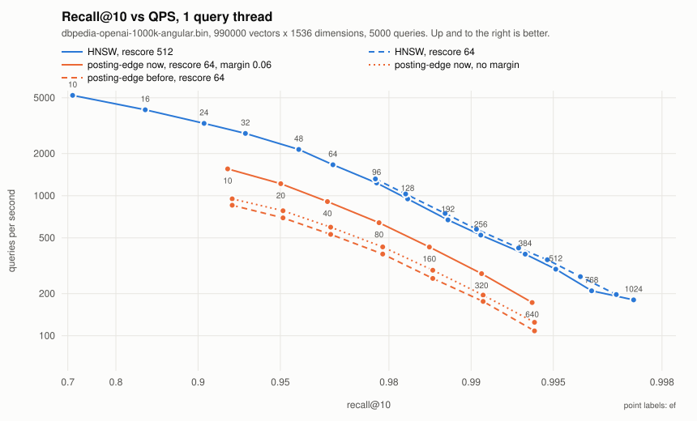
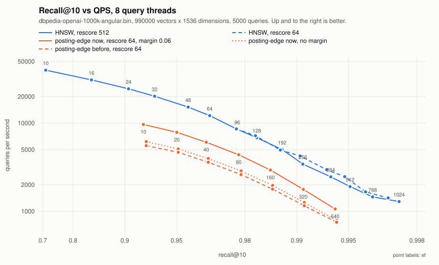
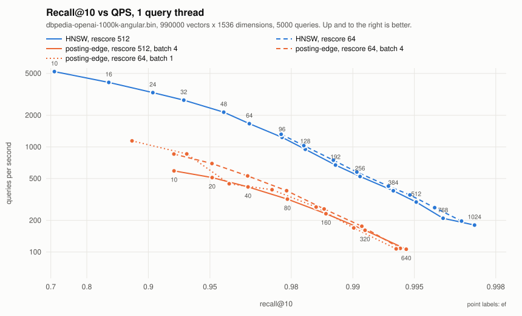
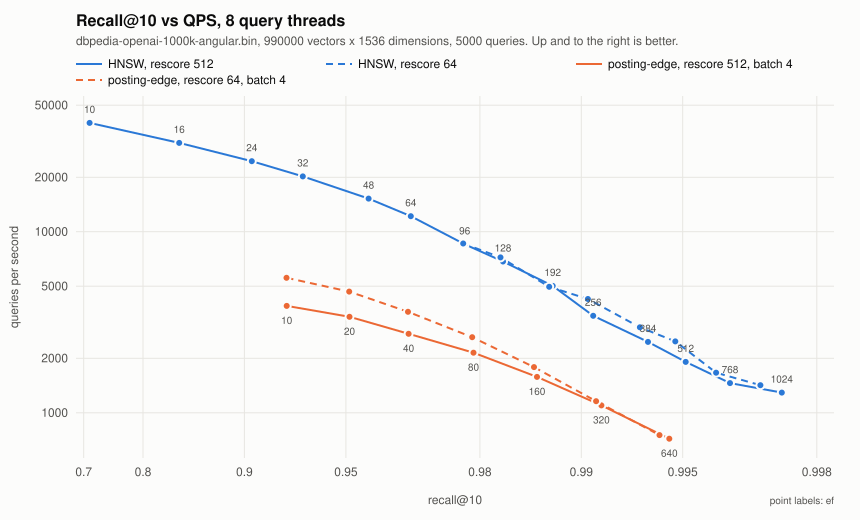

# Índice posting+edges en memoria (v1): benchmark end-to-end contra HNSW

**Fecha:** 2026-11-10 (v1 y v1.1) y 2026-11-11 (v1.2) · **Rama:** `feat/posting-edge-index` · **Paquete:** `adapters/repos/db/vector/postingedge` (nombre provisional)
**Dataset:** dbpedia-openai-1000k-angular (990 000 × 1536d, cosine, GT exacto top-100), el de las sims de `findings.md`
**Máquina:** Apple M1 Max (8P+2E), 64 GB, Go 1.27, GOMAXPROCS=10, escritorio en uso ligero en el v1 y el v1.1, en reposo y de noche en el v1.2

## Coste por distancia: el kernel CRQ1 (2026-11-12)

**Estado:** lectura de código y microbenchmarks hechos, con prototipos de los kernels en `postingedge/kernelproto`, sin integrar. La traducción a QPS es una estimación. No hay máquina x86 donde medir.

### Qué kernel corre hoy

La distancia a un código CRQ1 es `CenteredBinaryRQDistancer.Distance` (`compressionhelpers/binary_rq_centered.go`), la misma en posting-edge (scan y endpoints) y en HNSW.

- **Qué calcula.** La query es un valor de 5 bits por dimensión, guardado en cinco planos de bits; el código, un bit de signo por dimensión tras una palabra de cabecera. El entero de la estimación es S = Σ_p 2^p · popcount(q_p XOR x), y el producto de los dos códigos es 31·D − 2·S.
- **Cómo lo calcula:** con cinco distancias de Hamming, una por plano. Son cinco llamadas, cada una relee el código entero y hace su propia reducción horizontal y su conversión a float.
- **Desde 512 bits** cada llamada es `HammingDistSIMD`, que despacha por arquitectura:
  - **arm64** (con ASIMD, es decir todo Apple Silicon y Graviton): `asm.HammingBitwise`. Es NEON generado por GoAT desde C: EOR, CNT, UADDLP y UADALP, con una vuelta de 8 palabras, otra de 2 y una cola escalar.
  - **amd64 con AVX2:** `asm.HammingBitwiseAVX256`, popcount por tabla de nibbles con VPSHUFB y suma con VPSADBW.
  - **sin ASIMD ni AVX2:** Go con `bits.OnesCount64`.
- **Por debajo de 512 bits** (los códigos capados de 256 y 384): Go con `bits.OnesCount64`, también en cinco pasadas.

Los huecos:

- **Ningún kernel hace los cinco planos en una pasada,** en ninguna arquitectura. Se lee el código cinco veces y se pagan cinco llamadas y cinco reducciones.
- **No hay camino por lotes para el scan de un posting:** cada miembro se puntúa como si fuera un endpoint suelto.
- **x86 no usa VPOPCNTQ.** El kernel AVX-512 que existe (`asm.HammingBitwiseAVX512`) hace el popcount por software, con VPTERNLOGD, máscaras y desplazamientos, no con VPOPCNTQ (AVX512_VPOPCNTDQ, de Ice Lake y Zen 4 en adelante).
- **Y ese kernel AVX-512 no se selecciona en ningún sitio:** `compressionhelpers/distance_amd64.go` y `hnsw/distancer/hamming_amd64.go` eligen AVX2 aunque haya AVX-512.

### La cota teórica en esta CPU

Un núcleo de rendimiento del M1 Max va a 3.2 GHz y tiene cuatro tuberías NEON de 128 bits. Supongo que EOR, AND, CNT, ADD, USHR, TBL de un registro y UADDW salen a cuatro por ciclo, y que las cargas no limitan. Es una cota de throughput: no cuenta latencias ni el coste fijo de entrar y salir.

| kernel | operaciones vectoriales | ciclos por palabra de 64 bits | 768 bits | 1536 bits |
|---|---|---|---|---|
| S de un código, cinco planos en una pasada | 15 por cada 128 bits (5 EOR, 5 CNT, 5 ADD) | 1.9 | 22.5 ciclos, 7.0 ns | 45 ciclos, 13.9 ns |
| S de un código, cinco pasadas como hoy | las mismas 15, más 10 cargas en vez de 6 | 1.9 | 7.0 ns más cinco llamadas y cinco reducciones | 13.9 ns más lo mismo |
| FastScan, 32 códigos por bloque | 8 por grupo de 4 dimensiones y bloque (AND, USHR, 2 TBL, 4 UADDW) | 1.0 | 12 ciclos, 3.7 ns por código | 24 ciclos, 7.4 ns por código |

El kernel de hoy hace el mismo número de operaciones de cálculo que el fusionado. Lo que le sobra son cuatro relecturas del código, cuatro llamadas con su prólogo y cuatro reducciones horizontales con su paso a float. FastScan hace la mitad de trabajo por palabra: una TBL resuelve 4 dimensiones de 16 códigos.

### Microbenchmarks

Los prototipos de `kernelproto`:

- **`Fused`:** S de un código en una pasada para los cinco planos, en NEON, con los planos de la query intercalados cada 128 bits.
- **`ScanBlock`:** FastScan en NEON. Usa bloques de 32 códigos y una tabla de 16 entradas por grupo de 4 dimensiones, que una TBL busca para 16 códigos a la vez.

Los tests los atan bit a bit a las cinco llamadas de hoy: el mismo S para 128 a 3 968 dimensiones, bloques llenos y a medias, y los dos extremos.

Diez rondas intercaladas de todas las variantes, de 11:11 a 11:13 del 12, con el escritorio en uso. Cada ronda mide todas las variantes una vez, así que un tramo lento cae en todas. Mediana de ns por código, y entre paréntesis el mínimo y el máximo de las diez:

| caso | código de hoy | prototipo fusionado | FastScan | cociente, mediana por ronda |
|---|---|---|---|---|
| kernel solo, 768 bits, código en L1 | 33.7 (33.5–34.0) | 12.5 (12.5–13.6) | — | 2.68x |
| kernel solo, 1536 bits, código en L1 | 45.7 (44.2–53.6) | 18.8 (18.7–19.1) | — | 2.44x |
| distancia completa, 768 bits, en L1 | 33.6 (33.4–36.0) | 14.3 (14.2–14.6) | — | 2.35x |
| distancia completa, 1536 bits, en L1 | 44.7 (43.2–45.6) | 21.0 (20.9–21.1) | — | 2.13x |
| scan de un posting de 236, 768 bits | 33.3 (32.6–35.1) | 13.3 (13.2–16.9) | 6.6 (6.6–6.7) | 2.49x y 5.04x |
| scan de un posting de 236, 1536 bits | 42.9 (42.3–43.8) | 19.8 (19.6–23.4) | 10.8 (10.7–10.9) | 2.16x y 3.99x |
| endpoints sueltos en 1 GiB, 768 bits | 47.6 (46.6–50.6) | 28.2 (26.9–29.7) | — | 1.73x |
| endpoints sueltos en 1 GiB, 1536 bits | 55.1 (54.4–67.3) | 32.9 (31.3–35.3) | — | 1.71x |

- **"Endpoints sueltos"** son códigos en sitios al azar de un sidecar de 1 GiB, con el prefetch de 8 por delante que hace el índice. Es el caso de un endpoint a 10M, con el código viniendo de memoria.
- **El fusionado en Go puro no sirve:** 1.29x a 768 bits y 0.94x a 1536, porque `bits.OnesCount64` no vectoriza en arm64.
- **Preparar la query,** aparte: la rotación de hoy (`NewDistancer`) cuesta 4.6 µs a 768 bits y 9.3 µs a 1536. El prototipo de planos, intercalado y tablas, sin optimizar, cuesta 15.8 y 37.8 µs. Hay margen: las tablas se pueden construir de forma incremental.

Contra la cota teórica:

| kernel | 768 bits: medido / cota | 1536 bits: medido / cota |
|---|---|---|
| hoy, cinco llamadas | 33.7 / 7.0 ns: 4.8x por encima | 45.7 / 13.9 ns: 3.3x |
| fusionado NEON | 12.5 / 7.0 ns: 1.8x | 18.8 / 13.9 ns: 1.35x |
| FastScan, con la cabecera de cada código | 6.6 / 3.7 ns: 1.8x | 10.8 / 7.4 ns: 1.45x |

**El factor del kernel fusionado es 2.7x a 768 bits y 2.4x a 1536 sobre el kernel solo.** Sobre la distancia completa queda en 2.35x y 2.1x en caché, y en 1.7x con el código viniendo de memoria. Lo que le queda hasta la cota a 768 bits es sobre todo fijo: las cinco reducciones del final y la llamada.

### FastScan para el scan del posting

Sobre el mismo posting de 236 códigos, en caché, FastScan baja el coste por código de 33.3 a 6.6 ns a 768 bits (5.0x) y de 42.9 a 10.8 a 1536 (4.0x). Es el doble que el kernel fusionado.

- **Pide los códigos de los postings en otro orden:** por bloques de 32, traspuestos por grupos de 4 dimensiones. Los endpoints necesitan el código de un vector suelto, en fila.
- **En el índice en memoria eso es una segunda copia de los códigos.** Hoy postings y sidecar comparten un solo array; a 10M serían 992 MB más, de 1 712 a 2 704 MB de índice, todavía 0.79x de HNSW.
- **En el diseño de disco no cuesta nada:** los postings de disco llevan ya sus propios códigos.

### Traducción a QPS (estimación)

**Es una estimación, no una medida.** El tiempo de una query de posting-edge del perfil por fases (1 thread, rescoreLimit 200) baja por tres vías:

- **Por endpoint puntuado,** el ahorro mediano por código del caso de endpoints sueltos: 20.1 ns a 768 bits.
- **Por vector escaneado,** el del scan de un posting: 19.9 ns con el fusionado y 26.7 ns con FastScan.
- **Sube por preparar la query:** los 15.8 µs del prototipo, enteros.

El de HNSW baja en el ahorro de endpoints suelto por cada distancia a código, porque usa el mismo kernel.

- **Distancias de HNSW a 1M:** `TestSearchWork` sobre wiki-dpr 1M, interpoladas al recall: 2 461 a 0.95 y 9 423 a 0.99.
- **A 10M no están medidas:** se toma la cuenta de 1M al ef que necesita cada build de 10M, 1 570 a 1 941 a 0.95 y 5 926 a 8 303 a 0.99.
- **La aceleración de 1 thread se aplica también a 8 threads,** sin medir.

HNSW / posting-edge, hoy y estimado:

| N | recall | threads | hoy | con el kernel fusionado | con fusionado y FastScan |
|---|---|---|---|---|---|
| 1M | 0.95 | 1 | 1.53x | 1.36x | 1.32x |
| 1M | 0.95 | 8 | 1.26x | 1.13x | 1.09x |
| 1M | 0.99 | 1 | 0.77x | 0.63x | 0.60x |
| 1M | 0.99 | 8 | 0.62x | 0.51x | 0.49x |
| 10M | 0.95 | 1 | 2.10x a 2.14x | 1.90x a 1.91x | 1.86x a 1.87x |
| 10M | 0.95 | 8 | 2.09x a 2.20x | 1.89x a 1.96x | 1.85x a 1.92x |
| 10M | 0.99 | 1 | 1.36x a 1.72x | 1.12x a 1.41x | 1.09x a 1.37x |
| 10M | 0.99 | 8 | 1.34x a 1.82x | 1.10x a 1.49x | 1.07x a 1.45x |

Los rangos de 10M son los dos builds de HNSW. Posting-edge gana un 19 a 22 % a 10M a 0.95, y un 29 a 33 % a 0.99. HNSW gana un 6 a 9 %. La tabla completa, con los QPS, está en `testdata/bench/kernel/qps-estimate.md`.

Lo que dice:

- **El kernel acorta el gap, pero no lo cierra:** a 10M a 0.95, de unas 2.1–2.2x a unas 1.9x. La mitad del tiempo de posting-edge a 10M no es el kernel: centroides 229 µs, rescore 141 µs y resto 142 µs, de 1 184.
- **A 0.99 el efecto es mayor,** porque ahí pesan más los endpoints.
- **El gap sigue siendo de número de distancias.** A 10M y 0.95 posting-edge hace unas 10 200 distancias a código por query (6 878 endpoints y 3 306 escaneados), frente a unas 1 600–1 900 de HNSW. Es lo que ya decía dbpedia: unas diez veces más.
- **El siguiente coste es el resto por endpoint.** En el índice cada endpoint cuesta 73 ns, frente a 48 ns del caso de endpoints sueltos. Esos 25 ns de contabilidad (visited set, aristas, posting de destino) pasan a ser, con el kernel fusionado, casi lo mismo que la distancia (28 ns).
- **El scan puede quedar optimista:** el microbenchmark tiene el posting en caché, y en el índice viene de memoria, aunque en orden.

### x86

**No tengo acceso a una máquina x86 donde medir.**

- **No hay ningún host SSH configurado.**
- **Rosetta no sirve:** ejecuta los binarios amd64, pero no anuncia AVX ni AVX2. Los tests de `kernelproto` pasan allí, aunque solo prueban el camino Go. El kernel AVX2 de hoy no se ha validado ni cronometrado en x86, y menos uno con VPOPCNTQ.
- **Hay una clave de gcloud y un contexto de EKS en esta máquina,** pero usarlos es crear recursos en vuestras cuentas, y no lo he hecho.
- **Es un riesgo para la extrapolación a producción,** que corre sobre todo en x86. Los factores de arriba son de NEON en un M1 Max. En x86 el kernel de hoy es otro (VPSHUFB), y el que tocaría (VPOPCNTQ con AVX-512) no existe todavía.

### Datos y reproducción

En `testdata/bench/kernel/`:

- `m1max-rounds.txt`: las diez rondas, en bruto.
- `m1max-summary.md`: medianas y cocientes por ronda.
- `qps-estimate.md`: la estimación completa.
- `wikidpr-1m-hnsw-work.json`: las distancias por query de HNSW en wiki-dpr 1M.
- `scripts/`: el script de las rondas y los dos de resumen.

```bash
# los tests de equivalencia, en las dos arquitecturas (amd64 bajo Rosetta: solo el camino Go)
go test -race -count 1 ./adapters/repos/db/vector/postingedge/kernelproto/
GOARCH=amd64 go test -count 1 ./adapters/repos/db/vector/postingedge/kernelproto/

# las rondas intercaladas: el binario de test al lado del script
go test -c -o $K/scripts/kernelproto.test ./adapters/repos/db/vector/postingedge/kernelproto/
$K/scripts/run_kernel_ab.sh 10 rounds.txt
python3 $K/scripts/kernel_ab_summary.py rounds.txt
python3 $K/scripts/kernel_qps_estimate.py rounds.txt

# distancias por query de HNSW
go test -tags postingedgebench -run 'TestSearchWork$' -timeout 0 -v ./adapters/repos/db/vector/hnsw/ \
  -work.dataset $D1M -work.queries 1000 -work.rescores 512 -work.efs 32,48,64,96,128,192,256,384,512,768 \
  -work.out $K/wikidpr-1m-hnsw-work.json
```

## v1.5: cap de grado de aristas a 10M (pre-registro, 2026-11-12)

**Estado: pre-registrado; se mide la noche del 12 al 13.** Esta sección se escribió antes de ningún dato.

**Hipótesis.** El P=320 con R=256 que hizo falta a 10M para encontrar los vecinos también subió el grado: 11.4 aristas por vector frente a 9.7 a 1M. Eso explicaría la mitad del crecimiento del gap contra HNSW de 1M a 10M. El P alto hacía falta para encontrar los vecinos, no para guardarlos todos.

**Una precisión sobre el mecanismo, que no cambia el experimento.** El grado no sale de P:

- **Cada vector guarda como aristas sus 16 vecinos más cercanos, menos los que viven en su propio posting.** Su grado medio es 16 × (1 − la fracción de vecinos en el propio posting): 16 × (1 − 0.388) = 9.8 a 1M y 16 × (1 − 0.282) = 11.5 a 10M. Los medidos son 9.74 y 11.41.
- **P decide cuáles de esos vecinos se encuentran** (el recall de arista), no cuántos se guardan.
- **El grado sube porque a 10M hay diez veces más postings del mismo tamaño,** y caen menos vecinos de un vector en el suyo.

La pregunta sigue siendo la misma: si guardar menos aristas por vector, las más cercanas, abarata la búsqueda sin perder recall.

**Qué se mide.** Un solo build de 10M con el default de v1.4: S=236, P=320 sobre la asignación de P=384 de la caché, R=256 y código completo. Sobre él, sin reconstruir, cuatro celdas en este orden: sin cap (el ancla), cap 10, cap 8 y sin cap otra vez.

- **El cap deja a cada vector sus k aristas más cercanas por distancia exacta.** Las filas del constructor ya van ordenadas así, y el cap se queda con el principio de cada una (`capDegree`). El índice se vuelve a publicar con esas aristas sobre los mismos postings (`replaceEdges`).
- **Cada celda:**
  - frontera recall-QPS con 1 y 8 threads, con rescoreLimit 200, margen 0.06, lotes de 4 y ef de 10 a 1024;
  - tres pasadas por punto y segunda ronda (`-bench.repeat`);
  - recall de arista, endpoints puntuados, cargas y memoria de aristas;
  - la búsqueda de 10 000 vectores con ellos mismos como query, con los ajustes del primer punto.
- **El ancla del final la añadí yo:** cuesta unos 11 minutos y, con la del principio, dice si la sesión derivó.

**Recall de arista de un cap.** Se mide contra las k aristas verdaderas más cercanas de cada vector de la muestra: sus vecinos exactos de otros postings, entre los 16 más cercanos, de 1 000 vectores. Contra todas las aristas verdaderas el cap pierde recall por diseño (a 10M pasa de 11.4 aristas a 8 o a 10). Ese número va al lado, pero no es el del stop.

| pre-registro | umbral |
|---|---|
| el cap gana | QPS@0.95 un 10 % o más sobre el ancla del principio, con 1 y con 8 threads, y 0.99 alcanzable subiendo solo ef con rescoreLimit 200 |
| desempate, decidido antes de ver datos | si gana con un número de threads y no con el otro, decide 8 threads, que es el régimen de producción |
| stop-and-report | el recall de arista del cap queda más de 0.01 por debajo del de las aristas completas (0.9470 en el build de v1.4). Ese cap no se cronometra, y se reporta |
| deriva | si las dos anclas difieren más de un 2 % de mediana, se dice, y el veredicto se da contra las dos |

**Si gana:** el cap pasa a ser parámetro del constructor, como grado máximo independiente de P. Sobre 1M: allí el grado medio es 9.7, así que el cap de 10 recorta los vectores de más de 10 aristas y el de 8, la mayoría. Que sea neutro a 1M no está garantizado por construcción, así que su medida a 1M entra en la siguiente cola.

**Protocolo.** La cadena (`run_v15_night.sh`) corre bajo `caffeinate -s -i`, lanzada de día con la máquina despierta del todo. No arranca antes de las 23:00, ni hasta 15 minutos sin teclado ni trackpad, ni después de las 03:00. Al arrancar comprueba en `pmset -g systemstate` que la máquina está despierta del todo, y al acabar cada paso deja en su salida los reposos, despertares y actividad de teclado de la ventana. Detrás va el último intento de la curva de 8 threads del control de dbpedia (ver Fase C, "Ruido").

## v1.4: 10M en wiki-dpr e5 (768d) (2026-11-11 y 12)

**Estado: medido.** Los dos brazos a 10M y a 1M, y la celda de 512 bits en las dos escalas. Las curvas que marcaron deriva se volvieron a cronometrar la mañana del 12 con la máquina despierta. El ancla de posting-edge repite la tarde, y el brazo HNSW de 10M, reconstruido, repite su primera ronda de la tarde. Las dos segundas rondas que derivaron se tomaron con el escritorio en uso (ver "Deriva entre las dos rondas"). El pre-registro y el protocolo de abajo se escribieron antes de ver ningún dato de 10M; los resultados van en "Resultados a 10M".

La pregunta central: si el ~2x contra HNSW que se midió a 1M se mantiene plano a 10M, como las cargas de posting en las simulaciones.

Pre-registro, con las tres precisiones que se le hicieron el mismo día a la vista del 1M y antes de ningún dato de 10M:

| qué | umbral |
|---|---|
| ratio contra HNSW a recall 0.95, a 10M | ≤ 2.5x |
| gate de 0.99 en el default | alcanzable subiendo solo ef, con el rescoreLimit del default de 768d (200, o 400 para 0.99), no con 64 |
| stop-and-report: recall de arista a 10M con P=256 | que ningún R razonable de la malla llegue a 0.94. Si R=64 no llega y un R mayor sí, se construye con el menor R que llegue, sin parar |
| stop-and-report: pérdida de vectores | cualquiera. Tras el build, los vectores asignados tienen que ser los insertados, y se reporta como check explícito |

Las precisiones:

- **El default a 768d lleva el rescore acoplado.** A 768d el código completo ya es la celda de 768 bits de la Fase B, así que la config es rescoreLimit 200 para el tramo de 0.95 y 400 para 0.99. El techo de 0.9816 con 64 es de la dimensión, y le pasa igual a HNSW (0.976 con 64, 0.992 con su 512). No hay celda opt-in aparte: es el propio default.
- **Cada brazo se compara en su rescore operativo:** posting-edge con 200 y 400, HNSW con 512.
- **El R del build se elige en la malla.** Si el R elegido encarece la etapa de aristas más de ~1.5x contra R=64, se reporta junto al build. Y la pareja (R usado, recall de arista) de 10M va al lado de la de 1M: un R que crece con N es un riesgo abierto para 100M.

Qué se mide:

- **Dataset:** wiki-dpr-10m-e5b-filtered, 10 000 000 × 768d, L2-normalizado, 1 000 queries con GT exacto top-100 sin filtro. A 768d el código completo es de 768 bits (13 palabras, 104 B).
- **Posting-edge con los defaults cerrados:** S=236, P=256, margen 0.06, rescoreLimit 64, lotes de 4. S va fijado a 236: el default de la config sale de un presupuesto de 48 KiB por posting, que con códigos de 104 B daría 438. Con las precisiones de abajo, el rescoreLimit a 768d pasa a 200 y 400, y a 10M el build va con P=320 y R=256 (ver "Recall de arista a 10M").
- **HNSW a 10M en la misma sesión,** obligatorio: el código de 13 palabras es el que tocaba el bug de prefetch, así que ningún tiempo anterior de este dataset es comparable.
- **Control de escala:** el mismo dataset a 1M (su primer millón de filas), los dos brazos. Separa lo que cambia por el dataset y la dimensión de lo que cambia por el tamaño.
- **A reportar:** frontera recall-QPS con 1 y 8 threads y ratios contra HNSW y contra los de 1M, gate de 0.99, memoria por componente, build, cargas de posting a 0.95 y 0.99, y la proyección a disco en el punto de 0.99.
- **Códigos capados:** 512 y 384 bits a 1M sin cronometrar; a 10M solo sube el que alcance 0.99.
- **Proyección a disco, en el punto de 0.99:** de los candidatos que llegan al rescore final, cuántos viven en postings que la query ya cargó y cuántos necesitarían una lectura propia. Conteo por query, media y p95, no un cronometraje. Con él, las cargas, las rondas y los bytes leídos.

Protocolo de tiempos. Los dos brazos de 10M y los de 1M se cronometran seguidos en una misma sesión, el 11 de noviembre por la tarde, con la máquina libre y sin nada mío en paralelo: lo que había que compilar se compiló antes. Cada punto son tres pasadas, y al acabar el plan de cada celda todos sus puntos se cronometran una segunda vez (`-bench.repeat`). El contraste entre las dos rondas es el detector de deriva: una curva que no repita se vuelve a medir de noche, ella sola.

### Resultados a 10M

**Cobertura completa: 10 000 000 vectores insertados, 10 000 000 en postings, 0 perdidos, 0 repetidos, 0 ids que nunca se insertaron.** Es el check del agujero del 5.9 % del índice HFresh de septiembre: aquí la asignación es exacta y no se pierde ningún vector. Buscando 10 000 vectores con ellos mismos como query, con ef=10, vuelven 9 999: el que falta está en su posting, y es un fallo de la búsqueda aproximada, no una pérdida.

| pre-registro | resultado |
|---|---|
| ratio contra HNSW a recall 0.95, a 10M ≤ 2.5x | **Se cumple: entre 2.09x y 2.20x.** Son 2.14x con 1 thread y 2.20x con 8 contra el build de HNSW de la tarde, y 2.10x y 2.09x contra el de la mañana. A 0.99 el ratio va como rango entre builds, de 1.34x a 1.82x |
| gate de 0.99 subiendo solo ef, con el rescoreLimit acoplado | **Se cumple:** con rescoreLimit 200, 0.9909 a ef=160. HNSW llega con su 512 a 0.9900 a ef=256 con el build de la tarde, y a 0.9904 a ef=384 con el de la mañana |
| stop: recall de arista a 10M con P=256 | **Saltó:** techo 0.9392 con cualquier R. Se construyó con P=320 y R=256, que da 0.9470, con tu visto bueno |
| stop: pérdida de vectores | **No salta:** cobertura completa |

Los dos brazos se cronometraron seguidos el 11 de noviembre, de 18:04 (el build de posting-edge a 10M) a 20:26, cada uno en su rescore operativo: posting-edge con 200 y 400, HNSW con 512. HNSW se midió también con 64 desde ef=96, y las tablas toman su mejor curva en cada nivel. El brazo HNSW se reconstruyó y se volvió a cronometrar el 12 por la mañana (de 06:31 a 07:17), detrás de un ancla de posting-edge a 1M que repite la tarde. Todos los números son post-fix del prefetch: no se comparan con ningún tiempo anterior de este dataset.

#### Frontera y ratios

QPS a igual recall, leído de la curva de ef de cada configuración. Posting-edge con rescoreLimit 200, que es su mejor configuración en los tres niveles. La columna de HNSW a 10M da el build de la tarde y, tras la barra, el de la mañana, cada uno en su primera ronda. HNSW no construye el mismo grafo dos veces, y a 0.99 eso se nota (ver "Deriva").

1 thread:

| recall | posting-edge 1M | HNSW 1M | HNSW / PE, 1M | posting-edge 10M | HNSW 10M | HNSW / PE, 10M |
|---|---|---|---|---|---|---|
| 0.90 | 1567 (a 0.9061) | 3111 | 1.99x | 1096 (a 0.9139) | 2925 / 2649 | 2.67x / 2.42x |
| 0.95 | 1112 | 1702 | 1.53x | 870 | 1859 / 1828 | 2.14x / 2.10x |
| 0.99 | 412 | 316 | 0.77x | 261 | 448 / 355 | 1.72x / 1.36x |

8 threads:

| recall | posting-edge 1M | HNSW 1M | HNSW / PE, 1M | posting-edge 10M | HNSW 10M | HNSW / PE, 10M |
|---|---|---|---|---|---|---|
| 0.90 | 10978 (a 0.9061) | 16969 | 1.55x | 7250 (a 0.9139) | 19294 / 18686 | 2.66x / 2.58x |
| 0.95 | 7778 | 9818 | 1.26x | 5968 | 13122 / 12467 | 2.20x / 2.09x |
| 0.99 | 2974 | 1850 | 0.62x | 1770 | 3226 / 2363 | 1.82x / 1.34x |

La columna de HNSW a 1M es el build de la tarde, el que repite. El de la mañana llega a 0.99 a ef=512 en vez de a ef=768, y ahí da 379 y 2 374 QPS (0.92x y 0.80x de posting-edge). Su curva de 1 thread se cronometró con el escritorio en uso y va un 8 % lenta.

Para comparar, dbpedia 1M (1536d, Fase B): 2.27x / 1.93x / 2.32x con 1 thread y 2.38x / 1.99x / 2.35x con 8.

**La pregunta central: el ratio no se mantiene plano en QPS; las cargas sí, a 0.95.**

- **El ratio crece de 1M a 10M:** a recall 0.95, de 1.53x a entre 2.10x y 2.14x con 1 thread, y de 1.26x a entre 2.09x y 2.20x con 8. A 0.99 posting-edge iba por delante a 1M (de 0.62x a 0.92x según threads y build) y a 10M va por detrás (de 1.34x a 1.82x).
- **A 0.99 el ratio depende del build de HNSW, no del reloj.** Su curva es plana ahí: el build de la tarde llega a 0.99 a ef=256, y el de la mañana a ef=384, con el mismo QPS por ef (ver "Deriva"). El ratio a 0.99 tiene por eso una banda de un 20 a un 25 %. El de 0.95 apenas se mueve.
- **Las cargas de posting, en cambio, no crecen a 0.95:** 13.4 a 1M y 12.6 a 10M. A 0.99 suben un 17 %, de 43.7 a 51.3. Las simulaciones daban 41 y 35 a 0.95.
- **Posting-edge se hace más lento con N a igual recall:** 0.78x a 0.95 y 0.63x a 0.99 con 1 thread. Con las cargas planas, la diferencia es CPU en memoria (tabla de abajo).
- **HNSW no se hace más lento: a 0.95 da el mismo QPS a 10M que a 1M** (1859 y 1828 frente a 1702 con 1 thread). Llega a 0.95 con ef=48 a 10M y necesita ef entre 96 y 128 a 1M. Posting-edge también saca más recall al mismo ef a 10M (0.9543 a ef=20, frente a 0.9414 a 1M). Una causa probable, no medida: las 1 000 queries se eligieron entre 2 000 por tener la mayor similitud top-1 en el corpus de 10M, y en su primer millón de filas muchas pierden ese vecino cercano. Si es eso, el 1M de wiki-dpr no es un control limpio de "el mismo dataset, más pequeño" para el QPS, y el contraste fiable de escala son las cuentas de trabajo.

Dónde se va el tiempo de posting-edge, pase instrumentado con 1 thread y rescoreLimit 200 (µs por query; el resto incluye la selección de rondas):

| recall | N | ef | cargas | rondas | vectores escaneados | endpoints puntuados | centroides | scan | endpoints | rescore | resto | total |
|---|---|---|---|---|---|---|---|---|---|---|---|---|
| 0.95 | 1M | 25 | 13.4 | 3.1 | 3 319 | 6 161 | 122 | 167 | 423 | 121 | 114 | 950 |
| 0.95 | 10M | 19 | 12.6 | 2.9 | 3 306 | 6 878 | 229 | 168 | 502 | 141 | 142 | 1 184 |
| 0.99 | 1M | 155 | 43.7 | 10.7 | 10 697 | 21 244 | 144 | 477 | 1 540 | 127 | 386 | 2 674 |
| 0.99 | 10M | 146 | 51.3 | 12.6 | 13 081 | 33 021 | 247 | 579 | 2 431 | 150 | 628 | 4 043 |

- **Centroides: casi el doble** (122 a 229 µs a 0.95). Hay 42 373 centroides en vez de 4 238, y el grafo de centroides se busca con ef fijo de 64. Con ese ef, la entrada es el centroide más cercano en el 99.7 % de las queries a 10M, frente al 100 % a 1M.
- **Endpoints: un 12 % más a 0.95 y un 55 % más a 0.99.** Cada vector tiene más aristas, 11.4 frente a 9.7, porque menos de sus vecinos viven en su propio posting (28 % frente a 39 %). El coste por endpoint apenas cambia: 69 a 73 ns a 0.95, 72 a 74 ns a 0.99, con un sidecar diez veces mayor (992 MB frente a 99).
- **A 0.99 se suman las cargas de más,** que traen más scan y más endpoints.

**El crecimiento del coste de endpoints con N es estructural.** El grado de un vector son sus 16 vecinos más cercanos menos los que comparten su posting: 16 × (1 − la fracción de vecinos en el propio posting).

- **Con S fijo, esa fracción baja al crecer N:** hay más postings del mismo tamaño, y caen menos vecinos de un vector en el suyo. Fue de 0.388 a 1M y de 0.282 a 10M, con grados de 9.7 y 11.4.
- **El grado medio crece con N por construcción,** no por el P del build. Con él crecen los endpoints que puntúa cada fuente seguida.
- **El techo es el de los 16 vecinos que considera el constructor:** de 10M en adelante el grado puede subir todavía de 11.4 a 16, un 40 % más.
- **Para 100M, un cap de grado o un S mayor dejan de ser opcionales.** Un S mayor sube la fracción de vecinos en el propio posting, a cambio del scan que midió la Fase C.

El cap de grado se mide a 10M en v1.5. Si gana, su medida a 1M entra en la siguiente cola.

#### Memoria

Heap del índice, en MB. Los vectores completos (2.9 GB a 1M, 29.3 GB a 10M) no cuentan en ninguno de los dos.

| | posting-edge 1M | HNSW 1M | posting-edge 10M | HNSW 10M |
|---|---|---|---|---|
| códigos | 99.2 | 99.2 | 991.8 | 991.8 |
| aristas | 41.0 | — | 473.4 | — |
| vectores de centroides | 12.4 | — | 124.1 | — |
| postings | 11.5 | — | 114.6 | — |
| grafo | — | 235.9 | — | 2 426 |
| resto | 1.0 | — | 8.5 | — |
| heap del índice | 165.1 | 335.0 | 1 712.4 | 3 417.8 |
| contra HNSW | 0.49x | — | 0.50x | — |

La estructura sin los códigos es 0.28x la de HNSW a 1M y 0.30x a 10M. Las aristas pasan de 43 a 50 B por vector, por las aristas de más.

#### Build

| | posting-edge 1M | posting-edge 10M | HNSW 1M | HNSW 10M |
|---|---|---|---|---|
| partición y asignación exacta | 95 s (P=256) | ~2 h 40 min (P=384) | — | — |
| aristas | 303 s (P=256, R=64) | 3 668 s (P=320, R=256) | — | — |
| total | 399 s | ~3 h 45 min | 93 s (95 s el 12) | 1 645 s (1 691 s el 12) |
| pico de RSS | 5.3 GB | 35.7 GB | 9.8 GB | 44.9 GB (39.8 GB el 12) |

- **El build es el punto débil a escala:** 4x el de HNSW a 1M y unas 8x a 10M.
- **La asignación exacta es n·k:** con S fijo, cuadrática en N. A 10M se calculó una vez, con P=384, y quedó en caché para todos los builds. Su tiempo sale de la marca de los ficheros de caché (15:17 a 17:59), e incluye leer los 30 GB del train. Con P=256 había tardado 3 h 6 min (11:52 a 14:58), con unos minutos de tests míos por medio.
- **Las aristas crecen 12x para 10x vectores,** por el P y el R mayores.
- **A 100M,** la asignación exacta tal como está no escala: está anotada en el código como TODO (un pase por bloques o asistido por un grafo). Junto con el P y el R que crecen con N, es el riesgo principal.

#### Cargas de posting: el titular de disco

| recall | rescoreLimit | cargas, 1M (p95) | cargas, 10M (p95) | rondas, 1M (p95) | rondas, 10M (p95) |
|---|---|---|---|---|---|
| 0.95 | 200 | 13.4 (24.5) | 12.6 (24.0) | 3.1 (5.9) | 2.9 (5.7) |
| 0.99 | 200 | 43.7 (79.0) | 51.3 (100.7) | 10.7 (19.5) | 12.6 (24.9) |
| 0.99 | 400 | 41.4 (74.8) | 51.3 (100.7) | 10.1 (18.5) | 12.6 (24.9) |

Planas a 0.95, un 17 % más a 0.99. Las rondas, que son la profundidad serial de I/O, siguen a las cargas.

#### Proyección a disco en el punto de 0.99

De los candidatos del rescore final, por query (10M, rescoreLimit 200, mil queries):

- **Todos viven en postings que la query ya cargó; ninguno necesitaría una lectura propia.** El máximo sobre las mil queries es 0. Es así por construcción: los candidatos solo salen del scan de postings cargados.
- **Están repartidos por casi todos los postings cargados:** 51.2 de 51.3 de media, con p95 de 100.7. Son 3.9 candidatos por posting cargado con rescoreLimit 200, y 7.8 con 400. A recall 0.95 son 15.9 por posting.

Lo que lee una query en ese punto, por layout (detalle en `disk-design.md`):

| layout | cargas | bytes de posting | lecturas de rescore |
|---|---|---|---|
| (a) solo códigos | 51.3 | 1.5 MB de ids y códigos, más 0.65 MB de aristas | 200 al bucket de objetos |
| (b) exactos inline | 51.3 | 40 MB: 13 081 vectores de 3 KB, para usar 200 (1.5 %) | 0 |
| (b') store dedicado | 51.3 | los de (a) | 200 a un fichero propio, de 3 KB a offset fijo |

Con cuatro candidatos por posting cargado no compensa leer los vectores de un posting entero para el rescore, ni inline (b) ni por rangos en (b').

#### Deriva entre las dos rondas

La segunda ronda de cada celda contra la primera. Para la mañana del 12, también la primera ronda contra la de la tarde:

| celda | cuándo | threads | rescoreLimit | puntos dentro de ±2 % | mediana | peor punto |
|---|---|---|---|---|---|---|
| posting-edge 10M | tarde | 1 | 200 / 400 | 7 / 8 de 8 | -1.2 % / +0.2 % | -2.0 % |
| posting-edge 10M | tarde | 8 | 200 / 400 | 6 / 6 de 8 | -1.3 % / -1.1 % | -4.8 % |
| posting-edge 1M | tarde | 1 | 200 / 400 | 7 / 8 de 8 | +0.5 % / +0.3 % | +2.2 % |
| posting-edge 1M | tarde | 8 | 200 / 400 | 5 / 5 de 8 | +1.2 % / +1.8 % | +4.1 % |
| posting-edge 1M, ancla: mañana contra tarde | mañana | 1 | 200 / 400 | 0 / 4 de 8 | -3.1 % / -1.0 % | -5.8 % |
| posting-edge 1M, ancla: mañana contra tarde | mañana | 8 | 200 / 400 | 3 / 6 de 8 | +0.4 % / +1.6 % | +4.8 % |
| posting-edge 1M, ancla: su segunda ronda contra tarde | mañana | 1 | 200 / 400 | 7 / 8 de 8 | +1.3 % / +1.1 % | -2.2 % |
| posting-edge 1M, ancla: su segunda ronda contra tarde | mañana | 8 | 200 / 400 | 4 / 8 de 8 | +1.4 % / +1.5 % | +4.4 % |

HNSW, con rescoreLimit 512 y 64 juntos, y el umbral en ±5 %:

| celda | qué se compara | threads | puntos dentro de ±5 % | mediana | peor punto |
|---|---|---|---|---|---|
| HNSW 10M | tarde: segunda ronda contra primera | 1 | 12 de 22 | -1.3 % | -25.6 % y +19.7 % |
| HNSW 10M | tarde: segunda ronda contra primera | 8 | 3 de 22 | -10.2 % | -22.3 % |
| HNSW 10M | mañana: segunda ronda contra primera | 1 | 11 de 22 | -2.7 % | -18.7 % y +13.0 % |
| HNSW 10M | mañana: segunda ronda contra primera | 8 | 7 de 22 | +0.6 % | -13.6 % y +28.5 % |
| HNSW 10M | primera de la mañana contra primera de la tarde, con 512 | 1 | 9 de 14 | +3.1 % | -9.6 % y +15.9 % |
| HNSW 10M | primera de la mañana contra primera de la tarde, con 512 | 8 | 13 de 14 | +0.6 % | -10.7 % |
| HNSW 1M | tarde: segunda ronda contra primera | 1 | 16 de 22 | -0.2 % | -8.4 % |
| HNSW 1M | tarde: segunda ronda contra primera | 8 | 18 de 22 | -0.7 % | -6.9 % |
| HNSW 1M | primera de la mañana contra primera de la tarde | 1 | 2 de 22 | -8.8 % | -23.0 % |
| HNSW 1M | primera de la mañana contra primera de la tarde | 8 | 17 de 22 | +0.4 % | +10.0 % |

- **Posting-edge repite en las dos escalas y en las dos sesiones.** Ningún punto tiene pasadas con ruido. El ancla de la mañana repite la tarde: su segunda ronda tiene 15 de 16 puntos dentro de ±2 % con 1 thread, con medianas de +1.1 a +1.5 %. Su primera ronda de 1 thread va un 3 % lenta porque empezó con la máquina recién salida del reposo (abajo).
- **La deriva de HNSW a 10M era el escritorio en uso.** En las dos sesiones la primera ronda se cronometró con la máquina sola, y la segunda con alguien al teclado. El 11, la pantalla se encendió a las 20:01:08, un minuto después de empezar la segunda ronda (20:00 a 20:05). El 12, hubo actividad de teclado desde las 07:04:41, al empezar la segunda ronda (07:05 a 07:10). Lo dicen las aserciones `UserIsActive` de teclado y trackpad en `pmset -g log`. Yo no ejecutaba nada en ninguna de las dos ventanas.
- **Las dos primeras rondas de HNSW a 10M coinciden punto a punto,** aunque son builds distintos: con rescoreLimit 512, mediana de +0.6 % con 8 threads (13 de 14 puntos dentro de ±5 %) y de +3.1 % con 1 thread. Sus curvas de 64, que van al final de la ronda, salen entre un 7 y un 8 % lentas por la mañana: se cronometraron a las 07:04, con el teclado ya en uso. Las tablas no las usan, porque la de 512 es la mejor de HNSW en los tres niveles.
- **HNSW a 1M, por la mañana, se cronometró entero con el escritorio en uso** (07:10 a 07:17). Con 1 thread va entre un 8 % (rescoreLimit 512) y un 14 % (64) lenta contra la tarde, y su propia segunda ronda recupera entre un 7 y un 16 %. Con 8 threads repite la tarde. Las tablas usan la tarde, que se cronometró con la máquina sola y repite.
- **HNSW no construye el mismo grafo dos veces.** El build de la mañana da otro recall al mismo ef: a 10M, 0.9871 frente a 0.9900 a ef=256, y 0.9904 frente a 0.9925 a ef=384. A 0.95 eso apenas mueve el QPS (1859 y 1828 con 1 thread), porque ahí la curva es empinada. A 0.99 la curva es plana, y el build de la mañana llega a ef=384 en vez de a 256: 355 frente a 448 QPS con 1 thread, y 2 363 frente a 3 226 con 8. A 1M pasa al revés: el de la mañana llega a ef=512 en vez de a 768. El build de posting-edge es determinista: los dos de 1M dan el mismo recall a cada ef.
- **El veredicto del pre-registro no depende ni de la ronda ni del build.** A 0.95, con las primeras rondas de los dos builds, el ratio queda entre 2.09x y 2.20x. Con las segundas rondas, tomadas con el escritorio en uso, entre 1.78x y 2.24x. Siempre por debajo de 2.5x.
- **La repetición de la noche se perdió: el Mac estaba en reposo.** Desde las 22:56 del 11 de noviembre entró en reposo por inactividad, y solo despertaba en modo de mantenimiento, unos 45 a 60 segundos cada cuarto de hora (`pmset -g log`). La cola de las 00:30 corrió entera a trozos, en esos despertares: el ancla tardó casi tres horas, y el build de HNSW a 10M, 4 059 s en vez de 1 645. El reloj monotónico de Go no cuenta el reposo, así que ningún número lo delata por sí mismo, pero nada de esa cola sirve. Es un fallo mío, por dejar la cola sin impedir el reposo. Sus ficheros (`*-night.json`) no van al repositorio.
- **La cadena de la mañana empezó también en un despertar de mantenimiento.** La lancé a las 05:53 bajo `caffeinate -i`, desde un turno que corría en un despertar de mantenimiento (de 05:35 a 06:05). `caffeinate -i` solo impide el reposo por inactividad de una máquina despierta, así que de ahí volvió a dormirse de 06:05:44 a 06:21:18, hasta que la despertó el teclado. Solo le tocó al ancla: su build corrió en el despertar de mantenimiento, con la CPU frenada (la etapa de aristas tardó 705 s, frente a 279 s), y sus pasadas empezaron justo antes del reposo. Desde las 06:21 la máquina estuvo despierta hasta el final de la cadena, a las 09:32. Para la próxima: `caffeinate -s -i`, que con corriente impide también el reposo del sistema, y comprobar en `pmset -g log` que la cadena arranca con la máquina despierta del todo.

### El código de 512 bits a 10M

Es el único código capado que llegó a 0.99 a 1M, así que es el que subió a 10M. Va sobre el mismo build que el código completo (P=320, con la asignación de la caché) y con R=2048, el menor R de la malla que iguala su recall de arista: 0.9497 frente a 0.9470. Se cronometró con rescoreLimit 400 y 800, a 10M de 20:26 a 22:23 y a 1M (R=256) de 22:23 a 22:38, a continuación de los dos brazos. Sus curvas de 8 threads se volvieron a cronometrar el 12 por la mañana, sobre builds nuevos. **Cobertura completa en las dos escalas:** 10 000 000 y 1 000 000 vectores en postings, 0 perdidos, 0 repetidos.

QPS en la mejor configuración de cada celda: rescoreLimit 200 para el código completo, y 400 a 0.95 y 800 a 0.99 para el de 512 bits. Entre paréntesis, contra el código completo a la misma escala.

| | 1M, completo | 1M, 512 bits | 10M, completo | 10M, 512 bits |
|---|---|---|---|---|
| heap del índice, MB | 165.1 | 134.5 (−19 %) | 1 712.4 | 1 407.2 (−18 %) |
| contra HNSW | 0.49x | 0.40x | 0.50x | 0.41x |
| R y recall de arista | 64, 0.9461 | 256, 0.9593 | 256, 0.9470 | 2 048, 0.9497 |
| etapa de aristas | 279 s | 288 s y 264 s | 3 668 s | 5 711 s y 4 894 s (1.56x y 1.33x) |
| primer ef con 0.99 | 160 (con 200) | 640 (con 400), 320 (con 800) | 160 (con 200) | 320 (con 400 y con 800) |
| QPS@0.95, 1 thread | 1 112 | 778 (0.70x) | 870 | 654 (0.75x) |
| QPS@0.99, 1 thread | 412 | 278 (0.67x) | 261 | 182 (0.70x) |
| QPS@0.95, 8 threads | 7 778 | de 5 430 a 5 914 (0.70x a 0.76x)\* | 5 968 | 4 568 (0.77x)\* |
| QPS@0.99, 8 threads | 2 974 | 1 997 (0.67x) | 1 770 | 1 271 (0.72x) |
| HNSW / celda @0.95, 1 y 8 threads | 1.53x y 1.26x | 2.19x y de 1.66x a 1.81x | 2.14x y 2.20x | 2.84x y 2.87x |
| HNSW / celda @0.99, 1 y 8 threads | 0.77x y 0.62x | 1.13x y 0.93x | 1.72x y 1.82x | 2.46x y 2.54x |
| cargas @0.95 | 13.4 | 19.1 | 12.6 | 17.7 |
| cargas @0.99 | 43.7 | 66.6 | 51.3 | 79.3 |
| rondas @0.99 | 10.7 | 16.4 | 12.6 | 19.6 |

Las dos cifras de la etapa de aristas son el build de la tarde del 11 y el de la mañana del 12. Los ratios contra HNSW son contra su build de la tarde.

\* De la curva de 8 threads con rescoreLimit 400 (ver "Deriva", abajo). A 10M es la de la mañana, que repite la segunda ronda de la tarde. A 1M es el rango de las dos primeras rondas, la de la tarde y la de la mañana.

Lo que dice:

- **Llega a 0.99 a 10M, pero solo con rescoreLimit 400 o más:** 0.9909 a ef=320 con 400, y 0.9922 con 800. Con 200 se queda en 0.9892 a ef=1024. Pide el doble de ef que el código completo.
- **Ahorra un 18 % de índice a 10M (305 MB), lo mismo que a 1M.** Solo cambian los códigos, de 104 a 72 B por vector; aristas, centroides y postings son los mismos.
- **Lo paga en QPS, y el coste no cambia con N:** entre 0.70x y 0.77x a recall 0.95 y entre 0.67x y 0.72x a 0.99, a 1M y a 10M. Contra HNSW queda a 2.84x y 2.87x a 0.95 a 10M. Supera el 2.5x pre-registrado, aunque ese umbral era para el default y no para esta celda.
- **Carga más postings:** 1.40x a 0.95 y 1.55x a 0.99, y hace 19.6 rondas a 0.99 frente a 12.6. Para disco es lo que más pesa. Los candidatos del rescore siguen estando todos en postings cargados (máximo 0 en las mil queries), unos 10 por posting cargado con rescoreLimit 800.
- **La etapa de aristas cuesta entre 1.33x y 1.56x la del código completo,** por el R=2048. A 768d el código de 512 bits ordena peor los candidatos de arista, y hay que rescatar más para el mismo recall. El 1.33x es el build de la mañana, con la máquina sola, como el del código completo. El 1.56x es el de la tarde, que corrió con el escritorio en uso (de 20:43 a unas 22:14, según `pmset -g log`).
- **Como modo memoria es peor trato que el de 1536d.** Allí el código de 768 bits ahorraba un 34 % de índice a 0.74x y 0.90x a 0.95 y 0.99. Aquí ahorra la mitad y cuesta más a 0.99. Encaja con lo decidido en la Fase B: 512 bits queda como valor válido y documentado, sin recomendación. A 768d no hay modo memoria que recomendar.

**Deriva.** La tarde del 11, la curva de 8 threads con rescoreLimit 400 no repitió en ninguna de las dos celdas. Las otras tres curvas de cada celda sí repitieron, con medianas dentro de ±2 % y ningún punto más allá de un 6 %. Yo no ejecutaba nada en esa ventana. Las dos curvas de 8 threads se volvieron a cronometrar la mañana del 12, con la de 800 como ancla:

- **A 10M la lenta era la primera ronda de la tarde.** Su segunda ronda fue entre un 6 y un 16 % más rápida en los ocho puntos, y en la primera la curva salió más lenta que la de 800, que hace más trabajo, en ef=320, 640 y 1024 (el criterio de "outworked"). La mañana repite la segunda ronda: mediana de −0.2 %, ningún punto más allá de un 4 %. Su propia segunda ronda también la repite (mediana +1.2 %). La tabla toma la de la mañana. La primera ronda de la tarde terminó a las 22:16, con el escritorio en uso hasta unas 22:14. La segunda (de 22:16 a 22:23) se cronometró con la máquina sola.
- **La curva de 800 a 10M, el ancla, repite** entre las dos sesiones con mediana de −1.5 a −3.1 %. Su punto de ef=320 sale un 12 % lento en la primera ronda de la mañana, y su segunda ronda lo recupera.
- **A 1M ninguna de las cuatro rondas repite limpia.** La de la mañana coincide con la primera de la tarde en ef=10 a 20, y con la segunda en ef=40 y 80. Su propia segunda ronda va entre un 9 y un 21 % lenta, y se cronometró a las 08:00, con actividad de teclado. A recall 0.95 las dos primeras rondas dan entre 5 430 y 5 914 QPS, de 0.70x a 0.76x del código completo. La conclusión no cambia: a las dos escalas el código de 512 bits rinde entre 0.70x y 0.77x del completo a 0.95.

### Recall de arista a 10M: con P=256 no se llega a 0.94

**El stop pre-registrado saltó con el P del default.** A 10M (42 373 postings, S=236) ningún R de la malla llega a 0.94 de recall de arista con P=256: el techo es 0.9392. No se construyó ningún índice con P=256.

Recall de arista con el código completo, por P y R, sobre una muestra de 1 000 vectores (unas 9 700 aristas, error típico ~0.0025):

| P | candidatos por vector | R=64 | R=128 | R=256 | R=512 | R=1024 | R=2048 |
|---|---|---|---|---|---|---|---|
| 64 | 13 947 | 0.7959 | 0.8206 | 0.8273 | 0.8290 | 0.8293 | 0.8293 |
| 128 | 27 108 | 0.8499 | 0.8803 | 0.8897 | 0.8918 | 0.8924 | 0.8924 |
| 256 | 53 033 | 0.8884 | 0.9240 | 0.9357 | 0.9386 | 0.9392 | 0.9392 |
| 320 | 65 859 | 0.8978 | 0.9349 | **0.9470** | 0.9503 | 0.9509 | — |
| 384 | 78 682 | 0.9043 | 0.9423 | 0.9548 | 0.9581 | 0.9589 | — |
| 448 | 91 433 | 0.9078 | 0.9468 | 0.9593 | 0.9631 | 0.9639 | — |
| 512 | 104 194 | 0.9115 | 0.9506 | 0.9639 | 0.9678 | 0.9687 | — |

Las filas de P > 256 se midieron solo para la muestra: sus centroides más cercanos se calculan aparte, como los calcula un build, sin repetir la asignación exacta del train entero a ese ancho. El camino está comprobado donde se solapa con la asignación real (los 256 primeros centroides de cada vector de la muestra coinciden) y a 1M, donde repite la malla de P=256.

El mismo dataset a 1M, para comparar:

| P | R=64 | R=256 | R=1024 |
|---|---|---|---|
| 256 | 0.9461 | 0.9774 | 0.9786 |
| 384 | 0.9556 | 0.9883 | 0.9895 |
| 512 | 0.9592 | 0.9922 | 0.9935 |

Lo que dice:

- **Lo que falta a 10M es cobertura, no R.** Con P=256 el techo baja de 0.9786 (1M) a 0.9392 (10M). S es fijo, así que a 10M hay diez veces más postings y los mismos candidatos por vector: P=256 sondea el 0.6 % de los centroides en vez del 6 %.
- **El menor (P, R) que alcanza 0.94 es P=320 con R=256:** 0.9470, a 1.31x el coste de la búsqueda de vecinos de P=256 y R=64. Con P=384 basta R=128 (0.9423), pero cuesta 1.52x.
- **La pareja de escalado.** A 1M: (P=256, R=64) → 0.9461. A 10M: (P=320, R=256) → 0.9470. Para sostener el recall de arista de 1M, diez veces más vectores piden 4 veces más R y 1.25 veces más P. **Riesgo abierto para 100M:** los dos crecen con N, y con ellos el coste de la etapa de aristas, que ya es la mayor del build después de la asignación.
- **El código de 512 bits a 10M** necesita R=2048 para igualar el techo de P=256 (0.9383).

Qué se hace con esto. La regla acordada reservaba el stop para el caso en que ningún (P, R) razonable de la malla llegara a 0.94, y mandaba construir con el menor que llegara. Con la malla ampliada lo hay, así que el build de 10M va con **P=320 y R=256**. P deja de ser el del default a esta escala, y eso es una decisión que queda a la vista: si se prefiere otro P, la asignación que se está calculando (a P=384, unas 2 h) sirve para cualquier P hasta 384.

### El control de escala: el mismo dataset a 1M (corrida de día)

Lo que sigue no depende del reloj. 1 000 000 × 768d, 4 238 postings, S=236, P=256; los tiempos de esta corrida no se dan aquí.

**Cobertura: completa.** 1 000 000 vectores insertados, 1 000 000 en postings, 0 perdidos, 0 repetidos, en los seis builds de esta escala (cuatro del default y dos capados). Buscando 10 000 vectores con ellos mismos como query vuelven los 10 000 (9 998 con el código de 384 bits). El harness nuevo no mueve nada: el build con el train por streaming, el build con el train en memoria y GT por fuerza bruta, y el build con la partición tomada de la caché dan el mismo recall y el mismo trabajo, punto por punto.

**A 768d el default no llega a 0.99 con rescoreLimit 64.** El código completo a 768d es un código de 768 bits, y se comporta como la celda de 768 bits de la Fase B:

| rescoreLimit | primer ef con recall ≥ 0.99 | recall ahí | recall a ef=1024 | techo |
|---|---|---|---|---|
| 64 | nunca | — | 0.9806 | 0.9816 a ef=4096 |
| 200 | 160 | 0.9904 | 0.9961 | — |
| 400 | 160 | 0.9914 | 0.9978 | — |

Sin margen el techo con 64 es el mismo (0.9816): lo limita el corte final, no el margen. El brazo HNSW tiene el mismo problema: con rescoreLimit 64 se queda en 0.9763 a ef=1024, y necesita su default de 512 para llegar (0.9919 a ef=768). Para el pre-registro: "0.99 alcanzable solo con ef en el default" no se cumple a 768d con rescoreLimit 64, ya a 1M y por la dimensión; con 200 se cumple a ef=160.

**El `RescueLimit` de 64 también se queda corto a 768d.** La pareja de 1M es (R=64, recall de arista 0.9461): pasa el 0.94 con el default, por poco. Recall de arista por código y R, con P=256 (muestra de 1 000 vectores):

| código | índice, MB | R=64 | R=128 | R=256 | R=512 | R=1024 | R=2048 |
|---|---|---|---|---|---|---|---|
| completo (768 bits) | 165.1 | **0.9461** | 0.9710 | 0.9774 | 0.9783 | 0.9786 | 0.9786 |
| 512 bits | 134.5 | 0.8680 | 0.9296 | **0.9593** | 0.9738 | 0.9773 | 0.9781 |
| 384 bits | 119.3 | 0.7720 | 0.8636 | 0.9235 | **0.9547** | 0.9706 | 0.9766 |
| 256 bits | — | 0.6264 | 0.7351 | 0.8226 | 0.8905 | 0.9346 | 0.9603 |

En negrita, el R con que se construyó cada celda. En dbpedia el default de 64 dejaba 0.003 de recall de arista sin recoger (0.9628 de un techo de 0.9653); aquí deja 0.033, y R=128 recoge 0.025 con un 3 % más de CPU por vector. Con el código completo y R sin límite, el recall de arista por P es 0.909 (P=64), 0.952 (P=128) y 0.979 (P=256).

**Códigos capados a 768d: no hay modo memoria por debajo del código completo.** Sin cronometrar, margen 0.06:

| código | ahorro de índice | recall de arista | techo con rescoreLimit 64 | 200 | 400 | 800 | 0.99 alcanzable |
|---|---|---|---|---|---|---|---|
| completo (768 bits) | — | 0.9461 | 0.9816 | 0.9961 | 0.9978 | — | con 200, a ef=160 |
| 512 bits | 19 % | 0.9593 | 0.9176 | 0.9772 | 0.9913 | 0.9959 | con 400 a ef=640, con 800 a ef=320 |
| 384 bits | 28 % | 0.9547 | 0.8436 | 0.9411 | 0.9706 | 0.9863 | no, ni con 800 |

Los techos son el recall a ef=1024, salvo el de rescoreLimit 64 del código completo, que se siguió hasta ef=4096. El código de 512 bits ahorra un 19 % de índice y pide rescoreLimit 800 para un 0.99 cómodo; el de 384 no llega. Lo que cuenta son los bits del código, no la fracción de la dimensión: el presupuesto de 768 bits que a 1536d era el modo memoria es a 768d el código completo.

### Datos y reproducción

Resultados en `testdata/bench/v1.4/`:

- **Brazos cronometrados de la tarde:** `wikidpr-10m-{full,hnsw}.json` y `wikidpr-1m-{full,hnsw}-timed.json`. Cada uno tiene al lado su segunda ronda, en `-repeat.json`.
- **Celda de 512 bits:** `wikidpr-{10m,1m}-code-512{,-timed}.json`, también con su `-repeat.json`.
- **Repetición de la mañana del 12:** `wikidpr-1m-full-redo.json` (el ancla), `wikidpr-{10m,1m}-hnsw-redo.json` y `wikidpr-{10m,1m}-code-512-redo.json`, cada uno con su `-repeat.json`.
- **Corridas de día a 1M, sin tiempos válidos:** `wikidpr-1m-{full,hnsw,code-512,code-384}.json`.
- **Mallas de recall de arista:** `wikidpr-{1m,10m}-edge-recall-grid*.json` y `wikidpr-{1m,10m}-edge-recall-wide-probes.json`.
- **Salida completa de las tablas:** `cells-10m.md` y `cells-1m.md`, cada una contra el HNSW de la tarde de su escala, y `cells-{10m,1m}-hnsw-redo.md`, las mismas celdas contra el HNSW de la mañana. Las celdas `-512-redo` son las curvas de 8 threads de la mañana.

El dataset se exportó del HDF5 de wiki-dpr-10m-e5b-filtered al formato crudo que lee `testinghelpers.RawDataset`: `train.f32`, `test.f32`, `neighbors.i32` (el GT sin filtro) y `meta.txt`. El de 1M es su primer millón de filas, con su propio GT exacto.

```bash
# las tablas (aquí las de 10M; las de 1M igual, contra wikidpr-1m-hnsw-timed.json,
# y las -hnsw-redo.md contra wikidpr-{10m,1m}-hnsw-redo.json)
go test -tags postingedgebench -run 'TestCellReport$' ./adapters/repos/db/vector/postingedge/ \
  -bench.report.cells "10M=$B/v1.4/wikidpr-10m-full.json,10M-512=$B/v1.4/wikidpr-10m-code-512.json,10M-512-redo=$B/v1.4/wikidpr-10m-code-512-redo.json" \
  -bench.report.cells.repeats "10M=$B/v1.4/wikidpr-10m-full-repeat.json,10M-512=$B/v1.4/wikidpr-10m-code-512-repeat.json,10M-512-redo=$B/v1.4/wikidpr-10m-code-512-redo-repeat.json" \
  -bench.report.cells.recalls 0.92,0.93,0.94,0.96,0.97,0.98 \
  -bench.report.hnsw $B/v1.4/wikidpr-10m-hnsw.json -bench.report.cells.out cells-10m.md

# la malla de recall de arista a 10M, con la asignación calculada (y guardada) al P más ancho
go test -tags postingedgebench -run 'TestBenchmark$' -timeout 0 -v ./adapters/repos/db/vector/postingedge/ \
  -bench.dataset $D10M -bench.arm postingedge -bench.mode edgerecall -bench.queries 1000 \
  -bench.posting 236 -bench.codebitslist 0,512 -bench.probes 320,384 -bench.rescues 128,256,512 \
  -bench.buildcache $CACHE -bench.out $B/v1.4/wikidpr-10m-edge-recall-grid-p384.json

# el brazo posting-edge a 10M: P=320 sobre la asignación de P=384 de la caché, con el train por streaming
go test -tags postingedgebench -run 'TestBenchmark$' -timeout 0 -v ./adapters/repos/db/vector/postingedge/ \
  -bench.dataset $D10M -bench.arm postingedge -bench.queries 1000 -bench.runs 3 -bench.repeat \
  -bench.posting 236 -bench.probe 320 -bench.cacheprobe 384 -bench.codebits 0 -bench.rescue 256 \
  -bench.minedgerecall 0.94 -bench.workthreads 8 -bench.ceiling 0.99 \
  -bench.streamtrain -bench.buildcache $CACHE \
  -bench.sweep "ef=10,20,40,80,160,320,640,1024 threads=1,8 rescore=200,400 batch=4 margin=0.06" \
  -bench.sweep "ef=10,20,40,80,160,320,640,1024 threads=1 rescore=64 batch=4 margin=0.06 timed=0" \
  -bench.sweep "ef=10,20,40,80,160 threads=1 rescore=200 batch=4 margin=0 timed=0" \
  -bench.out $B/v1.4/wikidpr-10m-full.json
# la celda de 512 bits: -bench.codebits 512 -bench.rescue 2048 -bench.minedgerecall 0, rescore=400,800,
# y "ef=... threads=1 rescore=200 batch=4 margin=0.06 timed=0" sin cronometrar

# la malla de P mayores que el de la asignación, solo para una muestra de vectores
go test -tags postingedgebench -run 'TestBenchmark$' -timeout 0 -v ./adapters/repos/db/vector/postingedge/ \
  -bench.dataset $D10M -bench.arm postingedge -bench.mode edgerecall -bench.queries 1000 \
  -bench.posting 236 -bench.codebitslist 0 -bench.probes 256 -bench.sampleprobes 320,384,448,512 \
  -bench.rescues 64,128,256,512,1024 -bench.buildcache $CACHE \
  -bench.out $B/v1.4/wikidpr-10m-edge-recall-wide-probes.json

# el brazo HNSW
go test -tags postingedgebench -run 'TestBenchmark$' -timeout 0 -v ./adapters/repos/db/vector/postingedge/ \
  -bench.dataset $D10M -bench.arm hnsw -bench.queries 1000 -bench.runs 3 -bench.repeat \
  -bench.efs 10,16,24,32,48,64,96,128,192,256,384,512,768,1024 \
  -bench.sweep "rescore=512 threads=1,8" \
  -bench.sweep "rescore=64 threads=1,8 ef=96,128,192,256,384,512,768,1024" \
  -bench.out $B/v1.4/wikidpr-10m-hnsw.json
```

## v1.2, Fase C: tamaño de posting (2026-11-11)

**Veredicto: (b), el control gana y S=236 se queda como default del modo memoria.** Ningún S mayor domina su frontera. A recall 0.95 el control va por delante (0.95x, 0.85x y 0.66x para S=512, 1024 y 2048); a 0.99 empatan S=512 y S=1024, y desde 0.9925 también S=2048. El término que lo defiende es el scan: crece con S, y los endpoints puntuados, que eran lo que S tenía que abaratar, casi no bajan.

| pre-registro | resultado |
|---|---|
| (a) algún S > 236 domina la frontera del control | **No se cumple.** Ningún S va por delante en ningún recall más allá del ruido, y los tres van por detrás a 0.90 y 0.95. |
| (b) el control gana: 236 se queda y el perfil dice qué término lo defendió | **Es el resultado.** El scan: a recall 0.99 pasa de 692 µs a 1501 µs entre S=236 y S=2048, y los endpoints solo bajan de 2140 a 1730 µs. |
| gate de 0.99 | **Lo cumplen las cuatro celdas** subiendo solo ef: primer ef con recall ≥ 0.99 en 320, 320, 160 y 160. |
| stop-and-report: recall de arista bajo el del control con P razonable | **No salta.** 0.9647, 0.9644 y 0.9630 frente a 0.9628, con P = 176, 112 y 64. |
| predicción: a S mayor, el P que iguala al control baja | **Se cumple, pero P no es el invariante.** Baja 4 veces mientras S sube 8.7: los candidatos por vector suben 2.4 veces. Detalle en "Cobertura: ni P ni P×S". |

Qué se midió. Cuatro particiones nuevas, una por tamaño medio de posting S, con el default que dejó la Fase B: código completo, rescoreLimit 64, una entrada y lotes de 4 postings por ronda. En cada S, P es el menor de una malla que iguala el recall de arista del control. El margen se recalibró por celda con el protocolo de la Fase A y salió 0.06 en las cuatro. Barrido de ef de 10 a 640 (el control hasta 1024), con 1 y 8 threads.

Las cuatro celdas son de la misma sesión que la Fase B: el control es su celda de código completo (01:35 a 02:40) y las otras tres se midieron de 03:41 a 05:49, sin nada más en la máquina salvo lo que dice "Ruido".

### S contra QPS, memoria y build

1 thread:

| S | postings | P | índice, MB | build, s | QPS@0.90 | QPS@0.95 | QPS@0.99 | contra el control, 0.90 / 0.95 / 0.99 | HNSW / celda, 0.90 / 0.95 / 0.99 |
|---|---|---|---|---|---|---|---|---|---|
| 236 (control) | 4 195 | 256 | 263.5 | 496 | 1572 | 1238 | 301 | 1.00x | 2.27x / 1.93x / 2.32x |
| 512, primera corrida | 1 934 | 176 | 246.7 | 589 | 1304 | 1160 | 295 | 0.83x / 0.94x / 0.98x | 2.74x / 2.06x / 2.37x |
| 512, repetición con la máquina libre | 1 934 | 176 | 246.7 | 591 | 1306 | 1171 | 299 | 0.83x / 0.95x / 0.99x | 2.73x / 2.05x / 2.34x |
| 1024 | 967 | 112 | 238.0 | 706 | 1057 | 1057 | 299 | 0.67x / 0.85x / 0.99x | 3.38x / 2.27x / 2.34x |
| 2048 | 484 | 64 | 232.4 | 809 | 823 | 823 | 280 | 0.52x / 0.66x / 0.93x | 4.34x / 2.91x / 2.50x |
| HNSW | — | — | 420.2 | — | 3571 | 2395 | 699 | — | — |

8 threads:

| S | QPS@0.90 | QPS@0.95 | QPS@0.99 | contra el control, 0.90 / 0.95 / 0.99 | HNSW / celda, 0.90 / 0.95 / 0.99 |
|---|---|---|---|---|---|
| 236 (control) | 9973 | 7945 | 2009 | 1.00x | 2.38x / 1.99x / 2.35x |
| 512, primera corrida | 8512 | 7688 | 1919 | 0.85x / 0.97x / 0.95x | 2.79x / 2.06x / 2.46x |
| 512, repetición con la máquina libre | 8791 | 7902 | 1986 | 0.88x / 0.99x / 0.99x | 2.70x / 2.00x / 2.38x |
| 1024 | 7234 | 7234 | 1991 | 0.73x / 0.91x / 0.99x | 3.28x / 2.19x / 2.37x |
| 2048 | 5780 | 5780 | 1850 | 0.58x / 0.73x / 0.92x | 4.11x / 2.73x / 2.55x |
| HNSW | 23752 | 15806 | 4720 | — | — |

S=512 tiene dos filas. La primera corrida se cronometró mientras yo corría tests en prioridad de fondo y sale entre un 2 y un 3 % lenta; la repetición, de 09:31 a 09:59 con la máquina libre, es la que hay que leer (ver "Ruido"). El resto de las tablas de S=512 (perfil por fases, margen, techo) son de la primera corrida: sus cuentas de trabajo y su recall son idénticos, y sus tiempos llevan ese 2 a 3 %.

Cómo leer las columnas de 0.90 y 0.95. La búsqueda más barata que existe es ef=10 (un ef menor que k se sube a k), y con lotes de 4 son la entrada y una ronda: 5 postings como mínimo. Ese primer punto ya tiene recall 0.9221 con S=236, 0.9408 con 512, 0.9509 con 1024 y 0.9600 con 2048. El QPS@0.90 de todas las celdas es el de ese punto, y el QPS@0.95 de S=1024 y S=2048 también: no tienen ninguna configuración más barata con menos recall.

La frontera donde las cuatro celdas tienen puntos, con 1 thread y rescoreLimit 64 en todas (entre paréntesis, contra el control):

| recall | S=236 | S=512 | S=1024 | S=2048 |
|---|---|---|---|---|
| 0.96 | 1034 | 1022 (0.99x) | 925 (0.89x) | 822 (0.80x) |
| 0.97 | 828 | 823 (0.99x) | 798 (0.96x) | 681 (0.82x) |
| 0.98 | 593 | 575 (0.97x) | 566 (0.95x) | 525 (0.88x) |
| 0.99 | 301 | 295 (0.98x) | 299 (0.99x) | 280 (0.93x) |
| 0.9925 | 219 | 226 (1.03x) | 224 (1.02x) | 214 (0.98x) |
| 0.995 | 148 | 149 (1.01x) | 146 (0.99x) | 148 (1.00x) |

Con rescoreLimit 200 el control sube a 222 y 153 QPS en las dos últimas filas. Las otras celdas no se midieron con 200, así que esa comparación no está hecha.

Lectura:

1. **El control gana el extremo rápido.** A 0.95 nadie lo alcanza, y por debajo de 0.94 es la única celda con puntos.
2. **S=512 empata desde 0.96** (dentro de un 3 %), **S=1024 desde 0.99** (dentro de un 5 % desde 0.97) **y S=2048 desde 0.9925.** A 0.995 los cuatro dan 146 a 149 QPS.
3. **Nadie adelanta al control.** Las diferencias a favor de un S mayor son de un 1 a un 5 % con 1 thread. Con 8 threads S=512 sale entre un 6 y un 9 % por delante a 0.96 y 0.97 y empata a 0.99. No lo doy por ventaja: el punto del control que decide esa zona (ef=40 con 8 threads) escala 6.2x desde 1 thread cuando sus vecinos escalan entre 6.4x y 6.7x, y la repetición del control que tenía que aclararlo cayó con la máquina en uso (ver "Ruido").
4. **Memoria y build van en sentidos opuestos:** el índice baja un 6, un 10 y un 12 %, y el build sube un 19, un 42 y un 63 %.

### El perfil por fases: por qué no gana un S mayor

La hipótesis era que un S mayor reduce los endpoints puntuados y la etapa de centroides a cambio de scans más largos. Tiempos del pase instrumentado, 1 thread, leídos a igual recall sobre la curva de ef de cada celda. "Resto" es la selección de rondas más lo que no cae en ninguna fase.

Recall 0.99:

| S | ef | postings cargados | rondas | vectores escaneados | endpoints puntuados | centroides µs | scan µs | endpoints µs | rescore µs | resto µs | total µs |
|---|---|---|---|---|---|---|---|---|---|---|---|
| 236 | 285 | 53 | 12.9 | 13 235 | 26 630 | 213 | 692 | 2140 | 70 | 545 | 3660 |
| 512 | 195 | 32 | 7.8 | 17 402 | 25 626 | 179 | 885 | 2080 | 71 | 557 | 3772 |
| 1024 | 131 | 21 | 4.9 | 22 030 | 23 143 | 142 | 1097 | 1868 | 70 | 561 | 3738 |
| 2048 | 98 | 15 | 3.4 | 30 814 | 21 625 | 107 | 1501 | 1730 | 70 | 588 | 3996 |

Recall 0.97:

| S | ef | postings cargados | rondas | vectores escaneados | endpoints puntuados | centroides µs | scan µs | endpoints µs | rescore µs | resto µs | total µs |
|---|---|---|---|---|---|---|---|---|---|---|---|
| 236 | 49 | 16.5 | 3.9 | 4 180 | 8 577 | 185 | 219 | 656 | 68 | 165 | 1293 |
| 512 | 30 | 10.8 | 2.5 | 5 910 | 8 050 | 149 | 302 | 615 | 69 | 169 | 1304 |
| 1024 | 20 | 8.0 | 1.7 | 8 621 | 7 531 | 120 | 427 | 566 | 68 | 179 | 1360 |
| 2048 | 15 | 6.5 | 1.4 | 13 725 | 7 067 | 102 | 688 | 559 | 70 | 220 | 1639 |

Recall 0.95, que es donde está el default de ef. S=1024 se da en su primer punto, que cae en 0.9509; S=2048 no tiene punto ahí y se da el suyo, a recall 0.9600:

| S | recall | ef | postings cargados | rondas | vectores escaneados | endpoints puntuados | centroides µs | scan µs | endpoints µs | rescore µs | resto µs | total µs |
|---|---|---|---|---|---|---|---|---|---|---|---|---|
| 236 | 0.95 | 20 | 10.1 | 2.3 | 2 563 | 4 939 | 174 | 138 | 372 | 68 | 99 | 851 |
| 512 | 0.95 | 13 | 7.6 | 1.6 | 4 151 | 4 992 | 141 | 216 | 377 | 69 | 113 | 916 |
| 1024 | 0.9509 | 10 | 6.1 | 1.3 | 6 652 | 4 965 | 117 | 335 | 371 | 68 | 127 | 1018 |
| 2048 | 0.9600 | 10 | 5.6 | 1.1 | 11 839 | 5 450 | 103 | 606 | 442 | 72 | 182 | 1405 |

Cómo se mueve cada término:

- **Centroides: baja, como se esperaba,** y a la mitad con S=2048 (213 a 107 µs a recall 0.99). Pero es el 20 % de la query a 0.95 y el 6 % a 0.99.
- **Postings cargados y rondas: bajan mucho.** A 0.99 son 53, 32, 21 y 15 postings en 12.9, 7.8, 4.9 y 3.4 rondas. En RAM eso no es tiempo: una carga es un scan.
- **Scan: crece.** Los vectores escaneados suben de 13 235 a 30 814 a recall 0.99 y de 2 563 a 6 652 a 0.95, a unos 50 ns cada uno. Las cargas bajan más despacio que 1/S.
- **Endpoints: casi no bajan,** y a recall 0.95 nada (372, 377 y 371 µs). A 0.99 bajan un 19 % con S=2048. Era el término que tenía que pagar el cambio: con el corte por margen es el 44 % de la query a 0.95 y el 58 % a 0.99 (el 65 % de la hipótesis es del v1, sin margen).

Por qué no bajan los endpoints. Las aristas solo se siguen desde los vectores escaneados que quedan dentro del margen, y esos son los mismos sea cual sea S:

| recall | S | vectores escaneados | cortados por el margen | fuentes que se expanden | aristas por fuente | endpoints puntuados |
|---|---|---|---|---|---|---|
| 0.97 | 236 | 4 180 | 2 011 | 2 169 | 9.6 | 8 577 |
| 0.97 | 512 | 5 910 | 3 742 | 2 168 | 8.8 | 8 050 |
| 0.97 | 1024 | 8 621 | 6 453 | 2 168 | 8.0 | 7 531 |
| 0.97 | 2048 | 13 725 | 11 498 | 2 227 | 7.1 | 7 067 |
| 0.99 | 236 | 13 235 | 5 120 | 8 115 | 9.7 | 26 630 |
| 0.99 | 512 | 17 402 | 9 062 | 8 340 | 8.9 | 25 626 |
| 0.99 | 1024 | 22 030 | 14 039 | 7 991 | 8.2 | 23 143 |
| 0.99 | 2048 | 30 814 | 22 739 | 8 075 | 7.4 | 21 625 |

A recall 0.99 se expanden unas 8 100 fuentes con cualquier S (7 991 a 8 340), y a 0.995 entre 17 500 y 18 800. Todo lo que un posting grande hace escanear de más lo descarta el margen: es scan que no aporta fuentes. Los endpoints solo bajan por las aristas por vector, que caen un 25 % (de 8.98 a 6.69) porque más vecinos viven en el propio posting (del 43 % al 58 %).

Así que el balance a recall 0.99 con S=2048 es: 106 µs menos de centroides, 410 menos de endpoints y 809 más de scan. Con S=1024 son 71 y 272 menos y 405 más, y sale el empate.

### Aristas, memoria y build

| S | postings | P | candidatos por vector | recall de arista | aristas por vector | vecinos en el propio posting |
|---|---|---|---|---|---|---|
| 236 | 4 195 | 256 | 51 523 | 0.9628 | 8.98 | 43 % |
| 512 | 1 934 | 176 | 79 534 | 0.9647 | 8.13 | 50 % |
| 1024 | 967 | 112 | 104 298 | 0.9644 | 7.39 | 54 % |
| 2048 | 484 | 64 | 122 062 | 0.9630 | 6.69 | 58 % |

Memoria por componente, en MB:

| S | vectores de centroides | códigos | aristas | postings | resto | heap del índice | contra el control |
|---|---|---|---|---|---|---|---|
| 236 | 24.6 | 188.8 | 37.7 | 11.3 | 1.0 | 263.5 | — |
| 512 | 11.3 | 188.8 | 34.5 | 11.3 | 0.7 | 246.7 | -6 % |
| 1024 | 5.7 | 188.8 | 31.7 | 11.3 | 0.5 | 238.0 | -10 % |
| 2048 | 2.8 | 188.8 | 29.0 | 11.3 | 0.4 | 232.4 | -12 % |

El ahorro tiene techo: S solo mueve los vectores de los centroides y una parte de las aristas. Los códigos son el 72 % del índice y no cambian.

Build por etapa, en segundos:

| S | partición | asignación | aristas | build | contra el control |
|---|---|---|---|---|---|
| 236 | 44 | 125 | 325 | 496 | — |
| 512 | 42 | 44 | 500 | 589 | +19 % |
| 1024 | 40 | 21 | 642 | 706 | +42 % |
| 2048 | 37 | 10 | 759 | 809 | +63 % |

La asignación se abarata porque hay menos centroides, y el constructor de aristas se encarece porque puntúa más candidatos por vector para la misma cobertura.

### Cobertura: ni P ni P×S

El P de cada celda es el menor de la malla cuyo recall de arista alcanza el del control (0.9628). El P inmediatamente inferior de la malla se queda corto en las tres: 160 da 0.9609 con S=512, 104 da 0.9611 con S=1024 y 60 da 0.9588 con S=2048.

| S | P que iguala al control | fracción de los centroides | candidatos por vector | recall de arista con P=256 | recall de arista con los candidatos del control |
|---|---|---|---|---|---|
| 236 | 256 | 6.1 % | 51 523 | 0.9628 | 0.9628 |
| 512 | 176 | 9.1 % | 79 534 | 0.9759 | 0.945 |
| 1024 | 112 | 11.6 % | 104 298 | 0.9869 | 0.927 |
| 2048 | 64 | 13.2 % | 122 062 | 0.9954 | 0.904 |

La última columna está interpolada en la malla, a unos 51 500 candidatos por vector.

- **La predicción se cumple:** a S mayor, el P que iguala al control baja (256, 176, 112, 64). Y a candidatos fijos un S menor cubre más: 0.963 frente a 0.904.
- **Pero P tampoco es el invariante.** A P fijo la cobertura sube con S (0.963 a 0.995 con P=256). El P que iguala cae como S^-0.64 y los candidatos por vector crecen como S^0.4: 2.4 veces más de 236 a 2048. El modelo de cobertura queda entre los dos.
- **La búsqueda dice lo mismo que el constructor.** Las cargas a recall 0.99 caen como S^-0.59 (53, 32, 21, 15), no como 1/S. De ahí sale que los vectores escaneados crezcan con S, que es lo que defiende al control.

### Margen y techo de recall de cada celda

La calibración da 0.06 en las cuatro celdas. Lo que cuesta cada margen en recall a igual ef, contra sin margen, en el peor ef (que es ef=10):

| S | M=0.04 | M=0.06 | endpoints puntuados con M=0.06, contra sin margen |
|---|---|---|---|
| 236 | -0.0088 | -0.0029 | 0.39x |
| 512 | -0.0071 | -0.0017 | 0.30x |
| 1024 | -0.0075 | -0.0024 | 0.23x |
| 2048 | -0.0063 | -0.0024 | 0.16x |

El margen corta más cuanto mayor es el posting, por lo mismo que arriba: hay más vectores escaneados lejos de la query. También se cronometró 0.08 en las tres celdas nuevas y pierde en toda la frontera, como en el control (QPS a 0.95 con 1 thread: 875 frente a 1160, 749 frente a 1057 y 557 frente a 823).

| S | primer ef con recall ≥ 0.99 | recall ahí | recall a ef=640 |
|---|---|---|---|
| 236 | 320 | 0.9908 | 0.9940 (0.9960 a ef=1024) |
| 512 | 320 | 0.9930 | 0.9955 |
| 1024 | 160 | 0.9913 | 0.9963 |
| 2048 | 160 | 0.9926 | 0.9971 |

Sin margen el recall a ef=640 cambia como mucho 0.0002.

### Default recomendado y lo que queda para el modo disco

**S=236 se queda para el modo memoria** (el presupuesto de 48 KiB por posting, que a 1536d son 236 vectores). Es el único S con puntos por debajo de recall 0.94, gana a 0.95 y empata arriba. S=512 es la alternativa si alguna vez importa ese 6 % de memoria: mismo QPS desde recall 0.96, un 5 % menos a 0.95 y un 19 % más de build.

El modo disco tiene que re-derivar S con su presupuesto de I/O, y estos datos no le sirven de veredicto: lo que aquí no vale nada es justo lo que allí cuesta. A recall 0.99, pasar de S=236 a S=2048 son 3.6 veces menos cargas (53 a 15) y 3.8 veces menos rondas (12.9 a 3.4), a cambio de 2.3 veces más vectores leídos.

### El tamaño de la ronda (diagnóstico fuera de la matriz)

El lote de 4 postings por ronda se fijó con S=236, donde una ronda escanea 944 vectores. Con S=512 la misma ronda escanea 2 048, y su búsqueda más barata, 2 560. La pregunta era si parte de lo que S=512 pierde en el extremo rápido es el tamaño de la ronda y no el del posting. Está fuera de la matriz registrada, donde los lotes iban fijos.

**Respuesta: en parte, y no cambia el veredicto.** Las rondas cortas le dan a S=512 puntos más baratos, que no tenía, pero al control también: a recall 0.90, con rondas de 2, el control sigue por delante de cualquier lote de S=512. Hasta 0.95 el mejor lote del control gana al mejor de S=512 en cada nivel, y de 0.93 en adelante las rondas de 4 son las buenas para los dos tamaños.

QPS a igual recall con 1 thread, rescoreLimit 64 y margen 0.06. Entre paréntesis, el recall del punto más barato de la curva donde el nivel queda por debajo de él:

| recall | S=236, rondas de 4 | S=236, de 2 | S=236, de 1 | S=512, rondas de 4 | S=512, de 2 | S=512, de 1 |
|---|---|---|---|---|---|---|
| 0.88 | 1558 (0.9221) | 1782 (0.8955) | 1764 | 1306 (0.9408) | 1512 (0.9170) | 1604 (0.9015) |
| 0.90 | 1558 (0.9221) | 1731 | 1597 | 1306 (0.9408) | 1512 (0.9170) | 1604 (0.9015) |
| 0.92 | 1558 (0.9221) | 1526 | 1446 | 1306 (0.9408) | 1475 | 1409 |
| 0.93 | 1464 | 1433 | 1376 | 1306 (0.9408) | 1356 | 1313 |
| 0.95 | 1251 | 1145 | 1085 | 1171 | 1147 | 1118 |
| 0.97 | 829 | 734 | 708 | 835 | 796 | 758 |
| 0.99 | 298 | 285 | 280 | 299 | 278 | 272 |

Las tres columnas de S=236 son de una misma corrida, la repetición del control de la mañana del 12 (de 07:26 a 07:54, con la máquina sola). Su curva de rondas de 4 repite la del control de la noche (01:35) con 1 thread: mediana de −0.5 %, 7 de 8 puntos dentro de ±2 % (ver "Ruido"). S=512 es de 09:31 a 09:59 del 11, con la máquina libre. Las columnas de rondas de 2 y de 1 que había antes en esta tabla eran de 10:27 a 10:41 del 11, con la máquina ya en uso. Iban entre un 7 y un 9 % lentas con 1 thread, no un 4 % como estimé: la repetición les da una mediana de +6.7 % (rondas de 2) y de +8.7 % (de 1).

Con 8 threads el patrón es el mismo en el extremo rápido: a recall 0.90 el control da 10 766 QPS con rondas de 2 frente a 9 939 con rondas de 4 (1.08x), y S=512 da 10 500 con rondas de 1.

La búsqueda más barata de cada configuración (ef=10), que es lo que define el extremo rápido:

| S | ronda | postings cargados | vectores escaneados | recall | QPS |
|---|---|---|---|---|---|
| 236 | 4 | 7.5 | 1 920 | 0.9221 | 1558 |
| 236 | 2 | 5.3 | 1 371 | 0.8955 | 1782 |
| 236 | 1 | 4.5 | 1 176 | 0.8776 | 1785 |
| 512 | 4 | 6.7 | 3 698 | 0.9408 | 1306 |
| 512 | 2 | 4.7 | 2 615 | 0.9170 | 1512 |
| 512 | 1 | 4.0 | 2 240 | 0.9015 | 1604 |

Lo que dice:

- **A S=512 le faltaban puntos baratos, y la ronda corta se los da.** Con rondas de 4 no tenía nada por debajo de recall 0.94. Con rondas de 1 llega a 1604 QPS a recall 0.9015: su mejor QPS a recall 0.90 pasa de 0.84x a 1.03x del control con rondas de 4.
- **El control también gana con la ronda corta, a recall 0.90:** con rondas de 2 da 1731 QPS, frente a 1558 con rondas de 4 (1.11x). A 0.92 empatan (1526 y 1558), y desde 0.93 ganan las de 4. Antes escribí que sus rondas cortas no superaban a las de 4 a 0.90. Salía de las columnas tomadas con la máquina en uso, y era falso.
- **Hasta 0.95, el mejor lote del control va por delante del mejor de S=512:** 0.93x a 0.90, 0.95x a 0.92, 0.93x a 0.93 y 0.94x a 0.95 para S=512. A 0.97 y 0.99 empatan.
- **Lo que queda de diferencia sí es el tamaño del posting.** A igual trabajo, postings mayores dan menos recall: S=512 con rondas de 2 escanea 2 615 vectores para un recall de 0.917, y el control escanea 1 920 para 0.922.
- **De 0.95 en adelante, rondas de 4.** A S=512 las rondas de 1 cuestan entre un 4 y un 9 % de QPS. Al control, las de 2 le cuestan entre un 4 y un 12 %, y las de 1 entre un 6 y un 15 %.
- **El default de `LoadBatch` no se toca:** los puntos de operación son 0.95 y 0.99. A recall 0.90 las rondas de 2 le darían al control un 11 % con 1 thread y un 8 % con 8. Para el modo disco este dato sí importa: la ronda es la profundidad serial de I/O, y a recall 0.99 S=512 hace 8 rondas de 4 postings donde el control hace 13.

### Ruido

Ningún punto cronometrado de las cuatro celdas registradas tiene pasadas a más de un 10 % de su mediana (28 puntos por celda nueva, 48 en el control). Ese criterio no ve los tramos lentos, como deja medido la Fase B, así que dos celdas se repitieron.

**S=512, repetida con la máquina libre (09:31 a 09:59).** Su primera corrida se cronometró mientras yo corría tests y lint del código de la celda desacoplada, en prioridad de fondo. En su momento escribí que no veía huella; la repetición dice que sí la había:

| threads | puntos dentro de ±2 % | cambio de la primera corrida contra la repetición |
|---|---|---|
| 1 | 5 de 7 | de -0.1 a -2.1 %, mediana -1.9 % |
| 8 | 1 de 7 | de -1.2 a -4.5 %, mediana -2.9 % |

Es un sesgo parejo en toda la curva, sin picos, y por eso no salía en la dispersión entre pasadas ni en el coste por vector. Las tablas de arriba dan las dos corridas. La repetición de la celda de 512 bits de la Fase B, tomada entre las 07:42 y las 09:20, repite a su vez su corrida de medianoche con una mediana de -0.3 %, así que la mañana hasta las 10 es comparable con la noche.

**El control, repetido con la máquina en uso (10:12 a 10:27): no sirve de contraste.** La repetición de su curva registrada salió lenta en todos sus puntos:

| threads | cuándo | cambio de la repetición contra la corrida de la noche |
|---|---|---|
| 1 | 10:12 a 10:23 | de -3 a -11 %, mediana -4 % |
| 8 | 10:23 a 10:27 | de -39 a -67 %, mediana -44 % |

- **Con 1 thread yo no ejecutaba nada:** es el escritorio en uso.
- **Con 8 threads sí, y es un fallo mío.** Esa curva coincidió con los primeros comandos con que atendí un mensaje nuevo (búsquedas en disco y en el transcript de la sesión, de unos segundos cada una), lanzados sin prioridad de fondo en plena ventana cronometrada. No puedo separar su efecto del uso del escritorio.
- **El criterio de pasadas marcó tres de esos ocho puntos de 8 threads.** Los otros cinco iban igual de lentos con las pasadas de acuerdo entre sí.

Lo que deja. El punto dudoso del control con 8 threads (ef=40) se quedó sin contraste hasta la repetición del 12 (abajo). Las columnas de S=236 con rondas de 2 y de 1 eran de esa misma corrida, tomadas después (10:27 a 10:41) con el escritorio en uso y con lecturas y ediciones mías de ficheros de por medio. Su escalado de 1 a 8 threads era el normal (6.2x), pero no eran una medida limpia, y la tabla de arriba ya no las usa. Y cualquier cronometraje de día en esta máquina necesita una repetición con la máquina sola antes de publicarse, sobre todo con 8 threads.

**La repetición de la noche (desde las 22:38) no sirve, salvo su curva de 1 thread.** El Mac entró en reposo por inactividad a las 22:56:40 (`pmset -g log`). Desde entonces solo despertó en modo de mantenimiento, sin pantalla (DarkWake): de 45 a 60 segundos cada cuarto de hora, y una vez de 00:05 a 00:32. El reloj monotónico de Go no cuenta el reposo, así que ninguna pasada lo delata en su duración. Pero todo lo cronometrado después de las 22:56 corrió en esos despertares, junto a las tareas de mantenimiento del sistema. Cómo quedó cada parte:

- **Rondas de 4 con 1 thread (22:47 a 22:53): antes del reposo, vale.** Repite la corrida de 01:35, con 7 de 8 puntos dentro de ±2 % y mediana de −0.1 %. Con ella quedan confirmadas las columnas de 1 thread de las Fases B y C.
- **Rondas de 4 con 8 threads: no vale.** Atraviesa el reposo, y tres de sus ocho puntos tienen pasadas a más de un 10 % de su mediana (6757, 9288 y 10025 QPS a ef=10).
- **Rondas de 1 y de 2: no valen.** Salieron entre un 8 y un 10 % más rápidas que las de día con 1 thread, pero se cronometraron en reposo y no pueden sustituirlas.

**Fallo mío:** dejé cola para la noche sin impedir el reposo, que en esta máquina salta al minuto de inactividad. La cola nocturna del 12 de noviembre (el brazo HNSW de v1.4 y su ancla) se perdió igual. Todo lo afectado se volvió a cronometrar la mañana del 12 bajo `caffeinate -i`.

**La repetición de la mañana del 12 (de 07:26 a 07:54), con la máquina sola.** Va en la cadena de v1.4, con el mismo binario que el control. Lo cronometrado empezó con el build ya hecho, a las 07:26. `pmset -g log` no da actividad de teclado después de unas 07:24.

| lote | threads | puntos dentro de ±2 % | mediana | peor punto | contra |
|---|---|---|---|---|---|
| 4 | 1 | 7 de 8 | −0.5 % | −6.1 % (ef=1024) | la noche (01:35) |
| 4 | 8 | 3 de 8 | −3.3 % | −18.8 % (ef=640) | la noche (01:35) |
| 2 | 1 | 1 de 7 | +6.7 % | +13.9 % | el día (10:27) |
| 1 | 1 | 1 de 7 | +8.7 % | +9.1 % | el día (10:27) |

- **Rondas de 4 con 1 thread: repite la noche,** como la de las 22:47. Es la tercera vez que esta curva sale igual.
- **Rondas de 2 y de 1: salen una medida limpia,** y sustituyen en la tabla de "El tamaño de la ronda" a las de día, que iban entre un 7 y un 9 % lentas.
- **Rondas de 4 con 8 threads: repite en el extremo rápido, no en el lento.** De ef=10 a 80 queda dentro de ±2 %, salvo ef=40, que sale un 7.6 % más rápida. Ese era el punto dudoso de la noche, así que el de las 01:35 iba bajo. De ef=160 a 640 sale entre un 11 y un 19 % lenta, con pasadas a más de un 10 % de su mediana en ef=160. Dentro de esta misma curva, esos puntos escalan de 1 a 8 threads 5.3x a 5.9x, frente a 6.4x a 6.5x en el resto de la curva y en la de la noche. Así que la que se desvía en esos puntos es esta repetición, no la noche. `pmset -g log` no muestra la causa.
- **Lo que queda abierto:** la curva de 8 threads del control de ef=160 a 640 no tiene aún una repetición limpia. Van tres intentos: a las 10:12 (escritorio en uso y comandos míos), a las 22:38 (en reposo) y esta. Las tablas de las Fases B y C que la usan son a recall 0.99 con 8 threads.

**Último intento, la noche del 12 al 13 (pre-registro).** Esos tres puntos de 8 threads, ellos solos, detrás de la curva de 1 thread como ancla, con el binario del control y en la cadena de v1.5. Repite si:

- sus tres puntos quedan dentro de ±5 % de la corrida de 01:35, con mediana dentro de ±2 %;
- y su ancla de 1 thread repite con mediana dentro de ±2 %.

Si no repite, la curva va como banda de varianza, con una nota del régimen: ancho de banda de memoria a 1536d con ef alto. Las cifras de 8 threads a 0.99 de las Fases B y C quedan entonces marcadas como no confirmadas. No se vuelve a encolar.

### Datos y reproducción

Resultados en `testdata/bench/v1.2/`: `dbpedia-1m-posting-{512,1024,2048}.json` (el control es `dbpedia-1m-code-full.json`), `dbpedia-1m-posting-{236,512}-batches.json` (rondas de 1, 2 y 4, con la repetición de la curva registrada de cada una), `dbpedia-1m-posting-236-batches-repeat.json` (la repetición del control de las 22:38, de la que solo vale la curva de rondas de 4 con 1 thread: ver "Ruido"), `dbpedia-1m-posting-236-batches-redo.json` (la de la mañana del 12, con rondas de 1, 2 y 4) y `edge-recall-posting-{512,1024,2048}{,-fine}.json` (la malla de P de cada S y su afinado). Las tablas salen de `TestCellReport`, con `-bench.report.cells.recalls` para los niveles de recall de más y `-bench.report.cells.repeats` para comparar dos corridas de una celda. La salida completa está en `testdata/bench/v1.2/cells-posting-size.md`.

```bash
# las tablas
go test -tags postingedgebench -run 'TestCellReport$' ./adapters/repos/db/vector/postingedge/ \
  -bench.report.cells "S 236=$B/v1.2/dbpedia-1m-code-full.json,S 512=$B/v1.2/dbpedia-1m-posting-512.json,..." \
  -bench.report.cells.recalls 0.96,0.97,0.98,0.9925,0.995 \
  -bench.report.hnsw $B/v1.2/dbpedia-1m-hnsw.json -bench.report.cells.out cells.md

# la malla de P de un S (aquí 512)
go test -tags postingedgebench -run 'TestBenchmark$' -timeout 0 -v ./adapters/repos/db/vector/postingedge/ \
  -bench.dataset $D -bench.arm postingedge -bench.mode edgerecall -bench.posting 512 \
  -bench.probes 16,24,32,48,64,96,128,192,256 -bench.rescues 64,128 \
  -bench.out $B/v1.2/edge-recall-posting-512.json

# una celda (aquí S=512 con P=176)
go test -tags postingedgebench -run 'TestBenchmark$' -timeout 0 -v ./adapters/repos/db/vector/postingedge/ \
  -bench.dataset $D -bench.arm postingedge -bench.queries 5000 -bench.runs 3 \
  -bench.posting 512 -bench.probe 176 -bench.codebits 0 -bench.rescue 64 -bench.minedgerecall 0.96 \
  -bench.autotolerance 0.003 -bench.automargins 0.04,0.06,0.08,0.10,0.12,0.16,0.20 -bench.autoefs 10,20,40,80,160 \
  -bench.workthreads 8 -bench.ceiling 0.99 \
  -bench.sweep "ef=10,20,40,80,160,320,640 threads=1,8 rescore=64 batch=4 margin=auto" \
  -bench.sweep "ef=10,20,40,80,160,320,640 threads=1,8 rescore=64 batch=4 margin=0.06,0.08" \
  -bench.sweep "ef=640 threads=1 rescore=64 batch=4 margin=0 timed=0" \
  -bench.out $B/v1.2/dbpedia-1m-posting-512.json
```

## v1.2, Fase B: presupuesto de código (2026-11-11)

**Veredicto: (c), el código completo se queda como default.** Ninguna celda capada iguala su QPS a recall 0.95: con 1 thread quedan a 0.74x (768 bits), 0.67x (512) y 0.28x (256). A 256 bits salta además el veredicto (b): el routing necesita los bits. La celda desacoplada que pide el pre-registro para ese caso está medida y no cambia el veredicto: con el routing en código completo las cargas de más bajan de 3.0x a 1.5x, pero la celda no llega a recall 0.99 con ningún rescoreLimit cronometrado y a 0.95 queda a 0.37x del control, con más memoria que él. La fase queda cerrada con la repetición de la celda de 512 bits, entera y con los dos márgenes.

**Decisiones tomadas sobre estos datos (2026-11-11):**

1. **Se ofrece un modo opt-in de memoria, solo con 768 bits.** `CodeBits` queda en la config con el código completo de default. 512 bits es un valor válido, documentado con su tabla y sin recomendación; 256 bits no se recomienda en memoria. Detalle y receta en "Candidatos a opt-in de memoria".
2. **La variante que refina con el sidecar no se construye ahora.** Va como sección del design doc de disco, con los números de la celda desacoplada como justificación. El texto está en `disk-design.md`, junto a este informe.

| pre-registro | resultado |
|---|---|
| (a) capado como default: algún presupuesto ≤ 104 B con 0.99 alcanzable y QPS@0.95 ≥ el del completo | **No se cumple.** 768 bits (104 B) alcanza 0.99 con rescoreLimit ≥ 200, pero su QPS a 0.95 es 0.74× el del completo con 1 thread y 0.78× con 8. |
| (a) capado como opt-in de memoria | **Sí, con 768 bits** (decisión del 2026-11-11): 34 % menos memoria de índice, a 0.74× del QPS a 0.95 y 0.90× a 0.99, con 0.99 alcanzable desde rescoreLimit 200. 512 bits queda como valor válido sin recomendación (46 % menos, a 0.67× y 0.75×, y ese 0.99 pide rescoreLimit 800). 256 bits no se recomienda en memoria. |
| (b) routing hambriento de bits: cargas a igual recall > 2× las del completo | **Salta a 256 bits:** 3.0× a 0.95 y 3.1× a 0.99, con el corte final del rescore fuera de juego. No salta a 512 bits (1.2× a 1.8×) ni a 768 (1.0× a 1.5×). |
| (b), la celda desacoplada (scan a 256 bits, routing con código completo en el sidecar) | **Medida: 1.5× a 0.95 y a 0.99.** Recupera tres cuartos de las cargas de más, pero su recall sigue limitado por las estimaciones del scan: techo 0.952 con rescoreLimit 400 y 0.974 con 800. Detalle en "La celda desacoplada". |
| (c) negativo limpio | **Es el resultado para el default.** |
| gate de 0.99 sobre el default | **Se cumple.** Con código completo, margen 0.06 y rescoreLimit 64, subir ef basta: 0.9908 a ef=320 y 0.9960 a ef=1024. |
| stop-and-report | **No salta ninguno.** Todas las celdas parten del recall de arista del control dentro del ruido de la muestra (0.9624 a 0.9646 frente a 0.9628), y la de 768 bits alcanza 0.99. |

Qué se midió. `CodeBits` conserva los primeros N bits de signo de cada código CRQ1, y el mismo código sirve al scan, al routing y al constructor. Son cuatro celdas sobre la misma partición (4 195 postings, S=236, P=256): código completo (200 B por vector, con la cabecera de 8 B), 768 bits (104 B), 512 bits (72 B) y 256 bits (40 B). Cada celda se barrió con rescoreLimit 64, 200, 400 y 800 (el control con 64 y 200), con 1 y 8 threads y ef de 10 a 1024.

Todas las cifras de esta sección son de una misma sesión, la noche del 10 al 11 de noviembre con la máquina en reposo, hasta las 09:20 en que acabó la repetición de la celda de 512 bits. El control y el brazo HNSW se re-midieron enteros dentro de ella; el porqué está en "El brazo HNSW, re-medido".

### Cada celda en su mejor configuración

QPS a igual recall, leído de la curva de ef de cada configuración. Entre paréntesis, el rescoreLimit que da ese QPS. El margen es el de la frontera (ver "El margen de cada celda").

1 thread:

| celda | código, B/vector | índice, MB | margen | QPS@0.90 | QPS@0.95 | QPS@0.99 | contra el completo, 0.90 / 0.95 / 0.99 | HNSW / celda, 0.90 / 0.95 / 0.99 |
|---|---|---|---|---|---|---|---|---|
| completo (control) | 200 | 263.5 | 0.06 | 1572 (64) | 1238 (64) | 301 (64) | 1.00x | 2.27x / 1.93x / 2.32x |
| 768 bits | 104 | 172.9 | 0.06 | 1556 (64) | 915 (200) | 271 (400) | 0.99x / 0.74x / 0.90x | 2.29x / 2.62x / 2.58x |
| 512 bits | 72 | 142.6 | 0.06 | 1246 (200) | 826 (200) | 225 (800) | 0.79x / 0.67x / 0.75x | 2.87x / 2.90x / 3.10x |
| 256 bits | 40 | 112.4 | 0.08 | 707 (400) | 352 (800) | no llega | 0.45x / 0.28x / — | 5.05x / 6.81x / — |
| HNSW | 200 + grafo | 420.2 | — | 3571 | 2395 | 699 | — | — |

8 threads:

| celda | margen | QPS@0.90 | QPS@0.95 | QPS@0.99 | contra el completo, 0.90 / 0.95 / 0.99 | HNSW / celda, 0.90 / 0.95 / 0.99 |
|---|---|---|---|---|---|---|
| completo (control) | 0.06 | 9973 (64) | 7945 (64) | 2009 (64) | 1.00x | 2.38x / 1.99x / 2.35x |
| 768 bits | 0.06 | 10054 (64) | 6226 (200) | 1893 (400) | 1.01x / 0.78x / 0.94x | 2.36x / 2.54x / 2.49x |
| 512 bits | 0.06 | 8224 (200) | 5692 (200) | 1552 (800) | 0.82x / 0.72x / 0.77x | 2.89x / 2.78x / 3.04x |
| 256 bits | 0.08 | 4887 (400) | 2443 (800) | no llega | 0.49x / 0.31x / — | 4.86x / 6.47x / — |
| HNSW | — | 23752 | 15806 | 4720 | — | — |

La celda de 512 bits es la de su repetición, entera y con los dos márgenes, de 07:33 a 09:20: unas seis horas después del control, no seguida de él. Lo que la hace comparable es que sus puntos con margen 0.08 ya estaban medidos antes de medianoche y repiten con 1 thread dentro de un ±2 % en 23 de 32 (detalle en "Ruido"). El margen 0.06 le da un 20 % más de QPS que el 0.08 a recall 0.90, 0.95 y 0.99, lo mismo que a 768 bits. La celda de 256 bits solo se cronometró con 0.08, así que su fila lleva esa desventaja; no cambia su lectura, porque su techo de recall no depende del margen.

Lectura:

1. **A recall 0.90 la celda de 768 bits empata con el completo** (0.99x y 1.01x), con el mismo rescoreLimit 64. Un aviso sobre esa columna: el primer punto del control (ef=10) ya tiene recall 0.9221, así que su QPS@0.90 es el de un punto por encima de 0.90.
2. **A 0.95 ninguna capada llega:** 0.74x, 0.67x y 0.28x. Se suman dos costes: más cargas a igual recall (1.3x a 768 bits, 1.8x a 512, 3.9x a 256) y un rescoreLimit mayor, porque con 64 el recall de las capadas se queda corto (techo 0.975 a 768 bits, 0.926 a 512, 0.752 a 256). Pasar de 64 a 200 son 140 µs más por query sobre unos 850.
3. **El código corto apenas abarata cada vector.** Con cinco veces menos bytes, escanear un vector baja de 54 a 37 ns y puntuar un endpoint de 75 a 56 ns (tabla abajo). Domina el coste fijo por vector y el fallo de caché, no el conteo de bits, así que el trabajo de más no se recupera.
4. **A 0.99 la de 768 bits se acerca:** 0.90x con 1 thread y 0.94x con 8, con rescoreLimit 400. Ahí el control ya carga 53 postings por query y los 400 vectores rescoreados pesan menos.
5. **La de 512 bits queda entre las dos:** 0.79x / 0.67x / 0.75x con 1 thread y 0.82x / 0.72x / 0.77x con 8. Su 0.99 pide rescoreLimit 800; con 400 solo llega a ef=1024, a 0.55x del control.
6. **Contra HNSW,** el control queda a 2.27x / 1.93x / 2.32x con 1 thread y 2.38x / 1.99x / 2.35x con 8, con 157 MB menos de índice (263.5 frente a 420.2 MB).

Coste por vector, del pase instrumentado a recall 0.95 con 1 thread:

| celda | palabras por código | ns por vector escaneado | ns por endpoint puntuado |
|---|---|---|---|
| completo | 25 | 54 | 75 |
| 768 bits | 13 | 52 | 72 |
| 512 bits | 9 | 45 | 63 |
| 256 bits | 5 | 37 | 56 |

### Candidatos a opt-in de memoria

**Decisión (2026-11-11): el modo memoria es `CodeBits` = 768.** 512 queda documentado como valor válido, sin recomendación, y 256 no se recomienda en memoria.

La receta del modo memoria, tal como se midió a 1536 dimensiones. `CodeBits` solo no reproduce estas cifras, porque dos defaults se derivan o se fijan pensando en el código completo:

| knob | código completo (default) | modo memoria | por qué |
|---|---|---|---|
| `CodeBits` | 0 (un bit por dimensión) | 768 | la mitad de los bits de signo |
| `RescueLimit` | 64 | 512 | con 64 el recall de arista cae de 0.963 a 0.910 (ver "Aristas") |
| `TargetPostingSize` | 0, que a 1536d da 236 | 236, fijado | el presupuesto de 48 KiB daría 438 vectores con códigos de 104 B, y un posting mayor pierde en el extremo rápido (Fase C) |
| `RescoreLimit` | 64 | 200 (400 si el objetivo es 0.99) | con 64 el techo es 0.975 |
| `SourceMargin` | auto (0.06) | auto (0.06) | gana por frontera en las dos |

El gate decide default, no descarte: estas son las tres celdas como modo memoria-primero. El ahorro es sobre el heap del índice (263.5 MB por 990 000 vectores con código completo); los vectores completos no cuentan, el índice no los retiene.

| celda | índice, MB | ahorro | rescoreLimit mínimo para 0.99 | ef al que llega | QPS@0.95 contra el completo | QPS@0.99 contra el completo |
|---|---|---|---|---|---|---|
| 768 bits | 172.9 | 34 % | 200 | 640 (con 400: 320) | 0.74x | 0.77x con 200, 0.90x con 400 |
| 512 bits | 142.6 | 46 % | 400 | 1024 (con 800: 640) | 0.67x | 0.55x con 400, 0.75x con 800 |
| 256 bits | 112.4 | 57 % | no llega con 800 | — | 0.28x | — |

Techo de recall de cada configuración, subiendo solo ef. Donde el barrido cronometrado (hasta ef=1024) no llegó a 0.99, se siguió doblando ef sin cronometrar hasta que una duplicación sumara menos de 0.0005.

| celda | rescoreLimit | primer ef con recall ≥ 0.99 | recall ahí | techo | ef del techo |
|---|---|---|---|---|---|
| completo | 64 | 320 | 0.9908 | 0.9960 | 1024 |
| completo | 200 | 320 | 0.9912 | 0.9963 | 1024 |
| 768 bits | 64 | nunca | — | 0.9749 | 8192 |
| 768 bits | 200 | 640 | 0.9922 | 0.9937 | 1024 |
| 768 bits | 400 | 320 | 0.9907 | 0.9958 | 1024 |
| 768 bits | 800 | 320 | 0.9912 | 0.9963 | 1024 |
| 512 bits | 64 | nunca | — | 0.9255 | 8192 |
| 512 bits | 200 | nunca | — | 0.9836 | 8192 |
| 512 bits | 400 | 1024 | 0.9910 | 0.9910 | 1024 |
| 512 bits | 800 | 640 | 0.9930 | 0.9947 | 1024 |
| 512 bits, sin cronometrar | 1600 | solo se midió ef=1024 | — | 0.9960 | 1024 |
| 512 bits, sin cronometrar | 3200 | solo se midió ef=1024 | — | 0.9963 | 1024 |
| 256 bits | 64 | nunca | — | 0.7521 | 40 |
| 256 bits | 200 | nunca | — | 0.8867 | 1024 |
| 256 bits | 400 | nunca | — | 0.9369 | 1024 |
| 256 bits | 800 | nunca | — | 0.9692 | 4096 |
| 256 bits | 1600 | nunca hasta 1024 | — | 0.9837 | 1024 |
| 256 bits | 3200 | 1024 | 0.9914 | 0.9914 | 1024 |

Donde el techo cae en ef=1024 la curva seguía subiendo: es el recall al mayor ef medido, no una saturación. Las filas de 1600 y 3200 no se cronometraron y van sin margen. Las demás llevan el margen 0.06 donde se cronometró con él y el 0.08 donde no (rescoreLimit 64 a 512 bits, 800 a 768 bits y toda la celda de 256). El margen no es lo que limita ningún techo: sin margen, el recall al mayor ef cambia como mucho 0.0002.

A 512 bits el techo es del corte final, no del routing: con rescoreLimit 1600 la celda da a ef=1024 el recall del control al mismo ef (0.9960), con 162 cargas frente a 137.

Para la documentación de un modo opt-in: el rescoreLimit es el knob que manda en una celda capada, antes que ef. A 256 bits cada duplicación del rescoreLimit sube el techo (0.75, 0.89, 0.94, 0.97, 0.98, 0.99), y los 3 200 vectores exactos que pide el 0.99 son más de 3 ms de rescore por query en RAM; en disco serían 3 200 lecturas.

### Cargas a igual recall: el veredicto (b)

Postings cargados por query a igual recall, contra el control. Con 1 thread y el mismo margen 0.06 que el control en las celdas de 768 y 512 bits; la de 256 solo se midió con 0.08 y sin margen. El margen mueve poco las cargas: con 0.08 las de 768 y 512 bits quedan entre 0.01x y 0.09x por debajo de las de la tabla.

| celda | rescoreLimit | cargas a 0.90 | contra el control | cargas a 0.95 | contra el control | cargas a 0.99 | contra el control |
|---|---|---|---|---|---|---|---|
| completo | 64 | 8 | 1.00x | 10 | 1.00x | 53 | 1.00x |
| 768 bits | 200 | 8 | 1.04x | 13 | 1.31x | 74 | 1.45x |
| 768 bits | 400 | 8 | 1.04x | 13 | 1.30x | 58 | 1.13x |
| 512 bits | 200 | 10 | 1.27x | 18 | 1.82x | no llega | — |
| 512 bits | 400 | 9 | 1.24x | 16 | 1.62x | 127 | 2.47x |
| 512 bits | 800 | 9 | 1.24x | 16 | 1.59x | 75 | 1.47x |
| 256 bits | 800 | 15 | 2.05x | 39 | 3.85x | no llega | — |
| 256 bits, sin cronometrar | 1600 | 15 | 1.98x | 32 | 3.14x | no llega | — |
| 256 bits, sin cronometrar | 3200 | 15 | 1.98x | 30 | 3.02x | 159 | 3.10x |

Lo que dice:

- **A 256 bits el routing es el que falla, no solo el corte final.** Con rescoreLimit 3200 el corte final apenas actúa (a ef=10 y 20 se rescorean todos los vectores escaneados, unos 2 100 y 2 900), y aun así hacen falta el doble de cargas a 0.90 y el triple a 0.95 y 0.99. Con las mismas cargas la cobertura es peor: 8.9 postings dan recall 0.841 donde al control le bastan 7.5 para 0.922. El grafo no es la causa, porque el recall de arista de la celda es el del control (0.9624 frente a 0.9628): lo que se degrada es el ranking de los postings por la estimación de sus endpoints.
- **A 512 bits las cargas suben entre 1.2x y 1.8x**, por debajo del umbral. El 2.47x a 0.99 con rescoreLimit 400 es efecto del techo (0.9910, que solo se alcanza a ef=1024), no del routing: con 800 baja a 1.47x, y con 1600 la celda iguala el recall del control a ef=1024 con 1.18x sus cargas.
- **A 768 bits, entre 1.0x y 1.5x.**

### La celda desacoplada

El pre-registro pide, al saltar (b), añadir la celda desacoplada antes de cerrar: scan con código corto en el posting y routing con código completo en el sidecar. La implementa `UserConfig.ScanCodeBits`, con sus tests, y `-bench.scancodebits` en el harness. La celda medida escanea con 256 bits y deja el routing y el constructor con el código completo, así que tiene la partición y las aristas del control (recall de arista 0.9628, build 494 s frente a 496). Guarda dos códigos por vector, 40 + 200 = 240 B: 301.3 MB de índice, 37.8 más que el control.

**Resultado: recupera tres cuartos de las cargas de más y no rescata la celda.** No llega a recall 0.99 con ningún rescoreLimit cronometrado, y a 0.95 queda a 0.37x del control.

Cargas a igual recall con el corte final casi fuera de juego (rescoreLimit 3200, sin margen, sin cronometrar):

| celda | cargas a 0.90 | contra el control | cargas a 0.95 | contra el control | cargas a 0.99 | contra el control |
|---|---|---|---|---|---|---|
| 256 bits para todo | 15 | 1.98x | 30 | 3.02x | 159 | 3.10x |
| scan a 256 bits, sidecar completo | 9 | 1.17x | 15 | 1.47x | 77 | 1.50x |

QPS y techo de recall de las configuraciones cronometradas, con 1 thread. El techo es el mejor recall de la curva de ef; la última columna, el recall al mayor ef medido.

| celda | rescoreLimit | margen | QPS@0.90 | QPS@0.95 | QPS@0.97 | techo | ef del techo | recall a ef=8192 |
|---|---|---|---|---|---|---|---|---|
| completo (control) | 64 | 0.06 | 1572 | 1238 | 828 | 0.9960 | 1024 | — |
| 256 bits para todo | 400 | 0.08 | 707 | no llega | no llega | 0.9369 | 1024 | 0.9369 (ef=2048) |
| 256 bits para todo | 800 | 0.08 | 552 | 352 | no llega | 0.9692 | 4096 | 0.9692 |
| desacoplada | 400 | 0.08 | 779 | 363 | no llega | 0.9516 | 320 | 0.9397 |
| desacoplada | 800 | 0.06 | 604 | 457 | 306 | 0.9742 | 1024 | 0.9710 |

Contra el control, la desacoplada en su mejor configuración queda a 0.50x / 0.37x a recall 0.90 / 0.95 con 1 thread y a 0.51x / 0.39x con 8; a 0.97, a 0.37x con las dos. Sin cronometrar, sus techos con los demás rescoreLimit son 0.788 (64), 0.911 (200), 0.987 (1600) y 0.994 (3200, a ef=4096 y aún subiendo); los de 256 bits para todo, 0.752, 0.887, 0.984 y 0.991.

Lo que dice:

- **El routing era lo que más pesaba.** Con las mismas cargas la cobertura sube: 8.3 cargas dan recall 0.893 donde 256 bits para todo sacaba 0.841 con 8.9, y el control 0.930. A igual recall son 1.5x las cargas del control en vez de 3.0x.
- **Lo que queda hasta recall 0.97 es la parada.** Sin margen, el orden en que se cargan los postings no depende del código del scan: los postings se ordenan por la estimación de sus endpoints, que sale del sidecar. Una query que hace N cargas escanea los mismos N postings que en el control. Lo que cambia es dónde para cada query: el umbral de parada es la ef-ésima mejor estimación del scan, con el ruido de 256 bits, y se compara con estimaciones del sidecar. El corte final no lo explica, porque doblar el rescoreLimit de 1600 a 3200 mueve el recall 0.0006 como mucho hasta ef=80 (tabla abajo). Las cargas se reparten peor entre queries: con la misma mediana de 9 cargas, el control (ef=20) hace 10.1 de media y 21 en el percentil 95 para recall 0.950, y la desacoplada (ef=40) 11.4 y 29 para 0.932.
- **De 0.98 en adelante manda el corte final.** Pasar de 1600 a 3200 suma 0.0022 a ef=320 y 0.0044 a ef=1024, del orden de lo que separa a la celda del control con las mismas cargas (0.004 y 0.002).
- **Pasado el techo, subir ef baja el recall.** Con rescoreLimit 400 cae de 0.9516 (ef=320) a 0.9397 (ef=8192), y con 800 de 0.9742 a 0.9710. Más vectores escaneados compiten por los mismos puestos del rescore con estimaciones de 256 bits, y la celda converge al techo de la de 256 bits para todo (0.9369 y 0.9692). En esta celda ef tiene un óptimo por rescoreLimit; no vale "más ef, más recall".
- **ef no significa lo mismo.** El umbral sale de estimaciones más ruidosas y la búsqueda para antes: 38 cargas a ef=320 donde el control hace 57.
- **El scan corto ahorra poco y el rescore ancho cuesta mucho.** Escanear un vector cuesta entre 40 y 50 ns frente a los 54 del control, y un endpoint lo mismo que en el control (75 a 84 ns). A recall 0.95 la query son 2258 µs frente a 851: 878 de rescore (68 en el control), 670 de endpoints (372) y 201 de scan (138).
- **El margen:** la calibración tomó 0.08 (0.06 cuesta 0.0056 a ef=10), y por frontera gana 0.06, como en las demás celdas: 457 frente a 384 QPS a recall 0.95 con rescoreLimit 800.

Recall con las mismas cargas medias, sin margen y con 1 thread. El del control está interpolado en su curva de ef (rescoreLimit 64, margen 0.06) a las cargas de cada fila.

| ef | cargas por query | recall, rescoreLimit 1600 | recall, rescoreLimit 3200 | recall del control con esas cargas | diferencia |
|---|---|---|---|---|---|
| 20 | 8.3 | 0.8923 | 0.8925 | 0.9303 | -0.038 |
| 40 | 11.4 | 0.9316 | 0.9321 | 0.9549 | -0.023 |
| 80 | 16.3 | 0.9562 | 0.9568 | 0.9692 | -0.012 |
| 160 | 24.4 | 0.9714 | 0.9727 | 0.9796 | -0.007 |
| 320 | 38.2 | 0.9806 | 0.9828 | 0.9865 | -0.004 |
| 640 | 61.6 | 0.9848 | 0.9882 | 0.9912 | -0.003 |
| 1024 | 86.3 | 0.9865 | 0.9909 | 0.9933 | -0.002 |

En la celda de 256 bits para todo esa diferencia va de -0.096 (8.9 cargas) a -0.011 (81 cargas).

Qué significa para el veredicto. El (b) queda confirmado y acotado: el routing necesitaba los bits, y darle el código completo no basta, porque las estimaciones del scan siguen decidiendo dónde para la búsqueda y qué vectores llegan al rescore. En RAM la celda pierde en los tres ejes contra el control: 14 % más memoria, entre 0.37x y 0.50x del QPS, y techo por debajo de 0.99. El (c) no se mueve.

**Una variante que no está construida.** Las dos causas que quedan tienen el mismo arreglo: re-estimar con el código completo del sidecar los mejores candidatos del scan antes de que entren en el umbral de parada y en el corte final. Para el modo memoria no la recomiendo. Su techo son las cargas del control con un scan a 37–50 ns por vector en vez de 54, y el scan es entre el 16 y el 19 % de la query: un 6 % como mucho, menos las lecturas al sidecar del refinado, con un 14 % más de memoria. Donde encaja es en el diseño de disco, en el que el posting es lo que se lee y 40 B por vector son cinco veces menos bytes por carga que 200.

**Decisión (2026-11-11): no se construye ahora.** Queda como sección del design doc de disco, en `disk-design.md` junto a este informe, con los números de esta celda como justificación: 1.5x cargas sin refino, y dos causas con el mismo arreglo.

### El margen de cada celda

El margen de fuente M se calibró por celda y por rescoreLimit con el protocolo de la Fase A: el menor M de la malla {0.04, 0.06, 0.08, 0.10, 0.12, 0.16, 0.20} que cuesta como mucho 0.003 de recall a igual ef, contra sin margen, en ef de 10 a 160. La tabla da el peor ef de cada margen, que es el más bajo (ef=10; ef=20 en la celda de 256 bits), y el rango entre los rescoreLimit de la celda.

| celda | M=0.04 | M=0.06 | M=0.08 | M de la calibración |
|---|---|---|---|---|
| completo | -0.0088 | -0.0029 | — | 0.06 |
| 768 bits | -0.0087 a -0.0088 | -0.0035 a -0.0036 | -0.0012 | 0.08 |
| 512 bits | -0.0074 a -0.0082 | -0.0042 a -0.0047 | -0.0009 a -0.0010 | 0.08 |
| 256 bits (rescoreLimit ≥ 200) | -0.0062 a -0.0075 | -0.0035 a -0.0038 | -0.0016 a -0.0017 | 0.08 |
| 256 bits (rescoreLimit 64) | -0.0028 | — | — | 0.04 |

Tu previsión se cumple: un código capado pide más margen. Pero el umbral decide por muy poco (a ef=10, 0.0036 a 768 bits frente a 0.0029 en el completo, con la tolerancia en 0.003), y el default del v1.1 se eligió por frontera, no por umbral. Por frontera gana 0.06 también a 768 y a 512 bits, y 0.08 le cuesta al completo lo mismo que le costaba en el v1.1:

| celda | rescoreLimit | margen | QPS@0.95, 1 thread | QPS@0.99, 1 thread | endpoints puntuados a 0.95 |
|---|---|---|---|---|---|
| completo | 64 | 0.06 | 1238 | 301 | 4939 |
| completo | 64 | 0.08 | 959 | 243 | 7384 |
| 768 bits | 200 | 0.06 | 915 | 232 | 6228 |
| 768 bits | 200 | 0.08 | 758 | 184 | 9168 |
| 768 bits | 400 | 0.06 | 746 | 271 | 6180 |
| 768 bits | 400 | 0.08 | 626 | 220 | 9101 |
| 512 bits | 200 | 0.06 | 826 | no llega | 8312 |
| 512 bits | 200 | 0.08 | 687 | no llega | 11954 |
| 512 bits | 800 | 0.06 | 543 | 225 | 7248 |
| 512 bits | 800 | 0.08 | 484 | 189 | 10564 |

Por eso las tablas de arriba dan las celdas de 768 y 512 bits con 0.06. Con el margen de su calibración la de 768 queda en 0.61x del completo a 0.95, no en 0.74x, y la de 512 en 0.55x, no en 0.67x: entre un cuarto y un tercio de lo que separaba esas celdas del control era el margen, no el código. Los pares de 512 bits son de una misma corrida; los de 768, de dos. La celda de 256 bits con rescoreLimit 64 tomó 0.04 porque su recall está tan limitado por el corte final (techo 0.752) que el margen ya no cuesta nada medible.

### Aristas: R escalado con el ancho del código

Antes de construir ninguna celda se midió solo el constructor: sobre la partición del índice, y para una muestra de 1 000 vectores, la búsqueda de vecinos con cada ancho de código y cada límite de rescate R. El recall de arista es la fracción de los vecinos exactos del top-16 que viven en otro posting y que el constructor encuentra. Con P=256 (51 502 candidatos por vector):

| código | R=64 | R=128 | R=256 | R=512 | R=1024 | R=2048 | R=4096 |
|---|---|---|---|---|---|---|---|
| completo (control) | **0.9628** | 0.9652 | 0.9653 | 0.9653 | 0.9653 | 0.9653 | 0.9653 |
| 768 bits | 0.9097 | 0.9503 | 0.9616 | **0.9646** | 0.9652 | 0.9652 | 0.9653 |
| 512 bits | 0.8409 | 0.9095 | 0.9432 | 0.9577 | **0.9639** | 0.9651 | 0.9652 |
| 256 bits | 0.6525 | 0.7582 | 0.8456 | 0.9006 | 0.9376 | 0.9552 | **0.9624** |

En negrita, el R de cada celda: el menor de la malla que iguala al control dentro del ruido de la muestra (unas 9 000 aristas, error típico ~0.002).

- **La cobertura no es el problema.** El techo es el mismo para todos los códigos, 0.9653: los vecinos están entre los candidatos. Lo que se pierde es el corte a los R mejores por código, que con códigos más ruidosos deja fuera vecinos verdaderos. Con R=64 las capadas caerían a 0.910, 0.841 y 0.653.
- **A 768 y 512 bits el R mayor no cuesta build:** el código capado puntúa más rápido y eso paga las distancias exactas de más. A 256 bits la etapa de aristas casi se duplica.
- **Alternativa barata a 256 bits:** R=2048 da 0.9552 con 4.1 ms de CPU por vector en vez de los 6.6 ms de R=4096. No se usó: la celda falla en búsqueda, no en el grafo.

Build y memoria de las celdas construidas:

| celda | R | recall de arista | aristas por vector | índice, MB | códigos, MB | resto, MB | build, s | asignación, s | aristas, s |
|---|---|---|---|---|---|---|---|---|---|
| completo | 64 | 0.9628 | 8.98 | 263.5 | 188.8 | 74.7 | 496 | 125 | 325 |
| 768 bits | 512 | 0.9646 | 8.98 | 172.9 | 98.2 | 74.7 | 495 | 135 | 312 |
| 512 bits | 1024 | 0.9639 | 8.98 | 142.6 | 68.0 | 74.7 | 504 | 129 | 327 |
| 256 bits | 4096 | 0.9624 | 8.98 | 112.4 | 37.8 | 74.7 | 761 | 121 | 593 |

El resto son los vectores de los centroides (24.6 MB), las aristas (37.7 MB), los postings (11.3 MB) y 1 MB sin atribuir; no depende del código. Los tiempos de build de un mismo índice varían un ±5 % de una corrida a otra: la celda de 768 bits se construyó dos veces esta noche (473 y 495 s) y la de 512 también (536 y 504 s; la tabla da la segunda, que es la de las cifras de búsqueda).

Diagnóstico de atribución (opción B, una sola celda). La celda de 512 bits se re-corrió con las aristas del control, construidas con código completo y R=64, para separar grafo de routing. El resultado es el mismo punto por punto, en recall y en cargas:

| ef | rescoreLimit | recall, aristas propias | recall, aristas del control | cargas, propias | cargas, del control |
|---|---|---|---|---|---|
| 20 | 200 | 0.9166 | 0.9162 | 10.8 | 10.8 |
| 80 | 200 | 0.9621 | 0.9621 | 24.5 | 24.5 |
| 320 | 400 | 0.9863 | 0.9862 | 65.8 | 65.8 |
| 1024 | 800 | 0.9948 | 0.9948 | 161.7 | 161.7 |

Así que lo que pierde una celda capada lo pierde la búsqueda (routing y corte final), no el grafo. A 256 bits no se repitió el diagnóstico: su recall de arista ya es el del control.

### El brazo HNSW, re-medido

Un punto de HNSW re-medido de noche salió entre un 5 y un 9 % más rápido que el baseline del v1, tomado a las 13:51 con el escritorio en uso. Por eso el brazo entero y el control se re-midieron seguidos esta noche (01:35 a 02:40), y los ratios de esta sección salen solo de ahí.

| threads | recall | HNSW de día (v1) | HNSW esta noche | cambio | posting-edge de día (v1.1) | posting-edge esta noche | cambio |
|---|---|---|---|---|---|---|---|
| 1 | 0.90 | 3344 | 3571 | +7 % | 1555 | 1572 | +1 % |
| 1 | 0.95 | 2315 | 2395 | +3 % | 1221 | 1238 | +1 % |
| 1 | 0.99 | 600 | 699 | +17 % | 299 | 301 | +1 % |
| 8 | 0.90 | 25006 | 23752 | -5 % | 9675 | 9973 | +3 % |
| 8 | 0.95 | 16576 | 15806 | -5 % | 7888 | 7945 | +1 % |
| 8 | 0.99 | 4353 | 4720 | +8 % | 1931 | 2009 | +4 % |

- **El índice posting-edge repite sus números del v1.1** dentro de un 1 a 4 %. La corrida del v1.1 fue a las 17:04. Entre las dos el código de búsqueda solo cambia en el hint de prefetch del sidecar, que no afecta a los códigos de 25 palabras.
- **El brazo HNSW se mueve más, y no en un solo sentido:** más rápido con 1 thread, más lento con 8 threads a ef bajo. Cada build de HNSW es además un grafo distinto (la inserción es concurrente).
- **Efecto sobre los ratios publicados en el v1.1,** que comparaban dos sesiones: con 1 thread pasan de 2.15x / 1.90x / 2.01x a 2.27x / 1.93x / 2.32x, y con 8 de 2.58x / 2.10x / 2.25x a 2.38x / 1.99x / 2.35x. El pre-registro del v1.1 (≤ 2.2x a recall 0.95) se sigue cumpliendo; a 0.99 con 1 thread el ratio de una sola sesión es 2.32x, no 2.01x.

El fix de los hints de prefetch de la caché de vectores (PR weaviate/weaviate#13853) está aplicado en los dos brazos esta noche y no estaba en el baseline de día. Con 1 thread no explica el cambio: con y sin el fix, alternando y con dos builds por lado, el QPS a ef 32, 48 y 64 coincide dentro de un ±1.5 %.

| ef | recall sin fix | recall con fix | QPS sin fix | QPS con fix | cambio |
|---|---|---|---|---|---|
| 32 | 0.9311 / 0.9313 | 0.9320 / 0.9321 | 2945 / 3104 | 3123 / 3015 | +1.5 % |
| 48 | 0.9549 / 0.9559 | 0.9562 / 0.9556 | 2253 / 2240 | 2227 / 2258 | -0.2 % |
| 64 | 0.9662 / 0.9660 | 0.9670 / 0.9669 | 1844 / 1725 | 1775 / 1789 | -0.1 % |

Con 8 threads tampoco. La comparación se repitió al final de la noche (07:21 a 07:33) con 1 y 8 threads y hasta ef=256, igual que la primera: alternando, dos builds por lado. Cada celda da el QPS de los dos builds y el cambio es el de las medias.

| threads | ef | recall sin fix | recall con fix | QPS sin fix | QPS con fix | cambio |
|---|---|---|---|---|---|---|
| 1 | 16 | 0.8409 / 0.8419 | 0.8430 / 0.8414 | 4509 / 4694 | 4752 / 4798 | +3.8 % |
| 1 | 32 | 0.9322 / 0.9317 | 0.9302 / 0.9316 | 3084 / 3059 | 3131 / 3043 | +0.5 % |
| 1 | 64 | 0.9668 / 0.9671 | 0.9661 / 0.9676 | 1818 / 1844 | 1866 / 1834 | +1.0 % |
| 1 | 256 | 0.9907 / 0.9905 | 0.9908 / 0.9908 | 594 / 583 | 595 / 580 | -0.2 % |
| 8 | 16 | 0.8409 / 0.8419 | 0.8430 / 0.8414 | 30961 / 31044 | 31955 / 30058 | +0.0 % |
| 8 | 32 | 0.9322 / 0.9317 | 0.9302 / 0.9316 | 20627 / 20101 | 20610 / 20420 | +0.7 % |
| 8 | 64 | 0.9668 / 0.9671 | 0.9661 / 0.9676 | 12513 / 12420 | 12435 / 12358 | -0.6 % |
| 8 | 256 | 0.9907 / 0.9905 | 0.9908 / 0.9908 | 4014 / 3976 | 4026 / 3964 | +0.0 % |

- **El fix no mueve el QPS de HNSW con 8 threads:** entre -0.6 % y +0.7 %, cuando dos builds del mismo binario distan hasta un 6 % (31955 y 30058 a ef=16). El +3.8 % de ef=16 con 1 thread está dentro de esa misma dispersión (4509 y 4694 sin fix).
- **La caída con 8 threads a ef bajo era del build, no del fix.** En puntos crudos, el brazo de esta noche dio 29 309 QPS a ef=16 con 8 threads; el baseline de día, 30 966; los cuatro builds de esta comparación, entre 30 058 y 31 955 con y sin fix. Además el build del brazo tiene algo menos de recall a ef bajo (0.8399 y 0.9307 a ef=16 y 32, frente a 0.8438 y 0.9329 de día), y la tabla a igual recall lo convierte en QPS.
- **Lo que deja para los ratios.** Cada build de HNSW es un grafo distinto y una corrida distinta. Punto por punto, los cuatro builds de esta comparación salen de media un 3 % más rápidos que el brazo de las 01:35: de -0.3 a +6 % con 1 thread y de +0.5 a +9 % con 8. El control no se repitió a esa hora, así que no está separado si es el build del brazo o la hora. Los ratios HNSW / posting-edge de esta sección salen del brazo y del control medidos seguidos, y llevan esa incertidumbre del lado de HNSW: léanse con un ±5 %.

### Ruido

Puntos cronometrados cuyas tres pasadas distan más de un 10 % de su mediana:

| celda | puntos | con ruido | cuáles |
|---|---|---|---|
| completo | 48 | 0 | — |
| 768 bits, margen 0.06 | 48 | 0 | — |
| 768 bits, margen 0.08 | 64 | 1 | 8 threads, rescoreLimit 64, ef 640 |
| 512 bits, primera corrida (descartada) | 64 | 3 | 8 threads: rescoreLimit 64 a ef 40 y 320, rescoreLimit 200 a ef 40 |
| 512 bits, la repetición | 112 | 0 | — |
| 256 bits | 64 | 0 | — |
| desacoplada (scan a 256 bits, sidecar completo) | 60 | 1 | 1 thread, rescoreLimit 800, margen 0.08, ef 80 |

Ninguno de esos puntos entra en una cifra de las tablas de arriba: los de 512 bits son de la corrida descartada. El de la desacoplada es de la configuración con margen 0.08 y rescoreLimit 800, que no es la que dan las tablas (gana 0.06). Durante los primeros puntos cronometrados de esa celda (rescoreLimit 400, 1 thread, hacia las 06:03) corrieron dos compilaciones cortas mías a prioridad de fondo; ninguno de esos puntos sale con ruido.

**Ese criterio ve picos, no tramos lentos.** Si la máquina va lenta durante varios puntos seguidos, las tres pasadas de cada punto se frenan por igual y el punto no sale en la tabla. La celda de 512 bits lo deja medido, porque sus 64 puntos con margen 0.08 están dos veces esta noche: en la corrida que acabó a las 23:59 y en la repetición de 07:33 a 09:20. El recall coincide punto por punto. QPS de la repetición contra el de la primera corrida, por curva de ef (8 puntos cada una; la tabla sale de `TestCellReport` con `-bench.report.cells.repeats`):

| threads | rescoreLimit | puntos dentro de ±2 % | los demás |
|---|---|---|---|
| 1 | 64 | 4 de 8 | +3.7, +3.7, +8.5 y +10.7 % |
| 1 | 200 | 5 de 8 | -2.3, +4.9 y +10.4 % |
| 1 | 400 | 7 de 8 | +3.1 % |
| 1 | 800 | 7 de 8 | -3.4 % |
| 8 | 64 | 0 de 8 | de +16 a +73 % |
| 8 | 200 | 7 de 8 | +3.6 % |
| 8 | 400 | 4 de 8 | +2.2 %, y -8.8, -8.3 y -9.0 % a ef 320, 640 y 1024 |
| 8 | 800 | 6 de 8 | +2.1 y +3.7 % |

- **Sin deriva entre las dos corridas:** con 1 thread la mediana del cambio es -0.3 %, y 23 de 32 puntos repiten dentro de un ±2 %. Es lo que permite comparar la repetición con el control, medido seis horas antes.
- **Dos tramos lentos, y el criterio de pasadas no vio ninguno entero.** En la primera corrida, la curva de rescoreLimit 64 con 8 threads iba entre un 16 y un 73 % lenta en sus ocho puntos, y solo dos salieron con ruido. En la repetición, tres puntos seguidos de 8 threads (margen 0.08, rescoreLimit 400, ef 320 a 1024) van un 9 % lentos y no salió ninguno. Este segundo se ve también dentro de la corrida: a ef=640 y 1024 esos puntos dan menos QPS que los de rescoreLimit 800, que hacen más trabajo (894 frente a 914, y 648 frente a 685). `TestCellReport` lista ahora esos casos junto a los de pasadas dispersas; en las demás celdas de esta fase no hay ninguno.
- **Qué cifras toca el tramo de la repetición:** ninguna de las tablas, que dan la celda con margen 0.06, y la tabla por margen es de 1 thread.
- **Las celdas medidas una sola vez no tienen este contraste.** Para la de 768 bits hay uno indirecto: sus dos márgenes son dos corridas, y con 1 thread el cociente de QPS entre 0.06 y 0.08 sigue al de la celda de 512 bits (una corrida) dentro de un 1.5 % hasta ef=320 con rescoreLimit 200, y de un 4 % en el resto de los puntos. Con 8 threads no: la corrida de 768 bits con margen 0.08 tiene un tramo un 10 % lento (rescoreLimit 200, ef 10 a 320). Tampoco entra en las tablas, que dan esa celda con 0.06.
- **Lo que deja:** un punto suelto de 1 thread repite dentro de un ±2 %; con 8 threads puede ir hasta un 10 % lento durante varios puntos sin que nada lo marque. Las distancias del veredicto (0.74x y 0.67x a recall 0.95) son varias veces eso. Los empates no: el 0.99x / 1.01x de 768 bits a recall 0.90 y su 0.94x a 0.99 con 8 threads llevan esa incertidumbre.

### Datos y reproducción

Resultados en `testdata/bench/v1.2/`: `dbpedia-1m-code-{full,768,768-margin-0.06,512,256}.json`, `dbpedia-1m-code-512-earlier-run.json` (la corrida anterior de la celda de 512 bits, solo con margen 0.08; es el contraste de repetición de "Ruido"), `dbpedia-1m-code-256-wide-rescore.json` (rescoreLimit 1600 y 3200, sin cronometrar), `dbpedia-1m-code-512-control-edges.json` (el diagnóstico), `dbpedia-1m-scan-256-sidecar-full.json` (la celda desacoplada), `dbpedia-1m-hnsw.json` (el brazo HNSW de esta noche; el del v1 sigue en `testdata/bench/dbpedia-1m-hnsw.json`), `dbpedia-1m-hnsw-prefetch-{nofix,fix}-{1,2}.json` (con y sin el fix, 1 thread), `dbpedia-1m-hnsw-prefetch-{nofix,fix}-8t-{1,2}.json` (1 y 8 threads) y `edge-recall-grid.json`. Las tablas salen de `TestCellReport`, y su salida completa está en `testdata/bench/v1.2/cells-code-budget.md`.

```bash
# una celda (aquí la de 768 bits; -bench.codebits 0 y -bench.rescue 64 para el control)
go test -tags postingedgebench -run 'TestBenchmark$' -timeout 0 -v ./adapters/repos/db/vector/postingedge/ \
  -bench.dataset $D -bench.arm postingedge -bench.queries 5000 -bench.runs 3 \
  -bench.posting 236 -bench.probe 256 -bench.codebits 768 -bench.rescue 512 -bench.minedgerecall 0.955 \
  -bench.autotolerance 0.003 -bench.automargins 0.04,0.06,0.08,0.10,0.12,0.16,0.20 -bench.autoefs 10,20,40,80,160 \
  -bench.workthreads 8 -bench.ceiling 0.99 \
  -bench.sweep "ef=10,20,40,80,160,320,640,1024 threads=1,8 rescore=64,200,400,800 batch=4 margin=auto" \
  -bench.out $B/v1.2/dbpedia-1m-code-768.json
# el margen 0.06 de las capadas: a 768 bits es otra corrida (margin=0.06, a dbpedia-1m-code-768-margin-0.06.json);
# a 512 bits va en la misma, con un segundo -bench.sweep "... rescore=200,400,800 batch=4 margin=0.06",
# y con "ef=1024 threads=1 rescore=1600,3200 batch=4 margin=0 timed=0" para el rescore ancho

# la celda desacoplada: scan a 256 bits, sidecar y constructor con el código completo
go test -tags postingedgebench -run 'TestBenchmark$' -timeout 0 -v ./adapters/repos/db/vector/postingedge/ \
  -bench.dataset $D -bench.arm postingedge -bench.queries 5000 -bench.runs 3 \
  -bench.posting 236 -bench.probe 256 -bench.codebits 0 -bench.scancodebits 256 -bench.rescue 64 -bench.minedgerecall 0.955 \
  -bench.autotolerance 0.003 -bench.automargins 0.04,0.06,0.08,0.10,0.12,0.16,0.20 -bench.autoefs 10,20,40,80,160 \
  -bench.workthreads 8 -bench.ceiling 0.99 \
  -bench.sweep "ef=10,20,40,80,160,320,640,1024,2048,4096 threads=1,8 rescore=400,800 batch=4 margin=auto" \
  -bench.sweep "ef=10,20,40,80,160,320,640,1024,2048,4096 threads=1,8 rescore=800 batch=4 margin=0.06" \
  -bench.sweep "ef=10,20,40,80,160,320,640,1024,2048,4096 threads=1 rescore=64,200 batch=4 margin=0 timed=0" \
  -bench.sweep "ef=10,20,40,80,160,320,640,1024,2048,4096 threads=1 rescore=1600,3200 batch=4 margin=0,0.06 timed=0" \
  -bench.out $B/v1.2/dbpedia-1m-scan-256-sidecar-full.json

# el recall de arista por ancho de código y R
go test -tags postingedgebench -run 'TestBenchmark$' -timeout 0 -v ./adapters/repos/db/vector/postingedge/ \
  -bench.dataset $D -bench.arm postingedge -bench.mode edgerecall -bench.posting 236 \
  -bench.codebitslist 0,768,512,256 -bench.probes 128,256 -bench.rescues 64,128,256,512,1024,2048,4096 \
  -bench.out $B/v1.2/edge-recall-grid.json

# las tablas
go test -tags postingedgebench -run 'TestCellReport$' ./adapters/repos/db/vector/postingedge/ \
  -bench.report.cells "full=$B/v1.2/dbpedia-1m-code-full.json,768 bits=$B/v1.2/dbpedia-1m-code-768-margin-0.06.json,512 bits=$B/v1.2/dbpedia-1m-code-512.json,..." \
  -bench.report.cells.repeats "512 bits=$B/v1.2/dbpedia-1m-code-512-earlier-run.json" \
  -bench.report.hnsw $B/v1.2/dbpedia-1m-hnsw.json -bench.report.cells.out cells.md
```

### Nota al pie de las tablas de rescore: el rescoreLimit en producción

Contexto de producción para leer las tablas por rescoreLimit de esta fase; no es un resultado de este benchmark. Los rescoreLimit por defecto en el código son 512 para HNSW con RQ de 1 bit (`DefaultBRQRescoreLimit`, `entities/vectorindex/hnsw/rq_config.go`) y 350 para HFresh (`DefaultHFreshRescoreLimit`, `entities/vectorindex/hfresh/config.go`), los mismos en esta rama, en `main` y en `stable/v1.40`. Se calibraron antes de CRQ1 (RQ de 1 bit centrado).

- **(a) El rescoreLimit 400 que necesitan las celdas capadas no es un régimen raro.** Queda a un escalón del default de HFresh (350) y por debajo del de HNSW (512).
- **(b) El 64 del código completo queda muy por debajo de esos defaults**: 5.5× menos que el de HFresh y 8× menos que el de HNSW. Es atribuible al centrado de CRQ1. Lo medido aquí es que al código completo centrado le basta con 64: con rescoreLimit 200 el recall del control sube como mucho 0.0004 (0.9944 frente a 0.9940 a ef=640). RQ de 1 bit sin centrar no se midió, así que la atribución al centrado es contexto, no una medida de este informe.
- **En la fase de disco** cada vector rescoreado es una lectura exacta al store. Con 64 frente a los 350 de HFresh son 5.5× menos lecturas exactas por query, además de las ~70× menos cargas de posting (cifra de contexto, no medida aquí). En este benchmark los vectores completos están en RAM y rescorear cuesta ~1.1 µs por vector, así que aquí esa diferencia apenas se ve.

**Qué rescoreLimit usa el brazo HNSW de este benchmark.** No es 64 en toda la curva: se midió con 512 (la constante del código) en toda la malla de ef y con 64 solo en ef ≥ 96. Las dos curvas son la misma configuración por debajo de ef=64, porque HNSW rescorea min(ef, rescoreLimit) candidatos y ahí el límite no actúa. Para las comparaciones de esta fase eso significa:

- A recall 0.90 y 0.95 HNSW opera en ef 24–48: su número es el mismo con límite 64 que con 512, y rescorea menos de 64 vectores (los ef que tiene).
- A recall 0.99 (ef ≈ 256) las dos curvas difieren, y las tablas toman la mejor de HNSW, que es la de límite 64 (678 QPS a ef=256, frente a 573 con 512, en la medida de esta noche).

Así que los ratios HNSW / posting-edge de las tablas comparan, en efecto, los dos índices con rescoreLimit 64.

## v1.1: optimización del cuello (2026-11-10)

Segunda ronda, sobre el mismo dataset, la misma máquina y el mismo protocolo. El brazo HNSW es el del v1, sin re-medir. El índice se midió sobre el commit `243a571e65`; los defaults se fijaron después, a partir de estas medidas.

**Resultado: entre 1.5× y 1.7× más QPS a igual recall. El factor contra HNSW baja de ~3.2× a ~2.0× con 1 thread.**

Cada índice en su mejor configuración a cada recall, leída de su curva de ef:

| threads | recall | QPS v1 | QPS v1.1 | v1.1 / v1 | QPS HNSW | HNSW / v1 | HNSW / v1.1 |
|---|---|---|---|---|---|---|---|
| 1 | 0.90 | 1028 | 1555 | 1.51x | 3344 | 3.25x | 2.15x |
| 1 | 0.95 | 701 | 1221 | 1.74x | 2315 | 3.30x | 1.90x |
| 1 | 0.99 | 190 | 299 | 1.57x | 600 | 3.16x | 2.01x |
| 8 | 0.90 | 5563 | 9675 | 1.74x | 25006 | 4.49x | 2.58x |
| 8 | 0.95 | 4707 | 7888 | 1.68x | 16576 | 3.52x | 2.10x |
| 8 | 0.99 | 1263 | 1931 | 1.53x | 4353 | 3.45x | 2.25x |

| pre-registro | resultado |
|---|---|
| fase de endpoints ≤ 0.5 ms a iso-0.95 | **Se cumple: 377 µs** (eran 947 µs), con el margen elegido. Sin margen no se cumple: 795 µs. |
| ratio total contra HNSW ≤ 2.2× | **Se cumple a iso-0.95:** 1.90× con 1 thread y 2.10× con 8. A 0.90 y 0.99 queda en 2.15× y 2.01× con 1 thread, y en 2.58× y 2.25× con 8. |

**Nota del v1.2 (2026-11-11).** Los ratios contra HNSW de esta tabla comparan dos sesiones: el brazo HNSW se midió a las 13:51 y el índice a las 17:04. Re-medidos los dos seguidos en una misma sesión, quedan en 2.27× / 1.93× / 2.32× con 1 thread y 2.38× / 1.99× / 2.35× con 8 (a recall 0.90 / 0.95 / 0.99). El pre-registro a iso-0.95 se sigue cumpliendo; el 2.01× a 0.99 con 1 thread no se sostiene. Detalle en "El brazo HNSW, re-medido", en la Fase B.





En el punto default (ef=20, margen 0.06, rescore 64, lotes de 4, 1 thread): recall 0.9502, 1 219 QPS, latencia p50 0.70 ms y p95 1.73 ms, 2.3 rondas de media.

### Qué cambió

1. **Corte por margen (`SourceMargin`).** Solo se siguen las aristas de los vectores escaneados cuya estimación queda a menos de un margen del umbral de parada. Es una heurística, no una cota: cuesta recall. Sustituye a la poda triangular, que no poda (adenda más abajo).
2. **Scoring de endpoints por lotes.** Los endpoints de un posting se puntúan en una llamada que pide a la CPU cada código unos pasos por delante, el patrón de `DistancesToNodes`. Bit-idéntico al escalar. En microbenchmark, 49 ns por endpoint frente a 147 ns uno a uno, con el kernel en ~42 ns en caliente.
3. **Defaults** de ef, rescoreLimit y margen, al final de esta sección.

Lo que se probó y no entra:

- **Gather antes de puntuar** (copiar los códigos a un buffer contiguo): más lento que el prefetch por delante, porque la copia añade trabajo que los hints ya hacen innecesario.
- **Caché de las estimaciones re-escaneadas.** Cabe en menos de 20 líneas, pero necesita un array de 4 B/vector por búsqueda en curso y una consulta al visited-set por vector escaneado, para ahorrar como mucho 37 µs de 1.46 ms: las distancias que evita son las secuenciales, las baratas.
- **P menor que 256:** ningún valor del grid llega al recall de arista 0.94.

Cuánto aporta cada cambio, a ef=20 con 1 thread: el scoring por lotes solo, 695 → 781 QPS (+12 %) y la fase de endpoints de 947 a 795 µs; el corte por margen encima, 781 → 1 219 QPS (+56 %) y la fase a 377 µs.

### Corte por margen: calibración a igual ef

Recall contra sin corte, al mismo ef (P=256, rescore 64, lotes de 4, 5000 queries, sin cronometrar):

| M | ef=10 | ef=20 | ef=40 | ef=80 | ef=160 | ef=320 | ef=640 | peor |
|---|---|---|---|---|---|---|---|---|
| 0.04 | -0.0088 | -0.0056 | -0.0030 | -0.0030 | -0.0017 | -0.0007 | -0.0004 | -0.0088, fuera de tolerancia |
| 0.06 | -0.0029 | -0.0009 | -0.0009 | -0.0007 | -0.0004 | -0.0001 | -0.0001 | -0.0029, fuera de tolerancia |
| 0.08 | -0.0007 | -0.0003 | -0.0001 | -0.0000 | -0.0000 | -0.0001 | +0.0000 | -0.0007, dentro |
| 0.10 | -0.0001 | -0.0001 | +0.0000 | +0.0000 | +0.0000 | +0.0000 | +0.0000 | -0.0001, dentro |
| 0.12 | +0.0000 | +0.0000 | +0.0000 | +0.0000 | +0.0000 | +0.0000 | +0.0000 | +0.0000, dentro |

Endpoints puntuados por query:

| M | ef=10 | ef=20 | ef=40 | ef=80 | ef=160 | ef=320 | ef=640 | media sobre sin corte |
|---|---|---|---|---|---|---|---|---|
| sin corte | 8478 | 10944 | 15057 | 21491 | 31861 | 47934 | 73471 | 100% |
| 0.04 | 1529 (18%) | 2476 (23%) | 4000 (27%) | 6433 (30%) | 10376 (33%) | 16841 (35%) | 27686 (38%) | 29% |
| 0.06 | 3319 (39%) | 4953 (45%) | 7526 (50%) | 11577 (54%) | 18126 (57%) | 28749 (60%) | 46314 (63%) | 53% |
| 0.08 | 5291 (62%) | 7461 (68%) | 10936 (73%) | 16359 (76%) | 25167 (79%) | 39215 (82%) | 61947 (84%) | 75% |
| 0.10 | 6831 (81%) | 9280 (85%) | 13257 (88%) | 19446 (90%) | 29468 (92%) | 45141 (94%) | 70150 (95%) | 89% |
| 0.12 | 7757 (91%) | 10288 (94%) | 14426 (96%) | 20870 (97%) | 31238 (98%) | 47314 (99%) | 72830 (99%) | 96% |

- **Con la regla iso-ef pre-registrada el corte no paga:** el menor M dentro de 0.002 de recall en todos los ef es 0.08, y ahorra un 25 % de los endpoints de media, bajo el listón del 40 %.
- **M=0.06 solo sale de tolerancia en ef=10** (−0.0029). De ef=20 en adelante cuesta menos de 0.001 y ahorra entre el 55 % y el 37 %.
- **El diagnóstico previo era optimista.** Estimaba que con M=0.08 se puntuaría el 44 % de los endpoints; se puntúa entre el 62 % y el 84 %. Usaba el umbral final más bajo posible, y la búsqueda corta contra el umbral del momento, más alto al principio y con ef grande.
- El corte casi no cambia qué postings se cargan (10.1 a ef=20 con y sin él): lo que recorta es la puntuación.

### Corte por margen: el default se decide por frontera

El criterio final: el default es el M cuya frontera recall-QPS va al menos igual de rápido que sin corte en todo el rango medido. QPS interpolado a recall 0.90 / 0.95 / 0.99 y extremo rápido (mejor QPS con recall ≥ 0.92), rescore 64, lotes de 4:

| threads | M | QPS a 0.90 | QPS a 0.95 | QPS a 0.99 | extremo rápido | contra sin corte |
|---|---|---|---|---|---|---|
| 1 | sin corte | 950 | 788 | 212 | 950 |  |
| 1 | 0.06 | 1555 (+63.7%) | 1221 (+54.9%) | 299 (+41.0%) | 1555 (+63.7%) | al menos igual de rápido en todo |
| 1 | 0.08 | 1238 (+30.3%) | 939 (+19.1%) | 244 (+15.1%) | 1238 (+30.3%) | al menos igual de rápido en todo |
| 8 | sin corte | 6179 | 5145 | 1379 | 6179 |  |
| 8 | 0.06 | 9675 (+56.6%) | 7888 (+53.3%) | 1931 (+40.0%) | 9675 (+56.6%) | al menos igual de rápido en todo |
| 8 | 0.08 | 7337 (+18.7%) | 5922 (+15.1%) | 1431 (+3.8%) | 7337 (+18.7%) | al menos igual de rápido en todo |

**M=0.06 domina en las ocho comparaciones, por entre un 40 % y un 64 %, y es el default.** M=0.08 también domina, por menos. El margen está en unidades de la distancia: 0.06 vale para cosine. Para l2-squared no hay calibración y el default es sin corte.

### Dónde se va el tiempo a recall 0.95, antes y después

Microsegundos medios por query, 1 thread:

| | ef | rescore | margen | recall | etapa de centroides | scan de postings | puntuación de endpoints | selección de rondas | rescore | otros | total | endpoints puntuados |
|---|---|---|---|---|---|---|---|---|---|---|---|---|
| v1 | 20 | 64 | 0.00 | 0.9511 | 196 (13%) | 138 (9%) | 947 (65%) | 5 (0%) | 69 (5%) | 108 (7%) | 1462 | 10944 |
| v1.1 | 20 | 64 | 0.06 | 0.9502 | 181 (21%) | 139 (16%) | 377 (43%) | 3 (0%) | 69 (8%) | 100 (11%) | 869 | 4953 |

- **La puntuación de endpoints sigue siendo la mayor partida, pero ya es el 43 %, no el 65 %.** Son 4 950 endpoints a ~76 ns cada uno, contando el filtrado de aristas.
- **La etapa de centroides pasa a ser la segunda, con el 21 %.** No ha cambiado (181 µs): un HNSW con ef=64 sobre 4 195 centroides f32.
- Scan, rescore y "otros" tampoco han cambiado en términos absolutos: 139, 69 y 100 µs.

### Sweep de P

El constructor de aristas a cada P, sobre una misma partición (42 s) y asignación (133 s):

| P | tiempo de aristas (s) | candidatos por vector | aristas por vector | recall de arista |
|---|---|---|---|---|
| 32 | 53 | 6804 | 8.57 | 0.8044 |
| 64 | 94 | 13164 | 8.78 | 0.8741 |
| 128 | 171 | 25781 | 8.91 | 0.9274 |
| 256 | 330 | 51351 | 8.99 | 0.9609 |

- **P se queda en 256:** es el menor del grid con recall de arista ≥ 0.94. El umbral cae entre 128 y 256; un P intermedio no se midió.
- El tiempo de aristas es lineal en P, así que cada escalón de recall cuesta el doble que el anterior.
- Este sweep corre sobre su propia partición, no la del índice medido; su 0.961 a P=256 coincide con el 0.963 del índice dentro del ruido de la muestra de 1000 vectores.

### Defaults fijados

| parámetro | antes | ahora | por qué |
|---|---|---|---|
| `EF` | 0 (= k) | 20 | el menor ef del sweep con recall ≥ 0.95 (0.9502). A ef=k el recall es 0.922. |
| `RescoreLimit` | 512 | 64 | mismo recall que 512 (0.9511 frente a 0.9512 a ef=20) y 0.45 ms menos por query. |
| `SourceMargin` | 0 (sin corte) | automático: 0.06 para cosine, sin corte para l2-squared | domina la frontera de sin corte en todo el rango medido. |
| `BuildProbe` | 256 | 256 | ningún P menor del grid llega a recall de arista 0.94. |

### Notas

- **El extremo rápido lo limita ef=k.** A 0.90 el factor contra HNSW es 2.15× (2.58× con 8 threads) porque nuestro punto más rápido es ef=10 a recall 0.922 y no hay ninguno más barato. Lotes de 1 no ayudan con el corte puesto (1 485 QPS interpolados a 0.90, frente a 1 555).
- **Ruido:** 2 de los 63 puntos superan el 10 % de dispersión entre pasadas (M=0.08, ef=320, 8 threads; y lotes de 1, M=0.06, ef=10). Ninguno decide el default.
- **Build y memoria no cambian:** 490 s en este run (515 s en el v1, mismas etapas) y 263.5 MB de índice.
- **Lectura de las tablas iso-recall.** Desde esta ronda cada configuración se lee sobre su propia curva de ef y se toma la mejor, en vez de interpolar sobre la unión de todos los puntos, que con tres márgenes inventaba puntos intermedios entre curvas. Las cifras del v1 de más abajo están recalculadas así y se mueven menos de un 3 %.
- Tablas completas de puntos de operación, trabajo por query y memoria del v1.1: `testdata/bench/v1.1/tables.md`. Resultados: `testdata/bench/v1.1/*.json`.

## v1: veredicto contra las expectativas pre-registradas

| | expectativa | resultado |
|---|---|---|
| (a) | memoria del índice (sin f32) claramente bajo HNSW | **Se cumple.** 263.5 MB frente a 420.1 MB (−37 %). Los códigos pesan lo mismo en ambos (200 B/vector); la estructura es 3.1× menor: 79 B/vector (aristas + ids + centroides) frente a 245 B/vector del grafo. |
| (b) | recall ≥ 0.99 alcanzable con ef | **Se cumple, con matiz.** 0.9913 a ef=320 y 0.9945 a ef=640. Pero ef≈2k no "acerca a 1": da 0.951. La curva satura despacio; HNSW tampoco pasa de 0.9975 a ef=1024. |
| (c) | QPS más lento pero misma clase | **~3.2× más lento a iso-recall con 1 thread**, constante de 0.90 a 0.99 (3.25× / 3.30× / 3.16×), y ~3.5× con 8 threads, tomando el mejor punto medido de cada índice. Es un factor fijo, no una curva que se despega; si eso es "misma clase" queda a tu criterio. El cuello es la puntuación de endpoints: 65 % del tiempo a recall 0.95. |

Ningún stop-and-report se disparó: el recall llega a 0.99, y el benchmark no obligó a implementar persistencia (corre in-process).

La incógnita de la fase, la profundidad serial: a recall 0.95 (ef=20, lotes de 4) una query hace **2.3 rondas de media (p50 2, p95 5, máx 10)** tras la carga de entrada y carga 10 postings; a recall 0.99 (ef=320) son 14 rondas de media (p95 29, máx 56) y 58 postings. Con lotes de 1 las rondas se multiplican por 2.7–3.8 a igual ef. En RAM una ronda no cuesta nada (5 µs de selección por query a recall 0.95); el dato importa para la versión en disco, donde cada ronda es un lote de lecturas.

## Qué se midió y cómo

- **Harness in-process**, no server mode: `bench_test.go` (build tag `postingedgebench`), un brazo por proceso para que la memoria de un índice no contamine la del otro. El server mode no exige persistencia, pero sí exponer el tipo de índice en el schema y disparar el build en la primera query; queda fuera del alcance mínimo.
- **Igualdad de condiciones.** Los dos brazos usan la misma cuantización (RQ de 1 bit centrado, media sobre 10 000 vectores), leen los f32 del mismo array en RAM a través del mismo thunk (`TempVectorForIDWithViewThunk`, con copia al contenedor y normalización, como hace HNSW al rescorear), y corren con presupuesto de concurrencia 1 por query: ninguno reparte su rescore entre cores, un thread es un thread.
- **Protocolo.** 5000 queries de test, k=10. Por punto de operación: una pasada de calentamiento y tres medidas; se reporta la mediana de QPS y de cada percentil de latencia. Recall contra el GT exacto del dataset.
- **Brazo posting-edge:** defaults del paquete: posting objetivo de 48 KiB (236 vectores a 1536d), 16 vecinos por vector, P=256, rescate exacto de 64, entrada E=1, lotes B=4. Sweep de ef ∈ {10, 20, 40, 80, 160, 320, 640}.
- **Brazo HNSW:** defaults: maxConnections=32, efConstruction=128; se construye sin comprimir hasta el training limit, se hace el upgrade y el resto se indexa contra los códigos, como en producción. Sweep de ef ∈ {10 … 1024}.
- **Límite de rescore.** HNSW rescorea min(ef, rescoreLimit) candidatos; nuestro índice rescorea siempre los rescoreLimit mejores. Con el default de RQ-1 (512) eso nos cuesta 0.5 ms fijos por query. Por eso cada brazo se midió con 512 y con 64, y la comparación se da de las dos formas: mismo límite (512) y mejor punto de cada índice.
- **Ruido.** La máquina estaba en uso ligero. La dispersión entre las tres pasadas (máx − mín sobre la mediana) supera el 10 % en 1 de los 35 puntos de posting-edge y en 6 de los 44 de HNSW; las tablas de puntos listan el QPS de cada pasada. La mediana absorbe una pasada perturbada, no dos: el punto posting-edge de lotes de 1 y ef=40 (446 / 444 / 556 QPS) está subestimado.

## 1. Recall@10 vs QPS





Las dos curvas son paralelas en escala logarítmica: la distancia entre ellas es un factor casi constante, no una pendiente distinta.

Leído de la curva de ef de cada configuración, interpolando linealmente en recall y en log QPS; la mejor configuración de cada índice a cada recall.

| comparación | threads | recall | QPS posting-edge | QPS HNSW | HNSW / posting-edge |
|---|---|---|---|---|---|
| mismo rescore (512), lotes de 4 | 1 | 0.90 | 592 | 3344 | 5.65x |
| mismo rescore (512), lotes de 4 | 1 | 0.95 | 515 | 2315 | 4.50x |
| mismo rescore (512), lotes de 4 | 1 | 0.99 | 177 | 559 | 3.16x |
| mismo rescore (512), lotes de 4 | 8 | 0.90 | 3892 | 25006 | 6.42x |
| mismo rescore (512), lotes de 4 | 8 | 0.95 | 3410 | 16576 | 4.86x |
| mismo rescore (512), lotes de 4 | 8 | 0.99 | 1209 | 3799 | 3.14x |
| mejor punto medido de cada índice | 1 | 0.90 | 1028 | 3344 | 3.25x |
| mejor punto medido de cada índice | 1 | 0.95 | 701 | 2315 | 3.30x |
| mejor punto medido de cada índice | 1 | 0.99 | 190 | 600 | 3.16x |
| mejor punto medido de cada índice | 8 | 0.90 | 5563 | 25006 | 4.49x |
| mejor punto medido de cada índice | 8 | 0.95 | 4707 | 16576 | 3.52x |
| mejor punto medido de cada índice | 8 | 0.99 | 1263 | 4353 | 3.45x |

Lectura:

- Con el mismo límite de rescore (512) el factor crece hacia recall bajo (5.7× a 0.90) porque nuestro rescore fijo de 512 vectores pesa más cuanto más barata es la búsqueda. Con rescore 64 nuestro recall no cambia (0.9511 frente a 0.9512 a ef=20): el estimador de 1 bit centrado ya ordena bien el top, y 512 es puro coste.
- Con 8 threads los dos escalan parecido (HNSW 6.6–7.4×, nosotros 6.5–7.0×) y el factor queda en ~3.5× a 0.95 y 0.99. El 4.5× a 0.90 es un artefacto de la medición: nuestro mejor punto a 0.90 con 1 thread es de lotes de 1, que no se midió con 8 threads.
- Lotes de 1 frente a lotes de 4, en RAM: la curva es prácticamente la misma. A ef=20, lotes de 4 cargan un 40 % más de postings y ganan 1.6 pp de recall (a ef=160, un 9 % más y 0.1 pp), así que a iso-recall se compensan.

Puntos de operación completos, con latencias p50/p95/p99, al final del documento.

## 2. Trabajo por query

**Posting-edge**

Por query. Las distancias a código son los vectores escaneados más los endpoints puntuados.

| ef | rescore | lote | recall | postings cargados media / p50 / p95 | rondas media / p50 / p95 / máx | vectores escaneados | aristas seguidas | a postings ya cargados | endpoints repetidos | endpoints puntuados | distancias a código | distancias full-precision |
|---|---|---|---|---|---|---|---|---|---|---|---|---|
| 10 | 512 | 4 | 0.9251 | 7.6 / 5 / 17 | 1.6 / 1 / 4 / 8 | 1937 | 18458 | 2311 (13%) | 7668 (42%) | 8478 | 10415 | 488 |
| 20 | 512 | 4 | 0.9512 | 10.1 / 9 / 21 | 2.3 / 2 / 5 / 10 | 2579 | 24721 | 3255 (13%) | 10521 (43%) | 10944 | 13523 | 498 |
| 40 | 512 | 4 | 0.9674 | 14.6 / 13 / 29 | 3.4 / 3 / 7 / 12 | 3710 | 35813 | 5051 (14%) | 15705 (44%) | 15057 | 18767 | 505 |
| 80 | 512 | 4 | 0.9791 | 22.2 / 21 / 45 | 5.3 / 5 / 11 / 19 | 5608 | 54438 | 8320 (15%) | 24627 (45%) | 21491 | 27099 | 509 |
| 160 | 512 | 4 | 0.9865 | 35.4 / 33 / 73 | 8.6 / 8 / 18 / 38 | 8894 | 86431 | 14408 (17%) | 40162 (46%) | 31861 | 40755 | 511 |
| 320 | 512 | 4 | 0.9913 | 57.5 / 53 / 117 | 14.1 / 13 / 29 / 56 | 14418 | 139922 | 25516 (18%) | 66471 (48%) | 47934 | 62352 | 512 |
| 640 | 512 | 4 | 0.9945 | 96.0 / 89 / 189 | 23.7 / 22 / 47 / 111 | 23972 | 231455 | 45923 (20%) | 112062 (48%) | 73471 | 97442 | 512 |
| 10 | 64 | 4 | 0.9250 | 7.6 / 5 / 17 | 1.6 / 1 / 4 / 8 | 1937 | 18458 | 2311 (13%) | 7668 (42%) | 8478 | 10415 | 64 |
| 20 | 64 | 4 | 0.9511 | 10.1 / 9 / 21 | 2.3 / 2 / 5 / 10 | 2579 | 24721 | 3255 (13%) | 10521 (43%) | 10944 | 13523 | 64 |
| 40 | 64 | 4 | 0.9673 | 14.6 / 13 / 29 | 3.4 / 3 / 7 / 12 | 3710 | 35813 | 5051 (14%) | 15705 (44%) | 15057 | 18767 | 64 |
| 80 | 64 | 4 | 0.9789 | 22.2 / 21 / 45 | 5.3 / 5 / 11 / 19 | 5608 | 54438 | 8320 (15%) | 24627 (45%) | 21491 | 27099 | 64 |
| 160 | 64 | 4 | 0.9862 | 35.4 / 33 / 73 | 8.6 / 8 / 18 / 38 | 8894 | 86431 | 14408 (17%) | 40162 (46%) | 31861 | 40755 | 64 |
| 320 | 64 | 4 | 0.9910 | 57.5 / 53 / 117 | 14.1 / 13 / 29 / 56 | 14418 | 139922 | 25516 (18%) | 66471 (48%) | 47934 | 62352 | 64 |
| 640 | 64 | 4 | 0.9941 | 96.0 / 89 / 189 | 23.7 / 22 / 47 / 111 | 23972 | 231455 | 45923 (20%) | 112062 (48%) | 73471 | 97442 | 64 |
| 10 | 64 | 1 | 0.8798 | 4.6 / 4 / 9 | 3.6 / 3 / 8 / 16 | 1182 | 11265 | 794 (7%) | 4819 (43%) | 5652 | 6834 | 64 |
| 20 | 64 | 1 | 0.9351 | 7.2 / 7 / 15 | 6.2 / 6 / 14 / 25 | 1849 | 17881 | 1591 (9%) | 7877 (44%) | 8412 | 10262 | 64 |
| 40 | 64 | 1 | 0.9598 | 11.8 / 11 / 25 | 10.8 / 10 / 24 / 38 | 2988 | 29146 | 3149 (11%) | 13235 (45%) | 12762 | 15750 | 64 |
| 80 | 64 | 1 | 0.9752 | 19.5 / 17 / 42 | 18.5 / 16 / 41 / 75 | 4920 | 48147 | 6146 (13%) | 22492 (47%) | 19509 | 24428 | 64 |
| 160 | 64 | 1 | 0.9849 | 32.5 / 29 / 70 | 31.5 / 28 / 69 / 118 | 8181 | 79924 | 11850 (15%) | 38102 (48%) | 29973 | 38154 | 64 |
| 320 | 64 | 1 | 0.9901 | 54.7 / 50 / 114 | 53.7 / 49 / 113 / 219 | 13710 | 133415 | 22522 (17%) | 64630 (48%) | 46263 | 59973 | 64 |
| 640 | 64 | 1 | 0.9939 | 93.1 / 86 / 185 | 92.1 / 85 / 184 / 397 | 23249 | 224858 | 42439 (19%) | 110467 (49%) | 71952 | 95201 | 64 |

**HNSW**

Por query, contadas sobre un segundo build con la misma configuración.

| ef | rescore | recall | distancias a código | distancias full-precision |
|---|---|---|---|---|
| 10 | 512 | 0.7119 | 557 | 10 |
| 16 | 512 | 0.8425 | 707 | 16 |
| 24 | 512 | 0.9052 | 898 | 24 |
| 32 | 512 | 0.9329 | 1079 | 32 |
| 48 | 512 | 0.9564 | 1426 | 48 |
| 64 | 512 | 0.9672 | 1758 | 64 |
| 96 | 512 | 0.9768 | 2389 | 96 |
| 128 | 512 | 0.9824 | 2983 | 128 |
| 192 | 512 | 0.9880 | 4099 | 192 |
| 256 | 512 | 0.9906 | 5146 | 256 |
| 384 | 512 | 0.9934 | 7109 | 384 |
| 512 | 512 | 0.9950 | 8952 | 512 |
| 768 | 512 | 0.9964 | 12397 | 512 |
| 1024 | 512 | 0.9975 | 15632 | 512 |
| 10 | 64 | 0.7119 | 557 | 10 |
| 16 | 64 | 0.8425 | 707 | 16 |
| 24 | 64 | 0.9052 | 898 | 24 |
| 32 | 64 | 0.9329 | 1079 | 32 |
| 48 | 64 | 0.9564 | 1426 | 48 |
| 64 | 64 | 0.9672 | 1758 | 64 |
| 96 | 64 | 0.9767 | 2389 | 64 |
| 128 | 64 | 0.9822 | 2983 | 64 |
| 192 | 64 | 0.9876 | 4099 | 64 |
| 256 | 64 | 0.9903 | 5146 | 64 |
| 384 | 64 | 0.9931 | 7109 | 64 |
| 512 | 64 | 0.9946 | 8952 | 64 |
| 768 | 64 | 0.9961 | 12397 | 64 |
| 1024 | 64 | 0.9971 | 15632 | 64 |

Lectura:

- **Hacemos ~10× más distancias a código que HNSW a igual recall, y tardamos ~3.3× más.** A recall 0.95: 13 500 nuestras (2 600 de scan + 10 900 endpoints, ef=20) frente a 1 430 de HNSW (ef=48). A recall 0.99: 62 400 (ef=320) frente a 5 150 (ef=256). Cada distancia nuestra sale ~3× más barata con todo incluido (~0.11 µs frente a ~0.32 µs por distancia, dividiendo la latencia media entre las distancias): scans secuenciales y fallos de caché solapados frente al recorrido del grafo.
- **Endpoints únicos.** De las aristas que salen de los postings cargados solo se puntúa entre el 46 % (ef=10) y el 32 % (ef=640): un 13–20 % apunta a postings ya cargados y un 42–48 % a endpoints ya puntuados por otra arista. El filtro de duplicados ya está en el código medido; lo nuevo es el conteo.
- **Por posting cargado** se escanean ~255 vectores y se puntúan ~1 080 endpoints (a ef=20). La expansión allsrc son 4× más distancias que el scan y 7× más tiempo.
- **Cola de postings cargados.** El p95 es ~2× la media en todo el rango (21 frente a 10.1 a recall 0.95).
- **Rescore.** Nosotros rescoreamos el límite entero cuando hay candidatos de sobra (64, o ~500 con límite 512: a ef bajo no siempre se han escaneado 512 vectores). HNSW rescorea min(ef, límite).

## 3. Memoria

| índice | componente | tipo | MB | bytes/vector |
|---|---|---|---|---|
| posting-edge | códigos | códigos | 188.8 | 200.0 |
| posting-edge | postings: doc ids y directorio | estructura | 11.3 | 12.0 |
| posting-edge | aristas | estructura | 37.7 | 39.9 |
| posting-edge | centroides: vectores f32 | estructura | 24.6 | 26.0 |
| posting-edge | centroides: grafo, y resto del heap (medido) | estructura | 1.0 | 1.1 |
| posting-edge | **total estructura** |  | 74.7 | 79.1 |
| posting-edge | **total índice (heap medido)** |  | 263.5 | 279.1 |
| posting-edge | vectores full-precision (array compartido) | f32 | 5800.8 | 6144.0 |
| HNSW | códigos | códigos | 188.8 | 200.0 |
| HNSW | grafo, y resto del heap (medido) | estructura | 231.3 | 245.0 |
| HNSW | **total índice (heap medido)** |  | 420.1 | 445.0 |
| HNSW | vectores full-precision (array compartido) | f32 | 5800.8 | 6144.0 |

**Grafo de HNSW por nivel**

De un segundo build con la misma configuración. Los MB empaquetados son las listas de conexiones serializadas, repartidas por número de conexiones.

| nivel | nodos | conexiones | grado medio | MB empaquetados |
|---|---|---|---|---|
| 0 | 990000 | 30993084 | 31.3 | 95.30 |
| 1 | 31035 | 739850 | 23.8 | 2.27 |
| 2 | 986 | 19619 | 19.9 | 0.06 |
| 3 | 32 | 992 | 31.0 | 0.00 |
| **todos** | | 31753545 | | 97.6 (103.4 bytes/vector) |

**Memoria del proceso**

RSS según `ps`; en macOS sigue contando las páginas que el runtime de Go ya liberó como reutilizables, cosa que el footprint físico no hace.

| índice | cuándo | RSS MB | footprint MB | heap vivo MB |
|---|---|---|---|---|
| posting-edge | dataset cargado | 5906 | 5885 | 5863 |
| posting-edge | tras el build | 13063 | 6230 | 6126 |
| posting-edge | tras 1000 queries | 13501 | 6239 | 6136 |
| posting-edge | pico durante el build | 13063 | — | — |
| HNSW | dataset cargado | 5906 | 5885 | 5863 |
| HNSW | tras el build | 13233 | 7754 | 6283 |
| HNSW | tras 1000 queries | 13233 | 7771 | 6305 |
| HNSW | pico durante el build | 13014 | — | — |

Lectura:

- **Códigos frente a estructura.** Los códigos son los mismos en ambos índices: 200 B/vector. Toda la diferencia es estructural: nuestras aristas pesan 39.9 B/vector (8.98 aristas de 4 B más un offset), los ids y el directorio 12.0, y los centroides 27.1 (4195 vectores f32 de 1536d, 24.6 MB, más su grafo, que cabe en ~1 MB). El grafo de HNSW pesa 245 B/vector.
- **Aristas frente a grafo.** Guardamos 9.0 aristas por vector a 4 B (35.9 B/vector); HNSW guarda 32.1 conexiones por vector, que empaquetadas ocupan 103 B/vector (97.6 MB, el 98 % en el nivel 0). El resto hasta los 245 B/vector medidos son los vértices, sus locks, las cabeceras de slice de la caché de códigos y el redondeo del allocator: el grafo de HNSW está medido como el heap del índice menos los códigos.
- Un posting nuestro (ids + códigos) son 212 B/vector, de los que 200 son los códigos.
- **Con f32 la diferencia se diluye:** 5.8 GB de vectores dominan en ambos. El ahorro estructural importa cuando los f32 no están en RAM, que es el caso de producción y el de la versión en disco.
- **RSS.** En macOS el RSS de `ps` cuenta las páginas que el runtime de Go ya devolvió como reutilizables, y ambos procesos arrastran ahí los transitorios del build. El footprint físico es la cifra que refleja lo que el proceso ocupa. Tras el build, posting-edge ocupa 6 230 MB de footprint (6 126 MB de heap vivo) y HNSW 7 754 MB (6 283 MB de heap vivo); 1000 queries después, 6 239 y 7 771 MB. La diferencia de footprint (1.5 GB) es mucho mayor que la del heap vivo (157 MB): el proceso de HNSW tiene ~570 MB de fragmentación (6 849 MB de heap en uso frente a 6 283 MB vivos) y el resto no lo he atribuido.

## 4. Indexado

Los dos builds corren con 10 threads (GOMAXPROCS). Una sola ejecución de cada uno.

| índice | etapa | segundos | parte |
|---|---|---|---|
| posting-edge | aristas | 342.0 | 66% |
| posting-edge | asignación exacta | 125.2 | 24% |
| posting-edge | partición | 44.0 | 9% |
| posting-edge | AddBatch | 1.8 | 0% |
| posting-edge | códigos (media + encode) | 1.4 | 0% |
| posting-edge | HNSW de centroides | 0.2 | 0% |
| posting-edge | **total** | **514.6** | |
| HNSW | inserción contra códigos | 123.5 | 99% |
| HNSW | inserción sin comprimir (10 000 vectores) | 1.6 | 1% |
| HNSW | upgrade a RQ | 0.1 | 0% |
| HNSW | **total** | **125.1** | |

Lectura:

- Nuestro build es 4.1× más lento que el de HNSW, y dos tercios son la construcción de aristas. Son ejecuciones únicas en una máquina en uso: el segundo build de posting-edge (el de la pasada de trabajo) tardó 629 s, un 22 % más, con la asignación en 188 s.
- **Aristas (342 s).** Con P=256 y postings de 236 vectores, cada vector puntúa 51 500 candidatos (en las sims, con postings de 38, eran 9 800). El recall de arista sale 0.963, por encima del 0.93 que las sims dieron por suficiente. P es la palanca obvia de v2, sin medir aquí.
- **Asignación exacta (125 s).** Son n·k distancias: cuadrática en n a tamaño de posting fijo. A 10M serían ~100× más.
- **Partición (44 s).** Los primeros niveles de la bisección son seriales: un `FitBalanced` sobre 990k vectores acumula sus centroides en float64 en un solo thread.
- El pico de memoria del build incluye una copia normalizada de todos los vectores (5.8 GB) y las listas de centroides cercanos (1 GB), que se sueltan al terminar.

## 5. Dónde se va el tiempo a recall 0.95

Microsegundos medios por query con 1 thread, en el primer punto de cada configuración que alcanza ese recall. "Otros" es lo que las fases no cubren: preparar la query, tomar el scratch, montar el resultado.

| rescore | lote | ef | recall | etapa de centroides | scan de postings | puntuación de endpoints | selección de rondas | rescore | otros | total |
|---|---|---|---|---|---|---|---|---|---|---|
| 512 | 4 | 20 | 0.9512 | 209 (10%) | 186 (9%) | 952 (47%) | 5 (0%) | 515 (26%) | 142 (7%) | 2008 |
| 64 | 4 | 20 | 0.9511 | 196 (13%) | 138 (9%) | 947 (65%) | 5 (0%) | 69 (5%) | 108 (7%) | 1462 |
| 64 | 1 | 40 | 0.9598 | 194 (12%) | 160 (10%) | 1094 (66%) | 17 (1%) | 68 (4%) | 116 (7%) | 1648 |

Lectura, como entrada para la lista de v2 (aquí no se optimizó nada más):

1. **Puntuación de endpoints: 947 µs, 65 %** (con rescore 64). Son 10 900 endpoints a ~87 ns cada uno; el kernel de distancia cuesta 42 ns en caliente, el resto son accesos dispersos (el código del endpoint, el directorio slot→posting, el conjunto de visitados). Es la partida que decide el factor contra HNSW.
2. **Etapa de centroides: 196 µs, 13 %**, fija por query e independiente de ef: un HNSW con ef=64 sobre 4 195 centroides f32 de 1536d. A ef bajo pesa más que el scan.
3. **Scan de postings: 138 µs, 9 %**: 2 600 códigos a ~54 ns, secuenciales.
4. **Rescore: 69 µs, 5 %** con límite 64 (~1.1 µs por vector: copia de 6 KB, normalización y distancia); con límite 512 son 515 µs, el 26 %.
5. **Selección de rondas: 5 µs.** Despreciable en RAM, también con lotes de 1 (17 µs).
6. **Otros: ~110 µs, 7 %**: preparar el estimador de la query (rotación y código de 5 bits), scratch y resultados. Incluye ~25 µs de contabilidad de stats: la latencia media del mismo punto en la pasada cronometrada es 1 439 µs, frente a los 1 462 µs de esta.

## Estructura resultante

| | |
|---|---|
| postings | 4195 |
| tamaño de posting: media / mín / p50 / p95 / máx | 236 / 2 / 234 / 380 / 786 |
| aristas por vector | 8.98 |
| vecinos (top-16 exacto) que ya están en el posting propio | 43 % |
| recall de arista (muestra de 1000 vectores, vecinos fuera del posting) | 0.963 |
| candidatos puntuados por vector al construir aristas | 51 523 |
| la entrada del grafo de centroides es el centroide exacto más cercano | 99.98 % de las queries |

- La bisección deja hojas equilibradas, pero la reasignación exacta al centroide más cercano no lo está: hay postings de 2 vectores y de 786.
- El grafo de centroides no es un problema de calidad (99.98 %), sí de coste: ver sección 5.

## Notas de implementación que afectan a los números

- **Pasada de "touch" antes de puntuar endpoints.** Los endpoints están dispersos por los 189 MB de códigos. Antes de puntuarlos se lee una palabra por línea de caché de cada código para que los fallos de caché se solapen. En un microbenchmark con ese tamaño baja el coste por endpoint de 182 ns a 62 ns. No cambia qué se puntúa. HNSW ya hace lo equivalente con su distancer por lotes.
- **Qué filtraba ya el run medido.** Desde el primer commit de la rama (`6a31ca8c9c`, el del run cronometrado) la expansión descarta las aristas que llevan a postings ya cargados y puntúa cada endpoint una sola vez por búsqueda (visited-set). Lo que no hay es estimación cacheada: la estimación de un endpoint solo se pliega en el rank de su posting, y si ese posting se carga después, el scan la vuelve a calcular. Le pasa al 27 % de los vectores escaneados a recall 0.95 (692 de 2 579; del 24 % a ef=10 al 47 % a ef=640), es decir, al 5 % de las distancias a código de la query.
- **Tamaño de posting.** Se pidió posting medio ≈ HFresh (~230). Las sims corrieron con postings primarios de 38 de media, así que sus cifras de cargas no son comparables una a una con estas: aquí cada carga trae 6× más vectores.
- **Código medido.** Los QPS de posting-edge se midieron sobre el commit `6a31ca8c9c`. Después se añadieron, sin re-medir: contadores y un temporizador que solo corren con stats activadas, y la validación de vectores y queries no finitos (un producto escalar de 1536d por query, ~70 ns sobre ~1 ms). Los QPS de HNSW se midieron con el harness ya ampliado; el código de HNSW no se tocó.
- **Prefetch que dejaba fuera la última línea de un código (arreglado en `923efebee4` y `c477572ae2`, 2026-11-10).** `asm.PrefetchN` da un hint por cada 64 bytes del tamaño que recibe, contando desde la dirección. Un código que no empieza en frontera de línea de caché puede acabar una línea más allá de lo que dice su tamaño, y esa línea se quedaba sin hint: un fallo de caché que el bucle de puntuación espera. Les pasa la mitad de las veces a los códigos de 13 palabras (768 bits capados, y también el código completo de 768 dimensiones) y de 5 palabras (256 bits capados); nunca a los de 25 palabras (el código completo de 1536d) ni a los de 9 (512 bits). `BenchmarkSidecarScore`, por código puntuado en lote: 59.3 → 46.7 ns con 13 palabras y 37.0 → 29.4 ns con 5; sin cambio con 25 y 9. El arreglo solo mueve tiempos: recall y conteos de trabajo son los mismos. Consecuencias para lo medido:
  - Todo lo medido en dbpedia con el código completo (v1, v1.1 y el control de la Fase B) no cambia: sus códigos son de 25 palabras.
  - La primera medida de la celda de 768 bits de la Fase B se hizo con el fallo; se descartó y se repitió con el arreglo. La de 256 bits se midió ya con él.
  - **Para la vuelta a 10M:** wiki-dpr es de 768 dimensiones, así que allí el código completo es de 13 palabras y sí estaba penalizado por el fallo. Los tiempos que se midan en 10M con el índice real saldrán con el arreglo y no son comparables contra ninguna medición previa de ese dataset.
- **Segunda pasada.** El trabajo por query, el perfil por fases y la memoria del proceso de posting-edge salen de un segundo build con el mismo seed y sin pasadas cronometradas de QPS. Reproduce el primero: mismos postings, mismas aristas, y recall y postings cargados idénticos en los 21 puntos. Las distancias por query y el grafo por nivel de HNSW salen de un segundo build de HNSW, que no es idéntico al medido (la inserción es concurrente); su recall coincide con el del build medido a ±0.002.

## Decisiones abiertas

- Los defaults de ef, rescoreLimit y P quedaron fijados en el v1.1 (arriba).
- **Nombre del paquete y del tipo de índice** (`postingedge`), al abrir el PR.

## Adenda v1.1: la poda triangular por source no poda (gate, 2026-11-10)

La ronda v1.1 proponía saltar un source cuando `dist(q, source) − L_max(source) ≥ dist del ef-ésimo candidato`, con L_max la longitud de su arista más larga. El gate pre-registrado era parar si poda menos del 20 % de los sources. **Poda el 0.1 %**, así que se descartó. La sustituyó el corte por margen del v1.1.

No se implementó en el índice: se midió antes su mejor caso con un diagnóstico del harness (`-bench.reach`, 500 queries sobre el índice de 1M). El mejor caso es L_max exacto y sin cuantizar, y el umbral más bajo que una búsqueda puede alcanzar (la ef-ésima mejor estimación de todo el corpus). La cota se evalúa en ángulos: la distancia coseno no cumple la desigualdad triangular, el ángulo sí, y es la métrica más ajustada.

| sources podables, mejor caso | ef = k | ef = 2k |
|---|---|---|
| en los 16 postings más cercanos a la query | 0.10 % | 0.05 % |
| en todo el corpus | 0.49 % | 0.23 % |
| restando distancias coseno directamente (no es una cota), 16 postings | 4.6 % | 3.0 % |

Distribuciones, en distancia coseno:

| | mín | p1 | p5 | p25 | p50 | p75 | p95 | p99 |
|---|---|---|---|---|---|---|---|---|
| L_max por source | 0.009 | 0.082 | 0.115 | 0.141 | 0.155 | 0.169 | 0.186 | 0.197 |
| longitud de arista | | | 0.103 | | 0.150 | | 0.182 | |
| distancia estimada query→source, 16 postings más cercanos | | | 0.176 | | 0.231 | | 0.285 | 0.306 |
| umbral de parada (10.º mejor candidato) | | | | | 0.149 | | 0.178 | |

Lectura:

- **Las tres escalas coinciden.** Las aristas miden lo mismo que la distancia de la query a su décimo vecino (0.15), y los sources de los postings cargados están solo un poco más lejos (0.18–0.31). Con L_max y umbral medianos, un source es podable si está a distancia coseno ≥ 0.56 de la query; el p99 de los sources cercanos es 0.31.
- **No son aristas largas que se puedan acortar.** Son los vecinos más cercanos fuera del posting (recall de arista 0.963). Es la concentración de distancias de 1536d, la misma que en `findings.md` it1 hacía que "todo sea frontera".
- L_max en grados: p5 27.7°, p50 32.4°, p95 35.5°.

**Lo que el mismo diagnóstico sugiere en su lugar.** Un corte simple por distancia del source, sin cota: expandir solo los sources cuya estimación queda a menos de un margen del umbral. "Útil" es un endpoint fuera de los 16 postings más cercanos cuya estimación entra bajo el umbral, es decir, uno cuyo posting hay que cargar. Son 1.0 por query a ef=k y 2.3 a ef=2k, de 13 100 endpoints distintos alcanzables.

| margen sobre el umbral (coseno) | sources que se expanden | aristas seguidas | endpoints puntuados | endpoints útiles conservados, ef=k | ef=2k |
|---|---|---|---|---|---|
| 0.04 | 7 % | 4 % | 6 % | 90.8 % | 92.8 % |
| 0.06 | 23 % | 17 % | 21 % | 96.7 % | 97.7 % |
| 0.08 | 47 % | 40 % | 44 % | 99.2 % | 99.1 % |
| 0.10 | 70 % | 64 % | 67 % | 99.8 % | 99.9 % |
| 0.15 | 96 % | 95 % | 95 % | 100 % | 100 % |

- Con margen 0.08 se puntuaría el 44 % de los endpoints conservando el 99.2 % de los útiles; con 0.10, el 67 % y el 99.8 %.
- **Es una heurística, no una cota.** El diagnóstico usa el umbral final y los 16 postings más cercanos como aproximación de los cargados, y resultó optimista: la medición real está en la sección del v1.1.

Datos: `testdata/bench/dbpedia-1m-postingedge-reach.json`.

## Lo que este benchmark no cubre

- Disco: todo está en RAM. Las rondas y los bytes por carga están contados, no su latencia de I/O.
- Otras escalas y datasets: solo 1M × 1536d.
- Sensibilidad a P, al tamaño de posting, a E y a efConstruction/maxConnections de HNSW: un solo valor de cada uno.
- Filtros, borrados, updates e inserción incremental: no existen en v1.

## Reproducción

```bash
D=~/Documents/datasets/dbpedia-openai-1000k-angular.bin   # meta.txt, train.f32, test.f32, neighbors.i32
B=$PWD/adapters/repos/db/vector/postingedge/testdata/bench

# brazo posting-edge, cronometrado
go test -tags postingedgebench -run 'TestBenchmark$' -timeout 0 -v ./adapters/repos/db/vector/postingedge/ \
  -bench.dataset $D -bench.arm postingedge -bench.queries 5000 -bench.runs 3 \
  -bench.efs 10,20,40,80,160,320,640 \
  -bench.sweep "rescore=512 batch=4 threads=1,8" -bench.sweep "rescore=64 batch=4 threads=1,8" \
  -bench.sweep "rescore=64 batch=1 threads=1" -bench.out $B/dbpedia-1m-postingedge.json

# brazo HNSW, cronometrado
go test -tags postingedgebench -run 'TestBenchmark$' -timeout 0 -v ./adapters/repos/db/vector/postingedge/ \
  -bench.dataset $D -bench.arm hnsw -bench.queries 5000 -bench.runs 3 \
  -bench.efs 10,16,24,32,48,64,96,128,192,256,384,512,768,1024 \
  -bench.sweep "rescore=512 threads=1,8" \
  -bench.sweep "rescore=64 threads=1,8 ef=96,128,192,256,384,512,768,1024" -bench.out $B/dbpedia-1m-hnsw.json

# trabajo por query, perfil y memoria de posting-edge (sin cronometrar QPS)
go test -tags postingedgebench -run 'TestBenchmark$' -timeout 0 -v ./adapters/repos/db/vector/postingedge/ \
  -bench.dataset $D -bench.arm postingedge -bench.mode work -bench.queries 5000 \
  -bench.efs 10,20,40,80,160,320,640 \
  -bench.sweep "rescore=512 batch=4 threads=1" -bench.sweep "rescore=64 batch=4 threads=1" \
  -bench.sweep "rescore=64 batch=1 threads=1" -bench.out $B/dbpedia-1m-postingedge-work.json

# distancias por query y grafo por nivel de HNSW
go test -tags postingedgebench -run 'TestSearchWork$' -timeout 0 -v ./adapters/repos/db/vector/hnsw/ \
  -work.dataset $D -work.queries 5000 -work.rescores 512,64 -work.out $B/dbpedia-1m-hnsw-work.json

# tablas y gráficos de este informe
go test -tags postingedgebench -run 'TestBenchmarkReport$' ./adapters/repos/db/vector/postingedge/ \
  -bench.report.postingedge $B/dbpedia-1m-postingedge.json -bench.report.hnsw $B/dbpedia-1m-hnsw.json \
  -bench.report.postingedge.work $B/dbpedia-1m-postingedge-work.json \
  -bench.report.hnsw.work $B/dbpedia-1m-hnsw-work.json -bench.report.out $B
```

Los JSON de resultados, `tables.md` y los SVG están en `testdata/bench/`.

Las medidas del v1.1, con `V=$B/v1.1`:

```bash
# calibración del margen a igual ef (sin cronometrar)
go test -tags postingedgebench -run 'TestBenchmark$' -timeout 0 -v ./adapters/repos/db/vector/postingedge/ \
  -bench.dataset $D -bench.arm postingedge -bench.mode work -bench.queries 5000 \
  -bench.efs 10,20,40,80,160,320,640 \
  -bench.sweep "margin=0,0.04,0.06,0.08,0.10,0.12 rescore=64 batch=4 threads=1" -bench.out $V/dbpedia-1m-margin.json

# el constructor de aristas a cada P
go test -tags postingedgebench -run 'TestBenchmark$' -timeout 0 -v ./adapters/repos/db/vector/postingedge/ \
  -bench.dataset $D -bench.arm postingedge -bench.mode probes -bench.probes 32,64,128,256 \
  -bench.out $V/dbpedia-1m-probes.json

# sweep cronometrado
go test -tags postingedgebench -run 'TestBenchmark$' -timeout 0 -v ./adapters/repos/db/vector/postingedge/ \
  -bench.dataset $D -bench.arm postingedge -bench.queries 5000 -bench.runs 3 \
  -bench.efs 10,20,40,80,160,320,640 \
  -bench.sweep "margin=0,0.06,0.08 rescore=64 batch=4 threads=1,8" \
  -bench.sweep "margin=0 rescore=512 batch=4 threads=1" \
  -bench.sweep "margin=0,0.06 rescore=64 batch=1 threads=1" -bench.out $V/dbpedia-1m-postingedge.json

# tablas y gráficos, contra el v1 y el HNSW ya medido
go test -tags postingedgebench -run 'TestBenchmarkReport$' ./adapters/repos/db/vector/postingedge/ \
  -bench.report.postingedge $V/dbpedia-1m-postingedge.json -bench.report.hnsw $B/dbpedia-1m-hnsw.json \
  -bench.report.hnsw.work $B/dbpedia-1m-hnsw-work.json \
  -bench.report.before $B/dbpedia-1m-postingedge.json -bench.report.before.work $B/dbpedia-1m-postingedge-work.json \
  -bench.report.margin $V/dbpedia-1m-margin.json -bench.report.probes $V/dbpedia-1m-probes.json \
  -bench.report.out $V
```

## Puntos de operación

| ef | rescore | lote | threads | recall@10 | QPS | QPS de cada pasada | media ms | p50 ms | p95 ms | p99 ms |
|---|---|---|---|---|---|---|---|---|---|---|
| 10 | 512 | 4 | 1 | 0.9251 | 592 | 591 / 592 / 592 | 1.69 | 1.54 | 3.04 | 3.80 |
| 20 | 512 | 4 | 1 | 0.9512 | 511 | 509 / 511 / 512 | 1.96 | 1.78 | 3.59 | 4.38 |
| 40 | 512 | 4 | 1 | 0.9674 | 416 | 416 / 417 / 416 | 2.40 | 2.14 | 4.55 | 5.51 |
| 80 | 512 | 4 | 1 | 0.9791 | 318 | 318 / 319 / 318 | 3.14 | 2.79 | 6.22 | 7.60 |
| 160 | 512 | 4 | 1 | 0.9865 | 231 | 231 / 231 / 231 | 4.32 | 3.87 | 8.72 | 10.64 |
| 320 | 512 | 4 | 1 | 0.9913 | 161 | 161 / 162 / 160 | 6.21 | 5.61 | 12.59 | 15.43 |
| 640 | 512 | 4 | 1 | 0.9945 | 106 | 103 / 106 / 106 | 9.40 | 8.74 | 18.66 | 22.92 |
| 10 | 512 | 4 | 8 | 0.9251 | 3892 | 3892 / 3752 / 3978 | 2.05 | 1.86 | 3.71 | 4.76 |
| 20 | 512 | 4 | 8 | 0.9512 | 3388 | 3426 / 3378 / 3388 | 2.36 | 2.14 | 4.37 | 5.35 |
| 40 | 512 | 4 | 8 | 0.9674 | 2729 | 2729 / 2735 / 2710 | 2.93 | 2.59 | 5.63 | 7.33 |
| 80 | 512 | 4 | 8 | 0.9791 | 2147 | 2142 / 2147 / 2171 | 3.72 | 3.28 | 7.46 | 9.10 |
| 160 | 512 | 4 | 8 | 0.9865 | 1579 | 1579 / 1560 / 1583 | 5.06 | 4.50 | 10.30 | 12.75 |
| 320 | 512 | 4 | 8 | 0.9913 | 1098 | 1110 / 1098 / 1076 | 7.27 | 6.52 | 15.00 | 18.58 |
| 640 | 512 | 4 | 8 | 0.9945 | 719 | 733 / 719 / 703 | 11.11 | 10.29 | 22.33 | 28.01 |
| 10 | 64 | 4 | 1 | 0.9250 | 855 | 854 / 855 / 856 | 1.17 | 1.00 | 2.46 | 3.21 |
| 20 | 64 | 4 | 1 | 0.9511 | 695 | 695 / 694 / 698 | 1.44 | 1.25 | 3.06 | 3.81 |
| 40 | 64 | 4 | 1 | 0.9673 | 529 | 529 / 530 / 529 | 1.89 | 1.61 | 4.03 | 5.02 |
| 80 | 64 | 4 | 1 | 0.9789 | 383 | 378 / 385 / 383 | 2.61 | 2.26 | 5.68 | 7.04 |
| 160 | 64 | 4 | 1 | 0.9862 | 257 | 256 / 260 / 257 | 3.89 | 3.40 | 8.40 | 10.43 |
| 320 | 64 | 4 | 1 | 0.9910 | 176 | 175 / 176 / 176 | 5.69 | 5.10 | 12.08 | 14.92 |
| 640 | 64 | 4 | 1 | 0.9941 | 108 | 105 / 108 / 112 | 9.23 | 8.46 | 19.07 | 24.28 |
| 10 | 64 | 4 | 8 | 0.9250 | 5563 | 5563 / 5731 / 5563 | 1.44 | 1.21 | 3.04 | 4.23 |
| 20 | 64 | 4 | 8 | 0.9511 | 4671 | 4681 / 4650 / 4671 | 1.71 | 1.47 | 3.66 | 4.66 |
| 40 | 64 | 4 | 8 | 0.9673 | 3611 | 3611 / 3624 / 3487 | 2.21 | 1.89 | 4.74 | 6.23 |
| 80 | 64 | 4 | 8 | 0.9789 | 2615 | 2611 / 2615 / 2632 | 3.06 | 2.61 | 6.68 | 8.52 |
| 160 | 64 | 4 | 8 | 0.9862 | 1787 | 1809 / 1787 / 1759 | 4.47 | 3.89 | 9.79 | 12.35 |
| 320 | 64 | 4 | 8 | 0.9910 | 1158 | 1205 / 1158 / 1140 | 6.90 | 6.09 | 14.87 | 18.88 |
| 640 | 64 | 4 | 8 | 0.9941 | 753 | 779 / 753 / 751 | 10.61 | 9.78 | 22.00 | 27.41 |
| 10 | 64 | 1 | 1 | 0.8798 | 1142 | 1094 / 1142 / 1172 | 0.88 | 0.77 | 1.74 | 2.14 |
| 20 | 64 | 1 | 1 | 0.9351 | 858 | 853 / 869 / 858 | 1.17 | 1.00 | 2.51 | 3.01 |
| 40 | 64 | 1 | 1 | 0.9598 | 446 | 446 / 444 / 556 | 2.24 | 1.65 | 5.08 | 8.66 |
| 80 | 64 | 1 | 1 | 0.9752 | 392 | 382 / 392 / 396 | 2.55 | 2.13 | 5.73 | 7.03 |
| 160 | 64 | 1 | 1 | 0.9849 | 268 | 270 / 268 / 263 | 3.73 | 3.20 | 8.37 | 10.25 |
| 320 | 64 | 1 | 1 | 0.9901 | 169 | 170 / 169 / 169 | 5.90 | 5.20 | 12.85 | 15.83 |
| 640 | 64 | 1 | 1 | 0.9939 | 107 | 107 / 107 / 107 | 9.32 | 8.55 | 19.48 | 24.05 |

| ef | rescore | threads | recall@10 | QPS | QPS de cada pasada | media ms | p50 ms | p95 ms | p99 ms |
|---|---|---|---|---|---|---|---|---|---|
| 10 | 512 | 1 | 0.7118 | 5203 | 5379 / 5203 / 5135 | 0.19 | 0.19 | 0.28 | 0.34 |
| 16 | 512 | 1 | 0.8438 | 4107 | 3927 / 4310 / 4107 | 0.24 | 0.23 | 0.34 | 0.48 |
| 24 | 512 | 1 | 0.9049 | 3285 | 3285 / 3163 / 3560 | 0.30 | 0.29 | 0.42 | 0.50 |
| 32 | 512 | 1 | 0.9329 | 2786 | 2784 / 2859 / 2786 | 0.36 | 0.35 | 0.49 | 0.56 |
| 48 | 512 | 1 | 0.9572 | 2141 | 2130 / 2141 / 2190 | 0.47 | 0.46 | 0.64 | 0.72 |
| 64 | 512 | 1 | 0.9679 | 1663 | 1627 / 1723 / 1663 | 0.60 | 0.58 | 0.83 | 0.99 |
| 96 | 512 | 1 | 0.9778 | 1233 | 1229 / 1249 / 1233 | 0.81 | 0.80 | 1.11 | 1.24 |
| 128 | 512 | 1 | 0.9829 | 949 | 995 / 949 / 782 | 1.05 | 1.03 | 1.48 | 1.70 |
| 192 | 512 | 1 | 0.9878 | 672 | 649 / 672 / 676 | 1.49 | 1.46 | 2.07 | 2.26 |
| 256 | 512 | 1 | 0.9908 | 524 | 524 / 525 / 519 | 1.91 | 1.87 | 2.66 | 2.90 |
| 384 | 512 | 1 | 0.9937 | 383 | 381 / 384 / 383 | 2.61 | 2.57 | 3.63 | 4.00 |
| 512 | 512 | 1 | 0.9951 | 299 | 299 / 299 / 238 | 3.35 | 3.31 | 4.66 | 5.06 |
| 768 | 512 | 1 | 0.9964 | 209 | 203 / 209 / 211 | 4.77 | 4.70 | 6.75 | 7.48 |
| 1024 | 512 | 1 | 0.9975 | 180 | 166 / 180 / 187 | 5.54 | 5.51 | 7.81 | 8.58 |
| 10 | 512 | 8 | 0.7118 | 39949 | 39949 / 40068 / 39924 | 0.20 | 0.19 | 0.29 | 0.37 |
| 16 | 512 | 8 | 0.8438 | 30966 | 31464 / 30786 / 30966 | 0.26 | 0.25 | 0.37 | 0.51 |
| 24 | 512 | 8 | 0.9049 | 24546 | 24699 / 24381 / 24546 | 0.33 | 0.32 | 0.45 | 0.55 |
| 32 | 512 | 8 | 0.9329 | 20222 | 20222 / 20372 / 20173 | 0.39 | 0.38 | 0.54 | 0.66 |
| 48 | 512 | 8 | 0.9572 | 15247 | 15287 / 15247 / 15177 | 0.52 | 0.51 | 0.71 | 0.88 |
| 64 | 512 | 8 | 0.9679 | 12181 | 12181 / 12148 / 12287 | 0.66 | 0.64 | 0.90 | 1.14 |
| 96 | 512 | 8 | 0.9778 | 8525 | 8827 / 8525 / 8383 | 0.94 | 0.89 | 1.33 | 1.98 |
| 128 | 512 | 8 | 0.9829 | 6852 | 7038 / 6803 / 6852 | 1.17 | 1.11 | 1.66 | 2.65 |
| 192 | 512 | 8 | 0.9878 | 5024 | 4801 / 5032 / 5024 | 1.59 | 1.56 | 2.20 | 2.58 |
| 256 | 512 | 8 | 0.9908 | 3435 | 3421 / 3435 / 3447 | 2.33 | 2.11 | 4.08 | 5.52 |
| 384 | 512 | 8 | 0.9937 | 2464 | 2535 / 2464 / 2400 | 3.24 | 3.08 | 5.17 | 6.58 |
| 512 | 512 | 8 | 0.9951 | 1910 | 1910 / 1916 / 1859 | 4.19 | 3.98 | 6.59 | 8.25 |
| 768 | 512 | 8 | 0.9964 | 1458 | 1468 / 1458 / 1456 | 5.48 | 5.26 | 8.39 | 10.84 |
| 1024 | 512 | 8 | 0.9975 | 1292 | 1242 / 1313 / 1292 | 6.18 | 6.06 | 8.91 | 10.92 |
| 96 | 64 | 1 | 0.9776 | 1317 | 1311 / 1317 / 1318 | 0.76 | 0.75 | 1.05 | 1.18 |
| 128 | 64 | 1 | 0.9826 | 1030 | 1073 / 1010 / 1030 | 0.97 | 0.95 | 1.38 | 1.59 |
| 192 | 64 | 1 | 0.9875 | 748 | 761 / 748 / 733 | 1.34 | 1.30 | 1.95 | 2.21 |
| 256 | 64 | 1 | 0.9904 | 577 | 587 / 558 / 577 | 1.73 | 1.69 | 2.53 | 2.95 |
| 384 | 64 | 1 | 0.9933 | 424 | 424 / 438 / 420 | 2.36 | 2.30 | 3.51 | 4.11 |
| 512 | 64 | 1 | 0.9947 | 349 | 343 / 349 / 349 | 2.86 | 2.83 | 4.23 | 4.66 |
| 768 | 64 | 1 | 0.9960 | 265 | 265 / 265 / 257 | 3.78 | 3.73 | 5.53 | 6.24 |
| 1024 | 64 | 1 | 0.9971 | 197 | 197 / 195 / 198 | 5.08 | 5.01 | 7.43 | 8.38 |
| 96 | 64 | 8 | 0.9776 | 8612 | 8619 / 8585 / 8612 | 0.93 | 0.87 | 1.50 | 1.98 |
| 128 | 64 | 8 | 0.9826 | 7213 | 7169 / 7382 / 7213 | 1.11 | 1.05 | 1.71 | 2.28 |
| 192 | 64 | 8 | 0.9875 | 4965 | 5534 / 4965 / 4819 | 1.61 | 1.51 | 2.69 | 3.50 |
| 256 | 64 | 8 | 0.9904 | 4252 | 4026 / 4252 / 4318 | 1.88 | 1.78 | 3.01 | 3.64 |
| 384 | 64 | 8 | 0.9933 | 2967 | 2970 / 2913 / 2967 | 2.69 | 2.55 | 4.42 | 6.08 |
| 512 | 64 | 8 | 0.9947 | 2478 | 2442 / 2574 / 2478 | 3.23 | 3.12 | 4.93 | 6.12 |
| 768 | 64 | 8 | 0.9960 | 1665 | 1665 / 1631 / 1688 | 4.80 | 4.59 | 7.77 | 9.71 |
| 1024 | 64 | 8 | 0.9971 | 1419 | 1437 / 1419 / 1170 | 5.63 | 5.52 | 8.43 | 10.22 |
