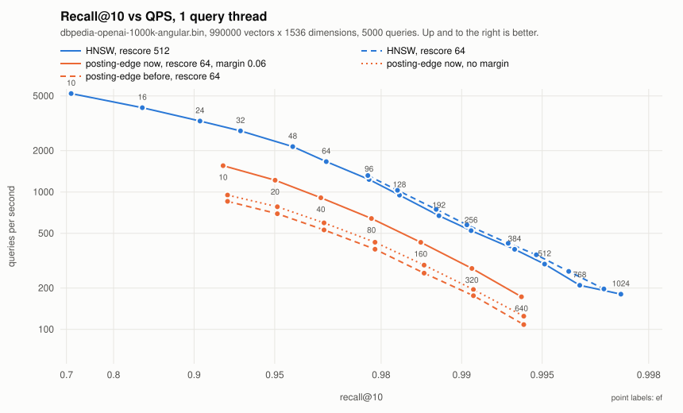
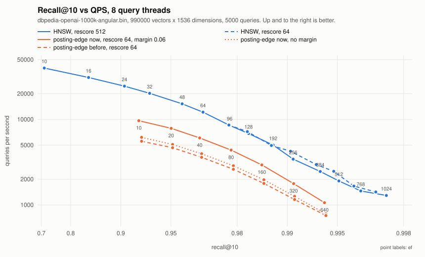

# Índice posting+edges en memoria (v1): benchmark end-to-end contra HNSW

**Fecha:** 2026-11-10 (v1 y v1.1) y 2026-11-11 (v1.2) · **Rama:** `feat/posting-edge-index` · **Paquete:** `adapters/repos/db/vector/postingedge` (nombre provisional)
**Dataset:** dbpedia-openai-1000k-angular (990 000 × 1536d, cosine, GT exacto top-100), el de las sims de `findings.md`
**Máquina:** Apple M1 Max (8P+2E), 64 GB, Go 1.27, GOMAXPROCS=10, escritorio en uso ligero en el v1 y el v1.1, en reposo y de noche en el v1.2

## Resumen, al cierre del 2026-11-17

*Una página. Cada cifra sale de las secciones de abajo. Incluye la noche del 13 al 14 (v1.6: el kernel de #13880 en los dos brazos, el ef de centroides y una arista por posting de destino), el cambio del ef de centroides a 8 del 16, el streaming en memoria del 16 (v2.0), con el barrido del ef de inserción (v2.1), y el crecimiento desde el 10 % del 17 (v2.2), con su diagnóstico de aristas o partición.*

**Titulares.** wiki-dpr e5, 768d. Ratio = QPS de HNSW (rescoreLimit 512) / QPS de posting-edge (rescoreLimit 200), a igual recall. Sin el kernel de #13880, los rangos de 10M son los dos builds de HNSW de v1.4. Con el kernel, son las dos rondas de un tercer build.

| | 1M | 10M |
|---|---|---|
| heap del índice | 165 MB, 0.49x de HNSW (335 MB) | 1 712 MB, 0.50x de HNSW (3 418 MB) |
| ratio a 0.95, 1 / 8 threads, sin el kernel | 1.53x / 1.26x | 2.10x–2.14x / 2.09x–2.20x |
| ratio a 0.95, 1 / 8 threads, con el kernel (v1.6) | sin medir | 2.01x–2.08x / 2.02x–2.04x |
| ratio a 0.99, 1 / 8 threads, sin el kernel | 0.77x / 0.62x: posting-edge por delante | 1.36x–1.72x / 1.34x–1.82x |
| ratio a 0.99, 1 / 8 threads, con el kernel (v1.6) | sin medir | 1.03x–1.05x / 1.02x–1.04x |
| gate de 0.99, subiendo solo ef | se cumple con rescoreLimit 200: 0.9904 a ef=160 | se cumple con rescoreLimit 200: 0.9909 a ef=160 |
| cobertura | completa: 0 vectores perdidos o repetidos | completa: 0 perdidos o repetidos; 9 999 de 10 000 se encuentran a sí mismos |

- **Los ratios de 10M llevan la variación entre builds de HNSW,** que es del orden de lo que se mide. El tercer build va de un 6 a un 13 % más rápido que los de v1.4 a 0.95, y necesita ef 394 para 0.99 donde uno de ellos necesitaba 256. Por eso, con el kernel, el ratio queda fuera de la banda pre-registrada (1.78x–2.01x), por encima, aunque posting-edge ganó lo estimado.
- **El ratio crece con N; las cargas no.** A 0.95, posting-edge carga 13.4 postings a 1M y 12.6 a 10M. Lo que crece son los endpoints: el grado sube de 9.7 a 11.4 aristas por vector, porque con S fijo caen menos vecinos en el posting propio.
- **dbpedia 1M (1536d):** 263.5 MB de índice frente a 420.1 de HNSW (v1). Ratio de 1.93x a 0.95 y 2.32x a 0.99 con 1 thread (v1.2).

**Defaults cerrados:**

- código completo y S=236 vectores por posting, fijado;
- ef 20, lotes de 4 postings por ronda y una entrada;
- ef de centroides 8 (antes 64): no pierde recall a 1M ni a 10M, y a 10M da de un 15 a un 22 % más de QPS a 0.95 (v1.6, cierre del 16);
- margen de source automático (0.06 en cosine);
- rescoreLimit 64 a 1536d; a 768d va acoplado, 200 (400 para 0.99);
- P=256 y R=64. A 10M hacen falta P=320 y R=256 para un recall de arista de 0.94.

Todo default pasa el gate de 0.99 subiendo solo ef.

**Opt-in.** El modo memoria es `CodeBits` 768, a 1536d: un 34 % menos de índice, a 0.74x del QPS a 0.95 y 0.90x a 0.99. Pide R=512, S=236 fijado y rescoreLimit 200 (400 para 0.99). El de 512 bits es un valor válido sin recomendación. A 768d no hay modo memoria que recomendar: 512 bits ahorra un 18 % a 0.70x–0.77x.

**Lo que murió, y por qué:**

- **Poda triangular por source (v1.1):** poda el 0.1 % de los sources en su mejor caso, frente al 20 % del gate.
- **Códigos capados como default (Fase B):** ninguno iguala el QPS a 0.95; el de 768 bits queda a 0.74x.
- **256 bits en memoria (Fase B):** el routing necesita los bits, y carga 3.0x postings a igual recall.
- **Celda desacoplada en memoria:** scan a 256 bits y routing completo. No llega a 0.99 y queda a 0.37x a 0.95, con más memoria. Pasa a disco como layout (c).
- **S mayor que 236 (Fase C):** el scan crece con S y los endpoints casi no bajan; ningún S domina.
- **FastScan en memoria:** pediría una segunda copia de los códigos, 992 MB a 10M. Pasa a disco, donde no cuesta.
- **Cap de grado (v1.5):** empata a 0.95 y pierde un 28 a 32 % a 0.99, porque las aristas que quita llevan recall.
- **Una arista por posting de destino (v1.6):** gana un 5.4 % a 0.95 con 8 threads, pero pierde un 4.4 % a 0.99, donde el umbral era un 2 %. No pierde destinos, pero los ordena peor: a 0.99 hace falta más ef, con un 28 % más de cargas.

**Palancas, por lo medido:**

1. **El ef de centroides (v1.6), ya default.** Bajarlo de 64 a 8 no pierde recall a 10M, ni a 1M en wiki-dpr y dbpedia (check del 16). Da de un 15 a un 22 % más de QPS a 0.95 y de un 6 a un 8 % a 0.99, porque el tiempo de centroides baja a un tercio. Con el kernel, el ratio queda en 1.67x–1.68x a 0.95 frente al build de HNSW de esa noche (informativo).
2. **El kernel de #13880 (v1.6).** Posting-edge gana lo estimado contra el mismo build: un 16 % a 0.95 y un 26 % a 0.99. El ratio baja menos de lo estimado, de 2.10x–2.14x a 2.01x–2.08x, porque el tercer build de HNSW es más rápido. El gate queda fuera de la banda, por encima.
3. **El número de distancias.** Ni el cap ni una arista por posting de destino lo recortan a igual recall a 0.99: lo que quitan vuelve como cargas. A 0.95, una por posting recorta un 9 % de las distancias y un 3.7 % de la query. A 0.99 las sube un 7 %. El cap las sube en los dos puntos.
4. **Contabilidad por endpoint:** el 15 % del tiempo a 0.95. Es ilustrativo.

**Mantenimiento por inserciones (v2.0, del 16).** dbpedia 1M, con el lote sobre el 50 % y el resto insertado, frente al lote del 100 %. En memoria.

- **Sin aristas inversas no aguanta.** Al doblar el corpus pierde 0.034 de recall a ef 10 y carga un 77 % más a 0.95. Con la misma representación, el QPS queda en 0.54x–0.64x a 0.95.
- **Con aristas inversas queda como el lote:** +0.0007 de recall en el peor ef y un 2.3 % más de cargas a 0.95, con 2 070 splits sin reparar.
  - Cada insert escribe 4.62 aristas inversas de media y 11 en el p95, en 3.28 postings distintos.
- **Reparar el split no las sustituye:** por búsqueda recupera el 60 % de lo perdido, y por hermanos, del 10 al 16 %.
- **Hermanos sobre aristas inversas mejoran al lote:** un 4 % menos de cargas a 0.95 y un 17 % menos a 0.99, con listas un 53 % más largas que las de H1.
- **Un insert cuesta su búsqueda:** unas 57 cargas de posting a ef 320, más que una query a 0.99.
- **El ef de inserción se puede bajar a 80 (v2.1):** un insert carga 21.9 postings en lugar de unos 57, escribe lo mismo, y el índice sigue dentro del criterio.
  - Lo paga la query de recall alto: frente a ef 320, un 4 % más de cargas a 0.95 y de un 16 a un 20 % más a 0.99.
  - La condición de 0.99 la cumple por 0.2 puntos, dentro del ruido. Con ef 160 son 34.6 cargas por insert, y cumple con margen.
  - Por debajo no hay dónde ir: ef 40 carga un 23 % más que el lote a 0.99, y con ef 20 el constructor baja de 0.90 de recall de arista.
  - Queda como parámetro del índice, sin repetir la celda (decisión del usuario del 17): 80 por la regla, y 160 si el objetivo de recall es 0.99.
- **La representación por docID cuesta un 15 % de QPS** con 8 threads, con los docIDs barajados.

**Crecer diez veces por inserciones (v2.2, del 17).** dbpedia 1M, con el lote sobre el 10 % y el 90 % insertado con aristas inversas y sin reparar splits, frente al lote del 100 %. En memoria.

- **A 0.99 no aguanta:** carga un 19.6 % más que el lote con ef de inserción 160 y un 17.9 % más con 80, donde el umbral es un 10 %. La celda de ef 80, repetida, carga un 32.0 % más.
  - El recall a igual ef sí cumple (−0.0027 y −0.0037 en el peor ef), y las cargas a 0.95 también (+6.3 y +9.2 %).
- **La deriva crece con el tramo insertado.** Frente a doblar el corpus con el mismo ef, a 0.99 son un 24 % más de cargas con ef 160 y un 7 % más con ef 80.
- **Subir el ef de inserción no lo arregla:** a 0.99 las dos celdas quedan en 63.1 y 62.2 cargas, dentro del ruido.
- **El grado de un vector queda fijado cuando entra:** 7.63 aristas en los del lote del 10 % y 9.47 en los del último tramo, frente a 8.98 de media en el lote del 100 %.
- **Lo que hace un insert depende del tamaño del corpus, no de la historia:** en el último tramo, 36.8 cargas con ef 160 y 23.1 con ef 80, y 4.8 escrituras inversas.
- **El build incremental hace menos trabajo que el lote:** 0.55 veces sus distancias por código con ef 160 y 0.39 con ef 80, y 0.10 veces las exactas, porque el 94 % de las del lote es la asignación n·k.
  - Un insert buscaba dos veces en el grafo de centroides con la misma query. La segunda, el 28 % de sus distancias exactas, está quitada desde el 17, sin volver a medir a 1M.
- **El déficit a 0.99 es de las aristas, no de la partición (diagnóstico del 17).** Con las aristas reconstruidas en lote sobre la partición que dejan los inserts, el índice carga un 0.8 % menos que el lote a 0.99, y su recall a igual ef queda por encima en todos los ef.
  - Lo que queda de la partición: un 3.0 % más de cargas a 0.95 y un 9 % más de aristas. El 17.3 % de los vectores no está en el posting de su centroide más cercano.
  - Las aristas que faltaban son las de los vectores viejos: los del lote del 10 % pasan de 7.63 a 10.26, y los del último tramo, de 9.44 a 9.57.
  - Lo siguiente es un refresco de aristas en segundo plano, sin medir. Reconstruirlas en lote cuesta 1.23 veces las distancias por código del lote entero.
- **Las cargas a 0.99 de un índice crecido no se repiten entre corridas:** las dos de ef 80 se separan un 12.0 %, con el recall a igual ef a 0.0010 como mucho. A 0.99 no separan los dos ef de inserción ni la deriva de ef 80.
  - **Regla de ruido (del usuario, del 17): ninguna comparación a 0.99 entre corridas distintas.** Vale desde v2.3, donde está escrita.

**Limitaciones:**

- **Build en lote:** `AddBatch` solo admite vectores antes de `Build`, que corre una vez; después devuelve `ErrBuilt`. El camino incremental de v2.0 vive en los tests, no en el índice.
- **Sin deletes ni updates:** `Delete`, y volver a añadir un id, devuelven `ErrNotSupported`.
- **Build de ~4x HNSW a 1M y ~8x a 10M:** unas 3 h 45 min frente a 27 min.
  - La asignación exacta es n·k, cuadrática en N con S fijo.
  - P y R crecen con N. Es el riesgo principal para 100M.
- **Solo medido en arm64,** en un M1 Max. x86 y sus kernels (AVX2, AVX-512) están sin medir.
- **Solo en memoria.** El diseño de disco está en `disk-design.md`, sin ningún I/O medido.

## v2.3: refresco de aristas con la búsqueda del insert (pre-registro, 2026-11-17)

**Estado: pre-registrado.** Escrito y commiteado a las 10:59 del 17 (`d8dd553157`), antes de compilar nada de esta ronda. El encargo, las etapas, la definición del refresco, el criterio y la regla de ruido son del usuario. Lo que el encargo deja abierto lo fijo aquí, marcado como mío.

### Qué se mide

El diagnóstico de v2.2 dice que el déficit a 0.99 de un índice crecido diez veces es de las aristas. Lo cierra reconstruyéndolas todas con la regla del lote, que cuesta más distancias por código que un build en lote entero. v2.3 mide si lo cierra un refresco hecho con la búsqueda del propio insert, y cuánto aporta refrescar cada parte del corpus según cuándo entró.

### Protocolo

- **La celda de crecimiento de v2.2 con ef de inserción 80:** lote sobre el 10 %, 891 000 inserts con aristas inversas y sin reparar splits, umbral 360 y checkpoints al 20, 40, 60, 80 y 100 %.
  - El insert es el de ahora, que pregunta una vez al grafo de centroides (desde `eb32538ae3`). Es la primera corrida de 1M con ese insert.
- **Al llegar al 100 %, el refresco, acumulado en tres etapas** (del usuario), midiendo tras cada una:

| etapa | se refrescan | vectores | refrescados en total |
|---|---|---|---|
| 1 | los del lote inicial: los que entraron del 0 al 10 % | 99 000 | 99 000 |
| 2 | hasta la cohorte del 40 %: los que entraron del 10 al 40 % | 297 000 | 396 000 |
| 3 | todos: los que entraron del 40 al 100 % | 594 000 | 990 000 |

- **Refrescar un vector (del usuario) es repetir el paso de aristas de su insert:**
  - la búsqueda, con ef 80;
  - su lista nueva, con los 16 más cercanos fuera de su posting;
  - las escrituras inversas, como en el insert.
- **Cómo lo leo, para escribirlo** (*mío*):
  - **La lista nueva sigue la regla del insert y del lote:** de los 16 vecinos más cercanos que encuentra la búsqueda, los que están fuera de su posting. No son 16 aristas.
  - **Las escrituras inversas son las del insert:** el vector entra en la lista de cada uno de esos vecinos de fuera de su posting cuya peor arista mejora, y esa peor arista sale.
  - **La búsqueda entra por el posting del vector,** sin preguntar al grafo de centroides. En el insert, la búsqueda de aristas entra por el posting del vector. El vector no cambia de posting.
  - **El vector se encuentra a sí mismo.** La búsqueda pide 17 y se le quita, como en la reparación por búsqueda de v2.0. Ocupa uno de los 64 sitios de rescore.
  - **Una arista inversa no se escribe si el vecino ya tiene al vector en su lista.** En un insert no puede pasar. Se cuenta.
  - **Cada vector se refresca una vez,** en el orden en que entró. Una etapa añade los suyos a los de las anteriores y no repite a nadie.
  - **Secuencial,** como los inserts: cada refresco ve las listas que dejaron los anteriores.
  - **No toca nada más:** postings, miembros, centroides, códigos y grafo de centroides se quedan como están. No hay splits.
- **Sin cronometrar.** Son conteos. Los segundos se dan como indicativos.

### Medidas (del usuario)

Antes del refresco y tras cada etapa, sobre el mismo índice y dentro de la misma corrida:

- cargas a 0.95 y a 0.99;
- recall y cargas a igual ef, en la malla de 10 a 1024;
- grado por cohorte;
- coste del refresco, en conteos.

*Mío, lo que cuenta el coste,* por etapa y por vector refrescado:

- **de la búsqueda:** cargas de posting, rondas, distancias por código (scan y endpoints) y candidatos rescoreados;
- **de las aristas inversas:** listas leídas, distancias exactas de comprobarlas, aristas escritas, y vecinos que ya tenían al vector;
- **de la lista propia:** cuántas cambian, y cuántas aristas tenían, tienen y conservan;
- **las escrituras,** como en el insert: listas de otros vectores escritas por refresco, y postings distintos en los que están.

Además, como en cada checkpoint: el recall de arista contra el corpus actual en las dos muestras, y la cobertura. La cobertura no mira si una lista repite una arista: eso se cuenta aparte, antes del refresco y tras cada etapa, y tiene que ser cero.

### Criterio (del usuario)

**El refresco sirve si, con todo refrescado, las cargas a 0.99 quedan a +10 % o menos del lote.**

- *Mío, para aplicarlo:* el lote carga 52.78 postings a 0.99, y +10 % son 58.06. Es la referencia en lote de v2.0, la del criterio de v2.2 y la del diagnóstico.
- **Se reporta qué parte de la recuperación da cada etapa** (del usuario). *Mío:* la recuperación es lo que bajan las cargas a 0.99 de antes del refresco a después de la etapa 3. La parte de una etapa es lo que bajan en ella, sobre ese total, y las tres suman el 100 %.
  - Se da también para las cargas a 0.95 y para el recall a igual ef, y por vector refrescado.
  - Junto a cada parte va la parte de la distancia al lote que cierra, (antes − después) / (antes − lote), como en el diagnóstico.
  - Si el refresco entero no baja las cargas a 0.99, no hay partes que dar: se dan las cifras de cada etapa.
- **Las partes son las de este orden,** de los vectores más viejos a los más nuevos. Lo que aporta una etapa depende de las que van antes.

### Regla de ruido (del usuario)

**Ninguna comparación a 0.99 entre corridas distintas.**

- **Por qué:** dos corridas de la misma celda de ef 80 se separan un 12.0 % en cargas a 0.99 (62.21 y 69.69), con el recall a igual ef a 0.0010 como mucho. El índice crecido cruza 0.99 entre ef 320 y ef 640, donde 0.001 de recall son de 9 a 12 cargas. Está en «Diagnóstico: la celda repetida y el ruido a 0.99».
- **Cómo se aplica aquí** (*mío*):
  - Las etapas se comparan entre sí y con el «antes» de esta misma corrida. Es un solo índice, que cambia solo por el refresco.
  - Nada a 0.99 se compara con las celdas de v2.2, con la corrida del diagnóstico ni con v2.1. Tampoco lo que recupera el refresco con lo que recuperó allí la reconstrucción en lote.
  - El criterio compara con el lote, que es otra corrida, porque así está escrito. Es la única comparación a 0.99 fuera de la corrida. Junto al veredicto se da entre qué dos ef cruza 0.99 el índice refrescado, y su recall en ellos.
- **Lo que sí se compara entre corridas:** el recall a igual ef, las cargas a 0.95 y los conteos de los inserts, cada uno con su suelo de ruido.

### Lo que se reporta además (mío)

- **Una cuarta medida, informativa: tras la etapa 3, las aristas reconstruidas en lote sobre la misma partición,** como en el diagnóstico (P=256, R=64).
  - Es la forma de comparar el refresco por búsqueda con la regla del lote sin salir de la corrida.
  - No entra en el criterio. El grafo de centroides no se rehace: en el diagnóstico no cambió nada.
- **El coste de un refresco junto al de un insert de la misma corrida,** y junto al de la reconstrucción en lote, por vector.

### Lo que no mide

- **Un refresco en segundo plano de verdad.** Aquí va todo al final, de una vez y sin inserts entre medias.
- **Cada cuánto hace falta,** ni una política por edad más fina que las tres etapas.
- **Otro orden.** Con los nuevos primero se sabría si lo que aporta una etapa es de su cohorte o de su turno.
- **Un ef de refresco distinto de 80,** otro dataset, otra escala, deletes, concurrencia y cualquier I/O.

### Lo que el binario añade (mío)

- **`refresh`, en el harness de streaming,** y un flag en la celda con los límites de las etapas.
- **Un flag para que la reconstrucción en lote no rehaga el grafo de centroides.**
- **Tests:** que un refresco deja en la lista del vector lo que da la regla del insert sobre su búsqueda, sin él mismo y sin repetidos; que no toca la partición; que sus aristas inversas son las del insert y no se repiten; y que sobre un índice recién construido en lote, con una búsqueda que lo ve todo, deja las aristas del lote.

**Datos:** `v2.3/dbpedia-1m-grow10-h1-ef80-refresh.json`, de `v2.3/scripts/run_v23_refresh.sh`, y el veredicto en `v2.3/refresh-verdict.md`.

*Smoke después del pre-registro (11:09):* para validar el binario, la cadena y el script de veredicto corrí la cadena entera con 30 000 vectores, fuera del directorio de datos. No predice 1M y no cambia nada de lo escrito arriba. Enseñó una cosa de la cuenta:

- **Casi todos los vecinos de un vector refrescado ya lo tienen en su lista:** 4.2 por refresco, y cada refresco escribe 0.2 aristas inversas de media, donde un insert escribe 4.
  - Ningún vector dejó de encontrarse a sí mismo, y ninguna lista repite una arista.

## v2.2: crecer desde el 10 %, sobre H1 (pre-registro, 2026-11-17)

**Estado: pre-registrado y medido el mismo día.** Escrito y commiteado a las 06:34 del 17, antes de compilar nada de esta ronda. Las dos celdas y el build de conteos del lote corrieron de 06:46 a 08:14, y sus resultados están al final de la sección, desde «Resultados de v2.2 (2026-11-17)». Lo que el encargo deja abierto lo fijo aquí, marcado como mío.

### Qué se mide

En v2.0 y v2.1 el corpus se dobla: el lote construye la mitad y los inserts ponen la otra. Queda sin medir si la deriva crece con el tramo insertado. v2.2 construye en lote el 10 % e inserta el 90 % restante: el corpus se multiplica por diez, y casi todos los postings del final salen de un split.

### Protocolo

- **dbpedia-openai 1M en el orden barajado de v2.0.** Lote sobre el primer 10 % (99 000 vectores) y los otros 891 000 insertados con el mecanismo de H1: aristas inversas, k=16, ef de centroides 8 y split por 2-means sin reparación.
- **Celdas:** ef de inserción 160 y 80.
- **Checkpoints al 20, 40, 60, 80 y 100 %,** además del 10 % de partida. En cada uno:
  - la cobertura;
  - la guardia del constructor, sobre una muestra de 2 000 inserts del tramo que acaba ahí;
  - el tamaño de posting: media, p50, p95 y máximo;
  - las métricas de aristas: recall de arista al insertar, recall de arista contra el corpus actual (de los insertados y de los vectores del lote) y grado;
  - la malla de búsqueda de 10 a 1024, sin cronometrar.
- **La comparación contra el lote se hace al 100 %,** con la referencia de v2.0 (`v2.0/dbpedia-1m-stream-principal-reference.json`). No se reconstruye para medir recall.
  - Los checkpoints intermedios no tienen referencia en lote. Su recall y sus cargas se guardan como informativos.
- **Sin cronometrar.** Son conteos, así que las dos celdas corren en paralelo, cada una en su proceso. Los µs por insert se guardan como indicativos, con esa contención.

*Diferencias con las celdas de v2.1 (mío):*

- **El grafo de centroides se limpia de lápidas en cada checkpoint,** cinco veces. En v2.1 se limpiaba una, al 100 %. Al crecer diez veces se retiran unos 3 700 postings; sin limpiar, casi la mitad de los nodos del grafo serían lápidas al final.
- **Los tramos son más largos:** el primero es el 10 % del corpus y los demás el 20 %, frente al 10 % de v2.0 y v2.1. La muestra de la guardia sigue siendo de 2 000 inserts por tramo.
- **Al 10 % el ground truth enviado no alcanza.** Lleva los 100 vecinos de cada query sobre el corpus entero, y con un 10 % vivo cerca de la mitad de las queries tienen menos de 10 vivos entre ellos. Para esas se calcula por fuerza bruta sobre los vivos, y se cuentan (`truthFallbacks`).

### El umbral de split

**Regla del usuario:** empieza en 360. Si el tamaño medio final se sale de ±15 % del lote, se recalibra y se reporta.

*Mío, para aplicarla:*

- **La banda:** el lote del 100 % tiene 4 195 postings, 236.0 vectores de media (el build de conteos de abajo lo confirma). ±15 % es de 200.6 a 271.4.
- **Si la media final de alguna de las dos celdas cae fuera,** se recalibra con el modo que solo asigna y parte, sin aristas, desde el 10 %:
  - umbrales T' = 360 × 236.0 / media final, redondeado a la decena, y T' ± 10 %;
  - se elige el que deje la media final más cerca de 236.0, y las dos celdas se repiten con él;
  - el veredicto sale de la corrida recalibrada, y la de 360 se reporta entera.
- **Si la corrida recalibrada vuelve a caer fuera,** se reporta y se para ahí. No hay tercera corrida.
- *Lo que espero, que no es criterio:* en la calibración de v2.0 la media final fue 0.66 veces el umbral con los cinco umbrales probados. Con 360 serían unos 238, dentro de la banda.

### Criterio

El de v2.1, por celda:

| pre-registro | umbral |
|---|---|
| una celda cumple | al 100 %: recall a igual ef a 0.005 o menos del lote en cada ef de la malla de búsqueda; cargas a 0.95 un 15 % o menos por encima del lote; y cargas a 0.99 un 10 % o menos por encima del lote |
| guardia del constructor | recall de arista al insertar por debajo de 0.90 en un tramo: esa celda se corta en ese checkpoint y se reporta. La otra sigue |
| cobertura | stop, por celda |

*Mío, para lo que la regla no dice:*

- **No hay ef elegido en esta ronda.** El ef de inserción es un parámetro (decisión del usuario del 17); aquí se dice si cada uno de los dos aguanta crecer diez veces.
- **Una celda cortada no cumple.**
- **Suelo de ruido:** el de v2.0 al 100 %, de las dos corridas de H1 con ef 320. Es hasta 0.0009 de recall, un 0.5 % en cargas a 0.95 y un 3.0 % en cargas a 0.99. Una condición que se cumpla o falle por menos que ese suelo se marca como no distinguible del ruido.

### Lo que se reporta además

- **La tasa de asignaciones no-nearest,** por tramo y acumulada. Al final casi todos los centroides salen de un split, y no de la partición del lote.
- **La tendencia por tramo** de las escrituras de aristas inversas (media, p95 y postings distintos) y del grado.
  - *Mío:* el grado se da de dos formas. Al insertar, de la muestra del tramo. Y exacto por cohorte en cada checkpoint: el grado medio de los vectores del lote y de los inserts de cada tramo, contado sobre todos ellos y no sobre una muestra.
- **Las cargas de posting por insert,** por tramo: el conteo directo de su búsqueda, como en v2.1.
- **La diferencia frente a la H1 de 50 → 100 %,** al mismo ef de inserción: las celdas de ef 160 y de ef 80 de v2.1. Al 100 %: recall a igual ef, cargas y endpoints a 0.95 y a 0.99, recall de arista contra el corpus actual, grado, escrituras inversas y no-nearest.
  - *Mío:* digo que la deriva crece con el tramo insertado si la celda de v2.2 queda peor que la de v2.1 por más que el suelo de ruido, en recall o en cargas.
- **El trabajo total del build incremental, en conteos, frente al del lote.**

### El trabajo de un build, en conteos (mío)

Tres unidades, para el lote del 100 % y para cada celda (su lote del 10 % más sus 891 000 inserts):

| unidad | en el lote | en el camino incremental |
|---|---|---|
| cargas de posting | los postings que el constructor de aristas sondea: P=256 por vector | las del lote del 10 %, más las de la búsqueda de cada insert |
| distancias por código | los candidatos que el constructor de aristas ordena por código | las del lote del 10 %, más los vectores escaneados y los endpoints puntuados de cada búsqueda |
| distancias exactas, a 1536d | el 2-means de la partición, la asignación exacta (n·k), el rescore de las aristas (R=64 por vector) y la construcción del grafo de centroides | las del lote del 10 %; por insert, la búsqueda en el grafo de centroides, el rescore y la comprobación de las aristas inversas; por split, el 2-means, las distancias de cada miembro a las dos medias y las dos altas en el grafo; y la limpieza de lápidas de cada checkpoint |

- **Las cargas del lote son visitas, no lecturas.** El constructor en lote recorre los vectores por posting, y los vecinos de posting comparten casi todos sus sondeos. En disco no leería 256 postings por vector. Sus cargas son una cota superior de lo que leería; la comparación que se sostiene es la de distancias.
- **Fuera de la cuenta:** la comprobación del centroide exacto de cada insert, que solo sirve al informe (da la tasa de no-nearest); la fuerza bruta de la guardia y de las métricas de aristas; las búsquedas de los checkpoints; y el entrenamiento y la codificación.
- **Cómo se cuenta:**
  - `BuildStats` gana los conteos que le faltan: las distancias de la partición y de la asignación, los postings sondeados y los candidatos rescoreados. Los candidatos ordenados por código ya estaban.
  - Las distancias del grafo de centroides se cuentan con un proveedor de distancia que cuenta, puesto en el grafo solo desde el benchmark.
  - Las estadísticas del streaming ganan las distancias de la asignación y del split.
- **El lote del 100 % se construye una vez más, solo para contar.** Es el mismo build que la referencia de v2.0 (mismo orden, misma semilla), sin ninguna búsqueda. Corre en un tercer proceso, a la vez que las dos celdas. La referencia de recall sigue siendo el fichero de v2.0.

### Lo que el binario añade (mío)

- **El punto de partida del lote, como flag.** Hasta ahora era la mitad del corpus, fija en el código.
- **El grado exacto por cohorte** en cada checkpoint.
- **Los conteos del trabajo del build** de la sección anterior, y un modo que construye el lote y solo escribe sus conteos y sus tamaños de posting.

*Smoke después del pre-registro (06:43):* para validar el binario, la cadena y el script de veredicto corrí la cadena entera con 30 000 vectores, fuera del directorio de datos. No predice 1M y no cambia nada de lo escrito arriba. Enseñó una cosa de la cuenta:

- **Un insert busca dos veces en el grafo de centroides con la misma query:** una para su posting y otra para la entrada de su búsqueda de aristas, que pide el mismo centroide más cercano. Las dos se cuentan, por separado, y en los resultados se dice cuánto es la repetida.
  - *Quitada el 17, después del diagnóstico:* «La búsqueda repetida en el grafo de centroides, quitada».

### Resultados de v2.2 (2026-11-17)

*Escrito el 17 por la mañana, con la cadena acabada (08:14). Las tablas completas están en `v2.2/growth-verdict.md`, de `v2.2/scripts/growth_verdict.py`.*

**Veredicto: ninguna de las dos celdas cumple el criterio. Las dos fallan la condición de cargas a 0.99,** por 9.6 y 7.9 puntos, con un suelo de ruido del 3.0 %. El recall a igual ef y las cargas a 0.95 cumplen con margen. El umbral de split no se recalibra: el tamaño medio final queda un 2.5 y un 2.9 % por encima del lote.

*Del diagnóstico, el mismo día («Diagnóstico: resultados»):* la repetición de la celda de ef 80 carga 69.7 postings a 0.99, un 32.0 % más que el lote y un 12.0 % más que la primera corrida. Las tres corridas fallan la condición. El tamaño del fallo solo se conoce entre un 18 y un 32 %: el suelo de ruido del 3.0 % no vale para esta medida.

| pre-registro | resultado al 100 % |
|---|---|
| tamaño medio final a ±15 % del lote (de 200.6 a 271.4) | **dentro:** 241.8 con ef 160 y 242.8 con ef 80, frente a 236.0. El umbral se queda en 360 |
| ef 160 | **no cumple:** cargas a 0.99 +19.6 %, donde el umbral es +10 %. Cumplen el recall (peor diferencia −0.0027) y las cargas a 0.95 (+6.3 %) |
| ef 80 | **no cumple:** cargas a 0.99 +17.9 %. Cumplen el recall (peor diferencia −0.0037) y las cargas a 0.95 (+9.2 %) |
| guardia del constructor | no corta: el peor tramo queda en 0.9738 con ef 160 y en 0.9626 con ef 80 |
| cobertura | completa en los seis checkpoints de las dos celdas |
| ¿crece la deriva con el tramo insertado? | **sí.** Frente a la H1 de 50 → 100 % con el mismo ef: un 23.7 % más de cargas a 0.99 con ef 160 y un 7.3 % más con ef 80, y un 3 % más a 0.95 en las dos |

**Por celda, al 100 %,** junto a la celda de v2.1 con el mismo ef de inserción, que parte del 50 %:

| | lote del 100 % | ef 160, desde el 10 % | ef 160, desde el 50 % (v2.1) | ef 80, desde el 10 % | ef 80, desde el 50 % (v2.1) |
|---|---|---|---|---|---|
| peor diferencia de recall a igual ef | | −0.0027 | −0.0001 | −0.0037 | −0.0024 |
| cargas a 0.95 | 10.1 | 10.7 (+6.3 %) | 10.4 (+3.0 %) | 11.0 (+9.2 %) | 10.7 (+6.2 %) |
| cargas a 0.99 | 52.8 | 63.1 (+19.6 %) | 51.0 (−3.3 %) | 62.2 (+17.9 %) | 58.0 (+9.8 %) |
| endpoints a 0.95 | 4 953 | 5 246 | 5 140 | 5 428 | 5 300 |
| endpoints a 0.99 | 26 634 | 32 628 | 26 760 | 31 806 | 29 760 |
| postings, y su tamaño medio | 4 195, 236.0 | 4 094, 241.8 | 4 142, 239.0 | 4 077, 242.8 | 4 168, 237.5 |
| inserts | | 891 000 | 495 000 | 891 000 | 495 000 |
| splits | | 3 674 | 2 044 | 3 657 | 2 070 |
| cargas de posting por insert: media (p50 / p95) | | 34.2 (33 / 69) | 34.6 (33 / 69) | 21.5 (21 / 41) | 21.9 (21 / 45) |
| escrituras inversas por insert: media / p95 | | 4.57 / 11 | 4.58 / 11 | 4.52 / 11 | 4.54 / 11 |
| asignaciones no-nearest | | 2.63 % | 2.43 % | 2.68 % | 2.54 % |
| cumple | | **no** | sí | **no** | sí, a 0.99 dentro del ruido |

**Lo que deja para el diseño de mantenimiento:**

- **Las aristas inversas sin reparar el split aguantan doblar el corpus, y no aguantan multiplicarlo por diez si el objetivo es 0.99.** A 0.95 sí: un 6.3 y un 9.2 % más de cargas que el lote, con el umbral en un 15 %.
- **Subir el ef de inserción no lo arregla.** A 0.99 las dos celdas quedan a un 1.4 % una de otra (63.1 y 62.2 cargas), dentro del ruido. Al doblar el corpus, la de ef 80 cargaba un 14 % más que la de ef 160.
- **A igual ef de búsqueda, el índice crecido pierde de 0.0005 a 0.0015 de recall de ef 160 en adelante y carga de un 6 a un 7 % más de postings,** con cualquiera de los dos ef de inserción.
- **El grado de un vector queda fijado cuando entra.** Los del lote del 10 % se quedan con 7.63 aristas y los del último tramo entran con 9.47. En el lote del 100 % la media es 8.98.
- **Lo que lee y escribe un insert depende del tamaño del corpus y no de cómo se llegó a él:** en el tramo del 80 al 100 %, un 3 % más de cargas y un 1 % más de escrituras inversas que en la celda que parte del 50 %.
- **El build incremental hace menos trabajo que el lote:** 0.55 veces sus distancias por código con ef 160 y 0.39 con ef 80, y 0.10 veces sus distancias exactas. El índice que deja no es el del lote: es el que falla a 0.99.
- ***Del diagnóstico:* el déficit a 0.99 es de las aristas.** Reconstruidas en lote sobre la partición final de la celda de ef 80, el índice carga un 0.8 % menos que el lote a 0.99.

### Resultados de v2.2: condiciones

- **Corrida:** tres procesos a la vez, de 06:46 a 08:14: las dos celdas y el build de conteos del lote del 100 %. El build de conteos acabó a las 06:59, la celda de ef 80 a las 08:01 y la de ef 160 a las 08:14.
  - Son conteos, así que la contención no les afecta.
  - Los µs por insert son indicativos: 4 020 con ef 160 y 3 088 con ef 80. Unos 1 090 son el check del centroide exacto, que solo reporta.
- **Stops: ninguno.**
  - Cobertura completa en los seis checkpoints de cada celda.
  - La guardia del constructor queda lejos de 0.90 en todos los tramos.
  - Ningún split falla: son 3 674 con ef 160 y 3 657 con ef 80.
- **El umbral de split se queda en 360.** La media final es 241.8 y 242.8, dentro de la banda de ±15 %. No hay corrida recalibrada.
  - La media final es 0.67 veces el umbral. En la calibración de v2.0 era 0.66.
  - En los checkpoints intermedios la media va de 234.6 a 242.2.
  - La cola es más corta que la del lote: p95 de 343 a 345 y máximo 360, frente a 380 y 786.
- **El lote del 10 %:** 99 000 vectores en 420 postings, con 235.7 de media, p95 362 y máximo 568. Su recall de arista es 0.9935 (0.9915 a nivel de posting), con 7.63 aristas por vector.
  - Es el mismo build en las dos celdas: su recall a ef 10 es 0.9530 y 0.9531.
- **Ground truth por fuerza bruta:** 2 202 de las 5 000 queries al 10 %, 14 al 20 % y ninguna después.
- **El build de conteos da el lote de la referencia:** 4 195 postings de 236.0 vectores de media y 8.98 aristas por vector.

### Resultados de v2.2: el criterio, celda a celda

**Recall a igual ef de búsqueda al 100 %,** como diferencia frente al lote:

| ef de búsqueda | lote | 160, desde el 10 % | 160, desde el 50 % (v2.1) | 80, desde el 10 % | 80, desde el 50 % (v2.1) |
|---|---|---|---|---|---|
| 10 | 0.9229 | −0.0027 | +0.0008 | −0.0037 | −0.0024 |
| 20 | 0.9506 | +0.0002 | +0.0010 | −0.0021 | −0.0013 |
| 40 | 0.9664 | −0.0002 | +0.0003 | −0.0023 | −0.0019 |
| 80 | 0.9782 | −0.0016 | −0.0001 | −0.0021 | −0.0018 |
| 160 | 0.9858 | −0.0015 | +0.0003 | −0.0015 | −0.0015 |
| 320 | 0.9908 | −0.0010 | +0.0008 | −0.0010 | −0.0006 |
| 640 | 0.9940 | −0.0010 | +0.0010 | −0.0008 | +0.0002 |
| 1024 | 0.9960 | −0.0009 | +0.0007 | −0.0005 | −0.0002 |
| peor | | −0.0027 | −0.0001 | −0.0037 | −0.0024 |

**Las tres condiciones,** con el suelo de ruido de v2.0 (0.0009 de recall, un 0.5 % en cargas a 0.95 y un 3.0 % a 0.99):

| celda | peor diferencia de recall (umbral −0.005) | cargas a 0.95 (umbral +15 %) | cargas a 0.99 (umbral +10 %) | guardia: peor tramo (umbral 0.90) | cumple |
|---|---|---|---|---|---|
| 160, desde el 10 % | −0.0027: cumple | 10.7 (+6.3 %): cumple | 63.1 (+19.6 %): no cumple | 0.9738 | **no** |
| 80, desde el 10 % | −0.0037: cumple | 11.0 (+9.2 %): cumple | 62.2 (+17.9 %): no cumple | 0.9626 | **no** |
| 160, desde el 50 % (v2.1) | −0.0001: cumple | 10.4 (+3.0 %): cumple | 51.0 (−3.3 %): cumple | 0.9765 | sí |
| 80, desde el 50 % (v2.1) | −0.0024: cumple | 10.7 (+6.2 %): cumple | 58.0 (+9.8 %): cumple, no distinguible del ruido | 0.9623 | sí |

- **Las dos fallan por las cargas a 0.99, y no por el ruido:** 63.1 y 62.2 cargas, frente a un umbral de 58.1. Quedan 9.6 y 7.9 puntos por encima, con un suelo de 3.0.
- **El recall cumple con margen:** 0.0023 y 0.0013 hasta el umbral, con un suelo de 0.0009. El peor punto de las dos es ef 10.
- **Las cargas a 0.95 cumplen con margen:** 8.7 y 5.8 puntos.
- **El ef de inserción deja de separar las celdas en los ef de búsqueda altos.** De ef 160 a 1024 la diferencia entre las dos es de 0.0004 como mucho. De ef 10 a 80, la de ef 160 queda de 0.0005 a 0.0023 por encima.

**El trabajo de una query a igual ef de búsqueda,** en cargas de posting y frente al lote:

| ef de búsqueda | lote | 160, desde el 10 % | 80, desde el 10 % | 160, desde el 50 % (v2.1) | 80, desde el 50 % (v2.1) |
|---|---|---|---|---|---|
| 10 | 7.58 | 8.01 (+5.7 %) | 7.90 (+4.2 %) | 7.88 (+4.0 %) | 7.84 (+3.5 %) |
| 20 | 10.13 | 10.78 (+6.4 %) | 10.60 (+4.7 %) | 10.54 (+4.1 %) | 10.53 (+3.9 %) |
| 40 | 14.56 | 15.43 (+6.0 %) | 15.37 (+5.6 %) | 15.06 (+3.4 %) | 15.07 (+3.6 %) |
| 80 | 22.12 | 23.65 (+6.9 %) | 23.56 (+6.5 %) | 22.99 (+3.9 %) | 22.82 (+3.2 %) |
| 160 | 35.18 | 37.54 (+6.7 %) | 37.41 (+6.3 %) | 36.41 (+3.5 %) | 36.38 (+3.4 %) |
| 320 | 57.27 | 61.16 (+6.8 %) | 60.72 (+6.0 %) | 59.17 (+3.3 %) | 59.11 (+3.2 %) |
| 640 | 95.54 | 101.69 (+6.4 %) | 101.00 (+5.7 %) | 98.40 (+3.0 %) | 98.08 (+2.7 %) |
| 1024 | 136.38 | 145.38 (+6.6 %) | 144.32 (+5.8 %) | 140.53 (+3.0 %) | 140.31 (+2.9 %) |

- **El fallo a 0.99 tiene dos partes.**
  - **El recall a igual ef:** a ef 320 las dos celdas quedan en 0.9898, 0.0010 por debajo del lote. El cruce de 0.99 pasa del tramo de ef 160 a 320, donde lo tiene el lote, al de 320 a 640.
  - **Las cargas a igual ef:** cada ef carga de un 6 a un 7 % más de postings que en el lote. Al doblar el corpus era de un 3 a un 4 %.
- **Los endpoints suben más que las cargas:** de un 9 a un 10 % más que el lote de ef 80 en adelante con ef de inserción 160, y de un 7 a un 8 % más con ef 80.
- **A 0.99 son dos rondas y media más:** 15.5 y 15.3 rondas, frente a 12.9 del lote.

**Los checkpoints intermedios.** Son informativos: no hay lote de ese tamaño con el que compararlos.

| checkpoint | ef 160: recall a ef 10 | cargas a 0.95 | cargas a 0.99 | ef 80: recall a ef 10 | cargas a 0.95 | cargas a 0.99 |
|---|---|---|---|---|---|---|
| 10 %, el lote | 0.9530 | 6.4 | 16.3 | 0.9531 | 6.4 | 16.3 |
| 20 % | 0.9428 | 7.5 | 22.6 | 0.9426 | 7.5 | 23.8 |
| 40 % | 0.9344 | 8.8 | 34.4 | 0.9326 | 8.9 | 37.6 |
| 60 % | 0.9297 | 9.5 | 41.6 | 0.9282 | 9.7 | 44.4 |
| 80 % | 0.9260 | 10.1 | 52.6 | 0.9217 | 10.4 | 55.8 |
| 100 % | 0.9203 | 10.7 | 63.1 | 0.9192 | 11.0 | 62.2 |
| lote del 100 % | 0.9229 | 10.1 | 52.8 | | | |

- **De aquí no sale dónde se rompe el criterio.** Las cargas suben con el corpus también en un lote: el del 10 % necesita 16.3 a 0.99 y el del 100 %, 52.8.
- **La celda de ef 160 va por delante de la de ef 80 hasta el 80 %** (52.6 frente a 55.8 cargas a 0.99) y la pierde en el último tramo.
  - *Mío:* en ese tramo su recall a ef 320 baja de 0.9914 a 0.9898 y el cruce de 0.99 cambia de tramo de la malla. La interpolación es lineal entre puntos, así que el salto del 80 al 100 % (un 20 % más de cargas) lleva algo de eso. La comparación con el lote se hace igual en los dos lados.

### Resultados de v2.2: por tramo

*Lo que hicieron los inserts de cada tramo. Las cargas, las escrituras y la tasa de no-nearest cuentan todos los inserts del tramo. El grado al insertar y el recall de arista salen de la muestra de la guardia, de 2 000 inserts por tramo.*

**ef de inserción 160:**

| tramo | inserts | splits | no-nearest | cargas por insert: media (p50 / p95) | rondas | recall de arista al insertar (posting) | grado al insertar | escrituras inversas: media (p95) | postings distintos: media (p95) | listas leídas |
|---|---|---|---|---|---|---|---|---|---|---|
| 10 → 20 % | 99 000 | 424 | 1.61 % | 29.7 (29 / 57) | 7.2 | 0.9873 (0.9806) | 8.07 | 4.11 (10) | 2.76 (7) | 7.77 |
| 20 → 40 % | 198 000 | 815 | 2.09 % | 32.2 (29 / 61) | 7.8 | 0.9789 (0.9699) | 8.74 | 4.44 (11) | 3.08 (7) | 8.34 |
| 40 → 60 % | 198 000 | 806 | 2.91 % | 34.4 (33 / 65) | 8.3 | 0.9803 (0.9717) | 9.05 | 4.59 (11) | 3.26 (8) | 8.75 |
| 60 → 80 % | 198 000 | 809 | 2.93 % | 35.7 (33 / 69) | 8.7 | 0.9738 (0.9655) | 9.19 | 4.70 (11) | 3.37 (8) | 8.98 |
| 80 → 100 % | 198 000 | 820 | 3.12 % | 36.8 (33 / 73) | 9.0 | 0.9743 (0.9653) | 9.36 | 4.79 (11) | 3.46 (8) | 9.18 |
| todo | 891 000 | 3 674 | 2.63 % | 34.2 (33 / 69) | 8.3 | | | 4.57 (11) | 3.23 (8) | 8.70 |

**ef de inserción 80:**

| tramo | inserts | splits | no-nearest | cargas por insert: media (p50 / p95) | rondas | recall de arista al insertar (posting) | grado al insertar | escrituras inversas: media (p95) | postings distintos: media (p95) | listas leídas |
|---|---|---|---|---|---|---|---|---|---|---|
| 10 → 20 % | 99 000 | 411 | 1.53 % | 18.7 (17 / 37) | 4.4 | 0.9787 (0.9655) | 8.06 | 4.07 (10) | 2.72 (7) | 7.71 |
| 20 → 40 % | 198 000 | 806 | 2.42 % | 20.3 (21 / 41) | 4.8 | 0.9642 (0.9482) | 8.76 | 4.39 (11) | 3.03 (7) | 8.29 |
| 40 → 60 % | 198 000 | 831 | 2.81 % | 21.6 (21 / 41) | 5.2 | 0.9651 (0.9484) | 8.98 | 4.54 (11) | 3.20 (8) | 8.67 |
| 60 → 80 % | 198 000 | 802 | 2.99 % | 22.4 (21 / 45) | 5.4 | 0.9626 (0.9453) | 9.18 | 4.65 (11) | 3.32 (8) | 8.92 |
| 80 → 100 % | 198 000 | 807 | 3.08 % | 23.1 (21 / 45) | 5.5 | 0.9626 (0.9465) | 9.41 | 4.73 (11) | 3.40 (8) | 9.13 |
| todo | 891 000 | 3 657 | 2.68 % | 21.5 (21 / 41) | 5.1 | | | 4.52 (11) | 3.18 (8) | 8.64 |

**La tasa de asignaciones no-nearest:**

- **Se dobla a lo largo de la corrida:** de un 1.6 a un 3.1 % con ef 160, y de un 1.5 a un 3.1 % con ef 80. Acumulada queda en un 2.63 y un 2.68 %.
- **Al mismo tamaño de corpus, el índice crecido desde el 10 % asigna peor.** En el tramo del 80 al 100 %, las celdas de v2.1 tenían un 2.48 y un 2.60 %: aquí son 0.6 y 0.5 puntos más.
  - *Mío:* la comparación lleva dos diferencias a la vez. Aquí casi todos los centroides salen de un split: de los 4 094 del final, como mucho 420 son del lote. Y el grafo se limpió de lápidas cinco veces, no una. No las separo.
- **La cobertura no depende de ella:** un vector que no va al centroide más cercano está en un posting, y solo en uno.

**Las cargas de posting por insert:**

- **Crecen un 24 % entre el primer tramo y el último:** de 29.7 a 36.8 con ef 160, y de 18.7 a 23.1 con ef 80.
  - *Mío:* entre la mitad de un tramo y la del otro el corpus se multiplica por seis, unas 2.6 duplicaciones. Sale a un 9 % por duplicación, cerca del 7 % de v2.1.
- **En el tramo del 80 al 100 % son las de v2.1 más un 3 %:** 36.8 frente a 35.6 con ef 160, y 23.1 frente a 22.5 con ef 80.

**Las escrituras de aristas inversas:**

- **Crecen con el corpus, cada vez menos:** 4.11, 4.44, 4.59, 4.70 y 4.79 por insert con ef 160. El p95 es 10 en el primer tramo y 11 en los demás.
- **Los postings distintos en los que escribe un insert,** de 2.76 a 3.46, con el p95 de 7 a 8.
- **Siguen al grado:** un insert lee las listas de 7.8 vecinos de fuera de su posting en el primer tramo y de 9.2 en el último, y escribe en algo más de la mitad.
- **Dependen del tamaño del corpus, no de la historia:** en el tramo del 80 al 100 % son 4.79 con ef 160, frente a 4.72 en la celda que parte del 50 %, y 4.73 frente a 4.69 con ef 80.
- **Acumulado, con ef 160:** 4.57 de media, p50 4, p95 11 y máximo 16. El 10.4 % de los inserts no escribe ninguna, y el 19.8 % escribe 8 o más. Con ef 80 son 4.52, el 10.7 % y el 19.5 %.

**El grado al insertar y la guardia:**

- **Un vector entra con más aristas cuanto mayor es el corpus:** 8.07, 8.74, 9.05, 9.19 y 9.36 con ef 160, de la muestra.
- **El recall de arista al insertar baja en los dos primeros tramos y ahí se queda:** 0.987, 0.979, 0.980, 0.974 y 0.974 con ef 160, y 0.979, 0.964, 0.965, 0.963 y 0.963 con ef 80. Desde el 40 % son los valores de v2.1 (0.977 y 0.963).

### Resultados de v2.2: el grado por cohorte y las aristas contra el corpus actual

**Grado medio de cada cohorte,** contado sobre todos sus vectores y no sobre una muestra:

| celda | lote del 10 % | 10 → 20 % | 20 → 40 % | 40 → 60 % | 60 → 80 % | 80 → 100 % | todo el índice, al 100 % |
|---|---|---|---|---|---|---|---|
| ef 160 | 7.63 | 8.10 | 8.69 | 9.08 | 9.30 | 9.47 | 8.88 |
| ef 80 | 7.63 | 8.05 | 8.65 | 9.01 | 9.25 | 9.43 | 8.84 |
| lote del 100 % | | | | | | | 8.98 |

- **El grado de una cohorte no cambia después de su tramo.** En todos los checkpoints posteriores es el mismo, a la centésima.
  - Es por construcción: una arista inversa ocupa el sitio de la peor arista de la lista, y el split no toca aristas. La lista de un vector cambia de contenido y no de longitud.
- **El grado con el que entra un vector crece con el corpus.** En un lote son 7.63 aristas con 99 000 vectores y 8.98 con 990 000. Los vectores viejos se quedan con el de su momento.
- **En total, el índice crecido tiene un 1.1 % menos de aristas que el lote** con ef 160 (8.79 millones frente a 8.89), y un 1.6 % menos con ef 80. Están repartidas de otra forma: faltan en los vectores viejos y sobran en los nuevos.

**Recall de arista contra el corpus actual,** de una muestra de 2 000 vectores de cada grupo. A nivel de vector y, entre paréntesis, de posting:

| checkpoint | ef 160: insertados | ef 160: vectores del lote | ef 80: insertados | ef 80: vectores del lote |
|---|---|---|---|---|
| 10 % | | 0.9935 (0.9915) | | 0.9935 (0.9915) |
| 20 % | 0.8070 (0.8643) | 0.6629 (0.7728) | 0.8002 (0.8546) | 0.6641 (0.7720) |
| 40 % | 0.7621 (0.8315) | 0.5508 (0.6769) | 0.7520 (0.8167) | 0.5486 (0.6774) |
| 60 % | 0.7349 (0.8116) | 0.5205 (0.6470) | 0.7270 (0.7965) | 0.5156 (0.6355) |
| 80 % | 0.7253 (0.8040) | 0.4984 (0.6151) | 0.7168 (0.7894) | 0.4948 (0.6111) |
| 100 % | 0.7220 (0.7975) | 0.4870 (0.5998) | 0.7061 (0.7800) | 0.4855 (0.5959) |
| v2.1, al 100 % | 0.8169 (0.8615) | 0.6705 (0.7628) | 0.8007 (0.8400) | 0.6673 (0.7606) |

- **Tras la primera duplicación, los vectores del lote quedan donde quedaban en v2.1:** 0.663 al 20 %, frente a 0.671 al doblar desde el 50 %. Después siguen bajando, cada vez menos, hasta 0.487.
- **Los insertados bajan de 0.807 a 0.722,** casi todo antes del 60 %.
- **Es descriptivo.** En v2.0 esta métrica no ordenaba las celdas por recall de búsqueda, así que no la uso como causa.

### Resultados de v2.2: frente a la H1 de 50 → 100 %

Al 100 % y al mismo ef de inserción. La diferencia es la celda que crece desde el 10 % menos la que crece desde el 50 %; el suelo de ruido es el de v2.0.

| al 100 % | ef 160: desde el 50 % | desde el 10 % | diferencia | ef 80: desde el 50 % | desde el 10 % | diferencia | suelo de ruido |
|---|---|---|---|---|---|---|---|
| recall a ef 10 | 0.9237 | 0.9203 | −0.0034 | 0.9206 | 0.9192 | −0.0013 | 0.0009 |
| recall a ef 20 | 0.9516 | 0.9508 | −0.0008, dentro | 0.9494 | 0.9485 | −0.0009, dentro | 0.0009 |
| recall a ef 40 | 0.9667 | 0.9662 | −0.0005, dentro | 0.9645 | 0.9641 | −0.0004, dentro | 0.0009 |
| recall a ef 80 | 0.9781 | 0.9766 | −0.0016 | 0.9764 | 0.9761 | −0.0004, dentro | 0.0009 |
| recall a ef 160 | 0.9862 | 0.9843 | −0.0019 | 0.9843 | 0.9843 | +0.0000, dentro | 0.0009 |
| recall a ef 320 | 0.9917 | 0.9898 | −0.0019 | 0.9902 | 0.9898 | −0.0004, dentro | 0.0009 |
| recall a ef 640 | 0.9950 | 0.9930 | −0.0020 | 0.9942 | 0.9932 | −0.0010 | 0.0009 |
| recall a ef 1024 | 0.9966 | 0.9951 | −0.0016 | 0.9957 | 0.9954 | −0.0003, dentro | 0.0009 |
| cargas a 0.95 | 10.4 | 10.7 | +3.2 % | 10.7 | 11.0 | +2.8 % | 0.5 % |
| endpoints a 0.95 | 5 140 | 5 246 | +2.1 % | 5 300 | 5 428 | +2.4 % | |
| cargas a 0.99 | 51.0 | 63.1 | +23.7 % | 58.0 | 62.2 | +7.3 % | 3.0 % |
| rondas a 0.99 | 12.5 | 15.5 | +24.2 % | 14.2 | 15.3 | +7.5 % | |
| endpoints a 0.99 | 26 760 | 32 628 | +21.9 % | 29 760 | 31 806 | +6.9 % | |
| escrituras inversas por insert, acumulado | 4.58 | 4.57 | −0.01 | 4.54 | 4.52 | −0.02 | |
| postings distintos por insert, acumulado | 3.24 | 3.23 | −0.01 | 3.19 | 3.18 | −0.01 | |
| cargas por insert, del 80 al 100 % | 35.6 | 36.8 | +3.3 % | 22.5 | 23.1 | +2.7 % | |
| escrituras inversas por insert, del 80 al 100 % | 4.72 | 4.79 | +1.4 % | 4.69 | 4.73 | +1.0 % | |
| no-nearest, del 80 al 100 % | 2.48 % | 3.12 % | +0.64 puntos | 2.60 % | 3.08 % | +0.48 puntos | |
| postings al final | 4 142 | 4 094 | −1.2 % | 4 168 | 4 077 | −2.2 % | |

- **La deriva crece con el tramo insertado, en las dos celdas.**
  - **Con ef 160,** el recall queda por debajo en los ocho ef de búsqueda, y por más que el suelo en seis: de 0.0016 a 0.0034. Las cargas suben un 3.2 % a 0.95 y un 23.7 % a 0.99.
  - **Con ef 80,** el recall solo se separa del suelo en dos ef, 10 y 640. Las cargas suben un 2.8 % a 0.95 y un 7.3 % a 0.99.
- **La celda de ef 160 pierde lo que la separaba de la de ef 80.** Al doblar el corpus estaba por delante en todo. Al multiplicarlo por diez solo lo está a 0.95 (10.7 frente a 11.0 cargas) y en los ef de búsqueda bajos.
- **Lo que hace un insert casi no cambia:** las mismas escrituras inversas acumuladas, y en el último tramo un 3 % más de cargas y un 1 % más de escrituras.

### Resultados de v2.2: el trabajo del build, en conteos

En millones. El incremental es su lote del 10 % más sus 891 000 inserts.

| unidad | lote del 100 % | ef 160: lote del 10 % + inserts | total | frente al lote | ef 80: lote del 10 % + inserts | total | frente al lote |
|---|---|---|---|---|---|---|---|
| cargas de posting | 253.4, visitas | 25.3 + 30.5 | 55.8 | 0.22x | 25.3 + 19.2 | 44.5 | 0.18x |
| distancias por código | 51 008 | 5 908 + 22 359 | 28 266 | 0.55x | 5 908 + 13 986 | 19 894 | 0.39x |
| distancias exactas | 4 411.6 | 60.7 + 396.5 | 457.2 | 0.10x | 60.7 + 390.8 | 451.5 | 0.10x |
| exactas, sin la asignación n·k de ningún lote | 258.6 | 19.1 + 396.5 | 415.6 | 1.61x | 19.1 + 390.8 | 409.9 | 1.59x |

**Por vector del lote y por insert:**

| | lote del 100 %, por vector | insert con ef 160 | insert con ef 80 |
|---|---|---|---|
| cargas de posting | 256, visitas | 34.2 | 21.5 |
| distancias por código | 51 523 | 25 094 | 15 698 |
| exactas: asignación | 4 195, n·k | 124.7, por el grafo | 122.2 |
| exactas: entrada de la búsqueda de aristas | | 124.7, la misma búsqueda otra vez | 122.2 |
| exactas: rescore | 64.0 | 64.0 | 64.0 |
| exactas: comprobar las aristas inversas | | 84.2 | 83.5 |
| exactas: partición, o splits | 193.5 | 24.5, y 7.6 de sus altas y bajas en el grafo | 24.4, y 7.5 |
| exactas: grafo de centroides | 3.7, construirlo | 15.1, limpiar lápidas | 14.8 |
| exactas, total | 4 456 | 445.0 | 438.6 |

- **En distancias por código, el incremental hace 0.55 veces las del lote con ef 160 y 0.39 con ef 80.**
  - Un insert con ef 160 calcula la mitad que un vector del lote: 25 094 frente a 51 523.
  - El lote del 10 % sale caro por vector, 59 673: con 420 postings, P=256 sondea el 61 % del corpus.
- **En distancias exactas, 0.10 veces. Casi todo es la asignación del lote:** n·k son 4 153 millones, el 94 % de sus exactas.
  - Sin la asignación de ningún lote, el incremental hace 1.6 veces las del lote: 416 millones frente a 259.
- **La búsqueda repetida en el grafo de centroides son 111 millones con ef 160 y 109 con ef 80:** el 28 % de las exactas de los inserts y el 24 % del total. Un insert que la haga una vez calcula 320 exactas, no 445.
- **Lo que pesa en las exactas de un insert:** las dos búsquedas en el grafo, el 56 %; la comprobación de las aristas inversas, el 19 %; el rescore, el 14 %; los splits, el 7 %; y la limpieza de lápidas, el 3 %.
- **Las cargas no se comparan igual en los dos lados.** Las del lote son visitas: 256 postings sondeados por vector, casi todos compartidos con sus vecinos de posting. Las de los inserts son lecturas de cada insert. Contando lecturas, el 0.22x y el 0.18x subirían.
- **La búsqueda en el grafo crece con el número de centroides:** 107 distancias por insert en el primer tramo y 122 de media en toda la corrida, con ef 80.
- **Fuera de la cuenta,** como en el pre-registro: el check del centroide exacto, la fuerza bruta de la guardia y de las métricas, las búsquedas de los checkpoints, y el entrenamiento y la codificación.
- **Tiempos, indicativos y con los tres procesos a la vez:** el build de conteos del lote tardó 747 s. Los inserts, 3 582 s con ef 160 y 2 751 s con ef 80, de los que unos 970 s son el check del centroide exacto.

*Lectura mía:* el build incremental es más barato que el lote en las tres unidades, pero no construye el mismo índice. La comparación de trabajo vale para dimensionar un insert, y no como argumento para sustituir el lote por inserts.

### Lo que v2.2 no mide

- **Qué parte del déficit a 0.99 es de las aristas y qué parte de la partición.** Las dos celdas comparten las dos cosas. Por un lado, las aristas: nadie rehace las viejas, y el grado queda fijado al entrar. Por otro, la partición: todos los postings salen de un 2-means, y un 3 % de los inserts no va al centroide más cercano.
  - *Mío, sin correr:* lo separa reconstruir en lote las aristas sobre la partición final de una celda. Si las cargas a 0.99 vuelven a las del lote, el déficit es de las aristas.
  - *Medido en el diagnóstico:* vuelven. Con las aristas reconstruidas, 52.39 cargas a 0.99 frente a 52.78 del lote.
- **Dónde se rompe el criterio entre doblar el corpus y multiplicarlo por diez.** Los checkpoints intermedios no tienen lote de su tamaño.
- **Reparar el split.** La celda 6 (aristas inversas más hermanos) y la variante fiel al lote siguen abiertas por decisión del usuario, sin medir en este régimen.
- **La repetición.** Hay una corrida por celda. El suelo de ruido es el de v2.0, medido al doblar el corpus.
  - *Medido en el diagnóstico:* la celda de ef 80 repetida carga un 12.0 % más a 0.99, con el recall a igual ef a 0.0010 como mucho. El suelo de v2.0 no vale para las cargas a 0.99 de este régimen.
- **Otro dataset, otra escala y un corpus que llegue en orden semántico.**
- **Deletes, concurrencia y cualquier I/O.** Las cargas son conteos en memoria.

### Datos y reproducción de v2.2

En `testdata/bench/v2.2/`:

- `dbpedia-1m-grow10-h1-ef<ef>.json`: una celda, con el lote del 10 % y sus conteos (`batchBuild`) y los checkpoints del 10, 20, 40, 60, 80 y 100 %.
  - Cada checkpoint lleva el grado por cohorte (`cohorts`) y las estadísticas acumuladas (`stats`), con las distancias exactas de los inserts: `assignDistances`, `searchCentroidDistances`, `inverseDistances`, `splitDistances`, `splitGraphDistances` y `cleanDistances`.
  - `-cp<porcentaje>.json`: el mismo checkpoint, escrito al acabar de medirlo.
- `dbpedia-1m-batch-buildwork.json`: los conteos del lote del 100 %, sin ninguna búsqueda.
- `growth-verdict.md`: las tablas, de `scripts/growth_verdict.py`, frente a la referencia en lote de `v2.0/` y a las celdas de ef 160 y 80 de `v2.1/`.
- `scripts/run_v22_growth.sh`: el build de conteos y las dos celdas en paralelo, y el veredicto.

```bash
go test -tags postingedgebench -c -o <dir>/postingedge-v22.test ./adapters/repos/db/vector/postingedge/
WORK=<dir con postingedge-v22.test> caffeinate -s -i v2.2/scripts/run_v22_growth.sh
python3 v2.2/scripts/growth_verdict.py v2.2 v2.0 v2.1 > v2.2/growth-verdict.md
```

### Diagnóstico: aristas o partición (pre-registro, 2026-11-17)

**Estado: pre-registrado y medido el mismo día.** Escrito y commiteado a las 08:56 del 17, antes de compilar nada de este diagnóstico. La celda corrió de 09:13 a 10:26, y sus resultados están debajo, desde «Diagnóstico: resultados (2026-11-17)». El encargo y su lectura son del usuario. Lo que deja abierto lo fijo aquí, marcado como mío.

**Qué se mide.** v2.2 no separa cuánto del déficit a 0.99 es de las aristas y cuánto de la partición. El diagnóstico repite la celda de ef de inserción 80 y, al 100 %, reconstruye en lote las aristas de todos los vectores sobre la partición final, sin tocarla. Lo que cambie entre antes y después es de las aristas. Lo que quede es de la partición.

**Protocolo:**

- **La celda de ef 80 de v2.2, igual:** lote sobre el 10 %, 891 000 inserts con aristas inversas, umbral 360 y checkpoints al 20, 40, 60, 80 y 100 %.
  - El camino del insert es el de la primera corrida. La búsqueda repetida en el grafo de centroides se quita después del diagnóstico, no antes (decisión del usuario).
  - No sale idéntica a la primera corrida: el grafo de centroides no se construye igual entre corridas. Su checkpoint del 100 % es una segunda corrida de la celda, y se reporta como tal.
- **La reconstrucción, al 100 %** (*mío*):
  - se quedan como están los postings, sus miembros, sus centroides, los códigos y el grafo de centroides;
  - las aristas de cada vector se sustituyen por las que le da el constructor del lote: candidatos de los P=256 postings de centroide más cercano, ordenados por código, R=64 rescoreados, y de sus 16 vecinos más cercanos, los de fuera de su posting;
  - los 256 centroides más cercanos de cada vector salen por fuerza bruta, como en el lote. Si el posting propio de un vector no está entre ellos, ocupa el sitio del último, y se cuenta cuántas veces pasa.
- **Se mide después de reconstruir,** sobre el mismo índice: la malla de búsqueda de 10 a 1024 (recall a igual ef, y cargas a 0.95 y a 0.99), el grado por cohorte, el recall de arista contra el corpus actual y la cobertura.
- **Sin cronometrar.** Son conteos.

**Lectura (del usuario),** sobre las cargas a 0.99 tras reconstruir, frente al lote:

| cargas a 0.99 tras reconstruir | lectura | lo siguiente |
|---|---|---|
| +10 % o menos frente al lote | el déficit es de las aristas | un refresco de aristas en segundo plano |
| donde están: dentro del ruido del +17.9 % | es la partición | el reassign tras el split, como hace HFresh |
| entre medias | se reporta qué parte recupera | |

*Mío, para aplicarla:*

- **+10 % son 58.06 cargas:** el lote carga 52.78 postings a 0.99.
- **«Dentro del ruido del +17.9 %» es de 60.3 a 64.1 cargas:** la celda cargaba 62.2, y el suelo de ruido a 0.99 es un 3.0 %. Frente al lote, de +14.3 a +21.4 %. Por encima de 64.1 también se lee como partición.
- **Entre medias es de 58.06 a 60.3 cargas.**
- **La parte recuperada** es (antes − después) / (antes − lote). «Antes» es el checkpoint del 100 % de esta misma corrida, que tiene la misma partición.
  - Se da siempre, caiga donde caiga la regla. También para las cargas a 0.95 y para el recall a igual ef, que no tienen regla.
- **Si el «antes» de esta corrida se separa de las 62.2 cargas de la primera por más de un 3.0 %,** el suelo de ruido de v2.0 no vale al crecer diez veces. La regla se aplica como está escrita, sobre las cargas frente al lote, y se dice.

**Lo que se reporta además** (*mío*):

- **Cuántos vectores no están, al final, en el posting de su centroide más cercano.** Exacto y sobre todos, de la fuerza bruta de la reconstrucción. Es lo que movería un reassign.
- **El trabajo de la reconstrucción, en conteos:** postings sondeados, candidatos ordenados por código y rescoreados, y las n·k distancias de la asignación.
- **Una segunda medida, informativa:** con las aristas ya reconstruidas, el grafo de centroides rehecho en lote sobre los mismos centroides, y la malla otra vez. Dice si lo que queda es del grafo y no de la partición. No entra en la regla.

**Lo que no separa** (*mío*):

- **La partición cuenta como una sola cosa:** los centroides que dejan los splits, los vectores que ya no están en su centroide más cercano y la distribución de tamaños.
- **El cuantizador es el del lote del 10 %:** su media sale de esos 99 000 vectores. Va igual antes y después.

**Lo que el binario añade** (*mío*):

- **Un flag en la celda** que, tras el último checkpoint, reconstruye las aristas y mide otra vez, y después rehace el grafo de centroides y mide una tercera.
- **Tests:** que reconstruir sobre la partición de un lote recién construido deja sus mismas aristas, y que sobre una partición crecida por inserts deja las de la regla del lote y no toca nada más.

**Datos:** `v2.2/dbpedia-1m-grow10-h1-ef80-run2.json`, de `v2.2/scripts/run_v22_rebuild.sh`.

*Smoke después del pre-registro (09:11):* para validar el binario, la cadena y el script de veredicto corrí la cadena entera con 30 000 vectores, fuera del directorio de datos. No predice 1M y no cambia nada de lo escrito arriba. Enseñó una cosa:

- **Los vectores que acaban fuera del posting de su centroide más cercano son muchos más que las asignaciones no-nearest de los inserts:** 3 962 de 30 000, el 13.2 %, con un 0.2 % de no-nearest al insertar.
  - *Mío:* los deja ahí un split, no el insert. Un split reparte los miembros entre sus dos medias y no mira los centroides de alrededor, y los centroides nuevos de un posting vecino pueden quedar más cerca que el propio.

### Diagnóstico: resultados (2026-11-17)

*Escrito el 17 por la mañana, con la corrida acabada (10:26). Las tablas completas están en `v2.2/rebuild-verdict.md`, de `v2.2/scripts/rebuild_verdict.py`.*

**Veredicto, por la regla: el déficit a 0.99 es de las aristas.** Con las aristas reconstruidas en lote sobre la partición que dejan los inserts, el índice carga 52.39 postings a 0.99: un 0.8 % menos que el lote, donde la regla pedía +10 % o menos (58.06 cargas). Lo siguiente, por la regla, es un refresco de aristas en segundo plano.

| | lote del 100 % | primera corrida, al 100 % | esta corrida, al 100 %: antes | aristas reconstruidas | aristas y grafo de centroides reconstruidos |
|---|---|---|---|---|---|
| cargas a 0.99 | 52.78 | 62.21 (+17.9 %) | 69.69 (+32.0 %) | **52.39 (−0.8 %)** | 52.37 (−0.8 %) |
| cargas a 0.95 | 10.06 | 10.99 (+9.2 %) | 11.11 (+10.4 %) | 10.36 (+3.0 %) | 10.31 (+2.4 %) |
| endpoints a 0.99 | 26 634 | 31 806 | 35 139 | 27 611 | 27 599 |
| peor diferencia de recall a igual ef | | −0.0037 | −0.0031 | +0.0008 | +0.0008 |
| cargas a igual ef, frente al lote | | de +4.2 a +6.5 % | de +5.7 a +6.9 % | de +5.4 a +7.8 % | de +5.6 a +7.7 % |
| aristas por vector | 8.98 | 8.84 | 8.85 | 9.79 | 9.79 |
| recall de arista contra el corpus actual: insertados / lote del 10 % | | 0.7061 / 0.4855 | 0.7065 / 0.4867 | 0.9697 / 0.9688 | 0.9697 / 0.9688 |
| postings, y su tamaño medio | 4 195, 236.0 | 4 077, 242.8 | 4 094, 241.8 | los mismos | los mismos |
| cobertura | | completa | completa | completa | completa |

**Lo que dice:**

- **La reconstrucción cierra todo el déficit a 0.99 y el 72 % del de 0.95.** A 0.99, de 69.69 a 52.39 cargas con el lote en 52.78: el 102 %. A 0.95, de 11.11 a 10.36 con el lote en 10.06.
- **El recall a igual ef pasa de estar por debajo del lote en todos los ef a estar por encima en todos:** de entre −0.0031 y −0.0007 a entre +0.0008 y +0.0034.
- **Las cargas a igual ef no se mueven.** Siguen de un 5.4 a un 7.8 % por encima del lote, y antes de reconstruir estaban de un 5.7 a un 6.9 %. Es lo que queda de la partición.
  - A 0.99 lo compensa el recall. A 0.95 quedan un 3.0 % más de cargas que el lote.
- **Con la misma regla, la partición crecida deja más aristas que la del lote:** 9.79 por vector frente a 8.98, un 9 % más. Los endpoints a 0.99 quedan un 3.7 % por encima del lote.
- **171 128 vectores, el 17.3 %, no están en el posting de su centroide más cercano.** Es lo que movería un reassign. Las asignaciones no-nearest de los inserts son el 2.7 %; el resto lo dejan los splits.
- **Las aristas que faltaban son las de los vectores viejos.** Los del lote del 10 % pasan de 7.63 a 10.26 aristas, y los del último tramo, de 9.44 a 9.57.
- **El grafo de centroides no es.** Rehecho en lote sobre los mismos centroides, las cargas a 0.99 quedan en 52.37 y las de 0.95 en 10.31.
- **La celda repetida no reproduce las cargas a 0.99 de la primera corrida:** 69.69 frente a 62.21, un 12.0 % más, con un suelo de ruido del 3.0 %.
  - La regla se aplica como está escrita, sobre las cargas frente al lote. El veredicto no depende de cuál de los dos «antes» se tome: tras reconstruir, el índice carga menos que el lote.
  - El suelo de ruido de v2.0 no vale para las cargas a 0.99 de un índice crecido diez veces. El detalle está abajo, en «la celda repetida y el ruido a 0.99».

**Lo que deja para el diseño** (*mío*):

- **Lo que hay que mantener son las aristas.** Con las aristas al día, la partición que dejan 3 674 splits sin ningún reassign busca como la del lote a 0.99, y a un 3.0 % de sus cargas a 0.95.
- **Reconstruir en lote es el instrumento del diagnóstico, no el refresco.** Son 62 989 millones de distancias por código y 4 116 millones de exactas, casi todas de la asignación n·k: 3.2 veces las distancias por código de todo el build incremental y 8.9 veces sus exactas.
- **Un refresco por búsqueda costaría lo que la búsqueda de un insert:** 21.5 cargas de posting y 15 709 distancias por código por vector con ef 80, frente a las 63 625 de la regla del lote.
  - Sin medir si recupera lo mismo. La búsqueda de un insert encuentra el 96.2 % de sus aristas en el último tramo, y la regla del lote, el 97.0 %.
- **El orden lo da la edad:** a un vector del lote del 10 % le faltan 2.63 aristas, y a uno del último tramo, 0.13.
- **El reassign tras el split no hace falta para este criterio.** Lo que podría comprar está acotado por lo que queda: un 3.0 % de cargas a 0.95, un 9 % de aristas y de un 5 a un 8 % de cargas a igual ef. Sin medir cuánto de eso recupera.

### Diagnóstico: recall y cargas a igual ef

**Recall, diferencia frente al lote:**

| ef de búsqueda | lote | primera corrida, al 100 % | esta corrida, al 100 %: antes | aristas reconstruidas | aristas y grafo de centroides reconstruidos |
|---|---|---|---|---|---|
| 10 | 0.9229 | −0.0037 | −0.0031 | +0.0025 | +0.0032 |
| 20 | 0.9506 | −0.0021 | −0.0023 | +0.0029 | +0.0034 |
| 40 | 0.9664 | −0.0023 | −0.0021 | +0.0034 | +0.0037 |
| 80 | 0.9782 | −0.0021 | −0.0023 | +0.0021 | +0.0021 |
| 160 | 0.9858 | −0.0015 | −0.0024 | +0.0009 | +0.0009 |
| 320 | 0.9908 | −0.0010 | −0.0020 | +0.0008 | +0.0008 |
| 640 | 0.9940 | −0.0008 | −0.0007 | +0.0011 | +0.0011 |
| 1024 | 0.9960 | −0.0005 | −0.0008 | +0.0008 | +0.0008 |

**Cargas de posting, frente al lote:**

| ef de búsqueda | lote | primera corrida, al 100 % | esta corrida, al 100 %: antes | aristas reconstruidas | aristas y grafo de centroides reconstruidos |
|---|---|---|---|---|---|
| 10 | 7.58 | 7.90 (+4.2 %) | 8.01 (+5.8 %) | 7.99 (+5.4 %) | 8.00 (+5.6 %) |
| 20 | 10.13 | 10.60 (+4.7 %) | 10.70 (+5.7 %) | 10.75 (+6.2 %) | 10.75 (+6.2 %) |
| 40 | 14.56 | 15.37 (+5.6 %) | 15.45 (+6.2 %) | 15.60 (+7.2 %) | 15.60 (+7.2 %) |
| 80 | 22.12 | 23.56 (+6.5 %) | 23.59 (+6.6 %) | 23.84 (+7.8 %) | 23.83 (+7.7 %) |
| 160 | 35.18 | 37.41 (+6.3 %) | 37.58 (+6.8 %) | 37.80 (+7.5 %) | 37.79 (+7.4 %) |
| 320 | 57.27 | 60.72 (+6.0 %) | 61.21 (+6.9 %) | 61.54 (+7.5 %) | 61.53 (+7.4 %) |
| 640 | 95.54 | 101.00 (+5.7 %) | 101.67 (+6.4 %) | 102.16 (+6.9 %) | 102.15 (+6.9 %) |
| 1024 | 136.38 | 144.32 (+5.8 %) | 145.14 (+6.4 %) | 145.82 (+6.9 %) | 145.82 (+6.9 %) |

- **La reconstrucción mueve el recall y no las cargas.** A cada ef el recall sube de 0.0016 a 0.0056, y las cargas cambian un 1.1 % como mucho.
- **Las dos partes del déficit de v2.2 tienen dueño distinto:** el recall a igual ef era de las aristas, y las cargas de más a igual ef son de la partición.
- **Las aristas de más se pagan en endpoints:** a ef 320 una query sigue un 10 % más de aristas (97 283 frente a 88 668) y puntúa un 3.5 % más de endpoints (32 190 frente a 31 104).

**Parte recuperada,** (antes − después) / (antes − lote):

| | lote | antes | aristas reconstruidas | recuperado | con el grafo de centroides | recuperado |
|---|---|---|---|---|---|---|
| cargas a 0.95 | 10.06 | 11.11 | 10.36 | 72 % | 10.31 | 77 % |
| rondas a 0.95 | 2.27 | 2.53 | 2.34 | 71 % | 2.33 | 77 % |
| endpoints a 0.95 | 4 953 | 5 455 | 5 165 | 58 % | 5 133 | 64 % |
| cargas a 0.99 | 52.78 | 69.69 | 52.39 | 102 % | 52.37 | 102 % |
| rondas a 0.99 | 12.94 | 17.17 | 12.84 | 102 % | 12.84 | 103 % |
| endpoints a 0.99 | 26 634 | 35 139 | 27 611 | 89 % | 27 599 | 89 % |

### Diagnóstico: el grado por cohorte y el recall de arista

**Aristas por vector, según cuándo entró:**

| | lote del 10 % | 10 → 20 % | 20 → 40 % | 40 → 60 % | 60 → 80 % | 80 → 100 % | todos |
|---|---|---|---|---|---|---|---|
| antes | 7.63 | 8.07 | 8.66 | 9.04 | 9.27 | 9.44 | 8.85 |
| aristas reconstruidas | 10.26 | 10.13 | 9.85 | 9.71 | 9.61 | 9.57 | 9.79 |
| lo que gana | +2.63 | +2.06 | +1.19 | +0.66 | +0.34 | +0.13 | +0.93 |
| lote del 100 % | | | | | | | 8.98 |

- **Cuanto antes entró un vector, más aristas le faltaban:** la reconstrucción da un 35 % más a los del lote del 10 %, y un 1 % más a los del último tramo.
- **Tras reconstruir el orden se invierte:** los más viejos quedan con más aristas que los más nuevos, 10.26 frente a 9.57.
  - *Mío, sin medir:* han pasado por más splits, y más de sus vecinos han quedado en otro posting. El conteo de vectores fuera de su centroide más cercano no está separado por cohorte.
- **Rehacer el grafo de centroides no cambia ninguna arista,** como debe: las dos medidas tienen las mismas 9 689 587.

**Recall de arista contra el corpus actual,** sobre la muestra de 2 000 vectores de cada grupo, a nivel de vector y, entre paréntesis, de posting:

| | insertados | su grado | del lote del 10 % | su grado |
|---|---|---|---|---|
| primera corrida, al 100 % | 0.7061 (0.7800) | 8.86 | 0.4855 (0.5959) | 7.54 |
| esta corrida, al 100 %: antes | 0.7065 (0.7800) | 8.88 | 0.4867 (0.5961) | 7.54 |
| aristas reconstruidas | 0.9697 (0.9555) | 9.69 | 0.9688 (0.9508) | 10.18 |

- **Antes de reconstruir, un vector del lote del 10 % tiene la mitad de las aristas que le daría la regla del lote,** y uno insertado, el 71 %.
- **La reconstrucción los deja iguales,** en 0.97, que es lo que da el constructor del lote con P=256 y R=64.
- *Mío:* aquí el recall de arista contra el corpus actual sí acompaña a la búsqueda. En v2.0 no ordenaba las celdas.

### Diagnóstico: la partición al final y el trabajo de la reconstrucción

- **Fuera del posting de su centroide más cercano:** 171 128 de 990 000 vectores, el 17.29 %.
  - Uno solo tiene su posting fuera de sus 256 centroides más cercanos, y ocupa el sitio del último.
  - El smoke de 30 000 vectores daba un 13.2 %.
- **Aristas:** 9 689 587 tras reconstruir, frente a 8 764 012 antes y a 8 888 026 en el lote del 100 %.

**El trabajo de la reconstrucción,** en millones de operaciones:

| | reconstrucción | lote del 100 % | build incremental de la celda |
|---|---|---|---|
| postings sondeados | 253.4 | 253.4 | |
| distancias por código | 62 989 | 51 008 | 19 904 |
| candidatos rescoreados | 63.4 | 63.4 | 63.4 |
| distancias exactas de la asignación | 4 053.1 | 4 153.1 | 41.6 en el lote del 10 % y 112.8 en los inserts |
| distancias exactas, todas | 4 116 | 4 411.6 | 460 |

- **La reconstrucción ordena un 23 % más de candidatos por código que el lote del 100 %,** con los mismos sondeos. Los postings que sondea miden 248.5 de media y los del lote, 201.3, con tamaños medios de 241.8 y 236.0.
  - Sin investigar por qué en el lote los postings sondeados son más pequeños que la media. *Mío, sin comprobar:* en el lote, los centroides de los clusters más dispersos quedan cerca de muchos vectores y sus postings son los pequeños. Con splits por umbral, el tamaño de un posting no depende de eso.
- **Tardó 558 s,** indicativo y con el proceso solo. El build de conteos del lote tardó 747 s con tres procesos a la vez.
- **Por vector son 63 625 distancias por código y 4 094 exactas.** La búsqueda de un insert de esta celda hace 15 709 por código (5 476 de scan y 10 233 de endpoints), 64 de rescore y 127 exactas por búsqueda en el grafo de centroides.

### Diagnóstico: la celda repetida y el ruido a 0.99

La celda de ef 80 corrió dos veces con el mismo camino de insert: la de v2.2, junto a otros dos procesos, y esta, sola. Al 100 %:

| | primera corrida | esta corrida | diferencia | suelo de ruido de v2.0 |
|---|---|---|---|---|
| recall a ef 160 | 0.9843 | 0.9834 | −0.0009 | 0.0009 |
| recall a ef 320 | 0.9898 | 0.9889 | −0.0010 | 0.0009 |
| recall a ef 640 | 0.9932 | 0.9933 | +0.0001 | 0.0009 |
| recall en los otros cinco ef | | | de −0.0003 a +0.0007 | 0.0009 |
| cargas a 0.95 | 10.99 | 11.11 | +1.2 % | 0.5 % |
| cargas a 0.99 | 62.21 | 69.69 | +12.0 % | 3.0 % |
| postings | 4 077 | 4 094 | +0.4 % | |
| splits | 3 657 | 3 674 | +0.5 % | |
| no-nearest, acumulado | 2.68 % | 2.69 % | | |
| cargas por insert | 21.52 | 21.54 | +0.1 % | |
| escrituras inversas por insert | 4.52 | 4.54 | +0.4 % | |
| aristas por vector | 8.84 | 8.85 | +0.2 % | |

- **Las dos corridas dejan el mismo índice en todo lo que se cuenta:** postings, splits, grado y trabajo por insert se separan un 0.5 % como mucho.
- **El recall a igual ef se separa 0.0010 como mucho,** en ef 320: 0.98984 y 0.98886. Es el borde del suelo de ruido.
- **Las cargas a 0.99 se separan un 12.0 % porque el cruce de 0.99 cae en la parte plana de la curva.**
  - El índice crecido cruza 0.99 entre ef 320 y ef 640. Ahí gana 0.0045 de recall con 40.5 cargas más: 9 cargas por cada 0.001 de recall. En la primera corrida son 12.
  - El lote cruza entre ef 160 y ef 320, donde son 4.4 cargas por cada 0.001.
  - Con 0.0010 menos de recall a ef 320, esta corrida carga 7.5 postings más a 0.99.
- **El suelo de ruido de v2.0 (3.0 % a 0.99) se midió con el cruce entre ef 160 y ef 320.** No vale cuando el cruce pasa de ef 320.

**Lo que cambia de lo escrito en v2.2:**

- **El fallo a 0.99 se mantiene:** las tres corridas quedan por encima del umbral de +10 % (+17.9, +19.6 y +32.0 %), y las tres pierden recall a igual ef frente al lote en todos los ef.
- **Su tamaño solo se conoce entre un 18 y un 32 %.**
- **A 0.99 no se separan los dos ef de inserción,** como ya decía v2.2 (63.1 y 62.2 cargas), **ni la deriva de ef 80 frente a v2.1** (+7.3 %), que queda dentro de la diferencia entre corridas.
- **Lo que no cambia:** el recall a igual ef, las cargas a 0.95 y todo lo que es conteo de inserts.

*Mío:* para un índice que cruza 0.99 por encima de ef 320, la medida estable es el recall a igual ef. Las cargas a 0.99 amplifican una diferencia de recall que está en el ruido.

**Regla de ruido (del usuario, del 17, después de estos resultados): ninguna comparación a 0.99 entre corridas distintas.** Está escrita, con cómo se aplica, en el pre-registro de v2.3.

### Lo que el diagnóstico no mide

- **Un refresco de verdad.** La reconstrucción rehace todas las aristas a la vez, al final y con la regla del lote. No dice cuánto recupera un refresco por búsqueda, ni uno parcial, ni cada cuánto hace falta.
- **Lo que recuperaría un reassign.** Queda acotado por lo que deja la partición con las aristas al día.
- **La repetición del después.** Es una reconstrucción sobre una corrida. Tras reconstruir, el cruce de 0.99 vuelve a caer entre ef 160 y ef 320, donde se midió el suelo de ruido de v2.0.
- **El ef de inserción 160.** La partición de esa celda no se reconstruyó.
- **El cuantizador.** Es el del lote del 10 %, igual antes y después.
- **Otro dataset, otra escala, deletes, concurrencia y cualquier I/O.**

### Datos y reproducción del diagnóstico

En `testdata/bench/v2.2/`:

- `dbpedia-1m-grow10-h1-ef80-run2.json`: la celda repetida, con sus checkpoints y, en `rebuilt`, los conteos de la reconstrucción (`work`), sus segundos y las dos medidas de después (`edges` y `graph`), con el formato de un checkpoint.
  - `-run2-cp<porcentaje>.json`, `-run2-rebuilt-edges.json` y `-run2-rebuilt-graph.json`: cada medida, escrita al acabarla.
- `rebuild-verdict.md`: las tablas, de `scripts/rebuild_verdict.py`, frente a la referencia en lote de `v2.0/` y a la primera corrida de la celda.
- `scripts/run_v22_rebuild.sh`: la celda, la reconstrucción y el veredicto, en un proceso.

```bash
go test -tags postingedgebench -c -o <dir>/postingedge-v22d.test ./adapters/repos/db/vector/postingedge/
WORK=<dir con postingedge-v22d.test> caffeinate -s -i v2.2/scripts/run_v22_rebuild.sh
python3 v2.2/scripts/rebuild_verdict.py v2.2 v2.0 v2.2 80 > v2.2/rebuild-verdict.md
```

El binario es el del commit `216325a9bd`, con las dos búsquedas en el grafo de centroides por insert.

### La búsqueda repetida en el grafo de centroides, quitada (2026-11-17)

*Después del diagnóstico, no antes (decisión del usuario). Los datos de v2.2 y del diagnóstico son de binarios con las dos búsquedas.*

- **Qué había:** un insert preguntaba al grafo de centroides por el centroide más cercano, para su posting. Su búsqueda de aristas volvía a preguntar lo mismo, para saber por dónde entrar.
- **Qué hay ahora:** el insert pregunta una vez. Lo que devuelve el grafo es su posting y también la entrada de su búsqueda de aristas (`searchFrom`, en `search.go`).
  - Una búsqueda de query no cambia: sin entrada dada, pregunta al grafo como antes.
  - Si el índice entra por más de un posting (`entryPostings`), el insert los pide de una vez, y su posting es el primero.
- **Lo que quita, por los conteos de 1M: el 28 % de las distancias exactas de un insert.**

| distancias exactas por insert | ef 160 | ef 80 | ef 80, repetida |
|---|---|---|---|
| con las dos búsquedas | 445.0 | 438.6 | 448.3 |
| la búsqueda repetida | 124.7 | 122.2 | 126.6 |
| sin ella | 320.3 | 316.4 | 321.6 |

- **Las dos búsquedas no eran idénticas al bit:** en las tres corridas se separan en 18, 8 y 4 distancias, de unos 110 millones. La segunda volvía a normalizar la query, y el redondeo cambia algún paso del grafo.
- **Sin volver a medir a 1M.** El smoke de 30 000 vectores con ef 80, antes y después del cambio: 15.3 cargas por insert en los dos, 108 418 y 108 417 aristas inversas, y 110 y 111 splits. Después del cambio son 53.7 distancias para encontrar el posting, y ninguna segunda búsqueda.
  - *Mío:* el índice que sale no es idéntico al bit al de antes, por ese mismo redondeo. No espero que mueva nada de lo medido, y no está medido.
- **Tests:**
  - `TestSearchFromEntryPostings`: con las entradas que da el grafo, `searchFrom` devuelve los mismos ids, distancias y conteos que una búsqueda, sin calcular ninguna distancia en el grafo. Sin entradas, pregunta como cualquier búsqueda. Un posting fuera de rango se rechaza.
  - `TestStreamInsertWorkOutsideTheSearch`: cada distancia del grafo se carga a un paso, una sola vez, y la búsqueda de aristas no carga ninguna.
- **Los datos:** hasta aquí, `stats` lleva la segunda búsqueda como `searchCentroidDistances`. Las corridas nuevas no llevan el campo, y `growth_verdict.py` lo lee como cero.

## v2.1: el ef de inserción, sobre H1 (pre-registro, 2026-11-16)

**Estado: pre-registrado y medido el mismo día.** Escrito y commiteado a las 21:06, antes de compilar nada de esta ronda. Las cuatro celdas corrieron de 21:13 a 22:38, y sus resultados están al final de la sección, desde «Resultados de v2.1 (2026-11-16)». Lo que el encargo deja abierto lo fijo aquí, marcado como mío.

### Qué se mide

En v2.0 el coste de un insert es su búsqueda de aristas: con ef 320 son de 53 a 60 cargas de posting, más que una query a 0.99. En disco esas cargas son lo que un insert lee. v2.1 mide cuánto se puede bajar ese ef sin que el índice mantenido deje de quedar como el lote.

### Protocolo

- **El de la celda H1 de v2.0, sin más cambio que el ef de inserción:** dbpedia-openai 1M en el orden barajado de v2.0, lote sobre el 50 %, y el otro 50 % insertado con aristas inversas, k=16, T=360, ef de centroides 8 y split sin reparación.
- **Celdas:** ef de inserción 160, 80, 40 y 20.
- **Ancla:** la H1 de ef 320 de v2.0, ya medida y repetida. No se vuelve a correr.
- **Un checkpoint con búsqueda, al 100 %,** además del 50 % de partida: recall a igual ef en la malla de 10 a 1024, cargas y endpoints a 0.95 y a 0.99, recall de arista contra el corpus actual, grado y cobertura.
- **Referencia:** el lote del 100 % de v2.0 (`v2.0/dbpedia-1m-stream-principal-reference.json`). No se reconstruye.
- **Sin cronometrar.** Son conteos, así que las cuatro celdas corren en paralelo, cada una en su proceso. Los µs por insert se guardan como indicativos, con esa contención.

### Lo que el binario añade (mío)

- **El trabajo de la búsqueda de cada insert.** Son los `SearchStats` de la propia búsqueda del insert, que v2.0 no guardaba:
  - cargas de posting, rondas, vectores escaneados, endpoints puntuados y candidatos rescoreados, sumados sobre todos los inserts;
  - el histograma de cargas por insert, para el p50 y el p95.
- **Puntos de guardia sin búsqueda, al 60, 70, 80 y 90 %.** En cada uno se evalúan la guardia del constructor y la cobertura, y se guardan los conteos acumulados. No se mide recall de búsqueda ni se limpia el grafo de centroides.
  - Así una celda se corta en el primer tramo que baje de 0.90, y no al final.
  - Los tramos y las semillas de la muestra son los de la H1 de v2.0: los mismos 2 000 inserts por tramo.
  - *La diferencia con la H1 original:* aquella limpiaba las lápidas del grafo de centroides en cada checkpoint, y aquí se limpian solo al 100 %, como en su repetición. Las dos corridas de H1 dan el tamaño de esa diferencia.

### El ancla no tiene el conteo directo (mío)

Las dos corridas de H1 con ef 320 no guardaron el trabajo de la búsqueda del insert. Para el ancla vale la aproximación de v2.0: el trabajo de las queries de cada checkpoint a ese mismo ef, que son 53.5 cargas al 50 % y 59.4 y 59.3 al 100 %.

En las cuatro celdas se reportan las dos cosas: el conteo directo, y esa aproximación con las queries a un ef igual al de inserción. Los cuatro ef están en la malla. Su cociente dice cuánto vale la aproximación para el ancla.

### Criterio

| pre-registro | umbral |
|---|---|
| una celda cumple | al 100 %: recall a igual ef a 0.005 o menos del lote en cada ef de la malla de búsqueda; cargas a 0.95 un 15 % o menos por encima del lote; y cargas a 0.99 un 10 % o menos por encima del lote |
| el ef elegido | el menor ef de inserción que cumple |
| guardia del constructor | recall de arista al insertar por debajo de 0.90 en un tramo: esa celda se corta ahí y se reporta. Las demás siguen |
| cobertura | sigue siendo stop, por celda |

*Mío, para lo que la regla no dice:*

- **Si ninguna de las cuatro cumple,** el elegido es 320. El ancla cumple las tres condiciones en sus dos corridas; en cargas a 0.99 queda un 5.7 y un 8.5 % por debajo del lote.
- **Si cumple la de 20,** el elegido es 20, y se dice que no hay medida por debajo. La búsqueda usa el mayor entre el ef y k, así que por debajo de 16 no hay nada que barrer.
- **Si no es monótono** (cumple un ef y no cumple uno mayor), la regla se aplica como está escrita, y se dice.
- **Una celda cortada por la guardia no cumple.**
- **Suelo de ruido:** el de v2.0 al 100 %, de las dos corridas de H1. Es hasta 0.0009 de recall, un 0.5 % en cargas a 0.95 y un 3.0 % en cargas a 0.99. Una celda que cumpla o falle una condición por menos que ese suelo se marca como no distinguible del ruido.

### Lo que se reporta, por celda

- **Las cargas de posting por insert,** que son el coste en disco: media, p50 y p95, acumuladas y por tramo. Con ellas, las rondas, los vectores escaneados, los endpoints puntuados y los candidatos rescoreados por insert.
- **El recall de arista al insertar,** por tramo, a nivel de vector y de posting.
- **El grado medio** de los insertados y de los vectores del lote, al 100 %.
- **Las escrituras de aristas inversas por insert:** media y p95, y los postings distintos donde caen.
- **Cargas y endpoints puntuados a igual recall,** a 0.95 y a 0.99, frente al lote y frente al ancla.
- Además: recall de arista contra el corpus actual, splits, tamaño de posting, asignaciones no-nearest y µs por insert, indicativos.

### Lo que no entra (decisión del usuario)

**La celda 6 no entra en el barrido.** Su aporte está mezclado con un grado un 53 % mayor. Queda abierta, junto con la variante fiel al lote (hermanos con la regla del lote), sin medir ahora.

*Smoke después del pre-registro (21:12):* para validar el binario, la cadena y el script de veredicto corrí dos smokes de 30 000 vectores, fuera del directorio de datos. Uno con las celdas de ef 80 y 20, y otro con la de ef 20 y el umbral de la guardia subido a 0.99, para comprobar que una celda se corta sola y la cadena sigue. No predicen 1M y no cambian nada de lo escrito arriba.

### Resultados de v2.1 (2026-11-16)

*Escrito el 16 por la noche, con la cadena acabada (22:38). Las tablas completas están en `v2.1/insertef-verdict.md`, de `v2.1/scripts/insertef_verdict.py`.*

**Veredicto: por la regla pre-registrada, el ef de inserción elegido es 80. Su condición de cargas a 0.99 no se distingue del ruido:** la cumple por 0.2 puntos, con un suelo del 3.0 %. El menor ef que cumple las tres condiciones con más margen que el ruido es 160.

| pre-registro | resultado al 100 % |
|---|---|
| ef 160 | **cumple:** peor diferencia de recall −0.0001, y cargas +3.0 % a 0.95 y −3.3 % a 0.99 |
| ef 80 | **cumple, con la tercera condición dentro del ruido:** −0.0024, y cargas +6.2 % a 0.95 y +9.8 % a 0.99, donde el umbral es +10 % |
| ef 40 | **no cumple:** cargas a 0.99 +23.0 %. El recall falla por 0.0007 (−0.0057), dentro del ruido. Las cargas a 0.95 cumplen (+14.4 %) |
| ef 20 | **cortada por la guardia al 80 %:** recall de arista al insertar 0.8992 en el tramo del 70 al 80 %. No cumple |
| el ef elegido | **80,** el menor que cumple |
| monotonía | es monótono: cumplen 320, 160 y 80, y no cumplen 40 ni 20 |
| cobertura | completa en todos los puntos de las cuatro celdas |

**Por celda.** Las cargas de posting por insert son el conteo directo de la búsqueda de cada insert. Las de trabajo de una query son al 100 %, frente al lote.

| ef de inserción | cargas de posting por insert: media (p50 / p95) | recall de arista al insertar, peor tramo | grado: insertados / lote | escrituras inversas por insert: media / p95 | cargas a 0.95 | cargas a 0.99 | endpoints a 0.95 | endpoints a 0.99 | cumple |
|---|---|---|---|---|---|---|---|---|---|
| referencia en lote | | | | | 10.1 | 52.8 | 4 953 | 26 634 | |
| 320, ancla | unas 56.6, estimadas | 0.9846 | 9.32 / 8.57 | 4.62 / sin histograma | 10.3 (+2.3 %) | 49.8 (−5.7 %) | 5 090 | 26 183 | **sí** |
| 320, ancla repetida | unas 56.6, estimadas | 0.9849, un solo tramo | 9.29 / 8.57 | 4.62 / 11 | 10.2 (+1.8 %) | 48.3 (−8.5 %) | 5 090 | 25 549 | **sí** |
| 160 | 34.6 (33 / 69) | 0.9765 | 9.28 / 8.57 | 4.58 / 11 | 10.4 (+3.0 %) | 51.0 (−3.3 %) | 5 140 | 26 760 | **sí** |
| 80 | 21.9 (21 / 45) | 0.9623 | 9.23 / 8.57 | 4.54 / 11 | 10.7 (+6.2 %) | 58.0 (+9.8 %) | 5 300 | 29 760 | **sí,** a 0.99 dentro del ruido |
| 40 | 14.4 (13 / 29) | 0.9400 | 9.13 / 8.57 | 4.46 / 11 | 11.5 (+14.4 %) | 64.9 (+23.0 %) | 5 705 | 32 598 | no |
| 20, hasta el 80 % | 9.9 (9 / 21) | 0.8992 | sin medir | 4.26 / 11 | sin medir | sin medir | sin medir | sin medir | no: cortada |

**Lo que deja para el diseño de mantenimiento:**

- **Bajar el ef de 320 a 80 quita el 61 % de lo que lee un insert:** de unas 56.6 cargas de posting a 21.9, con 45 en el p95. A 160 son 34.6, un 39 % menos.
- **Lo paga la query de recall alto.** Frente al ancla, ef 80 carga un 4 % más a 0.95 y de un 16 a un 20 % más a 0.99. Cumple frente al lote porque el ancla quedaba de un 6 a un 9 % por debajo del lote a 0.99.
- **ef 160 no se separa del ancla más allá del ruido en recall,** y carga de un 3 a un 6 % más a 0.99.
- **El ef no mueve lo que escribe un insert:** las aristas inversas bajan de 4.62 a 4.54 por insert, con 11 en el p95 en todas las celdas, y el grado, de 9.32 a 9.23.
- **Por debajo de 80 no hay dónde ir:** ef 40 falla la condición de 0.99 por 13 puntos, y ef 20 no pasa la guardia del constructor.

### Resultados de v2.1: condiciones

- **Corrida:** las cuatro celdas a la vez, de 21:13 a 22:38. La de ef 20 se cortó a las 21:56; las de 40, 80 y 160 acabaron a las 22:23, 22:29 y 22:38.
  - A los 7 minutos cada proceso ocupaba de 7.4 a 7.7 GB, con 26 GB libres y sin swap.
  - El escritorio estuvo en uso toda la corrida. Son conteos, así que no les afecta; los µs por insert son indicativos.
- **Stops:**
  - **Guardia del constructor: uno.** La celda de ef 20 baja a 0.8992 en el tramo del 70 al 80 % y se corta ahí, sola. La cadena siguió y las otras tres acabaron.
  - Cobertura completa en los puntos de guardia y en los checkpoints de las cuatro celdas.
  - Ningún split falla, y ninguna query necesita la verdad de terreno por fuerza bruta.
- **Tamaño de posting al 100 %,** en las tres celdas que acaban: media de 237.5 a 239.0, p95 de 343 a 345 y máximo 360.
- **Splits:** 2 044, 2 070 y 2 067 con ef 160, 80 y 40. El ancla hizo 2 070 y su repetición 2 053. El ef de inserción no entra en la asignación; la diferencia es la del grafo de centroides, que no se construye idéntico entre corridas.
- **Asignaciones no-nearest:** de un 2.4 a un 2.5 % de los inserts, como en v2.0.
- **El checkpoint del 50 %** es el mismo build en lote en las cuatro celdas. Su recall difiere en 0.0003 como mucho, y sus cargas a 0.95 son 8.78 u 8.79.

### Resultados de v2.1: el criterio, celda a celda

**Recall a igual ef de búsqueda al 100 %,** como diferencia frente al lote:

| ef de búsqueda | lote | 320, ancla | 320, ancla repetida | 160 | 80 | 40 |
|---|---|---|---|---|---|---|
| 10 | 0.9229 | +0.0008 | +0.0008 | +0.0008 | −0.0024 | −0.0057 |
| 20 | 0.9506 | +0.0022 | +0.0020 | +0.0010 | −0.0013 | −0.0044 |
| 40 | 0.9664 | +0.0013 | +0.0022 | +0.0003 | −0.0019 | −0.0055 |
| 80 | 0.9782 | +0.0008 | +0.0014 | −0.0001 | −0.0018 | −0.0050 |
| 160 | 0.9858 | +0.0009 | +0.0013 | +0.0003 | −0.0015 | −0.0037 |
| 320 | 0.9908 | +0.0011 | +0.0013 | +0.0008 | −0.0006 | −0.0017 |
| 640 | 0.9940 | +0.0012 | +0.0013 | +0.0010 | +0.0002 | −0.0007 |
| 1024 | 0.9960 | +0.0007 | +0.0006 | +0.0007 | −0.0002 | −0.0007 |
| peor | | +0.0007 | +0.0006 | −0.0001 | −0.0024 | −0.0057 |

**Las tres condiciones,** con el margen de cada una frente al suelo de ruido (0.0009 de recall, un 0.5 % en cargas a 0.95 y un 3.0 % a 0.99):

| ef de inserción | peor diferencia de recall (umbral −0.005) | cargas a 0.95 (umbral +15 %) | cargas a 0.99 (umbral +10 %) | guardia: peor tramo (umbral 0.90) | cumple |
|---|---|---|---|---|---|
| 320, ancla | +0.0007: cumple | 10.3 (+2.3 %): cumple | 49.8 (−5.7 %): cumple | 0.9846 | **sí** |
| 320, ancla repetida | +0.0006: cumple | 10.2 (+1.8 %): cumple | 48.3 (−8.5 %): cumple | 0.9849 | **sí** |
| 160 | −0.0001: cumple | 10.4 (+3.0 %): cumple | 51.0 (−3.3 %): cumple | 0.9765 | **sí** |
| 80 | −0.0024: cumple | 10.7 (+6.2 %): cumple | 58.0 (+9.8 %): cumple, no distinguible del ruido | 0.9623 | **sí** |
| 40 | −0.0057: no cumple, no distinguible del ruido | 11.5 (+14.4 %): cumple | 64.9 (+23.0 %): no cumple | 0.9400 | **no** |
| 20 | sin medir | sin medir | sin medir | 0.8992: cortada | **no** |

- **ef 80 pasa la tercera condición por una décima de carga:** 57.96 frente a un umbral de 58.06. El suelo de ruido a 0.99 es un 3.0 %, 1.6 cargas. Una repetición de la celda puede caer a cualquiera de los dos lados.
  - La regla se aplica como está escrita, y el elegido es 80.
  - Sus otras dos condiciones tienen margen: 0.0026 de recall y 8.8 puntos de cargas a 0.95.
- **ef 160 cumple las tres con margen:** 0.0049 de recall, 12 puntos de cargas a 0.95 y 13 a 0.99.
- **ef 40 falla sin duda por las cargas a 0.99:** 13 puntos por encima del umbral.
  - El recall falla en dos ef de búsqueda, 10 y 40, por 0.0007 y 0.0005, y a ef 80 queda justo en el umbral. Eso solo no se distinguiría del ruido.
  - Las cargas a 0.95 cumplen por 0.6 puntos, apenas por encima del suelo.
- **ef 20 se cortó por 0.0008.** *Mío:* la muestra del tramo son 2 000 inserts y unas 18 900 aristas, con un error binomial de 0.002, así que el corte en ese tramo está dentro del error de muestreo. La regla se aplicó como está escrita.
  - Sus tres tramos bajan: 0.9107, 0.9015 y 0.8992.
  - No cambia el veredicto: la celda de 40, con mejores aristas, ya falla.

**Frente al ancla,** que es lo que cuesta bajar el ef. Cada casilla da la diferencia con las dos corridas del ancla:

| ef de búsqueda | 160 | 80 | 40 | suelo de ruido |
|---|---|---|---|---|
| 10 | −0.0001 / +0.0000 | −0.0032 / −0.0031 | −0.0065 / −0.0065 | 0.0001 |
| 20 | −0.0011 / −0.0009 | −0.0034 / −0.0032 | −0.0065 / −0.0063 | 0.0002 |
| 40 | −0.0010 / −0.0019 | −0.0032 / −0.0041 | −0.0068 / −0.0077 | 0.0009 |
| 80 | −0.0008 / −0.0015 | −0.0025 / −0.0032 | −0.0058 / −0.0064 | 0.0007 |
| 160 | −0.0005 / −0.0009 | −0.0024 / −0.0028 | −0.0046 / −0.0050 | 0.0004 |
| 320 | −0.0002 / −0.0005 | −0.0017 / −0.0019 | −0.0027 / −0.0030 | 0.0003 |
| 640 | −0.0002 / −0.0003 | −0.0010 / −0.0012 | −0.0018 / −0.0020 | 0.0002 |
| 1024 | −0.0000 / +0.0000 | −0.0009 / −0.0008 | −0.0014 / −0.0013 | 0.0001 |
| cargas a 0.95 | +0.7 % / +1.2 % | +3.9 % / +4.4 % | +11.9 % / +12.4 % | 0.5 % |
| cargas a 0.99 | +2.6 % / +5.7 % | +16.5 % / +20.1 % | +30.4 % / +34.5 % | 3.0 % |

- **El recall baja con el ef de inserción en todos los ef de búsqueda,** y más en los bajos: con ef de inserción 80, unos 0.003 en los ef de búsqueda de 10 a 80 y 0.001 de 640 en adelante.
- **ef 160 pierde como mucho 0.0019,** en los ef de 20 a 80, con un suelo de 0.0002 a 0.0009.
- **Las cargas a 0.99 son lo que más se mueve:** un 16 a un 20 % más con ef 80 y un 30 a un 35 % más con ef 40.

### Resultados de v2.1: lo que lee un insert

*Conteo directo de la búsqueda de aristas de cada insert, por insert, sobre los 495 000 inserts de las celdas que acaban y los 297 000 de la de ef 20. La aproximación es el trabajo de las queries de los checkpoints a un ef de búsqueda igual al de inserción.*

| ef de inserción | cargas: media | p50 | p95 | máximo | rondas | vectores escaneados | endpoints puntuados | rescoreados | aproximación: cargas al 50 % / al 100 % | conteo / aproximación |
|---|---|---|---|---|---|---|---|---|---|---|
| 320, ancla | sin contar | | | | | | | | 53.5 / 59.4 | |
| 320, ancla repetida | sin contar | | | | | | | | 53.5 / 59.3 | |
| 160 | 34.6 | 33 | 69 | 157 | 8.4 | 8 642 | 17 411 | 64.0 | 32.7 / 36.4 | 1.003 |
| 80 | 21.9 | 21 | 45 | 109 | 5.2 | 5 474 | 11 034 | 64.0 | 20.7 / 22.8 | 1.003 |
| 40 | 14.4 | 13 | 29 | 69 | 3.3 | 3 606 | 7 085 | 64.0 | 13.7 / 15.0 | 1.003 |
| 20, hasta el 80 % | 9.9 | 9 | 21 | 57 | 2.2 | 2 477 | 4 477 | 64.0 | 9.6 / sin medir | |

**Por tramo,** las cargas de posting por insert y, entre paréntesis, las escrituras de aristas inversas por insert:

| ef de inserción | hasta el 60 % | hasta el 70 % | hasta el 80 % | hasta el 90 % | hasta el 100 % |
|---|---|---|---|---|---|
| 320, ancla | sin contar (4.38) | (4.54) | (4.64) | (4.74) | (4.79) |
| 160 | 33.4 (4.34) | 33.8 (4.50) | 34.6 (4.61) | 35.3 (4.69) | 35.9 (4.74) |
| 80 | 21.1 (4.30) | 21.4 (4.46) | 21.9 (4.57) | 22.3 (4.65) | 22.7 (4.72) |
| 40 | 13.9 (4.23) | 14.1 (4.38) | 14.4 (4.49) | 14.7 (4.58) | 14.9 (4.64) |
| 20 | 9.8 (4.12) | 9.9 (4.27) | 10.1 (4.37) | cortada | |

- **La aproximación de v2.0 vale:** en las tres celdas que acaban, el conteo directo es 1.003 veces la media de la aproximación al 50 y al 100 %. Para el ancla eso da unas 56.6 cargas por insert, en unas 13.9 rondas.
- **Cada mitad de ef quita algo más de un tercio de las cargas:** un 39 % de 320 a 160, un 37 % de 160 a 80, un 34 % de 80 a 40 y un 30 % de 40 a 20.
- **Las cargas crecen un 7 % al doblar el corpus:** de 21.1 a 22.7 con ef 80, entre el primer tramo y el último.
- **Frente a una query de su propia celda,** un insert con ef 80 carga 2.0 veces lo de una query a 0.95 y 0.38 veces lo de una a 0.99. Con ef 160 son 3.3 y 0.68 veces. Con ef 320 cargaba más que una query a 0.99.
- **Lo demás que lee un insert no baja con el ef:**
  - los 64 candidatos de rescore, en todas las celdas;
  - la comprobación de las aristas inversas: de 8.6 a 8.9 listas leídas y de 85 a 90 distancias exactas por insert.
- **Inserts cuya búsqueda carga un solo posting:** el 0.4 % con ef 160, el 1.3 % con 80, el 3.0 % con 40 y el 6.1 % con 20. Su búsqueda llena el ef con el posting de entrada y no sale de él.
- **En bytes, derivado:** a 244 B por vector escaneado (layout (a): id, código y aristas), son unos 3.4 MB por insert con ef 320, 2.1 MB con 160, 1.3 MB con 80 y 0.9 MB con 40.
- **µs por insert, indicativos,** con las cuatro celdas a la vez: 6 216, 5 007, 3 971 y 3 402 con ef 160, 80, 40 y 20. Unos 1 900 son el check del centroide exacto, que solo reporta. La búsqueda de aristas va de 3 947 µs con ef 160 a 1 755 con ef 40.

### Resultados de v2.1: aristas, grado y escrituras inversas

**Recall de arista al insertar, por tramo,** a nivel de vector y, entre paréntesis, de posting. Es la guardia del constructor:

| ef de inserción | hasta el 60 % | hasta el 70 % | hasta el 80 % | hasta el 90 % | hasta el 100 % |
|---|---|---|---|---|---|
| 320, ancla | 0.9867 (0.9814) | 0.9853 (0.9789) | 0.9848 (0.9783) | 0.9861 (0.9810) | 0.9846 (0.9790) |
| 160 | 0.9784 (0.9688) | 0.9765 (0.9646) | 0.9770 (0.9661) | 0.9772 (0.9665) | 0.9768 (0.9659) |
| 80 | 0.9653 (0.9488) | 0.9635 (0.9446) | 0.9624 (0.9437) | 0.9623 (0.9442) | 0.9633 (0.9448) |
| 40 | 0.9464 (0.9189) | 0.9412 (0.9106) | 0.9423 (0.9118) | 0.9400 (0.9103) | 0.9418 (0.9129) |
| 20 | 0.9107 (0.8648) | 0.9015 (0.8485) | 0.8992 (0.8493) | cortada | |

**Grado y recall de arista contra el corpus actual, al 100 %:**

| ef de inserción | grado medio: insertados | lote | insertados ahora: arista (posting) | lote ahora: arista (posting) |
|---|---|---|---|---|
| 320, ancla | 9.32 | 8.57 | 0.8245 (0.8730) | 0.6715 (0.7673) |
| 320, ancla repetida | 9.29 | 8.57 | 0.8264 (0.8725) | 0.6700 (0.7670) |
| 160 | 9.28 | 8.57 | 0.8169 (0.8615) | 0.6705 (0.7628) |
| 80 | 9.23 | 8.57 | 0.8007 (0.8400) | 0.6673 (0.7606) |
| 40 | 9.13 | 8.57 | 0.7862 (0.8186) | 0.6614 (0.7539) |

**Escrituras de aristas inversas por insert,** acumuladas hasta donde llegó cada celda:

| ef de inserción | listas leídas | escrituras: media | p50 | p95 | máximo | inserts sin ninguna | postings distintos: media | p50 | p95 |
|---|---|---|---|---|---|---|---|---|---|
| 320, ancla repetida | 8.97 | 4.62 | 4 | 11 | 16 | 10.5 % | 3.28 | 3 | 8 |
| 160 | 8.94 | 4.58 | 4 | 11 | 16 | 10.9 % | 3.24 | 3 | 8 |
| 80 | 8.91 | 4.54 | 4 | 11 | 16 | 11.4 % | 3.19 | 3 | 8 |
| 40 | 8.83 | 4.46 | 4 | 11 | 16 | 12.3 % | 3.11 | 3 | 8 |
| 20, hasta el 80 % | 8.59 | 4.26 | 4 | 11 | 16 | 14.1 % | 2.90 | 2 | 7 |

- **El recall de arista al insertar lo fija el ef y no deriva con el corpus:** cada celda queda plana entre tramos, en torno a 0.977 con ef 160, 0.963 con 80 y 0.942 con 40. La de ef 20 es la única que baja, de 0.911 a 0.899.
- **La guardia de 0.90 no avisa de dónde se rompe el criterio.** ef 40 la pasa con 0.94 y no cumple. *Mío:* con aristas inversas, la frontera del criterio está entre 0.94 y 0.96 de recall de arista al insertar.
- **El grado casi no cambia:** de 9.32 aristas por insertado con ef 320 a 9.13 con ef 40. Los vectores del lote se quedan en 8.57.
- **Las escrituras tampoco:** de 4.62 aristas inversas por insert a 4.46, en 3.28 a 3.11 postings distintos, con el p95 en 11 y en 8.
  - Con menos ef, más inserts no escriben ninguna: del 10.5 % al 12.3 %.
- **Lo que baja es la calidad de las aristas de los insertados,** medida contra el corpus actual: de 0.825 a 0.786 a nivel de vector.

### Resultados de v2.1: trabajo de una query a igual recall

Al 100 %, con 1 thread y sin cronometrar. Entre paréntesis, frente al lote:

| ef de inserción | cargas a 0.95 | rondas a 0.95 | endpoints a 0.95 | cargas a 0.99 | rondas a 0.99 | endpoints a 0.99 |
|---|---|---|---|---|---|---|
| referencia en lote | 10.1 | 2.27 | 4 953 | 52.8 | 12.9 | 26 634 |
| 320, ancla | 10.3 (+2.3 %) | 2.32 | 5 090 (+2.8 %) | 49.8 (−5.7 %) | 12.2 | 26 183 (−1.7 %) |
| 320, ancla repetida | 10.2 (+1.8 %) | 2.31 | 5 090 (+2.8 %) | 48.3 (−8.5 %) | 11.8 | 25 549 (−4.1 %) |
| 160 | 10.4 (+3.0 %) | 2.34 | 5 140 (+3.8 %) | 51.0 (−3.3 %) | 12.5 | 26 760 (+0.5 %) |
| 80 | 10.7 (+6.2 %) | 2.42 | 5 300 (+7.0 %) | 58.0 (+9.8 %) | 14.2 | 29 760 (+11.7 %) |
| 40 | 11.5 (+14.4 %) | 2.63 | 5 705 (+15.2 %) | 64.9 (+23.0 %) | 16.0 | 32 598 (+22.4 %) |

- **Los endpoints siguen a las cargas:** frente al ancla, ef 80 puntúa un 4.1 % más a 0.95 y un 13.7 % más a 0.99, y ef 160, un 1.0 y un 2.2 % más.
- **A 0.99, ef 80 necesita dos rondas más que el ancla:** 14.2 frente a 12.2. En disco cada ronda es una tanda de lecturas.

**Lo que se quita a cada insert y lo que se añade a cada query,** en cargas de posting. El rango es el de las dos corridas del ancla:

| paso del ef de inserción | cargas menos por insert | cargas más por query a 0.95 | cargas más por query a 0.99 |
|---|---|---|---|
| de 320 a 160 | 22.0 | de 0.08 a 0.12 | de 1.3 a 2.8 |
| de 160 a 80 | 12.8 | 0.32 | 6.9 |
| de 80 a 40 | 7.5 | 0.82 | 6.9 |

*Lectura mía:* el paso de 320 a 160 casi no cuesta. El de 160 a 80 se paga si el índice sirve queries a 0.99: por cada insert ahorra lo que cuestan de más dos de esas queries, o cuarenta a 0.95. Todo con medio corpus insertado y una sola duplicación.

### Lo que v2.1 no mide

- **La repetición de la celda de ef 80.** Su tercera condición está a 0.2 puntos del umbral, con un suelo del 3.0 %. Una corrida más no la decide; harían falta varias, o un ef intermedio entre 80 y 160, que no está en el barrido.
  - *Decisión del usuario del 17:* no se repite. El ef de inserción queda como parámetro del índice: 80 por la regla, y 160 si el objetivo de recall es 0.99.
- **Más allá de doblar el corpus.** El déficit de un ef bajo está medido con la mitad del corpus insertada.
  - *Medido en v2.2:* al multiplicar el corpus por diez, ni ef 80 ni ef 160 cumplen la condición de 0.99.
- **La celda 6 y la variante fiel al lote.** Quedan abiertas por decisión del usuario: el aporte de la celda 6 va mezclado con un grado un 53 % mayor, y los hermanos con la regla del lote dirían cuánto es reparación y cuánto es grado. No se miden ahora.
- **Cualquier I/O.** Las cargas son conteos en memoria.

### Datos y reproducción de v2.1

En `testdata/bench/v2.1/`:

- `dbpedia-1m-stream-h1-ef<ef>.json`: una celda, con el checkpoint del 50 %, sus puntos de guardia (`guards`, al 60, 70, 80 y 90 %) y el checkpoint del 100 %. La de ef 20 lleva `stopped` y acaba en la guardia del 80 %.
  - `-cp<porcentaje>.json`: el mismo checkpoint, escrito al acabar de medirlo.
  - El trabajo de la búsqueda de cada insert está en `stats`: `searchLoads`, `searchRounds`, `searchScanned`, `searchEndpoints`, `searchRescored` y el histograma `searchLoadsHist`.
- `insertef-verdict.md`: las tablas, de `scripts/insertef_verdict.py`, frente a la referencia en lote y a las dos corridas de H1 de `v2.0/`.
- `scripts/run_v21_insertef.sh`: las cuatro celdas en paralelo y el veredicto.

```bash
go test -tags postingedgebench -c -o <dir>/postingedge-v21.test ./adapters/repos/db/vector/postingedge/
WORK=<dir con postingedge-v21.test> caffeinate -s -i v2.1/scripts/run_v21_insertef.sh
python3 v2.1/scripts/insertef_verdict.py v2.1 v2.0 > v2.1/insertef-verdict.md
```

## v2.0: streaming en memoria (pre-registro, 2026-11-16)

**Estado: pre-registrado y medido el mismo día.** El pre-registro se escribió y se commiteó antes de compilar nada del experimento, y cada enmienda y cada celda añadida, antes de sus datos. Lo que el encargo deja abierto lo fijo aquí, marcado como mío. Los resultados están abajo, en «Resultados (2026-11-16)».

### Qué se valida

El mantenimiento, antes de llevarlo a disco: si un índice que crece por inserciones queda cerca del build en lote del mismo corpus. Las inserciones llevan asignación aproximada, aristas de salida buscadas en el propio índice y un split simple.

Las dos hipótesis:

- **H1:** no hacen falta aristas inversas.
- **H2:** no hace falta reparar las aristas de un posting que se parte.

**Decisiones provisionales del encargo,** que se revisan con los resultados:

- split simple propio, no el de HFresh;
- mapa vector→posting sobre docIDs crudos;
- sin deletes.

### Representación

**Aristas por docID, mapa docID→posting de 4 B por vector, y sidecar indexado por docID.** Un split o un movimiento de vector cambia el mapa y ninguna arista. El coste por endpoint de esta representación es lo que mide aparte el microbenchmark de fase 2 (`disk-design.md`).

**En memoria, cada posting guarda sus propios códigos,** contiguos para el scan, además del sidecar por docID. Son los códigos dos veces, como en el diseño de disco.

**La búsqueda es la misma función que la del índice en lote.** El store de postings gana un modo por docID, con una lista por posting que puede crecer y partirse. La búsqueda recibe de él docIDs donde antes recibía slots. Que las dos representaciones puntúan los mismos endpoints con las mismas estimaciones ya lo comprueba `TestEndpointKeysReplay`.

### Protocolo

- **Dataset:** dbpedia-openai 1M (990 000 × 1536d, cosine), con 5 000 queries como en v1.2.
- **Orden de inserción:** barajado, con semilla fija.
- **Celda:**
  1. build en lote con los defaults de hoy sobre el primer 50 % del orden: S=236, P=256, R=64, código completo y ef de centroides 8;
  2. después, el 50 % restante por el camino incremental;
  3. checkpoints al 60, 70, 80, 90 y 100 %, y el 50 % de partida como base.
- **Referencia:** el build en lote del 100 %, con los mismos defaults.
- **Variante extra, solo para la celda principal:** el orden natural de las filas, como prueba de deriva. Es la misma celda con el lote sobre la primera mitad de las filas y la segunda insertada en orden.

### El camino incremental

1. **Asignación.** El vector va al posting del centroide más cercano según el grafo de centroides, con el ef de centroides por defecto (8); no es una asignación exacta.
   - Cada insert calcula también, por fuerza bruta, el centroide vivo más cercano. Se reporta la tasa de asignaciones que no van a él, sin usarla para nada.
2. **Aristas de salida.** Antes de insertarlo, el índice busca el propio vector con k=16 y ef=320. Es el ef al que la curva de dbpedia llega a 0.99 con rescoreLimit 64.
   - De esos 16 más cercanos, los que caen fuera de su posting son sus aristas, el más cercano primero.
   - *Lectura mía de «los 16 vecinos más cercanos fuera de su posting»:* es la regla del constructor en lote (de los 16 más cercanos, los de fuera del posting propio). Así la comparación no mide grado. Se reporta el grado medio de los insertados frente al del lote.
3. **Escritura.** Un insert escribe el código en el sidecar, añade el miembro a su posting (docID, código y aristas) y escribe la entrada del mapa.
   - El insert no está completo hasta que están escritas las tres cosas, y ninguna búsqueda corre durante un insert: el harness es secuencial.
   - Un vector solo pasa a vivo, y entra en la verdad de terreno y en el check de cobertura, cuando su insert acaba.
4. **Split.** Cuando un posting pasa del umbral T después de un insert:
   - 2-means sobre los vectores exactos de sus miembros: la bisección del particionado en lote (`bisect`, el 2-means balanceado de `kmeans.FitBalanced`);
   - las dos medias son dos centroides nuevos en el grafo de centroides, y el viejo se borra como lápida;
   - cada miembro va a la más cercana de las dos, y el mapa se actualiza;
   - las aristas no se tocan.
   - Solo se parte el posting que recibió el insert. Un hijo que siga por encima de T se parte en su siguiente insert.
   - *Mío:* las lápidas del grafo de centroides se limpian en cada checkpoint, antes de medir. Si la limpieza no funciona sobre ese grafo, se dice y se mide con las lápidas.
5. **Sin reassign de vecinos tras el split.** HFresh sí lo hace; queda para después.

**El umbral T.** El tamaño medio final de posting tiene que quedar dentro de ±15 % del de la referencia en lote, 236: de 200.6 a 271.4. Si no, la comparación mediría S y no mantenimiento.

- **Calibración (mía).** Se corre la asignación y el split solos, sin aristas, sin búsquedas y sin medir recall, sobre el mismo orden. Los valores son T ∈ {280, 320, 360, 400, 472}.
- **Elección:** el T cuyo tamaño medio final quede más cerca de 236, si está dentro de la banda. Si ninguno lo está, se reporta y no corre ninguna celda.
- **La calibración no mira ninguna métrica de búsqueda.** El T elegido y el tamaño medio final se reportan.

### Celdas

| celda | aristas inversas | reparación tras split |
|---|---|---|
| 1. principal | no | no |
| 2. control H1 | sí | no |
| 3. control H2 | no | sí |
| 4. las dos, si sale barato | sí | sí |
| 5. principal en orden natural | no | no |

- **Aristas inversas (H1).** Se miran los 16 vecinos encontrados del vector nuevo v que viven fuera de su posting. Para cada uno, u, si v está más cerca de u que la peor arista de u, v sustituye a esa arista.
  - La lista de u sigue ordenada, el más cercano primero, y su grado no cambia.
  - Un vector sin aristas no gana ninguna.
- **Reparación (H2).** Cuando un posting se parte, cada miembro de los dos hijos recalcula sus aristas con la regla del insert: k=17 excluyéndose a sí mismo, y ef=320.
- **«Barato», mío:** la celda 4 corre si el tiempo de inserción de la celda H2 no pasa de 3 veces el de la principal.

### Métricas

**Por checkpoint, sin cronometrar:**

- **Recall@10 a igual ef,** en la malla de 10 a 1024 con rescoreLimit 64, lotes de 4 y margen 0.06. Se mide contra la verdad de terreno del conjunto vivo, sacada del top-100 exacto del dataset, con fuerza bruta para la query cuyo top-100 tenga menos de 10 vivos.
- **Cargas a 0.95 y a 0.99,** interpoladas en la malla, del pase instrumentado.
- **Tamaño de posting:** medio, p50, p95 y máximo, y el número de postings.
- **Recall de arista de 2 000 insertados,** muestreados uniformemente entre los insertados hasta ese checkpoint, con semilla fija.
  - Se mide frente a su vecindario exacto en el conjunto vivo: de sus 16 vecinos vivos más cercanos, los que están fuera de su posting actual.
  - Lo mismo para 2 000 vectores del lote inicial, como referencia.
  - Se reporta también el grado medio.
- **Check de cobertura completo:**
  - cada vector vivo está en exactamente un posting, y el mapa lo dice;
  - ningún posting tiene un vector que no esté vivo;
  - los postings retirados están vacíos y fuera del grafo.
- **La tasa acumulada de asignaciones no-nearest.**
- **µs por insert,** por fase, como indicativos.

**Al final, solo para la celda principal y la referencia: la frontera cronometrada, en el mismo proceso.**

- 1 y 8 threads, tres pasadas por punto y segunda ronda.
- Tres curvas, en este orden:
  1. la referencia como es, por slot;
  2. la referencia convertida a docID (*mío*: separa mantenimiento de representación);
  3. la principal al 100 %.

### Criterio

| pre-registro | umbral |
|---|---|
| H1 y H2 se sostienen | al 100 %, la celda principal queda a 0.005 de recall o menos del lote en cada ef de la malla (el criterio es el peor ef), y sus cargas a 0.95 suben un 15 % o menos |
| si se sostienen | el mantenimiento se diseña sin aristas inversas ni reparación |
| si no | las celdas de control dicen cuánto recupera cada mecanismo: déficit de recall y cargas de H1 y de H2 frente a la principal |
| stop-and-report | cualquier fallo de cobertura en un checkpoint, o recall de arista de los insertados por debajo de 0.90 en cualquiera: la celda para ahí y se reporta su estado. *La segunda condición la sustituye la enmienda de abajo.* |
| orden natural | se reporta con las mismas métricas; no decide |

**Sin commits mientras corra la parte cronometrada.**

### Enmienda (2026-11-16, después del smoke de 60k y antes de ningún dato de 1M)

*Encargo del usuario, escrito tal cual con su motivo.*

**Cuándo llega.** Llega después del smoke de 60k, que no predice 1M. A 1M solo había corrido parte de la calibración de T, que mide tamaños de posting y ninguna búsqueda. La calibración no se repite. La cadena se para antes de las celdas y se relanza con la regla nueva.

**El motivo.** El stop sobre el recall de arista a nivel de vector confunde dos cosas:

- un constructor roto;
- la obsolescencia de aristas que H1 predice y declara irrelevante.

En el smoke, el recall de arista de los insertados contra el corpus del checkpoint cae de 0.90 al 60 % a 0.68 al 100 %, y el de los vectores del lote de 1.00 a 0.43. Sus vecindarios exactos se llenan de vectores que llegaron después, y en la celda principal nadie les da aristas hacia ellos. Eso es obsolescencia, no un constructor roto.

**La regla nueva:**

- **Stop, como guardia del constructor:** el recall de arista en el momento de insertar, contra el corpus de ese momento, por debajo de 0.90. Mide si la búsqueda que crea las aristas funciona.
  - *Cómo lo mido (mío):* 2 000 inserts muestreados uniformemente en cada tramo entre checkpoints, con semilla fija. Para cada uno, justo después de escribir sus aristas y antes de cualquier split o arista inversa:
    - sus 16 vecinos exactos entre los vectores vivos de ese momento, él excluido;
    - de ellos, los que están fuera de su posting en ese momento.
  - El recall se suma sobre la muestra del tramo. La celda para si el de cualquier tramo baja de 0.90.
- **Métricas reportadas, no stop:**
  - **Recall de arista contra el corpus actual,** para los insertados y para los vectores del lote: la obsolescencia. Es la métrica de antes, ya sin stop.
  - **Recall de arista a nivel de posting.** De los postings donde viven los 16 vecinos exactos de fuera del propio posting, qué fracción cubren los postings de destino de sus aristas. Es la métrica alineada con H1.
    - Se cuenta sobre conjuntos de postings y con el mapa del checkpoint, sumado sobre la muestra.
    - Se mide para las mismas dos muestras, y también en el momento de insertar (*mío*, informativo).
- **El criterio principal no cambia:** recall de búsqueda a igual ef a 0.005 o menos del lote, y cargas a 0.95 un 15 % o menos por encima.
- **La cobertura sigue siendo stop.**

### Celda 5: reparación por hermanos en el split (pre-registro, 2026-11-16)

*Encargo del usuario, pre-registrada con la cadena de v2.0 ya corriendo y antes de ningún dato de esta celda. Corre detrás de esa cadena, en su propio script (`scripts/run_v20_siblings.sh`).*

**Mecanismo.** Al partir un posting, para cada vector de las dos mitades:

1. por fuerza bruta exacta, sus 16 vecinos más cercanos dentro de la mitad hermana, con la lista de miembros del posting viejo;
2. se mezclan con sus aristas de salida actuales, a las que se les calcula la distancia exacta;
3. se queda con las 16 más cercanas, la más cercana primero.

No hay búsqueda en el índice. Lo demás es igual que la celda principal: sin aristas inversas, mismo umbral T=360, mismo orden barajado y mismos checkpoints y métricas.

*Lecturas mías:*

- **El grado puede pasar del de la regla del lote.** Esa regla toma, de los 16 vecinos más cercanos de todo el corpus, los de fuera del posting propio. Aquí los candidatos son las aristas actuales y la mitad hermana, y se quedan hasta 16. Se reporta el grado medio frente al de las otras celdas.
- **Sobre el motivo:** la reparación de H2 busca con la búsqueda del índice. En los tests sintéticos de clusters compactos, donde las dos mitades no tienen ninguna arista entre sí ni camino por otros postings, esa búsqueda no llega a la otra mitad. La reparación por hermanos llega por construcción.

**Criterio:**

| pre-registro | umbral |
|---|---|
| frente al lote | el de la celda principal: al 100 %, recall a igual ef a 0.005 o menos del lote en cada ef de la malla, y cargas a 0.95 un 15 % o menos por encima |
| frente a H2: la candidata a mecanismo de split para disco | si iguala o supera a H2 sin búsqueda. *Mío, para que «iguala» tenga umbral:* en cada ef de la malla su recall no queda más de 0.001 por debajo del de H2, y sus cargas a 0.95 no pasan de las de H2 en más de un 2 % |
| coste | µs por split (split más reparación), indicativo, frente a los de H2 |
| stops | los de la enmienda: cobertura, y la guardia del constructor (recall de arista al insertar bajo 0.90) |

**El coste se compara con una salvedad (mía).** H2 corre en paralelo con H1 y con el orden natural, y la celda 5 corre sola. Así que sus µs no se miden en las mismas condiciones. Por eso se reporta también una cuenta que no depende de la máquina:

- en la celda 5, las distancias exactas por split;
- en H2, las búsquedas por split, una por miembro.

### Celda 6: aristas inversas más reparación por hermanos (pre-registro, 2026-11-16)

*Encargo del usuario, pre-registrada antes de ningún dato de la celda 5 ni de esta. La celda 5 sigue en cola. De la cadena de v2.0 se conocen a esta hora (16:45) la celda principal completa y checkpoints intermedios de los controles: H1 hasta el 80 %, H2 hasta el 70 % y el orden natural hasta el 90 %. Corre detrás de la celda 5, sola, en su propio script (`scripts/run_v20_cell6.sh`).*

**Mecanismo.** El de H1 más el de la celda 5, sin búsquedas de reparación:

- **en cada insert,** las aristas inversas de H1: el vector nuevo sustituye la peor arista de cada vecino encontrado fuera de su posting del que esté más cerca;
- **en cada split,** la reparación por hermanos de la celda 5: cada miembro se queda con las 16 más cercanas entre sus aristas actuales y la mitad hermana, por distancia exacta.

Lo demás es igual que la celda principal: T=360, orden barajado, y los mismos checkpoints, métricas y stops.

*Lecturas mías:*

- **El orden dentro de un insert** es el de cada mecanismo en su celda: escritura, aristas inversas y, si el posting pasa de T, split con reparación por hermanos. La mezcla por hermanos parte de las listas como estén, con las aristas inversas que ya tengan.
- **La regla de la arista inversa no cambia:** sustituye a la peor arista y el grado de esa lista queda igual. Las listas que los hermanos han llenado son más largas, así que una arista inversa compite contra más aristas. Se reporta cuántas se escriben, frente a H1.

**Criterio:**

| pre-registro | umbral |
|---|---|
| frente al lote | el principal, sin cambios: al 100 %, recall a igual ef a 0.005 o menos del lote en cada ef de la malla, y cargas a 0.95 un 15 % o menos por encima |
| frente a H1 sola: los hermanos aportan | si supera a H1 más allá de las definiciones de igualdad de la celda 5: más de 0.001 de recall por encima en algún ef de la malla, o cargas a 0.95 más de un 2 % por debajo |
| si no las supera | los hermanos no hacen falta cuando hay aristas inversas, y se documenta así |
| stops | cobertura, y la guardia del constructor (recall de arista al insertar bajo 0.90) |

*Mío:* la regla mira un solo lado. Se reportan la mejor y la peor diferencia de recall frente a H1, y las cargas. Si aporta por un lado y pierde por otro más allá de los mismos umbrales (más de 0.001 por debajo en algún ef, o más de un 2 % más de cargas), se dice y el veredicto se da como mixto.

**Lo que se reporta:**

- **Grado medio** de los insertados y de los vectores del lote, por checkpoint, frente a H1 y a la celda 5.
- **Trabajo a igual recall, al 100 %:** cargas y endpoints puntuados a 0.95 y a 0.99, frente a H1, la celda 5 y la referencia en lote.
- **Coste en conteos que no dependen de la máquina:**
  - **por insert:**
    - una búsqueda con k=16 y ef=320, como en todas las celdas;
    - las listas de vecinos que lee la comprobación de la arista inversa, y sus distancias exactas;
    - las escrituras de aristas inversas, media y p95;
  - **por split:**
    - las distancias exactas de la reparación por hermanos;
    - las listas de aristas que cambian.
    - El 2-means es el mismo en todas las celdas y no se cuenta.
- **µs por insert y por split,** indicativos.

*Smoke después del pre-registro (17:00):* para validar el binario y el script de veredicto corrí un smoke de 30 000 vectores con las celdas principal, H1, H2, 5 y 6, fuera del directorio de datos. Como el de 60k, no predice 1M y no cambia nada de lo escrito arriba.

### Escrituras de aristas inversas por insert, para H1 (encargo, 2026-11-16)

En disco, cada arista inversa es una escritura a la lista de otro vector. Cuántas hace cada insert, media y p95, decide dónde viven las aristas.

*Cómo lo mido (mío):*

- **La corrida de H1 de la cadena solo guarda el total.** De él sale la media, no el p95. El binario de la celda 6 guarda el histograma de escrituras por insert.
- **También cuenta los postings distintos que escribe cada insert.** Si las aristas se guardan con su posting, varias escrituras de un insert que caen en el mismo posting son una sola escritura de posting. Las dos cuentas juntas son las que comparan los dos sitios posibles para las aristas.
- **H1 se repite con ese binario,** detrás de la celda 6, sola y sin cronometrar, con un único checkpoint al 100 %. De esa repetición salen la media y el p95 de H1. Los de la celda 6 salen de su propia corrida.
- **La repetición se comprueba contra la corrida original:** media de escrituras, número de splits y recall al 100 %. Los builds no son idénticos bit a bit entre corridas, así que tienen que coincidir de cerca, no exactamente.

### Suelo de ruido entre corridas (2026-11-16, antes de ningún dato de las celdas 5 y 6)

El checkpoint del 50 % es el mismo build en lote, medido en tres corridas (principal, H1 y H2). Su recall no es idéntico:

| ef | recall en las tres corridas | diferencia máxima |
|---|---|---|
| 10 | 0.9335, 0.9328, 0.9326 | 0.0009 |
| 20 | 0.9585, 0.9578, 0.9578 | 0.0007 |
| 40 | 0.9722, 0.9719, 0.9721 | 0.0003 |
| 80 | 0.9823, 0.9820, 0.9822 | 0.0004 |
| 160 a 1024 | iguales a cuatro decimales | 0.0000 |

Las cargas difieren menos de un 0.5 % en todos los ef. La diferencia de recall está en los ef bajos, donde manda la entrada por el grafo de centroides, que no se construye idéntico entre corridas.

**Consecuencia (mía) para las comparaciones entre celdas, la 5 contra H2 y la 6 contra H1.** Su umbral es 0.001, al nivel de este ruido en ef 10 y 20.

- Las reglas se aplican como están escritas.
- Junto a cada veredicto se da la diferencia en cada ef y el suelo de ruido.
- **El suelo al 100 % se mide con la repetición de H1:** la diferencia entre las dos corridas de H1 en cada ef.
- Un veredicto que dependa solo de una diferencia menor que ese suelo se marca como no distinguible del ruido.

### Nota sobre la celda 4, «las dos» (2026-11-16, decisión del usuario)

La regla de «barato» compara el tiempo de inserción de H2 con el de la principal. La principal corrió sola y H2 corre en paralelo con H1 y con el orden natural, así que la contención penaliza a H2 en la comparación. El orden natural hace el mismo trabajo que la principal y, en paralelo, tarda un 26 % más en el tramo del 50 al 60 % (472 s frente a 376 s).

La regla se sigue como está escrita. Si se salta la celda 4, no se lanza a mano, y se anota en los resultados con este motivo.

### Resultados (2026-11-16)

*Escrito el 16 por la noche, con todas las corridas acabadas (20:41). Las tablas completas, por celda y por checkpoint, están en `v2.0/stream-verdict.md`, de `v2.0/scripts/stream_verdict.py`.*

**Veredicto: por la regla pre-registrada, H1 y H2 no se sostienen. Por separado, la que cae es H1:** sin aristas inversas el índice no aguanta doblar el corpus por inserciones, y con ellas queda como el lote sin reparar ningún split.

| pre-registro | resultado al 100 % |
|---|---|
| celda principal: recall a 0.005 o menos del lote en cada ef, y cargas a 0.95 un 15 % o menos por encima | **no cumple:** −0.0341 en el peor ef y −0.0054 en el mejor; cargas +77.0 % |
| control H1, aristas inversas | **cumple:** peor diferencia +0.0007 y cargas +2.3 %. Repetida, +0.0006 y +1.8 % |
| control H2, reparación por búsqueda en el split | no cumple: −0.0135 y cargas +29.9 % |
| celda 4, las dos | no corrió: la regla de «barato» la saltó por 82 s |
| orden natural, que no decide | como la principal: −0.0360 y cargas +80.3 % |
| celda 5, hermanos, frente al lote | no cumple: −0.0285 y cargas +69.5 % |
| celda 5 frente a H2 | **no iguala a H2: no es la candidata.** Queda 0.0150 por debajo a ef 10 y carga un 30.5 % más |
| celda 6, aristas inversas más hermanos, frente al lote | **cumple:** peor diferencia +0.0009 y cargas −4.1 % |
| celda 6 frente a H1 | **los hermanos aportan:** hasta +0.0067 de recall (ef 10) y un 6.2 % menos de cargas a 0.95, sin perder en ningún ef. No es mixto |
| stops | ninguno, en ninguna celda |

**Todas las celdas al 100 %,** frente a la referencia en lote del mismo corpus:

| celda | aristas inversas | en el split | peor diferencia de recall | cargas a 0.95 | cargas a 0.99 | endpoints a 0.95 | endpoints a 0.99 | grado: insertados / lote | cumple |
|---|---|---|---|---|---|---|---|---|---|
| referencia en lote | | | | 10.1 | 52.8 | 4 953 | 26 634 | | |
| principal | no | nada | −0.0341 | 17.8 (+77.0 %) | 122.5 (+132.2 %) | 8 951 | 55 312 | 9.23 / 8.57 | no |
| principal, orden natural | no | nada | −0.0360 | 18.1 (+80.3 %) | 123.6 (+134.1 %) | 9 098 | 55 847 | 9.15 / 8.51 | no |
| H1 | sí | nada | +0.0007 | 10.3 (+2.3 %) | 49.8 (−5.7 %) | 5 090 | 26 183 | 9.32 / 8.57 | **sí** |
| H1, repetición | sí | nada | +0.0006 | 10.2 (+1.8 %) | 48.3 (−8.5 %) | 5 090 | 25 549 | 9.29 / 8.57 | **sí** |
| H2 | no | búsqueda | −0.0135 | 13.1 (+29.9 %) | 91.8 (+73.8 %) | 6 723 | 45 269 | 9.81 / 9.73 | no |
| celda 5 | no | hermanos | −0.0285 | 17.1 (+69.5 %) | 118.2 (+123.9 %) | 9 115 | 56 643 | 12.39 / 15.00 | no |
| celda 6 | sí | hermanos | +0.0009 | 9.6 (−4.1 %) | 43.6 (−17.5 %) | 5 337 | 25 607 | 12.43 / 14.99 | **sí** |

**Lo que deja para el diseño de mantenimiento** (el detalle, en `disk-design.md`, «Mantenimiento: lo que deja v2.0»):

- **Las aristas inversas son necesarias, y bastan para el criterio.** H1 hace 2 070 splits sin reparar ninguno y queda como el lote.
- **La reparación por búsqueda (H2) no las sustituye:** recupera el 60 % de lo que pierde la principal, con 1.51 búsquedas más por insert.
- **Los hermanos solos no sirven, y sobre las aristas inversas mejoran al lote.** La celda 6 carga un 6 % menos que H1 a 0.95 y de un 10 a un 12 % menos a 0.99. Lo paga en grado: sus listas son un 53 % más largas que las de H1.
- **Un insert de H1 escribe 4.62 aristas inversas de media y 11 en el p95,** en 3.28 postings distintos (8 en el p95).
- **El coste de un insert es su búsqueda:** de 53 a 60 cargas de posting a ef 320, más que una query a 0.99.

### Resultados: condiciones

- **Umbral.** La calibración da T=360, con un tamaño medio final de 237.4 (banda: de 200.6 a 271.4). T=320 da 212.9 y T=400, 264.4, también dentro; 280 y 472 quedan fuera (186.2 y 311.7).
- **Tamaño de posting al 100 %,** en todas las celdas: media de 237.5 a 239.0, p95 de 344 a 345 y máximo 360. La comparación no mide S.
- **Stops: ninguno.**
  - Cobertura completa en todos los checkpoints de cada celda.
  - Guardia del constructor: el recall de arista al insertar no baja de 0.964 en ningún tramo de ninguna celda (umbral 0.90).
  - Ningún split falla, y ninguna query necesita la verdad de terreno por fuerza bruta.
- **Lápidas del grafo de centroides.** La limpieza funciona en cada checkpoint (en la principal, de 383 a 435 lápidas por tramo, las de sus splits). Todo se mide sin lápidas.
- **Asignaciones no-nearest:** de un 2.3 a un 2.6 % de los inserts no van a su centroide vivo más cercano. Es lo que deja el ef de centroides 8.
- **Orden de las corridas:**
  - de 13:29 a 15:26, la principal sola, con su referencia y la frontera cronometrada (de 14:35 a 15:26);
  - de 15:26 a 17:53, H1, H2 y el orden natural en paralelo;
  - de 17:54 a 18:55, la celda 5 sola;
  - de 18:55 a 19:59, la celda 6 sola;
  - de 19:59 a 20:41, la repetición de H1 sola, con un único checkpoint al 100 %.
- **Actividad de usuario** (`pmset -g log`), siempre sobre inserciones sin cronometrar:
  - de 13:35 a 14:18, en la principal;
  - de 17:11 a 17:34, en H2;
  - de 18:29 a 18:45, en la celda 5;
  - de 19:54 a 20:10, en el final de la celda 6 y el principio de la repetición de H1;
  - la frontera cronometrada corrió con la pantalla apagada y sin teclado.

### Resultados: recall a igual ef y cargas

**Recall a igual ef al 100 %: diferencia frente al lote.** El umbral es −0.005 en cada ef.

| ef | lote | principal | orden natural | H1 | H1, repetición | H2 | celda 5 | celda 6 |
|---|---|---|---|---|---|---|---|---|
| 10 | 0.9229 | −0.0341 | −0.0360 | +0.0008 | +0.0008 | −0.0135 | −0.0285 | +0.0075 |
| 20 | 0.9506 | −0.0307 | −0.0320 | +0.0022 | +0.0020 | −0.0132 | −0.0259 | +0.0072 |
| 40 | 0.9664 | −0.0257 | −0.0262 | +0.0013 | +0.0022 | −0.0105 | −0.0234 | +0.0048 |
| 80 | 0.9782 | −0.0202 | −0.0211 | +0.0008 | +0.0014 | −0.0093 | −0.0188 | +0.0038 |
| 160 | 0.9858 | −0.0155 | −0.0163 | +0.0009 | +0.0013 | −0.0074 | −0.0137 | +0.0025 |
| 320 | 0.9908 | −0.0111 | −0.0113 | +0.0011 | +0.0013 | −0.0060 | −0.0099 | +0.0024 |
| 640 | 0.9940 | −0.0070 | −0.0072 | +0.0012 | +0.0013 | −0.0037 | −0.0067 | +0.0017 |
| 1024 | 0.9960 | −0.0054 | −0.0055 | +0.0007 | +0.0006 | −0.0031 | −0.0049 | +0.0009 |
| peor | | −0.0341 | −0.0360 | +0.0007 | +0.0006 | −0.0135 | −0.0285 | +0.0009 |

**Cargas a 0.95 por checkpoint.** El umbral al 100 % es un 15 % sobre el lote.

| checkpoint | principal | orden natural | H1 | H1, repetición | H2 | celda 5 | celda 6 | lote |
|---|---|---|---|---|---|---|---|---|
| 50 % | 8.7 | 8.6 | 8.8 | 8.8 | 8.8 | 8.8 | 8.8 | |
| 60 % | 11.5 | 11.1 | 9.4 | | 10.9 | 11.4 | 9.1 | |
| 70 % | 13.3 | 13.2 | 9.6 | | 11.7 | 12.9 | 9.3 | |
| 80 % | 14.7 | 14.6 | 10.0 | | 12.5 | 14.0 | 9.5 | |
| 90 % | 16.6 | 16.3 | 10.0 | | 12.9 | 16.0 | 9.6 | |
| 100 % | 17.8 | 18.1 | 10.3 | 10.2 | 13.1 | 17.1 | 9.6 | 10.1 |
| al 100 %, frente al lote | +77.0 % | +80.3 % | +2.3 % | +1.8 % | +29.9 % | +69.5 % | −4.1 % | |
| endpoints al 100 % | 8 951 (+80.7 %) | 9 098 (+83.7 %) | 5 090 (+2.8 %) | 5 090 (+2.8 %) | 6 723 (+35.8 %) | 9 115 (+84.0 %) | 5 337 (+7.8 %) | 4 953 |

**Cargas a 0.99 por checkpoint** (informativo; el criterio es a 0.95):

| checkpoint | principal | orden natural | H1 | H1, repetición | H2 | celda 5 | celda 6 | lote |
|---|---|---|---|---|---|---|---|---|
| 50 % | 38.7 | 34.4 | 38.8 | 38.8 | 38.8 | 38.8 | 38.8 | |
| 60 % | 67.9 | 65.7 | 39.1 | | 61.5 | 66.0 | 37.6 | |
| 70 % | 82.7 | 84.3 | 40.9 | | 69.2 | 79.1 | 38.3 | |
| 80 % | 95.1 | 95.2 | 45.9 | | 75.4 | 92.0 | 41.9 | |
| 90 % | 111.3 | 108.2 | 48.4 | | 81.5 | 109.7 | 43.0 | |
| 100 % | 122.5 | 123.6 | 49.8 | 48.3 | 91.8 | 118.2 | 43.6 | 52.8 |
| al 100 %, frente al lote | +132.2 % | +134.1 % | −5.7 % | −8.5 % | +73.8 % | +123.9 % | −17.5 % | |
| endpoints al 100 % | 55 312 (+107.7 %) | 55 847 (+109.7 %) | 26 183 (−1.7 %) | 25 549 (−4.1 %) | 45 269 (+70.0 %) | 56 643 (+112.7 %) | 25 607 (−3.9 %) | 26 634 |

- **La principal pierde en todos los ef,** también en el más alto: −0.0054 a ef 1024, donde el umbral es −0.005. A 0.95 puntúa un 81 % más de endpoints que el lote, y a 0.99 más del doble.
- **La pérdida llega pronto.** Con un 20 % más de corpus (checkpoint del 60 %), las cargas a 0.99 de la principal pasan de 38.7 a 67.9. Las de H1, que al 100 % queda como el lote, pasan de 38.8 a 39.1.
- **Con aristas inversas el índice queda como el lote, o por delante.** H1 gana recall en todos los ef (de +0.0007 a +0.0022) y carga un 2.3 % más a 0.95 y un 5.7 % menos a 0.99. La celda 6 gana más recall (de +0.0009 a +0.0075) y carga menos en los dos puntos; su detalle está más abajo.
- **H2 recupera parte:** el 60 % del déficit de recall a ef 10 y el 61 % del exceso de cargas a 0.95 (el 44 % a 0.99). Queda fuera del umbral de recall en los ef de 10 a 320.
- **La celda 5 recupera poco:** el 16 % del déficit de recall a ef 10 y el 10 % del exceso de cargas a 0.95. Puntúa más endpoints que la principal (9 115 frente a 8 951 a 0.95) con menos cargas, porque sus listas son más largas.
- **El orden natural queda como el barajado:** 0.0019 por debajo a ef 10 y 0.0001 a ef 1024, con 18.1 cargas a 0.95 frente a 17.8.
  - **Es una prueba de deriva débil en este dataset.** El recall de arista de los vectores del lote contra el corpus actual cae igual en los dos órdenes, a 0.4199 y a 0.4245. La segunda mitad de las filas cae en los vecindarios de la primera como una mitad al azar.
  - Así que la variante no encuentra deriva, y tampoco la descarta para un corpus que llegue en orden semántico.

### Resultados: las métricas de aristas

**Recall de arista,** a nivel de vector y, entre paréntesis, de posting. «Al insertar» es la guardia del constructor: el peor tramo de cada celda. «Ahora» es contra el corpus del checkpoint, del 60 al 100 %.

| celda | al insertar, peor tramo | insertados ahora, 60 % → 100 % | lote ahora, 60 % → 100 % | grado al 100 %: insertados / lote |
|---|---|---|---|---|
| principal | 0.9641 (0.9465) | 0.8905 → 0.6975 (0.7773) | 0.7809 → 0.4245 (0.5921) | 9.23 / 8.57 |
| orden natural | 0.9653 (0.9481) | 0.8893 → 0.6876 (0.7671) | 0.7704 → 0.4199 (0.5860) | 9.15 / 8.51 |
| H1 | 0.9846 (0.9790) | 0.9297 → 0.8245 (0.8730) | 0.8515 → 0.6715 (0.7673) | 9.32 / 8.57 |
| H1, repetición | 0.9849 (0.9785) | 0.8264 (0.8725), solo al 100 % | 0.6700 (0.7670), solo al 100 % | 9.29 / 8.57 |
| H2 | 0.9730 (0.9599) | 0.9073 → 0.8037 (0.8635) | 0.8383 → 0.6825 (0.7848) | 9.81 / 9.73 |
| celda 5 | 0.9661 (0.9498) | 0.9036 → 0.7367 (0.8165) | 0.8222 → 0.5106 (0.6764) | 12.39 / 15.00 |
| celda 6 | 0.9863 (0.9799) | 0.9428 → 0.8707 (0.9084) | 0.8996 → 0.7816 (0.8460) | 12.43 / 14.99 |

- **La guardia del constructor se cumple con margen.** La búsqueda que crea las aristas encuentra más del 96 % de las que tocan en el momento de insertar. Con aristas inversas encuentra más: 0.985 frente a 0.964 en el último tramo.
- **La obsolescencia es grande en todas las celdas.** En la principal, a los vectores del lote les queda el 42 % de sus aristas exactas contra el corpus actual, y a los insertados el 70 %.
- **Ninguna de las dos métricas de obsolescencia ordena las celdas por recall de búsqueda.** H2 deja el recall de arista del lote por encima del de H1, a nivel de vector (0.6825 frente a 0.6715) y de posting (0.7848 frente a 0.7673), y pierde 0.0135 de recall de búsqueda donde H1 no pierde nada.
  - La celda 5 es el otro contraejemplo: deja el recall de arista del lote en 0.5106, por encima del 0.4245 de la principal, y su recall de búsqueda queda casi igual.
  - *Lectura mía, sin medir:* lo que H1 cambia directamente es que cada vector nuevo recibe aristas entrantes al llegar. No hay ningún conteo de aristas entrantes por vector en estas corridas.
  - Consecuencia para disco: el recall de arista contra el corpus actual no sirve como señal de cuándo rehacer un índice.

### Resultados: el split, H2 y la celda 5

**La celda 5 no iguala a H2 y no es la candidata.** Queda 0.0150 por debajo de H2 a ef 10, donde el umbral es 0.001, y carga un 30.5 % más a 0.95, donde el umbral es un 2 %. Las diferencias pasan el suelo de ruido en todos los ef: la menor es 0.0018 a ef 1024, con un suelo de 0.0001.

| | H2, reparación por búsqueda | celda 5, hermanos |
|---|---|---|
| peor diferencia de recall frente al lote | −0.0135 | −0.0285 |
| cargas a 0.95, frente al lote | 13.1 (+29.9 %) | 17.1 (+69.5 %) |
| trabajo por split | 365.5 búsquedas con ef 320 | 34 820 distancias exactas |
| µs por split, indicativo | 1 496 645, en paralelo con otras dos celdas | 12 186, sola |
| grado medio al 100 %, insertados / lote | 9.81 / 9.73 | 12.39 / 15.00 |

- **El split en sí es una parte pequeña del daño.** La reparación por hermanos repone por construcción las aristas que un split rompe, las de una mitad hacia la otra (2 696 por split), y recupera entre un 10 y un 16 % de lo que pierde la principal.
- **Lo que recupera H2 es sobre todo obsolescencia** (*lectura mía de las dos celdas juntas*). Su reparación vuelve a buscar las aristas de cada miembro contra el corpus de ese momento, así que también lo enlaza con lo que llegó después. Son 1.51 búsquedas más por insert, repartidas en los splits.
  - La salvedad: la celda 5 no es un aislamiento limpio del split, porque sus listas crecen hasta 16 y cada carga puntúa más endpoints.
- **La evidencia directa sobre H2 la da la celda H1:** hace 2 070 splits sin reparar ninguno y queda como el lote.
  - Reparar el split con hermanos sí suma algo encima de las aristas inversas (la celda 6, abajo). Lo que no hace falta para cumplir el criterio es repararlo.
- **La reparación por búsqueda tiene además un límite por construcción,** que no depende de este dataset: en los tests sintéticos de clusters compactos, donde las dos mitades no tienen aristas entre sí ni camino por otros postings, la búsqueda no llega a la otra mitad (`TestStreamRepairReachesTheOtherHalf`).

### Resultados: H1 y las escrituras de aristas inversas por insert

*El encargo: cuántas escrituras de aristas inversas hace cada insert de H1, media y p95. Salen de la repetición de H1, que guarda el histograma por insert. La corrida original solo guarda el total.*

| por insert | H1, repetición | celda 6 |
|---|---|---|
| vecinos encontrados fuera del posting, cuyas listas lee | 8.97 | 9.13 |
| **escrituras de aristas inversas: media** | **4.62** | 5.73 |
| p50 / **p95** / máximo | 4 / **11** / 16 | 5 / 12 / 16 |
| inserts que no escriben ninguna | 10.5 % | 7.5 % |
| inserts que escriben 8 o más | 20.5 % | 31.6 % |
| **postings distintos donde caen: media** | **3.28** | 3.83 |
| p50 / **p95** / máximo | 3 / **8** / 16 | 3 / 9 / 16 |
| inserts que escriben en un posting o en ninguno | 26.3 % | 19.6 % |
| distancias exactas de la comprobación | 89.9 | 118.0 |

- **Un insert de H1 escribe 4.62 aristas inversas de media y 11 en el p95.** Lee las listas de sus 8.97 vecinos de fuera del posting y entra en el 51 % de ellas.
- **Esas escrituras caen en 3.28 postings distintos de media y 8 en el p95.** Son 1.4 escrituras por posting tocado, así que agruparlas por posting ahorra un 29 % de las escrituras.
- **Crecen con el corpus.** En la corrida original pasan de 4.38 por insert en el tramo del 50 al 60 % a 4.79 en el del 90 al 100 %.
- **La comprobación hace 10 distancias exactas por lista leída,** porque recalcula la de cada arista de la lista.
  - *Mío, sin medir:* con la distancia de cada arista guardada en su lista, la comprobación sería una comparación contra la peor, con una distancia que la búsqueda del insert ya tiene.
- **La repetición coincide con la original,** como pedía el pre-registro:
  - 4.619 escrituras por insert en las dos (2 286 459 y 2 286 637 en total);
  - 2 053 splits frente a 2 070;
  - recall al 100 % a 0.0009 o menos en cada ef, y 10.24 y 10.29 cargas a 0.95.

**El suelo de ruido al 100 %** es la diferencia entre las dos corridas de H1:

| ef | 10 | 20 | 40 | 80 | 160 | 320 | 640 | 1024 |
|---|---|---|---|---|---|---|---|---|
| recall al 100 %: diferencia entre las dos corridas de H1 | 0.0001 | 0.0002 | 0.0009 | 0.0007 | 0.0004 | 0.0003 | 0.0002 | 0.0001 |
| recall al 50 %: diferencia máxima entre las seis corridas barajadas | 0.0009 | 0.0007 | 0.0003 | 0.0004 | 0.0000 | 0.0000 | 0.0000 | 0.0000 |

- Las cargas difieren un 0.5 % entre las dos corridas de H1 a 0.95, y un 3.0 % a 0.99 (49.8 y 48.3).
- En cada comparación entre celdas, el suelo de un ef es el mayor de los dos.

### Resultados: la celda 6, aristas inversas más reparación por hermanos

**Cumple el criterio, y frente a H1 los hermanos aportan.** Gana más de 0.001 de recall en los ef de 10 a 320, y carga un 6.2 % menos a 0.95, donde el umbral es un 2 %. No pierde en ningún ef, así que el veredicto no es mixto.

| ef | H1 | H1, repetición | celda 6 | frente a H1 | frente a la repetición | suelo de ruido |
|---|---|---|---|---|---|---|
| 10 | 0.9238 | 0.9237 | 0.9304 | +0.0067 | +0.0067 | 0.0009 |
| 20 | 0.9528 | 0.9526 | 0.9578 | +0.0051 | +0.0053 | 0.0007 |
| 40 | 0.9677 | 0.9686 | 0.9712 | +0.0035 | +0.0026 | 0.0009 |
| 80 | 0.9789 | 0.9796 | 0.9820 | +0.0031 | +0.0024 | 0.0007 |
| 160 | 0.9867 | 0.9871 | 0.9883 | +0.0016 | +0.0013 | 0.0004 |
| 320 | 0.9919 | 0.9922 | 0.9932 | +0.0013 | +0.0011 | 0.0003 |
| 640 | 0.9952 | 0.9954 | 0.9957 | +0.0005 | +0.0004 | 0.0002 |
| 1024 | 0.9966 | 0.9966 | 0.9969 | +0.0002 | +0.0003 | 0.0001 |

- **Pasa el suelo de ruido** en todos los ef donde supera el umbral. La menor de esas diferencias es +0.0011 a ef 320, con un suelo de 0.0003.
- **Queda por delante del lote:** +0.0075 de recall a ef 10, y un 4.1 % menos de cargas a 0.95 y un 17.5 % menos a 0.99.

**Trabajo a igual recall y grado medio, al 100 %:**

| | lote | H1 | H1, repetición | celda 5 | celda 6 | celda 6 frente a H1 / a su repetición |
|---|---|---|---|---|---|---|
| cargas a 0.95 | 10.1 | 10.3 | 10.2 | 17.1 | 9.6 | −6.2 % / −5.8 % |
| rondas a 0.95 | 2.27 | 2.32 | 2.31 | 4.01 | 2.16 | −7.0 % / −6.5 % |
| vectores escaneados a 0.95 | 2 563 | 2 603 | 2 602 | 4 320 | 2 449 | −5.9 % / −5.9 % |
| endpoints puntuados a 0.95 | 4 953 | 5 090 | 5 090 | 9 115 | 5 337 | +4.8 % / +4.8 % |
| cargas a 0.99 | 52.8 | 49.8 | 48.3 | 118.2 | 43.6 | −12.5 % / −9.8 % |
| rondas a 0.99 | 12.9 | 12.2 | 11.8 | 29.3 | 10.6 | −12.7 % / −10.0 % |
| vectores escaneados a 0.99 | 13 230 | 12 465 | 12 154 | 29 593 | 10 986 | −11.9 % / −9.6 % |
| endpoints puntuados a 0.99 | 26 634 | 26 183 | 25 549 | 56 643 | 25 607 | −2.2 % / +0.2 % |
| grado medio de los insertados | | 9.32 | 9.29 | 12.39 | 12.43 | |
| grado medio de los vectores del lote | | 8.57 | 8.57 | 15.00 | 14.99 | |

**Grado medio por checkpoint,** insertados / lote:

| checkpoint | H1 | celda 5 | celda 6 |
|---|---|---|---|
| 50 % | — / 8.57 | — / 8.57 | — / 8.57 |
| 60 % | 8.75 / 8.57 | 9.67 / 11.15 | 9.62 / 11.15 |
| 70 % | 9.11 / 8.57 | 10.75 / 12.85 | 10.75 / 12.86 |
| 80 % | 9.13 / 8.57 | 11.51 / 13.86 | 11.52 / 13.89 |
| 90 % | 9.22 / 8.57 | 11.80 / 14.58 | 11.78 / 14.59 |
| 100 % | 9.32 / 8.57 | 12.39 / 15.00 | 12.43 / 14.99 |

- **Lo que gana lo gana en cargas, y lo paga en grado.** Al 100 % sus listas tienen 13.7 aristas de media, frente a 8.9 en H1: un 53 % más.
  - A 0.95 puntúa un 4.8 % más de endpoints que H1, con un 6 % menos de cargas.
  - A 0.99 puntúa los mismos endpoints, con un 10 a un 12 % menos de cargas y de rondas.
- **El grado es el de la celda 5, y la celda 5 no cumple.** Las dos llenan las listas igual. Listas largas sin aristas inversas dejan el índice un 69.5 % por encima del lote en cargas.
- **El aporte de los hermanos es parecido con aristas inversas y sin ellas.** A ef 10 suman 0.0067 sobre H1 y 0.0056 sobre la principal. En cargas a 0.95 quitan 0.64 y 0.75.
- **Con listas más largas, las aristas inversas escriben más, no menos.** Son 5.73 por insert frente a 4.62 en H1, un 24 % más: el vector nuevo entra en el 63 % de las listas que lee, frente al 51 %.
  - *Lectura mía:* la peor arista de una lista que los hermanos han llenado está más lejos, y un vector nuevo la desplaza más veces.
- **No se separa cuánto del aporte es reparación y cuánto es grado** (*mío*). La regla de hermanos llena cada lista hasta 16 con miembros de la otra mitad. La regla del lote solo se quedaría con los que entran entre los 16 más cercanos del vector, contando los de su propia mitad. Esa variante, hermanos con la regla del lote, no está medida.

### Resultados: coste por insert y por split

*En conteos que no dependen de la máquina. Los µs son indicativos, y solo se comparan entre las celdas que corrieron solas: la principal, la 5, la 6 y la repetición de H1.*

**Por insert.** Hay un split cada 240 inserts, y lo del split va repartido entre ellos:

| | principal | H1, repetición | H2 | celda 5 | celda 6 |
|---|---|---|---|---|---|
| búsquedas con k=16 y ef=320 | 1 | 1 | 1, más 1.51 de reparación | 1 | 1 |
| listas leídas para las aristas inversas | — | 8.97 | — | — | 9.13 |
| distancias exactas de esa comprobación | — | 89.9 | — | — | 118.0 |
| escrituras de aristas inversas, media / p95 | — | 4.62 / 11 | — | — | 5.73 / 12 |
| del split: distancias exactas | — | — | — | 145 | 144 |
| del split: listas de aristas que cambian | — | — | 1.51, las reescribe todas | sin contar | 1.43 |
| µs por insert | 4 031 | 3 929 | 12 259, en paralelo | 3 958 | 4 270 |

**La búsqueda de un insert,** medida con las queries de cada checkpoint a ef 320. *Aproximación mía:* es la misma búsqueda con k=10; la del insert no se instrumenta aparte.

| a ef 320 | cargas | rondas | vectores escaneados | endpoints puntuados |
|---|---|---|---|---|
| las celdas barajadas, al 50 % | 53.5 | 13.1 | 13 373 | 24 610 |
| principal, al 100 % | 54.8 | 13.5 | 13 769 | 26 497 |
| H1, al 100 % | 59.4 | 14.6 | 14 864 | 30 961 |
| H2, al 100 % | 56.7 | 13.9 | 14 302 | 28 976 |
| celda 5, al 100 % | 55.2 | 13.6 | 13 895 | 28 227 |
| celda 6, al 100 % | 60.1 | 14.8 | 15 123 | 34 615 |
| referencia en lote, al 100 % | 57.3 | 14.1 | 14 345 | 28 767 |

**Por split:**

| | principal | H2 | celda 5 | celda 6 |
|---|---|---|---|---|
| splits | 2 067 | 2 044 | 2 061 | 2 051 |
| búsquedas de reparación, a ef 320 | — | 365.5 | — | — |
| distancias exactas | — | — | 34 820 | 34 762 |
| listas de aristas que cambian | — | 365.5, todas | sin contar | 344.4 |
| aristas que pasan a apuntar a la otra mitad | — | sin contar | 2 696 | 2 628 |
| µs: 2-means / reparación | 5 171 / — | 7 298 / 1 489 347, en paralelo | 4 997 / 7 189 | 4 995 / 7 259 |

- **El coste de un insert es su búsqueda.** Es de un 94 a un 96 % del tiempo del insert, una vez quitado el check del centroide exacto, que solo reporta y cuesta unos 900 µs.
  - Son de 53 a 60 cargas de posting en 13 a 15 rondas. Es más que una query a 0.99, que carga de 44 a 53.
  - **El ef de inserción, 320, quedó fijado en el pre-registro y no se barrió.** Deja el recall de arista al insertar entre 0.964 y 0.987, con el stop en 0.90. Cuánto se puede bajar no está medido.
- **Las aristas inversas no cuestan tiempo en memoria:** 51 µs de los 3 929 de un insert, el 1.3 %. H1 sola tarda lo que la principal.
  - A ef fijo su búsqueda carga y puntúa más que la de la principal (59.4 cargas y 30 961 endpoints, frente a 54.8 y 26 497), y encuentra más: 0.985 de recall de arista al insertar, frente a 0.964.
- **La celda 6 cuesta un 8.7 % más por insert que H1.** Casi todo es la búsqueda, que con las listas más largas puntúa un 11 % más de endpoints a ef 320. La reparación por hermanos son 30 µs por insert.
- **La reparación por hermanos es barata frente a la de búsqueda:** 34 800 distancias exactas por split, en 7.2 ms. La de H2 son 365.5 búsquedas a ef 320, en 1.49 s en paralelo con otras dos celdas, y cada una escanea unos 14 000 códigos y puntúa unos 29 000 endpoints.
- **Las distancias de los hermanos son de dos clases,** que el contador no separa:
  - entre las dos mitades, con los vectores exactos de los miembros del posting, que el 2-means ya usa;
  - una por cada arista actual, hacia endpoints de fuera del posting.

### Resultados: la frontera cronometrada de la principal

*Solo la celda principal y la referencia, como estaba pre-registrado. Mide lo que cuesta no mantener las aristas, no la celda que cumple.*

| recall | threads | referencia, 1ª / 2ª ronda | referencia por docID, 1ª / 2ª | principal, 1ª / 2ª | por docID / referencia, 1ª / 2ª | principal / por docID, 1ª / 2ª |
|---|---|---|---|---|---|---|
| 0.95 | 1 | 1 859 / 1 770 | 1 551 / 1 735 | 990 / 1 002 | 0.834x / 0.981x | 0.639x / 0.577x |
| 0.95 | 8 | 12 295 / 12 174 | 10 389 / 10 372 | 5 605 / 6 098 | 0.845x / 0.852x | 0.540x / 0.588x |
| 0.99 | 1 | 420 / 411 | 382 / 381 | 169 / 170 | 0.910x / 0.927x | 0.442x / 0.445x |
| 0.99 | 8 | 2 690 / 2 678 | 2 273 / 2 266 | 883 / 977 | 0.845x / 0.846x | 0.389x / 0.431x |

- **La representación por docID cuesta un 15 % de QPS con 8 threads,** a 0.95 y a 0.99, sin deriva entre rondas. Aquí los docIDs están barajados respecto a los postings, el caso malo del microbenchmark de `disk-design.md`.
  - Con 1 thread a 0.95 no queda fijado: 0.834x en la primera ronda y 0.981x en la segunda. Esa curva tiene un punto con un 12 % de deriva entre rondas.
- **El mantenimiento sin aristas inversas ni reparación cuesta la mitad del QPS a 0.95 y más de la mitad a 0.99,** con la misma representación: de 0.54x a 0.64x a 0.95, y de 0.39x a 0.45x a 0.99.
  - La principal con 8 threads va un 9 % más rápida en la segunda ronda (de +6.7 a +18.3 % según el punto), así que su ratio va con las dos rondas.
- **La frontera de H1 y la de la celda 6 no se cronometraron.** El trabajo sin cronometrar de H1 es el del lote: un 2.3 % más de cargas y un 2.8 % más de endpoints a 0.95. Lo esperable es el QPS de la referencia por docID, pero no está medido.
  - La celda 6 carga menos y puntúa más endpoints que H1, así que en memoria no se sabe cuál de las dos va más rápida.

### Resultados: la celda 4, «las dos», no corrió

**La regla la saltó por 82 s.** El tiempo de inserción de H2 fue 6 068 s y el límite, tres veces el de la principal (1 995 s), 5 986 s: un 1.4 % por encima.

**El motivo es la contención, no el mecanismo.** La principal corrió sola, y H2 en paralelo con H1 y con el orden natural:

- **en los tramos en paralelo,** el insert de H2 cuesta de 3.2 a 4.1 veces el de la principal en el mismo tramo (12 063 µs frente a 3 794 del 50 al 60 %; 16 546 frente a 4 045 del 70 al 80 %);
- **en el tramo del 90 al 100 %, que H2 corrió sola** (de 17:31 a 17:45; H1 y el orden natural habían acabado a las 17:16), cuesta 1.95 veces: 8 469 µs frente a 4 346;
- **el orden natural,** que hace el mismo trabajo que la principal, costó 1.67 veces en paralelo: 6 733 µs por insert frente a 4 031.

**No se lanzó a mano, por decisión del usuario.** La celda 6 no la sustituye: combina las aristas inversas con la reparación por hermanos, no con la reparación por búsqueda. Aristas inversas más reparación por búsqueda queda sin medir.

### Datos y reproducción de v2.0

En `testdata/bench/v2.0/`:

- `dbpedia-1m-stream-calibration.json`: la calibración de T.
- `dbpedia-1m-stream-<celda>.json`: todos los checkpoints de una celda, con sus conteos, sus tiempos por fase y su malla de ef. Las celdas son `principal`, `h1`, `h2`, `natural`, `siblings` (la 5), `inverse-siblings` (la 6) y `h1-writes` (la repetición de H1).
  - `-cp<porcentaje>.json`: el mismo checkpoint, escrito al acabar de medirlo.
  - Los histogramas de escrituras por insert (`inverseWrites`, `inversePostings`) solo están en `inverse-siblings` y `h1-writes`.
- `dbpedia-1m-stream-principal-reference.json`: la referencia en lote del 100 %.
- `dbpedia-1m-stream-principal-timed-{reference,reference-docid,cell}.json`: la frontera cronometrada, con su segunda ronda en `-repeat.json`.
- `stream-verdict.md`: las tablas, de `scripts/stream_verdict.py`.
- `scripts/run_v20_stream.sh` (la calibración, la principal con su referencia y su frontera, y H1, H2 y el orden natural en paralelo), `scripts/run_v20_siblings.sh` (la celda 5) y `scripts/run_v20_cell6.sh` (la celda 6 y la repetición de H1).

El modo streaming vive en los tests del paquete (`stream_test.go`, y `bench_stream_test.go` con el tag `postingedgebench`), no en el índice.

```bash
# cada script espera el binario con su nombre: postingedge-v20b.test, -v20c.test y -v20d.test
go test -tags postingedgebench -c -o <dir>/postingedge-v20b.test ./adapters/repos/db/vector/postingedge/
WORK=<dir con postingedge-v20b.test> caffeinate -s -i v2.0/scripts/run_v20_stream.sh
WORK=<dir con postingedge-v20c.test> caffeinate -s -i v2.0/scripts/run_v20_siblings.sh
WORK=<dir con postingedge-v20d.test> caffeinate -s -i v2.0/scripts/run_v20_cell6.sh
python3 v2.0/scripts/stream_verdict.py v2.0 > v2.0/stream-verdict.md
```

## v1.6: el kernel de #13880 a 10M, y el ef de centroides (pre-registro, 2026-11-13)

**Estado: pre-registrado y medido la noche del 13 al 14. Los resultados están abajo, en «Resultados de la noche», «El ef de centroides: resultados» y «Una arista por posting de destino: resultados».** Esta sección se escribió antes de ningún dato de esa noche. Las subsecciones marcadas «de día» se añadieron el 13 por la mañana, también antes de la noche.

### Qué se mide

Un binario de la rama con el commit del PR [weaviate/weaviate#13880](https://github.com/weaviate/weaviate/pull/13880) encima (`d763bb23fc`, el mismo código que la cabeza del PR, `3c1c6740ee`). Las distancias no cambian, bit a bit, y los dos brazos llevan el kernel: HNSW y posting-edge calculan la distancia a un código CRQ1 con el mismo distanciador.

1. **HNSW:** rescoreLimit 512, ef de 10 a 1024, con 1 y 8 threads, tres pasadas por punto y segunda ronda (`-bench.repeat`). Es la curva con la que HNSW da su mejor QPS a 0.95 y a 0.99 en v1.4; con rescoreLimit 64 no llega a 0.99.
2. **Posting-edge, el default de v1.4:** S=236, P=320 sobre la asignación de P=384 de la caché, R=256 y código completo. Busca con rescoreLimit 200, margen 0.06 y lotes de 4, de ef 10 a 1024, con 1 y 8 threads y segunda ronda.
3. **Detrás, sobre ese mismo build:** el barrido del ef de centroides (abajo).

**Protocolo,** el de la noche anterior. La cadena (`v1.6/scripts/run_v16_night.sh`) corre bajo `caffeinate -s -i`, lanzada de día con la máquina despierta del todo. No arranca antes de las 23:00, ni después de las 03:00, ni con otro binario de benchmark corriendo, ni hasta 15 minutos sin teclado ni trackpad. Al acabar cada paso deja en su salida los reposos, despertares y actividad de usuario de `pmset -g log`.

### El gate

| pre-registro | umbral |
|---|---|
| el ratio HNSW / posting-edge a 0.95 cae dentro de la estimación | 1.87x–1.91x ±5 %, es decir de 1.78x a 2.01x |
| si sale fuera | se explica qué supuesto de la estimación falló: el scan en caché, la aceleración a 8 threads o las distancias de HNSW extrapoladas |

Cómo lo leo, decidido antes de los datos:

- **El gate es con 1 thread,** que es donde se derivó la estimación (la tabla de palancas). El ratio con 8 threads se da contra la misma banda. Si el de 1 thread entra y el de 8 no, el supuesto que falla es la aceleración a 8 threads.
- **El ratio se lee como en v1.4:** QPS a igual recall interpolado en la curva de ef de cada brazo, posting-edge con rescoreLimit 200 y HNSW con 512, sobre la primera ronda. La segunda ronda detecta deriva: si las dos rondas de un brazo difieren más de un 2 % de mediana, se dice, y el veredicto se da con las dos.

### Lo que la banda supone, frente a lo que corre esta noche

Dicho antes de los datos, porque cambia cómo se lee un resultado fuera de la banda:

1. **La banda mezcla dos columnas de la estimación:** el kernel fusionado (1.90x–1.91x con 1 thread) y el fusionado más FastScan (1.86x–1.87x). El PR no lleva FastScan, así que la columna que le toca es la del fusionado: 1.90x–1.91x con 1 thread y 1.89x–1.96x con 8. Las dos caen dentro del gate.
2. **El kernel del PR no es el prototipo.** Lee los cinco planos de la query de sus slices, sin intercalarlos: 14.2 ns frente a 12.5 a 768 bits, el kernel solo y en caché. A cambio, no prepara la query: la estimación le cargaba 15.8 µs por query al prototipo. Hoy, de día, mido el kernel del PR antes y después en los dos casos que usa la estimación (endpoints sueltos en 1 GiB y scan de un posting en caché), y mido las distancias de HNSW a 10M, que la estimación sacó de 1M. Con eso la estimación se rehace para el kernel que corre, y queda escrita aquí antes de la noche. El gate no cambia.
3. **Una cuarta fuente que la banda no cubre: el build de HNSW.** Los builds de HNSW no son deterministas, y el de esta noche es un tercero. El rango de la banda sale de dos builds, cuyo ratio sin kernel era 2.10x y 2.14x con 1 thread.

### La estimación, rehecha para el kernel del PR (2026-11-13, de día)

*Añadido el 13 por la mañana, antes de la noche. El gate no cambia: de 1.78x a 2.01x.*

Cambian tres entradas de la estimación del 12 y nada más:

- **El ahorro por código es el del kernel del PR,** de diez rondas intercaladas antes y después, a 768 bits: 16.4 ns por endpoint suelto (de 49.2 a 32.7 ns) y 15.2 ns por vector escaneado (de 33.2 a 18.0). El prototipo ahorraba 20.1 y 19.9 ns.
- **No hay coste de preparar la query:** el prototipo pagaba 15.8 µs por query.
- **Las distancias de HNSW son las de 10M,** de `TestSearchWork` a los ef de cada build de v1.4. Son un 13 a 14 % más que las de 1M que tomó la estimación a 0.95, y un 18 a 20 % más a 0.99.

| ef | distancias a 1M (estimación del 12) | a 10M (hoy) | diferencia |
|---|---|---|---|
| 48 | 1 570 | 1 780 | +13.4 % |
| 64 | 1 941 | 2 209 | +13.8 % |
| 256 | 5 926 | 7 000 | +18.1 % |
| 384 | 8 303 | 9 969 | +20.1 % |

HNSW / posting-edge con el kernel del PR. El rango son los dos builds de HNSW de v1.4:

| recall | threads | hoy (v1.4) | estimación del 12, prototipo fusionado | rehecha, kernel del PR |
|---|---|---|---|---|
| 0.95 | 1 | 2.10x a 2.14x | 1.90x a 1.91x | **1.94x a 1.95x** |
| 0.95 | 8 | 2.09x a 2.20x | 1.89x a 1.96x | **1.93x a 2.00x** |
| 0.99 | 1 | 1.36x a 1.72x | 1.12x a 1.41x | 1.18x a 1.48x |
| 0.99 | 8 | 1.34x a 1.82x | 1.10x a 1.49x | 1.16x a 1.57x |

Lo que cambia:

- **Posting-edge gana menos que con el prototipo:** un 16 % a 0.95, en vez de un 19 %, y un 22 % a 0.99, en vez de un 29 %. La distancia del PR cuesta entre 4.5 y 5.0 ns más por código que la del prototipo, en los tres casos medidos: 18.9 frente a 14.4 ns con todo en caché, 18.0 frente a 13.3 en el scan de un posting, y 32.7 frente a 27.7 en endpoints sueltos. No preparar la query no lo compensa: la query de 0.95 ahorraría 163 µs con el kernel del PR, frente a 188 µs con el prototipo.
- **Esos 4.5–5.0 ns van como follow-up de #13880,** no como cambio del PR mientras está en review. Quedan anotados en su descripción como posible mejora futura. El prototipo intercala los cinco planos por bloque de 128 bits, una vez por query, y el PR los lee de cinco slices. No está medido cuánto de la diferencia viene de eso y cuánto del resto de la distancia.
- **HNSW gana casi lo mismo,** un 5 a 7 %. Hace más distancias de las que se suponían, pero ahorra menos en cada una.
- **El ratio esperado a 0.95 sube unas 0.04,** a 1.94x–1.95x con 1 thread. Sigue dentro del gate, a un 2 % por encima del borde de la banda (1.91x). Con 8 threads, el build de HNSW de la tarde da 2.00x, en el borde del gate.
- **El tercer build de HNSW, el de `TestSearchWork`,** llega a 0.95 a ef 45 con 1 693 distancias, y a 0.99 a ef 308 con 8 215. Queda entre los dos de v1.4.

Para la lectura de esta noche: con 1 thread, el kernel que corre predice un ratio en torno a 1.95x. La diferencia con la estimación del prototipo, 0.04, es menor que la que hay entre los dos builds de HNSW de v1.4 (2.10x y 2.14x). Esta noche no podrá separar una estimación de la otra.

Las salidas están en `testdata/bench/v1.6/kernel-pr-estimate.md` (la tabla completa, con los QPS) y `v1.6/kernel-pr-rounds.txt` (las rondas).

### Si sale fuera: cómo se lee cada supuesto

Cada supuesto tiene su contraste, fijado antes de los datos:

- **El scan en caché, y el ahorro por endpoint.** El pase instrumentado de posting-edge, con 1 thread, da µs por vector escaneado y por endpoint puntuado. El build es determinista y es el mismo que el ancla de v1.5, con 50.6 ns por vector escaneado y 72.2 ns por endpoint a 0.95. El ahorro medido esta noche contra ese se compara con el ahorro por código de los microbenchmarks de hoy.
- **La aceleración a 8 threads.** Se compara la ganancia de posting-edge contra el ancla de v1.5 (la misma cadena de condiciones, un día antes) con 1 y con 8 threads. Para HNSW, el escalado de 1 a 8 threads de esta noche frente al de los dos builds de v1.4.
- **Las distancias de HNSW extrapoladas.** Las cuentas de `TestSearchWork` a 10M de hoy, por ef, frente a las de 1M que usó la estimación.
- **El build de HNSW.** El ef al que llega a 0.95 el build de esta noche frente al 48 y el 64 de los dos de v1.4. Y su QPS sin el kernel, deducido del medido y del ahorro estimado por distancia, frente al de esos dos builds.

### El ef de centroides

El grafo de centroides se busca con ef fijo de 64 para una sola entrada. A 10M son 42 373 centroides, y a 0.95 esa búsqueda es el 19 % del tiempo de posting-edge (225 µs de 1 168 en el ancla de v1.5); a 0.99, el 6 %.

- **Valores:** 48, 32, 16 y 8, por debajo del 64 de hoy.
- **Primero sin cronometrar,** en ef=20 y ef=160, los primeros ef que llegan a 0.95 y a 0.99 en la curva de rescoreLimit 200 (0.9543 y 0.9909 en v1.5). Por cada valor: recall, cargas, rondas, la fracción de queries cuya entrada es el centroide más cercano, y el tiempo de centroides del pase instrumentado, solo como indicación.
- **"No pierde recall":** pierde como mucho 0.0005 (5 de los 10 000 resultados) en los dos puntos frente al ef de 64, en el mismo proceso. El barrido baja desde 48 y para en el primero que pierde.
- **Se cronometra solo el último que no pierde:** el plan entero, con 1 y 8 threads y segunda ronda, que se compara a igual recall con la curva principal del mismo proceso. Si ninguno aguanta, no se cronometra nada.
- **Lo que se espera:** si el tiempo de centroides se reduce a la mitad, la query a 0.95 baja un 10 % y a 0.99 un 3 %.
- **Lo que no está pre-registrado:** cambiar el default. Si el ef menor gana a 0.95 más que la deriva entre rondas (2 %) sin perder recall, va como propuesta.

### Resultados de la noche (2026-11-13 a 14)

*Escrito el 14 de madrugada, después de la corrida. Las tablas completas están en `v1.6/night-verdict.md`, de `v1.6/scripts/v16_verdict.py`.*

**Condiciones.** La cadena arrancó a las 23:00 con 2 h sin teclado ni trackpad, y acabó a las 00:25 sin que nadie los tocara (12 374 s de inactividad a las 00:26). `pmset -g log` no da reposo, DarkWake ni actividad de usuario. Sí da tareas de fondo:

- Spotlight (`mds`, `mds_stores`) y la sincronización de la agenda, de 13 a 30 s, entre las 23:28 y las 23:29, que es la ventana de las queries de HNSW;
- más de Spotlight durante el build de posting-edge.

Los puntos no llevan hora, así que no se pueden asignar a un punto concreto.

**Veredicto del gate: fuera de la banda, por encima.**

- Con 1 thread y la primera ronda, el ratio a 0.95 es **2.010x**. La banda acaba en 2.0055x (1.91x más un 5 %), que se escribió redondeada como 2.01x.
- La primera ronda de HNSW con 1 thread tiene deriva: la segunda va un 6.3 % más rápida en mediana, con un máximo de +21 % en ef=64. Así que el veredicto va con las dos rondas, y con la segunda el ratio es **2.081x**. Las otras tres curvas no tienen deriva (HNSW con 8 threads, y posting-edge con 1 y con 8): de −0.8 a +0.5 %.
- Con 8 threads, el ratio es 2.022x con la primera ronda y 2.038x con la segunda. También fuera, por encima.

| recall | threads | HNSW, 1ª / 2ª ronda | posting-edge, 1ª / 2ª | ratio, 1ª ronda | ratio, 2ª ronda | estimación rehecha | v1.4, sin kernel |
|---|---|---|---|---|---|---|---|
| 0.95 | 1 | 2 085 / 2 197 | 1 038 / 1 056 | **2.010x** | 2.081x | 1.94x–1.95x | 2.10x–2.14x |
| 0.95 | 8 | 14 219 / 14 228 | 7 031 / 6 982 | 2.022x | 2.038x | 1.93x–2.00x | 2.09x–2.20x |
| 0.99 | 1 | 344 / 353 | 333 / 336 | 1.033x | 1.052x | 1.18x–1.48x | 1.36x–1.72x |
| 0.99 | 8 | 2 325 / 2 341 | 2 286 / 2 262 | 1.017x | 1.035x | 1.16x–1.57x | 1.34x–1.82x |

**Lo que falló es el lado de HNSW. Posting-edge ganó con el kernel lo estimado.** La ganancia de cada brazo, primera ronda y, entre paréntesis, la segunda:

| recall | threads | posting-edge / ancla de v1.5 (el mismo build) | estimado | HNSW / build de la tarde de v1.4 | HNSW / build de la mañana | estimado (tarde / mañana) |
|---|---|---|---|---|---|---|
| 0.95 | 1 | 1.159x (1.180x) | 1.16x | 1.122x (1.182x) | 1.141x (1.202x) | 1.06x / 1.07x |
| 0.95 | 8 | 1.127x (1.119x) | 1.16x | 1.084x (1.084x) | 1.141x (1.141x) | 1.06x / 1.07x |
| 0.99 | 1 | 1.260x (1.269x) | 1.22x | 0.769x (0.788x) | 0.970x (0.995x) | 1.05x / 1.06x |
| 0.99 | 8 | 1.200x (1.187x) | 1.22x | 0.721x (0.726x) | 0.984x (0.991x) | 1.05x / 1.06x |

Los cuatro contrastes, en el orden en que se pre-registraron:

1. **El scan en caché y el ahorro por endpoint: se cumplen.** El pase instrumentado ahorra 15.6 ns por vector escaneado y 17.3 ns por endpoint a 0.95, frente a 15.2 y 16.4 de los microbenchmarks. A 0.99 ahorra 15.3 y 17.0. Pasa de 50.5 a 34.9 ns por escaneado y de 72.2 a 54.9 por endpoint. La query de 0.95 baja de 1 168 a 988 µs con el mismo trabajo: 3 314 escaneados y 6 908 endpoints, frente a 3 303 y 6 871.
2. **La aceleración a 8 threads: falla en parte, en posting-edge.** Con 8 threads gana 3 puntos menos que con 1 (1.127x frente a 1.159x contra el ancla), y su escalado de 1 a 8 baja de 6.97x a 6.78x a 0.95. Esto explica que el ratio con 8 threads quede por encima del de 1 (2.022x frente a 2.010x). No explica la salida de la banda, que ya ocurre con 1 thread. El escalado de HNSW, 6.82x, está entre los dos builds de v1.4 (7.06x y 6.82x).
3. **Las distancias de HNSW: no es esto.**
   - El build de esta noche llega a 0.95 a ef 45.7 interpolado, con unas 1 716 distancias. La estimación supuso 1 780 y 2 209.
   - Con menos distancias, el kernel le ahorra menos, no más.
   - A 0.99 hace más: llega a ef 394, con unas 10 190.
4. **El build de HNSW, la cuarta fuente que la banda no cubría: es esto.**
   - Sin el kernel, deducido del QPS medido y de 16.4 ns por distancia, el HNSW de esta noche daría 1 970 QPS a 0.95 con la primera ronda y 2 069 con la segunda. Los dos builds de v1.4 dieron 1 859 y 1 828: este va de un 6 a un 13 % más rápido.
   - A igual ef en la zona de 0.95 (ef 32 y 48), va de 1.07x a 1.10x por delante del build de la tarde con la primera ronda. El kernel solo explicaría de un 5 a un 6 %.
   - A 0.99 pasa lo contrario: el build es peor, y necesita ef 394 donde el de la tarde necesitaba 256.

**Lectura.**

- **El kernel hace en posting-edge lo estimado:** +16 % a 0.95 y +26 % a 0.99 contra el mismo build, con 1 thread.
- **El ratio contra HNSW no lo separa.** El tercer build de HNSW es más rápido a 0.95 que los dos de v1.4, en más de lo que el kernel mueve el ratio. La banda de ±5 % no cubría la variación entre builds de HNSW, que esta noche es del mismo orden que el efecto que se quería medir.
- **A 0.99 el ratio cae a 1.03x–1.05x,** frente a 1.18x–1.48x estimado. Es el mismo efecto del build en sentido contrario: «a 0.99 el ratio depende del build de HNSW» (v1.4).

**Lo demás del build,** igual que en v1.4 y v1.5:

- posting-edge:
  - heap de 1 712.4 MB;
  - 11.41 aristas por vector, con el 35.6 % de ellas compartiendo posting de destino;
  - cobertura completa;
  - 9 999 de 10 000 se encuentran a sí mismos;
  - build de 2 166 s con la asignación de la caché;
- HNSW: heap de 3 417.6 MB y build de 1 527 s.

La entrada es el centroide más cercano en el 99.5 % de las queries, frente al 99.7 % de v1.4. El grafo de centroides no es determinista, porque se construye con inserciones en paralelo.

### El ef de centroides: resultados (2026-11-13 a 14)

**Ninguno de los cuatro pierde recall.** De 48 a 16, la pérdida frente a 64 es 0.0000 en los dos puntos. A ef 8 el recall sube: 0.9548 frente a 0.9543 a ef=20, y 0.9910 frente a 0.9909 a ef=160. El barrido no paró, y se cronometró el último, el 8. Por debajo de 8 no se midió.

| ef de centroides | recall a ef=20 / ef=160 | entrada = centroide más cercano | centroides, µs (ef=20) | total, µs (ef=20) |
|---|---|---|---|---|
| 64 | 0.9543 / 0.9909 | 99.5 % | 224 | 1 028 |
| 48 | 0.9543 / 0.9909 | 99.0 % | 181 | 976 |
| 32 | 0.9543 / 0.9909 | 98.3 % | 140 | 934 |
| 16 | 0.9544 / 0.9909 | 96.2 % | 94 | 877 |
| 8 | 0.9548 / 0.9910 | 91.5 % | 70 | 857 |

Con ef 8, una de cada doce queries no entra por su centroide más cercano, y el recall no lo nota: las aristas corrigen la entrada.

Cronometrado contra la curva principal del mismo proceso. La deriva de la celda de ef 8 entre sus dos rondas es de −0.2 % con 1 thread y +0.1 % con 8.

| recall | threads | ef 64 | ef 8 | ganancia, 1ª ronda (2ª) | HNSW / posting-edge con ef 8 (informativo) |
|---|---|---|---|---|---|
| 0.95 | 1 | 1 038 | 1 244 | **+19.9 %** (+15.2 %) | 1.68x |
| 0.95 | 8 | 7 031 | 8 533 | **+21.4 %** (+22.4 %) | 1.67x |
| 0.99 | 1 | 333 | 358 | +7.4 % (+6.3 %) | 0.96x |
| 0.99 | 8 | 2 286 | 2 448 | +7.1 % (+7.9 %) | 0.95x |

- **Más que lo esperado** (un 10 % a 0.95 y un 3 % a 0.99 si el tiempo de centroides bajaba a la mitad), porque baja a un tercio: de 220 a 70 µs a 0.95.
- **La query instrumentada baja un 15.5 % a 0.95** (de 988 a 835 µs) y un 5 % a 0.99 (de 3 184 a 3 014).
- **El resto del trabajo no cambia:** 12.7 cargas en los dos casos a 0.95, y un 1.9 % más de endpoints.
- **Va como propuesta, según el pre-registro:** ef de centroides 8 en lugar de 64. Gana a 0.95 mucho más que la deriva entre rondas (2 %), sin perder recall. El default no cambia. Antes de cambiarlo faltaría lo que no se midió: valores por debajo de 8, y 1M y dbpedia, donde hay diez veces menos centroides. *(El 16 se midió eso, sin cronometrar, y el default pasó a 8: ver «El ef de centroides: cierre a 1M».)*
- **El ratio de la última columna es informativo:** no está pre-registrado, y a 0.99 lleva el build de HNSW de esta noche, que es peor allí.

### El ef de centroides: cierre a 1M (2026-11-16)

*Encargo del 16: el check de cierre de la propuesta, sin cronometrar.*

- **Valores:** ef 8, y 4, en dbpedia-openai 1M y en wiki-dpr 1M.
- **Puntos:** los de 0.95 y 0.99 de cada uno, con su build por defecto. Son los primeros ef de su curva que llegan a cada nivel.
- **Regla:** si ninguno pierde más de 0.0005 en ningún punto, el default pasa a 8. Si alguno pierde, queda como knob documentado.

**No pierde en ninguno.** El default pasa de 64 a 8 (`config.go`, `centroidEF`).

| dataset | puntos (rescoreLimit) | ef de centroides | recall | pérdida frente a 64 | entrada = centroide más cercano | centroides, µs | total, µs |
|---|---|---|---|---|---|---|---|
| dbpedia 1M, 5 000 queries | ef=20 / ef=320 (64) | 64 | 0.9502 / 0.9908 | — | 99.98 % | 211 / 249 | 792 / 3 418 |
| | | 8 | 0.9506 / 0.9908 | 0.0000 | 97.2 % | 64 / 77 | 647 / 3 228 |
| | | 4 | 0.9510 / 0.9908 | 0.0000 | 92.5 % | 51 / 62 | 638 / 3 215 |
| wiki-dpr 1M, 1 000 queries | ef=40 / ef=160 (200) | 64 | 0.9664 / 0.9904 | — | 100 % | 155 / 172 | 1 117 / 2 421 |
| | | 8 | 0.9666 / 0.9904 | 0.0000 | 95.4 % | 48 / 56 | 942 / 2 198 |
| | | 4 | 0.9666 / 0.9904 | 0.0000 | 88.6 % | 39 / 45 | 942 / 2 178 |
| wiki-dpr 10M (v1.6), 1 000 queries | ef=20 / ef=160 (200) | 8 | 0.9548 / 0.9910 | 0.0000 | 91.5 % | 70 / 79 | 857 / 3 231 |

- **Ninguna pérdida en los tres datasets, ni con 4.** El recall sube o queda igual aunque la entrada falle hasta en una de cada nueve queries. Las aristas corrigen una entrada cercana.
- **Los tiempos son del pase instrumentado, con 1 thread y sin cronometrar,** solo como indicación. A 0.95 la query baja un 18 % en dbpedia y un 16 % en wiki-dpr 1M; a 0.99, un 6 y un 9 %. A 10M, cronometrado, fueron de un 15 a un 22 % más de QPS a 0.95.
- **4 no pasa a default.** El encargo lo pedía como sonda. Con 4 la entrada falla en el 11 % de las queries de wiki-dpr 1M, y a 0.95 no ahorra nada más que 8 en esa query.
- **Un test asumía el 64:** `TestScanCodesAtTheFullWidthSearchLikeSharedCodes` compara dos builds y daba por hecho que el grafo de centroides se recorría entero. Ahora sube el ef de los dos grafos hasta el número de centroides, y lo dice. El grafo de centroides no es determinista (se construye con inserciones en paralelo), y con ef 8 dos builds pueden entrar por postings distintos.

Datos en `testdata/bench/v1.6/`:

- `{dbpedia,wikidpr}-1m-centroidef.json`: el build y los puntos con 64;
- `{dbpedia,wikidpr}-1m-centroidef-centroidef{64,8,4}.json`: cada valor;
- la cadena, en `scripts/run_v16_centroidef_1m.sh`.

### Redundancia de aristas (de día, sin cronometrar)

Por vector: número de aristas frente a número de postings de destino distintos, en media y distribución. Además, cuántas aristas comparten posting de destino con una arista más cercana del mismo vector.

- **Por qué importa:** la búsqueda puntúa un endpoint solo para dar rango al posting donde vive, con el endpoint más cercano de los que llevan allí. Una arista cuyo posting de destino ya alcanza otra más cercana del mismo vector añade un endpoint que puntuar y ningún posting que ordenar.
- **La hipótesis:** si hay mucha redundancia, la siguiente propuesta es una arista por posting de destino. Es una hipótesis, no una orden de implementar, y espera a los números.

### Redundancia de aristas: resultados (2026-11-13, de día)

*Añadido el 13 por la mañana, antes de la noche.*

Se midió sobre el build de 10M de esta noche y, como control de escala, sobre el de 1M de v1.4, sin cronometrar ninguno. El build de 10M es el mismo de v1.4 y v1.5, porque el constructor es determinista: a ef=20 da el mismo recall, 0.9543.

| por vector | 10M | 1M |
|---|---|---|
| aristas (vecinos fuera de su posting) | 11.41 | 9.74 |
| postings de destino distintos | 7.35 (p50 7, p95 13) | 5.55 (p50 5, p95 11) |
| aristas que comparten destino con una más cercana del mismo vector | 4.06 (p95 9), el 35.6 % | 4.19 (p95 10), el 43.0 % |
| vectores con al menos una de esas | 91.3 % | 86.2 % |
| aristas al posting de destino que más recibe, mediana / p95 | 3 / 8 | 3 / 8 |
| vectores sin aristas (sus 16 vecinos en su propio posting) | 2.0 % | 5.9 % |

Por rango en la fila (la arista 0 es la más cercana), la fracción que comparte destino con una más cercana:

| rango | 1 | 2 | 4 | 6 | 8 | 10 | 12 | 15 |
|---|---|---|---|---|---|---|---|---|
| 10M | 22 % | 30 % | 37 % | 42 % | 44 % | 45 % | 45 % | 44 % |
| 1M | 28 % | 38 % | 47 % | 51 % | 54 % | 55 % | 55 % | 55 % |

Lo que dicen:

- **La redundancia pasa de un tercio:** de las 114.1 M aristas de 10M, 40.6 M llevan a un posting al que ya llega una arista más cercana del mismo vector. Con una arista por posting de destino quedarían 7.35 por vector en vez de 11.41, sin perder ningún destino.
- **Crece con el rango y se satura en torno al 45 %.** Las aristas más cercanas casi siempre abren un posting nuevo. De la octava en adelante, casi la mitad repite uno.
- **A 10M hay menos que a 1M:** un 35.6 % frente a un 43.0 %. A 10M los vecinos se reparten entre más postings: un 28 % cae en el posting propio, frente a un 39 % a 1M. El build de 1M tiene otra configuración (P=256, R=64), así que la comparación de escala no es limpia.
- **No es el cap de v1.5.** El cap 8 quitaba las aristas de rango 8 a 15, que son 41.1 M. Solo 18.4 M de ellas (un 45 %) repetían posting. Las otras 22.6 M eran la única arista del vector hacia su posting: el cap perdía un 31 % de los 73.5 M destinos. Una arista por posting quita 40.6 M aristas y ningún destino.

Lo que estos números no dicen, y la hipótesis necesita saber:

- **Cuánto llega a la búsqueda.** Los números de arriba son por vector, en el build. La búsqueda ya se salta un endpoint cuyo posting está cargado o que otra arista ya puntuó. Si las aristas redundantes llevan sobre todo a postings que se cargan igualmente, quitarlas ahorra menos de un 36 % de endpoints. Esto se mide por query: qué fracción de los endpoints puntuados viene de una arista redundante.
- **Si la arista redundante da rango.** El rango de un posting es la distancia a la query más pequeña entre sus endpoints puntuados. Una segunda arista hacia el mismo posting no abre otro posting, pero le baja el rango si su endpoint está más cerca de la query que el de la arista más cercana al vector. Quitarla puede cambiar el orden de carga, y el trabajo puede volver como cargas, como pasó con el cap. Esto también se mide por query: con qué frecuencia el endpoint de una arista redundante es el que fija el rango de su posting.
- **El techo, si toda la redundancia llegara a la búsqueda:** un 36 % menos de endpoints a 0.95 serían unos 136 µs de los 1 005 de la query con el kernel del PR, un 14 %. La cuenta sale del ancla de v1.5 (6 871 endpoints en 496 µs, 1 168 µs por query) menos el ahorro del kernel del PR. Es un techo: supone que la redundancia por query es la del build, que todos los endpoints cuestan lo mismo y que no vuelve trabajo en forma de cargas. En memoria, 155 MB menos de aristas, un 9 % del heap del índice (1 712 MB).

### Redundancia por query: lo que llega a la búsqueda (pre-registro, 2026-11-13, de día)

*Escrito antes de ningún dato de esta medida, salvo la lectura revisada del final de esta subsección, que llegó después.*

**Qué se mide.** Se usa el mismo build de 10M, en ef=20 y ef=160 (los puntos de 0.95 y 0.99), sin cronometrar, con 1 000 queries. Una arista es **redundante** si su source tiene, antes en su fila, una arista más cercana hacia el mismo posting. Por query se cuentan:

1. **Endpoints puntuados redundantes:** de los endpoints que la búsqueda puntúa de verdad, después de quitar los de postings cargados y los ya puntuados, cuántos llegaron por una arista redundante. Esto da el ahorro real, frente al techo del 36 %.
   - Además se cuenta cuántos de ellos alcanza más tarde, en la misma búsqueda, una arista no redundante de otro source. Con una arista por posting, esos se seguirían puntuando por esa otra arista.
2. **Redundantes que fijan el rango:** cuántos de esos endpoints son el que da la distancia mínima de su posting, de modo que quitarlo cambiaría la prioridad del posting. Se mira en el momento que cuenta: cuando el posting se elige para cargar o, si no se carga, al acabar la búsqueda. Si para entonces otra arista no redundante ya ha alcanzado ese endpoint, no cuenta. De esos casos, cuántos postings llegan a cargarse.

Una arista redundante nunca deja sin rango a su posting: la arista más cercana del mismo source lleva allí, y su endpoint ya ha puntuado. Quitar la redundante solo cambia la prioridad.

**La lectura, pre-registrada:**
- **(1) es pequeño:** la idea muere por la vía barata.
- **(1) es grande y (2) también es pequeño:** una arista por posting es candidata a prototipo, con su propio pre-registro.
- **(2) es grande:** es el mismo mecanismo que mató al cap, y se documenta así.

**Umbrales.** No venían en el encargo. Los fijo yo antes de los datos:

- **(1), sobre todos los endpoints puntuados:**
  - Es pequeño si queda por debajo del 10 % en los dos puntos. Con el kernel del PR, los endpoints son el 38 % de la query a 0.95 (383 de 1 005 µs) y algo más de la mitad a 0.99. Un 10 % de endpoints es, por tanto, un 4 % de la query a 0.95: el doble de la deriva entre rondas (2 %).
  - Se lee con la definición del encargo. Si el número sin los endpoints que alcanza luego una arista no redundante cae en la otra categoría, se dice.
- **(2), sobre los postings que se cargan por rango** (todos menos la entrada): la fracción cuya prioridad vino de un endpoint redundante.
  - Solo cuentan los que se cargan. Subir el rango de un posting que no se cargó no hace que se cargue, y no cambia lo que carga la búsqueda.
  - Es grande si llega al 10 % en alguno de los dos puntos: a 0.95 sería algo más de una de las ~12 cargas por rango de cada query.
  - Es pequeño si queda por debajo del 5 % en los dos.
  - Entre medias, se dice. Antes de cualquier prototipo se mediría cuánto subiría el rango de esos postings.
- **Las dos fracciones que pide el encargo** (de los redundantes, cuántos fijan el rango; de esos, cuántos se cargan) se dan también, por punto.

**Cómo se mide:**
- **El conteo va solo en las búsquedas que piden estadísticas** (`SearchStats`), y solo cuando el bench lo pide (`-bench.edgetrace`).
- **No cambia lo que hace la búsqueda.** Las mismas queries con y sin conteo dan los mismos resultados. Hay un test que lo comprueba.
- **No toca las secciones cronometradas.** La parte que necesita las distancias va después de la que mide la expansión.
- **El conteo predice, antes de puntuar, qué endpoints puntuará la búsqueda,** y lo compara con los que puntúa de verdad. Si alguna vez no coinciden, la corrida falla.

**Lectura revisada (2026-11-13, 10:15).** *Es una corrección del encargo y llegó después de la corrida. Los resultados de la subsección siguiente ya estaban leídos y escritos con la lectura original (`db459dbd6f`), que queda arriba tal cual.*

(2) grande no equivale al mecanismo del cap:

- **El cap quitaba destinos:** un 31 % de ellos.
- **Una arista por posting los conserva todos.** A igual estado de la búsqueda, solo puede subir el rango de algunos postings, nunca dejarlos sin rango (lo dice ya el párrafo de arriba).
- **(2) es, por tanto, una cota de reordenamiento, no de pérdida.** Solo la frontera dice si ese reordenamiento cuesta.

La lectura queda así:

- **(1) pequeño:** la idea muere aquí.
- **(1) grande y (2) pequeño:** prototipo con su propio pre-registro, con alta expectativa.
- **(1) grande y (2) intermedio o grande:** prototipo igualmente, con su propio pre-registro. El informe lo dice así, sin anticipar veredicto.

**Los umbrales no cambian.** En la zona intermedia, medir cuánto subiría el rango deja de ser condición previa al prototipo: su frontera lo sustituye.

### Redundancia por query: resultados (2026-11-13, de día)

**Por la lectura revisada: (1) es grande, y (2) es grande a 0.95 e intermedio a 0.99.** Una arista por posting de destino pasa a prototipo, con su propio pre-registro. (2) acota el reordenamiento, no anticipa el veredicto: si cuesta, lo dirá la frontera.

Con la lectura original, la de antes de la corrida, el veredicto había sido el contrario: el mecanismo del cap, sin prototipo (`db459dbd6f`). La revisión llegó después de estos datos y está al final del pre-registro.

La corrida fue de 08:18 a 09:04, sin cronometrar, con 1 000 queries y ninguna carga mal predicha. El build da el mismo recall y los mismos endpoints que el de esta mañana.

| por query | ef=20 (recall 0.9543) | ef=160 (0.9909) |
|---|---|---|
| endpoints puntuados | 7 227 | 35 571 |
| **(1)** puntuados por una arista redundante | 2 294, **el 31.7 %** | 10 908, **el 30.7 %** |
| de ellos, alcanzados después por una arista directa de otro source | 420 | 2 577 |
| (1) sin esos | 25.9 % | 23.4 % |
| redundantes que fijan el rango de su posting | 99.1, el 4.3 % de los redundantes | 319, el 2.9 % |
| de esos postings, los que se cargan | 1.48, el 1.5 % | 5.28, el 1.7 % |
| **(2)** postings cargados por rango cuyo rango vino de un redundante | **el 12.2 %** de 12.1 | **el 9.7 %** de 54.2 |

- **(1) es grande:** un 31.7 % y un 30.7 %, lejos del umbral del 10 %. Sin los endpoints que alcanza después una arista directa, un 25.9 % y un 23.4 %: la misma categoría.
- **(2) es grande:** a 0.95 llega al 12.2 %, por encima del umbral del 10 %. A 0.99 queda en el 9.7 %, en la zona intermedia. El umbral pedía uno de los dos puntos.

Lo que dicen:

- **La redundancia llega casi entera a la búsqueda:** el 31.7 % de los endpoints puntuados, frente al 35.6 % de las aristas del build. Los filtros de postings cargados y de endpoints ya puntuados apenas la reducen.
- **Casi ningún endpoint redundante fija un rango, pero los que lo fijan deciden cargas.** Solo lo fijan el 4.3 % y el 2.9 % de los redundantes. Sin embargo, de cada 8 postings que la búsqueda carga por rango a 0.95, uno debe su prioridad a uno de ellos: 1.5 de 12.1 por query. A 0.99 son 5.3 de 54.2. El ahorro estaría en el 96 % que no fija nada; el riesgo, en esa carga de cada 8.
- **(2) es una cota de reordenamiento, no de pérdida.** A diferencia del cap, ningún posting pierde su rango: le queda el de la arista más cercana del mismo source, y ese rango solo puede subir. A 0.95, como mucho una de cada 8 cargas por rango cambiaría de prioridad; a 0.99, una de cada 10. Este conteo no dice si esas cargas se harían igual más tarde, ni si cambiarlas de orden costaría recall o cargas de más.
- **El ahorro, si nada volviera como cargas:** a 0.95, los 1 874 endpoints redundantes netos por query, a 55.8 ns cada uno con el kernel del PR, son unos 105 µs. Es un 10 % de la query.
- **No se midió cuánto subiría el rango de esos postings sin la arista redundante,** ni si se cargarían igual más tarde. Con la lectura revisada no hace falta medirlo antes del prototipo: la frontera del prototipo lo sustituye.

**El build no es determinista del todo.** Postings y aristas sí lo son, pero el grafo de centroides se construye con inserciones en paralelo (`centroids.go`). La fracción de queries cuya entrada es el centroide más cercano dio 0.998 esta mañana y 0.997 en este build, con el mismo recall a ef=20 (0.9543) y los mismos endpoints. Donde este informe dice que un build de posting-edge repite otro, vale para postings, aristas y recall. El grafo de centroides puede cambiar la entrada de alguna query de cada mil.

### Una arista por posting de destino: prototipo a 10M (pre-registro, 2026-11-13, de día)

*Escrito antes de compilar nada del prototipo y antes de ningún dato suyo.*

**Qué se mide.** Una arista por posting de destino, aplicada como filtro sobre el build de 10M, sin reconstruirlo:

- **El filtro:** de cada grupo de aristas de un vector que van al mismo posting, se conserva la más cercana al source. Las filas del constructor ya van ordenadas por distancia exacta al source, así que es la primera de cada grupo.
- **Cómo se aplica:** el índice se vuelve a publicar con esas aristas sobre los mismos postings (`replaceEdges`), como el cap de v1.5.
- **Lo que el filtro debe dar,** por la redundancia medida en este build:
  - de 11.41 a 7.35 aristas por vector, un 35.6 % menos (40.6 M aristas, unos 155 MB);
  - ningún destino perdido.
- **Se comprueba en el propio paso:** los postings de destino distintos por vector no cambian y no queda ninguna arista redundante. Si no es así, es un bug del filtro, y el paso para sin cronometrar.

**Celdas,** en este orden, sobre un solo build:

1. sin filtro (el ancla);
2. con filtro;
3. sin filtro otra vez (el ancla del final).

Todas con el kernel del PR, como el resto de la noche. En cada una:

- frontera recall-QPS con 1 y 8 threads, rescoreLimit 200, margen 0.06, lotes de 4 y ef de 10 a 1024;
- tres pasadas por punto y segunda ronda (`-bench.repeat`);
- el pase instrumentado: endpoints puntuados, cargas, rondas y vectores escaneados por query;
- memoria de aristas, y la búsqueda de 10 000 vectores con ellos mismos como query.

**El build.** Hacerlo en el mismo proceso que el brazo de posting-edge de la noche exigiría tocar su binario (`postingedge-v16.test`), así que el paso construye una vez en su propio proceso.

- **Configuración, la misma:** S=236, P=320 sobre la asignación de P=384 de la caché, R=256 y código completo.
- **Postings y aristas salen idénticos a los de la noche,** porque el constructor es determinista. El grafo de centroides puede cambiar la entrada de alguna query de cada mil (ver arriba).
- **Las tres celdas comparten ese build.**

**El binario, aparte: `postingedge-v16o.test`,** de la cabeza de la rama.

- **Qué lleva:** el kernel del PR (`d763bb23fc`) y, a diferencia del de la noche, el refactor de la búsqueda que hizo falta para la traza (`62fd80993a`). Hace las mismas operaciones, partidas en dos funciones que se llaman una vez por carga.
- **El veredicto no depende de eso,** porque las dos anclas corren en ese binario.
- **De paso, sin ser criterio,** el ancla del paso frente al brazo de posting-edge de la noche dice si el refactor cambia algo.

**Stop, primero.** Antes de cronometrar nada, la celda con filtro pasa sin cronometrar por los ef de 10 a 1024. Si con ninguno llega a 0.99, se reporta con esos puntos y no se cronometra nada más.

**Criterio:**

| pre-registro | umbral |
|---|---|
| gana | con 8 threads y contra el ancla del principio, las tres cosas: QPS@0.95 sube un 5 % o más; QPS@0.99 no baja más de un 2 %; 0.99 sigue alcanzable subiendo solo ef, con rescoreLimit 200 |
| decide | 8 threads, como en v1.5 |
| se reporta además, sin ser criterio | endpoints puntuados, cargas y rondas a igual recall, para ver si el reordenamiento devuelve trabajo como cargas, como pasó con el cap; la memoria de aristas ahorrada; 1 thread |
| stop | la celda con filtro no alcanza 0.99 con ef ≤ 1024: se reporta sin cronometrar el resto |
| deriva (lo añado yo, como en v1.5) | si las dos anclas difieren más de un 2 % de mediana, se dice, y el veredicto se da contra las dos |

- **QPS a igual recall:** se interpola en log-QPS sobre la curva de ef de cada celda, con la primera ronda, como en v1.5. La segunda ronda detecta deriva.
- **El trabajo a igual recall:** se interpola igual, con 1 thread, del pase instrumentado.

**El techo, para leer el resultado y no para decidirlo.** A 0.95, la query puntúa 1 874 endpoints redundantes netos, unos 105 µs: un 10 % de la query con 1 thread, si nada vuelve como cargas. Según (2), como mucho una de cada 8 cargas por rango cambia de prioridad. No anticipo veredicto. Lo que pase si gana tampoco lo fija este pre-registro: la propuesta sería llevarlo al constructor, con su propio encargo.

**Protocolo.** El paso va en su propia cadena, `v1.6/scripts/run_v16_onepertarget.sh`, lanzada hoy bajo `caffeinate -s -i` con la máquina despierta del todo. La cadena de la noche ya está en cola y no se toca.

1. **Espera a que acabe la cadena de la noche,** incluido el barrido del ef de centroides.
2. **Después, las mismas condiciones:** desde las 23:00, sin otro binario de benchmark corriendo, con 15 minutos sin teclado ni trackpad y con la máquina despierta del todo.
3. **Tiene que caber:** el paso dura unos 90 minutos, así que no arranca después de la 01:15, para acabar antes de las 03:00.
   - El build tardó 59 minutos en v1.5.
   - Cada celda, unos 8 a 11 minutos.
4. **Si no cabe, pasa a la noche siguiente,** del 14 al 15, con las mismas condiciones y la misma hora límite. Si tampoco cabe, no corre, y se dice.
5. **Al acabar,** deja en su salida los reposos, despertares y actividad de usuario de `pmset -g log`.

### Una arista por posting de destino: resultados (2026-11-14, de madrugada)

*Escrito después de la corrida. Las tablas completas están en `v1.6/onepertarget-verdict.md`, de `v1.6/scripts/onepertarget_verdict.py`.*

**Condiciones.** El paso cupo en la misma noche. Arrancó a las 00:26, un minuto después de acabar la cadena de la noche, y acabó a la 01:25:

- build de 2 192 s;
- comprobación sin cronometrar;
- las tres celdas, de 01:03 a 01:25.

`pmset -g log` no da reposo, DarkWake ni actividad de usuario. Sí da tareas de fondo de Spotlight (`mds_stores`) durante todo el paso:

- largas, de 7 y 9 minutos, durante el build. Parte de ellas pudo venir de mis commits en el repositorio entre las 00:30 y las 00:40, mientras el build corría;
- cortas, de 10 s a 1 min, durante las celdas.

Las dos anclas no se separan: −0.2 % de mediana, sin deriva.

**El filtro hace lo previsto:**

- de 11.41 a 7.35 aristas por vector (un 35.6 % menos) y de 473.4 a 318.4 MB de aristas, 155 MB, un 9 % del heap del índice;
- los postings de destino por vector no cambian, 7.35, y no queda ninguna arista redundante (la comprobación del paso);
- los 10 000 vectores de la muestra se encuentran a sí mismos con los dos juegos de aristas;
- el recall de arista contra todas las aristas verdaderas baja de 0.9470 a 0.6034, porque cuenta aristas y no destinos.

**Stop: no se activa.** Sin cronometrar, la celda con filtro llega a 0.9918 en ef=320 y a 0.9959 en ef=1024.

**Veredicto: no gana.** Con 8 threads, que decide, cumple dos de las tres condiciones y falla la de 0.99:

| criterio, 8 threads contra el ancla del principio | umbral | medido, 1ª ronda (2ª) | contra el ancla del final |
|---|---|---|---|
| QPS@0.95 | +5 % o más | **+5.4 %** (+5.4 %) | +6.1 % |
| QPS@0.99 | no baja más de un 2 % | **−4.4 %** (−4.0 %) | −3.9 % |
| 0.99 alcanzable con rescoreLimit 200 | sí | sí, a ef=320 (sin filtro, a ef=160) | — |

Con 1 thread, sin ser criterio: +3.5 % (segunda ronda +6.1 %) a 0.95 y −7.6 % (−7.0 %) a 0.99.

**Por qué: el reordenamiento devuelve trabajo como cargas, como el cap, sobre todo a 0.99.** A igual ef el filtro recorta un 25 % de los endpoints con las mismas cargas, pero pierde recall: 0.9478 frente a 0.9543 en ef=20, y 0.9890 frente a 0.9909 en ef=160. Para recuperarlo hace falta más ef. Trabajo a igual recall, 1 thread, del pase instrumentado:

| recall | celda | ef | cargas | rondas | endpoints | escaneados | distancias | µs por query |
|---|---|---|---|---|---|---|---|---|
| 0.95 | sin filtro | 19 | 12.6 | 2.9 | 6 872 | 3 303 | 10 178 | 968 |
| 0.95 | una por posting | 22 | 13.6 | 3.2 | 5 705 | 3 546 | 9 252 | 932 |
| 0.99 | sin filtro | 146 | 51.3 | 12.6 | 33 017 | 13 077 | 46 094 | 3 156 |
| 0.99 | una por posting | 205 | 65.8 | 16.2 | 32 833 | 16 669 | 49 502 | 3 410 |

- **A 0.95** quedan un 17 % menos de endpoints, a cambio de un 8 % más de cargas y un 7 % más de scan. La query baja un 3.7 %, unos 36 µs: un tercio del techo de 105 µs, que suponía que nada volvía como cargas.
- **A 0.99** los endpoints quedan igual: el ef más alto devuelve lo que el filtro quitó. Las cargas suben un 28 % y el scan un 27 %, y la query sube un 8 %.
- **La lectura revisada lo dejaba abierto,** y la frontera lo cierra. (2) acotaba el reordenamiento y no la pérdida, y a 0.99 ese reordenamiento cuesta más que lo que ahorra. El endpoint más cercano al source no es el que da el rango del posting para la query, y los demás endpoints del mismo posting sí aportaban rango.

**De paso, sin ser criterio:** el ancla del paso, en el binario con el refactor de la traza, va un 2.6 % y un 0.7 % por delante del brazo de la noche a 0.95 (1 y 8 threads), y un 1.8 % y un −0.9 % a 0.99. Son otro proceso y otro grafo de centroides: la entrada es el centroide más cercano en el 99.8 % de las queries, frente al 99.5 % de la noche. No hay señal de que el refactor cambie nada.

### Datos de día

En `testdata/bench/`:

- `v1.6/wikidpr-10m-edge-redundancy.json` y `v1.6/wikidpr-1m-edge-redundancy.json`: la redundancia (`edgeRedundancy`, con las tablas por rango y por grado y los histogramas) y el punto sin cronometrar de ef=20.
- `kernel/wikidpr-10m-hnsw-work.json`: las distancias por query de HNSW a 10M, `TestSearchWork` con rescoreLimit 512, de ef 10 a 1024.
- `v1.6/kernel-pr-rounds.txt`: las diez rondas intercaladas del kernel, antes y después del PR.
- `v1.6/kernel-pr-estimate.md`: la estimación rehecha, con los QPS.
- `v1.6/wikidpr-10m-edge-trace.json`: la redundancia por query en ef=20 y ef=160 (`stats.edgeTrace` de cada punto).
- `v1.6/scripts/`: `run_v16_day.sh` (las tres corridas de día), `run_v16_edgetrace.sh` (la redundancia por query), `run_kernel_pr_ab.sh` (las rondas), `kernel_pr_estimate.py` (la estimación rehecha) y `run_v16_night.sh` (la noche).

```bash
WORK=<dir con los binarios> v1.6/scripts/run_v16_day.sh
WORK=<dir con los binarios> v1.6/scripts/run_v16_edgetrace.sh
WORK=<dir con los binarios> v1.6/scripts/run_kernel_pr_ab.sh 10 v1.6/kernel-pr-rounds.txt
python3 v1.6/scripts/kernel_pr_estimate.py v1.6/kernel-pr-rounds.txt kernel/wikidpr-10m-hnsw-work.json
```

### Datos de la noche

En `testdata/bench/v1.6/`:

- `wikidpr-10m-hnsw.json` y `wikidpr-10m-pe.json`: los dos brazos con el kernel del PR, con su segunda ronda en `-repeat.json`.
- `wikidpr-10m-pe-centroidef{64,48,32,16,8}.json`: los puntos sin cronometrar del barrido. El de 8 lleva además el plan cronometrado, con su segunda ronda en `wikidpr-10m-pe-centroidef8-repeat.json`.
- `night-verdict.md`: las tablas de los resultados, con los cuatro contrastes y la comparación a igual ef de los tres builds de HNSW.
- `scripts/v16_verdict.py`: el script que la escribe. Lee también el ancla de v1.5 y los dos builds de HNSW y el brazo posting-edge de v1.4.
- Una arista por posting de destino:
  - `wikidpr-10m-onepertarget.json`: el build, con su memoria y sus diagnósticos;
  - `wikidpr-10m-onepertarget-onepertarget-untimed.json`: la comprobación sin cronometrar;
  - `wikidpr-10m-onepertarget-{full,onepertarget,full-2}.json`: las tres celdas en el orden en que corrieron, con su segunda ronda en `-repeat.json`;
  - `onepertarget-verdict.md`: las tablas, de `scripts/onepertarget_verdict.py`;
  - `scripts/run_v16_onepertarget.sh` y `scripts/v16_queue.sh`: la cadena.

```bash
WORK=<dir con postingedge-v16.test y hnsw-work.test> caffeinate -s -i v1.6/scripts/run_v16_night.sh 2300 0300
python3 v1.6/scripts/v16_verdict.py . > v1.6/night-verdict.md
WORK=<dir con postingedge-v16o.test> caffeinate -s -i v1.6/scripts/run_v16_onepertarget.sh 2300 0115
python3 v1.6/scripts/onepertarget_verdict.py v1.6 > v1.6/onepertarget-verdict.md
```

## Coste por distancia: el kernel CRQ1 (2026-11-12)

**Estado:** lectura de código y microbenchmarks hechos, con prototipos de los kernels en `postingedge/kernelproto`. La traducción a QPS es una estimación. No hay máquina x86 donde medir.

- **El kernel fusionado va en un PR aparte sobre main,** [weaviate/weaviate#13880](https://github.com/weaviate/weaviate/pull/13880): NEON en arm64 y AVX2 en amd64, con tests bit a bit.
  - Lee los cinco planos de la query de sus slices, sin intercalar. Por eso, a 768 dimensiones da 14.2 ns frente a los 12.5 del prototipo, y la mitad del tiempo de las cinco llamadas.
  - En los distanciadores, de 512 dimensiones en adelante es entre 1.6x y 2.0x más rápido, y por debajo 1.1x.
  - El rendimiento solo está medido en arm64. La corrección en x86 la valida el CI, y el kernel AVX2 pasó además los tests bajo Rosetta.
- **El despacho de AVX-512 y un camino con VPOPCNTQ** van en un issue aparte, sin implementar hasta tener dónde medirlos: [weaviate/weaviate#13879](https://github.com/weaviate/weaviate/issues/13879).
- **FastScan no se integra en memoria.** Su sección está en `disk-design.md`.
- **La próxima medición a 10M va con el kernel nuevo en los dos brazos,** en la misma sesión, cuando el PR esté listo. HNSW también lo usa, así que el ratio solo es justo si los dos lo llevan.

### Qué kernel corre hoy

La distancia a un código CRQ1 es `CenteredBinaryRQDistancer.Distance` (`compressionhelpers/binary_rq_centered.go`), la misma en posting-edge (scan y endpoints) y en HNSW.

- **Qué calcula.** La query es un valor de 5 bits por dimensión, guardado en cinco planos de bits; el código, un bit de signo por dimensión tras una palabra de cabecera. El entero de la estimación es S = Σ_p 2^p · popcount(q_p XOR x), y el producto de los dos códigos es 31·D − 2·S.
- **Cómo lo calcula:** con cinco distancias de Hamming, una por plano. Son cinco llamadas, cada una relee el código entero y hace su propia reducción horizontal y su conversión a float.
- **Desde 512 bits** cada llamada es `HammingDistSIMD`, que despacha por arquitectura:
  - **arm64** (con ASIMD, es decir todo Apple Silicon y Graviton): `asm.HammingBitwise`. Es NEON generado por GoAT desde C: EOR, CNT, UADDLP y UADALP, con una vuelta de 8 palabras, otra de 2 y una cola escalar.
  - **amd64 con AVX2:** `asm.HammingBitwiseAVX256`, popcount por tabla de nibbles con VPSHUFB y suma con VPSADBW.
  - **sin ASIMD ni AVX2:** Go con `bits.OnesCount64`.
- **Por debajo de 512 bits** (los códigos capados de 256 y 384): Go con `bits.OnesCount64`, también en cinco pasadas.

Los huecos:

- **Ningún kernel hace los cinco planos en una pasada,** en ninguna arquitectura. Se lee el código cinco veces y se pagan cinco llamadas y cinco reducciones.
- **No hay camino por lotes para el scan de un posting:** cada miembro se puntúa como si fuera un endpoint suelto.
- **x86 no usa VPOPCNTQ.** El kernel AVX-512 que existe (`asm.HammingBitwiseAVX512`) hace el popcount por software, con VPTERNLOGD, máscaras y desplazamientos, no con VPOPCNTQ (AVX512_VPOPCNTDQ, de Ice Lake y Zen 4 en adelante).
- **Y ese kernel AVX-512 no se selecciona en ningún sitio:** `compressionhelpers/distance_amd64.go` y `hnsw/distancer/hamming_amd64.go` eligen AVX2 aunque haya AVX-512.

### La cota teórica en esta CPU

Un núcleo de rendimiento del M1 Max va a 3.2 GHz y tiene cuatro tuberías NEON de 128 bits. Supongo que EOR, AND, CNT, ADD, USHR, TBL de un registro y UADDW salen a cuatro por ciclo, y que las cargas no limitan. Es una cota de throughput: no cuenta latencias ni el coste fijo de entrar y salir.

| kernel | operaciones vectoriales | ciclos por palabra de 64 bits | 768 bits | 1536 bits |
|---|---|---|---|---|
| S de un código, cinco planos en una pasada | 15 por cada 128 bits (5 EOR, 5 CNT, 5 ADD) | 1.9 | 22.5 ciclos, 7.0 ns | 45 ciclos, 13.9 ns |
| S de un código, cinco pasadas como hoy | las mismas 15, más 10 cargas en vez de 6 | 1.9 | 7.0 ns más cinco llamadas y cinco reducciones | 13.9 ns más lo mismo |
| FastScan, 32 códigos por bloque | 8 por grupo de 4 dimensiones y bloque (AND, USHR, 2 TBL, 4 UADDW) | 1.0 | 12 ciclos, 3.7 ns por código | 24 ciclos, 7.4 ns por código |

El kernel de hoy hace el mismo número de operaciones de cálculo que el fusionado. Lo que le sobra son cuatro relecturas del código, cuatro llamadas con su prólogo y cuatro reducciones horizontales con su paso a float. FastScan hace la mitad de trabajo por palabra: una TBL resuelve 4 dimensiones de 16 códigos.

### Microbenchmarks

Los prototipos de `kernelproto`:

- **`Fused`:** S de un código en una pasada para los cinco planos, en NEON, con los planos de la query intercalados cada 128 bits.
- **`ScanBlock`:** FastScan en NEON. Usa bloques de 32 códigos y una tabla de 16 entradas por grupo de 4 dimensiones, que una TBL busca para 16 códigos a la vez.

Los tests los atan bit a bit a las cinco llamadas de hoy: el mismo S para 128 a 3 968 dimensiones, bloques llenos y a medias, y los dos extremos.

Diez rondas intercaladas de todas las variantes, de 11:11 a 11:13 del 12, con el escritorio en uso. Cada ronda mide todas las variantes una vez, así que un tramo lento cae en todas. Mediana de ns por código, y entre paréntesis el mínimo y el máximo de las diez:

| caso | código de hoy | prototipo fusionado | FastScan | cociente, mediana por ronda |
|---|---|---|---|---|
| kernel solo, 768 bits, código en L1 | 33.7 (33.5–34.0) | 12.5 (12.5–13.6) | — | 2.68x |
| kernel solo, 1536 bits, código en L1 | 45.7 (44.2–53.6) | 18.8 (18.7–19.1) | — | 2.44x |
| distancia completa, 768 bits, en L1 | 33.6 (33.4–36.0) | 14.3 (14.2–14.6) | — | 2.35x |
| distancia completa, 1536 bits, en L1 | 44.7 (43.2–45.6) | 21.0 (20.9–21.1) | — | 2.13x |
| scan de un posting de 236, 768 bits | 33.3 (32.6–35.1) | 13.3 (13.2–16.9) | 6.6 (6.6–6.7) | 2.49x y 5.04x |
| scan de un posting de 236, 1536 bits | 42.9 (42.3–43.8) | 19.8 (19.6–23.4) | 10.8 (10.7–10.9) | 2.16x y 3.99x |
| endpoints sueltos en 1 GiB, 768 bits | 47.6 (46.6–50.6) | 28.2 (26.9–29.7) | — | 1.73x |
| endpoints sueltos en 1 GiB, 1536 bits | 55.1 (54.4–67.3) | 32.9 (31.3–35.3) | — | 1.71x |

- **"Endpoints sueltos"** son códigos en sitios al azar de un sidecar de 1 GiB, con el prefetch de 8 por delante que hace el índice. Es el caso de un endpoint a 10M, con el código viniendo de memoria.
- **El fusionado en Go puro no sirve:** 1.29x a 768 bits y 0.94x a 1536, porque `bits.OnesCount64` no vectoriza en arm64.
- **Preparar la query,** aparte: la rotación de hoy (`NewDistancer`) cuesta 4.6 µs a 768 bits y 9.3 µs a 1536. El prototipo de planos, intercalado y tablas, sin optimizar, cuesta 15.8 y 37.8 µs. Hay margen: las tablas se pueden construir de forma incremental.

Contra la cota teórica:

| kernel | 768 bits: medido / cota | 1536 bits: medido / cota |
|---|---|---|
| hoy, cinco llamadas | 33.7 / 7.0 ns: 4.8x por encima | 45.7 / 13.9 ns: 3.3x |
| fusionado NEON | 12.5 / 7.0 ns: 1.8x | 18.8 / 13.9 ns: 1.35x |
| FastScan, con la cabecera de cada código | 6.6 / 3.7 ns: 1.8x | 10.8 / 7.4 ns: 1.45x |

**El factor del kernel fusionado es 2.7x a 768 bits y 2.4x a 1536 sobre el kernel solo.** Sobre la distancia completa queda en 2.35x y 2.1x en caché, y en 1.7x con el código viniendo de memoria. Lo que le queda hasta la cota a 768 bits es sobre todo fijo: las cinco reducciones del final y la llamada.

### FastScan para el scan del posting

Sobre el mismo posting de 236 códigos, en caché, FastScan baja el coste por código de 33.3 a 6.6 ns a 768 bits (5.0x) y de 42.9 a 10.8 a 1536 (4.0x). Es el doble que el kernel fusionado.

- **Pide los códigos de los postings en otro orden:** por bloques de 32, traspuestos por grupos de 4 dimensiones. Los endpoints necesitan el código de un vector suelto, en fila.
- **En el índice en memoria eso es una segunda copia de los códigos.** Hoy postings y sidecar comparten un solo array; a 10M serían 992 MB más, de 1 712 a 2 704 MB de índice, todavía 0.79x de HNSW.
- **En el diseño de disco no cuesta nada:** los postings de disco llevan ya sus propios códigos.

### Traducción a QPS (estimación)

**Es una estimación, no una medida.** El tiempo de una query de posting-edge del perfil por fases (1 thread, rescoreLimit 200) baja por tres vías:

- **Por endpoint puntuado,** el ahorro mediano por código del caso de endpoints sueltos: 20.1 ns a 768 bits.
- **Por vector escaneado,** el del scan de un posting: 19.9 ns con el fusionado y 26.7 ns con FastScan.
- **Sube por preparar la query:** los 15.8 µs del prototipo, enteros.

El de HNSW baja en el ahorro de endpoints suelto por cada distancia a código, porque usa el mismo kernel.

- **Distancias de HNSW a 1M:** `TestSearchWork` sobre wiki-dpr 1M, interpoladas al recall: 2 461 a 0.95 y 9 423 a 0.99.
- **A 10M no están medidas:** se toma la cuenta de 1M al ef que necesita cada build de 10M, 1 570 a 1 941 a 0.95 y 5 926 a 8 303 a 0.99.
- **La aceleración de 1 thread se aplica también a 8 threads,** sin medir.

HNSW / posting-edge, hoy y estimado:

| N | recall | threads | hoy | con el kernel fusionado | con fusionado y FastScan |
|---|---|---|---|---|---|
| 1M | 0.95 | 1 | 1.53x | 1.36x | 1.32x |
| 1M | 0.95 | 8 | 1.26x | 1.13x | 1.09x |
| 1M | 0.99 | 1 | 0.77x | 0.63x | 0.60x |
| 1M | 0.99 | 8 | 0.62x | 0.51x | 0.49x |
| 10M | 0.95 | 1 | 2.10x a 2.14x | 1.90x a 1.91x | 1.86x a 1.87x |
| 10M | 0.95 | 8 | 2.09x a 2.20x | 1.89x a 1.96x | 1.85x a 1.92x |
| 10M | 0.99 | 1 | 1.36x a 1.72x | 1.12x a 1.41x | 1.09x a 1.37x |
| 10M | 0.99 | 8 | 1.34x a 1.82x | 1.10x a 1.49x | 1.07x a 1.45x |

Los rangos de 10M son los dos builds de HNSW. Posting-edge gana un 19 a 22 % a 10M a 0.95, y un 29 a 33 % a 0.99. HNSW gana un 6 a 9 %. La tabla completa, con los QPS, está en `testdata/bench/kernel/qps-estimate.md`.

Lo que dice:

- **El kernel acorta el gap, pero no lo cierra:** a 10M a 0.95, de unas 2.1–2.2x a unas 1.9x. La mitad del tiempo de posting-edge a 10M no es el kernel: centroides 229 µs, rescore 141 µs y resto 142 µs, de 1 184.
- **A 0.99 el efecto es mayor,** porque ahí pesan más los endpoints.
- **El gap sigue siendo de número de distancias.** A 10M y 0.95 posting-edge hace unas 10 200 distancias a código por query (6 878 endpoints y 3 306 escaneados), frente a unas 1 600–1 900 de HNSW. Es lo que ya decía dbpedia: unas diez veces más.
- **El siguiente coste es el resto por endpoint.** En el índice cada endpoint cuesta 73 ns, frente a 48 ns del caso de endpoints sueltos. Esos 25 ns de contabilidad (visited set, aristas, posting de destino) pasan a ser, con el kernel fusionado, casi lo mismo que la distancia (28 ns).
- **El scan puede quedar optimista:** el microbenchmark tiene el posting en caché, y en el índice viene de memoria, aunque en orden.

### Las palancas, por lo que mueven el ratio

Del perfil de 10M, 1 thread, rescoreLimit 200, con el ratio contra el build de HNSW de la tarde: 2.14x a 0.95 y 1.72x a 0.99. El tiempo de una query es 1 184 µs a 0.95 y 4 043 µs a 0.99. Por endpoint, 48 ns son kernel y memoria (el caso de endpoints sueltos) y unos 25 ns de contabilidad.

**La sensibilidad de cada palanca es la fracción del tiempo de posting-edge que toca:** recortar un 10 % de una fase recorta el tiempo de la query en un 10 % de esa fracción. Hay dos palancas con un recorte medido: el kernel y el cap de grado de v1.5, que era la forma de recortar el número de distancias. En las otras filas el recorte es un supuesto, y su ratio es ilustrativo.

**El orden definitivo, por lo medido (2026-11-13):**

1. **El kernel** es la única palanca medida que mueve el ratio: de 2.14x a 1.87x–1.91x a 0.95.
2. **El número de distancias, por el cap de grado,** no lo mueve a 0.95 y lo empeora a 0.99.
3. **Centroides y contabilidad** van detrás, ilustrativos, en el orden de los datos: centroides a 0.95, contabilidad a 0.99.

| palanca | qué es | fracción del tiempo de posting-edge, 0.95 / 0.99 | ¿gana también HNSW? | recorte | ratio a 0.95 | ratio a 0.99 |
|---|---|---|---|---|---|---|
| kernel | los cinco planos en una pasada | 37 % / 50 % | sí, un 6 a 9 % | **medido:** el prototipo fusionado con FastScan (estimación de arriba). El kernel del PR está medido en arm64 | 1.87x a 1.91x | 1.37x a 1.41x |
| número de distancias, por el cap de grado | cada vector se queda con sus 10 u 8 aristas más cercanas (v1.5) | 57 % / 74 % | no | **medido:** a igual recall no recorta distancias, las sube: un 3 a 4 % a 0.95 y un 46 a 54 % a 0.99 | 2.15x a 2.17x | 2.39x a 2.49x, peor |
| centroides | la búsqueda en el grafo de 42 373 centroides, con ef fijo de 64 | 19 % / 6 % | no | **ilustrativo:** la mitad | 1.93x | 1.67x |
| contabilidad por endpoint | visited set, aristas, posting de destino: unos 25 ns por endpoint | 15 % / 21 % | no | **ilustrativo:** la mitad | 1.98x | 1.54x |

- **El ratio del cap** es el de arriba (2.14x y 1.72x) por el cambio que midió v1.5 contra su ancla en la misma sesión, con 1 thread: −0.7 y −1.6 % a 0.95, −28 y −31 % a 0.99.
- **Las fracciones no se suman.** Las distancias son endpoints y scan, 670 µs y 3 010 µs. El kernel es la parte de distancia de esos dos, según los microbenchmarks, unos 440 µs y 2 020 µs. La contabilidad es la parte de los endpoints que no es distancia, 172 µs y 846 µs. Los centroides, 229 µs y 247 µs, van aparte.
- **Por cada 10 % que se recorte de cada fase,** el ratio a 0.95 baja a 2.02x con las distancias, a 2.10x con los centroides y a 2.11x con la contabilidad. A 0.99 baja a 1.59x, 1.71x y 1.68x.
- **El número de distancias sigue siendo la fase con más sensibilidad.** Lo que dice v1.5 es que quitar aristas por cercanía no la recorta: las aristas que quita llevan recall, y a igual recall el trabajo vuelve como cargas y scan. Elegir las aristas de otra forma, por ejemplo por diversidad, no está medido.
- **Centroides y contabilidad siguen siendo ilustrativos** hasta que haya un prototipo de cada uno.
- **Las palancas se suman, y no del todo:** con un kernel más rápido, cada distancia que se ahorra vale menos.

### x86

**No tengo acceso a una máquina x86 donde medir.**

- **No hay ningún host SSH configurado.**
- **Rosetta no sirve:** ejecuta los binarios amd64, pero no anuncia AVX ni AVX2. Los tests de `kernelproto` pasan allí, aunque solo prueban el camino Go. El kernel AVX2 de hoy no se ha validado ni cronometrado en x86, y menos uno con VPOPCNTQ.
- **Hay una clave de gcloud y un contexto de EKS en esta máquina,** pero usarlos es crear recursos en vuestras cuentas, y no lo he hecho.
- **Es un riesgo para la extrapolación a producción,** que corre sobre todo en x86. Los factores de arriba son de NEON en un M1 Max. En x86 el kernel de hoy es otro (VPSHUFB), y el que tocaría (VPOPCNTQ con AVX-512) no existe todavía.

### Datos y reproducción

En `testdata/bench/kernel/`:

- `m1max-rounds.txt`: las diez rondas, en bruto.
- `m1max-summary.md`: medianas y cocientes por ronda.
- `qps-estimate.md`: la estimación completa.
- `wikidpr-1m-hnsw-work.json`: las distancias por query de HNSW en wiki-dpr 1M.
- `scripts/`: el script de las rondas y los dos de resumen.

```bash
# los tests de equivalencia, en las dos arquitecturas (amd64 bajo Rosetta: solo el camino Go)
go test -race -count 1 ./adapters/repos/db/vector/postingedge/kernelproto/
GOARCH=amd64 go test -count 1 ./adapters/repos/db/vector/postingedge/kernelproto/

# las rondas intercaladas: el binario de test al lado del script
go test -c -o $K/scripts/kernelproto.test ./adapters/repos/db/vector/postingedge/kernelproto/
$K/scripts/run_kernel_ab.sh 10 rounds.txt
python3 $K/scripts/kernel_ab_summary.py rounds.txt
python3 $K/scripts/kernel_qps_estimate.py rounds.txt

# distancias por query de HNSW
go test -tags postingedgebench -run 'TestSearchWork$' -timeout 0 -v ./adapters/repos/db/vector/hnsw/ \
  -work.dataset $D1M -work.queries 1000 -work.rescores 512 -work.efs 32,48,64,96,128,192,256,384,512,768 \
  -work.out $K/wikidpr-1m-hnsw-work.json
```

## v1.5: cap de grado de aristas a 10M (2026-11-12 y 13)

**Veredicto: el cap no gana.**

- **A recall 0.95 empata con el ancla:** de −0.7 a −1.6 % con 1 y con 8 threads, con cap 10 y con cap 8. El pre-registro pedía +10 %.
- **A 0.99 pierde entre un 28 y un 32 %.** Sigue llegando subiendo solo ef con rescoreLimit 200, pero a ef 320 (cap 10) y 640 (cap 8), donde sin cap basta 160.
- **No salta el stop:** el recall de arista de los dos caps contra sus k aristas verdaderas más cercanas, 0.9552 y 0.9572, queda por encima del de las aristas completas (0.9470).
- **No hay deriva:** las dos anclas difieren un −0.6 % de mediana (−0.1 % con 1 thread, −1.7 % con 8).
- **Consecuencias:** el cap no pasa a ser parámetro del constructor, y su medida a 1M no entra en la siguiente cola. `capDegree` y `replaceEdges` salen del código del índice y quedan junto a los tests (`degree_cap_test.go`), que es lo único que las usa.

### Por qué no gana: las aristas que quita llevan recall

A igual ef el cap hace menos trabajo y da menos recall. A igual recall, el trabajo vuelve por otro lado.

- **A igual ef,** el cap 8 puntúa un 28 a 32 % menos endpoints y va un 13 a 35 % más rápido, pero pierde de 0.002 a 0.015 de recall, más cuanto menor es el ef.
- **A 0.95 lo recupera subiendo ef,** de 19 a 24 (cap 10) y a 28 (cap 8). Eso son más cargas (12.6 a 14.6 y 16.0) y más scan (3 303 a 3 813 y 4 151 vectores). Los endpoints casi no bajan (6 871 a 6 671 y 6 412), y las distancias totales suben un 3 y un 4 %. El tiempo por query queda igual: 1 168, 1 171 y 1 163 µs.
- **A 0.99 no hay forma barata.** El ef pasa de 146 a 290 y 359, las cargas casi se duplican y las distancias suben un 46 y un 54 %.
- **Contra todas las aristas verdaderas, el recall de arista cae a 0.76 y 0.64.** Las aristas que quita son las más lejanas de cada fila, pero siguen siendo vecinos reales, de entre los 16 más cercanos, en otros postings. A 0.99 hacen falta.

**Lo que sí da el cap es memoria:** 99 MB menos de aristas con cap 10 y 157 MB con cap 8, un 6 y un 9 % del heap del índice (1 712 MB). No era criterio del pre-registro, y a 0.99 cuesta un 30 % de QPS. Usarlo como opt-in de memoria pediría su propio pre-registro.

### Resultados

La cadena arrancó a las 23:00 bajo `caffeinate -s -i`, con la máquina despierta del todo y 55 minutos sin teclado ni trackpad. `pmset -g log` no da reposo, DarkWake ni actividad de usuario desde las 22:20 hasta el final del paso, a las 00:32. El build repite el de v1.4, porque el constructor es determinista, y el ancla repite su perfil de entonces a 0.95, con 6 871 endpoints, 3 303 escaneados y 1 168 µs, frente a 6 878, 3 306 y 1 184.

Aristas de cada celda:

| celda | aristas por vector | vectores recortados | aristas quitadas | recall de arista contra las k más cercanas | contra todas | aristas, MB | heap del índice, MB |
|---|---|---|---|---|---|---|---|
| sin cap (ancla) | 11.41 | 0 % | 0 % | 0.9470 | 0.9470 | 473.4 | 1 712.4 |
| cap 10 | 8.80 | 66.6 % | 22.8 % | 0.9552 | 0.7646 | 374.0 | 1 613.0 |
| cap 8 | 7.30 | 77.6 % | 36.0 % | 0.9572 | 0.6371 | 316.7 | 1 555.7 |
| sin cap (ancla del final) | 11.41 | 0 % | 0 % | 0.9470 | 0.9470 | 473.4 | 1 712.4 |

QPS a igual recall, rescoreLimit 200, margen 0.06, lotes de 4. Primera ronda y, entre paréntesis, la segunda (`-bench.repeat`). "Contra el ancla" es contra la del principio, como pide el pre-registro.

| threads | celda | QPS@0.90 | QPS@0.95 | contra el ancla | QPS@0.99 | contra el ancla | primer ef con 0.99 |
|---|---|---|---|---|---|---|---|
| 1 | sin cap (ancla) | 1126 (1142) | 895 (906) | — | 265 (269) | — | 160 |
| 1 | cap 10 | 1227 (1226) | 889 (888) | −0.7 % (−0.8 %) | 191 (192) | −27.7 % (−27.6 %) | 320 |
| 1 | cap 8 | 1268 (1273) | 881 (882) | −1.6 % (−1.5 %) | 183 (183) | −30.8 % (−30.7 %) | 640 |
| 1 | sin cap (ancla del final) | 1116 (1121) | 901 (891) | +0.7 % (−0.4 %) | 266 (260) | +0.5 % (−1.7 %) | 160 |
| 8 | sin cap (ancla) | 7763 (7728) | 6239 (6222) | — | 1905 (1893) | — | 160 |
| 8 | cap 10 | 8292 (8324) | 6142 (6166) | −1.6 % (−1.2 %) | 1360 (1358) | −28.6 % (−28.7 %) | 320 |
| 8 | cap 8 | 8663 (8684) | 6167 (6106) | −1.2 % (−2.1 %) | 1292 (1286) | −32.2 % (−32.5 %) | 640 |
| 8 | sin cap (ancla del final) | 7572 (7617) | 6201 (6117) | −0.6 % (−2.0 %) | 1870 (1885) | −1.8 % (−1.0 %) | 160 |

A 0.90 el cap sí va por delante, un 7 a 13 %: allí manda el punto más barato de la curva (ef=10), que con cap hace menos trabajo y aún pasa de 0.90. No es un nivel del pre-registro ni un punto de operación.

Trabajo por query a igual recall, 1 thread, del pase instrumentado:

| recall | celda | ef | cargas | rondas | endpoints | escaneados | distancias | endpoints, µs | scan, µs | centroides, µs | total, µs |
|---|---|---|---|---|---|---|---|---|---|---|---|
| 0.95 | sin cap | 19 | 12.6 | 2.9 | 6 871 | 3 303 | 10 176 | 496 | 167 | 225 | 1 168 |
| 0.95 | cap 10 | 24 | 14.6 | 3.4 | 6 671 | 3 813 | 10 486 | 480 | 187 | 218 | 1 171 |
| 0.95 | cap 8 | 28 | 16.0 | 3.7 | 6 412 | 4 151 | 10 568 | 459 | 201 | 214 | 1 163 |
| 0.99 | sin cap | 146 | 51.3 | 12.6 | 33 017 | 13 077 | 46 095 | 2 389 | 571 | 241 | 3 972 |
| 0.99 | cap 10 | 290 | 86.9 | 21.5 | 45 153 | 22 023 | 67 176 | 3 279 | 941 | 238 | 5 569 |
| 0.99 | cap 8 | 359 | 100.9 | 25.0 | 45 629 | 25 518 | 71 148 | 3 339 | 1 092 | 241 | 5 883 |

Las dos rondas de cada celda coinciden con medianas de −0.1 a +0.6 %, y punto a punto dentro de un ±3.3 %. Las tablas completas, con la comparación a igual ef, están en `testdata/bench/v1.5/cap-verdict.md`.

### Pre-registro

Escrito el 12, antes de ningún dato. Sin cambios.

**Hipótesis.** El P=320 con R=256 que hizo falta a 10M para encontrar los vecinos también subió el grado: 11.4 aristas por vector frente a 9.7 a 1M. Eso explicaría la mitad del crecimiento del gap contra HNSW de 1M a 10M. El P alto hacía falta para encontrar los vecinos, no para guardarlos todos.

**Una precisión sobre el mecanismo, que no cambia el experimento.** El grado no sale de P:

- **Cada vector guarda como aristas sus 16 vecinos más cercanos, menos los que viven en su propio posting.** Su grado medio es 16 × (1 − la fracción de vecinos en el propio posting): 16 × (1 − 0.388) = 9.8 a 1M y 16 × (1 − 0.282) = 11.5 a 10M. Los medidos son 9.74 y 11.41.
- **P decide cuáles de esos vecinos se encuentran** (el recall de arista), no cuántos se guardan.
- **El grado sube porque a 10M hay diez veces más postings del mismo tamaño,** y caen menos vecinos de un vector en el suyo.

La pregunta sigue siendo la misma: si guardar menos aristas por vector, las más cercanas, abarata la búsqueda sin perder recall.

**Qué se mide.** Un solo build de 10M con el default de v1.4: S=236, P=320 sobre la asignación de P=384 de la caché, R=256 y código completo. Sobre él, sin reconstruir, cuatro celdas en este orden: sin cap (el ancla), cap 10, cap 8 y sin cap otra vez.

- **El cap deja a cada vector sus k aristas más cercanas por distancia exacta.** Las filas del constructor ya van ordenadas así, y el cap se queda con el principio de cada una (`capDegree`). El índice se vuelve a publicar con esas aristas sobre los mismos postings (`replaceEdges`).
- **Cada celda:**
  - frontera recall-QPS con 1 y 8 threads, con rescoreLimit 200, margen 0.06, lotes de 4 y ef de 10 a 1024;
  - tres pasadas por punto y segunda ronda (`-bench.repeat`);
  - recall de arista, endpoints puntuados, cargas y memoria de aristas;
  - la búsqueda de 10 000 vectores con ellos mismos como query, con los ajustes del primer punto.
- **El ancla del final la añadí yo:** cuesta unos 11 minutos y, con la del principio, dice si la sesión derivó.

**Recall de arista de un cap.** Se mide contra las k aristas verdaderas más cercanas de cada vector de la muestra: sus vecinos exactos de otros postings, entre los 16 más cercanos, de 1 000 vectores. Contra todas las aristas verdaderas el cap pierde recall por diseño (a 10M pasa de 11.4 aristas a 8 o a 10). Ese número va al lado, pero no es el del stop.

| pre-registro | umbral |
|---|---|
| el cap gana | QPS@0.95 un 10 % o más sobre el ancla del principio, con 1 y con 8 threads, y 0.99 alcanzable subiendo solo ef con rescoreLimit 200 |
| desempate, decidido antes de ver datos | si gana con un número de threads y no con el otro, decide 8 threads, que es el régimen de producción |
| stop-and-report | el recall de arista del cap queda más de 0.01 por debajo del de las aristas completas (0.9470 en el build de v1.4). Ese cap no se cronometra, y se reporta |
| deriva | si las dos anclas difieren más de un 2 % de mediana, se dice, y el veredicto se da contra las dos |

**Si gana:** el cap pasa a ser parámetro del constructor, como grado máximo independiente de P. Sobre 1M: allí el grado medio es 9.7, así que el cap de 10 recorta los vectores de más de 10 aristas y el de 8, la mayoría. Que sea neutro a 1M no está garantizado por construcción, así que su medida a 1M entra en la siguiente cola.

**Protocolo.** La cadena (`run_v15_night.sh`) corre bajo `caffeinate -s -i`, lanzada de día con la máquina despierta del todo. No arranca antes de las 23:00, ni hasta 15 minutos sin teclado ni trackpad, ni después de las 03:00. Al arrancar comprueba en `pmset -g systemstate` que la máquina está despierta del todo, y al acabar cada paso deja en su salida los reposos, despertares y actividad de teclado de la ventana. Detrás va el último intento de la curva de 8 threads del control de dbpedia (ver Fase C, "Ruido").

### Datos y reproducción

En `testdata/bench/v1.5/`:

- `wikidpr-10m-degree.json`: el build, con su memoria y sus diagnósticos.
- `wikidpr-10m-degree-cap{0,10,8,0-2}.json`: las cuatro celdas, en el orden en que corrieron, y su segunda ronda en `-repeat.json`.
- `cap-verdict.md`: las tablas de arriba y la comparación a igual ef, de `scripts/cap_verdict.py`.
- `scripts/run_v15_night.sh`: la cadena de la noche, con sus comprobaciones de energía.
- `scripts/cmp_sessions.py`: la comparación punto a punto de dos corridas, la del control de dbpedia.

```bash
go test -c -o postingedge.test ./adapters/repos/db/vector/postingedge/
./postingedge.test -test.run 'TestBenchmark$' -test.timeout 0 -test.v \
  -bench.dataset $D10M -bench.arm postingedge -bench.queries 1000 -bench.runs 3 -bench.repeat \
  -bench.posting 236 -bench.probe 320 -bench.cacheprobe 384 -bench.codebits 0 -bench.rescue 256 \
  -bench.minedgerecall 0.94 -bench.workthreads 8 -bench.ceiling 0.99 \
  -bench.streamtrain -bench.buildcache $CACHE \
  -bench.degreecaps 0,10,8,0 -bench.capmaxdrop 0.01 \
  -bench.sweep "ef=10,20,40,80,160,320,640,1024 threads=1,8 rescore=200 batch=4 margin=0.06" \
  -bench.out $B/v1.5/wikidpr-10m-degree.json
python3 $B/v1.5/scripts/cap_verdict.py $B/v1.5 > $B/v1.5/cap-verdict.md
```

## v1.4: 10M en wiki-dpr e5 (768d) (2026-11-11 y 12)

**Estado: medido.** Los dos brazos a 10M y a 1M, y la celda de 512 bits en las dos escalas. Las curvas que marcaron deriva se volvieron a cronometrar la mañana del 12 con la máquina despierta. El ancla de posting-edge repite la tarde, y el brazo HNSW de 10M, reconstruido, repite su primera ronda de la tarde. Las dos segundas rondas que derivaron se tomaron con el escritorio en uso (ver "Deriva entre las dos rondas"). El pre-registro y el protocolo de abajo se escribieron antes de ver ningún dato de 10M; los resultados van en "Resultados a 10M".

La pregunta central: si el ~2x contra HNSW que se midió a 1M se mantiene plano a 10M, como las cargas de posting en las simulaciones.

Pre-registro, con las tres precisiones que se le hicieron el mismo día a la vista del 1M y antes de ningún dato de 10M:

| qué | umbral |
|---|---|
| ratio contra HNSW a recall 0.95, a 10M | ≤ 2.5x |
| gate de 0.99 en el default | alcanzable subiendo solo ef, con el rescoreLimit del default de 768d (200, o 400 para 0.99), no con 64 |
| stop-and-report: recall de arista a 10M con P=256 | que ningún R razonable de la malla llegue a 0.94. Si R=64 no llega y un R mayor sí, se construye con el menor R que llegue, sin parar |
| stop-and-report: pérdida de vectores | cualquiera. Tras el build, los vectores asignados tienen que ser los insertados, y se reporta como check explícito |

Las precisiones:

- **El default a 768d lleva el rescore acoplado.** A 768d el código completo ya es la celda de 768 bits de la Fase B, así que la config es rescoreLimit 200 para el tramo de 0.95 y 400 para 0.99. El techo de 0.9816 con 64 es de la dimensión, y le pasa igual a HNSW (0.976 con 64, 0.992 con su 512). No hay celda opt-in aparte: es el propio default.
- **Cada brazo se compara en su rescore operativo:** posting-edge con 200 y 400, HNSW con 512.
- **El R del build se elige en la malla.** Si el R elegido encarece la etapa de aristas más de ~1.5x contra R=64, se reporta junto al build. Y la pareja (R usado, recall de arista) de 10M va al lado de la de 1M: un R que crece con N es un riesgo abierto para 100M.

Qué se mide:

- **Dataset:** wiki-dpr-10m-e5b-filtered, 10 000 000 × 768d, L2-normalizado, 1 000 queries con GT exacto top-100 sin filtro. A 768d el código completo es de 768 bits (13 palabras, 104 B).
- **Posting-edge con los defaults cerrados:** S=236, P=256, margen 0.06, rescoreLimit 64, lotes de 4. S va fijado a 236: el default de la config sale de un presupuesto de 48 KiB por posting, que con códigos de 104 B daría 438. Con las precisiones de abajo, el rescoreLimit a 768d pasa a 200 y 400, y a 10M el build va con P=320 y R=256 (ver "Recall de arista a 10M").
- **HNSW a 10M en la misma sesión,** obligatorio: el código de 13 palabras es el que tocaba el bug de prefetch, así que ningún tiempo anterior de este dataset es comparable.
- **Control de escala:** el mismo dataset a 1M (su primer millón de filas), los dos brazos. Separa lo que cambia por el dataset y la dimensión de lo que cambia por el tamaño.
- **A reportar:** frontera recall-QPS con 1 y 8 threads y ratios contra HNSW y contra los de 1M, gate de 0.99, memoria por componente, build, cargas de posting a 0.95 y 0.99, y la proyección a disco en el punto de 0.99.
- **Códigos capados:** 512 y 384 bits a 1M sin cronometrar; a 10M solo sube el que alcance 0.99.
- **Proyección a disco, en el punto de 0.99:** de los candidatos que llegan al rescore final, cuántos viven en postings que la query ya cargó y cuántos necesitarían una lectura propia. Conteo por query, media y p95, no un cronometraje. Con él, las cargas, las rondas y los bytes leídos.

Protocolo de tiempos. Los dos brazos de 10M y los de 1M se cronometran seguidos en una misma sesión, el 11 de noviembre por la tarde, con la máquina libre y sin nada mío en paralelo: lo que había que compilar se compiló antes. Cada punto son tres pasadas, y al acabar el plan de cada celda todos sus puntos se cronometran una segunda vez (`-bench.repeat`). El contraste entre las dos rondas es el detector de deriva: una curva que no repita se vuelve a medir de noche, ella sola.

### Resultados a 10M

**Cobertura completa: 10 000 000 vectores insertados, 10 000 000 en postings, 0 perdidos, 0 repetidos, 0 ids que nunca se insertaron.** Es el check del agujero del 5.9 % del índice HFresh de septiembre: aquí la asignación es exacta y no se pierde ningún vector. Buscando 10 000 vectores con ellos mismos como query, con ef=10, vuelven 9 999: el que falta está en su posting, y es un fallo de la búsqueda aproximada, no una pérdida.

| pre-registro | resultado |
|---|---|
| ratio contra HNSW a recall 0.95, a 10M ≤ 2.5x | **Se cumple: entre 2.09x y 2.20x.** Son 2.14x con 1 thread y 2.20x con 8 contra el build de HNSW de la tarde, y 2.10x y 2.09x contra el de la mañana. A 0.99 el ratio va como rango entre builds, de 1.34x a 1.82x |
| gate de 0.99 subiendo solo ef, con el rescoreLimit acoplado | **Se cumple:** con rescoreLimit 200, 0.9909 a ef=160. HNSW llega con su 512 a 0.9900 a ef=256 con el build de la tarde, y a 0.9904 a ef=384 con el de la mañana |
| stop: recall de arista a 10M con P=256 | **Saltó:** techo 0.9392 con cualquier R. Se construyó con P=320 y R=256, que da 0.9470, con tu visto bueno |
| stop: pérdida de vectores | **No salta:** cobertura completa |

Los dos brazos se cronometraron seguidos el 11 de noviembre, de 18:04 (el build de posting-edge a 10M) a 20:26, cada uno en su rescore operativo: posting-edge con 200 y 400, HNSW con 512. HNSW se midió también con 64 desde ef=96, y las tablas toman su mejor curva en cada nivel. El brazo HNSW se reconstruyó y se volvió a cronometrar el 12 por la mañana (de 06:31 a 07:17), detrás de un ancla de posting-edge a 1M que repite la tarde. Todos los números son post-fix del prefetch: no se comparan con ningún tiempo anterior de este dataset.

#### Frontera y ratios

QPS a igual recall, leído de la curva de ef de cada configuración. Posting-edge con rescoreLimit 200, que es su mejor configuración en los tres niveles. La columna de HNSW a 10M da el build de la tarde y, tras la barra, el de la mañana, cada uno en su primera ronda. HNSW no construye el mismo grafo dos veces, y a 0.99 eso se nota (ver "Deriva").

1 thread:

| recall | posting-edge 1M | HNSW 1M | HNSW / PE, 1M | posting-edge 10M | HNSW 10M | HNSW / PE, 10M |
|---|---|---|---|---|---|---|
| 0.90 | 1567 (a 0.9061) | 3111 | 1.99x | 1096 (a 0.9139) | 2925 / 2649 | 2.67x / 2.42x |
| 0.95 | 1112 | 1702 | 1.53x | 870 | 1859 / 1828 | 2.14x / 2.10x |
| 0.99 | 412 | 316 | 0.77x | 261 | 448 / 355 | 1.72x / 1.36x |

8 threads:

| recall | posting-edge 1M | HNSW 1M | HNSW / PE, 1M | posting-edge 10M | HNSW 10M | HNSW / PE, 10M |
|---|---|---|---|---|---|---|
| 0.90 | 10978 (a 0.9061) | 16969 | 1.55x | 7250 (a 0.9139) | 19294 / 18686 | 2.66x / 2.58x |
| 0.95 | 7778 | 9818 | 1.26x | 5968 | 13122 / 12467 | 2.20x / 2.09x |
| 0.99 | 2974 | 1850 | 0.62x | 1770 | 3226 / 2363 | 1.82x / 1.34x |

La columna de HNSW a 1M es el build de la tarde, el que repite. El de la mañana llega a 0.99 a ef=512 en vez de a ef=768, y ahí da 379 y 2 374 QPS (0.92x y 0.80x de posting-edge). Su curva de 1 thread se cronometró con el escritorio en uso y va un 8 % lenta.

Para comparar, dbpedia 1M (1536d, Fase B): 2.27x / 1.93x / 2.32x con 1 thread y 2.38x / 1.99x / 2.35x con 8 (la de 0.99 con 8, no confirmada: de 2.28x a 2.78x según la corrida del control, ver Fase C, "Ruido").

**La pregunta central: el ratio no se mantiene plano en QPS; las cargas sí, a 0.95.**

- **El ratio crece de 1M a 10M:** a recall 0.95, de 1.53x a entre 2.10x y 2.14x con 1 thread, y de 1.26x a entre 2.09x y 2.20x con 8. A 0.99 posting-edge iba por delante a 1M (de 0.62x a 0.92x según threads y build) y a 10M va por detrás (de 1.34x a 1.82x).
- **A 0.99 el ratio depende del build de HNSW, no del reloj.** Su curva es plana ahí: el build de la tarde llega a 0.99 a ef=256, y el de la mañana a ef=384, con el mismo QPS por ef (ver "Deriva"). El ratio a 0.99 tiene por eso una banda de un 20 a un 25 %. El de 0.95 apenas se mueve.
- **Las cargas de posting, en cambio, no crecen a 0.95:** 13.4 a 1M y 12.6 a 10M. A 0.99 suben un 17 %, de 43.7 a 51.3. Las simulaciones daban 41 y 35 a 0.95.
- **Posting-edge se hace más lento con N a igual recall:** 0.78x a 0.95 y 0.63x a 0.99 con 1 thread. Con las cargas planas, la diferencia es CPU en memoria (tabla de abajo).
- **HNSW no se hace más lento: a 0.95 da el mismo QPS a 10M que a 1M** (1859 y 1828 frente a 1702 con 1 thread). Llega a 0.95 con ef=48 a 10M y necesita ef entre 96 y 128 a 1M. Posting-edge también saca más recall al mismo ef a 10M (0.9543 a ef=20, frente a 0.9414 a 1M). Una causa probable, no medida: las 1 000 queries se eligieron entre 2 000 por tener la mayor similitud top-1 en el corpus de 10M, y en su primer millón de filas muchas pierden ese vecino cercano. Si es eso, el 1M de wiki-dpr no es un control limpio de "el mismo dataset, más pequeño" para el QPS, y el contraste fiable de escala son las cuentas de trabajo.

Dónde se va el tiempo de posting-edge, pase instrumentado con 1 thread y rescoreLimit 200 (µs por query; el resto incluye la selección de rondas):

| recall | N | ef | cargas | rondas | vectores escaneados | endpoints puntuados | centroides | scan | endpoints | rescore | resto | total |
|---|---|---|---|---|---|---|---|---|---|---|---|---|
| 0.95 | 1M | 25 | 13.4 | 3.1 | 3 319 | 6 161 | 122 | 167 | 423 | 121 | 114 | 950 |
| 0.95 | 10M | 19 | 12.6 | 2.9 | 3 306 | 6 878 | 229 | 168 | 502 | 141 | 142 | 1 184 |
| 0.99 | 1M | 155 | 43.7 | 10.7 | 10 697 | 21 244 | 144 | 477 | 1 540 | 127 | 386 | 2 674 |
| 0.99 | 10M | 146 | 51.3 | 12.6 | 13 081 | 33 021 | 247 | 579 | 2 431 | 150 | 628 | 4 043 |

- **Centroides: casi el doble** (122 a 229 µs a 0.95). Hay 42 373 centroides en vez de 4 238, y el grafo de centroides se busca con ef fijo de 64. Con ese ef, la entrada es el centroide más cercano en el 99.7 % de las queries a 10M, frente al 100 % a 1M.
- **Endpoints: un 12 % más a 0.95 y un 55 % más a 0.99.** Cada vector tiene más aristas, 11.4 frente a 9.7, porque menos de sus vecinos viven en su propio posting (28 % frente a 39 %). El coste por endpoint apenas cambia: 69 a 73 ns a 0.95, 72 a 74 ns a 0.99, con un sidecar diez veces mayor (992 MB frente a 99).
- **A 0.99 se suman las cargas de más,** que traen más scan y más endpoints.

**El crecimiento del coste de endpoints con N es estructural.** El grado de un vector son sus 16 vecinos más cercanos menos los que comparten su posting: 16 × (1 − la fracción de vecinos en el propio posting).

- **Con S fijo, esa fracción baja al crecer N:** hay más postings del mismo tamaño, y caen menos vecinos de un vector en el suyo. Fue de 0.388 a 1M y de 0.282 a 10M, con grados de 9.7 y 11.4.
- **El grado medio crece con N por construcción,** no por el P del build. Con él crecen los endpoints que puntúa cada fuente seguida.
- **El techo es el de los 16 vecinos que considera el constructor:** de 10M en adelante el grado puede subir todavía de 11.4 a 16, un 40 % más.
- **Para 100M, un cap de grado o un S mayor dejan de ser opcionales.** Un S mayor sube la fracción de vecinos en el propio posting, a cambio del scan que midió la Fase C.

**El cap de grado, medido a 10M en v1.5, no gana.** Quedarse con las aristas más cercanas empata a 0.95 y pierde un 28 a 32 % a 0.99, porque las que quita llevan recall. De las dos salidas queda un S mayor. Una tercera sería otra forma de elegir las aristas que no sea por cercanía. Ninguna de las dos está medida a esta escala. La medida del cap a 1M no entra en la siguiente cola.

#### Memoria

Heap del índice, en MB. Los vectores completos (2.9 GB a 1M, 29.3 GB a 10M) no cuentan en ninguno de los dos.

| | posting-edge 1M | HNSW 1M | posting-edge 10M | HNSW 10M |
|---|---|---|---|---|
| códigos | 99.2 | 99.2 | 991.8 | 991.8 |
| aristas | 41.0 | — | 473.4 | — |
| vectores de centroides | 12.4 | — | 124.1 | — |
| postings | 11.5 | — | 114.6 | — |
| grafo | — | 235.9 | — | 2 426 |
| resto | 1.0 | — | 8.5 | — |
| heap del índice | 165.1 | 335.0 | 1 712.4 | 3 417.8 |
| contra HNSW | 0.49x | — | 0.50x | — |

La estructura sin los códigos es 0.28x la de HNSW a 1M y 0.30x a 10M. Las aristas pasan de 43 a 50 B por vector, por las aristas de más.

#### Build

| | posting-edge 1M | posting-edge 10M | HNSW 1M | HNSW 10M |
|---|---|---|---|---|
| partición y asignación exacta | 95 s (P=256) | ~2 h 40 min (P=384) | — | — |
| aristas | 303 s (P=256, R=64) | 3 668 s (P=320, R=256) | — | — |
| total | 399 s | ~3 h 45 min | 93 s (95 s el 12) | 1 645 s (1 691 s el 12) |
| pico de RSS | 5.3 GB | 35.7 GB | 9.8 GB | 44.9 GB (39.8 GB el 12) |

- **El build es el punto débil a escala:** 4x el de HNSW a 1M y unas 8x a 10M.
- **La asignación exacta es n·k:** con S fijo, cuadrática en N. A 10M se calculó una vez, con P=384, y quedó en caché para todos los builds. Su tiempo sale de la marca de los ficheros de caché (15:17 a 17:59), e incluye leer los 30 GB del train. Con P=256 había tardado 3 h 6 min (11:52 a 14:58), con unos minutos de tests míos por medio.
- **Las aristas crecen 12x para 10x vectores,** por el P y el R mayores.
- **A 100M,** la asignación exacta tal como está no escala: está anotada en el código como TODO (un pase por bloques o asistido por un grafo). Junto con el P y el R que crecen con N, es el riesgo principal.

#### Cargas de posting: el titular de disco

| recall | rescoreLimit | cargas, 1M (p95) | cargas, 10M (p95) | rondas, 1M (p95) | rondas, 10M (p95) |
|---|---|---|---|---|---|
| 0.95 | 200 | 13.4 (24.5) | 12.6 (24.0) | 3.1 (5.9) | 2.9 (5.7) |
| 0.99 | 200 | 43.7 (79.0) | 51.3 (100.7) | 10.7 (19.5) | 12.6 (24.9) |
| 0.99 | 400 | 41.4 (74.8) | 51.3 (100.7) | 10.1 (18.5) | 12.6 (24.9) |

Planas a 0.95, un 17 % más a 0.99. Las rondas, que son la profundidad serial de I/O, siguen a las cargas.

#### Proyección a disco en el punto de 0.99

De los candidatos del rescore final, por query (10M, rescoreLimit 200, mil queries):

- **Todos viven en postings que la query ya cargó; ninguno necesitaría una lectura propia.** El máximo sobre las mil queries es 0. Es así por construcción: los candidatos solo salen del scan de postings cargados.
- **Están repartidos por casi todos los postings cargados:** 51.2 de 51.3 de media, con p95 de 100.7. Son 3.9 candidatos por posting cargado con rescoreLimit 200, y 7.8 con 400. A recall 0.95 son 15.9 por posting.

Lo que lee una query en ese punto, por layout (detalle en `disk-design.md`):

| layout | cargas | bytes de posting | lecturas de rescore |
|---|---|---|---|
| (a) solo códigos | 51.3 | 1.5 MB de ids y códigos, más 0.65 MB de aristas | 200 al bucket de objetos |
| (b) exactos inline | 51.3 | 40 MB: 13 081 vectores de 3 KB, para usar 200 (1.5 %) | 0 |
| (b') store dedicado | 51.3 | los de (a) | 200 a un fichero propio, de 3 KB a offset fijo |

Con cuatro candidatos por posting cargado no compensa leer los vectores de un posting entero para el rescore, ni inline (b) ni por rangos en (b').

#### Deriva entre las dos rondas

La segunda ronda de cada celda contra la primera. Para la mañana del 12, también la primera ronda contra la de la tarde:

| celda | cuándo | threads | rescoreLimit | puntos dentro de ±2 % | mediana | peor punto |
|---|---|---|---|---|---|---|
| posting-edge 10M | tarde | 1 | 200 / 400 | 7 / 8 de 8 | -1.2 % / +0.2 % | -2.0 % |
| posting-edge 10M | tarde | 8 | 200 / 400 | 6 / 6 de 8 | -1.3 % / -1.1 % | -4.8 % |
| posting-edge 1M | tarde | 1 | 200 / 400 | 7 / 8 de 8 | +0.5 % / +0.3 % | +2.2 % |
| posting-edge 1M | tarde | 8 | 200 / 400 | 5 / 5 de 8 | +1.2 % / +1.8 % | +4.1 % |
| posting-edge 1M, ancla: mañana contra tarde | mañana | 1 | 200 / 400 | 0 / 4 de 8 | -3.1 % / -1.0 % | -5.8 % |
| posting-edge 1M, ancla: mañana contra tarde | mañana | 8 | 200 / 400 | 3 / 6 de 8 | +0.4 % / +1.6 % | +4.8 % |
| posting-edge 1M, ancla: su segunda ronda contra tarde | mañana | 1 | 200 / 400 | 7 / 8 de 8 | +1.3 % / +1.1 % | -2.2 % |
| posting-edge 1M, ancla: su segunda ronda contra tarde | mañana | 8 | 200 / 400 | 4 / 8 de 8 | +1.4 % / +1.5 % | +4.4 % |

HNSW, con rescoreLimit 512 y 64 juntos, y el umbral en ±5 %:

| celda | qué se compara | threads | puntos dentro de ±5 % | mediana | peor punto |
|---|---|---|---|---|---|
| HNSW 10M | tarde: segunda ronda contra primera | 1 | 12 de 22 | -1.3 % | -25.6 % y +19.7 % |
| HNSW 10M | tarde: segunda ronda contra primera | 8 | 3 de 22 | -10.2 % | -22.3 % |
| HNSW 10M | mañana: segunda ronda contra primera | 1 | 11 de 22 | -2.7 % | -18.7 % y +13.0 % |
| HNSW 10M | mañana: segunda ronda contra primera | 8 | 7 de 22 | +0.6 % | -13.6 % y +28.5 % |
| HNSW 10M | primera de la mañana contra primera de la tarde, con 512 | 1 | 9 de 14 | +3.1 % | -9.6 % y +15.9 % |
| HNSW 10M | primera de la mañana contra primera de la tarde, con 512 | 8 | 13 de 14 | +0.6 % | -10.7 % |
| HNSW 1M | tarde: segunda ronda contra primera | 1 | 16 de 22 | -0.2 % | -8.4 % |
| HNSW 1M | tarde: segunda ronda contra primera | 8 | 18 de 22 | -0.7 % | -6.9 % |
| HNSW 1M | primera de la mañana contra primera de la tarde | 1 | 2 de 22 | -8.8 % | -23.0 % |
| HNSW 1M | primera de la mañana contra primera de la tarde | 8 | 17 de 22 | +0.4 % | +10.0 % |

- **Posting-edge repite en las dos escalas y en las dos sesiones.** Ningún punto tiene pasadas con ruido. El ancla de la mañana repite la tarde: su segunda ronda tiene 15 de 16 puntos dentro de ±2 % con 1 thread, con medianas de +1.1 a +1.5 %. Su primera ronda de 1 thread va un 3 % lenta porque empezó con la máquina recién salida del reposo (abajo).
- **La deriva de HNSW a 10M era el escritorio en uso.** En las dos sesiones la primera ronda se cronometró con la máquina sola, y la segunda con alguien al teclado. El 11, la pantalla se encendió a las 20:01:08, un minuto después de empezar la segunda ronda (20:00 a 20:05). El 12, hubo actividad de teclado desde las 07:04:41, al empezar la segunda ronda (07:05 a 07:10). Lo dicen las aserciones `UserIsActive` de teclado y trackpad en `pmset -g log`. Yo no ejecutaba nada en ninguna de las dos ventanas.
- **Las dos primeras rondas de HNSW a 10M coinciden punto a punto,** aunque son builds distintos: con rescoreLimit 512, mediana de +0.6 % con 8 threads (13 de 14 puntos dentro de ±5 %) y de +3.1 % con 1 thread. Sus curvas de 64, que van al final de la ronda, salen entre un 7 y un 8 % lentas por la mañana: se cronometraron a las 07:04, con el teclado ya en uso. Las tablas no las usan, porque la de 512 es la mejor de HNSW en los tres niveles.
- **HNSW a 1M, por la mañana, se cronometró entero con el escritorio en uso** (07:10 a 07:17). Con 1 thread va entre un 8 % (rescoreLimit 512) y un 14 % (64) lenta contra la tarde, y su propia segunda ronda recupera entre un 7 y un 16 %. Con 8 threads repite la tarde. Las tablas usan la tarde, que se cronometró con la máquina sola y repite.
- **HNSW no construye el mismo grafo dos veces.** El build de la mañana da otro recall al mismo ef: a 10M, 0.9871 frente a 0.9900 a ef=256, y 0.9904 frente a 0.9925 a ef=384. A 0.95 eso apenas mueve el QPS (1859 y 1828 con 1 thread), porque ahí la curva es empinada. A 0.99 la curva es plana, y el build de la mañana llega a ef=384 en vez de a 256: 355 frente a 448 QPS con 1 thread, y 2 363 frente a 3 226 con 8. A 1M pasa al revés: el de la mañana llega a ef=512 en vez de a 768. El build de posting-edge es determinista: los dos de 1M dan el mismo recall a cada ef.
- **El veredicto del pre-registro no depende ni de la ronda ni del build.** A 0.95, con las primeras rondas de los dos builds, el ratio queda entre 2.09x y 2.20x. Con las segundas rondas, tomadas con el escritorio en uso, entre 1.78x y 2.24x. Siempre por debajo de 2.5x.
- **La repetición de la noche se perdió: el Mac estaba en reposo.** Desde las 22:56 del 11 de noviembre entró en reposo por inactividad, y solo despertaba en modo de mantenimiento, unos 45 a 60 segundos cada cuarto de hora (`pmset -g log`). La cola de las 00:30 corrió entera a trozos, en esos despertares: el ancla tardó casi tres horas, y el build de HNSW a 10M, 4 059 s en vez de 1 645. El reloj monotónico de Go no cuenta el reposo, así que ningún número lo delata por sí mismo, pero nada de esa cola sirve. Es un fallo mío, por dejar la cola sin impedir el reposo. Sus ficheros (`*-night.json`) no van al repositorio.
- **La cadena de la mañana empezó también en un despertar de mantenimiento.** La lancé a las 05:53 bajo `caffeinate -i`, desde un turno que corría en un despertar de mantenimiento (de 05:35 a 06:05). `caffeinate -i` solo impide el reposo por inactividad de una máquina despierta, así que de ahí volvió a dormirse de 06:05:44 a 06:21:18, hasta que la despertó el teclado. Solo le tocó al ancla: su build corrió en el despertar de mantenimiento, con la CPU frenada (la etapa de aristas tardó 705 s, frente a 279 s), y sus pasadas empezaron justo antes del reposo. Desde las 06:21 la máquina estuvo despierta hasta el final de la cadena, a las 09:32. Para la próxima: `caffeinate -s -i`, que con corriente impide también el reposo del sistema, y comprobar en `pmset -g log` que la cadena arranca con la máquina despierta del todo.

### El código de 512 bits a 10M

Es el único código capado que llegó a 0.99 a 1M, así que es el que subió a 10M. Va sobre el mismo build que el código completo (P=320, con la asignación de la caché) y con R=2048, el menor R de la malla que iguala su recall de arista: 0.9497 frente a 0.9470. Se cronometró con rescoreLimit 400 y 800, a 10M de 20:26 a 22:23 y a 1M (R=256) de 22:23 a 22:38, a continuación de los dos brazos. Sus curvas de 8 threads se volvieron a cronometrar el 12 por la mañana, sobre builds nuevos. **Cobertura completa en las dos escalas:** 10 000 000 y 1 000 000 vectores en postings, 0 perdidos, 0 repetidos.

QPS en la mejor configuración de cada celda: rescoreLimit 200 para el código completo, y 400 a 0.95 y 800 a 0.99 para el de 512 bits. Entre paréntesis, contra el código completo a la misma escala.

| | 1M, completo | 1M, 512 bits | 10M, completo | 10M, 512 bits |
|---|---|---|---|---|
| heap del índice, MB | 165.1 | 134.5 (−19 %) | 1 712.4 | 1 407.2 (−18 %) |
| contra HNSW | 0.49x | 0.40x | 0.50x | 0.41x |
| R y recall de arista | 64, 0.9461 | 256, 0.9593 | 256, 0.9470 | 2 048, 0.9497 |
| etapa de aristas | 279 s | 288 s y 264 s | 3 668 s | 5 711 s y 4 894 s (1.56x y 1.33x) |
| primer ef con 0.99 | 160 (con 200) | 640 (con 400), 320 (con 800) | 160 (con 200) | 320 (con 400 y con 800) |
| QPS@0.95, 1 thread | 1 112 | 778 (0.70x) | 870 | 654 (0.75x) |
| QPS@0.99, 1 thread | 412 | 278 (0.67x) | 261 | 182 (0.70x) |
| QPS@0.95, 8 threads | 7 778 | de 5 430 a 5 914 (0.70x a 0.76x)\* | 5 968 | 4 568 (0.77x)\* |
| QPS@0.99, 8 threads | 2 974 | 1 997 (0.67x) | 1 770 | 1 271 (0.72x) |
| HNSW / celda @0.95, 1 y 8 threads | 1.53x y 1.26x | 2.19x y de 1.66x a 1.81x | 2.14x y 2.20x | 2.84x y 2.87x |
| HNSW / celda @0.99, 1 y 8 threads | 0.77x y 0.62x | 1.13x y 0.93x | 1.72x y 1.82x | 2.46x y 2.54x |
| cargas @0.95 | 13.4 | 19.1 | 12.6 | 17.7 |
| cargas @0.99 | 43.7 | 66.6 | 51.3 | 79.3 |
| rondas @0.99 | 10.7 | 16.4 | 12.6 | 19.6 |

Las dos cifras de la etapa de aristas son el build de la tarde del 11 y el de la mañana del 12. Los ratios contra HNSW son contra su build de la tarde.

\* De la curva de 8 threads con rescoreLimit 400 (ver "Deriva", abajo). A 10M es la de la mañana, que repite la segunda ronda de la tarde. A 1M es el rango de las dos primeras rondas, la de la tarde y la de la mañana.

Lo que dice:

- **Llega a 0.99 a 10M, pero solo con rescoreLimit 400 o más:** 0.9909 a ef=320 con 400, y 0.9922 con 800. Con 200 se queda en 0.9892 a ef=1024. Pide el doble de ef que el código completo.
- **Ahorra un 18 % de índice a 10M (305 MB), lo mismo que a 1M.** Solo cambian los códigos, de 104 a 72 B por vector; aristas, centroides y postings son los mismos.
- **Lo paga en QPS, y el coste no cambia con N:** entre 0.70x y 0.77x a recall 0.95 y entre 0.67x y 0.72x a 0.99, a 1M y a 10M. Contra HNSW queda a 2.84x y 2.87x a 0.95 a 10M. Supera el 2.5x pre-registrado, aunque ese umbral era para el default y no para esta celda.
- **Carga más postings:** 1.40x a 0.95 y 1.55x a 0.99, y hace 19.6 rondas a 0.99 frente a 12.6. Para disco es lo que más pesa. Los candidatos del rescore siguen estando todos en postings cargados (máximo 0 en las mil queries), unos 10 por posting cargado con rescoreLimit 800.
- **La etapa de aristas cuesta entre 1.33x y 1.56x la del código completo,** por el R=2048. A 768d el código de 512 bits ordena peor los candidatos de arista, y hay que rescatar más para el mismo recall. El 1.33x es el build de la mañana, con la máquina sola, como el del código completo. El 1.56x es el de la tarde, que corrió con el escritorio en uso (de 20:43 a unas 22:14, según `pmset -g log`).
- **Como modo memoria es peor trato que el de 1536d.** Allí el código de 768 bits ahorraba un 34 % de índice a 0.74x y 0.90x a 0.95 y 0.99. Aquí ahorra la mitad y cuesta más a 0.99. Encaja con lo decidido en la Fase B: 512 bits queda como valor válido y documentado, sin recomendación. A 768d no hay modo memoria que recomendar.

**Deriva.** La tarde del 11, la curva de 8 threads con rescoreLimit 400 no repitió en ninguna de las dos celdas. Las otras tres curvas de cada celda sí repitieron, con medianas dentro de ±2 % y ningún punto más allá de un 6 %. Yo no ejecutaba nada en esa ventana. Las dos curvas de 8 threads se volvieron a cronometrar la mañana del 12, con la de 800 como ancla:

- **A 10M la lenta era la primera ronda de la tarde.** Su segunda ronda fue entre un 6 y un 16 % más rápida en los ocho puntos, y en la primera la curva salió más lenta que la de 800, que hace más trabajo, en ef=320, 640 y 1024 (el criterio de "outworked"). La mañana repite la segunda ronda: mediana de −0.2 %, ningún punto más allá de un 4 %. Su propia segunda ronda también la repite (mediana +1.2 %). La tabla toma la de la mañana. La primera ronda de la tarde terminó a las 22:16, con el escritorio en uso hasta unas 22:14. La segunda (de 22:16 a 22:23) se cronometró con la máquina sola.
- **La curva de 800 a 10M, el ancla, repite** entre las dos sesiones con mediana de −1.5 a −3.1 %. Su punto de ef=320 sale un 12 % lento en la primera ronda de la mañana, y su segunda ronda lo recupera.
- **A 1M ninguna de las cuatro rondas repite limpia.** La de la mañana coincide con la primera de la tarde en ef=10 a 20, y con la segunda en ef=40 y 80. Su propia segunda ronda va entre un 9 y un 21 % lenta, y se cronometró a las 08:00, con actividad de teclado. A recall 0.95 las dos primeras rondas dan entre 5 430 y 5 914 QPS, de 0.70x a 0.76x del código completo. La conclusión no cambia: a las dos escalas el código de 512 bits rinde entre 0.70x y 0.77x del completo a 0.95.

### Recall de arista a 10M: con P=256 no se llega a 0.94

**El stop pre-registrado saltó con el P del default.** A 10M (42 373 postings, S=236) ningún R de la malla llega a 0.94 de recall de arista con P=256: el techo es 0.9392. No se construyó ningún índice con P=256.

Recall de arista con el código completo, por P y R, sobre una muestra de 1 000 vectores (unas 9 700 aristas, error típico ~0.0025):

| P | candidatos por vector | R=64 | R=128 | R=256 | R=512 | R=1024 | R=2048 |
|---|---|---|---|---|---|---|---|
| 64 | 13 947 | 0.7959 | 0.8206 | 0.8273 | 0.8290 | 0.8293 | 0.8293 |
| 128 | 27 108 | 0.8499 | 0.8803 | 0.8897 | 0.8918 | 0.8924 | 0.8924 |
| 256 | 53 033 | 0.8884 | 0.9240 | 0.9357 | 0.9386 | 0.9392 | 0.9392 |
| 320 | 65 859 | 0.8978 | 0.9349 | **0.9470** | 0.9503 | 0.9509 | — |
| 384 | 78 682 | 0.9043 | 0.9423 | 0.9548 | 0.9581 | 0.9589 | — |
| 448 | 91 433 | 0.9078 | 0.9468 | 0.9593 | 0.9631 | 0.9639 | — |
| 512 | 104 194 | 0.9115 | 0.9506 | 0.9639 | 0.9678 | 0.9687 | — |

Las filas de P > 256 se midieron solo para la muestra: sus centroides más cercanos se calculan aparte, como los calcula un build, sin repetir la asignación exacta del train entero a ese ancho. El camino está comprobado donde se solapa con la asignación real (los 256 primeros centroides de cada vector de la muestra coinciden) y a 1M, donde repite la malla de P=256.

El mismo dataset a 1M, para comparar:

| P | R=64 | R=256 | R=1024 |
|---|---|---|---|
| 256 | 0.9461 | 0.9774 | 0.9786 |
| 384 | 0.9556 | 0.9883 | 0.9895 |
| 512 | 0.9592 | 0.9922 | 0.9935 |

Lo que dice:

- **Lo que falta a 10M es cobertura, no R.** Con P=256 el techo baja de 0.9786 (1M) a 0.9392 (10M). S es fijo, así que a 10M hay diez veces más postings y los mismos candidatos por vector: P=256 sondea el 0.6 % de los centroides en vez del 6 %.
- **El menor (P, R) que alcanza 0.94 es P=320 con R=256:** 0.9470, a 1.31x el coste de la búsqueda de vecinos de P=256 y R=64. Con P=384 basta R=128 (0.9423), pero cuesta 1.52x.
- **La pareja de escalado.** A 1M: (P=256, R=64) → 0.9461. A 10M: (P=320, R=256) → 0.9470. Para sostener el recall de arista de 1M, diez veces más vectores piden 4 veces más R y 1.25 veces más P. **Riesgo abierto para 100M:** los dos crecen con N, y con ellos el coste de la etapa de aristas, que ya es la mayor del build después de la asignación.
- **El código de 512 bits a 10M** necesita R=2048 para igualar el techo de P=256 (0.9383).

Qué se hace con esto. La regla acordada reservaba el stop para el caso en que ningún (P, R) razonable de la malla llegara a 0.94, y mandaba construir con el menor que llegara. Con la malla ampliada lo hay, así que el build de 10M va con **P=320 y R=256**. P deja de ser el del default a esta escala, y eso es una decisión que queda a la vista: si se prefiere otro P, la asignación que se está calculando (a P=384, unas 2 h) sirve para cualquier P hasta 384.

### El control de escala: el mismo dataset a 1M (corrida de día)

Lo que sigue no depende del reloj. 1 000 000 × 768d, 4 238 postings, S=236, P=256; los tiempos de esta corrida no se dan aquí.

**Cobertura: completa.** 1 000 000 vectores insertados, 1 000 000 en postings, 0 perdidos, 0 repetidos, en los seis builds de esta escala (cuatro del default y dos capados). Buscando 10 000 vectores con ellos mismos como query vuelven los 10 000 (9 998 con el código de 384 bits). El harness nuevo no mueve nada: el build con el train por streaming, el build con el train en memoria y GT por fuerza bruta, y el build con la partición tomada de la caché dan el mismo recall y el mismo trabajo, punto por punto.

**A 768d el default no llega a 0.99 con rescoreLimit 64.** El código completo a 768d es un código de 768 bits, y se comporta como la celda de 768 bits de la Fase B:

| rescoreLimit | primer ef con recall ≥ 0.99 | recall ahí | recall a ef=1024 | techo |
|---|---|---|---|---|
| 64 | nunca | — | 0.9806 | 0.9816 a ef=4096 |
| 200 | 160 | 0.9904 | 0.9961 | — |
| 400 | 160 | 0.9914 | 0.9978 | — |

Sin margen el techo con 64 es el mismo (0.9816): lo limita el corte final, no el margen. El brazo HNSW tiene el mismo problema: con rescoreLimit 64 se queda en 0.9763 a ef=1024, y necesita su default de 512 para llegar (0.9919 a ef=768). Para el pre-registro: "0.99 alcanzable solo con ef en el default" no se cumple a 768d con rescoreLimit 64, ya a 1M y por la dimensión; con 200 se cumple a ef=160.

**El `RescueLimit` de 64 también se queda corto a 768d.** La pareja de 1M es (R=64, recall de arista 0.9461): pasa el 0.94 con el default, por poco. Recall de arista por código y R, con P=256 (muestra de 1 000 vectores):

| código | índice, MB | R=64 | R=128 | R=256 | R=512 | R=1024 | R=2048 |
|---|---|---|---|---|---|---|---|
| completo (768 bits) | 165.1 | **0.9461** | 0.9710 | 0.9774 | 0.9783 | 0.9786 | 0.9786 |
| 512 bits | 134.5 | 0.8680 | 0.9296 | **0.9593** | 0.9738 | 0.9773 | 0.9781 |
| 384 bits | 119.3 | 0.7720 | 0.8636 | 0.9235 | **0.9547** | 0.9706 | 0.9766 |
| 256 bits | — | 0.6264 | 0.7351 | 0.8226 | 0.8905 | 0.9346 | 0.9603 |

En negrita, el R con que se construyó cada celda. En dbpedia el default de 64 dejaba 0.003 de recall de arista sin recoger (0.9628 de un techo de 0.9653); aquí deja 0.033, y R=128 recoge 0.025 con un 3 % más de CPU por vector. Con el código completo y R sin límite, el recall de arista por P es 0.909 (P=64), 0.952 (P=128) y 0.979 (P=256).

**Códigos capados a 768d: no hay modo memoria por debajo del código completo.** Sin cronometrar, margen 0.06:

| código | ahorro de índice | recall de arista | techo con rescoreLimit 64 | 200 | 400 | 800 | 0.99 alcanzable |
|---|---|---|---|---|---|---|---|
| completo (768 bits) | — | 0.9461 | 0.9816 | 0.9961 | 0.9978 | — | con 200, a ef=160 |
| 512 bits | 19 % | 0.9593 | 0.9176 | 0.9772 | 0.9913 | 0.9959 | con 400 a ef=640, con 800 a ef=320 |
| 384 bits | 28 % | 0.9547 | 0.8436 | 0.9411 | 0.9706 | 0.9863 | no, ni con 800 |

Los techos son el recall a ef=1024, salvo el de rescoreLimit 64 del código completo, que se siguió hasta ef=4096. El código de 512 bits ahorra un 19 % de índice y pide rescoreLimit 800 para un 0.99 cómodo; el de 384 no llega. Lo que cuenta son los bits del código, no la fracción de la dimensión: el presupuesto de 768 bits que a 1536d era el modo memoria es a 768d el código completo.

### Datos y reproducción

Resultados en `testdata/bench/v1.4/`:

- **Brazos cronometrados de la tarde:** `wikidpr-10m-{full,hnsw}.json` y `wikidpr-1m-{full,hnsw}-timed.json`. Cada uno tiene al lado su segunda ronda, en `-repeat.json`.
- **Celda de 512 bits:** `wikidpr-{10m,1m}-code-512{,-timed}.json`, también con su `-repeat.json`.
- **Repetición de la mañana del 12:** `wikidpr-1m-full-redo.json` (el ancla), `wikidpr-{10m,1m}-hnsw-redo.json` y `wikidpr-{10m,1m}-code-512-redo.json`, cada uno con su `-repeat.json`.
- **Corridas de día a 1M, sin tiempos válidos:** `wikidpr-1m-{full,hnsw,code-512,code-384}.json`.
- **Mallas de recall de arista:** `wikidpr-{1m,10m}-edge-recall-grid*.json` y `wikidpr-{1m,10m}-edge-recall-wide-probes.json`.
- **Salida completa de las tablas:** `cells-10m.md` y `cells-1m.md`, cada una contra el HNSW de la tarde de su escala, y `cells-{10m,1m}-hnsw-redo.md`, las mismas celdas contra el HNSW de la mañana. Las celdas `-512-redo` son las curvas de 8 threads de la mañana.

El dataset se exportó del HDF5 de wiki-dpr-10m-e5b-filtered al formato crudo que lee `testinghelpers.RawDataset`: `train.f32`, `test.f32`, `neighbors.i32` (el GT sin filtro) y `meta.txt`. El de 1M es su primer millón de filas, con su propio GT exacto.

```bash
# las tablas (aquí las de 10M; las de 1M igual, contra wikidpr-1m-hnsw-timed.json,
# y las -hnsw-redo.md contra wikidpr-{10m,1m}-hnsw-redo.json)
go test -tags postingedgebench -run 'TestCellReport$' ./adapters/repos/db/vector/postingedge/ \
  -bench.report.cells "10M=$B/v1.4/wikidpr-10m-full.json,10M-512=$B/v1.4/wikidpr-10m-code-512.json,10M-512-redo=$B/v1.4/wikidpr-10m-code-512-redo.json" \
  -bench.report.cells.repeats "10M=$B/v1.4/wikidpr-10m-full-repeat.json,10M-512=$B/v1.4/wikidpr-10m-code-512-repeat.json,10M-512-redo=$B/v1.4/wikidpr-10m-code-512-redo-repeat.json" \
  -bench.report.cells.recalls 0.92,0.93,0.94,0.96,0.97,0.98 \
  -bench.report.hnsw $B/v1.4/wikidpr-10m-hnsw.json -bench.report.cells.out cells-10m.md

# la malla de recall de arista a 10M, con la asignación calculada (y guardada) al P más ancho
go test -tags postingedgebench -run 'TestBenchmark$' -timeout 0 -v ./adapters/repos/db/vector/postingedge/ \
  -bench.dataset $D10M -bench.arm postingedge -bench.mode edgerecall -bench.queries 1000 \
  -bench.posting 236 -bench.codebitslist 0,512 -bench.probes 320,384 -bench.rescues 128,256,512 \
  -bench.buildcache $CACHE -bench.out $B/v1.4/wikidpr-10m-edge-recall-grid-p384.json

# el brazo posting-edge a 10M: P=320 sobre la asignación de P=384 de la caché, con el train por streaming
go test -tags postingedgebench -run 'TestBenchmark$' -timeout 0 -v ./adapters/repos/db/vector/postingedge/ \
  -bench.dataset $D10M -bench.arm postingedge -bench.queries 1000 -bench.runs 3 -bench.repeat \
  -bench.posting 236 -bench.probe 320 -bench.cacheprobe 384 -bench.codebits 0 -bench.rescue 256 \
  -bench.minedgerecall 0.94 -bench.workthreads 8 -bench.ceiling 0.99 \
  -bench.streamtrain -bench.buildcache $CACHE \
  -bench.sweep "ef=10,20,40,80,160,320,640,1024 threads=1,8 rescore=200,400 batch=4 margin=0.06" \
  -bench.sweep "ef=10,20,40,80,160,320,640,1024 threads=1 rescore=64 batch=4 margin=0.06 timed=0" \
  -bench.sweep "ef=10,20,40,80,160 threads=1 rescore=200 batch=4 margin=0 timed=0" \
  -bench.out $B/v1.4/wikidpr-10m-full.json
# la celda de 512 bits: -bench.codebits 512 -bench.rescue 2048 -bench.minedgerecall 0, rescore=400,800,
# y "ef=... threads=1 rescore=200 batch=4 margin=0.06 timed=0" sin cronometrar

# la malla de P mayores que el de la asignación, solo para una muestra de vectores
go test -tags postingedgebench -run 'TestBenchmark$' -timeout 0 -v ./adapters/repos/db/vector/postingedge/ \
  -bench.dataset $D10M -bench.arm postingedge -bench.mode edgerecall -bench.queries 1000 \
  -bench.posting 236 -bench.codebitslist 0 -bench.probes 256 -bench.sampleprobes 320,384,448,512 \
  -bench.rescues 64,128,256,512,1024 -bench.buildcache $CACHE \
  -bench.out $B/v1.4/wikidpr-10m-edge-recall-wide-probes.json

# el brazo HNSW
go test -tags postingedgebench -run 'TestBenchmark$' -timeout 0 -v ./adapters/repos/db/vector/postingedge/ \
  -bench.dataset $D10M -bench.arm hnsw -bench.queries 1000 -bench.runs 3 -bench.repeat \
  -bench.efs 10,16,24,32,48,64,96,128,192,256,384,512,768,1024 \
  -bench.sweep "rescore=512 threads=1,8" \
  -bench.sweep "rescore=64 threads=1,8 ef=96,128,192,256,384,512,768,1024" \
  -bench.out $B/v1.4/wikidpr-10m-hnsw.json
```

## v1.2, Fase C: tamaño de posting (2026-11-11)

**Veredicto: (b), el control gana y S=236 se queda como default del modo memoria.** Ningún S mayor domina su frontera. A recall 0.95 el control va por delante (0.95x, 0.85x y 0.66x para S=512, 1024 y 2048); a 0.99 empatan S=512 y S=1024, y desde 0.9925 también S=2048. El término que lo defiende es el scan: crece con S, y los endpoints puntuados, que eran lo que S tenía que abaratar, casi no bajan.

| pre-registro | resultado |
|---|---|
| (a) algún S > 236 domina la frontera del control | **No se cumple.** Ningún S va por delante en ningún recall más allá del ruido, y los tres van por detrás a 0.90 y 0.95. |
| (b) el control gana: 236 se queda y el perfil dice qué término lo defendió | **Es el resultado.** El scan: a recall 0.99 pasa de 692 µs a 1501 µs entre S=236 y S=2048, y los endpoints solo bajan de 2140 a 1730 µs. |
| gate de 0.99 | **Lo cumplen las cuatro celdas** subiendo solo ef: primer ef con recall ≥ 0.99 en 320, 320, 160 y 160. |
| stop-and-report: recall de arista bajo el del control con P razonable | **No salta.** 0.9647, 0.9644 y 0.9630 frente a 0.9628, con P = 176, 112 y 64. |
| predicción: a S mayor, el P que iguala al control baja | **Se cumple, pero P no es el invariante.** Baja 4 veces mientras S sube 8.7: los candidatos por vector suben 2.4 veces. Detalle en "Cobertura: ni P ni P×S". |

Qué se midió. Cuatro particiones nuevas, una por tamaño medio de posting S, con el default que dejó la Fase B: código completo, rescoreLimit 64, una entrada y lotes de 4 postings por ronda. En cada S, P es el menor de una malla que iguala el recall de arista del control. El margen se recalibró por celda con el protocolo de la Fase A y salió 0.06 en las cuatro. Barrido de ef de 10 a 640 (el control hasta 1024), con 1 y 8 threads.

Las cuatro celdas son de la misma sesión que la Fase B: el control es su celda de código completo (01:35 a 02:40) y las otras tres se midieron de 03:41 a 05:49, sin nada más en la máquina salvo lo que dice "Ruido".

### S contra QPS, memoria y build

1 thread:

| S | postings | P | índice, MB | build, s | QPS@0.90 | QPS@0.95 | QPS@0.99 | contra el control, 0.90 / 0.95 / 0.99 | HNSW / celda, 0.90 / 0.95 / 0.99 |
|---|---|---|---|---|---|---|---|---|---|
| 236 (control) | 4 195 | 256 | 263.5 | 496 | 1572 | 1238 | 301 | 1.00x | 2.27x / 1.93x / 2.32x |
| 512, primera corrida | 1 934 | 176 | 246.7 | 589 | 1304 | 1160 | 295 | 0.83x / 0.94x / 0.98x | 2.74x / 2.06x / 2.37x |
| 512, repetición con la máquina libre | 1 934 | 176 | 246.7 | 591 | 1306 | 1171 | 299 | 0.83x / 0.95x / 0.99x | 2.73x / 2.05x / 2.34x |
| 1024 | 967 | 112 | 238.0 | 706 | 1057 | 1057 | 299 | 0.67x / 0.85x / 0.99x | 3.38x / 2.27x / 2.34x |
| 2048 | 484 | 64 | 232.4 | 809 | 823 | 823 | 280 | 0.52x / 0.66x / 0.93x | 4.34x / 2.91x / 2.50x |
| HNSW | — | — | 420.2 | — | 3571 | 2395 | 699 | — | — |

8 threads:

| S | QPS@0.90 | QPS@0.95 | QPS@0.99 (no confirmada) | contra el control, 0.90 / 0.95 / 0.99 (no confirmada) | HNSW / celda, 0.90 / 0.95 / 0.99 (no confirmada) |
|---|---|---|---|---|---|
| 236 (control) | 9973 | 7945 | 2009 | 1.00x | 2.38x / 1.99x / 2.35x |
| 512, primera corrida | 8512 | 7688 | 1919 | 0.85x / 0.97x / 0.95x | 2.79x / 2.06x / 2.46x |
| 512, repetición con la máquina libre | 8791 | 7902 | 1986 | 0.88x / 0.99x / 0.99x | 2.70x / 2.00x / 2.38x |
| 1024 | 7234 | 7234 | 1991 | 0.73x / 0.91x / 0.99x | 3.28x / 2.19x / 2.37x |
| 2048 | 5780 | 5780 | 1850 | 0.58x / 0.73x / 0.92x | 4.11x / 2.73x / 2.55x |
| HNSW | 23752 | 15806 | 4720 | — | — |

**Las columnas de 0.99 con 8 threads no están confirmadas.** La curva de 8 threads del control de ef=160 a 640 no repitió en su último intento, y va como banda: su QPS@0.99 fue 2 009, 1 695 y 2 067 en tres corridas con la máquina sola (ver "Ruido"). Las cifras de la tabla son las de 01:35. Con la banda, el control queda a 2.28x–2.78x de HNSW a 0.99, y los cocientes de cada celda contra el control a 0.99 se mueven con él.

S=512 tiene dos filas. La primera corrida se cronometró mientras yo corría tests en prioridad de fondo y sale entre un 2 y un 3 % lenta; la repetición, de 09:31 a 09:59 con la máquina libre, es la que hay que leer (ver "Ruido"). El resto de las tablas de S=512 (perfil por fases, margen, techo) son de la primera corrida: sus cuentas de trabajo y su recall son idénticos, y sus tiempos llevan ese 2 a 3 %.

Cómo leer las columnas de 0.90 y 0.95. La búsqueda más barata que existe es ef=10 (un ef menor que k se sube a k), y con lotes de 4 son la entrada y una ronda: 5 postings como mínimo. Ese primer punto ya tiene recall 0.9221 con S=236, 0.9408 con 512, 0.9509 con 1024 y 0.9600 con 2048. El QPS@0.90 de todas las celdas es el de ese punto, y el QPS@0.95 de S=1024 y S=2048 también: no tienen ninguna configuración más barata con menos recall.

La frontera donde las cuatro celdas tienen puntos, con 1 thread y rescoreLimit 64 en todas (entre paréntesis, contra el control):

| recall | S=236 | S=512 | S=1024 | S=2048 |
|---|---|---|---|---|
| 0.96 | 1034 | 1022 (0.99x) | 925 (0.89x) | 822 (0.80x) |
| 0.97 | 828 | 823 (0.99x) | 798 (0.96x) | 681 (0.82x) |
| 0.98 | 593 | 575 (0.97x) | 566 (0.95x) | 525 (0.88x) |
| 0.99 | 301 | 295 (0.98x) | 299 (0.99x) | 280 (0.93x) |
| 0.9925 | 219 | 226 (1.03x) | 224 (1.02x) | 214 (0.98x) |
| 0.995 | 148 | 149 (1.01x) | 146 (0.99x) | 148 (1.00x) |

Con rescoreLimit 200 el control sube a 222 y 153 QPS en las dos últimas filas. Las otras celdas no se midieron con 200, así que esa comparación no está hecha.

Lectura:

1. **El control gana el extremo rápido.** A 0.95 nadie lo alcanza, y por debajo de 0.94 es la única celda con puntos.
2. **S=512 empata desde 0.96** (dentro de un 3 %), **S=1024 desde 0.99** (dentro de un 5 % desde 0.97) **y S=2048 desde 0.9925.** A 0.995 los cuatro dan 146 a 149 QPS.
3. **Nadie adelanta al control.** Las diferencias a favor de un S mayor son de un 1 a un 5 % con 1 thread. Con 8 threads S=512 sale entre un 6 y un 9 % por delante a 0.96 y 0.97 y empata a 0.99 (el empate a 0.99 con 8 threads, no confirmado: ver la nota de la tabla). No lo doy por ventaja: el punto del control que decide esa zona (ef=40 con 8 threads) escala 6.2x desde 1 thread cuando sus vecinos escalan entre 6.4x y 6.7x, y la repetición del control que tenía que aclararlo cayó con la máquina en uso (ver "Ruido").
4. **Memoria y build van en sentidos opuestos:** el índice baja un 6, un 10 y un 12 %, y el build sube un 19, un 42 y un 63 %.

### El perfil por fases: por qué no gana un S mayor

La hipótesis era que un S mayor reduce los endpoints puntuados y la etapa de centroides a cambio de scans más largos. Tiempos del pase instrumentado, 1 thread, leídos a igual recall sobre la curva de ef de cada celda. "Resto" es la selección de rondas más lo que no cae en ninguna fase.

Recall 0.99:

| S | ef | postings cargados | rondas | vectores escaneados | endpoints puntuados | centroides µs | scan µs | endpoints µs | rescore µs | resto µs | total µs |
|---|---|---|---|---|---|---|---|---|---|---|---|
| 236 | 285 | 53 | 12.9 | 13 235 | 26 630 | 213 | 692 | 2140 | 70 | 545 | 3660 |
| 512 | 195 | 32 | 7.8 | 17 402 | 25 626 | 179 | 885 | 2080 | 71 | 557 | 3772 |
| 1024 | 131 | 21 | 4.9 | 22 030 | 23 143 | 142 | 1097 | 1868 | 70 | 561 | 3738 |
| 2048 | 98 | 15 | 3.4 | 30 814 | 21 625 | 107 | 1501 | 1730 | 70 | 588 | 3996 |

Recall 0.97:

| S | ef | postings cargados | rondas | vectores escaneados | endpoints puntuados | centroides µs | scan µs | endpoints µs | rescore µs | resto µs | total µs |
|---|---|---|---|---|---|---|---|---|---|---|---|
| 236 | 49 | 16.5 | 3.9 | 4 180 | 8 577 | 185 | 219 | 656 | 68 | 165 | 1293 |
| 512 | 30 | 10.8 | 2.5 | 5 910 | 8 050 | 149 | 302 | 615 | 69 | 169 | 1304 |
| 1024 | 20 | 8.0 | 1.7 | 8 621 | 7 531 | 120 | 427 | 566 | 68 | 179 | 1360 |
| 2048 | 15 | 6.5 | 1.4 | 13 725 | 7 067 | 102 | 688 | 559 | 70 | 220 | 1639 |

Recall 0.95, que es donde está el default de ef. S=1024 se da en su primer punto, que cae en 0.9509; S=2048 no tiene punto ahí y se da el suyo, a recall 0.9600:

| S | recall | ef | postings cargados | rondas | vectores escaneados | endpoints puntuados | centroides µs | scan µs | endpoints µs | rescore µs | resto µs | total µs |
|---|---|---|---|---|---|---|---|---|---|---|---|---|
| 236 | 0.95 | 20 | 10.1 | 2.3 | 2 563 | 4 939 | 174 | 138 | 372 | 68 | 99 | 851 |
| 512 | 0.95 | 13 | 7.6 | 1.6 | 4 151 | 4 992 | 141 | 216 | 377 | 69 | 113 | 916 |
| 1024 | 0.9509 | 10 | 6.1 | 1.3 | 6 652 | 4 965 | 117 | 335 | 371 | 68 | 127 | 1018 |
| 2048 | 0.9600 | 10 | 5.6 | 1.1 | 11 839 | 5 450 | 103 | 606 | 442 | 72 | 182 | 1405 |

Cómo se mueve cada término:

- **Centroides: baja, como se esperaba,** y a la mitad con S=2048 (213 a 107 µs a recall 0.99). Pero es el 20 % de la query a 0.95 y el 6 % a 0.99.
- **Postings cargados y rondas: bajan mucho.** A 0.99 son 53, 32, 21 y 15 postings en 12.9, 7.8, 4.9 y 3.4 rondas. En RAM eso no es tiempo: una carga es un scan.
- **Scan: crece.** Los vectores escaneados suben de 13 235 a 30 814 a recall 0.99 y de 2 563 a 6 652 a 0.95, a unos 50 ns cada uno. Las cargas bajan más despacio que 1/S.
- **Endpoints: casi no bajan,** y a recall 0.95 nada (372, 377 y 371 µs). A 0.99 bajan un 19 % con S=2048. Era el término que tenía que pagar el cambio: con el corte por margen es el 44 % de la query a 0.95 y el 58 % a 0.99 (el 65 % de la hipótesis es del v1, sin margen).

Por qué no bajan los endpoints. Las aristas solo se siguen desde los vectores escaneados que quedan dentro del margen, y esos son los mismos sea cual sea S:

| recall | S | vectores escaneados | cortados por el margen | fuentes que se expanden | aristas por fuente | endpoints puntuados |
|---|---|---|---|---|---|---|
| 0.97 | 236 | 4 180 | 2 011 | 2 169 | 9.6 | 8 577 |
| 0.97 | 512 | 5 910 | 3 742 | 2 168 | 8.8 | 8 050 |
| 0.97 | 1024 | 8 621 | 6 453 | 2 168 | 8.0 | 7 531 |
| 0.97 | 2048 | 13 725 | 11 498 | 2 227 | 7.1 | 7 067 |
| 0.99 | 236 | 13 235 | 5 120 | 8 115 | 9.7 | 26 630 |
| 0.99 | 512 | 17 402 | 9 062 | 8 340 | 8.9 | 25 626 |
| 0.99 | 1024 | 22 030 | 14 039 | 7 991 | 8.2 | 23 143 |
| 0.99 | 2048 | 30 814 | 22 739 | 8 075 | 7.4 | 21 625 |

A recall 0.99 se expanden unas 8 100 fuentes con cualquier S (7 991 a 8 340), y a 0.995 entre 17 500 y 18 800. Todo lo que un posting grande hace escanear de más lo descarta el margen: es scan que no aporta fuentes. Los endpoints solo bajan por las aristas por vector, que caen un 25 % (de 8.98 a 6.69) porque más vecinos viven en el propio posting (del 43 % al 58 %).

Así que el balance a recall 0.99 con S=2048 es: 106 µs menos de centroides, 410 menos de endpoints y 809 más de scan. Con S=1024 son 71 y 272 menos y 405 más, y sale el empate.

### Aristas, memoria y build

| S | postings | P | candidatos por vector | recall de arista | aristas por vector | vecinos en el propio posting |
|---|---|---|---|---|---|---|
| 236 | 4 195 | 256 | 51 523 | 0.9628 | 8.98 | 43 % |
| 512 | 1 934 | 176 | 79 534 | 0.9647 | 8.13 | 50 % |
| 1024 | 967 | 112 | 104 298 | 0.9644 | 7.39 | 54 % |
| 2048 | 484 | 64 | 122 062 | 0.9630 | 6.69 | 58 % |

Memoria por componente, en MB:

| S | vectores de centroides | códigos | aristas | postings | resto | heap del índice | contra el control |
|---|---|---|---|---|---|---|---|
| 236 | 24.6 | 188.8 | 37.7 | 11.3 | 1.0 | 263.5 | — |
| 512 | 11.3 | 188.8 | 34.5 | 11.3 | 0.7 | 246.7 | -6 % |
| 1024 | 5.7 | 188.8 | 31.7 | 11.3 | 0.5 | 238.0 | -10 % |
| 2048 | 2.8 | 188.8 | 29.0 | 11.3 | 0.4 | 232.4 | -12 % |

El ahorro tiene techo: S solo mueve los vectores de los centroides y una parte de las aristas. Los códigos son el 72 % del índice y no cambian.

Build por etapa, en segundos:

| S | partición | asignación | aristas | build | contra el control |
|---|---|---|---|---|---|
| 236 | 44 | 125 | 325 | 496 | — |
| 512 | 42 | 44 | 500 | 589 | +19 % |
| 1024 | 40 | 21 | 642 | 706 | +42 % |
| 2048 | 37 | 10 | 759 | 809 | +63 % |

La asignación se abarata porque hay menos centroides, y el constructor de aristas se encarece porque puntúa más candidatos por vector para la misma cobertura.

### Cobertura: ni P ni P×S

El P de cada celda es el menor de la malla cuyo recall de arista alcanza el del control (0.9628). El P inmediatamente inferior de la malla se queda corto en las tres: 160 da 0.9609 con S=512, 104 da 0.9611 con S=1024 y 60 da 0.9588 con S=2048.

| S | P que iguala al control | fracción de los centroides | candidatos por vector | recall de arista con P=256 | recall de arista con los candidatos del control |
|---|---|---|---|---|---|
| 236 | 256 | 6.1 % | 51 523 | 0.9628 | 0.9628 |
| 512 | 176 | 9.1 % | 79 534 | 0.9759 | 0.945 |
| 1024 | 112 | 11.6 % | 104 298 | 0.9869 | 0.927 |
| 2048 | 64 | 13.2 % | 122 062 | 0.9954 | 0.904 |

La última columna está interpolada en la malla, a unos 51 500 candidatos por vector.

- **La predicción se cumple:** a S mayor, el P que iguala al control baja (256, 176, 112, 64). Y a candidatos fijos un S menor cubre más: 0.963 frente a 0.904.
- **Pero P tampoco es el invariante.** A P fijo la cobertura sube con S (0.963 a 0.995 con P=256). El P que iguala cae como S^-0.64 y los candidatos por vector crecen como S^0.4: 2.4 veces más de 236 a 2048. El modelo de cobertura queda entre los dos.
- **La búsqueda dice lo mismo que el constructor.** Las cargas a recall 0.99 caen como S^-0.59 (53, 32, 21, 15), no como 1/S. De ahí sale que los vectores escaneados crezcan con S, que es lo que defiende al control.

### Margen y techo de recall de cada celda

La calibración da 0.06 en las cuatro celdas. Lo que cuesta cada margen en recall a igual ef, contra sin margen, en el peor ef (que es ef=10):

| S | M=0.04 | M=0.06 | endpoints puntuados con M=0.06, contra sin margen |
|---|---|---|---|
| 236 | -0.0088 | -0.0029 | 0.39x |
| 512 | -0.0071 | -0.0017 | 0.30x |
| 1024 | -0.0075 | -0.0024 | 0.23x |
| 2048 | -0.0063 | -0.0024 | 0.16x |

El margen corta más cuanto mayor es el posting, por lo mismo que arriba: hay más vectores escaneados lejos de la query. También se cronometró 0.08 en las tres celdas nuevas y pierde en toda la frontera, como en el control (QPS a 0.95 con 1 thread: 875 frente a 1160, 749 frente a 1057 y 557 frente a 823).

| S | primer ef con recall ≥ 0.99 | recall ahí | recall a ef=640 |
|---|---|---|---|
| 236 | 320 | 0.9908 | 0.9940 (0.9960 a ef=1024) |
| 512 | 320 | 0.9930 | 0.9955 |
| 1024 | 160 | 0.9913 | 0.9963 |
| 2048 | 160 | 0.9926 | 0.9971 |

Sin margen el recall a ef=640 cambia como mucho 0.0002.

### Default recomendado y lo que queda para el modo disco

**S=236 se queda para el modo memoria** (el presupuesto de 48 KiB por posting, que a 1536d son 236 vectores). Es el único S con puntos por debajo de recall 0.94, gana a 0.95 y empata arriba. S=512 es la alternativa si alguna vez importa ese 6 % de memoria: mismo QPS desde recall 0.96, un 5 % menos a 0.95 y un 19 % más de build.

El modo disco tiene que re-derivar S con su presupuesto de I/O, y estos datos no le sirven de veredicto: lo que aquí no vale nada es justo lo que allí cuesta. A recall 0.99, pasar de S=236 a S=2048 son 3.6 veces menos cargas (53 a 15) y 3.8 veces menos rondas (12.9 a 3.4), a cambio de 2.3 veces más vectores leídos.

### El tamaño de la ronda (diagnóstico fuera de la matriz)

El lote de 4 postings por ronda se fijó con S=236, donde una ronda escanea 944 vectores. Con S=512 la misma ronda escanea 2 048, y su búsqueda más barata, 2 560. La pregunta era si parte de lo que S=512 pierde en el extremo rápido es el tamaño de la ronda y no el del posting. Está fuera de la matriz registrada, donde los lotes iban fijos.

**Respuesta: en parte, y no cambia el veredicto.** Las rondas cortas le dan a S=512 puntos más baratos, que no tenía, pero al control también: a recall 0.90, con rondas de 2, el control sigue por delante de cualquier lote de S=512. Hasta 0.95 el mejor lote del control gana al mejor de S=512 en cada nivel, y de 0.93 en adelante las rondas de 4 son las buenas para los dos tamaños.

QPS a igual recall con 1 thread, rescoreLimit 64 y margen 0.06. Entre paréntesis, el recall del punto más barato de la curva donde el nivel queda por debajo de él:

| recall | S=236, rondas de 4 | S=236, de 2 | S=236, de 1 | S=512, rondas de 4 | S=512, de 2 | S=512, de 1 |
|---|---|---|---|---|---|---|
| 0.88 | 1558 (0.9221) | 1782 (0.8955) | 1764 | 1306 (0.9408) | 1512 (0.9170) | 1604 (0.9015) |
| 0.90 | 1558 (0.9221) | 1731 | 1597 | 1306 (0.9408) | 1512 (0.9170) | 1604 (0.9015) |
| 0.92 | 1558 (0.9221) | 1526 | 1446 | 1306 (0.9408) | 1475 | 1409 |
| 0.93 | 1464 | 1433 | 1376 | 1306 (0.9408) | 1356 | 1313 |
| 0.95 | 1251 | 1145 | 1085 | 1171 | 1147 | 1118 |
| 0.97 | 829 | 734 | 708 | 835 | 796 | 758 |
| 0.99 | 298 | 285 | 280 | 299 | 278 | 272 |

Las tres columnas de S=236 son de una misma corrida, la repetición del control de la mañana del 12 (de 07:26 a 07:54, con la máquina sola). Su curva de rondas de 4 repite la del control de la noche (01:35) con 1 thread: mediana de −0.5 %, 7 de 8 puntos dentro de ±2 % (ver "Ruido"). S=512 es de 09:31 a 09:59 del 11, con la máquina libre. Las columnas de rondas de 2 y de 1 que había antes en esta tabla eran de 10:27 a 10:41 del 11, con la máquina ya en uso. Iban entre un 7 y un 9 % lentas con 1 thread, no un 4 % como estimé: la repetición les da una mediana de +6.7 % (rondas de 2) y de +8.7 % (de 1).

Con 8 threads el patrón es el mismo en el extremo rápido: a recall 0.90 el control da 10 766 QPS con rondas de 2 frente a 9 939 con rondas de 4 (1.08x), y S=512 da 10 500 con rondas de 1.

La búsqueda más barata de cada configuración (ef=10), que es lo que define el extremo rápido:

| S | ronda | postings cargados | vectores escaneados | recall | QPS |
|---|---|---|---|---|---|
| 236 | 4 | 7.5 | 1 920 | 0.9221 | 1558 |
| 236 | 2 | 5.3 | 1 371 | 0.8955 | 1782 |
| 236 | 1 | 4.5 | 1 176 | 0.8776 | 1785 |
| 512 | 4 | 6.7 | 3 698 | 0.9408 | 1306 |
| 512 | 2 | 4.7 | 2 615 | 0.9170 | 1512 |
| 512 | 1 | 4.0 | 2 240 | 0.9015 | 1604 |

Lo que dice:

- **A S=512 le faltaban puntos baratos, y la ronda corta se los da.** Con rondas de 4 no tenía nada por debajo de recall 0.94. Con rondas de 1 llega a 1604 QPS a recall 0.9015: su mejor QPS a recall 0.90 pasa de 0.84x a 1.03x del control con rondas de 4.
- **El control también gana con la ronda corta, a recall 0.90:** con rondas de 2 da 1731 QPS, frente a 1558 con rondas de 4 (1.11x). A 0.92 empatan (1526 y 1558), y desde 0.93 ganan las de 4. Antes escribí que sus rondas cortas no superaban a las de 4 a 0.90. Salía de las columnas tomadas con la máquina en uso, y era falso.
- **Hasta 0.95, el mejor lote del control va por delante del mejor de S=512:** 0.93x a 0.90, 0.95x a 0.92, 0.93x a 0.93 y 0.94x a 0.95 para S=512. A 0.97 y 0.99 empatan.
- **Lo que queda de diferencia sí es el tamaño del posting.** A igual trabajo, postings mayores dan menos recall: S=512 con rondas de 2 escanea 2 615 vectores para un recall de 0.917, y el control escanea 1 920 para 0.922.
- **De 0.95 en adelante, rondas de 4.** A S=512 las rondas de 1 cuestan entre un 4 y un 9 % de QPS. Al control, las de 2 le cuestan entre un 4 y un 12 %, y las de 1 entre un 6 y un 15 %.
- **El default de `LoadBatch` no se toca:** los puntos de operación son 0.95 y 0.99. A recall 0.90 las rondas de 2 le darían al control un 11 % con 1 thread y un 8 % con 8. Para el modo disco este dato sí importa: la ronda es la profundidad serial de I/O, y a recall 0.99 S=512 hace 8 rondas de 4 postings donde el control hace 13.

### Ruido

Ningún punto cronometrado de las cuatro celdas registradas tiene pasadas a más de un 10 % de su mediana (28 puntos por celda nueva, 48 en el control). Ese criterio no ve los tramos lentos, como deja medido la Fase B, así que dos celdas se repitieron.

**S=512, repetida con la máquina libre (09:31 a 09:59).** Su primera corrida se cronometró mientras yo corría tests y lint del código de la celda desacoplada, en prioridad de fondo. En su momento escribí que no veía huella; la repetición dice que sí la había:

| threads | puntos dentro de ±2 % | cambio de la primera corrida contra la repetición |
|---|---|---|
| 1 | 5 de 7 | de -0.1 a -2.1 %, mediana -1.9 % |
| 8 | 1 de 7 | de -1.2 a -4.5 %, mediana -2.9 % |

Es un sesgo parejo en toda la curva, sin picos, y por eso no salía en la dispersión entre pasadas ni en el coste por vector. Las tablas de arriba dan las dos corridas. La repetición de la celda de 512 bits de la Fase B, tomada entre las 07:42 y las 09:20, repite a su vez su corrida de medianoche con una mediana de -0.3 %, así que la mañana hasta las 10 es comparable con la noche.

**El control, repetido con la máquina en uso (10:12 a 10:27): no sirve de contraste.** La repetición de su curva registrada salió lenta en todos sus puntos:

| threads | cuándo | cambio de la repetición contra la corrida de la noche |
|---|---|---|
| 1 | 10:12 a 10:23 | de -3 a -11 %, mediana -4 % |
| 8 | 10:23 a 10:27 | de -39 a -67 %, mediana -44 % |

- **Con 1 thread yo no ejecutaba nada:** es el escritorio en uso.
- **Con 8 threads sí, y es un fallo mío.** Esa curva coincidió con los primeros comandos con que atendí un mensaje nuevo (búsquedas en disco y en el transcript de la sesión, de unos segundos cada una), lanzados sin prioridad de fondo en plena ventana cronometrada. No puedo separar su efecto del uso del escritorio.
- **El criterio de pasadas marcó tres de esos ocho puntos de 8 threads.** Los otros cinco iban igual de lentos con las pasadas de acuerdo entre sí.

Lo que deja. El punto dudoso del control con 8 threads (ef=40) se quedó sin contraste hasta la repetición del 12 (abajo). Las columnas de S=236 con rondas de 2 y de 1 eran de esa misma corrida, tomadas después (10:27 a 10:41) con el escritorio en uso y con lecturas y ediciones mías de ficheros de por medio. Su escalado de 1 a 8 threads era el normal (6.2x), pero no eran una medida limpia, y la tabla de arriba ya no las usa. Y cualquier cronometraje de día en esta máquina necesita una repetición con la máquina sola antes de publicarse, sobre todo con 8 threads.

**La repetición de la noche (desde las 22:38) no sirve, salvo su curva de 1 thread.** El Mac entró en reposo por inactividad a las 22:56:40 (`pmset -g log`). Desde entonces solo despertó en modo de mantenimiento, sin pantalla (DarkWake): de 45 a 60 segundos cada cuarto de hora, y una vez de 00:05 a 00:32. El reloj monotónico de Go no cuenta el reposo, así que ninguna pasada lo delata en su duración. Pero todo lo cronometrado después de las 22:56 corrió en esos despertares, junto a las tareas de mantenimiento del sistema. Cómo quedó cada parte:

- **Rondas de 4 con 1 thread (22:47 a 22:53): antes del reposo, vale.** Repite la corrida de 01:35, con 7 de 8 puntos dentro de ±2 % y mediana de −0.1 %. Con ella quedan confirmadas las columnas de 1 thread de las Fases B y C.
- **Rondas de 4 con 8 threads: no vale.** Atraviesa el reposo, y tres de sus ocho puntos tienen pasadas a más de un 10 % de su mediana (6757, 9288 y 10025 QPS a ef=10).
- **Rondas de 1 y de 2: no valen.** Salieron entre un 8 y un 10 % más rápidas que las de día con 1 thread, pero se cronometraron en reposo y no pueden sustituirlas.

**Fallo mío:** dejé cola para la noche sin impedir el reposo, que en esta máquina salta al minuto de inactividad. La cola nocturna del 12 de noviembre (el brazo HNSW de v1.4 y su ancla) se perdió igual. Todo lo afectado se volvió a cronometrar la mañana del 12 bajo `caffeinate -i`.

**La repetición de la mañana del 12 (de 07:26 a 07:54), con la máquina sola.** Va en la cadena de v1.4, con el mismo binario que el control. Lo cronometrado empezó con el build ya hecho, a las 07:26. `pmset -g log` no da actividad de teclado después de unas 07:24.

| lote | threads | puntos dentro de ±2 % | mediana | peor punto | contra |
|---|---|---|---|---|---|
| 4 | 1 | 7 de 8 | −0.5 % | −6.1 % (ef=1024) | la noche (01:35) |
| 4 | 8 | 3 de 8 | −3.3 % | −18.8 % (ef=640) | la noche (01:35) |
| 2 | 1 | 1 de 7 | +6.7 % | +13.9 % | el día (10:27) |
| 1 | 1 | 1 de 7 | +8.7 % | +9.1 % | el día (10:27) |

- **Rondas de 4 con 1 thread: repite la noche,** como la de las 22:47. Es la tercera vez que esta curva sale igual.
- **Rondas de 2 y de 1: salen una medida limpia,** y sustituyen en la tabla de "El tamaño de la ronda" a las de día, que iban entre un 7 y un 9 % lentas.
- **Rondas de 4 con 8 threads: repite en el extremo rápido, no en el lento.** De ef=10 a 80 queda dentro de ±2 %, salvo ef=40, que sale un 7.6 % más rápida. Ese era el punto dudoso de la noche, así que el de las 01:35 iba bajo. De ef=160 a 640 sale entre un 11 y un 19 % lenta, con pasadas a más de un 10 % de su mediana en ef=160. Dentro de esta misma curva, esos puntos escalan de 1 a 8 threads 5.3x a 5.9x, frente a 6.4x a 6.5x en el resto de la curva y en la de la noche. Así que la que se desvía en esos puntos es esta repetición, no la noche. `pmset -g log` no muestra la causa.
- **Lo que queda abierto:** la curva de 8 threads del control de ef=160 a 640 no tiene aún una repetición limpia. Van tres intentos: a las 10:12 (escritorio en uso y comandos míos), a las 22:38 (en reposo) y esta. Las tablas de las Fases B y C que la usan son a recall 0.99 con 8 threads.

**Último intento, la noche del 12 al 13 (pre-registro).** Esos tres puntos de 8 threads, ellos solos, detrás de la curva de 1 thread como ancla, con el binario del control y en la cadena de v1.5. Repite si:

- sus tres puntos quedan dentro de ±5 % de la corrida de 01:35, con mediana dentro de ±2 %;
- y su ancla de 1 thread repite con mediana dentro de ±2 %.

Si no repite, la curva va como banda de varianza, con una nota del régimen: ancho de banda de memoria a 1536d con ef alto. Las cifras de 8 threads a 0.99 de las Fases B y C quedan entonces marcadas como no confirmadas. No se vuelve a encolar.

**Resultado (00:32 a 00:52 del 13): no repite, por la mediana.** La máquina estaba sola: `pmset -g log` no da reposo ni actividad de teclado en la ventana.

| curva | contra la corrida de 01:35 | criterio | ¿lo cumple? |
|---|---|---|---|
| 8 threads, ef=160 / 320 / 640 | +4.1 / +2.6 / +3.4 %, mediana +3.4 % | cada punto dentro de ±5 % y mediana dentro de ±2 % | los puntos sí, la mediana no |
| 1 thread, el ancla (ef=10 a 1024) | mediana +0.1 %, de −0.2 a +1.4 % | mediana dentro de ±2 % | sí |

- **Falla por arriba.** Esta vez la curva de 8 threads sale más rápida que la de 01:35, y entre un 17 y un 27 % más que la repetición de la mañana del 12. Escala de 1 a 8 threads entre 6.7x y 6.9x, frente a 6.5x–6.7x a las 01:35 y 5.3x–5.9x por la mañana. El ancla de 1 thread repite las tres veces: QPS@0.99 de 298 a 302.
- **La curva va como banda de varianza.** Las tres corridas con la máquina sola, con 8 threads:

| ef | 01:35 del 11 | 07:26 del 12 | 00:32 del 13 |
|---|---|---|---|
| 160 | 2 896 | 2 567 | 3 015 |
| 320 | 1 868 | 1 560 | 1 917 |
| 640 | 1 133 | 920 | 1 171 |
| QPS@0.99 | 2 009 | 1 695 | 2 067 |

- **Nota del régimen.** Es donde 8 threads leen más memoria a la vez: códigos de 200 B y vectores de 1536 dimensiones, con ef alto, donde cada query carga decenas de postings (53 a recall 0.99). Con 1 thread la curva repite en las tres sesiones, con medianas dentro de ±0.5 %, y con 8 threads y ef de 10 a 80 la mañana del 12 repitió la noche dentro de ±2 %, salvo en ef=40. Con 8 threads y ef de 160 en adelante, de una sesión a otra va de −19 % a +4 %, sin causa visible en `pmset`. Que sea el ancho de banda de memoria es la lectura del régimen; no está medido.
- **Las cifras de 8 threads a 0.99 de las Fases B y C quedan marcadas como no confirmadas,** en sus tablas y en su lectura. Las de 01:35, que son las que usan, caen dentro de la banda, a un 3 % de su techo. A 0.99 con 8 threads, el ratio de HNSW contra el control va de 2.28x a 2.78x según la corrida del control, frente al 2.35x publicado.
- **No se vuelve a encolar.**

### Datos y reproducción

Resultados en `testdata/bench/v1.2/`: `dbpedia-1m-posting-{512,1024,2048}.json` (el control es `dbpedia-1m-code-full.json`), `dbpedia-1m-posting-{236,512}-batches.json` (rondas de 1, 2 y 4, con la repetición de la curva registrada de cada una), `dbpedia-1m-posting-236-batches-repeat.json` (la repetición del control de las 22:38, de la que solo vale la curva de rondas de 4 con 1 thread: ver "Ruido"), `dbpedia-1m-posting-236-batches-redo.json` (la de la mañana del 12, con rondas de 1, 2 y 4), `dbpedia-1m-control-8threads-last.json` (el último intento de la curva de 8 threads, la noche del 12 al 13; se compara con `v1.5/scripts/cmp_sessions.py`) y `edge-recall-posting-{512,1024,2048}{,-fine}.json` (la malla de P de cada S y su afinado). Las tablas salen de `TestCellReport`, con `-bench.report.cells.recalls` para los niveles de recall de más y `-bench.report.cells.repeats` para comparar dos corridas de una celda. La salida completa está en `testdata/bench/v1.2/cells-posting-size.md`.

```bash
# las tablas
go test -tags postingedgebench -run 'TestCellReport$' ./adapters/repos/db/vector/postingedge/ \
  -bench.report.cells "S 236=$B/v1.2/dbpedia-1m-code-full.json,S 512=$B/v1.2/dbpedia-1m-posting-512.json,..." \
  -bench.report.cells.recalls 0.96,0.97,0.98,0.9925,0.995 \
  -bench.report.hnsw $B/v1.2/dbpedia-1m-hnsw.json -bench.report.cells.out cells.md

# la malla de P de un S (aquí 512)
go test -tags postingedgebench -run 'TestBenchmark$' -timeout 0 -v ./adapters/repos/db/vector/postingedge/ \
  -bench.dataset $D -bench.arm postingedge -bench.mode edgerecall -bench.posting 512 \
  -bench.probes 16,24,32,48,64,96,128,192,256 -bench.rescues 64,128 \
  -bench.out $B/v1.2/edge-recall-posting-512.json

# una celda (aquí S=512 con P=176)
go test -tags postingedgebench -run 'TestBenchmark$' -timeout 0 -v ./adapters/repos/db/vector/postingedge/ \
  -bench.dataset $D -bench.arm postingedge -bench.queries 5000 -bench.runs 3 \
  -bench.posting 512 -bench.probe 176 -bench.codebits 0 -bench.rescue 64 -bench.minedgerecall 0.96 \
  -bench.autotolerance 0.003 -bench.automargins 0.04,0.06,0.08,0.10,0.12,0.16,0.20 -bench.autoefs 10,20,40,80,160 \
  -bench.workthreads 8 -bench.ceiling 0.99 \
  -bench.sweep "ef=10,20,40,80,160,320,640 threads=1,8 rescore=64 batch=4 margin=auto" \
  -bench.sweep "ef=10,20,40,80,160,320,640 threads=1,8 rescore=64 batch=4 margin=0.06,0.08" \
  -bench.sweep "ef=640 threads=1 rescore=64 batch=4 margin=0 timed=0" \
  -bench.out $B/v1.2/dbpedia-1m-posting-512.json
```

## v1.2, Fase B: presupuesto de código (2026-11-11)

**Veredicto: (c), el código completo se queda como default.** Ninguna celda capada iguala su QPS a recall 0.95: con 1 thread quedan a 0.74x (768 bits), 0.67x (512) y 0.28x (256). A 256 bits salta además el veredicto (b): el routing necesita los bits. La celda desacoplada que pide el pre-registro para ese caso está medida y no cambia el veredicto: con el routing en código completo las cargas de más bajan de 3.0x a 1.5x, pero la celda no llega a recall 0.99 con ningún rescoreLimit cronometrado y a 0.95 queda a 0.37x del control, con más memoria que él. La fase queda cerrada con la repetición de la celda de 512 bits, entera y con los dos márgenes.

**Decisiones tomadas sobre estos datos (2026-11-11):**

1. **Se ofrece un modo opt-in de memoria, solo con 768 bits.** `CodeBits` queda en la config con el código completo de default. 512 bits es un valor válido, documentado con su tabla y sin recomendación; 256 bits no se recomienda en memoria. Detalle y receta en "Candidatos a opt-in de memoria".
2. **La variante que refina con el sidecar no se construye ahora.** Va como sección del design doc de disco, con los números de la celda desacoplada como justificación. El texto está en `disk-design.md`, junto a este informe.

| pre-registro | resultado |
|---|---|
| (a) capado como default: algún presupuesto ≤ 104 B con 0.99 alcanzable y QPS@0.95 ≥ el del completo | **No se cumple.** 768 bits (104 B) alcanza 0.99 con rescoreLimit ≥ 200, pero su QPS a 0.95 es 0.74× el del completo con 1 thread y 0.78× con 8. |
| (a) capado como opt-in de memoria | **Sí, con 768 bits** (decisión del 2026-11-11): 34 % menos memoria de índice, a 0.74× del QPS a 0.95 y 0.90× a 0.99, con 0.99 alcanzable desde rescoreLimit 200. 512 bits queda como valor válido sin recomendación (46 % menos, a 0.67× y 0.75×, y ese 0.99 pide rescoreLimit 800). 256 bits no se recomienda en memoria. |
| (b) routing hambriento de bits: cargas a igual recall > 2× las del completo | **Salta a 256 bits:** 3.0× a 0.95 y 3.1× a 0.99, con el corte final del rescore fuera de juego. No salta a 512 bits (1.2× a 1.8×) ni a 768 (1.0× a 1.5×). |
| (b), la celda desacoplada (scan a 256 bits, routing con código completo en el sidecar) | **Medida: 1.5× a 0.95 y a 0.99.** Recupera tres cuartos de las cargas de más, pero su recall sigue limitado por las estimaciones del scan: techo 0.952 con rescoreLimit 400 y 0.974 con 800. Detalle en "La celda desacoplada". |
| (c) negativo limpio | **Es el resultado para el default.** |
| gate de 0.99 sobre el default | **Se cumple.** Con código completo, margen 0.06 y rescoreLimit 64, subir ef basta: 0.9908 a ef=320 y 0.9960 a ef=1024. |
| stop-and-report | **No salta ninguno.** Todas las celdas parten del recall de arista del control dentro del ruido de la muestra (0.9624 a 0.9646 frente a 0.9628), y la de 768 bits alcanza 0.99. |

Qué se midió. `CodeBits` conserva los primeros N bits de signo de cada código CRQ1, y el mismo código sirve al scan, al routing y al constructor. Son cuatro celdas sobre la misma partición (4 195 postings, S=236, P=256): código completo (200 B por vector, con la cabecera de 8 B), 768 bits (104 B), 512 bits (72 B) y 256 bits (40 B). Cada celda se barrió con rescoreLimit 64, 200, 400 y 800 (el control con 64 y 200), con 1 y 8 threads y ef de 10 a 1024.

Todas las cifras de esta sección son de una misma sesión, la noche del 10 al 11 de noviembre con la máquina en reposo, hasta las 09:20 en que acabó la repetición de la celda de 512 bits. El control y el brazo HNSW se re-midieron enteros dentro de ella; el porqué está en "El brazo HNSW, re-medido".

### Cada celda en su mejor configuración

QPS a igual recall, leído de la curva de ef de cada configuración. Entre paréntesis, el rescoreLimit que da ese QPS. El margen es el de la frontera (ver "El margen de cada celda").

1 thread:

| celda | código, B/vector | índice, MB | margen | QPS@0.90 | QPS@0.95 | QPS@0.99 | contra el completo, 0.90 / 0.95 / 0.99 | HNSW / celda, 0.90 / 0.95 / 0.99 |
|---|---|---|---|---|---|---|---|---|
| completo (control) | 200 | 263.5 | 0.06 | 1572 (64) | 1238 (64) | 301 (64) | 1.00x | 2.27x / 1.93x / 2.32x |
| 768 bits | 104 | 172.9 | 0.06 | 1556 (64) | 915 (200) | 271 (400) | 0.99x / 0.74x / 0.90x | 2.29x / 2.62x / 2.58x |
| 512 bits | 72 | 142.6 | 0.06 | 1246 (200) | 826 (200) | 225 (800) | 0.79x / 0.67x / 0.75x | 2.87x / 2.90x / 3.10x |
| 256 bits | 40 | 112.4 | 0.08 | 707 (400) | 352 (800) | no llega | 0.45x / 0.28x / — | 5.05x / 6.81x / — |
| HNSW | 200 + grafo | 420.2 | — | 3571 | 2395 | 699 | — | — |

8 threads:

| celda | margen | QPS@0.90 | QPS@0.95 | QPS@0.99 (no confirmada) | contra el completo, 0.90 / 0.95 / 0.99 (no confirmada) | HNSW / celda, 0.90 / 0.95 / 0.99 (no confirmada) |
|---|---|---|---|---|---|---|
| completo (control) | 0.06 | 9973 (64) | 7945 (64) | 2009 (64) | 1.00x | 2.38x / 1.99x / 2.35x |
| 768 bits | 0.06 | 10054 (64) | 6226 (200) | 1893 (400) | 1.01x / 0.78x / 0.94x | 2.36x / 2.54x / 2.49x |
| 512 bits | 0.06 | 8224 (200) | 5692 (200) | 1552 (800) | 0.82x / 0.72x / 0.77x | 2.89x / 2.78x / 3.04x |
| 256 bits | 0.08 | 4887 (400) | 2443 (800) | no llega | 0.49x / 0.31x / — | 4.86x / 6.47x / — |
| HNSW | — | 23752 | 15806 | 4720 | — | — |

**Las columnas de 0.99 con 8 threads no están confirmadas,** por lo mismo que en la Fase C: la curva de 8 threads del control de ef=160 a 640 va como banda, con un QPS@0.99 de 1 695 a 2 067 (ver Fase C, "Ruido"). Las cifras de la tabla son las de 01:35.

La celda de 512 bits es la de su repetición, entera y con los dos márgenes, de 07:33 a 09:20: unas seis horas después del control, no seguida de él. Lo que la hace comparable es que sus puntos con margen 0.08 ya estaban medidos antes de medianoche y repiten con 1 thread dentro de un ±2 % en 23 de 32 (detalle en "Ruido"). El margen 0.06 le da un 20 % más de QPS que el 0.08 a recall 0.90, 0.95 y 0.99, lo mismo que a 768 bits. La celda de 256 bits solo se cronometró con 0.08, así que su fila lleva esa desventaja; no cambia su lectura, porque su techo de recall no depende del margen.

Lectura:

1. **A recall 0.90 la celda de 768 bits empata con el completo** (0.99x y 1.01x), con el mismo rescoreLimit 64. Un aviso sobre esa columna: el primer punto del control (ef=10) ya tiene recall 0.9221, así que su QPS@0.90 es el de un punto por encima de 0.90.
2. **A 0.95 ninguna capada llega:** 0.74x, 0.67x y 0.28x. Se suman dos costes: más cargas a igual recall (1.3x a 768 bits, 1.8x a 512, 3.9x a 256) y un rescoreLimit mayor, porque con 64 el recall de las capadas se queda corto (techo 0.975 a 768 bits, 0.926 a 512, 0.752 a 256). Pasar de 64 a 200 son 140 µs más por query sobre unos 850.
3. **El código corto apenas abarata cada vector.** Con cinco veces menos bytes, escanear un vector baja de 54 a 37 ns y puntuar un endpoint de 75 a 56 ns (tabla abajo). Domina el coste fijo por vector y el fallo de caché, no el conteo de bits, así que el trabajo de más no se recupera.
4. **A 0.99 la de 768 bits se acerca:** 0.90x con 1 thread y 0.94x con 8 (no confirmado), con rescoreLimit 400. Ahí el control ya carga 53 postings por query y los 400 vectores rescoreados pesan menos.
5. **La de 512 bits queda entre las dos:** 0.79x / 0.67x / 0.75x con 1 thread y 0.82x / 0.72x / 0.77x con 8 (la de 0.99, no confirmada). Su 0.99 pide rescoreLimit 800; con 400 solo llega a ef=1024, a 0.55x del control.
6. **Contra HNSW,** el control queda a 2.27x / 1.93x / 2.32x con 1 thread y 2.38x / 1.99x / 2.35x con 8 (la de 0.99, no confirmada: 2.28x a 2.78x con la banda), con 157 MB menos de índice (263.5 frente a 420.2 MB).

Coste por vector, del pase instrumentado a recall 0.95 con 1 thread:

| celda | palabras por código | ns por vector escaneado | ns por endpoint puntuado |
|---|---|---|---|
| completo | 25 | 54 | 75 |
| 768 bits | 13 | 52 | 72 |
| 512 bits | 9 | 45 | 63 |
| 256 bits | 5 | 37 | 56 |

### Candidatos a opt-in de memoria

**Decisión (2026-11-11): el modo memoria es `CodeBits` = 768.** 512 queda documentado como valor válido, sin recomendación, y 256 no se recomienda en memoria.

La receta del modo memoria, tal como se midió a 1536 dimensiones. `CodeBits` solo no reproduce estas cifras, porque dos defaults se derivan o se fijan pensando en el código completo:

| knob | código completo (default) | modo memoria | por qué |
|---|---|---|---|
| `CodeBits` | 0 (un bit por dimensión) | 768 | la mitad de los bits de signo |
| `RescueLimit` | 64 | 512 | con 64 el recall de arista cae de 0.963 a 0.910 (ver "Aristas") |
| `TargetPostingSize` | 0, que a 1536d da 236 | 236, fijado | el presupuesto de 48 KiB daría 438 vectores con códigos de 104 B, y un posting mayor pierde en el extremo rápido (Fase C) |
| `RescoreLimit` | 64 | 200 (400 si el objetivo es 0.99) | con 64 el techo es 0.975 |
| `SourceMargin` | auto (0.06) | auto (0.06) | gana por frontera en las dos |

El gate decide default, no descarte: estas son las tres celdas como modo memoria-primero. El ahorro es sobre el heap del índice (263.5 MB por 990 000 vectores con código completo); los vectores completos no cuentan, el índice no los retiene.

| celda | índice, MB | ahorro | rescoreLimit mínimo para 0.99 | ef al que llega | QPS@0.95 contra el completo | QPS@0.99 contra el completo |
|---|---|---|---|---|---|---|
| 768 bits | 172.9 | 34 % | 200 | 640 (con 400: 320) | 0.74x | 0.77x con 200, 0.90x con 400 |
| 512 bits | 142.6 | 46 % | 400 | 1024 (con 800: 640) | 0.67x | 0.55x con 400, 0.75x con 800 |
| 256 bits | 112.4 | 57 % | no llega con 800 | — | 0.28x | — |

Techo de recall de cada configuración, subiendo solo ef. Donde el barrido cronometrado (hasta ef=1024) no llegó a 0.99, se siguió doblando ef sin cronometrar hasta que una duplicación sumara menos de 0.0005.

| celda | rescoreLimit | primer ef con recall ≥ 0.99 | recall ahí | techo | ef del techo |
|---|---|---|---|---|---|
| completo | 64 | 320 | 0.9908 | 0.9960 | 1024 |
| completo | 200 | 320 | 0.9912 | 0.9963 | 1024 |
| 768 bits | 64 | nunca | — | 0.9749 | 8192 |
| 768 bits | 200 | 640 | 0.9922 | 0.9937 | 1024 |
| 768 bits | 400 | 320 | 0.9907 | 0.9958 | 1024 |
| 768 bits | 800 | 320 | 0.9912 | 0.9963 | 1024 |
| 512 bits | 64 | nunca | — | 0.9255 | 8192 |
| 512 bits | 200 | nunca | — | 0.9836 | 8192 |
| 512 bits | 400 | 1024 | 0.9910 | 0.9910 | 1024 |
| 512 bits | 800 | 640 | 0.9930 | 0.9947 | 1024 |
| 512 bits, sin cronometrar | 1600 | solo se midió ef=1024 | — | 0.9960 | 1024 |
| 512 bits, sin cronometrar | 3200 | solo se midió ef=1024 | — | 0.9963 | 1024 |
| 256 bits | 64 | nunca | — | 0.7521 | 40 |
| 256 bits | 200 | nunca | — | 0.8867 | 1024 |
| 256 bits | 400 | nunca | — | 0.9369 | 1024 |
| 256 bits | 800 | nunca | — | 0.9692 | 4096 |
| 256 bits | 1600 | nunca hasta 1024 | — | 0.9837 | 1024 |
| 256 bits | 3200 | 1024 | 0.9914 | 0.9914 | 1024 |

Donde el techo cae en ef=1024 la curva seguía subiendo: es el recall al mayor ef medido, no una saturación. Las filas de 1600 y 3200 no se cronometraron y van sin margen. Las demás llevan el margen 0.06 donde se cronometró con él y el 0.08 donde no (rescoreLimit 64 a 512 bits, 800 a 768 bits y toda la celda de 256). El margen no es lo que limita ningún techo: sin margen, el recall al mayor ef cambia como mucho 0.0002.

A 512 bits el techo es del corte final, no del routing: con rescoreLimit 1600 la celda da a ef=1024 el recall del control al mismo ef (0.9960), con 162 cargas frente a 137.

Para la documentación de un modo opt-in: el rescoreLimit es el knob que manda en una celda capada, antes que ef. A 256 bits cada duplicación del rescoreLimit sube el techo (0.75, 0.89, 0.94, 0.97, 0.98, 0.99), y los 3 200 vectores exactos que pide el 0.99 son más de 3 ms de rescore por query en RAM; en disco serían 3 200 lecturas.

### Cargas a igual recall: el veredicto (b)

Postings cargados por query a igual recall, contra el control. Con 1 thread y el mismo margen 0.06 que el control en las celdas de 768 y 512 bits; la de 256 solo se midió con 0.08 y sin margen. El margen mueve poco las cargas: con 0.08 las de 768 y 512 bits quedan entre 0.01x y 0.09x por debajo de las de la tabla.

| celda | rescoreLimit | cargas a 0.90 | contra el control | cargas a 0.95 | contra el control | cargas a 0.99 | contra el control |
|---|---|---|---|---|---|---|---|
| completo | 64 | 8 | 1.00x | 10 | 1.00x | 53 | 1.00x |
| 768 bits | 200 | 8 | 1.04x | 13 | 1.31x | 74 | 1.45x |
| 768 bits | 400 | 8 | 1.04x | 13 | 1.30x | 58 | 1.13x |
| 512 bits | 200 | 10 | 1.27x | 18 | 1.82x | no llega | — |
| 512 bits | 400 | 9 | 1.24x | 16 | 1.62x | 127 | 2.47x |
| 512 bits | 800 | 9 | 1.24x | 16 | 1.59x | 75 | 1.47x |
| 256 bits | 800 | 15 | 2.05x | 39 | 3.85x | no llega | — |
| 256 bits, sin cronometrar | 1600 | 15 | 1.98x | 32 | 3.14x | no llega | — |
| 256 bits, sin cronometrar | 3200 | 15 | 1.98x | 30 | 3.02x | 159 | 3.10x |

Lo que dice:

- **A 256 bits el routing es el que falla, no solo el corte final.** Con rescoreLimit 3200 el corte final apenas actúa (a ef=10 y 20 se rescorean todos los vectores escaneados, unos 2 100 y 2 900), y aun así hacen falta el doble de cargas a 0.90 y el triple a 0.95 y 0.99. Con las mismas cargas la cobertura es peor: 8.9 postings dan recall 0.841 donde al control le bastan 7.5 para 0.922. El grafo no es la causa, porque el recall de arista de la celda es el del control (0.9624 frente a 0.9628): lo que se degrada es el ranking de los postings por la estimación de sus endpoints.
- **A 512 bits las cargas suben entre 1.2x y 1.8x**, por debajo del umbral. El 2.47x a 0.99 con rescoreLimit 400 es efecto del techo (0.9910, que solo se alcanza a ef=1024), no del routing: con 800 baja a 1.47x, y con 1600 la celda iguala el recall del control a ef=1024 con 1.18x sus cargas.
- **A 768 bits, entre 1.0x y 1.5x.**

### La celda desacoplada

El pre-registro pide, al saltar (b), añadir la celda desacoplada antes de cerrar: scan con código corto en el posting y routing con código completo en el sidecar. La implementa `UserConfig.ScanCodeBits`, con sus tests, y `-bench.scancodebits` en el harness. La celda medida escanea con 256 bits y deja el routing y el constructor con el código completo, así que tiene la partición y las aristas del control (recall de arista 0.9628, build 494 s frente a 496). Guarda dos códigos por vector, 40 + 200 = 240 B: 301.3 MB de índice, 37.8 más que el control.

**Resultado: recupera tres cuartos de las cargas de más y no rescata la celda.** No llega a recall 0.99 con ningún rescoreLimit cronometrado, y a 0.95 queda a 0.37x del control.

Cargas a igual recall con el corte final casi fuera de juego (rescoreLimit 3200, sin margen, sin cronometrar):

| celda | cargas a 0.90 | contra el control | cargas a 0.95 | contra el control | cargas a 0.99 | contra el control |
|---|---|---|---|---|---|---|
| 256 bits para todo | 15 | 1.98x | 30 | 3.02x | 159 | 3.10x |
| scan a 256 bits, sidecar completo | 9 | 1.17x | 15 | 1.47x | 77 | 1.50x |

QPS y techo de recall de las configuraciones cronometradas, con 1 thread. El techo es el mejor recall de la curva de ef; la última columna, el recall al mayor ef medido.

| celda | rescoreLimit | margen | QPS@0.90 | QPS@0.95 | QPS@0.97 | techo | ef del techo | recall a ef=8192 |
|---|---|---|---|---|---|---|---|---|
| completo (control) | 64 | 0.06 | 1572 | 1238 | 828 | 0.9960 | 1024 | — |
| 256 bits para todo | 400 | 0.08 | 707 | no llega | no llega | 0.9369 | 1024 | 0.9369 (ef=2048) |
| 256 bits para todo | 800 | 0.08 | 552 | 352 | no llega | 0.9692 | 4096 | 0.9692 |
| desacoplada | 400 | 0.08 | 779 | 363 | no llega | 0.9516 | 320 | 0.9397 |
| desacoplada | 800 | 0.06 | 604 | 457 | 306 | 0.9742 | 1024 | 0.9710 |

Contra el control, la desacoplada en su mejor configuración queda a 0.50x / 0.37x a recall 0.90 / 0.95 con 1 thread y a 0.51x / 0.39x con 8; a 0.97, a 0.37x con las dos. Sin cronometrar, sus techos con los demás rescoreLimit son 0.788 (64), 0.911 (200), 0.987 (1600) y 0.994 (3200, a ef=4096 y aún subiendo); los de 256 bits para todo, 0.752, 0.887, 0.984 y 0.991.

Lo que dice:

- **El routing era lo que más pesaba.** Con las mismas cargas la cobertura sube: 8.3 cargas dan recall 0.893 donde 256 bits para todo sacaba 0.841 con 8.9, y el control 0.930. A igual recall son 1.5x las cargas del control en vez de 3.0x.
- **Lo que queda hasta recall 0.97 es la parada.** Sin margen, el orden en que se cargan los postings no depende del código del scan: los postings se ordenan por la estimación de sus endpoints, que sale del sidecar. Una query que hace N cargas escanea los mismos N postings que en el control. Lo que cambia es dónde para cada query: el umbral de parada es la ef-ésima mejor estimación del scan, con el ruido de 256 bits, y se compara con estimaciones del sidecar. El corte final no lo explica, porque doblar el rescoreLimit de 1600 a 3200 mueve el recall 0.0006 como mucho hasta ef=80 (tabla abajo). Las cargas se reparten peor entre queries: con la misma mediana de 9 cargas, el control (ef=20) hace 10.1 de media y 21 en el percentil 95 para recall 0.950, y la desacoplada (ef=40) 11.4 y 29 para 0.932.
- **De 0.98 en adelante manda el corte final.** Pasar de 1600 a 3200 suma 0.0022 a ef=320 y 0.0044 a ef=1024, del orden de lo que separa a la celda del control con las mismas cargas (0.004 y 0.002).
- **Pasado el techo, subir ef baja el recall.** Con rescoreLimit 400 cae de 0.9516 (ef=320) a 0.9397 (ef=8192), y con 800 de 0.9742 a 0.9710. Más vectores escaneados compiten por los mismos puestos del rescore con estimaciones de 256 bits, y la celda converge al techo de la de 256 bits para todo (0.9369 y 0.9692). En esta celda ef tiene un óptimo por rescoreLimit; no vale "más ef, más recall".
- **ef no significa lo mismo.** El umbral sale de estimaciones más ruidosas y la búsqueda para antes: 38 cargas a ef=320 donde el control hace 57.
- **El scan corto ahorra poco y el rescore ancho cuesta mucho.** Escanear un vector cuesta entre 40 y 50 ns frente a los 54 del control, y un endpoint lo mismo que en el control (75 a 84 ns). A recall 0.95 la query son 2258 µs frente a 851: 878 de rescore (68 en el control), 670 de endpoints (372) y 201 de scan (138).
- **El margen:** la calibración tomó 0.08 (0.06 cuesta 0.0056 a ef=10), y por frontera gana 0.06, como en las demás celdas: 457 frente a 384 QPS a recall 0.95 con rescoreLimit 800.

Recall con las mismas cargas medias, sin margen y con 1 thread. El del control está interpolado en su curva de ef (rescoreLimit 64, margen 0.06) a las cargas de cada fila.

| ef | cargas por query | recall, rescoreLimit 1600 | recall, rescoreLimit 3200 | recall del control con esas cargas | diferencia |
|---|---|---|---|---|---|
| 20 | 8.3 | 0.8923 | 0.8925 | 0.9303 | -0.038 |
| 40 | 11.4 | 0.9316 | 0.9321 | 0.9549 | -0.023 |
| 80 | 16.3 | 0.9562 | 0.9568 | 0.9692 | -0.012 |
| 160 | 24.4 | 0.9714 | 0.9727 | 0.9796 | -0.007 |
| 320 | 38.2 | 0.9806 | 0.9828 | 0.9865 | -0.004 |
| 640 | 61.6 | 0.9848 | 0.9882 | 0.9912 | -0.003 |
| 1024 | 86.3 | 0.9865 | 0.9909 | 0.9933 | -0.002 |

En la celda de 256 bits para todo esa diferencia va de -0.096 (8.9 cargas) a -0.011 (81 cargas).

Qué significa para el veredicto. El (b) queda confirmado y acotado: el routing necesitaba los bits, y darle el código completo no basta, porque las estimaciones del scan siguen decidiendo dónde para la búsqueda y qué vectores llegan al rescore. En RAM la celda pierde en los tres ejes contra el control: 14 % más memoria, entre 0.37x y 0.50x del QPS, y techo por debajo de 0.99. El (c) no se mueve.

**Una variante que no está construida.** Las dos causas que quedan tienen el mismo arreglo: re-estimar con el código completo del sidecar los mejores candidatos del scan antes de que entren en el umbral de parada y en el corte final. Para el modo memoria no la recomiendo. Su techo son las cargas del control con un scan a 37–50 ns por vector en vez de 54, y el scan es entre el 16 y el 19 % de la query: un 6 % como mucho, menos las lecturas al sidecar del refinado, con un 14 % más de memoria. Donde encaja es en el diseño de disco, en el que el posting es lo que se lee y 40 B por vector son cinco veces menos bytes por carga que 200.

**Decisión (2026-11-11): no se construye ahora.** Queda como sección del design doc de disco, en `disk-design.md` junto a este informe, con los números de esta celda como justificación: 1.5x cargas sin refino, y dos causas con el mismo arreglo.

### El margen de cada celda

El margen de fuente M se calibró por celda y por rescoreLimit con el protocolo de la Fase A: el menor M de la malla {0.04, 0.06, 0.08, 0.10, 0.12, 0.16, 0.20} que cuesta como mucho 0.003 de recall a igual ef, contra sin margen, en ef de 10 a 160. La tabla da el peor ef de cada margen, que es el más bajo (ef=10; ef=20 en la celda de 256 bits), y el rango entre los rescoreLimit de la celda.

| celda | M=0.04 | M=0.06 | M=0.08 | M de la calibración |
|---|---|---|---|---|
| completo | -0.0088 | -0.0029 | — | 0.06 |
| 768 bits | -0.0087 a -0.0088 | -0.0035 a -0.0036 | -0.0012 | 0.08 |
| 512 bits | -0.0074 a -0.0082 | -0.0042 a -0.0047 | -0.0009 a -0.0010 | 0.08 |
| 256 bits (rescoreLimit ≥ 200) | -0.0062 a -0.0075 | -0.0035 a -0.0038 | -0.0016 a -0.0017 | 0.08 |
| 256 bits (rescoreLimit 64) | -0.0028 | — | — | 0.04 |

Tu previsión se cumple: un código capado pide más margen. Pero el umbral decide por muy poco (a ef=10, 0.0036 a 768 bits frente a 0.0029 en el completo, con la tolerancia en 0.003), y el default del v1.1 se eligió por frontera, no por umbral. Por frontera gana 0.06 también a 768 y a 512 bits, y 0.08 le cuesta al completo lo mismo que le costaba en el v1.1:

| celda | rescoreLimit | margen | QPS@0.95, 1 thread | QPS@0.99, 1 thread | endpoints puntuados a 0.95 |
|---|---|---|---|---|---|
| completo | 64 | 0.06 | 1238 | 301 | 4939 |
| completo | 64 | 0.08 | 959 | 243 | 7384 |
| 768 bits | 200 | 0.06 | 915 | 232 | 6228 |
| 768 bits | 200 | 0.08 | 758 | 184 | 9168 |
| 768 bits | 400 | 0.06 | 746 | 271 | 6180 |
| 768 bits | 400 | 0.08 | 626 | 220 | 9101 |
| 512 bits | 200 | 0.06 | 826 | no llega | 8312 |
| 512 bits | 200 | 0.08 | 687 | no llega | 11954 |
| 512 bits | 800 | 0.06 | 543 | 225 | 7248 |
| 512 bits | 800 | 0.08 | 484 | 189 | 10564 |

Por eso las tablas de arriba dan las celdas de 768 y 512 bits con 0.06. Con el margen de su calibración la de 768 queda en 0.61x del completo a 0.95, no en 0.74x, y la de 512 en 0.55x, no en 0.67x: entre un cuarto y un tercio de lo que separaba esas celdas del control era el margen, no el código. Los pares de 512 bits son de una misma corrida; los de 768, de dos. La celda de 256 bits con rescoreLimit 64 tomó 0.04 porque su recall está tan limitado por el corte final (techo 0.752) que el margen ya no cuesta nada medible.

### Aristas: R escalado con el ancho del código

Antes de construir ninguna celda se midió solo el constructor: sobre la partición del índice, y para una muestra de 1 000 vectores, la búsqueda de vecinos con cada ancho de código y cada límite de rescate R. El recall de arista es la fracción de los vecinos exactos del top-16 que viven en otro posting y que el constructor encuentra. Con P=256 (51 502 candidatos por vector):

| código | R=64 | R=128 | R=256 | R=512 | R=1024 | R=2048 | R=4096 |
|---|---|---|---|---|---|---|---|
| completo (control) | **0.9628** | 0.9652 | 0.9653 | 0.9653 | 0.9653 | 0.9653 | 0.9653 |
| 768 bits | 0.9097 | 0.9503 | 0.9616 | **0.9646** | 0.9652 | 0.9652 | 0.9653 |
| 512 bits | 0.8409 | 0.9095 | 0.9432 | 0.9577 | **0.9639** | 0.9651 | 0.9652 |
| 256 bits | 0.6525 | 0.7582 | 0.8456 | 0.9006 | 0.9376 | 0.9552 | **0.9624** |

En negrita, el R de cada celda: el menor de la malla que iguala al control dentro del ruido de la muestra (unas 9 000 aristas, error típico ~0.002).

- **La cobertura no es el problema.** El techo es el mismo para todos los códigos, 0.9653: los vecinos están entre los candidatos. Lo que se pierde es el corte a los R mejores por código, que con códigos más ruidosos deja fuera vecinos verdaderos. Con R=64 las capadas caerían a 0.910, 0.841 y 0.653.
- **A 768 y 512 bits el R mayor no cuesta build:** el código capado puntúa más rápido y eso paga las distancias exactas de más. A 256 bits la etapa de aristas casi se duplica.
- **Alternativa barata a 256 bits:** R=2048 da 0.9552 con 4.1 ms de CPU por vector en vez de los 6.6 ms de R=4096. No se usó: la celda falla en búsqueda, no en el grafo.

Build y memoria de las celdas construidas:

| celda | R | recall de arista | aristas por vector | índice, MB | códigos, MB | resto, MB | build, s | asignación, s | aristas, s |
|---|---|---|---|---|---|---|---|---|---|
| completo | 64 | 0.9628 | 8.98 | 263.5 | 188.8 | 74.7 | 496 | 125 | 325 |
| 768 bits | 512 | 0.9646 | 8.98 | 172.9 | 98.2 | 74.7 | 495 | 135 | 312 |
| 512 bits | 1024 | 0.9639 | 8.98 | 142.6 | 68.0 | 74.7 | 504 | 129 | 327 |
| 256 bits | 4096 | 0.9624 | 8.98 | 112.4 | 37.8 | 74.7 | 761 | 121 | 593 |

El resto son los vectores de los centroides (24.6 MB), las aristas (37.7 MB), los postings (11.3 MB) y 1 MB sin atribuir; no depende del código. Los tiempos de build de un mismo índice varían un ±5 % de una corrida a otra: la celda de 768 bits se construyó dos veces esta noche (473 y 495 s) y la de 512 también (536 y 504 s; la tabla da la segunda, que es la de las cifras de búsqueda).

Diagnóstico de atribución (opción B, una sola celda). La celda de 512 bits se re-corrió con las aristas del control, construidas con código completo y R=64, para separar grafo de routing. El resultado es el mismo punto por punto, en recall y en cargas:

| ef | rescoreLimit | recall, aristas propias | recall, aristas del control | cargas, propias | cargas, del control |
|---|---|---|---|---|---|
| 20 | 200 | 0.9166 | 0.9162 | 10.8 | 10.8 |
| 80 | 200 | 0.9621 | 0.9621 | 24.5 | 24.5 |
| 320 | 400 | 0.9863 | 0.9862 | 65.8 | 65.8 |
| 1024 | 800 | 0.9948 | 0.9948 | 161.7 | 161.7 |

Así que lo que pierde una celda capada lo pierde la búsqueda (routing y corte final), no el grafo. A 256 bits no se repitió el diagnóstico: su recall de arista ya es el del control.

### El brazo HNSW, re-medido

Un punto de HNSW re-medido de noche salió entre un 5 y un 9 % más rápido que el baseline del v1, tomado a las 13:51 con el escritorio en uso. Por eso el brazo entero y el control se re-midieron seguidos esta noche (01:35 a 02:40), y los ratios de esta sección salen solo de ahí.

| threads | recall | HNSW de día (v1) | HNSW esta noche | cambio | posting-edge de día (v1.1) | posting-edge esta noche | cambio |
|---|---|---|---|---|---|---|---|
| 1 | 0.90 | 3344 | 3571 | +7 % | 1555 | 1572 | +1 % |
| 1 | 0.95 | 2315 | 2395 | +3 % | 1221 | 1238 | +1 % |
| 1 | 0.99 | 600 | 699 | +17 % | 299 | 301 | +1 % |
| 8 | 0.90 | 25006 | 23752 | -5 % | 9675 | 9973 | +3 % |
| 8 | 0.95 | 16576 | 15806 | -5 % | 7888 | 7945 | +1 % |
| 8 | 0.99 | 4353 | 4720 | +8 % | 1931 | 2009 (no confirmada) | +4 % |

- **El índice posting-edge repite sus números del v1.1** dentro de un 1 a 4 %. La corrida del v1.1 fue a las 17:04. Entre las dos el código de búsqueda solo cambia en el hint de prefetch del sidecar, que no afecta a los códigos de 25 palabras.
- **El brazo HNSW se mueve más, y no en un solo sentido:** más rápido con 1 thread, más lento con 8 threads a ef bajo. Cada build de HNSW es además un grafo distinto (la inserción es concurrente).
- **Efecto sobre los ratios publicados en el v1.1,** que comparaban dos sesiones: con 1 thread pasan de 2.15x / 1.90x / 2.01x a 2.27x / 1.93x / 2.32x, y con 8 de 2.58x / 2.10x / 2.25x a 2.38x / 1.99x / 2.35x (la de 0.99 con 8, no confirmada: ver Fase C, "Ruido"). El pre-registro del v1.1 (≤ 2.2x a recall 0.95) se sigue cumpliendo; a 0.99 con 1 thread el ratio de una sola sesión es 2.32x, no 2.01x.

El fix de los hints de prefetch de la caché de vectores (PR weaviate/weaviate#13853) está aplicado en los dos brazos esta noche y no estaba en el baseline de día. Con 1 thread no explica el cambio: con y sin el fix, alternando y con dos builds por lado, el QPS a ef 32, 48 y 64 coincide dentro de un ±1.5 %.

| ef | recall sin fix | recall con fix | QPS sin fix | QPS con fix | cambio |
|---|---|---|---|---|---|
| 32 | 0.9311 / 0.9313 | 0.9320 / 0.9321 | 2945 / 3104 | 3123 / 3015 | +1.5 % |
| 48 | 0.9549 / 0.9559 | 0.9562 / 0.9556 | 2253 / 2240 | 2227 / 2258 | -0.2 % |
| 64 | 0.9662 / 0.9660 | 0.9670 / 0.9669 | 1844 / 1725 | 1775 / 1789 | -0.1 % |

Con 8 threads tampoco. La comparación se repitió al final de la noche (07:21 a 07:33) con 1 y 8 threads y hasta ef=256, igual que la primera: alternando, dos builds por lado. Cada celda da el QPS de los dos builds y el cambio es el de las medias.

| threads | ef | recall sin fix | recall con fix | QPS sin fix | QPS con fix | cambio |
|---|---|---|---|---|---|---|
| 1 | 16 | 0.8409 / 0.8419 | 0.8430 / 0.8414 | 4509 / 4694 | 4752 / 4798 | +3.8 % |
| 1 | 32 | 0.9322 / 0.9317 | 0.9302 / 0.9316 | 3084 / 3059 | 3131 / 3043 | +0.5 % |
| 1 | 64 | 0.9668 / 0.9671 | 0.9661 / 0.9676 | 1818 / 1844 | 1866 / 1834 | +1.0 % |
| 1 | 256 | 0.9907 / 0.9905 | 0.9908 / 0.9908 | 594 / 583 | 595 / 580 | -0.2 % |
| 8 | 16 | 0.8409 / 0.8419 | 0.8430 / 0.8414 | 30961 / 31044 | 31955 / 30058 | +0.0 % |
| 8 | 32 | 0.9322 / 0.9317 | 0.9302 / 0.9316 | 20627 / 20101 | 20610 / 20420 | +0.7 % |
| 8 | 64 | 0.9668 / 0.9671 | 0.9661 / 0.9676 | 12513 / 12420 | 12435 / 12358 | -0.6 % |
| 8 | 256 | 0.9907 / 0.9905 | 0.9908 / 0.9908 | 4014 / 3976 | 4026 / 3964 | +0.0 % |

- **El fix no mueve el QPS de HNSW con 8 threads:** entre -0.6 % y +0.7 %, cuando dos builds del mismo binario distan hasta un 6 % (31955 y 30058 a ef=16). El +3.8 % de ef=16 con 1 thread está dentro de esa misma dispersión (4509 y 4694 sin fix).
- **La caída con 8 threads a ef bajo era del build, no del fix.** En puntos crudos, el brazo de esta noche dio 29 309 QPS a ef=16 con 8 threads; el baseline de día, 30 966; los cuatro builds de esta comparación, entre 30 058 y 31 955 con y sin fix. Además el build del brazo tiene algo menos de recall a ef bajo (0.8399 y 0.9307 a ef=16 y 32, frente a 0.8438 y 0.9329 de día), y la tabla a igual recall lo convierte en QPS.
- **Lo que deja para los ratios.** Cada build de HNSW es un grafo distinto y una corrida distinta. Punto por punto, los cuatro builds de esta comparación salen de media un 3 % más rápidos que el brazo de las 01:35: de -0.3 a +6 % con 1 thread y de +0.5 a +9 % con 8. El control no se repitió a esa hora, así que no está separado si es el build del brazo o la hora. Los ratios HNSW / posting-edge de esta sección salen del brazo y del control medidos seguidos, y llevan esa incertidumbre del lado de HNSW: léanse con un ±5 %.

### Ruido

Puntos cronometrados cuyas tres pasadas distan más de un 10 % de su mediana:

| celda | puntos | con ruido | cuáles |
|---|---|---|---|
| completo | 48 | 0 | — |
| 768 bits, margen 0.06 | 48 | 0 | — |
| 768 bits, margen 0.08 | 64 | 1 | 8 threads, rescoreLimit 64, ef 640 |
| 512 bits, primera corrida (descartada) | 64 | 3 | 8 threads: rescoreLimit 64 a ef 40 y 320, rescoreLimit 200 a ef 40 |
| 512 bits, la repetición | 112 | 0 | — |
| 256 bits | 64 | 0 | — |
| desacoplada (scan a 256 bits, sidecar completo) | 60 | 1 | 1 thread, rescoreLimit 800, margen 0.08, ef 80 |

Ninguno de esos puntos entra en una cifra de las tablas de arriba: los de 512 bits son de la corrida descartada. El de la desacoplada es de la configuración con margen 0.08 y rescoreLimit 800, que no es la que dan las tablas (gana 0.06). Durante los primeros puntos cronometrados de esa celda (rescoreLimit 400, 1 thread, hacia las 06:03) corrieron dos compilaciones cortas mías a prioridad de fondo; ninguno de esos puntos sale con ruido.

**Ese criterio ve picos, no tramos lentos.** Si la máquina va lenta durante varios puntos seguidos, las tres pasadas de cada punto se frenan por igual y el punto no sale en la tabla. La celda de 512 bits lo deja medido, porque sus 64 puntos con margen 0.08 están dos veces esta noche: en la corrida que acabó a las 23:59 y en la repetición de 07:33 a 09:20. El recall coincide punto por punto. QPS de la repetición contra el de la primera corrida, por curva de ef (8 puntos cada una; la tabla sale de `TestCellReport` con `-bench.report.cells.repeats`):

| threads | rescoreLimit | puntos dentro de ±2 % | los demás |
|---|---|---|---|
| 1 | 64 | 4 de 8 | +3.7, +3.7, +8.5 y +10.7 % |
| 1 | 200 | 5 de 8 | -2.3, +4.9 y +10.4 % |
| 1 | 400 | 7 de 8 | +3.1 % |
| 1 | 800 | 7 de 8 | -3.4 % |
| 8 | 64 | 0 de 8 | de +16 a +73 % |
| 8 | 200 | 7 de 8 | +3.6 % |
| 8 | 400 | 4 de 8 | +2.2 %, y -8.8, -8.3 y -9.0 % a ef 320, 640 y 1024 |
| 8 | 800 | 6 de 8 | +2.1 y +3.7 % |

- **Sin deriva entre las dos corridas:** con 1 thread la mediana del cambio es -0.3 %, y 23 de 32 puntos repiten dentro de un ±2 %. Es lo que permite comparar la repetición con el control, medido seis horas antes.
- **Dos tramos lentos, y el criterio de pasadas no vio ninguno entero.** En la primera corrida, la curva de rescoreLimit 64 con 8 threads iba entre un 16 y un 73 % lenta en sus ocho puntos, y solo dos salieron con ruido. En la repetición, tres puntos seguidos de 8 threads (margen 0.08, rescoreLimit 400, ef 320 a 1024) van un 9 % lentos y no salió ninguno. Este segundo se ve también dentro de la corrida: a ef=640 y 1024 esos puntos dan menos QPS que los de rescoreLimit 800, que hacen más trabajo (894 frente a 914, y 648 frente a 685). `TestCellReport` lista ahora esos casos junto a los de pasadas dispersas; en las demás celdas de esta fase no hay ninguno.
- **Qué cifras toca el tramo de la repetición:** ninguna de las tablas, que dan la celda con margen 0.06, y la tabla por margen es de 1 thread.
- **Las celdas medidas una sola vez no tienen este contraste.** Para la de 768 bits hay uno indirecto: sus dos márgenes son dos corridas, y con 1 thread el cociente de QPS entre 0.06 y 0.08 sigue al de la celda de 512 bits (una corrida) dentro de un 1.5 % hasta ef=320 con rescoreLimit 200, y de un 4 % en el resto de los puntos. Con 8 threads no: la corrida de 768 bits con margen 0.08 tiene un tramo un 10 % lento (rescoreLimit 200, ef 10 a 320). Tampoco entra en las tablas, que dan esa celda con 0.06.
- **Lo que deja:** un punto suelto de 1 thread repite dentro de un ±2 %; con 8 threads puede ir hasta un 10 % lento durante varios puntos sin que nada lo marque. Las distancias del veredicto (0.74x y 0.67x a recall 0.95) son varias veces eso. Los empates no: el 0.99x / 1.01x de 768 bits a recall 0.90 y su 0.94x a 0.99 con 8 threads llevan esa incertidumbre.

### Datos y reproducción

Resultados en `testdata/bench/v1.2/`: `dbpedia-1m-code-{full,768,768-margin-0.06,512,256}.json`, `dbpedia-1m-code-512-earlier-run.json` (la corrida anterior de la celda de 512 bits, solo con margen 0.08; es el contraste de repetición de "Ruido"), `dbpedia-1m-code-256-wide-rescore.json` (rescoreLimit 1600 y 3200, sin cronometrar), `dbpedia-1m-code-512-control-edges.json` (el diagnóstico), `dbpedia-1m-scan-256-sidecar-full.json` (la celda desacoplada), `dbpedia-1m-hnsw.json` (el brazo HNSW de esta noche; el del v1 sigue en `testdata/bench/dbpedia-1m-hnsw.json`), `dbpedia-1m-hnsw-prefetch-{nofix,fix}-{1,2}.json` (con y sin el fix, 1 thread), `dbpedia-1m-hnsw-prefetch-{nofix,fix}-8t-{1,2}.json` (1 y 8 threads) y `edge-recall-grid.json`. Las tablas salen de `TestCellReport`, y su salida completa está en `testdata/bench/v1.2/cells-code-budget.md`.

```bash
# una celda (aquí la de 768 bits; -bench.codebits 0 y -bench.rescue 64 para el control)
go test -tags postingedgebench -run 'TestBenchmark$' -timeout 0 -v ./adapters/repos/db/vector/postingedge/ \
  -bench.dataset $D -bench.arm postingedge -bench.queries 5000 -bench.runs 3 \
  -bench.posting 236 -bench.probe 256 -bench.codebits 768 -bench.rescue 512 -bench.minedgerecall 0.955 \
  -bench.autotolerance 0.003 -bench.automargins 0.04,0.06,0.08,0.10,0.12,0.16,0.20 -bench.autoefs 10,20,40,80,160 \
  -bench.workthreads 8 -bench.ceiling 0.99 \
  -bench.sweep "ef=10,20,40,80,160,320,640,1024 threads=1,8 rescore=64,200,400,800 batch=4 margin=auto" \
  -bench.out $B/v1.2/dbpedia-1m-code-768.json
# el margen 0.06 de las capadas: a 768 bits es otra corrida (margin=0.06, a dbpedia-1m-code-768-margin-0.06.json);
# a 512 bits va en la misma, con un segundo -bench.sweep "... rescore=200,400,800 batch=4 margin=0.06",
# y con "ef=1024 threads=1 rescore=1600,3200 batch=4 margin=0 timed=0" para el rescore ancho

# la celda desacoplada: scan a 256 bits, sidecar y constructor con el código completo
go test -tags postingedgebench -run 'TestBenchmark$' -timeout 0 -v ./adapters/repos/db/vector/postingedge/ \
  -bench.dataset $D -bench.arm postingedge -bench.queries 5000 -bench.runs 3 \
  -bench.posting 236 -bench.probe 256 -bench.codebits 0 -bench.scancodebits 256 -bench.rescue 64 -bench.minedgerecall 0.955 \
  -bench.autotolerance 0.003 -bench.automargins 0.04,0.06,0.08,0.10,0.12,0.16,0.20 -bench.autoefs 10,20,40,80,160 \
  -bench.workthreads 8 -bench.ceiling 0.99 \
  -bench.sweep "ef=10,20,40,80,160,320,640,1024,2048,4096 threads=1,8 rescore=400,800 batch=4 margin=auto" \
  -bench.sweep "ef=10,20,40,80,160,320,640,1024,2048,4096 threads=1,8 rescore=800 batch=4 margin=0.06" \
  -bench.sweep "ef=10,20,40,80,160,320,640,1024,2048,4096 threads=1 rescore=64,200 batch=4 margin=0 timed=0" \
  -bench.sweep "ef=10,20,40,80,160,320,640,1024,2048,4096 threads=1 rescore=1600,3200 batch=4 margin=0,0.06 timed=0" \
  -bench.out $B/v1.2/dbpedia-1m-scan-256-sidecar-full.json

# el recall de arista por ancho de código y R
go test -tags postingedgebench -run 'TestBenchmark$' -timeout 0 -v ./adapters/repos/db/vector/postingedge/ \
  -bench.dataset $D -bench.arm postingedge -bench.mode edgerecall -bench.posting 236 \
  -bench.codebitslist 0,768,512,256 -bench.probes 128,256 -bench.rescues 64,128,256,512,1024,2048,4096 \
  -bench.out $B/v1.2/edge-recall-grid.json

# las tablas
go test -tags postingedgebench -run 'TestCellReport$' ./adapters/repos/db/vector/postingedge/ \
  -bench.report.cells "full=$B/v1.2/dbpedia-1m-code-full.json,768 bits=$B/v1.2/dbpedia-1m-code-768-margin-0.06.json,512 bits=$B/v1.2/dbpedia-1m-code-512.json,..." \
  -bench.report.cells.repeats "512 bits=$B/v1.2/dbpedia-1m-code-512-earlier-run.json" \
  -bench.report.hnsw $B/v1.2/dbpedia-1m-hnsw.json -bench.report.cells.out cells.md
```

### Nota al pie de las tablas de rescore: el rescoreLimit en producción

Contexto de producción para leer las tablas por rescoreLimit de esta fase; no es un resultado de este benchmark. Los rescoreLimit por defecto en el código son 512 para HNSW con RQ de 1 bit (`DefaultBRQRescoreLimit`, `entities/vectorindex/hnsw/rq_config.go`) y 350 para HFresh (`DefaultHFreshRescoreLimit`, `entities/vectorindex/hfresh/config.go`), los mismos en esta rama, en `main` y en `stable/v1.40`. Se calibraron antes de CRQ1 (RQ de 1 bit centrado).

- **(a) El rescoreLimit 400 que necesitan las celdas capadas no es un régimen raro.** Queda a un escalón del default de HFresh (350) y por debajo del de HNSW (512).
- **(b) El 64 del código completo queda muy por debajo de esos defaults**: 5.5× menos que el de HFresh y 8× menos que el de HNSW. Es atribuible al centrado de CRQ1. Lo medido aquí es que al código completo centrado le basta con 64: con rescoreLimit 200 el recall del control sube como mucho 0.0004 (0.9944 frente a 0.9940 a ef=640). RQ de 1 bit sin centrar no se midió, así que la atribución al centrado es contexto, no una medida de este informe.
- **En la fase de disco** cada vector rescoreado es una lectura exacta al store. Con 64 frente a los 350 de HFresh son 5.5× menos lecturas exactas por query, además de las ~70× menos cargas de posting (cifra de contexto, no medida aquí). En este benchmark los vectores completos están en RAM y rescorear cuesta ~1.1 µs por vector, así que aquí esa diferencia apenas se ve.

**Qué rescoreLimit usa el brazo HNSW de este benchmark.** No es 64 en toda la curva: se midió con 512 (la constante del código) en toda la malla de ef y con 64 solo en ef ≥ 96. Las dos curvas son la misma configuración por debajo de ef=64, porque HNSW rescorea min(ef, rescoreLimit) candidatos y ahí el límite no actúa. Para las comparaciones de esta fase eso significa:

- A recall 0.90 y 0.95 HNSW opera en ef 24–48: su número es el mismo con límite 64 que con 512, y rescorea menos de 64 vectores (los ef que tiene).
- A recall 0.99 (ef ≈ 256) las dos curvas difieren, y las tablas toman la mejor de HNSW, que es la de límite 64 (678 QPS a ef=256, frente a 573 con 512, en la medida de esta noche).

Así que los ratios HNSW / posting-edge de las tablas comparan, en efecto, los dos índices con rescoreLimit 64.

## v1.1: optimización del cuello (2026-11-10)

Segunda ronda, sobre el mismo dataset, la misma máquina y el mismo protocolo. El brazo HNSW es el del v1, sin re-medir. El índice se midió sobre el commit `243a571e65`; los defaults se fijaron después, a partir de estas medidas.

**Resultado: entre 1.5× y 1.7× más QPS a igual recall. El factor contra HNSW baja de ~3.2× a ~2.0× con 1 thread.**

Cada índice en su mejor configuración a cada recall, leída de su curva de ef:

| threads | recall | QPS v1 | QPS v1.1 | v1.1 / v1 | QPS HNSW | HNSW / v1 | HNSW / v1.1 |
|---|---|---|---|---|---|---|---|
| 1 | 0.90 | 1028 | 1555 | 1.51x | 3344 | 3.25x | 2.15x |
| 1 | 0.95 | 701 | 1221 | 1.74x | 2315 | 3.30x | 1.90x |
| 1 | 0.99 | 190 | 299 | 1.57x | 600 | 3.16x | 2.01x |
| 8 | 0.90 | 5563 | 9675 | 1.74x | 25006 | 4.49x | 2.58x |
| 8 | 0.95 | 4707 | 7888 | 1.68x | 16576 | 3.52x | 2.10x |
| 8 | 0.99 | 1263 | 1931 | 1.53x | 4353 | 3.45x | 2.25x |

| pre-registro | resultado |
|---|---|
| fase de endpoints ≤ 0.5 ms a iso-0.95 | **Se cumple: 377 µs** (eran 947 µs), con el margen elegido. Sin margen no se cumple: 795 µs. |
| ratio total contra HNSW ≤ 2.2× | **Se cumple a iso-0.95:** 1.90× con 1 thread y 2.10× con 8. A 0.90 y 0.99 queda en 2.15× y 2.01× con 1 thread, y en 2.58× y 2.25× con 8. |

**Nota del v1.2 (2026-11-11).** Los ratios contra HNSW de esta tabla comparan dos sesiones: el brazo HNSW se midió a las 13:51 y el índice a las 17:04. Re-medidos los dos seguidos en una misma sesión, quedan en 2.27× / 1.93× / 2.32× con 1 thread y 2.38× / 1.99× / 2.35× con 8 (a recall 0.90 / 0.95 / 0.99). El pre-registro a iso-0.95 se sigue cumpliendo; el 2.01× a 0.99 con 1 thread no se sostiene. Detalle en "El brazo HNSW, re-medido", en la Fase B.





En el punto default (ef=20, margen 0.06, rescore 64, lotes de 4, 1 thread): recall 0.9502, 1 219 QPS, latencia p50 0.70 ms y p95 1.73 ms, 2.3 rondas de media.

### Qué cambió

1. **Corte por margen (`SourceMargin`).** Solo se siguen las aristas de los vectores escaneados cuya estimación queda a menos de un margen del umbral de parada. Es una heurística, no una cota: cuesta recall. Sustituye a la poda triangular, que no poda (adenda más abajo).
2. **Scoring de endpoints por lotes.** Los endpoints de un posting se puntúan en una llamada que pide a la CPU cada código unos pasos por delante, el patrón de `DistancesToNodes`. Bit-idéntico al escalar. En microbenchmark, 49 ns por endpoint frente a 147 ns uno a uno, con el kernel en ~42 ns en caliente.
3. **Defaults** de ef, rescoreLimit y margen, al final de esta sección.

Lo que se probó y no entra:

- **Gather antes de puntuar** (copiar los códigos a un buffer contiguo): más lento que el prefetch por delante, porque la copia añade trabajo que los hints ya hacen innecesario.
- **Caché de las estimaciones re-escaneadas.** Cabe en menos de 20 líneas, pero necesita un array de 4 B/vector por búsqueda en curso y una consulta al visited-set por vector escaneado, para ahorrar como mucho 37 µs de 1.46 ms: las distancias que evita son las secuenciales, las baratas.
- **P menor que 256:** ningún valor del grid llega al recall de arista 0.94.

Cuánto aporta cada cambio, a ef=20 con 1 thread: el scoring por lotes solo, 695 → 781 QPS (+12 %) y la fase de endpoints de 947 a 795 µs; el corte por margen encima, 781 → 1 219 QPS (+56 %) y la fase a 377 µs.

### Corte por margen: calibración a igual ef

Recall contra sin corte, al mismo ef (P=256, rescore 64, lotes de 4, 5000 queries, sin cronometrar):

| M | ef=10 | ef=20 | ef=40 | ef=80 | ef=160 | ef=320 | ef=640 | peor |
|---|---|---|---|---|---|---|---|---|
| 0.04 | -0.0088 | -0.0056 | -0.0030 | -0.0030 | -0.0017 | -0.0007 | -0.0004 | -0.0088, fuera de tolerancia |
| 0.06 | -0.0029 | -0.0009 | -0.0009 | -0.0007 | -0.0004 | -0.0001 | -0.0001 | -0.0029, fuera de tolerancia |
| 0.08 | -0.0007 | -0.0003 | -0.0001 | -0.0000 | -0.0000 | -0.0001 | +0.0000 | -0.0007, dentro |
| 0.10 | -0.0001 | -0.0001 | +0.0000 | +0.0000 | +0.0000 | +0.0000 | +0.0000 | -0.0001, dentro |
| 0.12 | +0.0000 | +0.0000 | +0.0000 | +0.0000 | +0.0000 | +0.0000 | +0.0000 | +0.0000, dentro |

Endpoints puntuados por query:

| M | ef=10 | ef=20 | ef=40 | ef=80 | ef=160 | ef=320 | ef=640 | media sobre sin corte |
|---|---|---|---|---|---|---|---|---|
| sin corte | 8478 | 10944 | 15057 | 21491 | 31861 | 47934 | 73471 | 100% |
| 0.04 | 1529 (18%) | 2476 (23%) | 4000 (27%) | 6433 (30%) | 10376 (33%) | 16841 (35%) | 27686 (38%) | 29% |
| 0.06 | 3319 (39%) | 4953 (45%) | 7526 (50%) | 11577 (54%) | 18126 (57%) | 28749 (60%) | 46314 (63%) | 53% |
| 0.08 | 5291 (62%) | 7461 (68%) | 10936 (73%) | 16359 (76%) | 25167 (79%) | 39215 (82%) | 61947 (84%) | 75% |
| 0.10 | 6831 (81%) | 9280 (85%) | 13257 (88%) | 19446 (90%) | 29468 (92%) | 45141 (94%) | 70150 (95%) | 89% |
| 0.12 | 7757 (91%) | 10288 (94%) | 14426 (96%) | 20870 (97%) | 31238 (98%) | 47314 (99%) | 72830 (99%) | 96% |

- **Con la regla iso-ef pre-registrada el corte no paga:** el menor M dentro de 0.002 de recall en todos los ef es 0.08, y ahorra un 25 % de los endpoints de media, bajo el listón del 40 %.
- **M=0.06 solo sale de tolerancia en ef=10** (−0.0029). De ef=20 en adelante cuesta menos de 0.001 y ahorra entre el 55 % y el 37 %.
- **El diagnóstico previo era optimista.** Estimaba que con M=0.08 se puntuaría el 44 % de los endpoints; se puntúa entre el 62 % y el 84 %. Usaba el umbral final más bajo posible, y la búsqueda corta contra el umbral del momento, más alto al principio y con ef grande.
- El corte casi no cambia qué postings se cargan (10.1 a ef=20 con y sin él): lo que recorta es la puntuación.

### Corte por margen: el default se decide por frontera

El criterio final: el default es el M cuya frontera recall-QPS va al menos igual de rápido que sin corte en todo el rango medido. QPS interpolado a recall 0.90 / 0.95 / 0.99 y extremo rápido (mejor QPS con recall ≥ 0.92), rescore 64, lotes de 4:

| threads | M | QPS a 0.90 | QPS a 0.95 | QPS a 0.99 | extremo rápido | contra sin corte |
|---|---|---|---|---|---|---|
| 1 | sin corte | 950 | 788 | 212 | 950 |  |
| 1 | 0.06 | 1555 (+63.7%) | 1221 (+54.9%) | 299 (+41.0%) | 1555 (+63.7%) | al menos igual de rápido en todo |
| 1 | 0.08 | 1238 (+30.3%) | 939 (+19.1%) | 244 (+15.1%) | 1238 (+30.3%) | al menos igual de rápido en todo |
| 8 | sin corte | 6179 | 5145 | 1379 | 6179 |  |
| 8 | 0.06 | 9675 (+56.6%) | 7888 (+53.3%) | 1931 (+40.0%) | 9675 (+56.6%) | al menos igual de rápido en todo |
| 8 | 0.08 | 7337 (+18.7%) | 5922 (+15.1%) | 1431 (+3.8%) | 7337 (+18.7%) | al menos igual de rápido en todo |

**M=0.06 domina en las ocho comparaciones, por entre un 40 % y un 64 %, y es el default.** M=0.08 también domina, por menos. El margen está en unidades de la distancia: 0.06 vale para cosine. Para l2-squared no hay calibración y el default es sin corte.

### Dónde se va el tiempo a recall 0.95, antes y después

Microsegundos medios por query, 1 thread:

| | ef | rescore | margen | recall | etapa de centroides | scan de postings | puntuación de endpoints | selección de rondas | rescore | otros | total | endpoints puntuados |
|---|---|---|---|---|---|---|---|---|---|---|---|---|
| v1 | 20 | 64 | 0.00 | 0.9511 | 196 (13%) | 138 (9%) | 947 (65%) | 5 (0%) | 69 (5%) | 108 (7%) | 1462 | 10944 |
| v1.1 | 20 | 64 | 0.06 | 0.9502 | 181 (21%) | 139 (16%) | 377 (43%) | 3 (0%) | 69 (8%) | 100 (11%) | 869 | 4953 |

- **La puntuación de endpoints sigue siendo la mayor partida, pero ya es el 43 %, no el 65 %.** Son 4 950 endpoints a ~76 ns cada uno, contando el filtrado de aristas.
- **La etapa de centroides pasa a ser la segunda, con el 21 %.** No ha cambiado (181 µs): un HNSW con ef=64 sobre 4 195 centroides f32.
- Scan, rescore y "otros" tampoco han cambiado en términos absolutos: 139, 69 y 100 µs.

### Sweep de P

El constructor de aristas a cada P, sobre una misma partición (42 s) y asignación (133 s):

| P | tiempo de aristas (s) | candidatos por vector | aristas por vector | recall de arista |
|---|---|---|---|---|
| 32 | 53 | 6804 | 8.57 | 0.8044 |
| 64 | 94 | 13164 | 8.78 | 0.8741 |
| 128 | 171 | 25781 | 8.91 | 0.9274 |
| 256 | 330 | 51351 | 8.99 | 0.9609 |

- **P se queda en 256:** es el menor del grid con recall de arista ≥ 0.94. El umbral cae entre 128 y 256; un P intermedio no se midió.
- El tiempo de aristas es lineal en P, así que cada escalón de recall cuesta el doble que el anterior.
- Este sweep corre sobre su propia partición, no la del índice medido; su 0.961 a P=256 coincide con el 0.963 del índice dentro del ruido de la muestra de 1000 vectores.

### Defaults fijados

| parámetro | antes | ahora | por qué |
|---|---|---|---|
| `EF` | 0 (= k) | 20 | el menor ef del sweep con recall ≥ 0.95 (0.9502). A ef=k el recall es 0.922. |
| `RescoreLimit` | 512 | 64 | mismo recall que 512 (0.9511 frente a 0.9512 a ef=20) y 0.45 ms menos por query. |
| `SourceMargin` | 0 (sin corte) | automático: 0.06 para cosine, sin corte para l2-squared | domina la frontera de sin corte en todo el rango medido. |
| `BuildProbe` | 256 | 256 | ningún P menor del grid llega a recall de arista 0.94. |

### Notas

- **El extremo rápido lo limita ef=k.** A 0.90 el factor contra HNSW es 2.15× (2.58× con 8 threads) porque nuestro punto más rápido es ef=10 a recall 0.922 y no hay ninguno más barato. Lotes de 1 no ayudan con el corte puesto (1 485 QPS interpolados a 0.90, frente a 1 555).
- **Ruido:** 2 de los 63 puntos superan el 10 % de dispersión entre pasadas (M=0.08, ef=320, 8 threads; y lotes de 1, M=0.06, ef=10). Ninguno decide el default.
- **Build y memoria no cambian:** 490 s en este run (515 s en el v1, mismas etapas) y 263.5 MB de índice.
- **Lectura de las tablas iso-recall.** Desde esta ronda cada configuración se lee sobre su propia curva de ef y se toma la mejor, en vez de interpolar sobre la unión de todos los puntos, que con tres márgenes inventaba puntos intermedios entre curvas. Las cifras del v1 de más abajo están recalculadas así y se mueven menos de un 3 %.
- Tablas completas de puntos de operación, trabajo por query y memoria del v1.1: `testdata/bench/v1.1/tables.md`. Resultados: `testdata/bench/v1.1/*.json`.

## v1: veredicto contra las expectativas pre-registradas

| | expectativa | resultado |
|---|---|---|
| (a) | memoria del índice (sin f32) claramente bajo HNSW | **Se cumple.** 263.5 MB frente a 420.1 MB (−37 %). Los códigos pesan lo mismo en ambos (200 B/vector); la estructura es 3.1× menor: 79 B/vector (aristas + ids + centroides) frente a 245 B/vector del grafo. |
| (b) | recall ≥ 0.99 alcanzable con ef | **Se cumple, con matiz.** 0.9913 a ef=320 y 0.9945 a ef=640. Pero ef≈2k no "acerca a 1": da 0.951. La curva satura despacio; HNSW tampoco pasa de 0.9975 a ef=1024. |
| (c) | QPS más lento pero misma clase | **~3.2× más lento a iso-recall con 1 thread**, constante de 0.90 a 0.99 (3.25× / 3.30× / 3.16×), y ~3.5× con 8 threads, tomando el mejor punto medido de cada índice. Es un factor fijo, no una curva que se despega; si eso es "misma clase" queda a tu criterio. El cuello es la puntuación de endpoints: 65 % del tiempo a recall 0.95. |

Ningún stop-and-report se disparó: el recall llega a 0.99, y el benchmark no obligó a implementar persistencia (corre in-process).

La incógnita de la fase, la profundidad serial: a recall 0.95 (ef=20, lotes de 4) una query hace **2.3 rondas de media (p50 2, p95 5, máx 10)** tras la carga de entrada y carga 10 postings; a recall 0.99 (ef=320) son 14 rondas de media (p95 29, máx 56) y 58 postings. Con lotes de 1 las rondas se multiplican por 2.7–3.8 a igual ef. En RAM una ronda no cuesta nada (5 µs de selección por query a recall 0.95); el dato importa para la versión en disco, donde cada ronda es un lote de lecturas.

## Qué se midió y cómo

- **Harness in-process**, no server mode: `bench_test.go` (build tag `postingedgebench`), un brazo por proceso para que la memoria de un índice no contamine la del otro. El server mode no exige persistencia, pero sí exponer el tipo de índice en el schema y disparar el build en la primera query; queda fuera del alcance mínimo.
- **Igualdad de condiciones.** Los dos brazos usan la misma cuantización (RQ de 1 bit centrado, media sobre 10 000 vectores), leen los f32 del mismo array en RAM a través del mismo thunk (`TempVectorForIDWithViewThunk`, con copia al contenedor y normalización, como hace HNSW al rescorear), y corren con presupuesto de concurrencia 1 por query: ninguno reparte su rescore entre cores, un thread es un thread.
- **Protocolo.** 5000 queries de test, k=10. Por punto de operación: una pasada de calentamiento y tres medidas; se reporta la mediana de QPS y de cada percentil de latencia. Recall contra el GT exacto del dataset.
- **Brazo posting-edge:** defaults del paquete: posting objetivo de 48 KiB (236 vectores a 1536d), 16 vecinos por vector, P=256, rescate exacto de 64, entrada E=1, lotes B=4. Sweep de ef ∈ {10, 20, 40, 80, 160, 320, 640}.
- **Brazo HNSW:** defaults: maxConnections=32, efConstruction=128; se construye sin comprimir hasta el training limit, se hace el upgrade y el resto se indexa contra los códigos, como en producción. Sweep de ef ∈ {10 … 1024}.
- **Límite de rescore.** HNSW rescorea min(ef, rescoreLimit) candidatos; nuestro índice rescorea siempre los rescoreLimit mejores. Con el default de RQ-1 (512) eso nos cuesta 0.5 ms fijos por query. Por eso cada brazo se midió con 512 y con 64, y la comparación se da de las dos formas: mismo límite (512) y mejor punto de cada índice.
- **Ruido.** La máquina estaba en uso ligero. La dispersión entre las tres pasadas (máx − mín sobre la mediana) supera el 10 % en 1 de los 35 puntos de posting-edge y en 6 de los 44 de HNSW; las tablas de puntos listan el QPS de cada pasada. La mediana absorbe una pasada perturbada, no dos: el punto posting-edge de lotes de 1 y ef=40 (446 / 444 / 556 QPS) está subestimado.

## 1. Recall@10 vs QPS


Las dos curvas son paralelas en escala logarítmica: la distancia entre ellas es un factor casi constante, no una pendiente distinta.

Leído de la curva de ef de cada configuración, interpolando linealmente en recall y en log QPS; la mejor configuración de cada índice a cada recall.

| comparación | threads | recall | QPS posting-edge | QPS HNSW | HNSW / posting-edge |
|---|---|---|---|---|---|
| mismo rescore (512), lotes de 4 | 1 | 0.90 | 592 | 3344 | 5.65x |
| mismo rescore (512), lotes de 4 | 1 | 0.95 | 515 | 2315 | 4.50x |
| mismo rescore (512), lotes de 4 | 1 | 0.99 | 177 | 559 | 3.16x |
| mismo rescore (512), lotes de 4 | 8 | 0.90 | 3892 | 25006 | 6.42x |
| mismo rescore (512), lotes de 4 | 8 | 0.95 | 3410 | 16576 | 4.86x |
| mismo rescore (512), lotes de 4 | 8 | 0.99 | 1209 | 3799 | 3.14x |
| mejor punto medido de cada índice | 1 | 0.90 | 1028 | 3344 | 3.25x |
| mejor punto medido de cada índice | 1 | 0.95 | 701 | 2315 | 3.30x |
| mejor punto medido de cada índice | 1 | 0.99 | 190 | 600 | 3.16x |
| mejor punto medido de cada índice | 8 | 0.90 | 5563 | 25006 | 4.49x |
| mejor punto medido de cada índice | 8 | 0.95 | 4707 | 16576 | 3.52x |
| mejor punto medido de cada índice | 8 | 0.99 | 1263 | 4353 | 3.45x |

Lectura:

- Con el mismo límite de rescore (512) el factor crece hacia recall bajo (5.7× a 0.90) porque nuestro rescore fijo de 512 vectores pesa más cuanto más barata es la búsqueda. Con rescore 64 nuestro recall no cambia (0.9511 frente a 0.9512 a ef=20): el estimador de 1 bit centrado ya ordena bien el top, y 512 es puro coste.
- Con 8 threads los dos escalan parecido (HNSW 6.6–7.4×, nosotros 6.5–7.0×) y el factor queda en ~3.5× a 0.95 y 0.99. El 4.5× a 0.90 es un artefacto de la medición: nuestro mejor punto a 0.90 con 1 thread es de lotes de 1, que no se midió con 8 threads.
- Lotes de 1 frente a lotes de 4, en RAM: la curva es prácticamente la misma. A ef=20, lotes de 4 cargan un 40 % más de postings y ganan 1.6 pp de recall (a ef=160, un 9 % más y 0.1 pp), así que a iso-recall se compensan.

Puntos de operación completos, con latencias p50/p95/p99, al final del documento.

## 2. Trabajo por query

**Posting-edge**

Por query. Las distancias a código son los vectores escaneados más los endpoints puntuados.

| ef | rescore | lote | recall | postings cargados media / p50 / p95 | rondas media / p50 / p95 / máx | vectores escaneados | aristas seguidas | a postings ya cargados | endpoints repetidos | endpoints puntuados | distancias a código | distancias full-precision |
|---|---|---|---|---|---|---|---|---|---|---|---|---|
| 10 | 512 | 4 | 0.9251 | 7.6 / 5 / 17 | 1.6 / 1 / 4 / 8 | 1937 | 18458 | 2311 (13%) | 7668 (42%) | 8478 | 10415 | 488 |
| 20 | 512 | 4 | 0.9512 | 10.1 / 9 / 21 | 2.3 / 2 / 5 / 10 | 2579 | 24721 | 3255 (13%) | 10521 (43%) | 10944 | 13523 | 498 |
| 40 | 512 | 4 | 0.9674 | 14.6 / 13 / 29 | 3.4 / 3 / 7 / 12 | 3710 | 35813 | 5051 (14%) | 15705 (44%) | 15057 | 18767 | 505 |
| 80 | 512 | 4 | 0.9791 | 22.2 / 21 / 45 | 5.3 / 5 / 11 / 19 | 5608 | 54438 | 8320 (15%) | 24627 (45%) | 21491 | 27099 | 509 |
| 160 | 512 | 4 | 0.9865 | 35.4 / 33 / 73 | 8.6 / 8 / 18 / 38 | 8894 | 86431 | 14408 (17%) | 40162 (46%) | 31861 | 40755 | 511 |
| 320 | 512 | 4 | 0.9913 | 57.5 / 53 / 117 | 14.1 / 13 / 29 / 56 | 14418 | 139922 | 25516 (18%) | 66471 (48%) | 47934 | 62352 | 512 |
| 640 | 512 | 4 | 0.9945 | 96.0 / 89 / 189 | 23.7 / 22 / 47 / 111 | 23972 | 231455 | 45923 (20%) | 112062 (48%) | 73471 | 97442 | 512 |
| 10 | 64 | 4 | 0.9250 | 7.6 / 5 / 17 | 1.6 / 1 / 4 / 8 | 1937 | 18458 | 2311 (13%) | 7668 (42%) | 8478 | 10415 | 64 |
| 20 | 64 | 4 | 0.9511 | 10.1 / 9 / 21 | 2.3 / 2 / 5 / 10 | 2579 | 24721 | 3255 (13%) | 10521 (43%) | 10944 | 13523 | 64 |
| 40 | 64 | 4 | 0.9673 | 14.6 / 13 / 29 | 3.4 / 3 / 7 / 12 | 3710 | 35813 | 5051 (14%) | 15705 (44%) | 15057 | 18767 | 64 |
| 80 | 64 | 4 | 0.9789 | 22.2 / 21 / 45 | 5.3 / 5 / 11 / 19 | 5608 | 54438 | 8320 (15%) | 24627 (45%) | 21491 | 27099 | 64 |
| 160 | 64 | 4 | 0.9862 | 35.4 / 33 / 73 | 8.6 / 8 / 18 / 38 | 8894 | 86431 | 14408 (17%) | 40162 (46%) | 31861 | 40755 | 64 |
| 320 | 64 | 4 | 0.9910 | 57.5 / 53 / 117 | 14.1 / 13 / 29 / 56 | 14418 | 139922 | 25516 (18%) | 66471 (48%) | 47934 | 62352 | 64 |
| 640 | 64 | 4 | 0.9941 | 96.0 / 89 / 189 | 23.7 / 22 / 47 / 111 | 23972 | 231455 | 45923 (20%) | 112062 (48%) | 73471 | 97442 | 64 |
| 10 | 64 | 1 | 0.8798 | 4.6 / 4 / 9 | 3.6 / 3 / 8 / 16 | 1182 | 11265 | 794 (7%) | 4819 (43%) | 5652 | 6834 | 64 |
| 20 | 64 | 1 | 0.9351 | 7.2 / 7 / 15 | 6.2 / 6 / 14 / 25 | 1849 | 17881 | 1591 (9%) | 7877 (44%) | 8412 | 10262 | 64 |
| 40 | 64 | 1 | 0.9598 | 11.8 / 11 / 25 | 10.8 / 10 / 24 / 38 | 2988 | 29146 | 3149 (11%) | 13235 (45%) | 12762 | 15750 | 64 |
| 80 | 64 | 1 | 0.9752 | 19.5 / 17 / 42 | 18.5 / 16 / 41 / 75 | 4920 | 48147 | 6146 (13%) | 22492 (47%) | 19509 | 24428 | 64 |
| 160 | 64 | 1 | 0.9849 | 32.5 / 29 / 70 | 31.5 / 28 / 69 / 118 | 8181 | 79924 | 11850 (15%) | 38102 (48%) | 29973 | 38154 | 64 |
| 320 | 64 | 1 | 0.9901 | 54.7 / 50 / 114 | 53.7 / 49 / 113 / 219 | 13710 | 133415 | 22522 (17%) | 64630 (48%) | 46263 | 59973 | 64 |
| 640 | 64 | 1 | 0.9939 | 93.1 / 86 / 185 | 92.1 / 85 / 184 / 397 | 23249 | 224858 | 42439 (19%) | 110467 (49%) | 71952 | 95201 | 64 |

**HNSW**

Por query, contadas sobre un segundo build con la misma configuración.

| ef | rescore | recall | distancias a código | distancias full-precision |
|---|---|---|---|---|
| 10 | 512 | 0.7119 | 557 | 10 |
| 16 | 512 | 0.8425 | 707 | 16 |
| 24 | 512 | 0.9052 | 898 | 24 |
| 32 | 512 | 0.9329 | 1079 | 32 |
| 48 | 512 | 0.9564 | 1426 | 48 |
| 64 | 512 | 0.9672 | 1758 | 64 |
| 96 | 512 | 0.9768 | 2389 | 96 |
| 128 | 512 | 0.9824 | 2983 | 128 |
| 192 | 512 | 0.9880 | 4099 | 192 |
| 256 | 512 | 0.9906 | 5146 | 256 |
| 384 | 512 | 0.9934 | 7109 | 384 |
| 512 | 512 | 0.9950 | 8952 | 512 |
| 768 | 512 | 0.9964 | 12397 | 512 |
| 1024 | 512 | 0.9975 | 15632 | 512 |
| 10 | 64 | 0.7119 | 557 | 10 |
| 16 | 64 | 0.8425 | 707 | 16 |
| 24 | 64 | 0.9052 | 898 | 24 |
| 32 | 64 | 0.9329 | 1079 | 32 |
| 48 | 64 | 0.9564 | 1426 | 48 |
| 64 | 64 | 0.9672 | 1758 | 64 |
| 96 | 64 | 0.9767 | 2389 | 64 |
| 128 | 64 | 0.9822 | 2983 | 64 |
| 192 | 64 | 0.9876 | 4099 | 64 |
| 256 | 64 | 0.9903 | 5146 | 64 |
| 384 | 64 | 0.9931 | 7109 | 64 |
| 512 | 64 | 0.9946 | 8952 | 64 |
| 768 | 64 | 0.9961 | 12397 | 64 |
| 1024 | 64 | 0.9971 | 15632 | 64 |

Lectura:

- **Hacemos ~10× más distancias a código que HNSW a igual recall, y tardamos ~3.3× más.** A recall 0.95: 13 500 nuestras (2 600 de scan + 10 900 endpoints, ef=20) frente a 1 430 de HNSW (ef=48). A recall 0.99: 62 400 (ef=320) frente a 5 150 (ef=256). Cada distancia nuestra sale ~3× más barata con todo incluido (~0.11 µs frente a ~0.32 µs por distancia, dividiendo la latencia media entre las distancias): scans secuenciales y fallos de caché solapados frente al recorrido del grafo.
- **Endpoints únicos.** De las aristas que salen de los postings cargados solo se puntúa entre el 46 % (ef=10) y el 32 % (ef=640): un 13–20 % apunta a postings ya cargados y un 42–48 % a endpoints ya puntuados por otra arista. El filtro de duplicados ya está en el código medido; lo nuevo es el conteo.
- **Por posting cargado** se escanean ~255 vectores y se puntúan ~1 080 endpoints (a ef=20). La expansión allsrc son 4× más distancias que el scan y 7× más tiempo.
- **Cola de postings cargados.** El p95 es ~2× la media en todo el rango (21 frente a 10.1 a recall 0.95).
- **Rescore.** Nosotros rescoreamos el límite entero cuando hay candidatos de sobra (64, o ~500 con límite 512: a ef bajo no siempre se han escaneado 512 vectores). HNSW rescorea min(ef, límite).

## 3. Memoria

| índice | componente | tipo | MB | bytes/vector |
|---|---|---|---|---|
| posting-edge | códigos | códigos | 188.8 | 200.0 |
| posting-edge | postings: doc ids y directorio | estructura | 11.3 | 12.0 |
| posting-edge | aristas | estructura | 37.7 | 39.9 |
| posting-edge | centroides: vectores f32 | estructura | 24.6 | 26.0 |
| posting-edge | centroides: grafo, y resto del heap (medido) | estructura | 1.0 | 1.1 |
| posting-edge | **total estructura** |  | 74.7 | 79.1 |
| posting-edge | **total índice (heap medido)** |  | 263.5 | 279.1 |
| posting-edge | vectores full-precision (array compartido) | f32 | 5800.8 | 6144.0 |
| HNSW | códigos | códigos | 188.8 | 200.0 |
| HNSW | grafo, y resto del heap (medido) | estructura | 231.3 | 245.0 |
| HNSW | **total índice (heap medido)** |  | 420.1 | 445.0 |
| HNSW | vectores full-precision (array compartido) | f32 | 5800.8 | 6144.0 |

**Grafo de HNSW por nivel**

De un segundo build con la misma configuración. Los MB empaquetados son las listas de conexiones serializadas, repartidas por número de conexiones.

| nivel | nodos | conexiones | grado medio | MB empaquetados |
|---|---|---|---|---|
| 0 | 990000 | 30993084 | 31.3 | 95.30 |
| 1 | 31035 | 739850 | 23.8 | 2.27 |
| 2 | 986 | 19619 | 19.9 | 0.06 |
| 3 | 32 | 992 | 31.0 | 0.00 |
| **todos** | | 31753545 | | 97.6 (103.4 bytes/vector) |

**Memoria del proceso**

RSS según `ps`; en macOS sigue contando las páginas que el runtime de Go ya liberó como reutilizables, cosa que el footprint físico no hace.

| índice | cuándo | RSS MB | footprint MB | heap vivo MB |
|---|---|---|---|---|
| posting-edge | dataset cargado | 5906 | 5885 | 5863 |
| posting-edge | tras el build | 13063 | 6230 | 6126 |
| posting-edge | tras 1000 queries | 13501 | 6239 | 6136 |
| posting-edge | pico durante el build | 13063 | — | — |
| HNSW | dataset cargado | 5906 | 5885 | 5863 |
| HNSW | tras el build | 13233 | 7754 | 6283 |
| HNSW | tras 1000 queries | 13233 | 7771 | 6305 |
| HNSW | pico durante el build | 13014 | — | — |

Lectura:

- **Códigos frente a estructura.** Los códigos son los mismos en ambos índices: 200 B/vector. Toda la diferencia es estructural: nuestras aristas pesan 39.9 B/vector (8.98 aristas de 4 B más un offset), los ids y el directorio 12.0, y los centroides 27.1 (4195 vectores f32 de 1536d, 24.6 MB, más su grafo, que cabe en ~1 MB). El grafo de HNSW pesa 245 B/vector.
- **Aristas frente a grafo.** Guardamos 9.0 aristas por vector a 4 B (35.9 B/vector); HNSW guarda 32.1 conexiones por vector, que empaquetadas ocupan 103 B/vector (97.6 MB, el 98 % en el nivel 0). El resto hasta los 245 B/vector medidos son los vértices, sus locks, las cabeceras de slice de la caché de códigos y el redondeo del allocator: el grafo de HNSW está medido como el heap del índice menos los códigos.
- Un posting nuestro (ids + códigos) son 212 B/vector, de los que 200 son los códigos.
- **Con f32 la diferencia se diluye:** 5.8 GB de vectores dominan en ambos. El ahorro estructural importa cuando los f32 no están en RAM, que es el caso de producción y el de la versión en disco.
- **RSS.** En macOS el RSS de `ps` cuenta las páginas que el runtime de Go ya devolvió como reutilizables, y ambos procesos arrastran ahí los transitorios del build. El footprint físico es la cifra que refleja lo que el proceso ocupa. Tras el build, posting-edge ocupa 6 230 MB de footprint (6 126 MB de heap vivo) y HNSW 7 754 MB (6 283 MB de heap vivo); 1000 queries después, 6 239 y 7 771 MB. La diferencia de footprint (1.5 GB) es mucho mayor que la del heap vivo (157 MB): el proceso de HNSW tiene ~570 MB de fragmentación (6 849 MB de heap en uso frente a 6 283 MB vivos) y el resto no lo he atribuido.

## 4. Indexado

Los dos builds corren con 10 threads (GOMAXPROCS). Una sola ejecución de cada uno.

| índice | etapa | segundos | parte |
|---|---|---|---|
| posting-edge | aristas | 342.0 | 66% |
| posting-edge | asignación exacta | 125.2 | 24% |
| posting-edge | partición | 44.0 | 9% |
| posting-edge | AddBatch | 1.8 | 0% |
| posting-edge | códigos (media + encode) | 1.4 | 0% |
| posting-edge | HNSW de centroides | 0.2 | 0% |
| posting-edge | **total** | **514.6** | |
| HNSW | inserción contra códigos | 123.5 | 99% |
| HNSW | inserción sin comprimir (10 000 vectores) | 1.6 | 1% |
| HNSW | upgrade a RQ | 0.1 | 0% |
| HNSW | **total** | **125.1** | |

Lectura:

- Nuestro build es 4.1× más lento que el de HNSW, y dos tercios son la construcción de aristas. Son ejecuciones únicas en una máquina en uso: el segundo build de posting-edge (el de la pasada de trabajo) tardó 629 s, un 22 % más, con la asignación en 188 s.
- **Aristas (342 s).** Con P=256 y postings de 236 vectores, cada vector puntúa 51 500 candidatos (en las sims, con postings de 38, eran 9 800). El recall de arista sale 0.963, por encima del 0.93 que las sims dieron por suficiente. P es la palanca obvia de v2, sin medir aquí.
- **Asignación exacta (125 s).** Son n·k distancias: cuadrática en n a tamaño de posting fijo. A 10M serían ~100× más.
- **Partición (44 s).** Los primeros niveles de la bisección son seriales: un `FitBalanced` sobre 990k vectores acumula sus centroides en float64 en un solo thread.
- El pico de memoria del build incluye una copia normalizada de todos los vectores (5.8 GB) y las listas de centroides cercanos (1 GB), que se sueltan al terminar.

## 5. Dónde se va el tiempo a recall 0.95

Microsegundos medios por query con 1 thread, en el primer punto de cada configuración que alcanza ese recall. "Otros" es lo que las fases no cubren: preparar la query, tomar el scratch, montar el resultado.

| rescore | lote | ef | recall | etapa de centroides | scan de postings | puntuación de endpoints | selección de rondas | rescore | otros | total |
|---|---|---|---|---|---|---|---|---|---|---|
| 512 | 4 | 20 | 0.9512 | 209 (10%) | 186 (9%) | 952 (47%) | 5 (0%) | 515 (26%) | 142 (7%) | 2008 |
| 64 | 4 | 20 | 0.9511 | 196 (13%) | 138 (9%) | 947 (65%) | 5 (0%) | 69 (5%) | 108 (7%) | 1462 |
| 64 | 1 | 40 | 0.9598 | 194 (12%) | 160 (10%) | 1094 (66%) | 17 (1%) | 68 (4%) | 116 (7%) | 1648 |

Lectura, como entrada para la lista de v2 (aquí no se optimizó nada más):

1. **Puntuación de endpoints: 947 µs, 65 %** (con rescore 64). Son 10 900 endpoints a ~87 ns cada uno; el kernel de distancia cuesta 42 ns en caliente, el resto son accesos dispersos (el código del endpoint, el directorio slot→posting, el conjunto de visitados). Es la partida que decide el factor contra HNSW.
2. **Etapa de centroides: 196 µs, 13 %**, fija por query e independiente de ef: un HNSW con ef=64 sobre 4 195 centroides f32 de 1536d. A ef bajo pesa más que el scan.
3. **Scan de postings: 138 µs, 9 %**: 2 600 códigos a ~54 ns, secuenciales.
4. **Rescore: 69 µs, 5 %** con límite 64 (~1.1 µs por vector: copia de 6 KB, normalización y distancia); con límite 512 son 515 µs, el 26 %.
5. **Selección de rondas: 5 µs.** Despreciable en RAM, también con lotes de 1 (17 µs).
6. **Otros: ~110 µs, 7 %**: preparar el estimador de la query (rotación y código de 5 bits), scratch y resultados. Incluye ~25 µs de contabilidad de stats: la latencia media del mismo punto en la pasada cronometrada es 1 439 µs, frente a los 1 462 µs de esta.

## Estructura resultante

| | |
|---|---|
| postings | 4195 |
| tamaño de posting: media / mín / p50 / p95 / máx | 236 / 2 / 234 / 380 / 786 |
| aristas por vector | 8.98 |
| vecinos (top-16 exacto) que ya están en el posting propio | 43 % |
| recall de arista (muestra de 1000 vectores, vecinos fuera del posting) | 0.963 |
| candidatos puntuados por vector al construir aristas | 51 523 |
| la entrada del grafo de centroides es el centroide exacto más cercano | 99.98 % de las queries |

- La bisección deja hojas equilibradas, pero la reasignación exacta al centroide más cercano no lo está: hay postings de 2 vectores y de 786.
- El grafo de centroides no es un problema de calidad (99.98 %), sí de coste: ver sección 5.

## Notas de implementación que afectan a los números

- **Pasada de "touch" antes de puntuar endpoints.** Los endpoints están dispersos por los 189 MB de códigos. Antes de puntuarlos se lee una palabra por línea de caché de cada código para que los fallos de caché se solapen. En un microbenchmark con ese tamaño baja el coste por endpoint de 182 ns a 62 ns. No cambia qué se puntúa. HNSW ya hace lo equivalente con su distancer por lotes.
- **Qué filtraba ya el run medido.** Desde el primer commit de la rama (`6a31ca8c9c`, el del run cronometrado) la expansión descarta las aristas que llevan a postings ya cargados y puntúa cada endpoint una sola vez por búsqueda (visited-set). Lo que no hay es estimación cacheada: la estimación de un endpoint solo se pliega en el rank de su posting, y si ese posting se carga después, el scan la vuelve a calcular. Le pasa al 27 % de los vectores escaneados a recall 0.95 (692 de 2 579; del 24 % a ef=10 al 47 % a ef=640), es decir, al 5 % de las distancias a código de la query.
- **Tamaño de posting.** Se pidió posting medio ≈ HFresh (~230). Las sims corrieron con postings primarios de 38 de media, así que sus cifras de cargas no son comparables una a una con estas: aquí cada carga trae 6× más vectores.
- **Código medido.** Los QPS de posting-edge se midieron sobre el commit `6a31ca8c9c`. Después se añadieron, sin re-medir: contadores y un temporizador que solo corren con stats activadas, y la validación de vectores y queries no finitos (un producto escalar de 1536d por query, ~70 ns sobre ~1 ms). Los QPS de HNSW se midieron con el harness ya ampliado; el código de HNSW no se tocó.
- **Prefetch que dejaba fuera la última línea de un código (arreglado en `923efebee4` y `c477572ae2`, 2026-11-10).** `asm.PrefetchN` da un hint por cada 64 bytes del tamaño que recibe, contando desde la dirección. Un código que no empieza en frontera de línea de caché puede acabar una línea más allá de lo que dice su tamaño, y esa línea se quedaba sin hint: un fallo de caché que el bucle de puntuación espera. Les pasa la mitad de las veces a los códigos de 13 palabras (768 bits capados, y también el código completo de 768 dimensiones) y de 5 palabras (256 bits capados); nunca a los de 25 palabras (el código completo de 1536d) ni a los de 9 (512 bits). `BenchmarkSidecarScore`, por código puntuado en lote: 59.3 → 46.7 ns con 13 palabras y 37.0 → 29.4 ns con 5; sin cambio con 25 y 9. El arreglo solo mueve tiempos: recall y conteos de trabajo son los mismos. Consecuencias para lo medido:
  - Todo lo medido en dbpedia con el código completo (v1, v1.1 y el control de la Fase B) no cambia: sus códigos son de 25 palabras.
  - La primera medida de la celda de 768 bits de la Fase B se hizo con el fallo; se descartó y se repitió con el arreglo. La de 256 bits se midió ya con él.
  - **Para la vuelta a 10M:** wiki-dpr es de 768 dimensiones, así que allí el código completo es de 13 palabras y sí estaba penalizado por el fallo. Los tiempos que se midan en 10M con el índice real saldrán con el arreglo y no son comparables contra ninguna medición previa de ese dataset.
- **Segunda pasada.** El trabajo por query, el perfil por fases y la memoria del proceso de posting-edge salen de un segundo build con el mismo seed y sin pasadas cronometradas de QPS. Reproduce el primero: mismos postings, mismas aristas, y recall y postings cargados idénticos en los 21 puntos. Las distancias por query y el grafo por nivel de HNSW salen de un segundo build de HNSW, que no es idéntico al medido (la inserción es concurrente); su recall coincide con el del build medido a ±0.002.

## Decisiones abiertas

- Los defaults de ef, rescoreLimit y P quedaron fijados en el v1.1 (arriba).
- **Nombre del paquete y del tipo de índice** (`postingedge`), al abrir el PR.

## Adenda v1.1: la poda triangular por source no poda (gate, 2026-11-10)

La ronda v1.1 proponía saltar un source cuando `dist(q, source) − L_max(source) ≥ dist del ef-ésimo candidato`, con L_max la longitud de su arista más larga. El gate pre-registrado era parar si poda menos del 20 % de los sources. **Poda el 0.1 %**, así que se descartó. La sustituyó el corte por margen del v1.1.

No se implementó en el índice: se midió antes su mejor caso con un diagnóstico del harness (`-bench.reach`, 500 queries sobre el índice de 1M). El mejor caso es L_max exacto y sin cuantizar, y el umbral más bajo que una búsqueda puede alcanzar (la ef-ésima mejor estimación de todo el corpus). La cota se evalúa en ángulos: la distancia coseno no cumple la desigualdad triangular, el ángulo sí, y es la métrica más ajustada.

| sources podables, mejor caso | ef = k | ef = 2k |
|---|---|---|
| en los 16 postings más cercanos a la query | 0.10 % | 0.05 % |
| en todo el corpus | 0.49 % | 0.23 % |
| restando distancias coseno directamente (no es una cota), 16 postings | 4.6 % | 3.0 % |

Distribuciones, en distancia coseno:

| | mín | p1 | p5 | p25 | p50 | p75 | p95 | p99 |
|---|---|---|---|---|---|---|---|---|
| L_max por source | 0.009 | 0.082 | 0.115 | 0.141 | 0.155 | 0.169 | 0.186 | 0.197 |
| longitud de arista | | | 0.103 | | 0.150 | | 0.182 | |
| distancia estimada query→source, 16 postings más cercanos | | | 0.176 | | 0.231 | | 0.285 | 0.306 |
| umbral de parada (10.º mejor candidato) | | | | | 0.149 | | 0.178 | |

Lectura:

- **Las tres escalas coinciden.** Las aristas miden lo mismo que la distancia de la query a su décimo vecino (0.15), y los sources de los postings cargados están solo un poco más lejos (0.18–0.31). Con L_max y umbral medianos, un source es podable si está a distancia coseno ≥ 0.56 de la query; el p99 de los sources cercanos es 0.31.
- **No son aristas largas que se puedan acortar.** Son los vecinos más cercanos fuera del posting (recall de arista 0.963). Es la concentración de distancias de 1536d, la misma que en `findings.md` it1 hacía que "todo sea frontera".
- L_max en grados: p5 27.7°, p50 32.4°, p95 35.5°.

**Lo que el mismo diagnóstico sugiere en su lugar.** Un corte simple por distancia del source, sin cota: expandir solo los sources cuya estimación queda a menos de un margen del umbral. "Útil" es un endpoint fuera de los 16 postings más cercanos cuya estimación entra bajo el umbral, es decir, uno cuyo posting hay que cargar. Son 1.0 por query a ef=k y 2.3 a ef=2k, de 13 100 endpoints distintos alcanzables.

| margen sobre el umbral (coseno) | sources que se expanden | aristas seguidas | endpoints puntuados | endpoints útiles conservados, ef=k | ef=2k |
|---|---|---|---|---|---|
| 0.04 | 7 % | 4 % | 6 % | 90.8 % | 92.8 % |
| 0.06 | 23 % | 17 % | 21 % | 96.7 % | 97.7 % |
| 0.08 | 47 % | 40 % | 44 % | 99.2 % | 99.1 % |
| 0.10 | 70 % | 64 % | 67 % | 99.8 % | 99.9 % |
| 0.15 | 96 % | 95 % | 95 % | 100 % | 100 % |

- Con margen 0.08 se puntuaría el 44 % de los endpoints conservando el 99.2 % de los útiles; con 0.10, el 67 % y el 99.8 %.
- **Es una heurística, no una cota.** El diagnóstico usa el umbral final y los 16 postings más cercanos como aproximación de los cargados, y resultó optimista: la medición real está en la sección del v1.1.

Datos: `testdata/bench/dbpedia-1m-postingedge-reach.json`.

## Lo que este benchmark no cubre

- Disco: todo está en RAM. Las rondas y los bytes por carga están contados, no su latencia de I/O.
- Otras escalas y datasets: solo 1M × 1536d.
- Sensibilidad a P, al tamaño de posting, a E y a efConstruction/maxConnections de HNSW: un solo valor de cada uno.
- Filtros, borrados, updates e inserción incremental: no existen en v1.

## Reproducción

```bash
D=~/Documents/datasets/dbpedia-openai-1000k-angular.bin   # meta.txt, train.f32, test.f32, neighbors.i32
B=$PWD/adapters/repos/db/vector/postingedge/testdata/bench

# brazo posting-edge, cronometrado
go test -tags postingedgebench -run 'TestBenchmark$' -timeout 0 -v ./adapters/repos/db/vector/postingedge/ \
  -bench.dataset $D -bench.arm postingedge -bench.queries 5000 -bench.runs 3 \
  -bench.efs 10,20,40,80,160,320,640 \
  -bench.sweep "rescore=512 batch=4 threads=1,8" -bench.sweep "rescore=64 batch=4 threads=1,8" \
  -bench.sweep "rescore=64 batch=1 threads=1" -bench.out $B/dbpedia-1m-postingedge.json

# brazo HNSW, cronometrado
go test -tags postingedgebench -run 'TestBenchmark$' -timeout 0 -v ./adapters/repos/db/vector/postingedge/ \
  -bench.dataset $D -bench.arm hnsw -bench.queries 5000 -bench.runs 3 \
  -bench.efs 10,16,24,32,48,64,96,128,192,256,384,512,768,1024 \
  -bench.sweep "rescore=512 threads=1,8" \
  -bench.sweep "rescore=64 threads=1,8 ef=96,128,192,256,384,512,768,1024" -bench.out $B/dbpedia-1m-hnsw.json

# trabajo por query, perfil y memoria de posting-edge (sin cronometrar QPS)
go test -tags postingedgebench -run 'TestBenchmark$' -timeout 0 -v ./adapters/repos/db/vector/postingedge/ \
  -bench.dataset $D -bench.arm postingedge -bench.mode work -bench.queries 5000 \
  -bench.efs 10,20,40,80,160,320,640 \
  -bench.sweep "rescore=512 batch=4 threads=1" -bench.sweep "rescore=64 batch=4 threads=1" \
  -bench.sweep "rescore=64 batch=1 threads=1" -bench.out $B/dbpedia-1m-postingedge-work.json

# distancias por query y grafo por nivel de HNSW
go test -tags postingedgebench -run 'TestSearchWork$' -timeout 0 -v ./adapters/repos/db/vector/hnsw/ \
  -work.dataset $D -work.queries 5000 -work.rescores 512,64 -work.out $B/dbpedia-1m-hnsw-work.json

# tablas y gráficos de este informe
go test -tags postingedgebench -run 'TestBenchmarkReport$' ./adapters/repos/db/vector/postingedge/ \
  -bench.report.postingedge $B/dbpedia-1m-postingedge.json -bench.report.hnsw $B/dbpedia-1m-hnsw.json \
  -bench.report.postingedge.work $B/dbpedia-1m-postingedge-work.json \
  -bench.report.hnsw.work $B/dbpedia-1m-hnsw-work.json -bench.report.out $B
```

Los JSON de resultados, `tables.md` y los SVG están en `testdata/bench/`.

Las medidas del v1.1, con `V=$B/v1.1`:

```bash
# calibración del margen a igual ef (sin cronometrar)
go test -tags postingedgebench -run 'TestBenchmark$' -timeout 0 -v ./adapters/repos/db/vector/postingedge/ \
  -bench.dataset $D -bench.arm postingedge -bench.mode work -bench.queries 5000 \
  -bench.efs 10,20,40,80,160,320,640 \
  -bench.sweep "margin=0,0.04,0.06,0.08,0.10,0.12 rescore=64 batch=4 threads=1" -bench.out $V/dbpedia-1m-margin.json

# el constructor de aristas a cada P
go test -tags postingedgebench -run 'TestBenchmark$' -timeout 0 -v ./adapters/repos/db/vector/postingedge/ \
  -bench.dataset $D -bench.arm postingedge -bench.mode probes -bench.probes 32,64,128,256 \
  -bench.out $V/dbpedia-1m-probes.json

# sweep cronometrado
go test -tags postingedgebench -run 'TestBenchmark$' -timeout 0 -v ./adapters/repos/db/vector/postingedge/ \
  -bench.dataset $D -bench.arm postingedge -bench.queries 5000 -bench.runs 3 \
  -bench.efs 10,20,40,80,160,320,640 \
  -bench.sweep "margin=0,0.06,0.08 rescore=64 batch=4 threads=1,8" \
  -bench.sweep "margin=0 rescore=512 batch=4 threads=1" \
  -bench.sweep "margin=0,0.06 rescore=64 batch=1 threads=1" -bench.out $V/dbpedia-1m-postingedge.json

# tablas y gráficos, contra el v1 y el HNSW ya medido
go test -tags postingedgebench -run 'TestBenchmarkReport$' ./adapters/repos/db/vector/postingedge/ \
  -bench.report.postingedge $V/dbpedia-1m-postingedge.json -bench.report.hnsw $B/dbpedia-1m-hnsw.json \
  -bench.report.hnsw.work $B/dbpedia-1m-hnsw-work.json \
  -bench.report.before $B/dbpedia-1m-postingedge.json -bench.report.before.work $B/dbpedia-1m-postingedge-work.json \
  -bench.report.margin $V/dbpedia-1m-margin.json -bench.report.probes $V/dbpedia-1m-probes.json \
  -bench.report.out $V
```

## Puntos de operación

| ef | rescore | lote | threads | recall@10 | QPS | QPS de cada pasada | media ms | p50 ms | p95 ms | p99 ms |
|---|---|---|---|---|---|---|---|---|---|---|
| 10 | 512 | 4 | 1 | 0.9251 | 592 | 591 / 592 / 592 | 1.69 | 1.54 | 3.04 | 3.80 |
| 20 | 512 | 4 | 1 | 0.9512 | 511 | 509 / 511 / 512 | 1.96 | 1.78 | 3.59 | 4.38 |
| 40 | 512 | 4 | 1 | 0.9674 | 416 | 416 / 417 / 416 | 2.40 | 2.14 | 4.55 | 5.51 |
| 80 | 512 | 4 | 1 | 0.9791 | 318 | 318 / 319 / 318 | 3.14 | 2.79 | 6.22 | 7.60 |
| 160 | 512 | 4 | 1 | 0.9865 | 231 | 231 / 231 / 231 | 4.32 | 3.87 | 8.72 | 10.64 |
| 320 | 512 | 4 | 1 | 0.9913 | 161 | 161 / 162 / 160 | 6.21 | 5.61 | 12.59 | 15.43 |
| 640 | 512 | 4 | 1 | 0.9945 | 106 | 103 / 106 / 106 | 9.40 | 8.74 | 18.66 | 22.92 |
| 10 | 512 | 4 | 8 | 0.9251 | 3892 | 3892 / 3752 / 3978 | 2.05 | 1.86 | 3.71 | 4.76 |
| 20 | 512 | 4 | 8 | 0.9512 | 3388 | 3426 / 3378 / 3388 | 2.36 | 2.14 | 4.37 | 5.35 |
| 40 | 512 | 4 | 8 | 0.9674 | 2729 | 2729 / 2735 / 2710 | 2.93 | 2.59 | 5.63 | 7.33 |
| 80 | 512 | 4 | 8 | 0.9791 | 2147 | 2142 / 2147 / 2171 | 3.72 | 3.28 | 7.46 | 9.10 |
| 160 | 512 | 4 | 8 | 0.9865 | 1579 | 1579 / 1560 / 1583 | 5.06 | 4.50 | 10.30 | 12.75 |
| 320 | 512 | 4 | 8 | 0.9913 | 1098 | 1110 / 1098 / 1076 | 7.27 | 6.52 | 15.00 | 18.58 |
| 640 | 512 | 4 | 8 | 0.9945 | 719 | 733 / 719 / 703 | 11.11 | 10.29 | 22.33 | 28.01 |
| 10 | 64 | 4 | 1 | 0.9250 | 855 | 854 / 855 / 856 | 1.17 | 1.00 | 2.46 | 3.21 |
| 20 | 64 | 4 | 1 | 0.9511 | 695 | 695 / 694 / 698 | 1.44 | 1.25 | 3.06 | 3.81 |
| 40 | 64 | 4 | 1 | 0.9673 | 529 | 529 / 530 / 529 | 1.89 | 1.61 | 4.03 | 5.02 |
| 80 | 64 | 4 | 1 | 0.9789 | 383 | 378 / 385 / 383 | 2.61 | 2.26 | 5.68 | 7.04 |
| 160 | 64 | 4 | 1 | 0.9862 | 257 | 256 / 260 / 257 | 3.89 | 3.40 | 8.40 | 10.43 |
| 320 | 64 | 4 | 1 | 0.9910 | 176 | 175 / 176 / 176 | 5.69 | 5.10 | 12.08 | 14.92 |
| 640 | 64 | 4 | 1 | 0.9941 | 108 | 105 / 108 / 112 | 9.23 | 8.46 | 19.07 | 24.28 |
| 10 | 64 | 4 | 8 | 0.9250 | 5563 | 5563 / 5731 / 5563 | 1.44 | 1.21 | 3.04 | 4.23 |
| 20 | 64 | 4 | 8 | 0.9511 | 4671 | 4681 / 4650 / 4671 | 1.71 | 1.47 | 3.66 | 4.66 |
| 40 | 64 | 4 | 8 | 0.9673 | 3611 | 3611 / 3624 / 3487 | 2.21 | 1.89 | 4.74 | 6.23 |
| 80 | 64 | 4 | 8 | 0.9789 | 2615 | 2611 / 2615 / 2632 | 3.06 | 2.61 | 6.68 | 8.52 |
| 160 | 64 | 4 | 8 | 0.9862 | 1787 | 1809 / 1787 / 1759 | 4.47 | 3.89 | 9.79 | 12.35 |
| 320 | 64 | 4 | 8 | 0.9910 | 1158 | 1205 / 1158 / 1140 | 6.90 | 6.09 | 14.87 | 18.88 |
| 640 | 64 | 4 | 8 | 0.9941 | 753 | 779 / 753 / 751 | 10.61 | 9.78 | 22.00 | 27.41 |
| 10 | 64 | 1 | 1 | 0.8798 | 1142 | 1094 / 1142 / 1172 | 0.88 | 0.77 | 1.74 | 2.14 |
| 20 | 64 | 1 | 1 | 0.9351 | 858 | 853 / 869 / 858 | 1.17 | 1.00 | 2.51 | 3.01 |
| 40 | 64 | 1 | 1 | 0.9598 | 446 | 446 / 444 / 556 | 2.24 | 1.65 | 5.08 | 8.66 |
| 80 | 64 | 1 | 1 | 0.9752 | 392 | 382 / 392 / 396 | 2.55 | 2.13 | 5.73 | 7.03 |
| 160 | 64 | 1 | 1 | 0.9849 | 268 | 270 / 268 / 263 | 3.73 | 3.20 | 8.37 | 10.25 |
| 320 | 64 | 1 | 1 | 0.9901 | 169 | 170 / 169 / 169 | 5.90 | 5.20 | 12.85 | 15.83 |
| 640 | 64 | 1 | 1 | 0.9939 | 107 | 107 / 107 / 107 | 9.32 | 8.55 | 19.48 | 24.05 |

| ef | rescore | threads | recall@10 | QPS | QPS de cada pasada | media ms | p50 ms | p95 ms | p99 ms |
|---|---|---|---|---|---|---|---|---|---|
| 10 | 512 | 1 | 0.7118 | 5203 | 5379 / 5203 / 5135 | 0.19 | 0.19 | 0.28 | 0.34 |
| 16 | 512 | 1 | 0.8438 | 4107 | 3927 / 4310 / 4107 | 0.24 | 0.23 | 0.34 | 0.48 |
| 24 | 512 | 1 | 0.9049 | 3285 | 3285 / 3163 / 3560 | 0.30 | 0.29 | 0.42 | 0.50 |
| 32 | 512 | 1 | 0.9329 | 2786 | 2784 / 2859 / 2786 | 0.36 | 0.35 | 0.49 | 0.56 |
| 48 | 512 | 1 | 0.9572 | 2141 | 2130 / 2141 / 2190 | 0.47 | 0.46 | 0.64 | 0.72 |
| 64 | 512 | 1 | 0.9679 | 1663 | 1627 / 1723 / 1663 | 0.60 | 0.58 | 0.83 | 0.99 |
| 96 | 512 | 1 | 0.9778 | 1233 | 1229 / 1249 / 1233 | 0.81 | 0.80 | 1.11 | 1.24 |
| 128 | 512 | 1 | 0.9829 | 949 | 995 / 949 / 782 | 1.05 | 1.03 | 1.48 | 1.70 |
| 192 | 512 | 1 | 0.9878 | 672 | 649 / 672 / 676 | 1.49 | 1.46 | 2.07 | 2.26 |
| 256 | 512 | 1 | 0.9908 | 524 | 524 / 525 / 519 | 1.91 | 1.87 | 2.66 | 2.90 |
| 384 | 512 | 1 | 0.9937 | 383 | 381 / 384 / 383 | 2.61 | 2.57 | 3.63 | 4.00 |
| 512 | 512 | 1 | 0.9951 | 299 | 299 / 299 / 238 | 3.35 | 3.31 | 4.66 | 5.06 |
| 768 | 512 | 1 | 0.9964 | 209 | 203 / 209 / 211 | 4.77 | 4.70 | 6.75 | 7.48 |
| 1024 | 512 | 1 | 0.9975 | 180 | 166 / 180 / 187 | 5.54 | 5.51 | 7.81 | 8.58 |
| 10 | 512 | 8 | 0.7118 | 39949 | 39949 / 40068 / 39924 | 0.20 | 0.19 | 0.29 | 0.37 |
| 16 | 512 | 8 | 0.8438 | 30966 | 31464 / 30786 / 30966 | 0.26 | 0.25 | 0.37 | 0.51 |
| 24 | 512 | 8 | 0.9049 | 24546 | 24699 / 24381 / 24546 | 0.33 | 0.32 | 0.45 | 0.55 |
| 32 | 512 | 8 | 0.9329 | 20222 | 20222 / 20372 / 20173 | 0.39 | 0.38 | 0.54 | 0.66 |
| 48 | 512 | 8 | 0.9572 | 15247 | 15287 / 15247 / 15177 | 0.52 | 0.51 | 0.71 | 0.88 |
| 64 | 512 | 8 | 0.9679 | 12181 | 12181 / 12148 / 12287 | 0.66 | 0.64 | 0.90 | 1.14 |
| 96 | 512 | 8 | 0.9778 | 8525 | 8827 / 8525 / 8383 | 0.94 | 0.89 | 1.33 | 1.98 |
| 128 | 512 | 8 | 0.9829 | 6852 | 7038 / 6803 / 6852 | 1.17 | 1.11 | 1.66 | 2.65 |
| 192 | 512 | 8 | 0.9878 | 5024 | 4801 / 5032 / 5024 | 1.59 | 1.56 | 2.20 | 2.58 |
| 256 | 512 | 8 | 0.9908 | 3435 | 3421 / 3435 / 3447 | 2.33 | 2.11 | 4.08 | 5.52 |
| 384 | 512 | 8 | 0.9937 | 2464 | 2535 / 2464 / 2400 | 3.24 | 3.08 | 5.17 | 6.58 |
| 512 | 512 | 8 | 0.9951 | 1910 | 1910 / 1916 / 1859 | 4.19 | 3.98 | 6.59 | 8.25 |
| 768 | 512 | 8 | 0.9964 | 1458 | 1468 / 1458 / 1456 | 5.48 | 5.26 | 8.39 | 10.84 |
| 1024 | 512 | 8 | 0.9975 | 1292 | 1242 / 1313 / 1292 | 6.18 | 6.06 | 8.91 | 10.92 |
| 96 | 64 | 1 | 0.9776 | 1317 | 1311 / 1317 / 1318 | 0.76 | 0.75 | 1.05 | 1.18 |
| 128 | 64 | 1 | 0.9826 | 1030 | 1073 / 1010 / 1030 | 0.97 | 0.95 | 1.38 | 1.59 |
| 192 | 64 | 1 | 0.9875 | 748 | 761 / 748 / 733 | 1.34 | 1.30 | 1.95 | 2.21 |
| 256 | 64 | 1 | 0.9904 | 577 | 587 / 558 / 577 | 1.73 | 1.69 | 2.53 | 2.95 |
| 384 | 64 | 1 | 0.9933 | 424 | 424 / 438 / 420 | 2.36 | 2.30 | 3.51 | 4.11 |
| 512 | 64 | 1 | 0.9947 | 349 | 343 / 349 / 349 | 2.86 | 2.83 | 4.23 | 4.66 |
| 768 | 64 | 1 | 0.9960 | 265 | 265 / 265 / 257 | 3.78 | 3.73 | 5.53 | 6.24 |
| 1024 | 64 | 1 | 0.9971 | 197 | 197 / 195 / 198 | 5.08 | 5.01 | 7.43 | 8.38 |
| 96 | 64 | 8 | 0.9776 | 8612 | 8619 / 8585 / 8612 | 0.93 | 0.87 | 1.50 | 1.98 |
| 128 | 64 | 8 | 0.9826 | 7213 | 7169 / 7382 / 7213 | 1.11 | 1.05 | 1.71 | 2.28 |
| 192 | 64 | 8 | 0.9875 | 4965 | 5534 / 4965 / 4819 | 1.61 | 1.51 | 2.69 | 3.50 |
| 256 | 64 | 8 | 0.9904 | 4252 | 4026 / 4252 / 4318 | 1.88 | 1.78 | 3.01 | 3.64 |
| 384 | 64 | 8 | 0.9933 | 2967 | 2970 / 2913 / 2967 | 2.69 | 2.55 | 4.42 | 6.08 |
| 512 | 64 | 8 | 0.9947 | 2478 | 2442 / 2574 / 2478 | 3.23 | 3.12 | 4.93 | 6.12 |
| 768 | 64 | 8 | 0.9960 | 1665 | 1665 / 1631 / 1688 | 4.80 | 4.59 | 7.77 | 9.71 |
| 1024 | 64 | 8 | 0.9971 | 1419 | 1437 / 1419 / 1170 | 5.63 | 5.52 | 8.43 | 10.22 |
